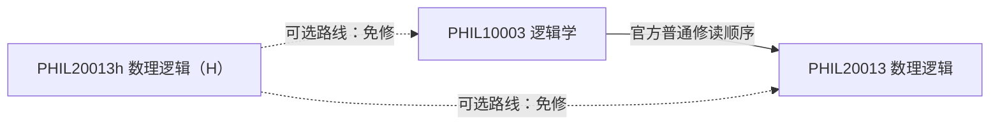

# 哲学系课程关系图谱

节点完整覆盖2025秋、2026春哲学学院267个开课代码；2026培养方案和2026版手册用于补充关联与限定规则，不代表全历史开课目录。

覆盖全部267个课程代码（253个去重名称），按12个主题导航。每条关系都有类型、解释和来源定位。**目前确认的正式先修边为0条，表示逐班正式要求尚未核实，不表示这些课程没有先修。**

- [离线交互图谱](index.html)：下载本目录，打开index.html，可搜索名称/代码/教师、按主题和关系类型筛选，点击课程查看相邻关系。HTML内嵌完整数据，不需联网。GitHub会显示HTML源码，可下载后打开。
- [完整图数据](graph.json)、[节点表](nodes.csv)、[关系表](edges.csv)、[来源索引](sources.json)、[审计记录](audit.json)。

## 关系怎么读

| 类型 | 箭头含义 | 依据与适用边界 |
| --- | --- | --- |
| 正式先修 | 先修课程 → 后续课程 | 本批未确认，不自动生成 |
| 官方修读顺序 | 官方安排先读 → 后读 | 2026手册第18页，限相应年级和方案；不是选课拦截条件 |
| 建议先学 | 有帮助的基础 → 专题/进阶 | 编辑根据课名及知识结构整理，需当期大纲复核 |
| 内容联系 | 无方向 | 共用主题、经典文本、方法或交叉问题；不是学分互认 |
| 普通/H、同名异码 | 无方向 | 作为检索关联，课程代码、层次和教师分别保留 |
| 官方免修方向 | 已修替代课 → 被免修课 | 2026哲学专业H逻辑路线的特定规则 |

## 官方逻辑修读路线

2026版手册第18页明确普通路线与可选H路线：普通路线先逻辑学，再数理逻辑；数学基础较好者可在大一上选数理逻辑（H），并免修前两门普通课程。适用2026哲学专业相关方案；不倒推2025级规则。



## 建议学习路径

以下图中虚线箭头是**学习建议**，不表示已取得正式先修证据；逻辑学到数理逻辑的实线单独标为官方普通路线。正文路径保留具体代码，普通/H与本科/研究生课程不会自动合并。

### 中国哲学史的时间脉络


### 逻辑训练的学习阶梯


### 模型论的工具准备


### 集合论的进阶准备


### 梵语连续学习


### 梵语连续学习（GESF代码）


### 西方艺术史的时间脉络


### 中国艺术史的时间脉络


### 西方哲学概览到德国古典专题


### 德国古典哲学到黑格尔文本


### 欧陆哲学到现象学专题


### 分析哲学到原著研究


### 伦理学基础到规范与应用


### 中国古典文本的阅读工具


### 儒家典籍的递进阅读


### 宋明哲学到理学原著


### 宋明哲学到阳明原著


### 宗教学概览到比较研究


### 佛教思想到经典与历史


### 基督教概览到经典研究

```mermaid
flowchart LR
  PHIL30009["PHIL30009 基督教哲学"]
  PHIL30154["PHIL30154 圣经学概论"]
  PHIL70009["PHIL70009 基督教原著选读"]
  PHIL30009 -.->|"建议先学"| PHIL30154
  PHIL30154 -.->|"建议先学"| PHIL70009
```

### 科学哲学到原著与专题

```mermaid
flowchart LR
  PHIL20004["PHIL20004 科学哲学"]
  PHIL40033["PHIL40033 科学哲学原著选读"]
  PHIL60074["PHIL60074 科学哲学原著精读"]
  PHIL50029["PHIL50029 科学解释研究"]
  PHIL20004 -.->|"建议先学"| PHIL40033
  PHIL40033 -.->|"建议先学"| PHIL60074
  PHIL60074 -.->|"建议先学"| PHIL50029
```

### 美学基础到原著与批评

```mermaid
flowchart LR
  PHIL30052["PHIL30052 美学与艺术哲学基础"]
  PHIL30074["PHIL30074 美学原著选读"]
  PHIL30151["PHIL30151 艺术理论原著选读"]
  PHIL40002["PHIL40002 现代艺术理论与批评"]
  PHIL30052 -.->|"建议先学"| PHIL30074
  PHIL30074 -.->|"建议先学"| PHIL30151
  PHIL30151 -.->|"建议先学"| PHIL40002
```

### 马克思主义基础到原著

```mermaid
flowchart LR
  PHIL20003["PHIL20003 马克思主义哲学导论"]
  PHIL30099["PHIL30099 马克思主义哲学史"]
  PHIL60005["PHIL60005 马克思主义哲学原著选读"]
  PHIL40029["PHIL40029 马克思《1844年经济学哲学手稿》"]
  PHIL20003 -.->|"建议先学"| PHIL30099
  PHIL30099 -.->|"建议先学"| PHIL60005
  PHIL60005 -.->|"建议先学"| PHIL40029
```

### 西方马克思主义到批判理论

```mermaid
flowchart LR
  PHIL30051["PHIL30051 西方马克思主义哲学"]
  PHIL30057["PHIL30057 西方马克思主义原著选读"]
  PHIL30058["PHIL30058 社会批判理论"]
  PHIL60090["PHIL60090 法兰克福学派批判理论专题研究"]
  PHIL70118["PHIL70118 西方马克思主义原著精读（《否定辩证法》）"]
  PHIL30051 -.->|"建议先学"| PHIL30057
  PHIL30057 -.->|"建议先学"| PHIL30058
  PHIL30058 -.->|"建议先学"| PHIL60090
  PHIL60090 -.->|"建议先学"| PHIL70118
```

### 写作训练到论文实践

```mermaid
flowchart LR
  PHIL20018["PHIL20018 哲学阅读和写作"]
  PHIL40036["PHIL40036 学术规范与写作"]
  PHIL30004["PHIL30004 学年论文"]
  PHIL40008["PHIL40008 毕业论文"]
  PHIL20018 -.->|"建议先学"| PHIL40036
  PHIL40036 -.->|"建议先学"| PHIL30004
  PHIL30004 -.->|"建议先学"| PHIL40008
```

### 研究生论文训练

```mermaid
flowchart LR
  PHIL40036["PHIL40036 学术规范与写作"]
  PHIL70088["PHIL70088 研究生学位论文研讨课"]
  PHIL70127["PHIL70127 论文研讨独立课程"]
  PHIL40036 -.->|"建议先学"| PHIL70088
  PHIL70088 -.->|"建议先学"| PHIL70127
```

### 中级古希腊语的连续文本训练

```mermaid
flowchart LR
  PHIL70074["PHIL70074 中级古希腊语：哲学文本阅读"]
  PHIL70077["PHIL70077 中级古希腊语：哲学文本阅读（下）"]
  PHIL70074 -.->|"建议先学"| PHIL70077
```

## 跨主题内容桥梁

| 课程A | 课程B | 联系 |
| --- | --- | --- |
| 科学哲学（PHIL20004） | 知识论（PHIL30054） | 科学解释与知识正当性的交叉问题 |
| 心灵哲学（PHIL30022） | 神经伦理学（PHIL30115） | 心智/神经研究与伦理评价的交叉 |
| 政治哲学（PHIL30024） | 伦理学基础（PHIL20012） | 正义、权利与规范理由的交叉 |
| 佛教哲学（PHIL30011） | 印度哲学选读（PHIL30147） | 佛教与印度哲学的思想语境 |
| 基督教哲学（PHIL30009） | 中世纪哲学原著选读（PHIL30065） | 基督教哲学与中世纪哲学文本 |
| 德国古典哲学（PHIL20011） | 西方马克思主义哲学（PHIL30051） | 德国哲学与西方马克思主义的思想背景 |
| 美学与艺术哲学基础（PHIL30052） | 康德《判断力批判》（PHIL60089） | 美学与康德判断力问题的专题联系 |
| 政治哲学（PHIL30024） | 霍布斯论“利维坦”（GECC20041） | 政治哲学与霍布斯经典文本 |
| 政治哲学（PHIL30024） | 卢梭论人类不平等的起源与基础（GECC20037） | 政治哲学与卢梭不平等问题 |
| 政治哲学（PHIL30024） | 《论法的精神》导读（GECC20014） | 政治哲学与法、政体的经典问题 |
| 伦理学基础（PHIL20012） | 《功利主义》研读（GECC20043） | 伦理学与功利主义经典文本 |
| 先秦哲学（PHIL20014） | 《荀子》导读（GECC20012） | 先秦哲学与荀子经典文本 |
| 印度佛教哲学（PHIL30028） | 梵语Ⅰ（GESF40004） | 梵语是印度佛教文献研究的一种语言工具；不表示本课必须掌握梵语 |
| 中国哲学史料学（PHIL30023） | 中国经学史（PHIL70035） | 史料研读与经学历史研究的工具联系 |
| 技术哲学（PHIL30013） | 科技伦理专题（PHIL60058） | 技术议题与科技伦理评价的联系 |

## 数据、来源与更新

- [学院2026版课程学习手册](https://philosophy.fudan.edu.cn/_upload/article/files/98/2a/cd8af1f746e3ac12a137bbcfaffe/43d2a51a-eb21-4991-925c-26bb8fde30f4.pdf)：PDF共235页，页码从1开始。来源于[学院培养栏目](https://philosophy.fudan.edu.cn/py/list.htm)的2026-09-23条目，2026-11-19核对。只记录所用规则及来源，不复制完整手册。
- [本批267代码与教学班记录](../summaries/courses.json)、[18份培养方案课程索引](../official/programme-courses.json)。培养方案索引3327条的建议学期均为空或null；不据此编造修读先后。
- 内容主题星形索引使用正式课名进行导航匹配，完整保留推断标记。主题连线不意味着任意两门课程内容等价；未核对的逐周内容和先修字段保留待查。
- 手册第181、183、186、189、192页的“先修课程不作要求”针对微专业整体准入，不当作267门课均无先修的证据。
- 后续接入检索时以课程代码为主键；按kind和authority过滤。需要严格先修查询时仅允许kind=formal_prerequisite；本批该查询应返回“待核实”，不能用建议边替代。
- 新增硬性先修要求必须带具体教学班/学期、官方大纲或教务规则、页码/字段路径及确认日期。H班替代条款需要完整保留适用专业和年级。
- 生成命令：在本院系目录执行 `python 课程关系图谱/build_graph.py`（标准库；维护源数据见脚本说明）。

## 当前数量

- 节点：267；关系：396；主题：12。
- 官方修读顺序：1。
- 官方免修方向：2。
- 建议先学：78。
- 内容联系：291。
- 普通/H关联：10。
- 同名异码关联：14。
