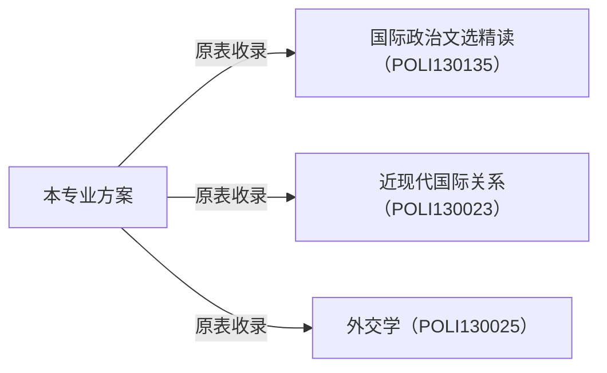

# 国际政治专业“2+X”教学培养方案

2023 年度汇编，方案正文印刷页 295–298。本页附上原书 PDF 第 307–314 页，其中含本专业紧随正文的各版修读建议。逐行数据覆盖可可靠对应课号和名称的原表记录。[方案原页](original-pages.pdf) · [完整原版](https://jwc.fudan.edu.cn/_upload/article/files/83/6c/8a3c080c4f8991024f4b59ad4f1b/64d23c13-0465-4619-bd18-9e491594f850.pdf#page=307) · [逐行数据与来源](record.json)

## 课程导读

想了解国际政治与外交的课程安排，可以在原表中找到《国际政治文选精读》（`POLI130135`）、《近现代国际关系》（`POLI130023`）、《外交学》（`POLI130025`）。 [原书 PDF 第 307 页](original-pages.pdf#page=1) · [原书 PDF 第 308 页](original-pages.pdf#page=2)

原表把 `POLI130135` 列在第 4 学期，把 `POLI130023` 列在第 3 学期。图中箭头表示本节原表收录该课，图上各课之间没有先修连线。

| 课号 | 课程名称 | 开课学期原文 | PDF 页 |
|---|---|---|---|
| LAWS130061 | 国际法 | 2 | 307 |
| POLI130002 | 当代国际关系 | 4 | 308 |
| POLI130003 | 西方政治学说史 | 3 | 307 |
| POLI130004 | 西方经济学基础 | 3 | 307 |
| POLI130005 | 比较政治制度 | 3 | 307 |
| POLI130020 | 社会实践 | 8 | 308 |
| POLI130021 | 毕业论文 | 8 | 308 |
| POLI130022 | 近现代中国对外关系 | 3 | 307 |
| POLI130023 | 近现代国际关系 | 3 | 307 |
| POLI130024 | 当代中国对外关系 | 4 | 308 |
| POLI130025 | 外交学 | 5 | 308 |
| POLI130026 | 西方国际关系理论 | 4 | 308 |
| POLI130027 | 国际政治经济学 | 6 | 308 |
| POLI130030 | 美国政治与对外关系 | 5 | 308 |
| POLI130032 | 欧盟政治与对外关系 | 6 | 308 |
| POLI130033 | 日本政治与对外关系 | 6 | 308 |
| POLI130063 | 国际组织 | 7 | 308 |
| POLI130135 | 国际政治文选精读 | 4 | 308 |
| POLI130138 | 跨文化与国际交流 | 5 | 308 |
| POLI130149 | 定性研究方法 | 4 | 308 |
| POLI130173 | 定量研究方法 | 3 | 307 |

可定位的课程对暂无明确先修记录，原课程表及备注见上方 PDF。
