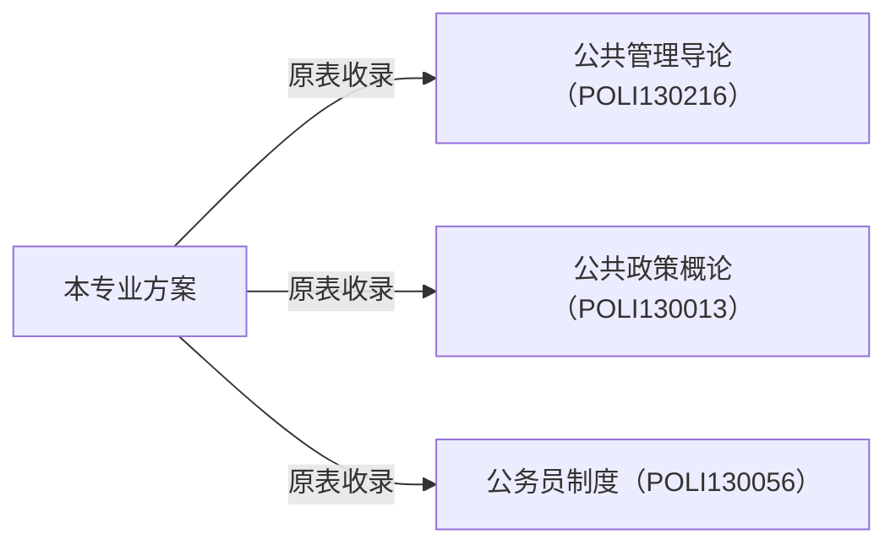

# 行政管理专业“2+X”教学培养方案

2023 年度汇编，方案正文印刷页 303–305。本页附上原书 PDF 第 315–321 页，其中含本专业紧随正文的各版修读建议。逐行数据覆盖可可靠对应课号和名称的原表记录。[方案原页](original-pages.pdf) · [完整原版](https://jwc.fudan.edu.cn/_upload/article/files/83/6c/8a3c080c4f8991024f4b59ad4f1b/64d23c13-0465-4619-bd18-9e491594f850.pdf#page=315) · [逐行数据与来源](record.json)

## 课程导读

想了解行政与公共政策的课程安排，可以在原表中找到《公共管理导论》（`POLI130216`）、《公共政策概论》（`POLI130013`）、《公务员制度》（`POLI130056`）。 [原书 PDF 第 315 页](original-pages.pdf#page=1)

其中 `POLI130216` 的开课时间标为第 3 学期。图中箭头表示本节原表收录该课，图上各课之间没有先修连线。

| 课号 | 课程名称 | 开课学期原文 | PDF 页 |
|---|---|---|---|
| POLI130005 | 比较政治制度 | 春秋 | 317 |
| POLI130007 | 中国历代政治与行政 | 春秋 | 317 |
| POLI130012 | 政府经济学 | 4 | 315 |
| POLI130013 | 公共政策概论 | 3 | 315 |
| POLI130014 | 比较地方政府学 | 春秋 | 317 |
| POLI130015 | 中国社会政治分析 | 春秋 | 317 |
| POLI130020 | 社会实践 | 8 | 316 |
| POLI130021 | 毕业论文 | 8 | 316 |
| POLI130048 | 组织行为学 | 5 | 315 |
| POLI130050 | 西方行政学说史 | 6 | 316 |
| POLI130054 | 行政法 | 4 | 315 |
| POLI130056 | 公务员制度 | 3 | 315 |
| POLI130061 | 港台政治与行政 | 春秋 | 317 |
| POLI130063 | 国际组织 | 春秋 | 317 |
| POLI130085 | 比较公共行政 | 春秋 | 317 |
| POLI130098 | 基层政治与地方治理 | 春秋 | 317 |
| POLI130113 | 公共事业管理 | 4 | 315 |
| POLI130124 | 当代中国公共行政 | 5 | 316 |
| POLI130127 | 公共行政经典选读 | 春秋 | 317 |
| POLI130140 | 公共危机管理 | 5 | 316 |
| POLI130145 | 跨国公司与国际关系 | 春秋 | 317 |
| POLI130147 | 电子治理 | 5 | 316 |
| POLI130149 | 定性研究方法 | 4 | 315 |
| POLI130150 | 公共政策分析方法 | 6 | 316 |
| POLI130153 | 比较政治学导论 | 春秋 | 317 |
| POLI130173 | 定量研究方法 | 3 | 315 |
| POLI130175 | 公共管理伦理 | 6 | 316 |
| POLI130193 | 中国社会 | 春秋 | 317 |
| POLI130216 | 公共管理导论 | 3 | 315 |
| POLI130231 | 当代中国政府治理 | 春秋 | 317 |

可定位的课程对暂无明确先修记录，原课程表及备注见上方 PDF。
