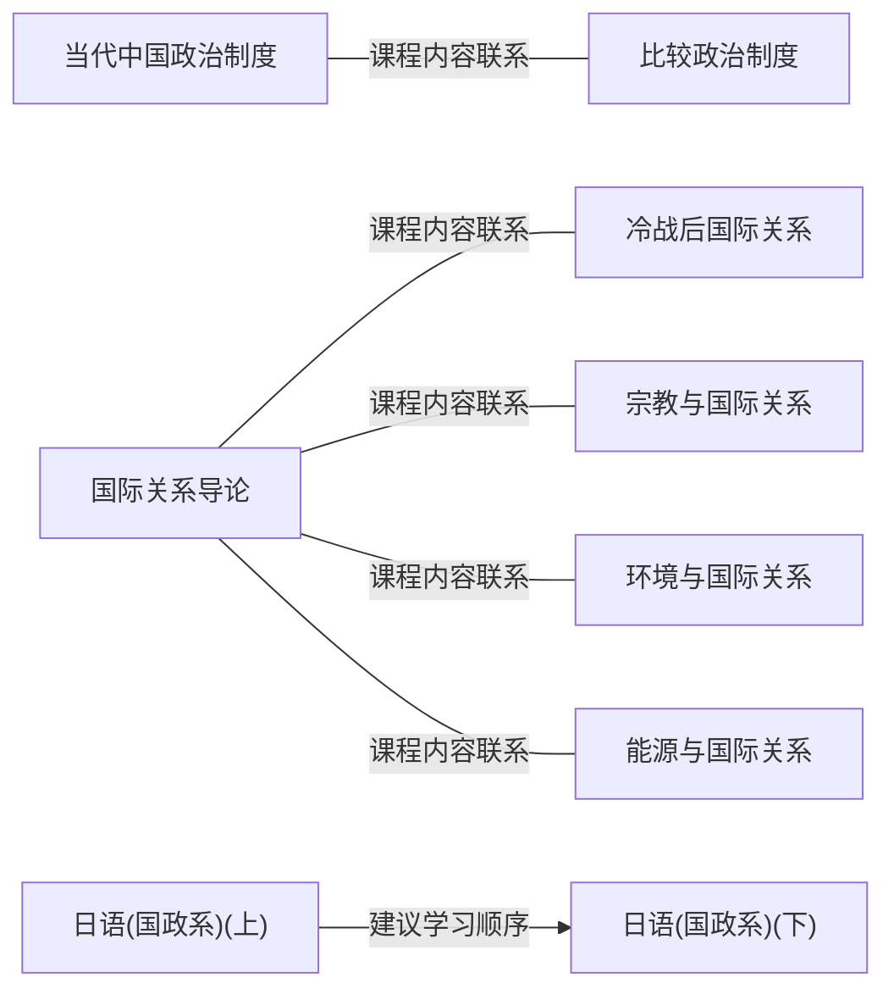

# 2024国际政治专业“2+X”教学培养方案（留学生适用）

国际关系与公共事务学院 · 国际政治 · 方案 72762 · 79 个不同课程或科研条目。

[官方 Word](../originals/plan-72762.docx) · [教务详情](https://fdjwgl.fudan.edu.cn/manager/bizType/2/major-program-search/info/72762?skipAuth=1) · [方案快照](../raw/plan-72762.json.gz) · [年级目录](../README.md)

## 课程关系图

图中展示部分关系。下表保留全部已建立的课程对，来源位置使用本方案 JSON Pointer。

## 先修与内容联系

| 类型 | 起点 | 终点 | 依据 | 原表定位 |
| --- | --- | --- | --- | --- |
| 建议学习顺序 | 国际关系导论 (POLI10008) | 冷战后国际关系 (POLI130190) | “国际关系导论”题名标明基础层次，前置阅读可帮助了解“冷战后国际关系”中的国际关系主题。  | `/courseModules/2/planCourses/9`、`/courseModules/8/planCourses/13` |
| 建议学习顺序 | 国际关系导论 (POLI10008) | 宗教与国际关系 (POLI30039) | “国际关系导论”题名标明基础层次，前置阅读可帮助了解“宗教与国际关系”中的国际关系主题。  | `/courseModules/2/planCourses/9`、`/courseModules/9/planCourses/5` |
| 建议学习顺序 | 国际关系导论 (POLI10008) | 环境与国际关系 (POLI30040) | “国际关系导论”题名标明基础层次，前置阅读可帮助了解“环境与国际关系”中的国际关系主题。  | `/courseModules/2/planCourses/9`、`/courseModules/9/planCourses/6` |
| 建议学习顺序 | 国际关系导论 (POLI10008) | 能源与国际关系 (POLI30048) | “国际关系导论”题名标明基础层次，前置阅读可帮助了解“能源与国际关系”中的国际关系主题。  | `/courseModules/2/planCourses/9`、`/courseModules/9/planCourses/8` |
| 建议学习顺序 | 日语(国政系)(上) (POLI30036) | 日语(国政系)(下) (POLI30037) | 同方案的课程题名具有连续分册或序号。  | `/courseModules/8/planCourses/3`、`/courseModules/8/planCourses/16` |
| 课程内容联系 | 人工智能时代的国际关系 (AIS310011) | 人工智能与国家治理 (AIS310012) | 本方案两门课程的题名均含“人工智能”，可据此对照这一主题。  | `/courseModules/8/planCourses/22`、`/courseModules/9/planCourses/18` |
| 课程内容联系 | 法理学导论 (LAW10004) | 宪法 (LAW10005) | 两课均涉及权利与公共权力的规范依据。  | `/courseModules/2/planCourses/3`、`/courseModules/2/planCourses/12` |
| 课程内容联系 | 国际关系导论 (POLI10008) | 冷战后国际关系 (POLI130190) | 本方案两门课程的题名均含“国际关系”，可据此对照这一主题。  | `/courseModules/2/planCourses/9`、`/courseModules/8/planCourses/13` |
| 课程内容联系 | 国际关系导论 (POLI10008) | 宗教与国际关系 (POLI30039) | 本方案两门课程的题名均含“国际关系”，可据此对照这一主题。  | `/courseModules/2/planCourses/9`、`/courseModules/9/planCourses/5` |
| 课程内容联系 | 国际关系导论 (POLI10008) | 环境与国际关系 (POLI30040) | 本方案两门课程的题名均含“国际关系”，可据此对照这一主题。  | `/courseModules/2/planCourses/9`、`/courseModules/9/planCourses/6` |
| 课程内容联系 | 国际关系导论 (POLI10008) | 能源与国际关系 (POLI30048) | 本方案两门课程的题名均含“国际关系”，可据此对照这一主题。  | `/courseModules/2/planCourses/9`、`/courseModules/9/planCourses/8` |
| 课程内容联系 | 当代中国政治制度 (POLI10009) | 比较政治制度 (POLI20022) | 均涉及政治制度，可对照制度安排与研究对象。  | `/courseModules/2/planCourses/15`、`/courseModules/3/planCourses/5` |

本次未从可定位的明确表述中确认课程对课程预修。学期安排、系列分册与编辑建议均保留各自的依据。

## 课程表

同一课程在不同模块分别出现时，按原表逐行列出。季节字段保留原值。

| 课程 | 代码 | 学分 | 学期 | 模块 |
| --- | --- | ---: | --- | --- |
| 高等数学D | MATH10008 | 4.0 | SPRING、AUTUMN | 培养方案 / 专业培养课程 / 大类基础课程 |
| 政治学原理 | POLI10007 | 3.0 | SPRING、AUTUMN | 培养方案 / 专业培养课程 / 大类基础课程 |
| 社会学导论 | SOCI20001 | 3.0 | SPRING、AUTUMN | 培养方案 / 专业培养课程 / 大类基础课程 |
| 法理学导论 | LAW10004 | 3.0 | SPRING、AUTUMN | 培养方案 / 专业培养课程 / 大类基础课程 |
| 微观经济学 | ECON20003 | 3.0 | SPRING、AUTUMN | 培养方案 / 专业培养课程 / 大类基础课程 |
| 宏观经济学 | ECON20004 | 3.0 | SPRING、AUTUMN | 培养方案 / 专业培养课程 / 大类基础课程 |
| 经济学原理 | ECON20005 | 3.0 | SPRING、AUTUMN | 培养方案 / 专业培养课程 / 大类基础课程 |
| 社会研究方法A | SOCI20002 | 3.0 | SPRING、AUTUMN | 培养方案 / 专业培养课程 / 大类基础课程 |
| 社会研究方法B | MSE30029 | 3.0 | SPRING、AUTUMN | 培养方案 / 专业培养课程 / 大类基础课程 |
| 国际关系导论 | POLI10008 | 3.0 | SPRING、AUTUMN | 培养方案 / 专业培养课程 / 大类基础课程 |
| 心理学导论 | PSYC20001 | 3.0 | SPRING、AUTUMN | 培养方案 / 专业培养课程 / 大类基础课程 |
| 管理学导论 | BA10004 | 3.0 | SPRING、AUTUMN | 培养方案 / 专业培养课程 / 大类基础课程 |
| 宪法 | LAW10005 | 3.0 | SPRING、AUTUMN | 培养方案 / 专业培养课程 / 大类基础课程 |
| 统计学 | SOCI20003 | 3.0 | SPRING、AUTUMN | 培养方案 / 专业培养课程 / 大类基础课程 |
| 公共行政学 | MANA10002 | 3.0 | SPRING、AUTUMN | 培养方案 / 专业培养课程 / 大类基础课程 |
| 当代中国政治制度 | POLI10009 | 3.0 | SPRING、AUTUMN | 培养方案 / 专业培养课程 / 大类基础课程 |
| 国际法 | LAW20005 | 3.0 | 第2学期 | 培养方案 / 专业培养课程 / 专业核心教育课程 |
| 当代国际关系 | POLI130002 | 3.0 | 第4学期 | 培养方案 / 专业培养课程 / 专业核心教育课程 |
| 当代国际关系 | POLI20012 | 3.0 | 第4学期 | 培养方案 / 专业培养课程 / 专业核心教育课程 |
| 西方政治学说史 | POLI20021 | 3.0 | 第3学期 | 培养方案 / 专业培养课程 / 专业核心教育课程 |
| 西方经济学基础 | POLI10005 | 3.0 | 第3学期 | 培养方案 / 专业培养课程 / 专业核心教育课程 |
| 比较政治制度 | POLI20022 | 3.0 | 第3学期 | 培养方案 / 专业培养课程 / 专业核心教育课程 |
| 社会实践 | POLI40011 | 2.0 | 第8学期 | 培养方案 / 专业培养课程 / 专业核心教育课程 |
| 毕业论文 | POLI40012 | 4.0 | 第8学期 | 培养方案 / 专业培养课程 / 专业核心教育课程 |
| 近现代中国对外关系 | POLI20026 | 3.0 | 第3学期 | 培养方案 / 专业培养课程 / 专业核心教育课程 |
| 近现代国际关系 | POLI20027 | 3.0 | 第3学期 | 培养方案 / 专业培养课程 / 专业核心教育课程 |
| 当代中国对外关系 | POLI130024 | 3.0 | 第4学期 | 培养方案 / 专业培养课程 / 专业核心教育课程 |
| 当代中国对外关系 | POLI20009 | 3.0 | 第4学期 | 培养方案 / 专业培养课程 / 专业核心教育课程 |
| 外交学 | POLI30027 | 2.0 | 第5学期 | 培养方案 / 专业培养课程 / 专业核心教育课程 |
| 西方国际关系理论 | POLI130026 | 2.0 | 第4学期 | 培养方案 / 专业培养课程 / 专业核心教育课程 |
| 国际政治经济学 | POLI130027 | 3.0 | 第6学期 | 培养方案 / 专业培养课程 / 专业核心教育课程 |
| 美国政治与对外关系 | POLI40013 | 2.0 | 第5学期 | 培养方案 / 专业培养课程 / 专业核心教育课程 |
| 欧盟政治与对外关系 | POLI30029 | 2.0 | 第6学期 | 培养方案 / 专业培养课程 / 专业核心教育课程 |
| 日本政治与对外关系 | POLI30030 | 2.0 | 第6学期 | 培养方案 / 专业培养课程 / 专业核心教育课程 |
| 国际组织 | POLI20029 | 2.0 | 第7学期 | 培养方案 / 专业培养课程 / 专业核心教育课程 |
| 定性研究方法 | POLI30053 | 2.0 | 第4学期 | 培养方案 / 专业培养课程 / 专业核心教育课程 |
| 定量研究方法 | POLI30057 | 2.0 | 第3学期 | 培养方案 / 专业培养课程 / 专业核心教育课程 |
| 中国政治与治理 | POLI40030 | 2.0 | SPRING、AUTUMN | 培养方案 / 专业进阶模块Ⅰ |
| 俄罗斯政治与对外关系 | POLI30028 | 2.0 | SPRING、AUTUMN | 培养方案 / 专业进阶模块Ⅰ |
| 比较政党制度 | POLI30034 | 2.0 | SPRING、AUTUMN | 培养方案 / 专业进阶模块Ⅰ |
| 日语(国政系)(上) | POLI30036 | 2.0 | SPRING、AUTUMN | 培养方案 / 专业进阶模块Ⅰ |
| 日本政治与行政 | POLI30041 | 2.0 | SPRING、AUTUMN | 培养方案 / 专业进阶模块Ⅰ |
| 国际谈判 | POLI30043 | 2.0 | SPRING、AUTUMN | 培养方案 / 专业进阶模块Ⅰ |
| 国际谈判 | POLI30018 | 2.0 | SPRING | 培养方案 / 专业进阶模块Ⅰ |
| 东亚政治概论 | POLI30045 | 2.0 | SPRING、AUTUMN | 培养方案 / 专业进阶模块Ⅰ |
| 中国外交文献选读 | POLI30050 | 2.0 | SPRING、AUTUMN | 培养方案 / 专业进阶模块Ⅰ |
| 美国宗教与社会 | POLI30054 | 2.0 | SPRING、AUTUMN | 培养方案 / 专业进阶模块Ⅰ |
| 外交实务 | POLI50010 | 2.0 | SPRING、AUTUMN | 培养方案 / 专业进阶模块Ⅰ |
| 发展中国家政治与对外关系 | POLI40018 | 2.0 | SPRING、AUTUMN | 培养方案 / 专业进阶模块Ⅰ |
| 英文应用文写作 | POLI30056 | 2.0 | SPRING、AUTUMN | 培养方案 / 专业进阶模块Ⅰ |
| 冷战后国际关系 | POLI130190 | 2.0 | SPRING、AUTUMN | 培养方案 / 专业进阶模块Ⅰ |
| 地中海研究导论 | POLI130210 | 2.0 | SPRING、AUTUMN | 培养方案 / 专业进阶模块Ⅰ |
| 东南亚政治与国际关系 | POLI40022 | 2.0 | SPRING、AUTUMN | 培养方案 / 专业进阶模块Ⅰ |
| 日语(国政系)(下) | POLI30037 | 2.0 | SPRING、AUTUMN | 培养方案 / 专业进阶模块Ⅰ |
| 日本与东亚国际关系研究 | POLI40021 | 2.0 | SPRING、AUTUMN | 培养方案 / 专业进阶模块Ⅰ |
| 经济外交 | POLI30049 | 2.0 | SPRING、AUTUMN | 培养方案 / 专业进阶模块Ⅰ |
| 古代中国对外关系 | POLI20032 | 2.0 | SPRING、AUTUMN | 培养方案 / 专业进阶模块Ⅰ |
| 中国涉外法律研究 | POLI30062 | 2.0 | SPRING、AUTUMN | 培养方案 / 专业进阶模块Ⅰ |
| 跨文化与国际交流 | POLI30051 | 2.0 | SPRING、AUTUMN | 培养方案 / 专业进阶模块Ⅰ |
| 人工智能时代的国际关系 | AIS310011 | 3.0 | SPRING、AUTUMN | 培养方案 / 专业进阶模块Ⅰ |
| 中国政治与治理 | POLI40030 | 2.0 | SPRING、AUTUMN | 培养方案 / 专业进阶模块Ⅱ |
| 全球卫生与国际关系 | POLI30063 | 2.0 | SPRING、AUTUMN | 培养方案 / 专业进阶模块Ⅱ |
| 国际安全与军备控制 | POLI130028 | 2.0 | SPRING、AUTUMN | 培养方案 / 专业进阶模块Ⅱ |
| 专题阅读讨论 | POLI40014 | 2.0 | SPRING、AUTUMN | 培养方案 / 专业进阶模块Ⅱ |
| 亚太地区政治与经济 | POLI30035 | 2.0 | SPRING、AUTUMN | 培养方案 / 专业进阶模块Ⅱ |
| 宗教与国际关系 | POLI30039 | 2.0 | SPRING、AUTUMN | 培养方案 / 专业进阶模块Ⅱ |
| 环境与国际关系 | POLI30040 | 2.0 | SPRING、AUTUMN | 培养方案 / 专业进阶模块Ⅱ |
| 大众传媒与外交 | POLI30042 | 2.0 | SPRING、AUTUMN | 培养方案 / 专业进阶模块Ⅱ |
| 能源与国际关系 | POLI30048 | 2.0 | SPRING、AUTUMN | 培养方案 / 专业进阶模块Ⅱ |
| 贸易与国际关系 | POLI30052 | 2.0 | SPRING、AUTUMN | 培养方案 / 专业进阶模块Ⅱ |
| 中国与全球治理 | POLI40019 | 2.0 | SPRING、AUTUMN | 培养方案 / 专业进阶模块Ⅱ |
| 国际发展 | POLI130188 | 3.0 | SPRING、AUTUMN | 培养方案 / 专业进阶模块Ⅱ |
| 国际发展 | POLI30003 | 2.0 | SPRING | 培养方案 / 专业进阶模块Ⅱ |
| 中东政治 | POLI130214 | 2.0 | SPRING、AUTUMN | 培养方案 / 专业进阶模块Ⅱ |
| 中东政治与对外关系 | POLI20017 | 2.0 | SPRING、AUTUMN | 培养方案 / 专业进阶模块Ⅱ |
| 国际秩序与国际规范 | POLI40023 | 2.0 | SPRING、AUTUMN | 培养方案 / 专业进阶模块Ⅱ |
| 中美关系与亚洲的崛起 | POLI40015 | 2.0 | SPRING、AUTUMN | 培养方案 / 专业进阶模块Ⅱ |
| 网络安全与国际关系 | POLI30060 | 2.0 | SPRING、AUTUMN | 培养方案 / 专业进阶模块Ⅱ |
| 人工智能与国家治理 | AIS310012 | 2.0 | SPRING、AUTUMN | 培养方案 / 专业进阶模块Ⅱ |
| AI赋能的政务服务再造 | AIT531018 | 3.0 | SPRING、AUTUMN | 培养方案 / 专业进阶模块Ⅱ |
