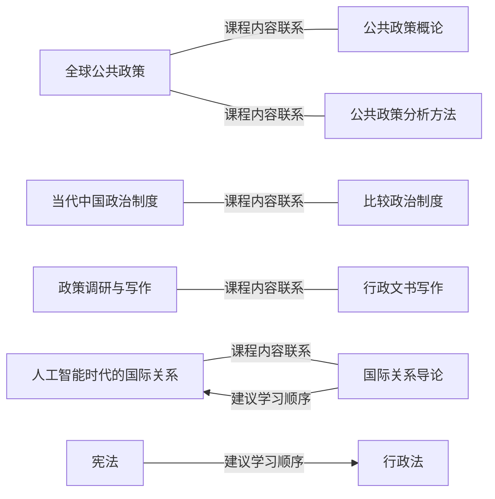

# 2024行政管理专业“2+X”教学培养方案（普通学生适用）

国际关系与公共事务学院 · 行政管理 · 方案 72763 · 85 个不同课程或科研条目。

[官方 Word](../originals/plan-72763.docx) · [教务详情](https://fdjwgl.fudan.edu.cn/manager/bizType/2/major-program-search/info/72763?skipAuth=1) · [方案快照](../raw/plan-72763.json.gz) · [年级目录](../README.md)

## 修读导读

- **建议先学**　《宪法》（`LAW10005`） → 《行政法》（`POLI30032`）。对国家机构与公权力结构的认识可帮助理解行政法律关系。

- **可以对照着读**　《当代中国政治制度》（`POLI10009`）与《比较政治制度》（`POLI20022`）。均涉及政治制度，可对照制度安排与研究对象。

- **查模块选课**　《公共政策概论》（`POLI10006`）、《公务员制度》（`MANA30011`）列在“专业核心教育课程”中。原表见 `/courseModules/3`。

## 课程关系图

图中展示部分关系。下表保留全部已建立的课程对，来源位置使用本方案 JSON Pointer。

## 先修与内容联系

| 类型 | 起点 | 终点 | 依据 | 原表定位 |
| --- | --- | --- | --- | --- |
| 建议学习顺序 | 宪法 (LAW10005) | 行政法 (POLI30032) | 对国家机构与公权力结构的认识可帮助理解行政法律关系。  | `/courseModules/2/planCourses/3`、`/courseModules/3/planCourses/5` |
| 建议学习顺序 | 国际关系导论 (POLI10008) | 人工智能时代的国际关系 (AIS310011) | “国际关系导论”题名标明基础层次，前置阅读可帮助了解“人工智能时代的国际关系”中的国际关系主题。  | `/courseModules/2/planCourses/12`、`/courseModules/9/planCourses/17` |
| 课程内容联系 | 人工智能时代的国际关系 (AIS310011) | 人工智能与国家治理 (AIS310012) | 本方案两门课程的题名均含“人工智能”，可据此对照这一主题。  | `/courseModules/9/planCourses/17`、`/courseModules/9/planCourses/16` |
| 课程内容联系 | 人工智能时代的国际关系 (AIS310011) | 国际关系导论 (POLI10008) | 本方案两门课程的题名均含“国际关系”，可据此对照这一主题。  | `/courseModules/9/planCourses/17`、`/courseModules/2/planCourses/12` |
| 课程内容联系 | 政策调研与写作 (GEXZ10024) | 行政文书写作 (MANA20010) | 本方案两门课程的题名均含“写作”，可据此对照这一主题。  | `/courseModules/8/planCourses/26`、`/courseModules/8/planCourses/8` |
| 课程内容联系 | 法理学导论 (LAW10004) | 宪法 (LAW10005) | 两课均涉及权利与公共权力的规范依据。  | `/courseModules/2/planCourses/7`、`/courseModules/2/planCourses/3` |
| 课程内容联系 | 全球公共政策 (MANA30002) | 公共政策概论 (POLI10006) | 本方案两门课程的题名均含“公共政策”，可据此对照这一主题。  | `/courseModules/9/planCourses/21`、`/courseModules/3/planCourses/0` |
| 课程内容联系 | 全球公共政策 (MANA30002) | 公共政策分析方法 (POLI130150) | 本方案两门课程的题名均含“公共政策”，可据此对照这一主题。  | `/courseModules/9/planCourses/21`、`/courseModules/3/planCourses/14` |
| 课程内容联系 | 当代中国政治制度 (POLI10009) | 比较政治制度 (POLI20022) | 均涉及政治制度，可对照制度安排与研究对象。  | `/courseModules/2/planCourses/10`、`/courseModules/9/planCourses/6` |

本次未从可定位的明确表述中确认课程对课程预修。学期安排、系列分册与编辑建议均保留各自的依据。

## 课程表

同一课程在不同模块分别出现时，按原表逐行列出。季节字段保留原值。

| 课程 | 代码 | 学分 | 学期 | 模块 |
| --- | --- | ---: | --- | --- |
| 社会学导论 | SOCI20001 | 3.0 | SPRING、AUTUMN | 培养方案 / 专业培养课程 / 大类基础课程 |
| 微观经济学 | ECON20003 | 3.0 | SPRING、AUTUMN | 培养方案 / 专业培养课程 / 大类基础课程 |
| 社会研究方法B | MSE30029 | 3.0 | SPRING、AUTUMN | 培养方案 / 专业培养课程 / 大类基础课程 |
| 宪法 | LAW10005 | 3.0 | SPRING、AUTUMN | 培养方案 / 专业培养课程 / 大类基础课程 |
| 高等数学D | MATH10008 | 4.0 | SPRING、AUTUMN | 培养方案 / 专业培养课程 / 大类基础课程 |
| 政治学原理 | POLI10007 | 3.0 | SPRING、AUTUMN | 培养方案 / 专业培养课程 / 大类基础课程 |
| 宏观经济学 | ECON20004 | 3.0 | SPRING、AUTUMN | 培养方案 / 专业培养课程 / 大类基础课程 |
| 法理学导论 | LAW10004 | 3.0 | SPRING、AUTUMN | 培养方案 / 专业培养课程 / 大类基础课程 |
| 统计学 | SOCI20003 | 3.0 | SPRING、AUTUMN | 培养方案 / 专业培养课程 / 大类基础课程 |
| 公共行政学 | MANA10002 | 3.0 | SPRING、AUTUMN | 培养方案 / 专业培养课程 / 大类基础课程 |
| 当代中国政治制度 | POLI10009 | 3.0 | SPRING、AUTUMN | 培养方案 / 专业培养课程 / 大类基础课程 |
| 社会研究方法A | SOCI20002 | 3.0 | SPRING、AUTUMN | 培养方案 / 专业培养课程 / 大类基础课程 |
| 国际关系导论 | POLI10008 | 3.0 | SPRING、AUTUMN | 培养方案 / 专业培养课程 / 大类基础课程 |
| 心理学导论 | PSYC20001 | 3.0 | SPRING、AUTUMN | 培养方案 / 专业培养课程 / 大类基础课程 |
| 公共政策概论 | POLI10006 | 3.0 | 第3学期 | 培养方案 / 专业培养课程 / 专业核心教育课程 |
| 公务员制度 | MANA30011 | 2.0 | 第3学期 | 培养方案 / 专业培养课程 / 专业核心教育课程 |
| 定量研究方法 | POLI30057 | 2.0 | 第3学期 | 培养方案 / 专业培养课程 / 专业核心教育课程 |
| 公共管理导论 | MANA20013 | 3.0 | 第3学期 | 培养方案 / 专业培养课程 / 专业核心教育课程 |
| 政府经济学 | POLI30025 | 3.0 | 第4学期 | 培养方案 / 专业培养课程 / 专业核心教育课程 |
| 行政法 | POLI30032 | 3.0 | 第4学期 | 培养方案 / 专业培养课程 / 专业核心教育课程 |
| 公共事业管理 | POLI20031 | 2.0 | 第4学期 | 培养方案 / 专业培养课程 / 专业核心教育课程 |
| 定性研究方法 | POLI30053 | 2.0 | 第4学期 | 培养方案 / 专业培养课程 / 专业核心教育课程 |
| 组织行为学 | POLI30031 | 2.0 | 第5学期 | 培养方案 / 专业培养课程 / 专业核心教育课程 |
| 当代中国公共行政 | POLI30047 | 3.0 | 第5学期 | 培养方案 / 专业培养课程 / 专业核心教育课程 |
| 公共危机管理 | MANA30013 | 2.0 | 第5学期 | 培养方案 / 专业培养课程 / 专业核心教育课程 |
| 电子治理 | MANA20012 | 2.0 | 第5学期 | 培养方案 / 专业培养课程 / 专业核心教育课程 |
| 数字治理 | MANA20004 | 2.0 | 第5学期 | 培养方案 / 专业培养课程 / 专业核心教育课程 |
| 西方行政学说史 | MANA20009 | 2.0 | 第6学期 | 培养方案 / 专业培养课程 / 专业核心教育课程 |
| 公共政策分析方法 | POLI130150 | 3.0 | 第6学期 | 培养方案 / 专业培养课程 / 专业核心教育课程 |
| 公共管理伦理 | POLI30058 | 2.0 | 第6学期 | 培养方案 / 专业培养课程 / 专业核心教育课程 |
| 社会实践 | POLI40011 | 2.0 | 第8学期 | 培养方案 / 专业培养课程 / 专业核心教育课程 |
| 毕业论文 | POLI40012 | 4.0 | 第8学期 | 培养方案 / 专业培养课程 / 专业核心教育课程 |
| 中国政治与治理 | POLI40030 | 2.0 | SPRING、AUTUMN | 培养方案 / 专业进阶模块I |
| 当代中国政府治理 | POLI40024 | 3.0 | SPRING、AUTUMN | 培养方案 / 专业进阶模块I |
| 跨文化与国际交流 | POLI30051 | 2.0 | SPRING、AUTUMN | 培养方案 / 专业进阶模块I |
| 中国社会政治分析 | POLI20025 | 3.0 | SPRING、AUTUMN | 培养方案 / 专业进阶模块I |
| 国际政治经济学 | POLI130027 | 3.0 | SPRING、AUTUMN | 培养方案 / 专业进阶模块I |
| 国际政治经济学 | POLI30016 | 2.0 | SPRING | 培养方案 / 专业进阶模块I |
| 公共关系学 | MANA20008 | 2.0 | SPRING、AUTUMN | 培养方案 / 专业进阶模块I |
| 人力资源开发与管理 | POLI20028 | 2.0 | SPRING、AUTUMN | 培养方案 / 专业进阶模块I |
| 行政文书写作 | MANA20010 | 2.0 | SPRING、AUTUMN | 培养方案 / 专业进阶模块I |
| 当代中国公共政策 | MANA20011 | 2.0 | SPRING、AUTUMN | 培养方案 / 专业进阶模块I |
| 当代中国公共政策 | MANA20003 | 3.0 | SPRING、AUTUMN | 培养方案 / 专业进阶模块I |
| 公共部门绩效评估 | MANA40006 | 2.0 | SPRING、AUTUMN | 培养方案 / 专业进阶模块I |
| 非政府组织 | POLI130142 | 2.0 | SPRING、AUTUMN | 培养方案 / 专业进阶模块I |
| 中国公共管理前沿问题研究 | MANA40007 | 2.0 | SPRING、AUTUMN | 培养方案 / 专业进阶模块I |
| 量化研究设计与实践 | POLI20033 | 2.0 | SPRING、AUTUMN | 培养方案 / 专业进阶模块I |
| 环境政策与管理 | MANA30015 | 2.0 | SPRING、AUTUMN | 培养方案 / 专业进阶模块I |
| 地理信息系统与空间分析 | POLI30061 | 2.0 | SPRING、AUTUMN | 培养方案 / 专业进阶模块I |
| AI赋能的政务服务再造 | AIT531018 | 3.0 | SPRING、AUTUMN | 培养方案 / 专业进阶模块I |
| 公共管理 | MANA20002 | 3.0 |  | 培养方案 / 专业进阶模块I |
| 政府运行保障管理 | MANA30005 | 3.0 |  | 培养方案 / 专业进阶模块I |
| 产业经济学概论 | GEEC10226 | 2.0 | SPRING、AUTUMN | 培养方案 / 专业进阶模块I |
| 城市治理 | POLI40007 | 2.0 | SPRING、AUTUMN | 培养方案 / 专业进阶模块I |
| 公共卫生政策 | MANA30003 | 2.0 | SPRING、AUTUMN | 培养方案 / 专业进阶模块I |
| 环境政策 | MANA30008 | 2.0 | SPRING、AUTUMN | 培养方案 / 专业进阶模块I |
| 人口与社会保障经济学 | ECON30077 | 2.0 | SPRING、AUTUMN | 培养方案 / 专业进阶模块I |
| 田野调查方法 | POLI40001 | 2.0 | SPRING、AUTUMN | 培养方案 / 专业进阶模块I |
| 政策调研与写作 | GEXZ10024 | 2.0 | SPRING、AUTUMN | 培养方案 / 专业进阶模块I |
| 政策推演与模拟 | POLI30011 | 2.0 | SPRING、AUTUMN | 培养方案 / 专业进阶模块I |
| 政府财政与预算 | MANA30004 | 3.0 | SPRING、AUTUMN | 培养方案 / 专业进阶模块I |
| 政府监管理论与实践 | MANA70007 | 2.0 | SPRING、AUTUMN | 培养方案 / 专业进阶模块I |
| 中国政治与治理 | POLI40030 | 2.0 | SPRING、AUTUMN | 培养方案 / 专业进阶模块II |
| 公共数据利用与治理 | POLI40029 | 2.0 | SPRING、AUTUMN | 培养方案 / 专业进阶模块II |
| 当代中国政府治理 | POLI40024 | 3.0 | SPRING、AUTUMN | 培养方案 / 专业进阶模块II |
| 基层政治与地方治理 | POLI30044 | 2.0 | SPRING、AUTUMN | 培养方案 / 专业进阶模块II |
| 地方政府与治理 | POLI30001 | 2.0 | SPRING | 培养方案 / 专业进阶模块II |
| 中国社会政治分析 | POLI20025 | 3.0 | SPRING、AUTUMN | 培养方案 / 专业进阶模块II |
| 比较政治制度 | POLI20022 | 3.0 | SPRING、AUTUMN | 培养方案 / 专业进阶模块II |
| 中国历代政治与行政 | POLI20023 | 3.0 | SPRING、AUTUMN | 培养方案 / 专业进阶模块II |
| 比较地方政府学 | POLI30026 | 3.0 | SPRING、AUTUMN | 培养方案 / 专业进阶模块II |
| 港台政治与行政 | POLI30033 | 2.0 | SPRING、AUTUMN | 培养方案 / 专业进阶模块II |
| 国际组织 | POLI20029 | 2.0 | SPRING、AUTUMN | 培养方案 / 专业进阶模块II |
| 比较公共行政 | MANA50002 | 2.0 | SPRING、AUTUMN | 培养方案 / 专业进阶模块II |
| 比较政治学导论 | POLI40017 | 2.0 | SPRING、AUTUMN | 培养方案 / 专业进阶模块II |
| 中国社会 | POLI40020 | 3.0 | SPRING、AUTUMN | 培养方案 / 专业进阶模块II |
| 城乡公共治理导论 | MANA30016 | 2.0 | SPRING、AUTUMN | 培养方案 / 专业进阶模块II |
| 公共科技政策 | POLI40031 | 2.0 | SPRING、AUTUMN | 培养方案 / 专业进阶模块II |
| 人工智能与国家治理 | AIS310012 | 2.0 | SPRING、AUTUMN | 培养方案 / 专业进阶模块II |
| 人工智能时代的国际关系 | AIS310011 | 3.0 | SPRING、AUTUMN | 培养方案 / 专业进阶模块II |
| 城乡治理理论与实践 | MANA20001 | 2.0 | SPRING、AUTUMN | 培养方案 / 专业进阶模块II |
| 发展经济学 | ECON30026 | 3.0 | SPRING、AUTUMN | 培养方案 / 专业进阶模块II |
| 国际公共行政 | POLI30005 | 2.0 | SPRING、AUTUMN | 培养方案 / 专业进阶模块II |
| 全球公共政策 | MANA30002 | 2.0 | SPRING、AUTUMN | 培养方案 / 专业进阶模块II |
| 社会政策与社会治理 | MANA30007 | 2.0 | SPRING、AUTUMN | 培养方案 / 专业进阶模块II |
| 行政与外交文书 | POLI20010 | 2.0 | SPRING、AUTUMN | 培养方案 / 专业进阶模块II |
| 运筹学 | CS30035 | 3.0 | SPRING、AUTUMN | 培养方案 / 专业进阶模块II |
| 制度分析 | POLI30012 | 2.0 | SPRING、AUTUMN | 培养方案 / 专业进阶模块II |
