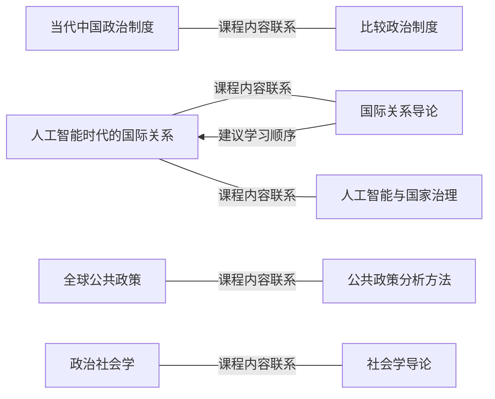

# 2024政治学与行政学专业“2+X”教学培养方案（普通学生适用）

国际关系与公共事务学院 · 政治学与行政学 · 方案 72764 · 98 个不同课程或科研条目。

[官方 Word](../originals/plan-72764.docx) · [教务详情](https://fdjwgl.fudan.edu.cn/manager/bizType/2/major-program-search/info/72764?skipAuth=1) · [方案快照](../raw/plan-72764.json.gz) · [年级目录](../README.md)

## 修读导读

- **建议先学**　《国际关系导论》（`POLI10008`） → 《人工智能时代的国际关系》（`AIS310011`）。前一门从基础概念入手，可用这套概念阅读后一门涉及国际关系的材料。

- **可以对照着读**　《当代中国政治制度》（`POLI10009`）与《比较政治制度》（`POLI20022`）。均涉及政治制度，可对照制度安排与研究对象。

- **查模块选课**　《国家理论研究》（`POLI130100`）、《西方经济学基础》（`POLI10005`）列在“专业核心教育课程”中。原表见 `/courseModules/3`。

## 课程关系图

图中展示部分关系。下表保留全部已建立的课程对，来源位置使用本方案 JSON Pointer。

## 先修与内容联系

| 类型 | 起点 | 终点 | 依据 | 原表定位 |
| --- | --- | --- | --- | --- |
| 建议学习顺序 | 国际关系导论 (POLI10008) | 人工智能时代的国际关系 (AIS310011) | “国际关系导论”题名标明基础层次，前置阅读可帮助了解“人工智能时代的国际关系”中的国际关系主题。  | `/courseModules/2/planCourses/14`、`/courseModules/9/planCourses/23` |
| 课程内容联系 | 人工智能时代的国际关系 (AIS310011) | 人工智能与国家治理 (AIS310012) | 本方案两门课程的题名均含“人工智能”，可据此对照这一主题。  | `/courseModules/9/planCourses/23`、`/courseModules/9/planCourses/22` |
| 课程内容联系 | 人工智能时代的国际关系 (AIS310011) | 国际关系导论 (POLI10008) | 本方案两门课程的题名均含“国际关系”，可据此对照这一主题。  | `/courseModules/9/planCourses/23`、`/courseModules/2/planCourses/14` |
| 课程内容联系 | 法理学导论 (LAW10004) | 宪法 (LAW10005) | 两课均涉及权利与公共权力的规范依据。  | `/courseModules/2/planCourses/5`、`/courseModules/2/planCourses/10` |
| 课程内容联系 | 宪法 (LAW10005) | 比较宪法 (POLI30014) | 本方案两门课程的题名均含“宪法”，可据此对照这一主题。  | `/courseModules/2/planCourses/10`、`/courseModules/8/planCourses/29` |
| 课程内容联系 | 全球公共政策 (MANA30002) | 公共政策分析方法 (POLI130150) | 本方案两门课程的题名均含“公共政策”，可据此对照这一主题。  | `/courseModules/9/planCourses/26`、`/courseModules/9/planCourses/14` |
| 课程内容联系 | 当代中国政治制度 (POLI10009) | 比较政治制度 (POLI20022) | 均涉及政治制度，可对照制度安排与研究对象。  | `/courseModules/2/planCourses/13`、`/courseModules/3/planCourses/2` |
| 课程内容联系 | 政治社会学 (POLI20030) | 社会学导论 (SOCI20001) | 本方案两门课程的题名均含“社会学”，可据此对照这一主题。  | `/courseModules/3/planCourses/7`、`/courseModules/2/planCourses/4` |

本次未从可定位的明确表述中确认课程对课程预修。学期安排、系列分册与编辑建议均保留各自的依据。

## 课程表

同一课程在不同模块分别出现时，按原表逐行列出。季节字段保留原值。

| 课程 | 代码 | 学分 | 学期 | 模块 |
| --- | --- | ---: | --- | --- |
| 社会研究方法A | SOCI20002 | 3.0 | SPRING、AUTUMN | 培养方案 / 专业培养课程 / 大类基础课程 |
| 社会研究方法B | MSE30029 | 3.0 | SPRING、AUTUMN | 培养方案 / 专业培养课程 / 大类基础课程 |
| 高等数学D | MATH10008 | 4.0 | AUTUMN | 培养方案 / 专业培养课程 / 大类基础课程 |
| 政治学原理 | POLI10007 | 3.0 | SPRING、AUTUMN | 培养方案 / 专业培养课程 / 大类基础课程 |
| 社会学导论 | SOCI20001 | 3.0 | SPRING、AUTUMN | 培养方案 / 专业培养课程 / 大类基础课程 |
| 法理学导论 | LAW10004 | 3.0 | SPRING、AUTUMN | 培养方案 / 专业培养课程 / 大类基础课程 |
| 微观经济学 | ECON20003 | 3.0 | SPRING、AUTUMN | 培养方案 / 专业培养课程 / 大类基础课程 |
| 宏观经济学 | ECON20004 | 3.0 | SPRING、AUTUMN | 培养方案 / 专业培养课程 / 大类基础课程 |
| 经济学原理 | ECON20005 | 3.0 | SPRING、AUTUMN | 培养方案 / 专业培养课程 / 大类基础课程 |
| 心理学导论 | PSYC20001 | 3.0 | SPRING、AUTUMN | 培养方案 / 专业培养课程 / 大类基础课程 |
| 宪法 | LAW10005 | 3.0 | SPRING、AUTUMN | 培养方案 / 专业培养课程 / 大类基础课程 |
| 统计学 | SOCI20003 | 3.0 | SPRING、AUTUMN | 培养方案 / 专业培养课程 / 大类基础课程 |
| 公共行政学 | MANA10002 | 3.0 | SPRING、AUTUMN | 培养方案 / 专业培养课程 / 大类基础课程 |
| 当代中国政治制度 | POLI10009 | 3.0 | SPRING、AUTUMN | 培养方案 / 专业培养课程 / 大类基础课程 |
| 国际关系导论 | POLI10008 | 3.0 | SPRING、AUTUMN | 培养方案 / 专业培养课程 / 大类基础课程 |
| 国家理论研究 | POLI130100 | 2.0 | 第6学期 | 培养方案 / 专业培养课程 / 专业核心教育课程 |
| 西方经济学基础 | POLI10005 | 3.0 | 第3学期 | 培养方案 / 专业培养课程 / 专业核心教育课程 |
| 比较政治制度 | POLI20022 | 3.0 | 第3学期 | 培养方案 / 专业培养课程 / 专业核心教育课程 |
| 中国历代政治与行政 | POLI20023 | 3.0 | 第3学期 | 培养方案 / 专业培养课程 / 专业核心教育课程 |
| 定量研究方法 | POLI30057 | 2.0 | 第3学期 | 培养方案 / 专业培养课程 / 专业核心教育课程 |
| 中国政治思想 | POLI20020 | 3.0 | 第5学期 | 培养方案 / 专业培养课程 / 专业核心教育课程 |
| 西方政治史 | POLI30023 | 2.0 | 第5学期 | 培养方案 / 专业培养课程 / 专业核心教育课程 |
| 政治社会学 | POLI20030 | 2.0 | 第5学期 | 培养方案 / 专业培养课程 / 专业核心教育课程 |
| 当代西方政治学 | POLI130011 | 2.0 | 第6学期 | 培养方案 / 专业培养课程 / 专业核心教育课程 |
| 中国社会政治分析 | POLI20025 | 3.0 | 第7学期 | 培养方案 / 专业培养课程 / 专业核心教育课程 |
| 社会实践 | POLI40011 | 2.0 | 第8学期 | 培养方案 / 专业培养课程 / 专业核心教育课程 |
| 毕业论文 | POLI40012 | 4.0 | 第8学期 | 培养方案 / 专业培养课程 / 专业核心教育课程 |
| 基层政治与地方治理 | POLI30044 | 2.0 | 第7学期 | 培养方案 / 专业培养课程 / 专业核心教育课程 |
| 地方政府与治理 | POLI30001 | 2.0 | 第8学期、SPRING | 培养方案 / 专业培养课程 / 专业核心教育课程 |
| 西方政治学说史 | POLI20021 | 3.0 | 第3学期 | 培养方案 / 专业培养课程 / 专业核心教育课程 |
| 现当代西方政治哲学 | POLI30024 | 3.0 | 第4学期 | 培养方案 / 专业培养课程 / 专业核心教育课程 |
| 发展政治学 | POLI20024 | 2.0 | 第4学期 | 培养方案 / 专业培养课程 / 专业核心教育课程 |
| 定性研究方法 | POLI30053 | 2.0 | 第4学期 | 培养方案 / 专业培养课程 / 专业核心教育课程 |
| 中国政治与治理 | POLI40030 | 2.0 | SPRING、AUTUMN | 培养方案 / 专业进阶模块I |
| 社会科学数据分析（R语言） | POLI130237 | 2.0 | SPRING、AUTUMN | 培养方案 / 专业进阶模块I |
| 社会科学数据分析 | POLI50007 | 3.0 | SPRING、AUTUMN | 培养方案 / 专业进阶模块I |
| 比较政治理论导论 | POLI40026 | 2.0 | SPRING、AUTUMN | 培养方案 / 专业进阶模块I |
| 计算政治学导论 | POLI40028 | 2.0 | SPRING、AUTUMN | 培养方案 / 专业进阶模块I |
| 计算社会科学 | POLI10002 | 3.0 | SPRING、AUTUMN | 培养方案 / 专业进阶模块I |
| 美国政治与对外关系 | POLI40013 | 2.0 | SPRING、AUTUMN | 培养方案 / 专业进阶模块I |
| 欧盟政治与对外关系 | POLI30029 | 2.0 | SPRING、AUTUMN | 培养方案 / 专业进阶模块I |
| 日本政治与行政 | POLI30041 | 2.0 | SPRING、AUTUMN | 培养方案 / 专业进阶模块I |
| 东亚政治概论 | POLI30045 | 2.0 | SPRING、AUTUMN | 培养方案 / 专业进阶模块I |
| 地中海研究导论 | POLI130210 | 2.0 | SPRING、AUTUMN | 培养方案 / 专业进阶模块I |
| 中东政治 | POLI130214 | 2.0 | SPRING、AUTUMN | 培养方案 / 专业进阶模块I |
| 非洲政治思想导读 | POLI130215 | 2.0 | SPRING、AUTUMN | 培养方案 / 专业进阶模块I |
| 当代国际关系 | POLI130002 | 3.0 | SPRING、AUTUMN | 培养方案 / 专业进阶模块I |
| 当代国际关系 | POLI20012 | 3.0 | SPRING、AUTUMN | 培养方案 / 专业进阶模块I |
| 国际政治文选精读 | POLI130135 | 2.0 | SPRING、AUTUMN | 培养方案 / 专业进阶模块I |
| 国际政治经济学 | POLI130027 | 3.0 | SPRING、AUTUMN | 培养方案 / 专业进阶模块I |
| 国际政治经济学 | POLI30016 | 2.0 | SPRING | 培养方案 / 专业进阶模块I |
| 亚太地区政治与经济 | POLI30035 | 2.0 | SPRING、AUTUMN | 培养方案 / 专业进阶模块I |
| 比较地方政府学 | POLI30026 | 3.0 | SPRING、AUTUMN | 培养方案 / 专业进阶模块I |
| 美国宗教与社会 | POLI30054 | 2.0 | SPRING、AUTUMN | 培养方案 / 专业进阶模块I |
| 发展中国家政治与对外关系 | POLI40018 | 2.0 | SPRING、AUTUMN | 培养方案 / 专业进阶模块I |
| 美国政治思想史 | POLI30055 | 2.0 | SPRING、AUTUMN | 培养方案 / 专业进阶模块I |
| 美国政党政治 | POLI40027 | 2.0 | SPRING、AUTUMN | 培养方案 / 专业进阶模块I |
| 比较政党制度 | POLI30034 | 2.0 | SPRING、AUTUMN | 培养方案 / 专业进阶模块I |
| 比较政治学导论 | POLI40017 | 2.0 | SPRING、AUTUMN | 培养方案 / 专业进阶模块I |
| 选举政治学 | POLI30038 | 2.0 | SPRING、AUTUMN | 培养方案 / 专业进阶模块I |
| AI赋能的政务服务再造 | AIT531018 | 3.0 | SPRING、AUTUMN | 培养方案 / 专业进阶模块I |
| 政治修辞学 | POLI20003 | 2.0 | SPRING | 培养方案 / 专业进阶模块I |
| 比较宪法 | POLI30014 | 2.0 | SPRING、AUTUMN | 培养方案 / 专业进阶模块I |
| 纪检监察学原理 | LAW60020 | 2.0 | SPRING、AUTUMN | 培养方案 / 专业进阶模块I |
| 田野调查方法 | POLI40001 | 2.0 | SPRING、AUTUMN | 培养方案 / 专业进阶模块I |
| 西方政治史经典选读 | POLI20019 | 2.0 | SPRING、AUTUMN | 培养方案 / 专业进阶模块I |
| 政治传播学 | POLI30020 | 2.0 | SPRING、AUTUMN | 培养方案 / 专业进阶模块I |
| 政治心理学 | POLI30009 | 2.0 | SPRING、AUTUMN | 培养方案 / 专业进阶模块I |
| 中国政治与治理 | POLI40030 | 2.0 | SPRING、AUTUMN | 培养方案 / 专业进阶模块II |
| 公务员制度 | MANA30011 | 2.0 | SPRING、AUTUMN | 培养方案 / 专业进阶模块II |
| 公务员制度 | MANA30001 | 3.0 | SPRING、AUTUMN | 培养方案 / 专业进阶模块II |
| 当代中国公共政策 | MANA20011 | 2.0 | SPRING、AUTUMN | 培养方案 / 专业进阶模块II |
| 当代中国公共政策 | MANA20003 | 3.0 | SPRING、AUTUMN | 培养方案 / 专业进阶模块II |
| 中国共产党研究 | POLI30046 | 2.0 | SPRING、AUTUMN | 培养方案 / 专业进阶模块II |
| 古代中国对外关系 | POLI20032 | 2.0 | SPRING、AUTUMN | 培养方案 / 专业进阶模块II |
| 中国社会 | POLI40020 | 3.0 | SPRING、AUTUMN | 培养方案 / 专业进阶模块II |
| 中国公共管理前沿问题研究 | MANA40007 | 2.0 | SPRING、AUTUMN | 培养方案 / 专业进阶模块II |
| 健康治理 | MANA30014 | 2.0 | SPRING、AUTUMN | 培养方案 / 专业进阶模块II |
| 港台政治与行政 | POLI30033 | 2.0 | SPRING、AUTUMN | 培养方案 / 专业进阶模块II |
| 非政府组织 | POLI130142 | 2.0 | SPRING、AUTUMN | 培养方案 / 专业进阶模块II |
| 当代中国公共行政 | POLI30047 | 3.0 | SPRING、AUTUMN | 培养方案 / 专业进阶模块II |
| 当代中国政府治理 | POLI40024 | 3.0 | SPRING、AUTUMN | 培养方案 / 专业进阶模块II |
| 公共政策分析方法 | POLI130150 | 3.0 | SPRING、AUTUMN | 培养方案 / 专业进阶模块II |
| 公共财政管理 | MANA30012 | 2.0 | SPRING、AUTUMN | 培养方案 / 专业进阶模块II |
| 政府经济学 | POLI30025 | 3.0 | SPRING、AUTUMN | 培养方案 / 专业进阶模块II |
| 公共危机管理 | MANA30013 | 2.0 | SPRING、AUTUMN | 培养方案 / 专业进阶模块II |
| 应急管理 | MANA70005 | 3.0 | SPRING、AUTUMN | 培养方案 / 专业进阶模块II |
| 政治人类学导论 | POLI130222 | 2.0 | SPRING、AUTUMN | 培养方案 / 专业进阶模块II |
| 政治人类学导论 | POLI30064 | 2.0 | SPRING、AUTUMN | 培养方案 / 专业进阶模块II |
| 比较政治经济分析 | POLI30059 | 2.0 | SPRING、AUTUMN | 培养方案 / 专业进阶模块II |
| 人工智能与国家治理 | AIS310012 | 2.0 | SPRING、AUTUMN | 培养方案 / 专业进阶模块II |
| 人工智能时代的国际关系 | AIS310011 | 3.0 | SPRING、AUTUMN | 培养方案 / 专业进阶模块II |
| 福利政治 | POLI30004 | 2.0 | SPRING、AUTUMN | 培养方案 / 专业进阶模块II |
| 国家治理 | POLI20002 | 3.0 | SPRING、AUTUMN | 培养方案 / 专业进阶模块II |
| 全球公共政策 | MANA30002 | 2.0 | SPRING、AUTUMN | 培养方案 / 专业进阶模块II |
| 行政与外交文书 | POLI20010 | 2.0 | SPRING、AUTUMN | 培养方案 / 专业进阶模块II |
| 政策调研与写作 | GEXZ10024 | 2.0 | SPRING、AUTUMN | 培养方案 / 专业进阶模块II |
| 政策推演与模拟 | POLI30011 | 2.0 | SPRING、AUTUMN | 培养方案 / 专业进阶模块II |
| 制度分析 | POLI30012 | 2.0 | SPRING、AUTUMN | 培养方案 / 专业进阶模块II |
