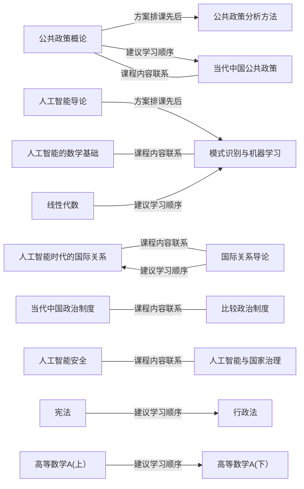

# 2024行政管理（公共政策）-人工智能双学士学位复合型人才培养项目教学培养方案（留学生适用）

国际关系与公共事务学院 · 行政管理(公共政策)-人工智能(双学士学位项目) · 方案 73271 · 82 个不同课程或科研条目。

[官方 Word](../originals/plan-73271.docx) · [教务详情](https://fdjwgl.fudan.edu.cn/manager/bizType/2/major-program-search/info/73271?skipAuth=1) · [方案快照](../raw/plan-73271.json.gz) · [年级目录](../README.md)

## 课程关系图

图中展示部分关系。下表保留全部已建立的课程对，来源位置使用本方案 JSON Pointer。

## 先修与内容联系

| 类型 | 起点 | 终点 | 依据 | 原表定位 |
| --- | --- | --- | --- | --- |
| 建议学习顺序 | 人工智能导论 (AIE310005) | 模式识别与机器学习 (AIE410001) | 人工智能问题与模型类别可为学习模式识别作准备。  | `/courseModules/6/planCourses/21`、`/courseModules/6/planCourses/23` |
| 建议学习顺序 | 线性代数 (CS10003) | 模式识别与机器学习 (AIE410001) | 向量表示和矩阵运算支持理解分类、回归等模型。  | `/courseModules/5/planCourses/9`、`/courseModules/6/planCourses/23` |
| 建议学习顺序 | 宪法 (LAW10005) | 行政法 (POLI30032) | 对国家机构与公权力结构的认识可帮助理解行政法律关系。  | `/courseModules/5/planCourses/12`、`/courseModules/6/planCourses/8` |
| 建议学习顺序 | 高等数学A(上） (MATH10015) | 高等数学A(下） (MATH10016) | 同方案的课程题名具有连续分册或序号。  | `/courseModules/5/planCourses/7`、`/courseModules/5/planCourses/8` |
| 建议学习顺序 | 公共政策概论 (POLI10006) | 当代中国公共政策 (MANA20011) | “公共政策概论”题名标明基础层次，前置阅读可帮助了解“当代中国公共政策”中的公共政策主题。  | `/courseModules/6/planCourses/0`、`/courseModules/8/planCourses/0` |
| 建议学习顺序 | 公共政策概论 (POLI10006) | 公共政策分析方法 (POLI130150) | “公共政策概论”题名标明基础层次，前置阅读可帮助了解“公共政策分析方法”中的公共政策主题。  | `/courseModules/6/planCourses/0`、`/courseModules/6/planCourses/14` |
| 建议学习顺序 | 国际关系导论 (POLI10008) | 人工智能时代的国际关系 (AIS310011) | “国际关系导论”题名标明基础层次，前置阅读可帮助了解“人工智能时代的国际关系”中的国际关系主题。  | `/courseModules/5/planCourses/11`、`/courseModules/6/planCourses/4` |
| 方案排课先后 | 人工智能导论 (AIE310005) | 模式识别与机器学习 (AIE410001) | 同方案该课程全部明确数字学期均早于后者。  | `/courseModules/6/planCourses/21`、`/courseModules/6/planCourses/23` |
| 方案排课先后 | 公共政策概论 (POLI10006) | 公共政策分析方法 (POLI130150) | 同方案该课程全部明确数字学期均早于后者。  | `/courseModules/6/planCourses/0`、`/courseModules/6/planCourses/14` |
| 课程内容联系 | 计算机系统基础 (AIE210006) | 计算机组成与体系结构 (CS30052) | 处理器、存储与系统执行模型具有共同内容。  | `/courseModules/6/planCourses/20`、`/courseModules/9/planCourses/1` |
| 课程内容联系 | 人工智能导论 (AIE310005) | 人工智能安全 (AIE831001) | 本方案两门课程的题名均含“人工智能”，可据此对照这一主题。  | `/courseModules/6/planCourses/21`、`/courseModules/6/planCourses/24` |
| 课程内容联系 | 人工智能的编程基础 (AIE310006) | 人工智能安全 (AIE831001) | 本方案两门课程的题名均含“人工智能”，可据此对照这一主题。  | `/courseModules/6/planCourses/17`、`/courseModules/6/planCourses/24` |
| 课程内容联系 | 人工智能的数学基础 (AIE310009) | 模式识别与机器学习 (AIE410001) | 数学表达与学习模型的统计、优化工具可对照。  | `/courseModules/6/planCourses/19`、`/courseModules/6/planCourses/23` |
| 课程内容联系 | 人工智能的数学基础 (AIE310009) | 人工智能安全 (AIE831001) | 本方案两门课程的题名均含“人工智能”，可据此对照这一主题。  | `/courseModules/6/planCourses/19`、`/courseModules/6/planCourses/24` |
| 课程内容联系 | 模式识别与机器学习 (AIE410001) | 机器学习系统 (CS30058) | 本方案两门课程的题名均含“机器学习”，可据此对照这一主题。  | `/courseModules/6/planCourses/23`、`/courseModules/9/planCourses/5` |
| 课程内容联系 | 人工智能安全 (AIE831001) | 人工智能与国家治理 (AIS310012) | 本方案两门课程的题名均含“人工智能”，可据此对照这一主题。  | `/courseModules/6/planCourses/24`、`/courseModules/6/planCourses/3` |
| 课程内容联系 | 人工智能时代的国际关系 (AIS310011) | 国际关系导论 (POLI10008) | 本方案两门课程的题名均含“国际关系”，可据此对照这一主题。  | `/courseModules/6/planCourses/4`、`/courseModules/5/planCourses/11` |
| 课程内容联系 | 法理学导论 (LAW10004) | 宪法 (LAW10005) | 两课均涉及权利与公共权力的规范依据。  | `/courseModules/5/planCourses/2`、`/courseModules/5/planCourses/12` |
| 课程内容联系 | 当代中国公共政策 (MANA20011) | 公共政策概论 (POLI10006) | 本方案两门课程的题名均含“公共政策”，可据此对照这一主题。  | `/courseModules/8/planCourses/0`、`/courseModules/6/planCourses/0` |
| 课程内容联系 | 公共政策概论 (POLI10006) | 公共政策分析方法 (POLI130150) | 本方案两门课程的题名均含“公共政策”，可据此对照这一主题。  | `/courseModules/6/planCourses/0`、`/courseModules/6/planCourses/14` |
| 课程内容联系 | 当代中国政治制度 (POLI10009) | 比较政治制度 (POLI20022) | 均涉及政治制度，可对照制度安排与研究对象。  | `/courseModules/5/planCourses/4`、`/courseModules/8/planCourses/29` |

本次未从可定位的明确表述中确认课程对课程预修。学期安排、系列分册与编辑建议均保留各自的依据。

## 按原方案模块阅读

同一模块展示原表中的课程归属。模块内课程之间的先后仍须逐项查阅。

- **公共管理进阶模块**　公共关系学、行政文书写作、当代中国公共政策、公共管理导论、公务员制度、环境政策与管理、城乡公共治理导论、公共部门绩效评估、中国公共管理前沿问题研究、比较公共行政、国际政治经济学、非政府组织、比较政治制度、中国历代政治与行政、中国社会政治分析、人力资源开发与管理、国际组织、量化研究设计与实践等30项（原表模块 8）
- **人工智能专业进阶课程**　数据库引论、软件工程、计算机图形学A、计算机网络、集合与图论、计算机组成与体系结构、机器学习系统（原表模块 9）

## 课程表

同一课程在不同模块分别出现时，按原表逐行列出。季节字段保留原值。

| 课程 | 代码 | 学分 | 学期 | 模块 |
| --- | --- | ---: | --- | --- |
| 政治学原理 | POLI10007 | 3.0 | SPRING、AUTUMN | 培养方案 / 专业培养课程 / 大类基础课程 |
| 社会学导论 | SOCI20001 | 3.0 | SPRING、AUTUMN | 培养方案 / 专业培养课程 / 大类基础课程 |
| 法理学导论 | LAW10004 | 3.0 | SPRING、AUTUMN | 培养方案 / 专业培养课程 / 大类基础课程 |
| 公共行政学 | MANA10002 | 3.0 | SPRING、AUTUMN | 培养方案 / 专业培养课程 / 大类基础课程 |
| 当代中国政治制度 | POLI10009 | 3.0 | SPRING、AUTUMN | 培养方案 / 专业培养课程 / 大类基础课程 |
| 微观经济学 | ECON20003 | 3.0 | SPRING、AUTUMN | 培养方案 / 专业培养课程 / 大类基础课程 |
| 宏观经济学 | ECON20004 | 3.0 | SPRING、AUTUMN | 培养方案 / 专业培养课程 / 大类基础课程 |
| 高等数学A(上） | MATH10015 | 5.0 | SPRING、AUTUMN | 培养方案 / 专业培养课程 / 大类基础课程 |
| 高等数学A(下） | MATH10016 | 5.0 | SPRING、AUTUMN | 培养方案 / 专业培养课程 / 大类基础课程 |
| 线性代数 | CS10003 | 3.0 | SPRING、AUTUMN | 培养方案 / 专业培养课程 / 大类基础课程 |
| 程序设计 | CS10004 | 4.0 | SPRING、AUTUMN | 培养方案 / 专业培养课程 / 大类基础课程 |
| 国际关系导论 | POLI10008 | 3.0 | SPRING、AUTUMN | 培养方案 / 专业培养课程 / 大类基础课程 |
| 宪法 | LAW10005 | 3.0 | SPRING、AUTUMN | 培养方案 / 专业培养课程 / 大类基础课程 |
| 心理学导论 | PSYC20001 | 3.0 | SPRING、AUTUMN | 培养方案 / 专业培养课程 / 大类基础课程 |
| 社会研究方法A | SOCI20002 | 3.0 | SPRING、AUTUMN | 培养方案 / 专业培养课程 / 大类基础课程 |
| 社会研究方法B | MSE30029 | 3.0 | SPRING、AUTUMN | 培养方案 / 专业培养课程 / 大类基础课程 |
| 公共政策概论 | POLI10006 | 3.0 | 第3学期 | 培养方案 / 专业培养课程 / 专业核心教育课程 |
| AI赋能的政务服务再造 | AIT531018 | 3.0 | 第3学期 | 培养方案 / 专业培养课程 / 专业核心教育课程 |
| 定量研究方法 | POLI30057 | 2.0 | 第3学期 | 培养方案 / 专业培养课程 / 专业核心教育课程 |
| 人工智能与国家治理 | AIS310012 | 2.0 | 第3学期 | 培养方案 / 专业培养课程 / 专业核心教育课程 |
| 人工智能时代的国际关系 | AIS310011 | 3.0 | 第5学期 | 培养方案 / 专业培养课程 / 专业核心教育课程 |
| 电子治理 | MANA20012 | 2.0 | 第5学期 | 培养方案 / 专业培养课程 / 专业核心教育课程 |
| 定性研究方法 | POLI30053 | 2.0 | 第4学期 | 培养方案 / 专业培养课程 / 专业核心教育课程 |
| 政府经济学 | POLI30025 | 3.0 | 第4学期 | 培养方案 / 专业培养课程 / 专业核心教育课程 |
| 行政法 | POLI30032 | 3.0 | 第4学期 | 培养方案 / 专业培养课程 / 专业核心教育课程 |
| 公共事业管理 | POLI20031 | 2.0 | 第4学期 | 培养方案 / 专业培养课程 / 专业核心教育课程 |
| 当代中国公共行政 | POLI30047 | 3.0 | 第5学期 | 培养方案 / 专业培养课程 / 专业核心教育课程 |
| 公共危机管理 | MANA30013 | 2.0 | 第5学期 | 培养方案 / 专业培养课程 / 专业核心教育课程 |
| 公共管理伦理 | POLI30058 | 2.0 | 第6学期 | 培养方案 / 专业培养课程 / 专业核心教育课程 |
| 西方行政学说史 | MANA20009 | 2.0 | 第6学期 | 培养方案 / 专业培养课程 / 专业核心教育课程 |
| 公共政策分析方法 | POLI130150 | 3.0 | 第6学期 | 培养方案 / 专业培养课程 / 专业核心教育课程 |
| 社会实践 | POLI40011 | 2.0 | 第8学期 | 培养方案 / 专业培养课程 / 专业核心教育课程 |
| 毕业论文 | POLI40012 | 4.0 | 第8学期 | 培养方案 / 专业培养课程 / 专业核心教育课程 |
| 人工智能的编程基础 | AIE310006 | 2.0 | 第2学期 | 培养方案 / 专业培养课程 / 专业核心教育课程 |
| 数据结构 | AIE310007 | 4.0 | 第3学期 | 培养方案 / 专业培养课程 / 专业核心教育课程 |
| 人工智能的数学基础 | AIE310009 | 3.0 | 第3学期 | 培养方案 / 专业培养课程 / 专业核心教育课程 |
| 计算机系统基础 | AIE210006 | 3.0 | 第3学期 | 培养方案 / 专业培养课程 / 专业核心教育课程 |
| 人工智能导论 | AIE310005 | 3.0 | 第4学期 | 培养方案 / 专业培养课程 / 专业核心教育课程 |
| 人工智能的软件基础 | AIE310008 | 3.0 | 第4学期 | 培养方案 / 专业培养课程 / 专业核心教育课程 |
| 模式识别与机器学习 | AIE410001 | 3.0 | 第5学期 | 培养方案 / 专业培养课程 / 专业核心教育课程 |
| 人工智能安全 | AIE831001 | 3.0 | 第5学期 | 培养方案 / 专业培养课程 / 专业核心教育课程 |
| 人工智能的伦理与治理 | PHIL50006 | 2.0 | 第4学期、第6学期 | 培养方案 / 专业培养课程 / 专业核心教育课程 |
| 自然语言处理与大语言模型 | AIE410002 | 3.0 | 第6学期 | 培养方案 / 专业培养课程 / 专业核心教育课程 |
| 计算机视觉 | AIE310004 | 3.0 | 第7学期 | 培养方案 / 专业培养课程 / 专业核心教育课程 |
| 人工智能前沿探索实践 | AIE531001 | 3.0 | 第7学期 | 培养方案 / 专业培养课程 / 专业核心教育课程 |
| 当代中国公共政策 | MANA20011 | 2.0 | SPRING、AUTUMN | 培养方案 / 公共管理进阶模块 |
| 公共数据利用与治理 | POLI40029 | 2.0 | SPRING、AUTUMN | 培养方案 / 公共管理进阶模块 |
| 公共部门绩效评估 | MANA40006 | 2.0 | SPRING、AUTUMN | 培养方案 / 公共管理进阶模块 |
| 中国公共管理前沿问题研究 | MANA40007 | 2.0 | SPRING、AUTUMN | 培养方案 / 公共管理进阶模块 |
| 人力资源开发与管理 | POLI20028 | 2.0 | SPRING、AUTUMN | 培养方案 / 公共管理进阶模块 |
| 行政文书写作 | MANA20010 | 2.0 | SPRING、AUTUMN | 培养方案 / 公共管理进阶模块 |
| 公共关系学 | MANA20008 | 2.0 | SPRING、AUTUMN | 培养方案 / 公共管理进阶模块 |
| 非政府组织 | POLI130142 | 2.0 | SPRING、AUTUMN | 培养方案 / 公共管理进阶模块 |
| 量化研究设计与实践 | POLI20033 | 2.0 | SPRING、AUTUMN | 培养方案 / 公共管理进阶模块 |
| 组织行为学 | POLI30031 | 2.0 | SPRING、AUTUMN | 培养方案 / 公共管理进阶模块 |
| 环境政策与管理 | MANA30015 | 2.0 | SPRING、AUTUMN | 培养方案 / 公共管理进阶模块 |
| 国际政治经济学 | POLI130027 | 3.0 | SPRING、AUTUMN | 培养方案 / 公共管理进阶模块 |
| 跨文化与国际交流 | POLI30051 | 2.0 | SPRING、AUTUMN | 培养方案 / 公共管理进阶模块 |
| 地理信息系统与空间分析 | POLI30061 | 2.0 | SPRING、AUTUMN | 培养方案 / 公共管理进阶模块 |
| 比较公共行政 | MANA50002 | 2.0 | SPRING、AUTUMN | 培养方案 / 公共管理进阶模块 |
| 城乡公共治理导论 | MANA30016 | 2.0 | SPRING、AUTUMN | 培养方案 / 公共管理进阶模块 |
| 比较地方政府学 | POLI30026 | 3.0 | SPRING、AUTUMN | 培养方案 / 公共管理进阶模块 |
| 公共管理导论 | MANA20013 | 3.0 | SPRING、AUTUMN | 培养方案 / 公共管理进阶模块 |
| 公务员制度 | MANA30011 | 2.0 | SPRING、AUTUMN | 培养方案 / 公共管理进阶模块 |
| 国际组织 | POLI20029 | 2.0 | SPRING、AUTUMN | 培养方案 / 公共管理进阶模块 |
| 公共科技政策 | POLI40031 | 2.0 | SPRING、AUTUMN | 培养方案 / 公共管理进阶模块 |
| 港台政治与行政 | POLI30033 | 2.0 | SPRING、AUTUMN | 培养方案 / 公共管理进阶模块 |
| 中国历代政治与行政 | POLI20023 | 3.0 | SPRING、AUTUMN | 培养方案 / 公共管理进阶模块 |
| 比较政治学导论 | POLI40017 | 2.0 | SPRING、AUTUMN | 培养方案 / 公共管理进阶模块 |
| 中国社会 | POLI40020 | 3.0 | SPRING、AUTUMN | 培养方案 / 公共管理进阶模块 |
| 当代中国政府治理 | POLI40024 | 3.0 | SPRING、AUTUMN | 培养方案 / 公共管理进阶模块 |
| 基层政治与地方治理 | POLI30044 | 2.0 | SPRING、AUTUMN | 培养方案 / 公共管理进阶模块 |
| 中国社会政治分析 | POLI20025 | 3.0 | SPRING、AUTUMN | 培养方案 / 公共管理进阶模块 |
| 中国政治与治理 | POLI40030 | 2.0 | SPRING、AUTUMN | 培养方案 / 公共管理进阶模块 |
| 比较政治制度 | POLI20022 | 3.0 | SPRING、AUTUMN | 培养方案 / 公共管理进阶模块 |
| 集合与图论 | CS30043 | 3.0 | 第3学期 | 培养方案 / 人工智能专业进阶课程 |
| 计算机组成与体系结构 | CS30052 | 4.0 | 第4学期 | 培养方案 / 人工智能专业进阶课程 |
| 数据库引论 | CS20010 | 3.0 | 第4学期 | 培养方案 / 人工智能专业进阶课程 |
| 计算机网络 | CS30036 | 3.0 | 第5学期 | 培养方案 / 人工智能专业进阶课程 |
| 软件工程 | CS30018 | 3.0 | 第6学期 | 培养方案 / 人工智能专业进阶课程 |
| 机器学习系统 | CS30058 | 3.0 | 第6学期 | 培养方案 / 人工智能专业进阶课程 |
| 计算机图形学A | CS30019 | 3.0 | 第6学期 | 培养方案 / 人工智能专业进阶课程 |
