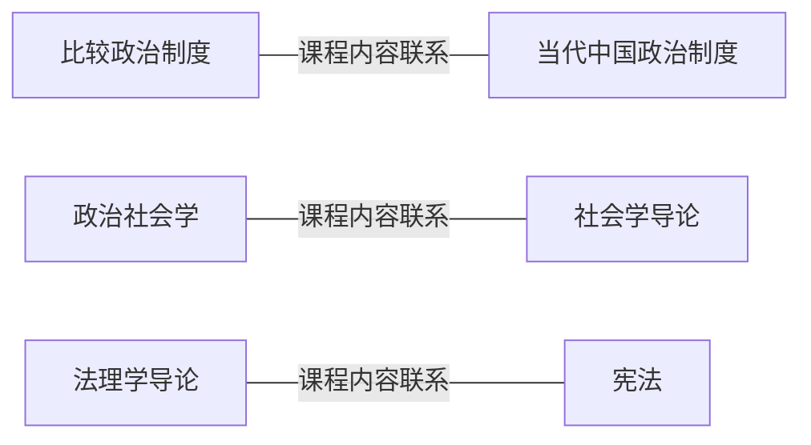

# 政治学与行政学专业“2+X”修读建议

2024 年汇编印刷页 344–345。原表记录 38 个可配对的课程代码。

[本节原页](plan-340.pdf#page=5) · [逐行数据](plan-340.json) · [院系目录](README.md)

## 课程关系图

图中展示最多 20 条关系。下表列出本节全部关系。建议学习顺序供规划课程使用，正式选课资格以教务规定为准。

| 课程 | 关联课程 | 关系 | 依据 |
| --- | --- | --- | --- |
| 比较政治制度（POLI130005） | 当代中国政治制度（SOSC120019） | 课程内容联系 | 均涉及政治制度，可对照制度安排与研究对象。 |
| 政治社会学（POLI130071） | 社会学导论（SOSC120002） | 课程内容联系 | 本方案两门课程的题名均含“社会学”，可据此对照这一主题。 |
| 法理学导论（SOSC120003） | 宪法（SOSC120015） | 课程内容联系 | 两课均涉及权利与公共权力的规范依据。 |

## 课程

| 课程代码 | 名称 | 开课学期原文 | 来源（PDF 页） |
| --- | --- | --- | --- |
| MATH120007 | 高等数学D |  | 358 |
| POLI130001 | 中国政治思想 |  | 359 |
| POLI130003 | 西方政治学说史 |  | 359 |
| POLI130004 | 西方经济学基础 |  | 359 |
| POLI130005 | 比较政治制度 |  | 359 |
| POLI130007 | 中国历代政治与行政 |  | 359 |
| POLI130008 | 西方政治史 |  | 359 |
| POLI130009 | 现当代西方政治哲学 |  | 359 |
| POLI130010 | 发展政治学 |  | 359 |
| POLI130011 | 当代西方政治学 |  | 359 |
| POLI130015 | 中国社会政治分析 |  | 359 |
| POLI130020 | 社会实践 |  | 359 |
| POLI130021 | 毕业论文 |  | 359 |
| POLI130071 | 政治社会学 |  | 359 |
| POLI130098 | 基层政治与地方治理 |  | 359 |
| POLI130100 | 国家理论研究 |  | 359 |
| POLI130149 | 定性研究方法 |  | 359 |
| POLI130173 | 定量研究方法 |  | 359 |
| PTSS110082 | 毛泽东思想和中国特色社会主义理论体系概论 |  | 358 |
| PTSS110087 | 马克思主义基本原理 |  | 358 |
| PTSS110088 | 中国近现代史纲要 |  | 358 |
| PTSS110089 | 思想道德与法治 |  | 358 |
| PTSS110090 | 习近平新时代中国特色社会主义思想概论 |  | 358 |
| SOSC120001 | 政治学原理 |  | 358 |
| SOSC120002 | 社会学导论 |  | 358 |
| SOSC120003 | 法理学导论 |  | 358 |
| SOSC120004 | 微观经济学 |  | 358 |
| SOSC120005 | 宏观经济学 |  | 358 |
| SOSC120007 | 经济学原理 |  | 358 |
| SOSC120009 | 社会研究方法A |  | 359 |
| SOSC120010 | 社会研究方法B |  | 359 |
| SOSC120011 | 国际关系导论 |  | 358 |
| SOSC120013 | 心理学导论 |  | 358 |
| SOSC120014 | 管理学导论 |  | 358 |
| SOSC120015 | 宪法 |  | 358 |
| SOSC120017 | 统计学 |  | 358 |
| SOSC120018 | 公共行政学 |  | 358 |
| SOSC120019 | 当代中国政治制度 |  | 358 |
