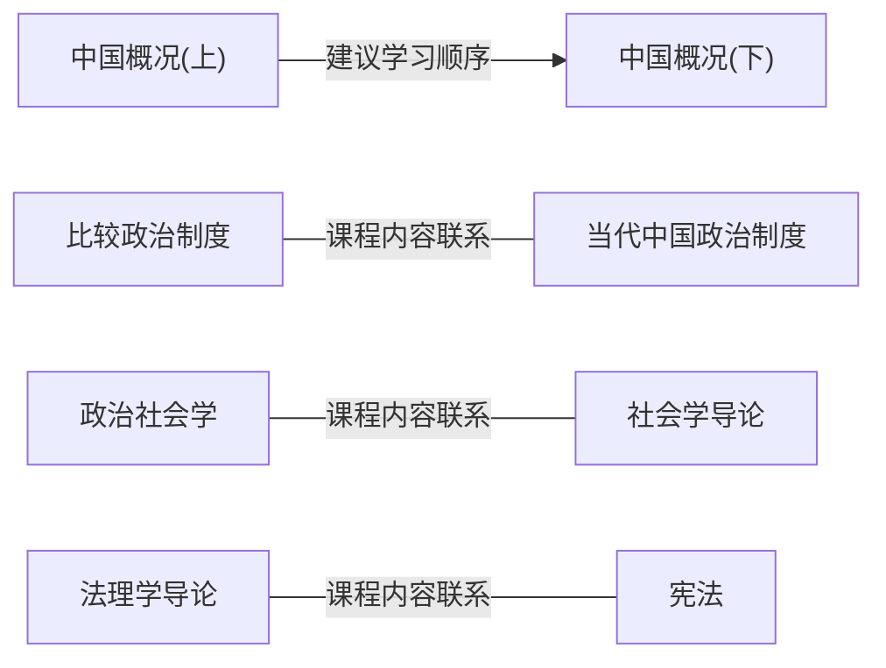

# 政治学与行政学专业“2+X”修读建议（留学生适用）

2024 年汇编印刷页 346–347。原表记录 31 个可配对的课程代码。

[本节原页](plan-340.pdf#page=7) · [逐行数据](plan-340.json) · [院系目录](README.md)

## 课程导读

想了解政治制度与公共行政的课程安排，可以在原表中找到《西方政治学说史》（`POLI130003`）、《中国历代政治与行政》（`POLI130007`）、《比较政治制度》（`POLI130005`）。 [原书 PDF 第 360 页](plan-340.pdf#page=7)

图中把《比较政治制度》（`POLI130005`）和《当代中国政治制度》（`SOSC120019`）列作内容联系。均涉及政治制度，可对照制度安排与研究对象。 [原书 PDF 第 360 页](plan-340.pdf#page=7)

## 课程关系图

图中展示最多 20 条关系。下表列出本节全部关系。建议学习顺序供规划课程使用，正式选课资格以教务规定为准。

| 课程 | 关联课程 | 关系 | 依据 |
| --- | --- | --- | --- |
| 中国概况(上)（ICES110012） | 中国概况(下)（ICES110013） | 建议学习顺序 | 同节课程题名标明连续分册或序号。 |
| 比较政治制度（POLI130005） | 当代中国政治制度（SOSC120019） | 课程内容联系 | 均涉及政治制度，可对照制度安排与研究对象。 |
| 政治社会学（POLI130071） | 社会学导论（SOSC120002） | 课程内容联系 | 本方案两门课程的题名均含“社会学”，可据此对照这一主题。 |
| 法理学导论（SOSC120003） | 宪法（SOSC120015） | 课程内容联系 | 两课均涉及权利与公共权力的规范依据。 |

## 课程

| 课程代码 | 名称 | 开课学期原文 | 来源（PDF 页） |
| --- | --- | --- | --- |
| ICES110012 | 中国概况(上) |  | 360 |
| ICES110013 | 中国概况(下) |  | 360 |
| MATH120007 | 高等数学D |  | 360 |
| POLI130001 | 中国政治思想 |  | 360 |
| POLI130003 | 西方政治学说史 |  | 360 |
| POLI130004 | 西方经济学基础 |  | 360 |
| POLI130005 | 比较政治制度 |  | 360 |
| POLI130007 | 中国历代政治与行政 |  | 360 |
| POLI130008 | 西方政治史 |  | 360 |
| POLI130009 | 现当代西方政治哲学 |  | 360 |
| POLI130010 | 发展政治学 |  | 360 |
| POLI130011 | 当代西方政治学 |  | 360 |
| POLI130015 | 中国社会政治分析 |  | 360 |
| POLI130020 | 社会实践 |  | 361 |
| POLI130021 | 毕业论文 |  | 361 |
| POLI130071 | 政治社会学 |  | 360 |
| POLI130098 | 基层政治与地方治理 |  | 360 |
| POLI130149 | 定性研究方法 |  | 360 |
| POLI130173 | 定量研究方法 |  | 360 |
| SOSC120001 | 政治学原理 |  | 360 |
| SOSC120002 | 社会学导论 |  | 360 |
| SOSC120003 | 法理学导论 |  | 360 |
| SOSC120007 | 经济学原理 |  | 360 |
| SOSC120009 | 社会研究方法A |  | 360 |
| SOSC120010 | 社会研究方法B |  | 360 |
| SOSC120011 | 国际关系导论 |  | 360 |
| SOSC120013 | 心理学导论 |  | 360 |
| SOSC120014 | 管理学导论 |  | 360 |
| SOSC120015 | 宪法 |  | 360 |
| SOSC120018 | 公共行政学 |  | 360 |
| SOSC120019 | 当代中国政治制度 |  | 360 |
