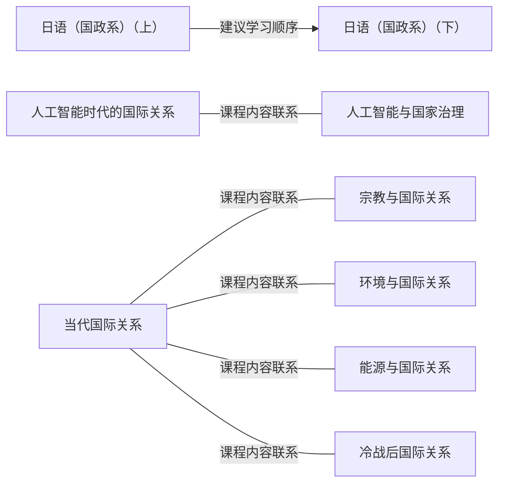

# 国际政治专业“2+X”教学培养方案

2024 年汇编印刷页 348–351。原表记录 59 个可配对的课程代码。

[本节原页](plan-348.pdf#page=1) · [逐行数据](plan-348.json) · [院系目录](README.md)

## 课程导读

想了解国际政治与外交的课程安排，可以在原表中找到《国际政治文选精读》（`POLI130135`）、《近现代国际关系》（`POLI130023`）、《外交学》（`POLI130025`）。 [原书 PDF 第 362 页](plan-348.pdf#page=1) · [原书 PDF 第 363 页](plan-348.pdf#page=2)

图中连接《当代国际关系》（`POLI130002`）和《宗教与国际关系》（`POLI130090`），两门课都从课程题名标出的“国际关系”切入，可沿这一主题对照阅读。 [原书 PDF 第 363 页](plan-348.pdf#page=2) · [原书 PDF 第 364 页](plan-348.pdf#page=3)

## 课程关系图

图中展示最多 20 条关系。下表列出本节全部关系。建议学习顺序供规划课程使用，正式选课资格以教务规定为准。

| 课程 | 关联课程 | 关系 | 依据 |
| --- | --- | --- | --- |
| 日语（国政系）（上）（POLI130079） | 日语（国政系）（下）（POLI130080） | 建议学习顺序 | 同节课程题名标明连续分册或序号。 |
| 人工智能时代的国际关系（AIS310011） | 人工智能与国家治理（AIS310012） | 课程内容联系 | 本方案两门课程的题名均含“人工智能”，可据此对照这一主题。 |
| 当代国际关系（POLI130002） | 宗教与国际关系（POLI130090） | 课程内容联系 | 本方案两门课程的题名均含“国际关系”，可据此对照这一主题。 |
| 当代国际关系（POLI130002） | 环境与国际关系（POLI130092） | 课程内容联系 | 本方案两门课程的题名均含“国际关系”，可据此对照这一主题。 |
| 当代国际关系（POLI130002） | 能源与国际关系（POLI130130） | 课程内容联系 | 本方案两门课程的题名均含“国际关系”，可据此对照这一主题。 |
| 当代国际关系（POLI130002） | 冷战后国际关系（POLI130190） | 课程内容联系 | 本方案两门课程的题名均含“国际关系”，可据此对照这一主题。 |

## 课程

| 课程代码 | 名称 | 开课学期原文 | 来源（PDF 页） |
| --- | --- | --- | --- |
| AIS310011 | 人工智能时代的国际关系 | 春，秋 | 364 |
| AIS310012 | 人工智能与国家治理 | 春秋 | 364 |
| AIT531018 | AI赋能的政务服务再造 | 春秋 | 364 |
| LAWS130061 | 国际法 | 2 | 362 |
| POLI130002 | 当代国际关系 | 4 | 363 |
| POLI130003 | 西方政治学说史 | 3 | 362 |
| POLI130004 | 西方经济学基础 | 3 | 362 |
| POLI130005 | 比较政治制度 | 3 | 362 |
| POLI130020 | 社会实践 | 8 | 363 |
| POLI130021 | 毕业论文 | 8 | 363 |
| POLI130022 | 近现代中国对外关系 | 3 | 362 |
| POLI130023 | 近现代国际关系 | 3 | 362 |
| POLI130024 | 当代中国对外关系 | 4 | 363 |
| POLI130025 | 外交学 | 5 | 363 |
| POLI130026 | 西方国际关系理论 | 4 | 363 |
| POLI130027 | 国际政治经济学 | 6 | 363 |
| POLI130028 | 国际安全与军备控制 | 春，秋 | 364 |
| POLI130030 | 美国政治与对外关系 | 5 | 363 |
| POLI130031 | 俄罗斯政治与对外关系 | 春，秋 | 363 |
| POLI130032 | 欧盟政治与对外关系 | 6 | 363 |
| POLI130033 | 日本政治与对外关系 | 6 | 363 |
| POLI130062 | 比较政党制度 | 春，秋 | 363 |
| POLI130063 | 国际组织 | 7 | 363 |
| POLI130072 | 专题阅读讨论 | 春，秋 | 364 |
| POLI130075 | 亚太地区政治与经济 | 春，秋 | 364 |
| POLI130079 | 日语（国政系）（上） | 春，秋 | 364 |
| POLI130080 | 日语（国政系）（下） | 春，秋 | 364 |
| POLI130090 | 宗教与国际关系 | 春，秋 | 364 |
| POLI130092 | 环境与国际关系 | 春，秋 | 364 |
| POLI130093 | 日本政治与行政 | 春，秋 | 363 |
| POLI130095 | 大众传媒与外交 | 春，秋 | 364 |
| POLI130096 | 国际谈判 | 春，秋 | 363 |
| POLI130099 | 东亚政治概论 | 春，秋 | 363 |
| POLI130121 | 中美关系与亚洲的崛起 | 春，秋 | 364 |
| POLI130130 | 能源与国际关系 | 春，秋 | 364 |
| POLI130131 | 经济外交 | 春，秋 | 364 |
| POLI130133 | 中国外交文献选读 | 春，秋 | 364 |
| POLI130135 | 国际政治文选精读 | 4 | 363 |
| POLI130138 | 跨文化与国际交流 | 春，秋 | 363 |
| POLI130144 | 贸易与国际关系 | 春，秋 | 364 |
| POLI130149 | 定性研究方法 | 4 | 362 |
| POLI130151 | 美国宗教与社会 | 春，秋 | 363 |
| POLI130152 | 外交实务 | 春，秋 | 364 |
| POLI130167 | 发展中国家政治与对外关系 | 春，秋 | 363 |
| POLI130170 | 英文应用文写作 | 春，秋 | 363 |
| POLI130173 | 定量研究方法 | 3 | 362 |
| POLI130179 | 中国与全球治理 | 春，秋 | 364 |
| POLI130188 | 国际发展 | 春，秋 | 364 |
| POLI130189 | 古代中国对外关系 | 春，秋 | 364 |
| POLI130190 | 冷战后国际关系 | 春，秋 | 363 |
| POLI130203 | 日本与东亚国际关系研究 | 春，秋 | 364 |
| POLI130210 | 地中海研究导论 | 春，秋 | 363 |
| POLI130211 | 东南亚政治与国际关系 | 春，秋 | 363 |
| POLI130214 | 中东政治 | 春，秋 | 364 |
| POLI130220 | 国际秩序与国际规范 | 春，秋 | 364 |
| POLI130225 | 网络安全与国际关系 | 春，秋 | 364 |
| POLI130229 | 中国涉外法律研究 | 春，秋 | 364 |
| POLI130230 | 全球卫生与国际关系 | 春，秋 | 364 |
| POLI130239 | 中国政府与治理 | 春，秋 | 364 |
