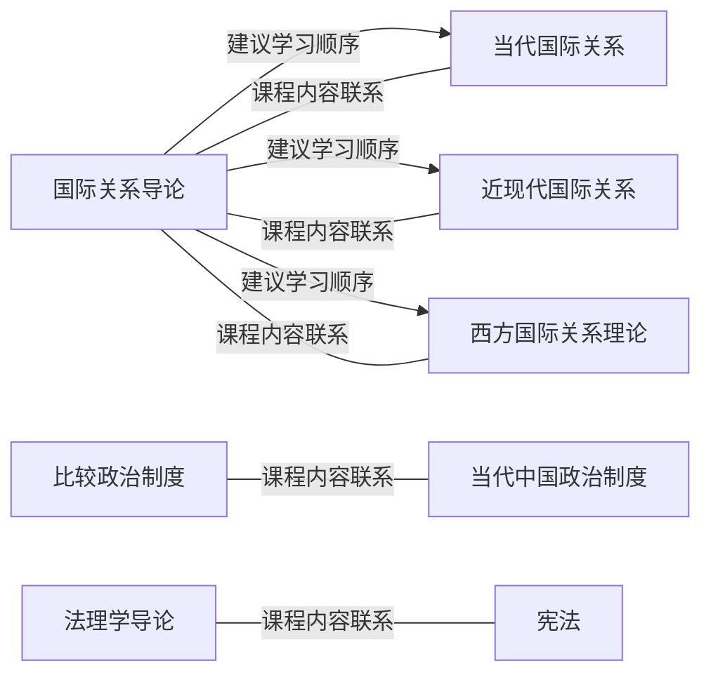

# 国际政治专业“2+X”修读建议

2024 年汇编印刷页 352–353。原表记录 41 个可配对的课程代码。

[本节原页](plan-348.pdf#page=5) · [逐行数据](plan-348.json) · [院系目录](README.md)

## 课程导读

想了解国际政治与外交的课程安排，可以在原表中找到《国际政治文选精读》（`POLI130135`）、《近现代国际关系》（`POLI130023`）、《外交学》（`POLI130025`）。 [原书 PDF 第 367 页](plan-348.pdf#page=6)

图中连接《当代国际关系》（`POLI130002`）和《国际关系导论》（`SOSC120011`），两门课都从课程题名标出的“国际关系”切入，可沿这一主题对照阅读。 [原书 PDF 第 366 页](plan-348.pdf#page=5) · [原书 PDF 第 367 页](plan-348.pdf#page=6)

## 课程关系图

图中展示最多 20 条关系。下表列出本节全部关系。建议学习顺序供规划课程使用，正式选课资格以教务规定为准。

| 课程 | 关联课程 | 关系 | 依据 |
| --- | --- | --- | --- |
| 国际关系导论（SOSC120011） | 当代国际关系（POLI130002） | 建议学习顺序 | 国际体系和行为体概念可用于时事与历史案例分析。 |
| 国际关系导论（SOSC120011） | 近现代国际关系（POLI130023） | 建议学习顺序 | “国际关系导论”题名标明基础层次，前置阅读可帮助了解“近现代国际关系”中的国际关系主题。 |
| 国际关系导论（SOSC120011） | 西方国际关系理论（POLI130026） | 建议学习顺序 | “国际关系导论”题名标明基础层次，前置阅读可帮助了解“西方国际关系理论”中的国际关系主题。 |
| 当代国际关系（POLI130002） | 国际关系导论（SOSC120011） | 课程内容联系 | 本方案两门课程的题名均含“国际关系”，可据此对照这一主题。 |
| 比较政治制度（POLI130005） | 当代中国政治制度（SOSC120019） | 课程内容联系 | 均涉及政治制度，可对照制度安排与研究对象。 |
| 近现代国际关系（POLI130023） | 国际关系导论（SOSC120011） | 课程内容联系 | 本方案两门课程的题名均含“国际关系”，可据此对照这一主题。 |
| 西方国际关系理论（POLI130026） | 国际关系导论（SOSC120011） | 课程内容联系 | 本方案两门课程的题名均含“国际关系”，可据此对照这一主题。 |
| 法理学导论（SOSC120003） | 宪法（SOSC120015） | 课程内容联系 | 两课均涉及权利与公共权力的规范依据。 |

## 课程

| 课程代码 | 名称 | 开课学期原文 | 来源（PDF 页） |
| --- | --- | --- | --- |
| LAWS130061 | 国际法 |  | 367 |
| MATH120007 | 高等数学D |  | 366 |
| POLI130002 | 当代国际关系 |  | 367 |
| POLI130003 | 西方政治学说史 |  | 367 |
| POLI130004 | 西方经济学基础 |  | 367 |
| POLI130005 | 比较政治制度 |  | 367 |
| POLI130020 | 社会实践 |  | 367 |
| POLI130021 | 毕业论文 |  | 367 |
| POLI130022 | 近现代中国对外关系 |  | 367 |
| POLI130023 | 近现代国际关系 |  | 367 |
| POLI130024 | 当代中国对外关系 |  | 367 |
| POLI130025 | 外交学 |  | 367 |
| POLI130026 | 西方国际关系理论 |  | 367 |
| POLI130027 | 国际政治经济学 |  | 367 |
| POLI130030 | 美国政治与对外关系 |  | 367 |
| POLI130032 | 欧盟政治与对外关系 |  | 367 |
| POLI130033 | 日本政治与对外关系 |  | 367 |
| POLI130063 | 国际组织 |  | 367 |
| POLI130135 | 国际政治文选精读 |  | 367 |
| POLI130149 | 定性研究方法 |  | 367 |
| POLI130173 | 定量研究方法 |  | 367 |
| PTSS110082 | 毛泽东思想和中国特色社会主义理论体系概论 |  | 366 |
| PTSS110087 | 马克思主义基本原理 |  | 366 |
| PTSS110088 | 中国近现代史纲要 |  | 366 |
| PTSS110089 | 思想道德与法治 |  | 366 |
| PTSS110090 | 习近平新时代中国特色社会主义思想概论 |  | 366 |
| SOSC120001 | 政治学原理 |  | 366 |
| SOSC120002 | 社会学导论 |  | 366 |
| SOSC120003 | 法理学导论 |  | 366 |
| SOSC120004 | 微观经济学 |  | 366 |
| SOSC120005 | 宏观经济学 |  | 366 |
| SOSC120007 | 经济学原理 |  | 366 |
| SOSC120009 | 社会研究方法A |  | 366 |
| SOSC120010 | 社会研究方法B |  | 366 |
| SOSC120011 | 国际关系导论 |  | 366 |
| SOSC120013 | 心理学导论 |  | 366 |
| SOSC120014 | 管理学导论 |  | 366 |
| SOSC120015 | 宪法 |  | 366 |
| SOSC120017 | 统计学 |  | 366 |
| SOSC120018 | 公共行政学 |  | 366 |
| SOSC120019 | 当代中国政治制度 |  | 366 |
