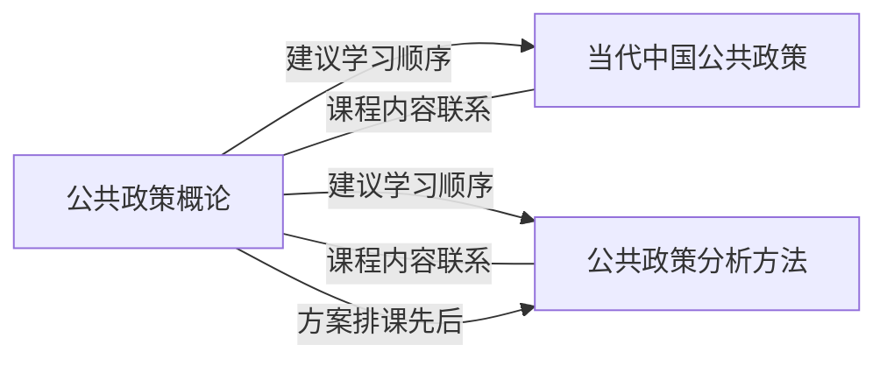

# 行政管理专业“2+X”教学培养方案

2024 年汇编印刷页 356–358。原表记录 46 个可配对的课程代码。

[本节原页](plan-356.pdf#page=1) · [逐行数据](plan-356.json) · [院系目录](README.md)

## 课程导读

想了解行政与公共政策的课程安排，可以在原表中找到《公共管理导论》（`POLI130216`）、《公共政策概论》（`POLI130013`）、《公务员制度》（`POLI130056`）。 [原书 PDF 第 370 页](plan-356.pdf#page=1)

图中连接《公共政策概论》（`POLI130013`）和《公共政策分析方法》（`POLI130150`），两门课都从课程题名标出的“公共政策”切入，可沿这一主题对照阅读。 [原书 PDF 第 370 页](plan-356.pdf#page=1) · [原书 PDF 第 371 页](plan-356.pdf#page=2)

## 课程关系图

图中展示最多 20 条关系。下表列出本节全部关系。建议学习顺序供规划课程使用，正式选课资格以教务规定为准。

| 课程 | 关联课程 | 关系 | 依据 |
| --- | --- | --- | --- |
| 公共政策概论（POLI130013） | 当代中国公共政策（POLI130083） | 建议学习顺序 | “公共政策概论”题名标明基础层次，前置阅读可帮助了解“当代中国公共政策”中的公共政策主题。 |
| 公共政策概论（POLI130013） | 公共政策分析方法（POLI130150） | 建议学习顺序 | “公共政策概论”题名标明基础层次，前置阅读可帮助了解“公共政策分析方法”中的公共政策主题。 |
| 公共政策概论（POLI130013） | 当代中国公共政策（POLI130083） | 课程内容联系 | 本方案两门课程的题名均含“公共政策”，可据此对照这一主题。 |
| 公共政策概论（POLI130013） | 公共政策分析方法（POLI130150） | 课程内容联系 | 本方案两门课程的题名均含“公共政策”，可据此对照这一主题。 |
| 公共政策概论（POLI130013） | 公共政策分析方法（POLI130150） | 方案排课先后 | 本节原表所列全部明确学期均早于后者。 |

## 课程

| 课程代码 | 名称 | 开课学期原文 | 来源（PDF 页） |
| --- | --- | --- | --- |
| AIS310012 | 人工智能与国家治理 | 春，秋 | 372 |
| AIT531018 | AI赋能的政务服务再造 | 春，秋 | 371 |
| POLI130005 | 比较政治制度 | 春，秋 | 372 |
| POLI130007 | 中国历代政治与行政 | 春，秋 | 372 |
| POLI130012 | 政府经济学 | 4 | 370 |
| POLI130013 | 公共政策概论 | 3 | 370 |
| POLI130014 | 比较地方政府学 | 春，秋 | 372 |
| POLI130015 | 中国社会政治分析 | 春，秋 | 371, 372 |
| POLI130020 | 社会实践 | 8 | 371 |
| POLI130021 | 毕业论文 | 8 | 371 |
| POLI130027 | 国际政治经济学 | 春，秋 | 371 |
| POLI130044 | 公共关系学 | 春，秋 | 371 |
| POLI130048 | 组织行为学 | 5 | 370 |
| POLI130050 | 西方行政学说史 | 6 | 371 |
| POLI130053 | 人力资源开发与管理 | 春，秋 | 371 |
| POLI130054 | 行政法 | 4 | 370 |
| POLI130056 | 公务员制度 | 3 | 370 |
| POLI130061 | 港台政治与行政 | 春，秋 | 372 |
| POLI130063 | 国际组织 | 春，秋 | 372 |
| POLI130065 | 行政文书写作 | 春，秋 | 371 |
| POLI130083 | 当代中国公共政策 | 春，秋 | 371 |
| POLI130085 | 比较公共行政 | 春，秋 | 372 |
| POLI130098 | 基层政治与地方治理 | 春，秋 | 372 |
| POLI130113 | 公共事业管理 | 4 | 370 |
| POLI130114 | 公共部门绩效评估 | 春，秋 | 371 |
| POLI130124 | 当代中国公共行政 | 5 | 371 |
| POLI130138 | 跨文化与国际交流 | 春，秋 | 371 |
| POLI130140 | 公共危机管理 | 5 | 371 |
| POLI130142 | 非政府组织 | 春，秋 | 371 |
| POLI130147 | 电子治理 | 5 | 371 |
| POLI130149 | 定性研究方法 | 4 | 370 |
| POLI130150 | 公共政策分析方法 | 6 | 371 |
| POLI130153 | 比较政治学导论 | 春，秋 | 372 |
| POLI130173 | 定量研究方法 | 3 | 370 |
| POLI130175 | 公共管理伦理 | 6 | 371 |
| POLI130193 | 中国社会 | 春，秋 | 372 |
| POLI130212 | 中国公共管理前沿问题研究 | 春，秋 | 371 |
| POLI130216 | 公共管理导论 | 3 | 370 |
| POLI130219 | 量化研究设计与实践 | 春，秋 | 371 |
| POLI130226 | 环境政策与管理 | 春，秋 | 371 |
| POLI130227 | 地理信息系统与空间分析 | 春，秋 | 371 |
| POLI130231 | 当代中国政府治理 | 春，秋 | 371, 372 |
| POLI130238 | 公共数据利用与治理 | 春，秋 | 372 |
| POLI130239 | 中国政府与治理 | 春，秋 | 371, 372 |
| POLI130240 | 公共科技政策 | 春，秋 | 372 |
| POLI130241 | 城乡公共治理导论 | 春，秋 | 372 |
