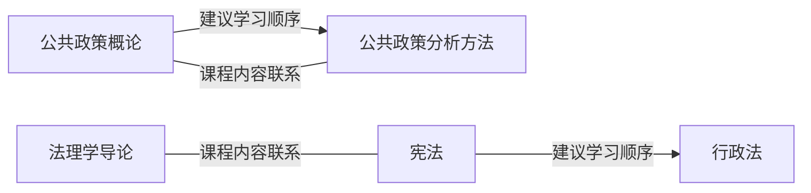

# 行政管理专业“2+X”修读建议

2024 年汇编印刷页 359–360。原表记录 36 个可配对的课程代码。

[本节原页](plan-356.pdf#page=4) · [逐行数据](plan-356.json) · [院系目录](README.md)

## 课程关系图

图中展示最多 20 条关系。下表列出本节全部关系。建议学习顺序供规划课程使用，正式选课资格以教务规定为准。

| 课程 | 关联课程 | 关系 | 依据 |
| --- | --- | --- | --- |
| 公共政策概论（POLI130013） | 公共政策分析方法（POLI130150） | 建议学习顺序 | “公共政策概论”题名标明基础层次，前置阅读可帮助了解“公共政策分析方法”中的公共政策主题。 |
| 宪法（SOSC120015） | 行政法（POLI130054） | 建议学习顺序 | 对国家机构与公权力结构的认识可帮助理解行政法律关系。 |
| 公共政策概论（POLI130013） | 公共政策分析方法（POLI130150） | 课程内容联系 | 本方案两门课程的题名均含“公共政策”，可据此对照这一主题。 |
| 法理学导论（SOSC120003） | 宪法（SOSC120015） | 课程内容联系 | 两课均涉及权利与公共权力的规范依据。 |

## 课程

| 课程代码 | 名称 | 开课学期原文 | 来源（PDF 页） |
| --- | --- | --- | --- |
| MATH120007 | 高等数学D |  | 373 |
| POLI130012 | 政府经济学 |  | 374 |
| POLI130013 | 公共政策概论 |  | 374 |
| POLI130020 | 社会实践 |  | 374 |
| POLI130021 | 毕业论文 |  | 374 |
| POLI130048 | 组织行为学 |  | 374 |
| POLI130050 | 西方行政学说史 |  | 374 |
| POLI130054 | 行政法 |  | 374 |
| POLI130056 | 公务员制度 |  | 374 |
| POLI130113 | 公共事业管理 |  | 374 |
| POLI130124 | 当代中国公共行政 |  | 374 |
| POLI130140 | 公共危机管理 |  | 374 |
| POLI130147 | 电子治理 |  | 374 |
| POLI130149 | 定性研究方法 |  | 374 |
| POLI130150 | 公共政策分析方法 |  | 374 |
| POLI130173 | 定量研究方法 |  | 374 |
| POLI130175 | 公共管理伦理 |  | 374 |
| POLI130216 | 公共管理导论 |  | 374 |
| PTSS110082 | 毛泽东思想和中国特色社会主义理论体系概论 |  | 373 |
| PTSS110087 | 马克思主义基本原理 |  | 373 |
| PTSS110088 | 中国近现代史纲要 |  | 373 |
| PTSS110089 | 思想道德与法治 |  | 373 |
| PTSS110090 | 习近平新时代中国特色社会主义思想概论 |  | 373 |
| SOSC120001 | 政治学原理 |  | 373 |
| SOSC120002 | 社会学导论 |  | 373 |
| SOSC120003 | 法理学导论 |  | 373 |
| SOSC120004 | 微观经济学 |  | 373 |
| SOSC120005 | 宏观经济学 |  | 373 |
| SOSC120009 | 社会研究方法A |  | 373 |
| SOSC120010 | 社会研究方法B |  | 373 |
| SOSC120011 | 国际关系导论 |  | 373 |
| SOSC120013 | 心理学导论 |  | 373 |
| SOSC120015 | 宪法 |  | 373 |
| SOSC120017 | 统计学 |  | 373 |
| SOSC120018 | 公共行政学 |  | 373 |
| SOSC120019 | 当代中国政治制度 |  | 373 |
