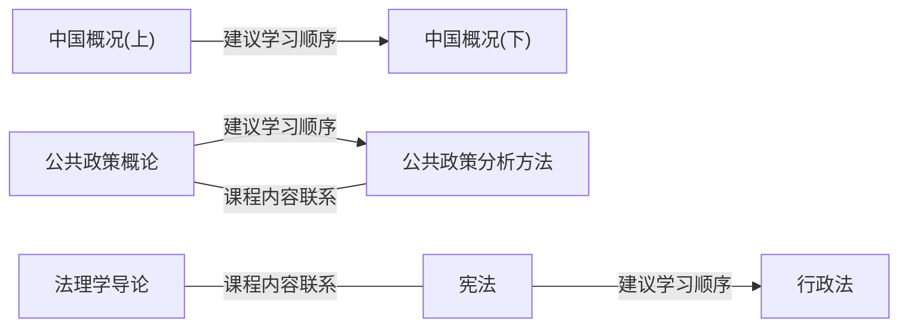

# 行政管理专业“2+X”修读建议（留学生适用）

2024 年汇编印刷页 361–362。原表记录 33 个可配对的课程代码。

[本节原页](plan-356.pdf#page=6) · [逐行数据](plan-356.json) · [院系目录](README.md)

## 课程导读

想了解行政与公共政策的课程安排，可以在原表中找到《公共管理导论》（`POLI130216`）、《公共政策概论》（`POLI130013`）、《公务员制度》（`POLI130056`）。 [原书 PDF 第 375 页](plan-356.pdf#page=6)

图中连接《公共政策概论》（`POLI130013`）和《公共政策分析方法》（`POLI130150`），两门课都从课程题名标出的“公共政策”切入，可沿这一主题对照阅读。 [原书 PDF 第 375 页](plan-356.pdf#page=6) · [原书 PDF 第 376 页](plan-356.pdf#page=7)

## 课程关系图

图中展示最多 20 条关系。下表列出本节全部关系。建议学习顺序供规划课程使用，正式选课资格以教务规定为准。

| 课程 | 关联课程 | 关系 | 依据 |
| --- | --- | --- | --- |
| 中国概况(上)（ICES110012） | 中国概况(下)（ICES110013） | 建议学习顺序 | 同节课程题名标明连续分册或序号。 |
| 公共政策概论（POLI130013） | 公共政策分析方法（POLI130150） | 建议学习顺序 | “公共政策概论”题名标明基础层次，前置阅读可帮助了解“公共政策分析方法”中的公共政策主题。 |
| 宪法（SOSC120015） | 行政法（POLI130054） | 建议学习顺序 | 对国家机构与公权力结构的认识可帮助理解行政法律关系。 |
| 公共政策概论（POLI130013） | 公共政策分析方法（POLI130150） | 课程内容联系 | 本方案两门课程的题名均含“公共政策”，可据此对照这一主题。 |
| 法理学导论（SOSC120003） | 宪法（SOSC120015） | 课程内容联系 | 两课均涉及权利与公共权力的规范依据。 |

## 课程

| 课程代码 | 名称 | 开课学期原文 | 来源（PDF 页） |
| --- | --- | --- | --- |
| ICES110012 | 中国概况(上) |  | 375 |
| ICES110013 | 中国概况(下) |  | 375 |
| MATH120007 | 高等数学D |  | 375 |
| POLI130012 | 政府经济学 |  | 375 |
| POLI130013 | 公共政策概论 |  | 375 |
| POLI130020 | 社会实践 |  | 376 |
| POLI130021 | 毕业论文 |  | 376 |
| POLI130048 | 组织行为学 |  | 375 |
| POLI130050 | 西方行政学说史 |  | 375 |
| POLI130054 | 行政法 |  | 375 |
| POLI130056 | 公务员制度 |  | 375 |
| POLI130113 | 公共事业管理 |  | 375 |
| POLI130124 | 当代中国公共行政 |  | 375 |
| POLI130140 | 公共危机管理 |  | 375 |
| POLI130147 | 电子治理 |  | 375 |
| POLI130149 | 定性研究方法 |  | 375 |
| POLI130150 | 公共政策分析方法 |  | 376 |
| POLI130173 | 定量研究方法 |  | 375 |
| POLI130175 | 公共管理伦理 |  | 375 |
| POLI130216 | 公共管理导论 |  | 375 |
| SOSC120001 | 政治学原理 |  | 375 |
| SOSC120002 | 社会学导论 |  | 375 |
| SOSC120003 | 法理学导论 |  | 375 |
| SOSC120004 | 微观经济学 |  | 375 |
| SOSC120005 | 宏观经济学 |  | 375 |
| SOSC120009 | 社会研究方法A |  | 375 |
| SOSC120010 | 社会研究方法B |  | 375 |
| SOSC120011 | 国际关系导论 |  | 375 |
| SOSC120013 | 心理学导论 |  | 375 |
| SOSC120015 | 宪法 |  | 375 |
| SOSC120017 | 统计学 |  | 375 |
| SOSC120018 | 公共行政学 |  | 375 |
| SOSC120019 | 当代中国政治制度 |  | 375 |
