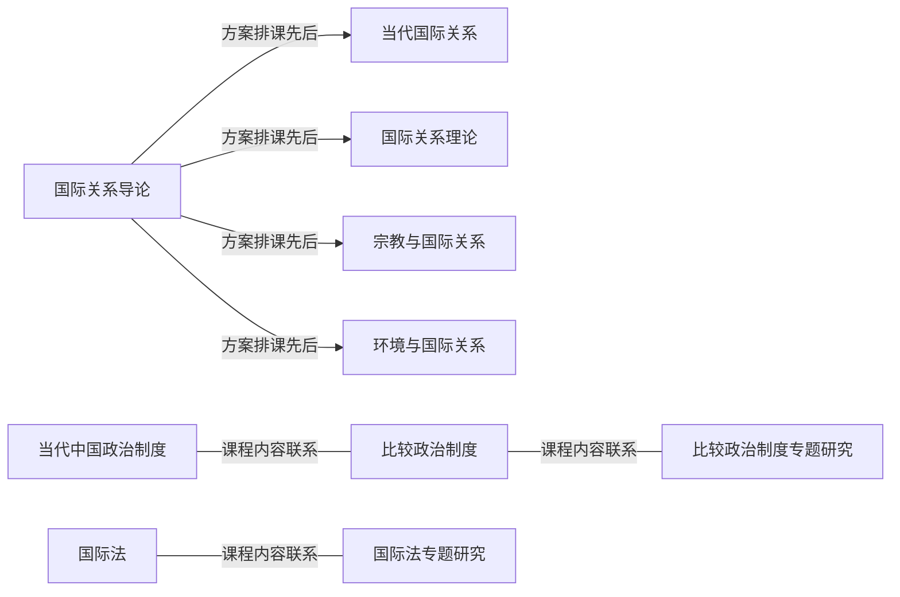

# 2025国际政治专业-政治学-本博融通培养方案（留学生适用）

国际关系与公共事务学院 · 国际政治 · 方案 96750 · 420 个不同课程或科研条目。

[官方 Word](../originals/plan-96750.docx) · [教务详情](https://fdjwgl.fudan.edu.cn/manager/bizType/2/major-program-search/info/96750?skipAuth=1) · [方案快照](../raw/plan-96750.json.gz) · [年级目录](../README.md)

## 修读导读

- **建议先学**　《国际关系导论》（`POLI10003`） → 《当代国际关系》（`POLI20012`）。国际体系和行为体概念可用于时事与历史案例分析。

- **可以对照着读**　《当代中国政治制度》（`POLI10009`）与《比较政治制度》（`POLI20022`）。均涉及政治制度，可对照制度安排与研究对象。

- **查模块选课**　《国际关系理论》（`POLI20018`）、《近现代国际关系》（`POLI20027`）列在“专业核心教育课程”中。原表见 `/courseModules/16`。

## 课程关系图

图中展示部分关系。下表保留全部已建立的课程对，来源位置使用本方案 JSON Pointer。

## 先修与内容联系

| 类型 | 起点 | 终点 | 依据 | 原表定位 |
| --- | --- | --- | --- | --- |
| 建议学习顺序 | 国际关系导论 (POLI10003) | 当代国际关系 (POLI20012) | 国际体系和行为体概念可用于时事与历史案例分析。  | `/courseModules/15/planCourses/2`、`/courseModules/16/planCourses/2` |
| 建议学习顺序 | 国际关系导论 (POLI10003) | 国际关系理论 (POLI20018) | “国际关系导论”题名标明基础层次，前置阅读可帮助了解“国际关系理论”中的国际关系主题。  | `/courseModules/15/planCourses/2`、`/courseModules/16/planCourses/0` |
| 建议学习顺序 | 国际关系导论 (POLI10003) | 宗教与国际关系 (POLI30039) | “国际关系导论”题名标明基础层次，前置阅读可帮助了解“宗教与国际关系”中的国际关系主题。  | `/courseModules/15/planCourses/2`、`/courseModules/19/planCourses/14` |
| 建议学习顺序 | 国际关系导论 (POLI10003) | 环境与国际关系 (POLI30040) | “国际关系导论”题名标明基础层次，前置阅读可帮助了解“环境与国际关系”中的国际关系主题。  | `/courseModules/15/planCourses/2`、`/courseModules/19/planCourses/15` |
| 方案排课先后 | 国际关系导论 (POLI10003) | 当代国际关系 (POLI20012) | 同方案该课程全部明确数字学期均早于后者。  | `/courseModules/15/planCourses/2`、`/courseModules/16/planCourses/2` |
| 方案排课先后 | 国际关系导论 (POLI10003) | 国际关系理论 (POLI20018) | 同方案该课程全部明确数字学期均早于后者。  | `/courseModules/15/planCourses/2`、`/courseModules/16/planCourses/0` |
| 方案排课先后 | 国际关系导论 (POLI10003) | 宗教与国际关系 (POLI30039) | 同方案该课程全部明确数字学期均早于后者。  | `/courseModules/15/planCourses/2`、`/courseModules/19/planCourses/14` |
| 方案排课先后 | 国际关系导论 (POLI10003) | 环境与国际关系 (POLI30040) | 同方案该课程全部明确数字学期均早于后者。  | `/courseModules/15/planCourses/2`、`/courseModules/19/planCourses/15` |
| 课程内容联系 | 国际关系导论 (POLI10003) | 当代国际关系 (POLI20012) | 本方案两门课程的题名均含“国际关系”，可据此对照这一主题。  | `/courseModules/15/planCourses/2`、`/courseModules/16/planCourses/2` |
| 课程内容联系 | 国际关系导论 (POLI10003) | 国际关系理论 (POLI20018) | 本方案两门课程的题名均含“国际关系”，可据此对照这一主题。  | `/courseModules/15/planCourses/2`、`/courseModules/16/planCourses/0` |
| 课程内容联系 | 国际关系导论 (POLI10003) | 宗教与国际关系 (POLI30039) | 本方案两门课程的题名均含“国际关系”，可据此对照这一主题。  | `/courseModules/15/planCourses/2`、`/courseModules/19/planCourses/14` |
| 课程内容联系 | 国际关系导论 (POLI10003) | 环境与国际关系 (POLI30040) | 本方案两门课程的题名均含“国际关系”，可据此对照这一主题。  | `/courseModules/15/planCourses/2`、`/courseModules/19/planCourses/15` |
| 课程内容联系 | 当代中国政治制度 (POLI10009) | 比较政治制度 (POLI20022) | 均涉及政治制度，可对照制度安排与研究对象。  | `/courseModules/15/planCourses/3`、`/courseModules/16/planCourses/5` |
| 课程内容联系 | 国际法 (POLI20015) | 国际法专题研究 (POLI60009) | 本方案两门课程的题名均含“国际法”，可据此对照这一主题。  | `/courseModules/16/planCourses/8`、`/courseModules/20/planCourses/19` |
| 课程内容联系 | 比较政治制度 (POLI20022) | 比较政治制度专题研究 (POLI60001) | 本方案两门课程的题名均含“政治制度”，可据此对照这一主题。  | `/courseModules/16/planCourses/5`、`/courseModules/20/planCourses/8` |

本次未从可定位的明确表述中确认课程对课程预修。学期安排、系列分册与编辑建议均保留各自的依据。

## 课程表

同一课程在不同模块分别出现时，按原表逐行列出。季节字段保留原值。

| 课程 | 代码 | 学分 | 学期 | 模块 |
| --- | --- | ---: | --- | --- |
| 古典诗词导读 | GECC10004 | 2.0 | SPRING、AUTUMN | 培养方案 / 通识教育课程 / 通识教育核心课程 / 核心课程七大模块 / 文史经典与文化传承 |
| 庄子导读 | GECC10005 | 2.0 | SPRING、AUTUMN | 培养方案 / 通识教育课程 / 通识教育核心课程 / 核心课程七大模块 / 文史经典与文化传承 |
| 《周易》与中华审美文化 | GECC10006 | 2.0 | SPRING、AUTUMN | 培养方案 / 通识教育课程 / 通识教育核心课程 / 核心课程七大模块 / 文史经典与文化传承 |
| 唐诗经典与中国文化传统 | GECC10007 | 2.0 | SPRING、AUTUMN | 培养方案 / 通识教育课程 / 通识教育核心课程 / 核心课程七大模块 / 文史经典与文化传承 |
| 唐宋八大家古文 | GECC10008 | 2.0 | SPRING、AUTUMN | 培养方案 / 通识教育课程 / 通识教育核心课程 / 核心课程七大模块 / 文史经典与文化传承 |
| 中国当代小说选读 | GECC10009 | 2.0 | SPRING、AUTUMN | 培养方案 / 通识教育课程 / 通识教育核心课程 / 核心课程七大模块 / 文史经典与文化传承 |
| 中国新诗导读 | GECC10010 | 2.0 | SPRING、AUTUMN | 培养方案 / 通识教育课程 / 通识教育核心课程 / 核心课程七大模块 / 文史经典与文化传承 |
| 鲁迅与中国现代文化 | GECC10011 | 2.0 | SPRING、AUTUMN | 培养方案 / 通识教育课程 / 通识教育核心课程 / 核心课程七大模块 / 文史经典与文化传承 |
| 《史记》导读 | GECC10012 | 2.0 | SPRING、AUTUMN | 培养方案 / 通识教育课程 / 通识教育核心课程 / 核心课程七大模块 / 文史经典与文化传承 |
| 宋词导读 | GECC10013 | 2.0 | SPRING、AUTUMN | 培养方案 / 通识教育课程 / 通识教育核心课程 / 核心课程七大模块 / 文史经典与文化传承 |
| 诗经与传统文化 | GECC10014 | 2.0 | SPRING、AUTUMN | 培养方案 / 通识教育课程 / 通识教育核心课程 / 核心课程七大模块 / 文史经典与文化传承 |
| 《红楼梦》与人生 | GECC10015 | 2.0 | SPRING、AUTUMN | 培养方案 / 通识教育课程 / 通识教育核心课程 / 核心课程七大模块 / 文史经典与文化传承 |
| 《三国志》导读 | GECC10016 | 2.0 | SPRING、AUTUMN | 培养方案 / 通识教育课程 / 通识教育核心课程 / 核心课程七大模块 / 文史经典与文化传承 |
| 《文选》与中古社会 | GECC10017 | 2.0 | SPRING、AUTUMN | 培养方案 / 通识教育课程 / 通识教育核心课程 / 核心课程七大模块 / 文史经典与文化传承 |
| 中国现代散文导读 | GECC10018 | 2.0 | SPRING、AUTUMN | 培养方案 / 通识教育课程 / 通识教育核心课程 / 核心课程七大模块 / 文史经典与文化传承 |
| 《尔雅》与中国古典语文 | GECC10020 | 2.0 | SPRING、AUTUMN | 培养方案 / 通识教育课程 / 通识教育核心课程 / 核心课程七大模块 / 文史经典与文化传承 |
| 《谈艺录》导读 | GECC10021 | 2.0 | SPRING、AUTUMN | 培养方案 / 通识教育课程 / 通识教育核心课程 / 核心课程七大模块 / 文史经典与文化传承 |
| 中国现代文学名著选讲 | GECC10022 | 3.0 | SPRING、AUTUMN | 培养方案 / 通识教育课程 / 通识教育核心课程 / 核心课程七大模块 / 文史经典与文化传承 |
| 《西游记》导读 | GECC10023 | 2.0 | SPRING、AUTUMN | 培养方案 / 通识教育课程 / 通识教育核心课程 / 核心课程七大模块 / 文史经典与文化传承 |
| 陶渊明精读 | GECC10024 | 2.0 | SPRING、AUTUMN | 培养方案 / 通识教育课程 / 通识教育核心课程 / 核心课程七大模块 / 文史经典与文化传承 |
| 现代散文经典选读 | GECC10025 | 3.0 | SPRING、AUTUMN | 培养方案 / 通识教育课程 / 通识教育核心课程 / 核心课程七大模块 / 文史经典与文化传承 |
| 汉语方言与中国文化 | GECC10027 | 2.0 | SPRING、AUTUMN | 培养方案 / 通识教育课程 / 通识教育核心课程 / 核心课程七大模块 / 文史经典与文化传承 |
| 《说文解字》与汉字源流 | GECC10051 | 2.0 | SPRING、AUTUMN | 培养方案 / 通识教育课程 / 通识教育核心课程 / 核心课程七大模块 / 文史经典与文化传承 |
| 《十三经》导读 | GECC10058 | 2.0 | SPRING、AUTUMN | 培养方案 / 通识教育课程 / 通识教育核心课程 / 核心课程七大模块 / 文史经典与文化传承 |
| 《资治通鉴》导读 | GECC10069 | 3.0 | SPRING、AUTUMN | 培养方案 / 通识教育课程 / 通识教育核心课程 / 核心课程七大模块 / 文史经典与文化传承 |
| 《周易》的思维世界 | GECC10072 | 2.0 | SPRING、AUTUMN | 培养方案 / 通识教育课程 / 通识教育核心课程 / 核心课程七大模块 / 文史经典与文化传承 |
| 《三国志》与三国史 | GECC10083 | 3.0 | SPRING、AUTUMN | 培养方案 / 通识教育课程 / 通识教育核心课程 / 核心课程七大模块 / 文史经典与文化传承 |
| 中国历史上的民族与国家 | GECC10087 | 2.0 | SPRING、AUTUMN | 培养方案 / 通识教育课程 / 通识教育核心课程 / 核心课程七大模块 / 文史经典与文化传承 |
| 《论语》导读 | GECC20011 | 2.0 | SPRING、AUTUMN | 培养方案 / 通识教育课程 / 通识教育核心课程 / 核心课程七大模块 / 文史经典与文化传承 |
| 《荀子》导读 | GECC20012 | 2.0 | SPRING、AUTUMN | 培养方案 / 通识教育课程 / 通识教育核心课程 / 核心课程七大模块 / 文史经典与文化传承 |
| 《孟子》导读 | GECC20017 | 2.0 | SPRING、AUTUMN | 培养方案 / 通识教育课程 / 通识教育核心课程 / 核心课程七大模块 / 文史经典与文化传承 |
| 《老子》导读 | GECC20020 | 2.0 | SPRING、AUTUMN | 培养方案 / 通识教育课程 / 通识教育核心课程 / 核心课程七大模块 / 文史经典与文化传承 |
| 《春秋》三传选读 | GECC20036 | 3.0 | SPRING、AUTUMN | 培养方案 / 通识教育课程 / 通识教育核心课程 / 核心课程七大模块 / 文史经典与文化传承 |
| 中国古代思想 | GEIS10024 | 2.0 | SUMMER | 培养方案 / 通识教育课程 / 通识教育核心课程 / 核心课程七大模块 / 文史经典与文化传承 |
| 《艺术即经验》导读 | GECC10019 | 2.0 | SPRING、AUTUMN | 培养方案 / 通识教育课程 / 通识教育核心课程 / 核心课程七大模块 / 哲学智慧与批判性思维 |
| 笛卡尔《谈谈方法》导读 | GECC20009 | 2.0 | SPRING、AUTUMN | 培养方案 / 通识教育课程 / 通识教育核心课程 / 核心课程七大模块 / 哲学智慧与批判性思维 |
| 康德《实践理性批判》精读 | GECC20013 | 2.0 | SPRING、AUTUMN | 培养方案 / 通识教育课程 / 通识教育核心课程 / 核心课程七大模块 / 哲学智慧与批判性思维 |
| 《论法的精神》导读 | GECC20014 | 2.0 | SPRING、AUTUMN | 培养方案 / 通识教育课程 / 通识教育核心课程 / 核心课程七大模块 / 哲学智慧与批判性思维 |
| 《法哲学原理》导读 | GECC20015 | 2.0 | SPRING、AUTUMN | 培养方案 / 通识教育课程 / 通识教育核心课程 / 核心课程七大模块 / 哲学智慧与批判性思维 |
| 《尼各马可伦理学》导读 | GECC20016 | 2.0 | SPRING、AUTUMN | 培养方案 / 通识教育课程 / 通识教育核心课程 / 核心课程七大模块 / 哲学智慧与批判性思维 |
| 《逻辑哲学论》导读 | GECC20018 | 2.0 | SPRING、AUTUMN | 培养方案 / 通识教育课程 / 通识教育核心课程 / 核心课程七大模块 / 哲学智慧与批判性思维 |
| 《查拉图斯特拉如是说》导读 | GECC20021 | 2.0 | SPRING、AUTUMN | 培养方案 / 通识教育课程 / 通识教育核心课程 / 核心课程七大模块 / 哲学智慧与批判性思维 |
| 《费尔巴哈论》研读 | GECC20022 | 2.0 | SPRING、AUTUMN | 培养方案 / 通识教育课程 / 通识教育核心课程 / 核心课程七大模块 / 哲学智慧与批判性思维 |
| 西方道德哲学原著选读 | GECC20023 | 2.0 | SPRING、AUTUMN | 培养方案 / 通识教育课程 / 通识教育核心课程 / 核心课程七大模块 / 哲学智慧与批判性思维 |
| 《第一哲学沉思集》导读 | GECC20024 | 2.0 | SPRING、AUTUMN | 培养方案 / 通识教育课程 / 通识教育核心课程 / 核心课程七大模块 / 哲学智慧与批判性思维 |
| 休谟《人性论》导读 | GECC20025 | 2.0 | SPRING、AUTUMN | 培养方案 / 通识教育课程 / 通识教育核心课程 / 核心课程七大模块 / 哲学智慧与批判性思维 |
| 《新教伦理与资本主义精神》导读 | GECC20026 | 2.0 | SPRING、AUTUMN | 培养方案 / 通识教育课程 / 通识教育核心课程 / 核心课程七大模块 / 哲学智慧与批判性思维 |
| 艺术哲学与审美问题 | GECC20027 | 3.0 | SPRING、AUTUMN | 培养方案 / 通识教育课程 / 通识教育核心课程 / 核心课程七大模块 / 哲学智慧与批判性思维 |
| 科学哲学与认知问题 | GECC20028 | 2.0 | SPRING、AUTUMN | 培养方案 / 通识教育课程 / 通识教育核心课程 / 核心课程七大模块 / 哲学智慧与批判性思维 |
| 批判性思维与论证问题 | GECC20029 | 2.0 | SPRING、AUTUMN | 培养方案 / 通识教育课程 / 通识教育核心课程 / 核心课程七大模块 / 哲学智慧与批判性思维 |
| 形而上学与知识论问题 | GECC20030 | 2.0 | SPRING、AUTUMN | 培养方案 / 通识教育课程 / 通识教育核心课程 / 核心课程七大模块 / 哲学智慧与批判性思维 |
| 《理想国》导读 | GECC20034 | 3.0 | SPRING、AUTUMN | 培养方案 / 通识教育课程 / 通识教育核心课程 / 核心课程七大模块 / 哲学智慧与批判性思维 |
| 卢梭论人类不平等的起源与基础 | GECC20037 | 3.0 | SPRING、AUTUMN | 培养方案 / 通识教育课程 / 通识教育核心课程 / 核心课程七大模块 / 哲学智慧与批判性思维 |
| 《法华经》导读 | GECC20038 | 2.0 | SPRING、AUTUMN | 培养方案 / 通识教育课程 / 通识教育核心课程 / 核心课程七大模块 / 哲学智慧与批判性思维 |
| 康德的哲学世界 | GECC20039 | 3.0 | SPRING、AUTUMN | 培养方案 / 通识教育课程 / 通识教育核心课程 / 核心课程七大模块 / 哲学智慧与批判性思维 |
| 哲学视野中的人工智能 | GECC20040 | 2.0 | SPRING、AUTUMN | 培养方案 / 通识教育课程 / 通识教育核心课程 / 核心课程七大模块 / 哲学智慧与批判性思维 |
| 霍布斯论“利维坦” | GECC20041 | 3.0 | SPRING、AUTUMN | 培养方案 / 通识教育课程 / 通识教育核心课程 / 核心课程七大模块 / 哲学智慧与批判性思维 |
| 《共产党宣言》导读 | GECC20042 | 3.0 | SPRING、AUTUMN | 培养方案 / 通识教育课程 / 通识教育核心课程 / 核心课程七大模块 / 哲学智慧与批判性思维 |
| 托克维尔论美国的民主 | GECC10112 | 3.0 | SPRING、AUTUMN | 培养方案 / 通识教育课程 / 通识教育核心课程 / 核心课程七大模块 / 哲学智慧与批判性思维 |
| 亚里士多德《政治学》导读 | GECC20051 | 2.0 | SPRING、AUTUMN | 培养方案 / 通识教育课程 / 通识教育核心课程 / 核心课程七大模块 / 哲学智慧与批判性思维 |
| 《功利主义》研读 | GECC20043 | 2.0 | SPRING、AUTUMN | 培养方案 / 通识教育课程 / 通识教育核心课程 / 核心课程七大模块 / 哲学智慧与批判性思维 |
| 《共产党宣言》导读 | GECC20010 | 2.0 | SPRING、AUTUMN | 培养方案 / 通识教育课程 / 通识教育核心课程 / 核心课程七大模块 / 哲学智慧与批判性思维 |
| 文学与跨文化阅读 | GECC10028 | 2.0 | SPRING、AUTUMN | 培养方案 / 通识教育课程 / 通识教育核心课程 / 核心课程七大模块 / 文明对话与世界视野 |
| 莎士比亚作品撷英 | GECC10045 | 3.0 | SPRING、AUTUMN | 培养方案 / 通识教育课程 / 通识教育核心课程 / 核心课程七大模块 / 文明对话与世界视野 |
| 从特洛伊到漫威世界：西方叙事传统的演变与发展 | GECC10046 | 2.0 | SPRING、AUTUMN | 培养方案 / 通识教育课程 / 通识教育核心课程 / 核心课程七大模块 / 文明对话与世界视野 |
| 英国中世纪文学与文化 | GECC10048 | 2.0 | SPRING、AUTUMN | 培养方案 / 通识教育课程 / 通识教育核心课程 / 核心课程七大模块 / 文明对话与世界视野 |
| 卡夫卡与全球现代性 | GECC10049 | 3.0 | SPRING、AUTUMN | 培养方案 / 通识教育课程 / 通识教育核心课程 / 核心课程七大模块 / 文明对话与世界视野 |
| 英国经典小说与19世纪社会 | GECC10050 | 2.0 | SPRING、AUTUMN | 培养方案 / 通识教育课程 / 通识教育核心课程 / 核心课程七大模块 / 文明对话与世界视野 |
| 文艺复兴史 | GECC10052 | 2.0 | SPRING、AUTUMN | 培养方案 / 通识教育课程 / 通识教育核心课程 / 核心课程七大模块 / 文明对话与世界视野 |
| 中西文化交流史 | GECC10054 | 2.0 | SPRING、AUTUMN | 培养方案 / 通识教育课程 / 通识教育核心课程 / 核心课程七大模块 / 文明对话与世界视野 |
| 《荷马史诗》导读 | GECC10055 | 2.0 | SPRING、AUTUMN | 培养方案 / 通识教育课程 / 通识教育核心课程 / 核心课程七大模块 / 文明对话与世界视野 |
| 中国现代学科的形成 | GECC10056 | 2.0 | SPRING、AUTUMN | 培养方案 / 通识教育课程 / 通识教育核心课程 / 核心课程七大模块 / 文明对话与世界视野 |
| 基督教文明史 | GECC10057 | 2.0 | SPRING、AUTUMN | 培养方案 / 通识教育课程 / 通识教育核心课程 / 核心课程七大模块 / 文明对话与世界视野 |
| 欧洲文明的现代历程 | GECC10059 | 2.0 | SPRING、AUTUMN | 培养方案 / 通识教育课程 / 通识教育核心课程 / 核心课程七大模块 / 文明对话与世界视野 |
| 历史上的中国与世界 | GECC10060 | 2.0 | SPRING、AUTUMN | 培养方案 / 通识教育课程 / 通识教育核心课程 / 核心课程七大模块 / 文明对话与世界视野 |
| 希腊悲剧 | GECC10061 | 2.0 | SPRING、AUTUMN | 培养方案 / 通识教育课程 / 通识教育核心课程 / 核心课程七大模块 / 文明对话与世界视野 |
| 性别与历史 | GECC10062 | 2.0 | SPRING、AUTUMN | 培养方案 / 通识教育课程 / 通识教育核心课程 / 核心课程七大模块 / 文明对话与世界视野 |
| 日本文明的历史变迁 | GECC10063 | 2.0 | SPRING、AUTUMN | 培养方案 / 通识教育课程 / 通识教育核心课程 / 核心课程七大模块 / 文明对话与世界视野 |
| 印度宗教经典导读 | GECC10064 | 2.0 | SPRING、AUTUMN | 培养方案 / 通识教育课程 / 通识教育核心课程 / 核心课程七大模块 / 文明对话与世界视野 |
| 东亚文明史 | GECC10065 | 3.0 | SPRING、AUTUMN | 培养方案 / 通识教育课程 / 通识教育核心课程 / 核心课程七大模块 / 文明对话与世界视野 |
| 古代近东的英雄与神祇 | GECC10066 | 2.0 | SPRING、AUTUMN | 培养方案 / 通识教育课程 / 通识教育核心课程 / 核心课程七大模块 / 文明对话与世界视野 |
| 16-20世纪的欧洲殖民帝国 | GECC10067 | 2.0 | SPRING、AUTUMN | 培养方案 / 通识教育课程 / 通识教育核心课程 / 核心课程七大模块 / 文明对话与世界视野 |
| 中世纪欧洲文明 | GECC10068 | 2.0 | SPRING、AUTUMN | 培养方案 / 通识教育课程 / 通识教育核心课程 / 核心课程七大模块 / 文明对话与世界视野 |
| 古埃及文明 | GECC10070 | 2.0 | SPRING、AUTUMN | 培养方案 / 通识教育课程 / 通识教育核心课程 / 核心课程七大模块 / 文明对话与世界视野 |
| 古希腊神话 | GECC10071 | 2.0 | SPRING、AUTUMN | 培养方案 / 通识教育课程 / 通识教育核心课程 / 核心课程七大模块 / 文明对话与世界视野 |
| 20世纪的中美关系与东亚世界 | GECC10073 | 2.0 | SPRING、AUTUMN | 培养方案 / 通识教育课程 / 通识教育核心课程 / 核心课程七大模块 / 文明对话与世界视野 |
| 古代两河流域考古与艺术 | GECC10075 | 3.0 | SPRING、AUTUMN | 培养方案 / 通识教育课程 / 通识教育核心课程 / 核心课程七大模块 / 文明对话与世界视野 |
| 现代欧洲思想观念 | GECC10077 | 2.0 | SPRING、AUTUMN | 培养方案 / 通识教育课程 / 通识教育核心课程 / 核心课程七大模块 / 文明对话与世界视野 |
| 艺术与文明-公元1400年之前 | GECC10078 | 3.0 | SPRING、AUTUMN | 培养方案 / 通识教育课程 / 通识教育核心课程 / 核心课程七大模块 / 文明对话与世界视野 |
| 近现代中西文化交流 | GECC10084 | 2.0 | SPRING、AUTUMN | 培养方案 / 通识教育课程 / 通识教育核心课程 / 核心课程七大模块 / 文明对话与世界视野 |
| 现代非洲与世界 | GECC10085 | 2.0 | SPRING、AUTUMN | 培养方案 / 通识教育课程 / 通识教育核心课程 / 核心课程七大模块 / 文明对话与世界视野 |
| 雅典-斯巴达战争年代的古希腊文学 | GECC10086 | 2.0 | SPRING、AUTUMN | 培养方案 / 通识教育课程 / 通识教育核心课程 / 核心课程七大模块 / 文明对话与世界视野 |
| 《古兰经》与伊斯兰文明 | GECC20019 | 2.0 | SPRING、AUTUMN | 培养方案 / 通识教育课程 / 通识教育核心课程 / 核心课程七大模块 / 文明对话与世界视野 |
| 希伯来圣经 | GECC20031 | 2.0 | SPRING、AUTUMN | 培养方案 / 通识教育课程 / 通识教育核心课程 / 核心课程七大模块 / 文明对话与世界视野 |
| 启蒙运动 | GECC20032 | 2.0 | SPRING、AUTUMN | 培养方案 / 通识教育课程 / 通识教育核心课程 / 核心课程七大模块 / 文明对话与世界视野 |
| 新约历史、文学与宗教 | GECC20033 | 2.0 | SPRING、AUTUMN | 培养方案 / 通识教育课程 / 通识教育核心课程 / 核心课程七大模块 / 文明对话与世界视野 |
| 修昔底德战争史 | GECC10113 | 3.0 | SPRING、AUTUMN | 培养方案 / 通识教育课程 / 通识教育核心课程 / 核心课程七大模块 / 文明对话与世界视野 |
| 欧洲公法发展与现代国家观念 | GECC20052 | 2.0 | SPRING、AUTUMN | 培养方案 / 通识教育课程 / 通识教育核心课程 / 核心课程七大模块 / 文明对话与世界视野 |
| 古希腊文明研究 | GECC10053 | 2.0 | SPRING、AUTUMN | 培养方案 / 通识教育课程 / 通识教育核心课程 / 核心课程七大模块 / 文明对话与世界视野 |
| 美国政治与对外政策 | GEIS10027 | 2.0 | SUMMER | 培养方案 / 通识教育课程 / 通识教育核心课程 / 核心课程七大模块 / 文明对话与世界视野 |
| 中国、第三世界与冷战 | GEIS10008 | 2.0 | SUMMER | 培养方案 / 通识教育课程 / 通识教育核心课程 / 核心课程七大模块 / 文明对话与世界视野 |
| 化学与人类 | GECC10002 | 2.0 | SPRING、AUTUMN | 培养方案 / 通识教育课程 / 通识教育核心课程 / 核心课程七大模块 / 科学探索与技术创新 |
| 化学与中国文明 | GECC10003 | 3.0 | SPRING、AUTUMN | 培养方案 / 通识教育课程 / 通识教育核心课程 / 核心课程七大模块 / 科学探索与技术创新 |
| 从计算到智能 | GECC10029 | 2.0 | SPRING、AUTUMN | 培养方案 / 通识教育课程 / 通识教育核心课程 / 核心课程七大模块 / 科学探索与技术创新 |
| 计算思维 | GECC10030 | 2.0 | SPRING、AUTUMN | 培养方案 / 通识教育课程 / 通识教育核心课程 / 核心课程七大模块 / 科学探索与技术创新 |
| 信号、信息与社会 | GECC10088 | 2.0 | SPRING、AUTUMN | 培养方案 / 通识教育课程 / 通识教育核心课程 / 核心课程七大模块 / 科学探索与技术创新 |
| 无处不在的大分子 | GECC10094 | 2.0 | SPRING、AUTUMN | 培养方案 / 通识教育课程 / 通识教育核心课程 / 核心课程七大模块 / 科学探索与技术创新 |
| 材料与社会 | GECC10095 | 2.0 | SPRING、AUTUMN | 培养方案 / 通识教育课程 / 通识教育核心课程 / 核心课程七大模块 / 科学探索与技术创新 |
| 数据的背后 | GECC10096 | 2.0 | SPRING、AUTUMN | 培养方案 / 通识教育课程 / 通识教育核心课程 / 核心课程七大模块 / 科学探索与技术创新 |
| 随机现象与概率 | GECC10097 | 2.0 | SPRING、AUTUMN | 培养方案 / 通识教育课程 / 通识教育核心课程 / 核心课程七大模块 / 科学探索与技术创新 |
| 航空与航天 | GECC10098 | 2.0 | SPRING、AUTUMN | 培养方案 / 通识教育课程 / 通识教育核心课程 / 核心课程七大模块 / 科学探索与技术创新 |
| 物理与文化 | GECC20046 | 2.0 | SPRING、AUTUMN | 培养方案 / 通识教育课程 / 通识教育核心课程 / 核心课程七大模块 / 科学探索与技术创新 |
| 天体物理与宇宙论的演化 | GECC20047 | 2.0 | SPRING、AUTUMN | 培养方案 / 通识教育课程 / 通识教育核心课程 / 核心课程七大模块 / 科学探索与技术创新 |
| 人文的物理学 | GECC20048 | 2.0 | SPRING、AUTUMN | 培养方案 / 通识教育课程 / 通识教育核心课程 / 核心课程七大模块 / 科学探索与技术创新 |
| 量子科学与未来计算 | GECC20049 | 2.0 | SPRING、AUTUMN | 培养方案 / 通识教育课程 / 通识教育核心课程 / 核心课程七大模块 / 科学探索与技术创新 |
| 智能社会与“元宇宙” | AIB119004 | 2.0 | SPRING、AUTUMN | 培养方案 / 通识教育课程 / 通识教育核心课程 / 核心课程七大模块 / 科学探索与技术创新 |
| 超级智能与人类文明 | GECC20044 | 2.0 | SPRING、AUTUMN | 培养方案 / 通识教育课程 / 通识教育核心课程 / 核心课程七大模块 / 科学探索与技术创新 |
| 从生物智能到机器智能 | GECC20001 | 2.0 | SPRING、AUTUMN | 培养方案 / 通识教育课程 / 通识教育核心课程 / 核心课程七大模块 / 科学探索与技术创新 |
| 金融科技中的人工智能 | GEIS10001 | 2.0 | SUMMER | 培养方案 / 通识教育课程 / 通识教育核心课程 / 核心课程七大模块 / 科学探索与技术创新 |
| 计算理论导论 | GEIS20001 | 2.0 | SUMMER | 培养方案 / 通识教育课程 / 通识教育核心课程 / 核心课程七大模块 / 科学探索与技术创新 |
| 数据科学基础 | GEIS30010 | 2.0 | SUMMER | 培养方案 / 通识教育课程 / 通识教育核心课程 / 核心课程七大模块 / 科学探索与技术创新 |
| 数理逻辑 | PHIL20013 | 2.0 | SUMMER | 培养方案 / 通识教育课程 / 通识教育核心课程 / 核心课程七大模块 / 科学探索与技术创新 |
| 宜居地球与人类未来 | GECC10001 | 2.0 | SPRING、AUTUMN | 培养方案 / 通识教育课程 / 通识教育核心课程 / 核心课程七大模块 / 生态环境与生命关怀 |
| 生命进化论 | GECC20002 | 2.0 | SPRING、AUTUMN | 培养方案 / 通识教育课程 / 通识教育核心课程 / 核心课程七大模块 / 生态环境与生命关怀 |
| 微生物与人类健康 | GECC20003 | 2.0 | SPRING、AUTUMN | 培养方案 / 通识教育课程 / 通识教育核心课程 / 核心课程七大模块 / 生态环境与生命关怀 |
| 人类进化 | GECC20004 | 3.0 | SPRING、AUTUMN | 培养方案 / 通识教育课程 / 通识教育核心课程 / 核心课程七大模块 / 生态环境与生命关怀 |
| 生态学：管理大自然的经济学 | GECC20005 | 3.0 | SPRING、AUTUMN | 培养方案 / 通识教育课程 / 通识教育核心课程 / 核心课程七大模块 / 生态环境与生命关怀 |
| 生物技术与人类社会 | GECC20006 | 3.0 | SPRING、AUTUMN | 培养方案 / 通识教育课程 / 通识教育核心课程 / 核心课程七大模块 / 生态环境与生命关怀 |
| 身边的基因科学 | GECC20007 | 3.0 | SPRING、AUTUMN | 培养方案 / 通识教育课程 / 通识教育核心课程 / 核心课程七大模块 / 生态环境与生命关怀 |
| 环境与人类 | GECC10033 | 2.0 | SPRING、AUTUMN | 培养方案 / 通识教育课程 / 通识教育核心课程 / 核心课程七大模块 / 生态环境与生命关怀 |
| 环境灾害与启示 | GECC10034 | 2.0 | SPRING、AUTUMN | 培养方案 / 通识教育课程 / 通识教育核心课程 / 核心课程七大模块 / 生态环境与生命关怀 |
| 生态文明：人与自然和谐共生 | GECC10035 | 2.0 | SPRING、AUTUMN | 培养方案 / 通识教育课程 / 通识教育核心课程 / 核心课程七大模块 / 生态环境与生命关怀 |
| 医学的社会文化史 | GECC10076 | 3.0 | SPRING、AUTUMN | 培养方案 / 通识教育课程 / 通识教育核心课程 / 核心课程七大模块 / 生态环境与生命关怀 |
| 认识地球 | GECC10081 | 2.0 | SPRING、AUTUMN | 培养方案 / 通识教育课程 / 通识教育核心课程 / 核心课程七大模块 / 生态环境与生命关怀 |
| 病原生物与人类 | GECC20055 | 2.0 | SPRING、AUTUMN | 培养方案 / 通识教育课程 / 通识教育核心课程 / 核心课程七大模块 / 生态环境与生命关怀 |
| 元宇宙与未来医学 | GECC20053 | 2.0 | SPRING、AUTUMN | 培养方案 / 通识教育课程 / 通识教育核心课程 / 核心课程七大模块 / 生态环境与生命关怀 |
| 医药伦理 | GECC10105 | 2.0 | SPRING、AUTUMN | 培养方案 / 通识教育课程 / 通识教育核心课程 / 核心课程七大模块 / 生态环境与生命关怀 |
| 药物·生命·社会 | GECC10106 | 2.0 | SPRING、AUTUMN | 培养方案 / 通识教育课程 / 通识教育核心课程 / 核心课程七大模块 / 生态环境与生命关怀 |
| 环境与人群健康 | GECC10107 | 2.0 | SPRING、AUTUMN | 培养方案 / 通识教育课程 / 通识教育核心课程 / 核心课程七大模块 / 生态环境与生命关怀 |
| 社会发展与健康 | GECC10108 | 2.0 | SPRING、AUTUMN | 培养方案 / 通识教育课程 / 通识教育核心课程 / 核心课程七大模块 / 生态环境与生命关怀 |
| 改变世界的流行病 | GECC30001 | 2.0 | SPRING、AUTUMN | 培养方案 / 通识教育课程 / 通识教育核心课程 / 核心课程七大模块 / 生态环境与生命关怀 |
| 公共卫生应急与现代社会 | GECC10109 | 2.0 | SPRING、AUTUMN | 培养方案 / 通识教育课程 / 通识教育核心课程 / 核心课程七大模块 / 生态环境与生命关怀 |
| 生命科学史 | GECC20050 | 2.0 | SPRING、AUTUMN | 培养方案 / 通识教育课程 / 通识教育核心课程 / 核心课程七大模块 / 生态环境与生命关怀 |
| 可持续智能城镇化 | JWCH110026 | 1.0 | SPRING、AUTUMN | 培养方案 / 通识教育课程 / 通识教育核心课程 / 核心课程七大模块 / 生态环境与生命关怀 |
| 神经、认知与类脑智能 | AIB219005 | 3.0 | SPRING、AUTUMN | 培养方案 / 通识教育课程 / 通识教育核心课程 / 核心课程七大模块 / 生态环境与生命关怀 |
| 癌症：科学、人文与社会 | GECC20054 | 2.0 | SPRING、AUTUMN | 培养方案 / 通识教育课程 / 通识教育核心课程 / 核心课程七大模块 / 生态环境与生命关怀 |
| 文化探索之旅：神奇的中国传统医学 | GEIS30022 | 2.0 | SUMMER | 培养方案 / 通识教育课程 / 通识教育核心课程 / 核心课程七大模块 / 生态环境与生命关怀 |
| 可再生能源：基本原理与实际应用 | GEIS10006 | 2.0 | SUMMER | 培养方案 / 通识教育课程 / 通识教育核心课程 / 核心课程七大模块 / 生态环境与生命关怀 |
| 上海医疗服务的多样性 | GEIS40001 | 1.0 | SUMMER | 培养方案 / 通识教育课程 / 通识教育核心课程 / 核心课程七大模块 / 生态环境与生命关怀 |
| 文化与健康 | SOCI30042 | 2.0 | SUMMER | 培养方案 / 通识教育课程 / 通识教育核心课程 / 核心课程七大模块 / 生态环境与生命关怀 |
| 常见疾病与健康促进 | GEXZ30001 | 3.0 | SPRING | 培养方案 / 通识教育课程 / 通识教育核心课程 / 核心课程七大模块 / 生态环境与生命关怀 |
| 游戏与文化 | GECC10026 | 2.0 | SPRING、AUTUMN | 培养方案 / 通识教育课程 / 通识教育核心课程 / 核心课程七大模块 / 艺术创作与审美体验 |
| 音乐理论与实践 | GECC10036 | 2.0 | SPRING、AUTUMN | 培养方案 / 通识教育课程 / 通识教育核心课程 / 核心课程七大模块 / 艺术创作与审美体验 |
| 中国戏曲·京剧 | GECC10037 | 2.0 | SPRING、AUTUMN | 培养方案 / 通识教育课程 / 通识教育核心课程 / 核心课程七大模块 / 艺术创作与审美体验 |
| 中国戏曲·昆曲 | GECC10038 | 2.0 | SPRING、AUTUMN | 培养方案 / 通识教育课程 / 通识教育核心课程 / 核心课程七大模块 / 艺术创作与审美体验 |
| 陶艺与雕塑 | GECC10039 | 2.0 | SPRING、AUTUMN | 培养方案 / 通识教育课程 / 通识教育核心课程 / 核心课程七大模块 / 艺术创作与审美体验 |
| 戏剧经典与表达·西方戏剧 | GECC10040 | 2.0 | SPRING、AUTUMN | 培养方案 / 通识教育课程 / 通识教育核心课程 / 核心课程七大模块 / 艺术创作与审美体验 |
| 达芬奇笔记与绘画实践 | GECC10041 | 3.0 | SPRING、AUTUMN | 培养方案 / 通识教育课程 / 通识教育核心课程 / 核心课程七大模块 / 艺术创作与审美体验 |
| 西方古典建筑 | GECC10042 | 3.0 | SPRING、AUTUMN | 培养方案 / 通识教育课程 / 通识教育核心课程 / 核心课程七大模块 / 艺术创作与审美体验 |
| 诗意的音画世界 | GECC10043 | 3.0 | SPRING、AUTUMN | 培养方案 / 通识教育课程 / 通识教育核心课程 / 核心课程七大模块 / 艺术创作与审美体验 |
| 走进电影世界 | GECC10044 | 3.0 | SPRING、AUTUMN | 培养方案 / 通识教育课程 / 通识教育核心课程 / 核心课程七大模块 / 艺术创作与审美体验 |
| 欧洲电影解析与实践 | GECC10047 | 3.0 | SPRING、AUTUMN | 培养方案 / 通识教育课程 / 通识教育核心课程 / 核心课程七大模块 / 艺术创作与审美体验 |
| 玺印赏析与篆刻实践 | GECC10079 | 2.0 | SPRING、AUTUMN | 培养方案 / 通识教育课程 / 通识教育核心课程 / 核心课程七大模块 / 艺术创作与审美体验 |
| 中国古代艺术史专题 | GECC10082 | 2.0 | SPRING、AUTUMN | 培养方案 / 通识教育课程 / 通识教育核心课程 / 核心课程七大模块 / 艺术创作与审美体验 |
| 文物赏析与体验 | GECC10099 | 2.0 | SPRING、AUTUMN | 培养方案 / 通识教育课程 / 通识教育核心课程 / 核心课程七大模块 / 艺术创作与审美体验 |
| 博物馆文化解读 | GECC10100 | 2.0 | SPRING、AUTUMN | 培养方案 / 通识教育课程 / 通识教育核心课程 / 核心课程七大模块 / 艺术创作与审美体验 |
| 考古与人类 | GECC10101 | 2.0 | SPRING、AUTUMN | 培养方案 / 通识教育课程 / 通识教育核心课程 / 核心课程七大模块 / 艺术创作与审美体验 |
| 中国古代物质文化·读懂青铜器 | GECC10102 | 3.0 | SPRING、AUTUMN | 培养方案 / 通识教育课程 / 通识教育核心课程 / 核心课程七大模块 / 艺术创作与审美体验 |
| 中国古代物质文化·玉与瓷的技艺之美 | GECC10103 | 3.0 | SPRING、AUTUMN | 培养方案 / 通识教育课程 / 通识教育核心课程 / 核心课程七大模块 / 艺术创作与审美体验 |
| 中国古代物质文化·生活美学 | GECC10104 | 3.0 | SPRING、AUTUMN | 培养方案 / 通识教育课程 / 通识教育核心课程 / 核心课程七大模块 / 艺术创作与审美体验 |
| 西方现代艺术：历史与理论 | GECC20035 | 2.0 | SPRING、AUTUMN | 培养方案 / 通识教育课程 / 通识教育核心课程 / 核心课程七大模块 / 艺术创作与审美体验 |
| 中国书法艺术 | GECC10110 | 2.0 | SPRING、AUTUMN | 培养方案 / 通识教育课程 / 通识教育核心课程 / 核心课程七大模块 / 艺术创作与审美体验 |
| 影视剧艺术 | GEEC10099 | 2.0 | SPRING、AUTUMN | 培养方案 / 通识教育课程 / 通识教育核心课程 / 核心课程七大模块 / 艺术创作与审美体验 |
| 当代电影美学 | GEEC10101 | 2.0 | SPRING、AUTUMN | 培养方案 / 通识教育课程 / 通识教育核心课程 / 核心课程七大模块 / 艺术创作与审美体验 |
| 中外音乐审美 | GEEC10102 | 2.0 | SPRING、AUTUMN | 培养方案 / 通识教育课程 / 通识教育核心课程 / 核心课程七大模块 / 艺术创作与审美体验 |
| 中西美术 | GEEC10103 | 2.0 | SPRING、AUTUMN | 培养方案 / 通识教育课程 / 通识教育核心课程 / 核心课程七大模块 / 艺术创作与审美体验 |
| 中国音乐史 | GEEC10108 | 2.0 | SPRING、AUTUMN | 培养方案 / 通识教育课程 / 通识教育核心课程 / 核心课程七大模块 / 艺术创作与审美体验 |
| 数码钢琴演奏（初级） | GEEC10109 | 2.0 | SPRING、AUTUMN | 培养方案 / 通识教育课程 / 通识教育核心课程 / 核心课程七大模块 / 艺术创作与审美体验 |
| 数码钢琴演奏（中级） | GEEC20004 | 2.0 | SPRING、AUTUMN | 培养方案 / 通识教育课程 / 通识教育核心课程 / 核心课程七大模块 / 艺术创作与审美体验 |
| 中外电影比较研究 | GEEC10110 | 2.0 | SPRING、AUTUMN | 培养方案 / 通识教育课程 / 通识教育核心课程 / 核心课程七大模块 / 艺术创作与审美体验 |
| 合唱作品赏析与实践（初级） | GEEC10111 | 2.0 | SPRING、AUTUMN | 培养方案 / 通识教育课程 / 通识教育核心课程 / 核心课程七大模块 / 艺术创作与审美体验 |
| 二胡演奏艺术及技法 | GEEC10112 | 2.0 | SPRING、AUTUMN | 培养方案 / 通识教育课程 / 通识教育核心课程 / 核心课程七大模块 / 艺术创作与审美体验 |
| 世界民族音乐文化 | GEEC10113 | 2.0 | SPRING、AUTUMN | 培养方案 / 通识教育课程 / 通识教育核心课程 / 核心课程七大模块 / 艺术创作与审美体验 |
| 美学与人生 | GEEC10114 | 2.0 | SPRING、AUTUMN | 培养方案 / 通识教育课程 / 通识教育核心课程 / 核心课程七大模块 / 艺术创作与审美体验 |
| 中外建筑与环境艺术 | GEEC10115 | 2.0 | SPRING、AUTUMN | 培养方案 / 通识教育课程 / 通识教育核心课程 / 核心课程七大模块 / 艺术创作与审美体验 |
| 现代设计思维 | GEEC10116 | 2.0 | SPRING、AUTUMN | 培养方案 / 通识教育课程 / 通识教育核心课程 / 核心课程七大模块 / 艺术创作与审美体验 |
| 构成艺术与设计思维 | GEEC10117 | 2.0 | SPRING、AUTUMN | 培养方案 / 通识教育课程 / 通识教育核心课程 / 核心课程七大模块 / 艺术创作与审美体验 |
| 数码艺术设计基础 | GEEC10118 | 2.0 | SPRING、AUTUMN | 培养方案 / 通识教育课程 / 通识教育核心课程 / 核心课程七大模块 / 艺术创作与审美体验 |
| 新媒体艺术 | GEEC10119 | 2.0 | SPRING、AUTUMN | 培养方案 / 通识教育课程 / 通识教育核心课程 / 核心课程七大模块 / 艺术创作与审美体验 |
| 数字动画艺术与设计 | GEEC10120 | 2.0 | SPRING、AUTUMN | 培养方案 / 通识教育课程 / 通识教育核心课程 / 核心课程七大模块 / 艺术创作与审美体验 |
| 外国代表性舞蹈表演与赏析 | GEEC10121 | 2.0 | SPRING、AUTUMN | 培养方案 / 通识教育课程 / 通识教育核心课程 / 核心课程七大模块 / 艺术创作与审美体验 |
| 建筑空间艺术之旅 | GEEC10122 | 2.0 | SPRING、AUTUMN | 培养方案 / 通识教育课程 / 通识教育核心课程 / 核心课程七大模块 / 艺术创作与审美体验 |
| 视觉艺术流派解析 | GEEC10123 | 2.0 | SPRING、AUTUMN | 培养方案 / 通识教育课程 / 通识教育核心课程 / 核心课程七大模块 / 艺术创作与审美体验 |
| 建筑艺术创意解读 | GEEC10124 | 2.0 | SPRING、AUTUMN | 培养方案 / 通识教育课程 / 通识教育核心课程 / 核心课程七大模块 / 艺术创作与审美体验 |
| 音乐美学与实践 | GEEC10125 | 2.0 | SPRING、AUTUMN | 培养方案 / 通识教育课程 / 通识教育核心课程 / 核心课程七大模块 / 艺术创作与审美体验 |
| 影片精读：方法与实践 | GEEC10126 | 2.0 | SPRING、AUTUMN | 培养方案 / 通识教育课程 / 通识教育核心课程 / 核心课程七大模块 / 艺术创作与审美体验 |
| 中国民族民间舞表演与赏析 | GEEC10127 | 2.0 | SPRING、AUTUMN | 培养方案 / 通识教育课程 / 通识教育核心课程 / 核心课程七大模块 / 艺术创作与审美体验 |
| 素描 | GEEC10129 | 2.0 | SPRING、AUTUMN | 培养方案 / 通识教育课程 / 通识教育核心课程 / 核心课程七大模块 / 艺术创作与审美体验 |
| 色彩 | GEEC10130 | 2.0 | SPRING、AUTUMN | 培养方案 / 通识教育课程 / 通识教育核心课程 / 核心课程七大模块 / 艺术创作与审美体验 |
| 写生 | GEEC10131 | 2.0 | SPRING、AUTUMN | 培养方案 / 通识教育课程 / 通识教育核心课程 / 核心课程七大模块 / 艺术创作与审美体验 |
| 微电影与微时代 | GEEC10132 | 2.0 | SPRING、AUTUMN | 培养方案 / 通识教育课程 / 通识教育核心课程 / 核心课程七大模块 / 艺术创作与审美体验 |
| 微影人的自我修养 | GEEC10133 | 2.0 | SPRING、AUTUMN | 培养方案 / 通识教育课程 / 通识教育核心课程 / 核心课程七大模块 / 艺术创作与审美体验 |
| 中国传统建筑文化 | GEEC10134 | 2.0 | SPRING、AUTUMN | 培养方案 / 通识教育课程 / 通识教育核心课程 / 核心课程七大模块 / 艺术创作与审美体验 |
| 合唱与指挥 | GEEC10135 | 2.0 | SPRING、AUTUMN | 培养方案 / 通识教育课程 / 通识教育核心课程 / 核心课程七大模块 / 艺术创作与审美体验 |
| 戏剧表演 | GEEC10136 | 2.0 | SPRING、AUTUMN | 培养方案 / 通识教育课程 / 通识教育核心课程 / 核心课程七大模块 / 艺术创作与审美体验 |
| 古琴艺术导赏与演奏入门 | GEEC10137 | 2.0 | SPRING、AUTUMN | 培养方案 / 通识教育课程 / 通识教育核心课程 / 核心课程七大模块 / 艺术创作与审美体验 |
| 虚拟空间设计与表现 | GEEC10138 | 2.0 | SPRING、AUTUMN | 培养方案 / 通识教育课程 / 通识教育核心课程 / 核心课程七大模块 / 艺术创作与审美体验 |
| 数字影像艺术 | GEEC10139 | 2.0 | SPRING、AUTUMN | 培养方案 / 通识教育课程 / 通识教育核心课程 / 核心课程七大模块 / 艺术创作与审美体验 |
| 中国民族器乐概论 | GEEC10140 | 2.0 | SPRING、AUTUMN | 培养方案 / 通识教育课程 / 通识教育核心课程 / 核心课程七大模块 / 艺术创作与审美体验 |
| 合唱作品赏析与实践（中级） | GEEC20005 | 2.0 | SPRING、AUTUMN | 培养方案 / 通识教育课程 / 通识教育核心课程 / 核心课程七大模块 / 艺术创作与审美体验 |
| 声乐（美声唱法） | GEEC10141 | 2.0 | SPRING、AUTUMN | 培养方案 / 通识教育课程 / 通识教育核心课程 / 核心课程七大模块 / 艺术创作与审美体验 |
| 后人类艺术观察 | GEEC10142 | 2.0 | SPRING、AUTUMN | 培养方案 / 通识教育课程 / 通识教育核心课程 / 核心课程七大模块 / 艺术创作与审美体验 |
| 声乐（民族唱法） | GEEC10143 | 2.0 | SPRING、AUTUMN | 培养方案 / 通识教育课程 / 通识教育核心课程 / 核心课程七大模块 / 艺术创作与审美体验 |
| 普拉提器械初级 | GEEC10144 | 2.0 | SPRING、AUTUMN | 培养方案 / 通识教育课程 / 通识教育核心课程 / 核心课程七大模块 / 艺术创作与审美体验 |
| 校园歌曲赏析和创作 | GEEC10100 | 2.0 | SPRING、AUTUMN | 培养方案 / 通识教育课程 / 通识教育核心课程 / 核心课程七大模块 / 艺术创作与审美体验 |
| 艺术与创造力（陶艺） | GEXZ10009 | 3.0 | SPRING、AUTUMN | 培养方案 / 通识教育课程 / 通识教育核心课程 / 核心课程七大模块 / 艺术创作与审美体验 |
| 古村落的保护与开发 | GEXZ10010 | 3.0 | SUMMER | 培养方案 / 通识教育课程 / 通识教育核心课程 / 核心课程七大模块 / 艺术创作与审美体验 |
| 原本性音乐教育与社区服务 | GEXZ10011 | 3.0 | SUMMER | 培养方案 / 通识教育课程 / 通识教育核心课程 / 核心课程七大模块 / 艺术创作与审美体验 |
| 油画风景写生 | GEXZ10012 | 3.0 | SUMMER | 培养方案 / 通识教育课程 / 通识教育核心课程 / 核心课程七大模块 / 艺术创作与审美体验 |
| 多声部声乐实践 | GEXZ10013 | 3.0 | SPRING、AUTUMN | 培养方案 / 通识教育课程 / 通识教育核心课程 / 核心课程七大模块 / 艺术创作与审美体验 |
| 植物标本的艺术创作 | GEXZ10014 | 3.0 | SUMMER | 培养方案 / 通识教育课程 / 通识教育核心课程 / 核心课程七大模块 / 艺术创作与审美体验 |
| 虚拟现实艺术与在地创新 | GEXZ10016 | 3.0 | SPRING、AUTUMN | 培养方案 / 通识教育课程 / 通识教育核心课程 / 核心课程七大模块 / 艺术创作与审美体验 |
| 丝绸之路与古陶瓷外销 | GEXZ10017 | 3.0 | SUMMER | 培养方案 / 通识教育课程 / 通识教育核心课程 / 核心课程七大模块 / 艺术创作与审美体验 |
| 视觉艺术现场研究 | GEXZ10015 | 3.0 | SPRING、AUTUMN | 培养方案 / 通识教育课程 / 通识教育核心课程 / 核心课程七大模块 / 艺术创作与审美体验 |
| 时尚与跨界设计 | JWCH110024 | 2.0 | SPRING、AUTUMN | 培养方案 / 通识教育课程 / 通识教育核心课程 / 核心课程七大模块 / 艺术创作与审美体验 |
| 星期音乐会 | JWCH110025 | 2.0 | SPRING、AUTUMN | 培养方案 / 通识教育课程 / 通识教育核心课程 / 核心课程七大模块 / 艺术创作与审美体验 |
| 中国传统绘画工笔技法 | JWCH110027 | 2.0 | SPRING、AUTUMN | 培养方案 / 通识教育课程 / 通识教育核心课程 / 核心课程七大模块 / 艺术创作与审美体验 |
| 传承与创造:砖木雕的“技”与“艺” | JWCH110028 | 3.0 | SPRING、AUTUMN | 培养方案 / 通识教育课程 / 通识教育核心课程 / 核心课程七大模块 / 艺术创作与审美体验 |
| 城市色彩 | JWCH110029 | 2.0 | SPRING、AUTUMN | 培养方案 / 通识教育课程 / 通识教育核心课程 / 核心课程七大模块 / 艺术创作与审美体验 |
| 阅读当代中国建筑 | JWCH110030 | 2.0 | SPRING、AUTUMN | 培养方案 / 通识教育课程 / 通识教育核心课程 / 核心课程七大模块 / 艺术创作与审美体验 |
| 中国玉石及玉文化鉴赏 | JWCH110032 | 2.0 | SPRING、AUTUMN | 培养方案 / 通识教育课程 / 通识教育核心课程 / 核心课程七大模块 / 艺术创作与审美体验 |
| 木刻版画 | JWCH110033 | 3.0 | SPRING、AUTUMN | 培养方案 / 通识教育课程 / 通识教育核心课程 / 核心课程七大模块 / 艺术创作与审美体验 |
| 当代艺术评论 | JWCH110034 | 2.0 | SPRING、AUTUMN | 培养方案 / 通识教育课程 / 通识教育核心课程 / 核心课程七大模块 / 艺术创作与审美体验 |
| 文化遗产概览 | JWCH110035 | 2.0 | SPRING、AUTUMN | 培养方案 / 通识教育课程 / 通识教育核心课程 / 核心课程七大模块 / 艺术创作与审美体验 |
| 设计、生活与创新 | JWCH110036 | 2.0 | SPRING、AUTUMN | 培养方案 / 通识教育课程 / 通识教育核心课程 / 核心课程七大模块 / 艺术创作与审美体验 |
| 工匠文化 | JWCH110037 | 2.0 | SPRING、AUTUMN | 培养方案 / 通识教育课程 / 通识教育核心课程 / 核心课程七大模块 / 艺术创作与审美体验 |
| 植物文化与古典园林空间 | JWCH110038 | 2.0 | SPRING、AUTUMN | 培养方案 / 通识教育课程 / 通识教育核心课程 / 核心课程七大模块 / 艺术创作与审美体验 |
| 中国古典审美理想 | GECC20045 | 2.0 | SPRING、SUMMER、AUTUMN | 培养方案 / 通识教育课程 / 通识教育核心课程 / 核心课程七大模块 / 艺术创作与审美体验 |
| 声乐疗愈 | GEEC10002 | 2.0 | SPRING、AUTUMN | 培养方案 / 通识教育课程 / 通识教育核心课程 / 核心课程七大模块 / 艺术创作与审美体验 |
| 未来叙事与创新表达 | GEEC20001 | 2.0 | SPRING、AUTUMN | 培养方案 / 通识教育课程 / 通识教育核心课程 / 核心课程七大模块 / 艺术创作与审美体验 |
| 戏剧导演 | GEEC10001 | 2.0 | SPRING、AUTUMN | 培养方案 / 通识教育课程 / 通识教育核心课程 / 核心课程七大模块 / 艺术创作与审美体验 |
| 文明互鉴视域下的合作艺术 | GEEC10439 | 3.0 |  | 培养方案 / 通识教育课程 / 通识教育核心课程 / 核心课程七大模块 / 艺术创作与审美体验 |
| 中国古典音乐与人文精神 | GEEC10440 | 2.0 |  | 培养方案 / 通识教育课程 / 通识教育核心课程 / 核心课程七大模块 / 艺术创作与审美体验 |
| 学术英语（科学技术） | GEEF30013 | 2.0 | SPRING、AUTUMN | 培养方案 / 通识教育课程 / 通识教育专项教育课程 / 大学外语 |
| 跨文化交际 | GEEF30029 | 2.0 | SPRING、AUTUMN | 培养方案 / 通识教育课程 / 通识教育专项教育课程 / 大学外语 |
| 英语视听 | GEEF20004 | 2.0 | SPRING、AUTUMN | 培养方案 / 通识教育课程 / 通识教育专项教育课程 / 大学外语 |
| 学术英语（科学技术） | GEEF30013 | 2.0 | SPRING、AUTUMN | 培养方案 / 通识教育课程 / 通识教育专项教育课程 / 大学外语 |
| 跨文化交际 | GEEF30029 | 2.0 | SPRING、AUTUMN | 培养方案 / 通识教育课程 / 通识教育专项教育课程 / 大学外语 |
| 英语视听 | GEEF20004 | 2.0 | SPRING、AUTUMN | 培养方案 / 通识教育课程 / 通识教育专项教育课程 / 大学外语 |
| 复旦大学英语水平测试 | GEEF30032 | 0.0 | SPRING、AUTUMN | 培养方案 / 通识教育课程 / 通识教育专项教育课程 / 大学外语 |
| 大学英语高阶课程 | GEEF30033 | 2.0 | SPRING、AUTUMN | 培养方案 / 通识教育课程 / 通识教育专项教育课程 / 大学外语 |
| 学术英语（综合） | GEEF30023 | 2.0 | SPRING、AUTUMN | 培养方案 / 通识教育课程 / 通识教育专项教育课程 / 大学外语 |
| 学术英语（社会科学） | GEEF30014 | 2.0 | SPRING、AUTUMN | 培养方案 / 通识教育课程 / 通识教育专项教育课程 / 大学外语 |
| 中外大学文化对比研究 | GEEF30024 | 2.0 | SPRING、AUTUMN | 培养方案 / 通识教育课程 / 通识教育专项教育课程 / 大学外语 |
| 基础俄语Ⅰ | GESF10005 | 2.0 | SPRING、AUTUMN | 培养方案 / 通识教育课程 / 通识教育专项教育课程 / 大学外语 |
| 复旦大学英语水平测试 | GEEF30032 | 0.0 | SPRING、AUTUMN | 培养方案 / 通识教育课程 / 通识教育专项教育课程 / 大学外语 |
| 大学英语进阶课程 | GEEF20016 | 2.0 | SPRING、AUTUMN | 培养方案 / 通识教育课程 / 通识教育专项教育课程 / 大学外语 |
| 实用交际英语口语 | GEEF20006 | 2.0 | SPRING、AUTUMN | 培养方案 / 通识教育课程 / 通识教育专项教育课程 / 大学外语 |
| 英美文化概论 | GEEF20003 | 2.0 | SPRING、AUTUMN | 培养方案 / 通识教育课程 / 通识教育专项教育课程 / 大学外语 |
| 大学英语高阶课程 | GEEF30033 | 2.0 | SPRING、AUTUMN | 培养方案 / 通识教育课程 / 通识教育专项教育课程 / 大学外语 |
| 学术英语（综合） | GEEF30023 | 2.0 | SPRING、AUTUMN | 培养方案 / 通识教育课程 / 通识教育专项教育课程 / 大学外语 |
| 学术英语（社会科学） | GEEF30014 | 2.0 | SPRING、AUTUMN | 培养方案 / 通识教育课程 / 通识教育专项教育课程 / 大学外语 |
| 中外大学文化对比研究 | GEEF30024 | 2.0 | SPRING、AUTUMN | 培养方案 / 通识教育课程 / 通识教育专项教育课程 / 大学外语 |
| 复旦大学英语水平测试 | GEEF30032 | 0.0 | SPRING、AUTUMN | 培养方案 / 通识教育课程 / 通识教育专项教育课程 / 大学外语 |
| 综合英语 | GEEF10001 | 2.0 | AUTUMN | 培养方案 / 通识教育课程 / 通识教育专项教育课程 / 大学外语 |
| 大学英语进阶课程 | GEEF20016 | 2.0 | SPRING、AUTUMN | 培养方案 / 通识教育课程 / 通识教育专项教育课程 / 大学外语 |
| 实用交际英语口语 | GEEF20006 | 2.0 | SPRING、AUTUMN | 培养方案 / 通识教育课程 / 通识教育专项教育课程 / 大学外语 |
| 英美文化概论 | GEEF20003 | 2.0 | SPRING、AUTUMN | 培养方案 / 通识教育课程 / 通识教育专项教育课程 / 大学外语 |
| 大学英语高阶课程 | GEEF30033 | 2.0 | SPRING、AUTUMN | 培养方案 / 通识教育课程 / 通识教育专项教育课程 / 大学外语 |
| 学术英语（综合） | GEEF30023 | 2.0 | SPRING、AUTUMN | 培养方案 / 通识教育课程 / 通识教育专项教育课程 / 大学外语 |
| 学术英语（科学技术） | GEEF30013 | 2.0 | SPRING、AUTUMN | 培养方案 / 通识教育课程 / 通识教育专项教育课程 / 大学外语 |
| 跨文化交际 | GEEF30029 | 2.0 | SPRING、AUTUMN | 培养方案 / 通识教育课程 / 通识教育专项教育课程 / 大学外语 |
| 英语公众演说 | GEEF30012 | 2.0 | SPRING、AUTUMN | 培养方案 / 通识教育课程 / 通识教育专项教育课程 / 大学外语 |
| 学术英语（文史哲） | GEEF30015 | 2.0 | SPRING、AUTUMN | 培养方案 / 通识教育课程 / 通识教育专项教育课程 / 大学外语 |
| 西方儒学研究名著导读 | GEEF30021 | 2.0 | SPRING、AUTUMN | 培养方案 / 通识教育课程 / 通识教育专项教育课程 / 大学外语 |
| 基础俄语Ⅱ | GESF20001 | 2.0 | SPRING、AUTUMN | 培养方案 / 通识教育课程 / 通识教育专项教育课程 / 大学外语 |
| 英语口译 | GEEF20008 | 2.0 | SPRING、AUTUMN | 培养方案 / 通识教育课程 / 通识教育专项教育课程 / 大学外语 |
| 影视与英美文化讨论 | GEEF20005 | 2.0 | SPRING、AUTUMN | 培养方案 / 通识教育课程 / 通识教育专项教育课程 / 大学外语 |
| 英语公众演说 | GEEF30012 | 2.0 | SPRING、AUTUMN | 培养方案 / 通识教育课程 / 通识教育专项教育课程 / 大学外语 |
| 学术英语（文史哲） | GEEF30015 | 2.0 | SPRING、AUTUMN | 培养方案 / 通识教育课程 / 通识教育专项教育课程 / 大学外语 |
| 西方儒学研究名著导读 | GEEF30021 | 2.0 | SPRING、AUTUMN | 培养方案 / 通识教育课程 / 通识教育专项教育课程 / 大学外语 |
| 英语口译 | GEEF20008 | 2.0 | SPRING、AUTUMN | 培养方案 / 通识教育课程 / 通识教育专项教育课程 / 大学外语 |
| 影视与英美文化讨论 | GEEF20005 | 2.0 | SPRING、AUTUMN | 培养方案 / 通识教育课程 / 通识教育专项教育课程 / 大学外语 |
| 英语公众演说 | GEEF30012 | 2.0 | SPRING、AUTUMN | 培养方案 / 通识教育课程 / 通识教育专项教育课程 / 大学外语 |
| 学术英语（社会科学） | GEEF30014 | 2.0 | SPRING、AUTUMN | 培养方案 / 通识教育课程 / 通识教育专项教育课程 / 大学外语 |
| 中外大学文化对比研究 | GEEF30024 | 2.0 | SPRING、AUTUMN | 培养方案 / 通识教育课程 / 通识教育专项教育课程 / 大学外语 |
| 英语论辩与思辨 | GEEF30018 | 2.0 | SPRING、AUTUMN | 培养方案 / 通识教育课程 / 通识教育专项教育课程 / 大学外语 |
| 学术英语（管理科学） | GEEF30016 | 2.0 | SPRING、AUTUMN | 培养方案 / 通识教育课程 / 通识教育专项教育课程 / 大学外语 |
| 中美文化对比研究 | GEEF30001 | 2.0 | SPRING、AUTUMN | 培养方案 / 通识教育课程 / 通识教育专项教育课程 / 大学外语 |
| 基础法语Ⅰ | GESF10006 | 2.0 | SPRING、AUTUMN | 培养方案 / 通识教育课程 / 通识教育专项教育课程 / 大学外语 |
| 英语论说文写作 | GEEF20011 | 2.0 | SPRING、AUTUMN | 培养方案 / 通识教育课程 / 通识教育专项教育课程 / 大学外语 |
| 文学翻译鉴赏 | GEEF20013 | 2.0 | SPRING、AUTUMN | 培养方案 / 通识教育课程 / 通识教育专项教育课程 / 大学外语 |
| 英语论辩与思辨 | GEEF30018 | 2.0 | SPRING、AUTUMN | 培养方案 / 通识教育课程 / 通识教育专项教育课程 / 大学外语 |
| 学术英语（管理科学） | GEEF30016 | 2.0 | SPRING、AUTUMN | 培养方案 / 通识教育课程 / 通识教育专项教育课程 / 大学外语 |
| 中美文化对比研究 | GEEF30001 | 2.0 | SPRING、AUTUMN | 培养方案 / 通识教育课程 / 通识教育专项教育课程 / 大学外语 |
| 英语论说文写作 | GEEF20011 | 2.0 | SPRING、AUTUMN | 培养方案 / 通识教育课程 / 通识教育专项教育课程 / 大学外语 |
| 文学翻译鉴赏 | GEEF20013 | 2.0 | SPRING、AUTUMN | 培养方案 / 通识教育课程 / 通识教育专项教育课程 / 大学外语 |
| 英语论辩与思辨 | GEEF30018 | 2.0 | SPRING、AUTUMN | 培养方案 / 通识教育课程 / 通识教育专项教育课程 / 大学外语 |
| 学术英语（文史哲） | GEEF30015 | 2.0 | SPRING、AUTUMN | 培养方案 / 通识教育课程 / 通识教育专项教育课程 / 大学外语 |
| 西方儒学研究名著导读 | GEEF30021 | 2.0 | SPRING、AUTUMN | 培养方案 / 通识教育课程 / 通识教育专项教育课程 / 大学外语 |
| 国际学术交流 | GEEF30019 | 2.0 | SPRING、AUTUMN | 培养方案 / 通识教育课程 / 通识教育专项教育课程 / 大学外语 |
| 医学英语论文写作 | GEEF30028 | 2.0 | SPRING、AUTUMN | 培养方案 / 通识教育课程 / 通识教育专项教育课程 / 大学外语 |
| 数智时代的翻译与跨文化传播 | GEEF30005 | 2.0 | SPRING、AUTUMN | 培养方案 / 通识教育课程 / 通识教育专项教育课程 / 大学外语 |
| 基础法语Ⅱ | GESF20002 | 2.0 | SPRING、AUTUMN | 培养方案 / 通识教育课程 / 通识教育专项教育课程 / 大学外语 |
| 高级英语 | GEEF20012 | 2.0 | SPRING、AUTUMN | 培养方案 / 通识教育课程 / 通识教育专项教育课程 / 大学外语 |
| 美国文学选读 | GEEF20014 | 2.0 | SPRING、AUTUMN | 培养方案 / 通识教育课程 / 通识教育专项教育课程 / 大学外语 |
| 国际学术交流 | GEEF30019 | 2.0 | SPRING、AUTUMN | 培养方案 / 通识教育课程 / 通识教育专项教育课程 / 大学外语 |
| 医学英语论文写作 | GEEF30028 | 2.0 | SPRING、AUTUMN | 培养方案 / 通识教育课程 / 通识教育专项教育课程 / 大学外语 |
| 数智时代的翻译与跨文化传播 | GEEF30005 | 2.0 | SPRING、AUTUMN | 培养方案 / 通识教育课程 / 通识教育专项教育课程 / 大学外语 |
| 高级英语 | GEEF20012 | 2.0 | SPRING、AUTUMN | 培养方案 / 通识教育课程 / 通识教育专项教育课程 / 大学外语 |
| 美国文学选读 | GEEF20014 | 2.0 | SPRING、AUTUMN | 培养方案 / 通识教育课程 / 通识教育专项教育课程 / 大学外语 |
| 国际学术交流 | GEEF30019 | 2.0 | SPRING、AUTUMN | 培养方案 / 通识教育课程 / 通识教育专项教育课程 / 大学外语 |
| 学术英语（管理科学） | GEEF30016 | 2.0 | SPRING、AUTUMN | 培养方案 / 通识教育课程 / 通识教育专项教育课程 / 大学外语 |
| 中美文化对比研究 | GEEF30001 | 2.0 | SPRING、AUTUMN | 培养方案 / 通识教育课程 / 通识教育专项教育课程 / 大学外语 |
| 研究论文写作 | GEEF30020 | 2.0 | SPRING、AUTUMN | 培养方案 / 通识教育课程 / 通识教育专项教育课程 / 大学外语 |
| 医学英语视听说 | GEEF30025 | 2.0 | SPRING、AUTUMN | 培养方案 / 通识教育课程 / 通识教育专项教育课程 / 大学外语 |
| 基础日语Ⅰ | GESF10007 | 2.0 | SPRING、AUTUMN | 培养方案 / 通识教育课程 / 通识教育专项教育课程 / 大学外语 |
| 数智化实用英文写作 | GEEF20002 | 2.0 | SPRING、AUTUMN | 培养方案 / 通识教育课程 / 通识教育专项教育课程 / 大学外语 |
| 文化阅读 | GEEF20009 | 2.0 | SPRING、AUTUMN | 培养方案 / 通识教育课程 / 通识教育专项教育课程 / 大学外语 |
| 研究论文写作 | GEEF30020 | 2.0 | SPRING、AUTUMN | 培养方案 / 通识教育课程 / 通识教育专项教育课程 / 大学外语 |
| 医学英语视听说 | GEEF30025 | 2.0 | SPRING、AUTUMN | 培养方案 / 通识教育课程 / 通识教育专项教育课程 / 大学外语 |
| 数智化实用英文写作 | GEEF20002 | 2.0 | SPRING、AUTUMN | 培养方案 / 通识教育课程 / 通识教育专项教育课程 / 大学外语 |
| 文化阅读 | GEEF20009 | 2.0 | SPRING、AUTUMN | 培养方案 / 通识教育课程 / 通识教育专项教育课程 / 大学外语 |
| 研究论文写作 | GEEF30020 | 2.0 | SPRING、AUTUMN | 培养方案 / 通识教育课程 / 通识教育专项教育课程 / 大学外语 |
| 医学英语论文写作 | GEEF30028 | 2.0 | SPRING、AUTUMN | 培养方案 / 通识教育课程 / 通识教育专项教育课程 / 大学外语 |
| 数智时代的翻译与跨文化传播 | GEEF30005 | 2.0 | SPRING、AUTUMN | 培养方案 / 通识教育课程 / 通识教育专项教育课程 / 大学外语 |
| 学术英语视听说 | GEEF30026 | 2.0 | SPRING、AUTUMN | 培养方案 / 通识教育课程 / 通识教育专项教育课程 / 大学外语 |
| 医学英语术语及应用 | GEEF30027 | 2.0 | SPRING、AUTUMN | 培养方案 / 通识教育课程 / 通识教育专项教育课程 / 大学外语 |
| 基础日语 II | GESF20003 | 2.0 | SPRING、AUTUMN | 培养方案 / 通识教育课程 / 通识教育专项教育课程 / 大学外语 |
| 英国文学欣赏指南 | GEEF20010 | 2.0 | SPRING、AUTUMN | 培养方案 / 通识教育课程 / 通识教育专项教育课程 / 大学外语 |
| 学术英语视听说 | GEEF30026 | 2.0 | SPRING、AUTUMN | 培养方案 / 通识教育课程 / 通识教育专项教育课程 / 大学外语 |
| 医学英语术语及应用 | GEEF30027 | 2.0 | SPRING、AUTUMN | 培养方案 / 通识教育课程 / 通识教育专项教育课程 / 大学外语 |
| 英国文学欣赏指南 | GEEF20010 | 2.0 | SPRING、AUTUMN | 培养方案 / 通识教育课程 / 通识教育专项教育课程 / 大学外语 |
| 学术英语视听说 | GEEF30026 | 2.0 | SPRING、AUTUMN | 培养方案 / 通识教育课程 / 通识教育专项教育课程 / 大学外语 |
| 医学英语视听说 | GEEF30025 | 2.0 | SPRING、AUTUMN | 培养方案 / 通识教育课程 / 通识教育专项教育课程 / 大学外语 |
| AI赋能学术英语读写 | GEEF30030 | 2.0 | SPRING、AUTUMN | 培养方案 / 通识教育课程 / 通识教育专项教育课程 / 大学外语 |
| 商务英语沟通 | GEEF30022 | 2.0 | SPRING、AUTUMN | 培养方案 / 通识教育课程 / 通识教育专项教育课程 / 大学外语 |
| 基础韩语Ⅰ | GESF10008 | 2.0 | SPRING、AUTUMN | 培养方案 / 通识教育课程 / 通识教育专项教育课程 / 大学外语 |
| 英语诗歌选读 | GEEF20015 | 2.0 | SPRING、AUTUMN | 培养方案 / 通识教育课程 / 通识教育专项教育课程 / 大学外语 |
| AI赋能学术英语读写 | GEEF30030 | 2.0 | SPRING、AUTUMN | 培养方案 / 通识教育课程 / 通识教育专项教育课程 / 大学外语 |
| 商务英语沟通 | GEEF30022 | 2.0 | SPRING、AUTUMN | 培养方案 / 通识教育课程 / 通识教育专项教育课程 / 大学外语 |
| 英语诗歌选读 | GEEF20015 | 2.0 | SPRING、AUTUMN | 培养方案 / 通识教育课程 / 通识教育专项教育课程 / 大学外语 |
| AI赋能学术英语读写 | GEEF30030 | 2.0 | SPRING、AUTUMN | 培养方案 / 通识教育课程 / 通识教育专项教育课程 / 大学外语 |
| 医学英语术语及应用 | GEEF30027 | 2.0 | SPRING、AUTUMN | 培养方案 / 通识教育课程 / 通识教育专项教育课程 / 大学外语 |
| 学术英语沟通与写作 | GEEF30002 | 2.0 | SPRING、AUTUMN | 培养方案 / 通识教育课程 / 通识教育专项教育课程 / 大学外语 |
| 医学英语（基础医学） | GEEF30009 | 2.0 | SPRING、AUTUMN | 培养方案 / 通识教育课程 / 通识教育专项教育课程 / 大学外语 |
| 基础韩语Ⅱ | GESF20004 | 2.0 | SPRING、AUTUMN | 培养方案 / 通识教育课程 / 通识教育专项教育课程 / 大学外语 |
| 中国文化理解与传播 | GEEF20001 | 2.0 | SPRING、AUTUMN | 培养方案 / 通识教育课程 / 通识教育专项教育课程 / 大学外语 |
| 学术英语沟通与写作 | GEEF30002 | 2.0 | SPRING、AUTUMN | 培养方案 / 通识教育课程 / 通识教育专项教育课程 / 大学外语 |
| 医学英语（基础医学） | GEEF30009 | 2.0 | SPRING、AUTUMN | 培养方案 / 通识教育课程 / 通识教育专项教育课程 / 大学外语 |
| 中国文化理解与传播 | GEEF20001 | 2.0 | SPRING、AUTUMN | 培养方案 / 通识教育课程 / 通识教育专项教育课程 / 大学外语 |
| 学术英语沟通与写作 | GEEF30002 | 2.0 | SPRING、AUTUMN | 培养方案 / 通识教育课程 / 通识教育专项教育课程 / 大学外语 |
| 商务英语沟通 | GEEF30022 | 2.0 | SPRING、AUTUMN | 培养方案 / 通识教育课程 / 通识教育专项教育课程 / 大学外语 |
| 医学英语（临床医学） | GEEF30010 | 2.0 | SPRING、AUTUMN | 培养方案 / 通识教育课程 / 通识教育专项教育课程 / 大学外语 |
| 基础德语Ⅰ | GESF10009 | 2.0 | SPRING、AUTUMN | 培养方案 / 通识教育课程 / 通识教育专项教育课程 / 大学外语 |
| 医学英语（临床医学） | GEEF30010 | 2.0 | SPRING、AUTUMN | 培养方案 / 通识教育课程 / 通识教育专项教育课程 / 大学外语 |
| 医学英语（基础医学） | GEEF30009 | 2.0 | SPRING、AUTUMN | 培养方案 / 通识教育课程 / 通识教育专项教育课程 / 大学外语 |
| 医学英语（社会医学） | GEEF30008 | 2.0 | SPRING、AUTUMN | 培养方案 / 通识教育课程 / 通识教育专项教育课程 / 大学外语 |
| 基础德语Ⅱ | GESF20005 | 2.0 | SPRING、AUTUMN | 培养方案 / 通识教育课程 / 通识教育专项教育课程 / 大学外语 |
| 医学英语（社会医学） | GEEF30008 | 2.0 | SPRING、AUTUMN | 培养方案 / 通识教育课程 / 通识教育专项教育课程 / 大学外语 |
| 医学英语（临床医学） | GEEF30010 | 2.0 | SPRING、AUTUMN | 培养方案 / 通识教育课程 / 通识教育专项教育课程 / 大学外语 |
| 医学英语（医学人文） | GEEF30007 | 2.0 | SPRING、AUTUMN | 培养方案 / 通识教育课程 / 通识教育专项教育课程 / 大学外语 |
| 基础西班牙语Ⅰ | GESF10010 | 4.0 | SPRING、AUTUMN | 培养方案 / 通识教育课程 / 通识教育专项教育课程 / 大学外语 |
| 医学英语（医学人文） | GEEF30007 | 2.0 | SPRING、AUTUMN | 培养方案 / 通识教育课程 / 通识教育专项教育课程 / 大学外语 |
| 医学英语（社会医学） | GEEF30008 | 2.0 | SPRING、AUTUMN | 培养方案 / 通识教育课程 / 通识教育专项教育课程 / 大学外语 |
| 科技人才英语沟通 | GEEF30003 | 2.0 | SPRING、AUTUMN | 培养方案 / 通识教育课程 / 通识教育专项教育课程 / 大学外语 |
| 基础西班牙语Ⅱ | GESF20006 | 4.0 | SPRING、AUTUMN | 培养方案 / 通识教育课程 / 通识教育专项教育课程 / 大学外语 |
| 科技人才英语沟通 | GEEF30003 | 2.0 | SPRING、AUTUMN | 培养方案 / 通识教育课程 / 通识教育专项教育课程 / 大学外语 |
| 医学英语（医学人文） | GEEF30007 | 2.0 | SPRING、AUTUMN | 培养方案 / 通识教育课程 / 通识教育专项教育课程 / 大学外语 |
| 科技英语写作 | GEEF30011 | 2.0 | SPRING、AUTUMN | 培养方案 / 通识教育课程 / 通识教育专项教育课程 / 大学外语 |
| 基础瑞典语Ⅰ | GESF10011 | 4.0 | SPRING、AUTUMN | 培养方案 / 通识教育课程 / 通识教育专项教育课程 / 大学外语 |
| 科技英语写作 | GEEF30011 | 2.0 | SPRING、AUTUMN | 培养方案 / 通识教育课程 / 通识教育专项教育课程 / 大学外语 |
| 科技人才英语沟通 | GEEF30003 | 2.0 | SPRING、AUTUMN | 培养方案 / 通识教育课程 / 通识教育专项教育课程 / 大学外语 |
| 学术英语阅读与思辨（科学技术） | GEEF30004 | 2.0 | SPRING、AUTUMN | 培养方案 / 通识教育课程 / 通识教育专项教育课程 / 大学外语 |
| 梵语Ⅰ | GESF40004 | 2.0 | SPRING、AUTUMN | 培养方案 / 通识教育课程 / 通识教育专项教育课程 / 大学外语 |
| 学术英语阅读与思辨（科学技术） | GEEF30004 | 2.0 | SPRING、AUTUMN | 培养方案 / 通识教育课程 / 通识教育专项教育课程 / 大学外语 |
| 科技英语写作 | GEEF30011 | 2.0 | SPRING、AUTUMN | 培养方案 / 通识教育课程 / 通识教育专项教育课程 / 大学外语 |
| 科技与人文：英语语境下的深度思辨 | GEEF30006 | 2.0 | SPRING、AUTUMN | 培养方案 / 通识教育课程 / 通识教育专项教育课程 / 大学外语 |
| 梵语Ⅱ | GESF40005 | 2.0 | SPRING、AUTUMN | 培养方案 / 通识教育课程 / 通识教育专项教育课程 / 大学外语 |
| 科技与人文：英语语境下的深度思辨 | GEEF30006 | 2.0 | SPRING、AUTUMN | 培养方案 / 通识教育课程 / 通识教育专项教育课程 / 大学外语 |
| 学术英语阅读与思辨（科学技术） | GEEF30004 | 2.0 | SPRING、AUTUMN | 培养方案 / 通识教育课程 / 通识教育专项教育课程 / 大学外语 |
| 梵语Ⅲ | GESF40006 | 2.0 | SPRING、AUTUMN | 培养方案 / 通识教育课程 / 通识教育专项教育课程 / 大学外语 |
| 科技与人文：英语语境下的深度思辨 | GEEF30006 | 2.0 | SPRING、AUTUMN | 培养方案 / 通识教育课程 / 通识教育专项教育课程 / 大学外语 |
| 梵语Ⅳ | GESF40007 | 2.0 | SPRING、AUTUMN | 培养方案 / 通识教育课程 / 通识教育专项教育课程 / 大学外语 |
| 丹麦语 I | GESF10012 | 4.0 | SPRING、AUTUMN | 培养方案 / 通识教育课程 / 通识教育专项教育课程 / 大学外语 |
| 丹麦语 II | GESF20007 | 4.0 | SPRING、AUTUMN | 培养方案 / 通识教育课程 / 通识教育专项教育课程 / 大学外语 |
| 现代希伯来语I | GESF10013 | 4.0 | SPRING、AUTUMN | 培养方案 / 通识教育课程 / 通识教育专项教育课程 / 大学外语 |
| 现代希伯来语II | GESF20008 | 4.0 | SPRING、AUTUMN | 培养方案 / 通识教育课程 / 通识教育专项教育课程 / 大学外语 |
| 阿拉伯语I | GESF10014 | 4.0 | SPRING、AUTUMN | 培养方案 / 通识教育课程 / 通识教育专项教育课程 / 大学外语 |
| 阿拉伯语II | GESF20009 | 4.0 | SPRING、AUTUMN | 培养方案 / 通识教育课程 / 通识教育专项教育课程 / 大学外语 |
| 阿拉伯语III | GESF30001 | 4.0 | SPRING、AUTUMN | 培养方案 / 通识教育课程 / 通识教育专项教育课程 / 大学外语 |
| 荷兰语I | GESF10015 | 4.0 | SPRING、AUTUMN | 培养方案 / 通识教育课程 / 通识教育专项教育课程 / 大学外语 |
| 荷兰语II | GESF20010 | 4.0 | SPRING、AUTUMN | 培养方案 / 通识教育课程 / 通识教育专项教育课程 / 大学外语 |
| 荷兰语III | GESF30002 | 4.0 | SPRING、AUTUMN | 培养方案 / 通识教育课程 / 通识教育专项教育课程 / 大学外语 |
| 波斯语I | GESF10016 | 4.0 | SPRING、AUTUMN | 培养方案 / 通识教育课程 / 通识教育专项教育课程 / 大学外语 |
| 波斯语II | GESF20011 | 4.0 | SPRING、AUTUMN | 培养方案 / 通识教育课程 / 通识教育专项教育课程 / 大学外语 |
| 波斯语III | GESF30003 | 4.0 | SPRING、AUTUMN | 培养方案 / 通识教育课程 / 通识教育专项教育课程 / 大学外语 |
| 土耳其语I | GESF10017 | 4.0 | SPRING、AUTUMN | 培养方案 / 通识教育课程 / 通识教育专项教育课程 / 大学外语 |
| 土耳其语II | GESF20012 | 4.0 | SPRING、AUTUMN | 培养方案 / 通识教育课程 / 通识教育专项教育课程 / 大学外语 |
| 土耳其语III | GESF30004 | 4.0 | SPRING、AUTUMN | 培养方案 / 通识教育课程 / 通识教育专项教育课程 / 大学外语 |
| 匈牙利语I | GESF10018 | 4.0 | SPRING、AUTUMN | 培养方案 / 通识教育课程 / 通识教育专项教育课程 / 大学外语 |
| 匈牙利语II | GESF20013 | 4.0 | SPRING、AUTUMN | 培养方案 / 通识教育课程 / 通识教育专项教育课程 / 大学外语 |
| 匈牙利语III | GESF30005 | 4.0 | SPRING、AUTUMN | 培养方案 / 通识教育课程 / 通识教育专项教育课程 / 大学外语 |
| 基础瑞典语Ⅰ | GESF10001 | 2.0 | SPRING、AUTUMN | 培养方案 / 通识教育课程 / 通识教育专项教育课程 / 大学外语 |
| 基础瑞典语Ⅱ | GESF10002 | 2.0 | SPRING、AUTUMN | 培养方案 / 通识教育课程 / 通识教育专项教育课程 / 大学外语 |
| 基础阿拉伯语Ⅰ | GESF10003 | 2.0 | SPRING、AUTUMN | 培养方案 / 通识教育课程 / 通识教育专项教育课程 / 大学外语 |
| 基础阿拉伯语Ⅱ | GESF10004 | 2.0 | SPRING、AUTUMN | 培养方案 / 通识教育课程 / 通识教育专项教育课程 / 大学外语 |
| 高级外国语（法语） | GESF40001 | 3.0 | SPRING、AUTUMN | 培养方案 / 通识教育课程 / 通识教育专项教育课程 / 大学外语 |
| 高级外国语（日语） | GESF40002 | 3.0 | SPRING、AUTUMN | 培养方案 / 通识教育课程 / 通识教育专项教育课程 / 大学外语 |
| 高级外国语（俄语） | GESF40003 | 3.0 | SPRING、AUTUMN | 培养方案 / 通识教育课程 / 通识教育专项教育课程 / 大学外语 |
| 高级外国语（德语) | GESF40008 | 3.0 | SPRING、AUTUMN | 培养方案 / 通识教育课程 / 通识教育专项教育课程 / 大学外语 |
| 泰语Ⅰ | GESF10019 | 4.0 | SPRING、AUTUMN | 培养方案 / 通识教育课程 / 通识教育专项教育课程 / 大学外语 |
| 泰语Ⅱ | GESF20014 | 4.0 | SPRING、AUTUMN | 培养方案 / 通识教育课程 / 通识教育专项教育课程 / 大学外语 |
| 泰语Ⅲ | GESF30006 | 4.0 | SPRING、AUTUMN | 培养方案 / 通识教育课程 / 通识教育专项教育课程 / 大学外语 |
| 政治学原理 | POLI10004 | 4.0 | 第1学期 | 培养方案 / 专业培养课程 / 学科基础课程 |
| 公共行政学 | MANA10001 | 4.0 | 第1学期 | 培养方案 / 专业培养课程 / 学科基础课程 |
| 国际关系导论 | POLI10003 | 4.0 | 第1学期、第2学期 | 培养方案 / 专业培养课程 / 学科基础课程 |
| 当代中国政治制度 | POLI10009 | 3.0 | 第2学期 | 培养方案 / 专业培养课程 / 学科基础课程 |
| 公共政策概论 | POLI10006 | 3.0 | 第2学期 | 培养方案 / 专业培养课程 / 学科基础课程 |
| 全球治理概论 | POLI10001 | 3.0 | 第2学期 | 培养方案 / 专业培养课程 / 学科基础课程 |
| 计算社会科学 | POLI10002 | 3.0 | 第3学期 | 培养方案 / 专业培养课程 / 学科基础课程 |
| 高等数学D | MATH10008 | 4.0 | 第1学期 | 培养方案 / 专业培养课程 / 学科基础课程 |
| 国际关系理论 | POLI20018 | 3.0 | 第4学期 | 培养方案 / 专业培养课程 / 专业核心教育课程 |
| 近现代国际关系 | POLI20027 | 3.0 | 第3学期 | 培养方案 / 专业培养课程 / 专业核心教育课程 |
| 当代国际关系 | POLI20012 | 3.0 | 第4学期 | 培养方案 / 专业培养课程 / 专业核心教育课程 |
| 近现代中国对外关系 | POLI20026 | 3.0 | 第3学期 | 培养方案 / 专业培养课程 / 专业核心教育课程 |
| 当代中国对外关系 | POLI20009 | 3.0 | 第4学期 | 培养方案 / 专业培养课程 / 专业核心教育课程 |
| 比较政治制度 | POLI20022 | 3.0 | 第3学期 | 培养方案 / 专业培养课程 / 专业核心教育课程 |
| 外交学 | POLI30027 | 2.0 | 第5学期 | 培养方案 / 专业培养课程 / 专业核心教育课程 |
| 国际组织概论 | POLI50005 | 2.0 | 第5学期 | 培养方案 / 专业培养课程 / 专业核心教育课程 |
| 国际法 | POLI20015 | 2.0 | 第2学期 | 培养方案 / 专业培养课程 / 专业核心教育课程 |
| 国际安全概论 | POLI20001 | 2.0 | 第7学期 | 培养方案 / 专业培养课程 / 专业核心教育课程 |
| 当代世界政治思潮 | POLI30019 | 2.0 | 第6学期 | 培养方案 / 专业培养课程 / 专业核心教育课程 |
| 社会科学研究方法 | POLI20016 | 3.0 | 第3学期、第4学期 | 培养方案 / 专业培养课程 / 专业核心教育课程 |
| 国际政治经济学 | POLI30016 | 2.0 | 第5学期 | 培养方案 / 专业进阶I |
| 区域国别学 | POLI30013 | 2.0 | 第5学期 | 培养方案 / 专业进阶I |
| 国家安全学 | POLI30006 | 2.0 | 第6学期 | 培养方案 / 专业进阶I |
| 习近平外交思想概论 | POLI40005 | 2.0 | 第6学期 | 培养方案 / 专业进阶I |
| 国际发展 | POLI30003 | 2.0 | 第5学期 | 培养方案 / 专业进阶I |
| 美国政治与对外关系 | POLI40002 | 2.0 | 第6学期 | 培养方案 / 专业进阶I |
| 欧盟政治与对外关系 | POLI30029 | 2.0 | 第6学期 | 培养方案 / 专业进阶I |
| 日本政治与对外关系 | POLI30030 | 2.0 | 第5学期 | 培养方案 / 专业进阶I |
| 发展中国家政治与对外关系 | POLI40018 | 2.0 | 第7学期 | 培养方案 / 专业进阶I |
| 中国外交文献选读 | POLI60040 | 2.0 | 第6学期 | 培养方案 / 专业进阶I |
| 国际政治文献选读 | POLI30010 | 2.0 | 第6学期 | 培养方案 / 专业进阶I |
| 人工智能时代的国际关系 | AIS310011 | 3.0 | 第5学期 | 培养方案 / 专业进阶I |
| 涉外法治与国际关系 | POLI30007 | 2.0 | 第5学期 | 培养方案 / 专业进阶I |
| 贸易与国际关系 | POLI30052 | 2.0 | 第6学期 | 培养方案 / 专业进阶I |
| 宗教与国际关系 | POLI30039 | 2.0 | 第6学期 | 培养方案 / 专业进阶I |
| 环境与国际关系 | POLI30040 | 2.0 | 第6学期 | 培养方案 / 专业进阶I |
| 能源与国际关系 | POLI30048 | 2.0 | 第6学期 | 培养方案 / 专业进阶I |
| 国际传播与人文交流 | POLI40006 | 2.0 | 第7学期 | 培养方案 / 专业进阶I |
| 俄罗斯政治与对外关系 | POLI30021 | 2.0 | 第7学期 | 培养方案 / 专业进阶I |
| 东南亚政治与对外关系 | POLI40004 | 2.0 | 第7学期 | 培养方案 / 专业进阶I |
| 中东政治与对外关系 | POLI20017 | 2.0 | 第7学期 | 培养方案 / 专业进阶I |
| 拉美政治与对外关系 | POLI40003 | 2.0 | 第7学期 | 培养方案 / 专业进阶I |
| 非洲政治与对外关系 | POLI30015 | 2.0 | 第7学期 | 培养方案 / 专业进阶I |
| 博弈论 | POLI40008 | 2.0 | 第7学期 | 培养方案 / 专业进阶I |
| 制度分析 | POLI30012 | 2.0 | 第7学期 | 培养方案 / 专业进阶I |
| 田野调查方法 | POLI40001 | 2.0 | 第7学期 | 培养方案 / 专业进阶I |
| 马克思主义政治学经典文献选读 | POLI50003 | 3.0 | 第9学期、第10学期 | 培养方案 / 专业进阶II |
| 当代中国政治行政经典文献选读 | POLI60005 | 3.0 | 第9学期、第10学期 | 培养方案 / 专业进阶II |
| 研究设计与论文写作 | POLI50002 | 2.0 | 第9学期、第10学期 | 培养方案 / 专业进阶II |
| 战略研究与政策分析 | POLI60013 | 2.0 | 第9学期 | 培养方案 / 专业进阶II |
| 国际关系前沿理论 | POLI60016 | 3.0 | 第9学期、第10学期 | 培养方案 / 专业进阶II |
| 外交学前沿专题 | POLI70008 | 3.0 | 第11学期、第12学期 | 培养方案 / 专业进阶II |
| 国际政治经济学前沿专题 | POLI60014 | 3.0 | 第11学期、第12学期 | 培养方案 / 专业进阶II |
| 全球治理前沿专题 | POLI70009 | 3.0 | 第9学期 | 培养方案 / 专业进阶II |
| 比较政治制度专题研究 | POLI60001 | 3.0 | 第9学期 | 培养方案 / 专业进阶II |
| 比较政治学前沿理论 | POLI50006 | 3.0 | 第13学期、第14学期 | 培养方案 / 专业进阶II |
| 中国式现代化研究 | POLI60019 | 3.0 | 第13学期、第14学期 | 培养方案 / 专业进阶II |
| 国家安全学前沿专题 | POLI80002 | 3.0 | 第11学期 | 培养方案 / 专业进阶II |
| 中国外交专题研究 | POLI70004 | 3.0 | 第11学期 | 培养方案 / 专业进阶II |
| 国际关系史专题研究 | POLI70011 | 3.0 | 第12学期 | 培养方案 / 专业进阶II |
| 中国外交史专题研究 | POLI60015 | 3.0 | 第12学期 | 培养方案 / 专业进阶II |
| 国际组织专题研究 | POLI70017 | 3.0 | 第9学期 | 培养方案 / 专业进阶II |
| 国际发展专题研究 | POLI70003 | 3.0 | 第9学期 | 培养方案 / 专业进阶II |
| 国际安全专题研究 | POLI60017 | 3.0 | 第9学期 | 培养方案 / 专业进阶II |
| 国际制度专题研究 | POLI60053 | 2.0 | 第9学期 | 培养方案 / 专业进阶II |
| 国际法专题研究 | POLI60009 | 3.0 | 第10学期 | 培养方案 / 专业进阶II |
| 国际秩序专题研究 | POLI70014 | 3.0 | 第10学期 | 培养方案 / 专业进阶II |
| 网络空间治理专题研究 | POLI70013 | 3.0 | 第10学期 | 培养方案 / 专业进阶II |
| 美国专题研究 | POLI70015 | 3.0 | 第10学期 | 培养方案 / 专业进阶II |
| 欧洲专题研究 | POLI50004 | 3.0 | 第10学期 | 培养方案 / 专业进阶II |
| 全球南方专题研究 | POLI70007 | 3.0 | 第10学期 | 培养方案 / 专业进阶II |
| 复芏计划(FDUROP) | 102 | 0.0 |  | 融合创新能力 |
| 研究生科研项目 | 41 | 0.0 |  | 融合创新能力 |
| 研究生学术活动 | 4 | 2.0 |  | 融合创新能力 |
| 研究生实践活动 | 5 | 2.0 |  | 融合创新能力 |
| 国际交流 | 7 | 0.0 |  | 融合创新能力 |
| 博士生资格考核 | 2 | 0.0 |  | 融合创新能力 |
| 博士学位论文开题 | 1 | 0.0 |  | 融合创新能力 |
| 博士论文中期考核 | 3 | 0.0 |  | 融合创新能力 |
| 博士学位论文预审 | 6 | 0.0 |  | 融合创新能力 |
| 毕业论文 | POLI40012 | 4.0 | 第8学期 | 融合创新能力 |
| 社会实践 | POLI40011 | 2.0 | 第8学期 | 融合创新能力 |
| 科研实践Ⅱ | POLI30066 | 4.0 | 第6学期、第7学期 | 融合创新能力 |
