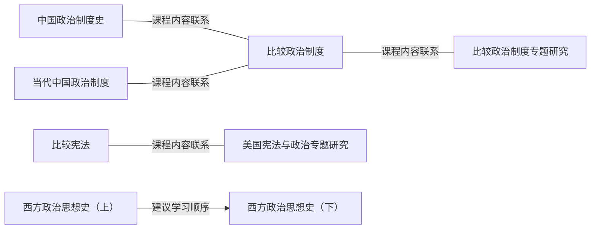

# 2025政治学与行政学专业-政治学-本博融通培养方案（留学生适用）

国际关系与公共事务学院 · 政治学与行政学 · 方案 96751 · 75 个不同课程或科研条目。

[官方 Word](../originals/plan-96751.docx) · [教务详情](https://fdjwgl.fudan.edu.cn/manager/bizType/2/major-program-search/info/96751?skipAuth=1) · [方案快照](../raw/plan-96751.json.gz) · [年级目录](../README.md)

## 课程关系图

图中展示部分关系。下表保留全部已建立的课程对，来源位置使用本方案 JSON Pointer。

## 先修与内容联系

| 类型 | 起点 | 终点 | 依据 | 原表定位 |
| --- | --- | --- | --- | --- |
| 建议学习顺序 | 西方政治思想史（上） (POLI20013) | 西方政治思想史（下） (POLI20014) | 同方案的课程题名具有连续分册或序号。  | `/courseModules/3/planCourses/4`、`/courseModules/3/planCourses/5` |
| 课程内容联系 | 当代中国政治制度 (POLI10009) | 比较政治制度 (POLI20022) | 均涉及政治制度，可对照制度安排与研究对象。  | `/courseModules/2/planCourses/3`、`/courseModules/3/planCourses/0` |
| 课程内容联系 | 中国政治制度史 (POLI20007) | 比较政治制度 (POLI20022) | 本方案两门课程的题名均含“政治制度”，可据此对照这一主题。  | `/courseModules/3/planCourses/2`、`/courseModules/3/planCourses/0` |
| 课程内容联系 | 比较政治制度 (POLI20022) | 比较政治制度专题研究 (POLI60001) | 本方案两门课程的题名均含“政治制度”，可据此对照这一主题。  | `/courseModules/3/planCourses/0`、`/courseModules/7/planCourses/6` |
| 课程内容联系 | 比较宪法 (POLI30014) | 美国宪法与政治专题研究 (POLI80001) | 本方案两门课程的题名均含“宪法”，可据此对照这一主题。  | `/courseModules/6/planCourses/5`、`/courseModules/7/planCourses/18` |

本次未从可定位的明确表述中确认课程对课程预修。学期安排、系列分册与编辑建议均保留各自的依据。

## 课程表

同一课程在不同模块分别出现时，按原表逐行列出。季节字段保留原值。

| 课程 | 代码 | 学分 | 学期 | 模块 |
| --- | --- | ---: | --- | --- |
| 政治学原理 | POLI10004 | 4.0 | 第1学期 | 培养方案 / 专业培养课程 / 学科基础课程 |
| 公共行政学 | MANA10001 | 4.0 | 第1学期 | 培养方案 / 专业培养课程 / 学科基础课程 |
| 国际关系导论 | POLI10003 | 4.0 | 第1学期、第2学期 | 培养方案 / 专业培养课程 / 学科基础课程 |
| 当代中国政治制度 | POLI10009 | 3.0 | 第2学期 | 培养方案 / 专业培养课程 / 学科基础课程 |
| 公共政策概论 | POLI10006 | 3.0 | 第2学期 | 培养方案 / 专业培养课程 / 学科基础课程 |
| 全球治理概论 | POLI10001 | 3.0 | 第2学期 | 培养方案 / 专业培养课程 / 学科基础课程 |
| 计算社会科学 | POLI10002 | 3.0 | 第3学期 | 培养方案 / 专业培养课程 / 学科基础课程 |
| 高等数学D | MATH10008 | 4.0 | 第1学期 | 培养方案 / 专业培养课程 / 学科基础课程 |
| 比较政治制度 | POLI20022 | 3.0 | 第3学期、第4学期 | 培养方案 / 专业培养课程 / 专业核心教育课程 |
| 中国政治思想史 | POLI20006 | 3.0 | 第3学期、第4学期 | 培养方案 / 专业培养课程 / 专业核心教育课程 |
| 中国政治制度史 | POLI20007 | 3.0 | 第3学期、第4学期 | 培养方案 / 专业培养课程 / 专业核心教育课程 |
| 中国社会政治分析 | POLI20025 | 3.0 | 第3学期、第4学期 | 培养方案 / 专业培养课程 / 专业核心教育课程 |
| 西方政治思想史（上） | POLI20013 | 3.0 | 第3学期、第4学期 | 培养方案 / 专业培养课程 / 专业核心教育课程 |
| 西方政治思想史（下） | POLI20014 | 3.0 | 第3学期、第4学期 | 培养方案 / 专业培养课程 / 专业核心教育课程 |
| 当代西方政治学 | POLI30002 | 3.0 | 第5学期、第6学期 | 培养方案 / 专业培养课程 / 专业核心教育课程 |
| 国家理论研究 | POLI30022 | 3.0 | 第5学期、第6学期 | 培养方案 / 专业培养课程 / 专业核心教育课程 |
| 政府经济学 | POLI30025 | 3.0 | 第5学期、第6学期 | 培养方案 / 专业培养课程 / 专业核心教育课程 |
| 比较政治学导论 | POLI40017 | 2.0 | 第5学期、第6学期 | 培养方案 / 专业培养课程 / 专业核心教育课程 |
| 当代世界政治思潮 | POLI30019 | 2.0 | 第5学期、第6学期 | 培养方案 / 专业培养课程 / 专业核心教育课程 |
| 社会科学研究方法 | POLI20016 | 3.0 | 第3学期、第4学期 | 培养方案 / 专业培养课程 / 专业核心教育课程 |
| 政治修辞学 | POLI20003 | 2.0 | 第3学期、第4学期 | 培养方案 / 专业进阶I |
| 发展政治学 | POLI20024 | 2.0 | 第3学期、第4学期 | 培养方案 / 专业进阶I |
| 政治社会学 | POLI20030 | 2.0 | 第3学期、第4学期 | 培养方案 / 专业进阶I |
| 西方政治史经典选读 | POLI20019 | 2.0 | 第3学期、第4学期 | 培养方案 / 专业进阶I |
| 比较政党制度 | POLI30034 | 2.0 | 第5学期、第6学期 | 培养方案 / 专业进阶I |
| 比较宪法 | POLI30014 | 2.0 | 第5学期、第6学期 | 培养方案 / 专业进阶I |
| 比较政治经济分析 | POLI30059 | 2.0 | 第5学期、第6学期 | 培养方案 / 专业进阶I |
| 选举政治学 | POLI30038 | 2.0 | 第5学期、第6学期 | 培养方案 / 专业进阶I |
| 政治人类学导论 | POLI30064 | 2.0 | 第5学期、第6学期 | 培养方案 / 专业进阶I |
| 政治心理学 | POLI30009 | 2.0 | 第5学期、第6学期 | 培养方案 / 专业进阶I |
| 政治传播学 | POLI30020 | 2.0 | 第5学期、第6学期 | 培养方案 / 专业进阶I |
| 地方政府与治理 | POLI30001 | 2.0 | 第5学期、第6学期 | 培养方案 / 专业进阶I |
| 福利政治 | POLI30004 | 2.0 | 第5学期、第6学期 | 培养方案 / 专业进阶I |
| 美国政治与对外关系 | POLI40002 | 2.0 | 第7学期、第8学期 | 培养方案 / 专业进阶I |
| 欧盟政治与对外关系 | POLI30029 | 2.0 | 第7学期、第8学期 | 培养方案 / 专业进阶I |
| 发展中国家政治与对外关系 | POLI40018 | 2.0 | 第7学期、第8学期 | 培养方案 / 专业进阶I |
| 博弈论 | POLI40008 | 2.0 | 第5学期、第6学期 | 培养方案 / 专业进阶I |
| 制度分析 | POLI30012 | 2.0 | 第5学期、第6学期 | 培养方案 / 专业进阶I |
| 田野调查方法 | POLI40001 | 2.0 | 第5学期、第6学期 | 培养方案 / 专业进阶I |
| 马克思主义政治学经典文献选读 | POLI50003 | 3.0 | 第9学期、第10学期 | 培养方案 / 专业进阶II |
| 当代中国政治行政经典文献选读 | POLI60005 | 3.0 | 第9学期、第10学期 | 培养方案 / 专业进阶II |
| 研究设计与论文写作 | POLI50002 | 2.0 | 第9学期、第10学期 | 培养方案 / 专业进阶II |
| 战略研究与政策分析 | POLI60013 | 2.0 | 第9学期、第10学期 | 培养方案 / 专业进阶II |
| 比较政治学前沿理论 | POLI50006 | 3.0 | 第9学期、第10学期 | 培养方案 / 专业进阶II |
| 国外政治经典名著选读 | POLI60010 | 3.0 | 第11学期、第12学期 | 培养方案 / 专业进阶II |
| 比较政治制度专题研究 | POLI60001 | 3.0 | 第11学期、第12学期 | 培养方案 / 专业进阶II |
| 比较政治经济学专题研究 | POLI70006 | 3.0 | 第11学期、第12学期 | 培养方案 / 专业进阶II |
| 政治哲学专题研究 | POLI60003 | 3.0 | 第11学期、第12学期 | 培养方案 / 专业进阶II |
| 中国社会政治分析专题研究 | POLI60004 | 3.0 | 第9学期、第10学期 | 培养方案 / 专业进阶II |
| 当代中国政府与政治专题研究 | POLI60008 | 3.0 | 第11学期、第12学期 | 培养方案 / 专业进阶II |
| 中国式现代化研究 | POLI60019 | 3.0 | 第11学期、第12学期 | 培养方案 / 专业进阶II |
| 当代中国政治学发展专题研究 | POLI60011 | 3.0 | 第11学期、第12学期 | 培养方案 / 专业进阶II |
| 中国古代政治名著选读 | POLI70012 | 3.0 | 第11学期、第12学期 | 培养方案 / 专业进阶II |
| 中国古代行政区划专题研究 | POLI70010 | 3.0 | 第11学期、第12学期 | 培养方案 / 专业进阶II |
| 区域发展与地方治理专题研究 | POLI60002 | 3.0 | 第11学期、第12学期 | 培养方案 / 专业进阶II |
| 政治文化专题研究 | POLI70016 | 3.0 | 第11学期、第12学期 | 培养方案 / 专业进阶II |
| 环境政治学专题研究 | POLI60006 | 3.0 | 第11学期、第12学期 | 培养方案 / 专业进阶II |
| 美国宪法与政治专题研究 | POLI80001 | 3.0 | 第11学期、第12学期 | 培养方案 / 专业进阶II |
| 非洲政治与对外关系 | POLI30015 | 2.0 | 第11学期、第12学期 | 培养方案 / 专业进阶II |
| 当代世界政治思潮专题研究 | POLI60012 | 3.0 | 第11学期、第12学期 | 培养方案 / 专业进阶II |
| 美国专题研究 | POLI70015 | 3.0 | 第13学期、第14学期 | 培养方案 / 专业进阶II |
| 欧洲专题研究 | POLI50004 | 3.0 | 第13学期、第14学期 | 培养方案 / 专业进阶II |
| 全球南方专题研究 | POLI70007 | 3.0 | 第13学期、第14学期 | 培养方案 / 专业进阶II |
| 复芏计划(FDUROP) | 102 | 0.0 |  | 融合创新能力 |
| 研究生科研项目 | 41 | 0.0 |  | 融合创新能力 |
| 研究生学术活动 | 4 | 2.0 |  | 融合创新能力 |
| 研究生实践活动 | 5 | 2.0 |  | 融合创新能力 |
| 国际交流 | 7 | 0.0 |  | 融合创新能力 |
| 博士生资格考核 | 2 | 0.0 |  | 融合创新能力 |
| 博士学位论文开题 | 1 | 0.0 |  | 融合创新能力 |
| 博士论文中期考核 | 3 | 0.0 |  | 融合创新能力 |
| 博士学位论文预审 | 6 | 0.0 |  | 融合创新能力 |
| 毕业论文 | POLI40012 | 4.0 | 第8学期 | 融合创新能力 |
| 社会实践 | POLI40011 | 2.0 | 第8学期 | 融合创新能力 |
| 科研实践Ⅱ | POLI30066 | 4.0 | 第6学期、第7学期 | 融合创新能力 |
