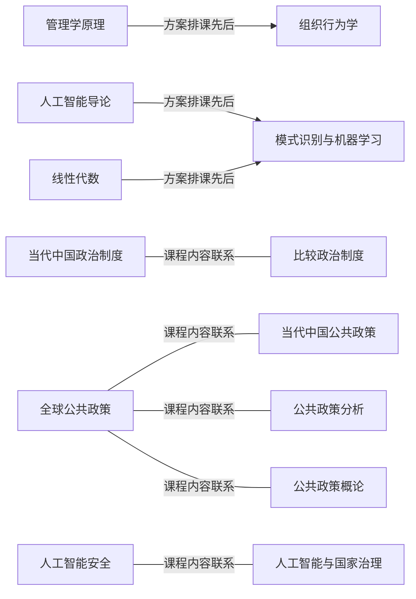

# 2025行政管理（公共政策）-人工智能双学士学位复合型人才培养项目本硕融通培养方案

国际关系与公共事务学院 · 行政管理(公共政策)-人工智能(双学士学位项目) · 方案 96766 · 86 个不同课程或科研条目。

[官方 Word](../originals/plan-96766.docx) · [教务详情](https://fdjwgl.fudan.edu.cn/manager/bizType/2/major-program-search/info/96766?skipAuth=1) · [方案快照](../raw/plan-96766.json.gz) · [年级目录](../README.md)

## 修读导读

- **建议先学**　《管理学原理》（`GEEC10006`） → 《组织行为学》（`POLI30031`）。组织与管理基本概念有助于组织行为分析。

- **可以对照着读**　《当代中国政治制度》（`POLI10009`）与《比较政治制度》（`POLI20022`）。均涉及政治制度，可对照制度安排与研究对象。

- **查模块选课**　《当代中国公共政策》（`MANA20003`）、《公共行政学说史》（`MANA30010`）列在“专业核心教育课程”中。原表见 `/courseModules/3`。

## 课程关系图

图中展示部分关系。下表保留全部已建立的课程对，来源位置使用本方案 JSON Pointer。

## 先修与内容联系

| 类型 | 起点 | 终点 | 依据 | 原表定位 |
| --- | --- | --- | --- | --- |
| 建议学习顺序 | 人工智能导论 (AIE310005) | 模式识别与机器学习 (AIE410001) | 人工智能问题与模型类别可为学习模式识别作准备。  | `/courseModules/3/planCourses/19`、`/courseModules/3/planCourses/21` |
| 建议学习顺序 | 线性代数 (CS10003) | 模式识别与机器学习 (AIE410001) | 向量表示和矩阵运算支持理解分类、回归等模型。  | `/courseModules/2/planCourses/7`、`/courseModules/3/planCourses/21` |
| 建议学习顺序 | 管理学原理 (GEEC10006) | 组织行为学 (POLI30031) | 组织与管理基本概念有助于组织行为分析。  | `/courseModules/3/planCourses/0`、`/courseModules/3/planCourses/9` |
| 方案排课先后 | 人工智能导论 (AIE310005) | 模式识别与机器学习 (AIE410001) | 同方案该课程全部明确数字学期均早于后者。  | `/courseModules/3/planCourses/19`、`/courseModules/3/planCourses/21` |
| 方案排课先后 | 线性代数 (CS10003) | 模式识别与机器学习 (AIE410001) | 同方案该课程全部明确数字学期均早于后者。  | `/courseModules/2/planCourses/7`、`/courseModules/3/planCourses/21` |
| 方案排课先后 | 管理学原理 (GEEC10006) | 组织行为学 (POLI30031) | 同方案该课程全部明确数字学期均早于后者。  | `/courseModules/3/planCourses/0`、`/courseModules/3/planCourses/9` |
| 课程内容联系 | 计算机系统基础 (AIE210006) | 计算机组成与体系结构 (CS30052) | 处理器、存储与系统执行模型具有共同内容。  | `/courseModules/3/planCourses/18`、`/courseModules/9/planCourses/1` |
| 课程内容联系 | 人工智能导论 (AIE310005) | 人工智能安全 (AIE831001) | 本方案两门课程的题名均含“人工智能”，可据此对照这一主题。  | `/courseModules/3/planCourses/19`、`/courseModules/3/planCourses/22` |
| 课程内容联系 | 人工智能的编程基础 (AIE310006) | 人工智能安全 (AIE831001) | 本方案两门课程的题名均含“人工智能”，可据此对照这一主题。  | `/courseModules/3/planCourses/15`、`/courseModules/3/planCourses/22` |
| 课程内容联系 | 人工智能的数学基础 (AIE310009) | 模式识别与机器学习 (AIE410001) | 数学表达与学习模型的统计、优化工具可对照。  | `/courseModules/3/planCourses/17`、`/courseModules/3/planCourses/21` |
| 课程内容联系 | 人工智能的数学基础 (AIE310009) | 人工智能安全 (AIE831001) | 本方案两门课程的题名均含“人工智能”，可据此对照这一主题。  | `/courseModules/3/planCourses/17`、`/courseModules/3/planCourses/22` |
| 课程内容联系 | 模式识别与机器学习 (AIE410001) | 机器学习系统 (CS30058) | 本方案两门课程的题名均含“机器学习”，可据此对照这一主题。  | `/courseModules/3/planCourses/21`、`/courseModules/9/planCourses/5` |
| 课程内容联系 | 人工智能安全 (AIE831001) | 人工智能与国家治理 (AIS310012) | 本方案两门课程的题名均含“人工智能”，可据此对照这一主题。  | `/courseModules/3/planCourses/22`、`/courseModules/6/planCourses/9` |
| 课程内容联系 | 全球公共政策 (GEEC20011) | 当代中国公共政策 (MANA20003) | 本方案两门课程的题名均含“公共政策”，可据此对照这一主题。  | `/courseModules/8/planCourses/3`、`/courseModules/3/planCourses/11` |
| 课程内容联系 | 全球公共政策 (GEEC20011) | 公共政策分析 (MANA30006) | 本方案两门课程的题名均含“公共政策”，可据此对照这一主题。  | `/courseModules/8/planCourses/3`、`/courseModules/8/planCourses/1` |
| 课程内容联系 | 全球公共政策 (GEEC20011) | 公共政策概论 (POLI10006) | 本方案两门课程的题名均含“公共政策”，可据此对照这一主题。  | `/courseModules/8/planCourses/3`、`/courseModules/2/planCourses/4` |
| 课程内容联系 | 当代中国政治制度 (POLI10009) | 比较政治制度 (POLI20022) | 均涉及政治制度，可对照制度安排与研究对象。  | `/courseModules/2/planCourses/3`、`/courseModules/3/planCourses/2` |

本次未从可定位的明确表述中确认课程对课程预修。学期安排、系列分册与编辑建议均保留各自的依据。

## 按原方案模块阅读

同一模块展示原表中的课程归属。模块内课程之间的先后仍须逐项查阅。

- **本博学术创新衔接课程包**　AI赋能的政务服务再造、运筹学、发展经济学、博弈论、田野调查方法、全球公共政策、港台政治与行政、政策调研与写作、城乡治理理论与实践、公共管理、政府财政与预算、政府运行保障管理、公共政策分析、应急管理、政府监管理论与实践、行政与外交文书、国际公共行政、政策推演与模拟等19项（原表模块 8）
- **人工智能专业进阶**　数据库引论、软件工程、计算机图形学A、计算机网络、集合与图论、计算机组成与体系结构、机器学习系统（原表模块 9）

## 课程表

同一课程在不同模块分别出现时，按原表逐行列出。季节字段保留原值。

| 课程 | 代码 | 学分 | 学期 | 模块 |
| --- | --- | ---: | --- | --- |
| 政治学原理 | POLI10004 | 4.0 | 第1学期 | 培养方案 / 专业培养课程 / 学科基础课程 |
| 公共行政学 | MANA10001 | 4.0 | 第1学期 | 培养方案 / 专业培养课程 / 学科基础课程 |
| 国际关系导论 | POLI10003 | 4.0 | 第1学期、第2学期 | 培养方案 / 专业培养课程 / 学科基础课程 |
| 当代中国政治制度 | POLI10009 | 3.0 | 第2学期 | 培养方案 / 专业培养课程 / 学科基础课程 |
| 公共政策概论 | POLI10006 | 3.0 | 第2学期 | 培养方案 / 专业培养课程 / 学科基础课程 |
| 全球治理概论 | POLI10001 | 3.0 | 第2学期 | 培养方案 / 专业培养课程 / 学科基础课程 |
| 统计学 | SOCI20003 | 3.0 | 第1学期、第2学期 | 培养方案 / 专业培养课程 / 学科基础课程 |
| 线性代数 | CS10003 | 3.0 | 第1学期 | 培养方案 / 专业培养课程 / 学科基础课程 |
| 程序设计 | CS10004 | 4.0 | 第1学期 | 培养方案 / 专业培养课程 / 学科基础课程 |
| 高等数学D | MATH10008 | 4.0 | 第1学期 | 培养方案 / 专业培养课程 / 学科基础课程 |
| 微观经济学 | ECON20003 | 3.0 | 第3学期 | 培养方案 / 专业培养课程 / 学科基础课程 |
| 宏观经济学 | ECON20004 | 3.0 | 第4学期 | 培养方案 / 专业培养课程 / 学科基础课程 |
| 管理学原理 | GEEC10006 | 2.0 | 第1学期、第2学期 | 培养方案 / 专业培养课程 / 专业核心教育课程 |
| 政府经济学 | POLI30025 | 3.0 | 第3学期、第4学期 | 培养方案 / 专业培养课程 / 专业核心教育课程 |
| 比较政治制度 | POLI20022 | 3.0 | 第3学期、第4学期 | 培养方案 / 专业培养课程 / 专业核心教育课程 |
| 公共行政学说史 | MANA30010 | 2.0 | 第3学期、第4学期 | 培养方案 / 专业培养课程 / 专业核心教育课程 |
| 数字治理 | MANA20004 | 2.0 | 第3学期、第4学期 | 培养方案 / 专业培养课程 / 专业核心教育课程 |
| 行政法 | POLI30032 | 3.0 | 第3学期、第4学期 | 培养方案 / 专业培养课程 / 专业核心教育课程 |
| 比较公共行政 | MANA50002 | 2.0 | 第5学期、第6学期 | 培养方案 / 专业培养课程 / 专业核心教育课程 |
| 公务员制度 | MANA30001 | 3.0 | 第5学期、第6学期 | 培养方案 / 专业培养课程 / 专业核心教育课程 |
| 人力资源开发与管理 | POLI20028 | 2.0 | 第5学期、第6学期 | 培养方案 / 专业培养课程 / 专业核心教育课程 |
| 组织行为学 | POLI30031 | 2.0 | 第5学期、第6学期 | 培养方案 / 专业培养课程 / 专业核心教育课程 |
| 当代中国公共行政 | POLI30047 | 3.0 | 第5学期、第6学期 | 培养方案 / 专业培养课程 / 专业核心教育课程 |
| 当代中国公共政策 | MANA20003 | 3.0 | 第5学期、第6学期 | 培养方案 / 专业培养课程 / 专业核心教育课程 |
| 公共管理伦理 | POLI30058 | 2.0 | 第5学期、第6学期 | 培养方案 / 专业培养课程 / 专业核心教育课程 |
| 公共事业管理 | POLI20031 | 2.0 | 第5学期、第6学期 | 培养方案 / 专业培养课程 / 专业核心教育课程 |
| 社会科学研究方法 | POLI20016 | 3.0 | 第3学期、第4学期 | 培养方案 / 专业培养课程 / 专业核心教育课程 |
| 人工智能的编程基础 | AIE310006 | 2.0 | 第2学期 | 培养方案 / 专业培养课程 / 专业核心教育课程 |
| 数据结构 | AIE310007 | 4.0 | 第3学期 | 培养方案 / 专业培养课程 / 专业核心教育课程 |
| 人工智能的数学基础 | AIE310009 | 3.0 | 第3学期 | 培养方案 / 专业培养课程 / 专业核心教育课程 |
| 计算机系统基础 | AIE210006 | 3.0 | 第3学期 | 培养方案 / 专业培养课程 / 专业核心教育课程 |
| 人工智能导论 | AIE310005 | 3.0 | 第4学期 | 培养方案 / 专业培养课程 / 专业核心教育课程 |
| 人工智能的软件基础 | AIE310008 | 3.0 | 第4学期 | 培养方案 / 专业培养课程 / 专业核心教育课程 |
| 模式识别与机器学习 | AIE410001 | 3.0 | 第5学期 | 培养方案 / 专业培养课程 / 专业核心教育课程 |
| 人工智能安全 | AIE831001 | 3.0 | 第5学期 | 培养方案 / 专业培养课程 / 专业核心教育课程 |
| 人工智能的伦理与治理 | PHIL50006 | 2.0 | 第4学期、第6学期 | 培养方案 / 专业培养课程 / 专业核心教育课程 |
| 自然语言处理与大语言模型 | AIE410002 | 3.0 | 第6学期 | 培养方案 / 专业培养课程 / 专业核心教育课程 |
| 计算机视觉 | AIE310004 | 3.0 | 第7学期 | 培养方案 / 专业培养课程 / 专业核心教育课程 |
| 人工智能前沿探索实践 | AIE531001 | 3.0 | 第7学期 | 培养方案 / 专业培养课程 / 专业核心教育课程 |
| 战略研究与政策分析 | POLI60013 | 2.0 | 第9学期、第10学期 | 培养方案 / 专业进阶II |
| 公共行政的艺术与实践 | MANA70017 | 3.0 | 第9学期、第10学期 | 培养方案 / 专业进阶II |
| 数字时代的政府治理 | MANA50005 | 2.0 | 第9学期、第10学期 | 培养方案 / 专业进阶II |
| 风险分析与评估 | MANA70006 | 2.0 | 第9学期、第10学期 | 培养方案 / 专业进阶II |
| 国有资产管理研究 | MANA60065 | 2.0 | 第9学期、第10学期 | 培养方案 / 专业进阶II |
| 公共机构节能管理 | MANA60005 | 2.0 | 第9学期、第10学期 | 培养方案 / 专业进阶II |
| 政府采购 | MANA30009 | 2.0 | 第9学期、第10学期 | 培养方案 / 专业进阶II |
| 灾害社会学理论与实践 | MANA70004 | 2.0 | 第9学期、第10学期 | 培养方案 / 专业进阶II |
| 风险沟通理论与实践 | POLI60018 | 2.0 | 第9学期、第10学期 | 培养方案 / 专业进阶II |
| 人工智能与国家治理 | AIS310012 | 2.0 | 第9学期、第10学期 | 培养方案 / 专业进阶II |
| 社会科学数据分析 | POLI50007 | 3.0 | 第9学期、第10学期 | 培养方案 / 专业进阶II |
| 公共管理 | MANA20002 | 3.0 | 第3学期、第4学期 | 培养方案 / 专业进阶I / 本博学术创新衔接课程包 |
| 公共政策分析 | MANA30006 | 3.0 | 第3学期、第4学期 | 培养方案 / 专业进阶I / 本博学术创新衔接课程包 |
| 政府财政与预算 | MANA30004 | 3.0 | 第3学期、第4学期 | 培养方案 / 专业进阶I / 本博学术创新衔接课程包 |
| 全球公共政策 | GEEC20011 | 2.0 | 第3学期、第4学期 | 培养方案 / 专业进阶I / 本博学术创新衔接课程包 |
| 应急管理 | MANA70005 | 3.0 | 第3学期、第4学期 | 培养方案 / 专业进阶I / 本博学术创新衔接课程包 |
| 政府运行保障管理 | MANA30005 | 3.0 | 第3学期、第4学期 | 培养方案 / 专业进阶I / 本博学术创新衔接课程包 |
| 政策调研与写作 | GEXZ10024 | 2.0 | 第5学期、第6学期 | 培养方案 / 专业进阶I / 本博学术创新衔接课程包 |
| 政策推演与模拟 | POLI30011 | 2.0 | 第5学期、第6学期 | 培养方案 / 专业进阶I / 本博学术创新衔接课程包 |
| 行政与外交文书 | POLI20010 | 2.0 | 第7学期、第8学期 | 培养方案 / 专业进阶I / 本博学术创新衔接课程包 |
| 国际公共行政 | POLI30005 | 2.0 | 第7学期、第8学期 | 培养方案 / 专业进阶I / 本博学术创新衔接课程包 |
| AI赋能的政务服务再造 | AIT531018 | 3.0 | 第7学期、第8学期 | 培养方案 / 专业进阶I / 本博学术创新衔接课程包 |
| 城乡治理理论与实践 | MANA20001 | 2.0 | 第7学期、第8学期 | 培养方案 / 专业进阶I / 本博学术创新衔接课程包 |
| 发展经济学 | ECON30026 | 3.0 | 第7学期、第8学期 | 培养方案 / 专业进阶I / 本博学术创新衔接课程包 |
| 地理信息系统与空间分析 | POLI30061 | 2.0 | 第7学期、第8学期 | 培养方案 / 专业进阶I / 本博学术创新衔接课程包 |
| 港台政治与行政 | GEEC30013 | 2.0 | 第7学期、第8学期 | 培养方案 / 专业进阶I / 本博学术创新衔接课程包 |
| 政府监管理论与实践 | MANA70007 | 2.0 | 第9学期、第10学期 | 培养方案 / 专业进阶I / 本博学术创新衔接课程包 |
| 运筹学 | CS30035 | 3.0 | 第9学期、第10学期 | 培养方案 / 专业进阶I / 本博学术创新衔接课程包 |
| 博弈论 | ECON30054 | 3.0 | 第9学期、第10学期 | 培养方案 / 专业进阶I / 本博学术创新衔接课程包 |
| 田野调查方法 | ESE50034 | 2.0 | 第9学期、第10学期 | 培养方案 / 专业进阶I / 本博学术创新衔接课程包 |
| 集合与图论 | CS30043 | 3.0 | 第3学期 | 培养方案 / 专业进阶I / 人工智能专业进阶 |
| 计算机组成与体系结构 | CS30052 | 4.0 | 第4学期 | 培养方案 / 专业进阶I / 人工智能专业进阶 |
| 数据库引论 | CS20010 | 3.0 | 第4学期 | 培养方案 / 专业进阶I / 人工智能专业进阶 |
| 计算机网络 | CS30036 | 3.0 | 第5学期 | 培养方案 / 专业进阶I / 人工智能专业进阶 |
| 软件工程 | CS30018 | 3.0 | 第6学期 | 培养方案 / 专业进阶I / 人工智能专业进阶 |
| 机器学习系统 | CS30058 | 3.0 | 第6学期 | 培养方案 / 专业进阶I / 人工智能专业进阶 |
| 计算机图形学A | CS30019 | 3.0 | 第6学期 | 培养方案 / 专业进阶I / 人工智能专业进阶 |
| 其他本科生学术研究计划 | 1021 | 0.0 |  | 融合创新能力 |
| 研究生科研项目 | 41 | 0.0 |  | 融合创新能力 |
| 研究生学术活动 | 4 | 2.0 |  | 融合创新能力 |
| 研究生实践活动 | 5 | 2.0 |  | 融合创新能力 |
| 硕士学位论文开题 | 11 | 0.0 |  | 融合创新能力 |
| 硕士论文中期考核 | 31 | 0.0 |  | 融合创新能力 |
| 硕士学位论文预审 | 61 | 0.0 |  | 融合创新能力 |
| 毕业论文 | POLI40012 | 4.0 | 第8学期 | 融合创新能力 |
| 社会实践 | POLI40011 | 2.0 | 第8学期 | 融合创新能力 |
| 科研实践Ⅰ | POLI30065 | 4.0 | 第6学期、第7学期 | 融合创新能力 |
