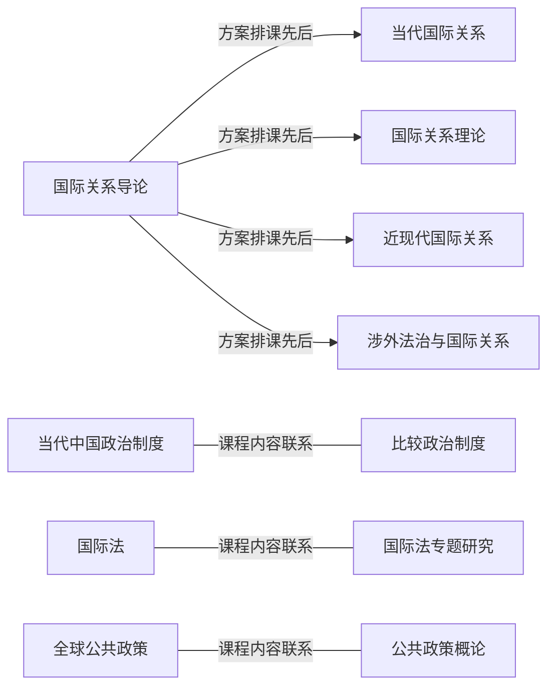

# 2025国际政治专业-政治学-本硕融通培养方案（留学生适用）

国际关系与公共事务学院 · 国际政治 · 方案 96769 · 166 个不同课程或科研条目。

[官方 Word](../originals/plan-96769.docx) · [教务详情](https://fdjwgl.fudan.edu.cn/manager/bizType/2/major-program-search/info/96769?skipAuth=1) · [方案快照](../raw/plan-96769.json.gz) · [年级目录](../README.md)

## 修读导读

- **建议先学**　《国际关系导论》（`POLI10003`） → 《当代国际关系》（`POLI20012`）。国际体系和行为体概念可用于时事与历史案例分析。

- **可以对照着读**　《当代中国政治制度》（`POLI10009`）与《比较政治制度》（`POLI20022`）。均涉及政治制度，可对照制度安排与研究对象。

- **查模块选课**　《国际关系理论》（`POLI20018`）、《近现代国际关系》（`POLI20027`）列在“专业核心教育课程”中。原表见 `/courseModules/8`。

## 课程关系图

图中展示部分关系。下表保留全部已建立的课程对，来源位置使用本方案 JSON Pointer。

## 先修与内容联系

| 类型 | 起点 | 终点 | 依据 | 原表定位 |
| --- | --- | --- | --- | --- |
| 建议学习顺序 | 国际关系导论 (POLI10003) | 当代国际关系 (POLI20012) | 国际体系和行为体概念可用于时事与历史案例分析。  | `/courseModules/7/planCourses/2`、`/courseModules/8/planCourses/2` |
| 建议学习顺序 | 国际关系导论 (POLI10003) | 国际关系理论 (POLI20018) | “国际关系导论”题名标明基础层次，前置阅读可帮助了解“国际关系理论”中的国际关系主题。  | `/courseModules/7/planCourses/2`、`/courseModules/8/planCourses/0` |
| 建议学习顺序 | 国际关系导论 (POLI10003) | 近现代国际关系 (POLI20027) | “国际关系导论”题名标明基础层次，前置阅读可帮助了解“近现代国际关系”中的国际关系主题。  | `/courseModules/7/planCourses/2`、`/courseModules/8/planCourses/1` |
| 建议学习顺序 | 国际关系导论 (POLI10003) | 涉外法治与国际关系 (POLI30007) | “国际关系导论”题名标明基础层次，前置阅读可帮助了解“涉外法治与国际关系”中的国际关系主题。  | `/courseModules/7/planCourses/2`、`/courseModules/11/planCourses/11` |
| 方案排课先后 | 国际关系导论 (POLI10003) | 当代国际关系 (POLI20012) | 同方案该课程全部明确数字学期均早于后者。  | `/courseModules/7/planCourses/2`、`/courseModules/8/planCourses/2` |
| 方案排课先后 | 国际关系导论 (POLI10003) | 国际关系理论 (POLI20018) | 同方案该课程全部明确数字学期均早于后者。  | `/courseModules/7/planCourses/2`、`/courseModules/8/planCourses/0` |
| 方案排课先后 | 国际关系导论 (POLI10003) | 近现代国际关系 (POLI20027) | 同方案该课程全部明确数字学期均早于后者。  | `/courseModules/7/planCourses/2`、`/courseModules/8/planCourses/1` |
| 方案排课先后 | 国际关系导论 (POLI10003) | 涉外法治与国际关系 (POLI30007) | 同方案该课程全部明确数字学期均早于后者。  | `/courseModules/7/planCourses/2`、`/courseModules/11/planCourses/11` |
| 课程内容联系 | 全球公共政策 (MANA30002) | 公共政策概论 (POLI10006) | 本方案两门课程的题名均含“公共政策”，可据此对照这一主题。  | `/courseModules/11/planCourses/10`、`/courseModules/7/planCourses/4` |
| 课程内容联系 | 国际关系导论 (POLI10003) | 当代国际关系 (POLI20012) | 本方案两门课程的题名均含“国际关系”，可据此对照这一主题。  | `/courseModules/7/planCourses/2`、`/courseModules/8/planCourses/2` |
| 课程内容联系 | 国际关系导论 (POLI10003) | 国际关系理论 (POLI20018) | 本方案两门课程的题名均含“国际关系”，可据此对照这一主题。  | `/courseModules/7/planCourses/2`、`/courseModules/8/planCourses/0` |
| 课程内容联系 | 国际关系导论 (POLI10003) | 近现代国际关系 (POLI20027) | 本方案两门课程的题名均含“国际关系”，可据此对照这一主题。  | `/courseModules/7/planCourses/2`、`/courseModules/8/planCourses/1` |
| 课程内容联系 | 国际关系导论 (POLI10003) | 涉外法治与国际关系 (POLI30007) | 本方案两门课程的题名均含“国际关系”，可据此对照这一主题。  | `/courseModules/7/planCourses/2`、`/courseModules/11/planCourses/11` |
| 课程内容联系 | 当代中国政治制度 (POLI10009) | 比较政治制度 (POLI20022) | 均涉及政治制度，可对照制度安排与研究对象。  | `/courseModules/7/planCourses/3`、`/courseModules/8/planCourses/5` |
| 课程内容联系 | 国际法 (POLI20015) | 国际法专题研究 (POLI60009) | 本方案两门课程的题名均含“国际法”，可据此对照这一主题。  | `/courseModules/8/planCourses/8`、`/courseModules/12/planCourses/8` |

本次未从可定位的明确表述中确认课程对课程预修。学期安排、系列分册与编辑建议均保留各自的依据。

## 课程表

同一课程在不同模块分别出现时，按原表逐行列出。季节字段保留原值。

| 课程 | 代码 | 学分 | 学期 | 模块 |
| --- | --- | ---: | --- | --- |
| 学术英语（科学技术） | GEEF30013 | 2.0 | SPRING、AUTUMN | 培养方案 / 通识教育课程 / 通识教育专项教育课程 / 大学外语 |
| 跨文化交际 | GEEF30029 | 2.0 | SPRING、AUTUMN | 培养方案 / 通识教育课程 / 通识教育专项教育课程 / 大学外语 |
| 英语视听 | GEEF20004 | 2.0 | SPRING、AUTUMN | 培养方案 / 通识教育课程 / 通识教育专项教育课程 / 大学外语 |
| 学术英语（科学技术） | GEEF30013 | 2.0 | SPRING、AUTUMN | 培养方案 / 通识教育课程 / 通识教育专项教育课程 / 大学外语 |
| 跨文化交际 | GEEF30029 | 2.0 | SPRING、AUTUMN | 培养方案 / 通识教育课程 / 通识教育专项教育课程 / 大学外语 |
| 英语视听 | GEEF20004 | 2.0 | SPRING、AUTUMN | 培养方案 / 通识教育课程 / 通识教育专项教育课程 / 大学外语 |
| 复旦大学英语水平测试 | GEEF30032 | 0.0 | SPRING、AUTUMN | 培养方案 / 通识教育课程 / 通识教育专项教育课程 / 大学外语 |
| 大学英语高阶课程 | GEEF30033 | 2.0 | SPRING、AUTUMN | 培养方案 / 通识教育课程 / 通识教育专项教育课程 / 大学外语 |
| 学术英语（综合） | GEEF30023 | 2.0 | SPRING、AUTUMN | 培养方案 / 通识教育课程 / 通识教育专项教育课程 / 大学外语 |
| 学术英语（社会科学） | GEEF30014 | 2.0 | SPRING、AUTUMN | 培养方案 / 通识教育课程 / 通识教育专项教育课程 / 大学外语 |
| 中外大学文化对比研究 | GEEF30024 | 2.0 | SPRING、AUTUMN | 培养方案 / 通识教育课程 / 通识教育专项教育课程 / 大学外语 |
| 基础俄语Ⅰ | GESF10005 | 2.0 | SPRING、AUTUMN | 培养方案 / 通识教育课程 / 通识教育专项教育课程 / 大学外语 |
| 复旦大学英语水平测试 | GEEF30032 | 0.0 | SPRING、AUTUMN | 培养方案 / 通识教育课程 / 通识教育专项教育课程 / 大学外语 |
| 大学英语进阶课程 | GEEF20016 | 2.0 | SPRING、AUTUMN | 培养方案 / 通识教育课程 / 通识教育专项教育课程 / 大学外语 |
| 实用交际英语口语 | GEEF20006 | 2.0 | SPRING、AUTUMN | 培养方案 / 通识教育课程 / 通识教育专项教育课程 / 大学外语 |
| 英美文化概论 | GEEF20003 | 2.0 | SPRING、AUTUMN | 培养方案 / 通识教育课程 / 通识教育专项教育课程 / 大学外语 |
| 大学英语高阶课程 | GEEF30033 | 2.0 | SPRING、AUTUMN | 培养方案 / 通识教育课程 / 通识教育专项教育课程 / 大学外语 |
| 学术英语（综合） | GEEF30023 | 2.0 | SPRING、AUTUMN | 培养方案 / 通识教育课程 / 通识教育专项教育课程 / 大学外语 |
| 学术英语（社会科学） | GEEF30014 | 2.0 | SPRING、AUTUMN | 培养方案 / 通识教育课程 / 通识教育专项教育课程 / 大学外语 |
| 中外大学文化对比研究 | GEEF30024 | 2.0 | SPRING、AUTUMN | 培养方案 / 通识教育课程 / 通识教育专项教育课程 / 大学外语 |
| 复旦大学英语水平测试 | GEEF30032 | 0.0 | SPRING、AUTUMN | 培养方案 / 通识教育课程 / 通识教育专项教育课程 / 大学外语 |
| 综合英语 | GEEF10001 | 2.0 | AUTUMN | 培养方案 / 通识教育课程 / 通识教育专项教育课程 / 大学外语 |
| 大学英语进阶课程 | GEEF20016 | 2.0 | SPRING、AUTUMN | 培养方案 / 通识教育课程 / 通识教育专项教育课程 / 大学外语 |
| 实用交际英语口语 | GEEF20006 | 2.0 | SPRING、AUTUMN | 培养方案 / 通识教育课程 / 通识教育专项教育课程 / 大学外语 |
| 英美文化概论 | GEEF20003 | 2.0 | SPRING、AUTUMN | 培养方案 / 通识教育课程 / 通识教育专项教育课程 / 大学外语 |
| 大学英语高阶课程 | GEEF30033 | 2.0 | SPRING、AUTUMN | 培养方案 / 通识教育课程 / 通识教育专项教育课程 / 大学外语 |
| 学术英语（综合） | GEEF30023 | 2.0 | SPRING、AUTUMN | 培养方案 / 通识教育课程 / 通识教育专项教育课程 / 大学外语 |
| 学术英语（科学技术） | GEEF30013 | 2.0 | SPRING、AUTUMN | 培养方案 / 通识教育课程 / 通识教育专项教育课程 / 大学外语 |
| 跨文化交际 | GEEF30029 | 2.0 | SPRING、AUTUMN | 培养方案 / 通识教育课程 / 通识教育专项教育课程 / 大学外语 |
| 英语公众演说 | GEEF30012 | 2.0 | SPRING、AUTUMN | 培养方案 / 通识教育课程 / 通识教育专项教育课程 / 大学外语 |
| 学术英语（文史哲） | GEEF30015 | 2.0 | SPRING、AUTUMN | 培养方案 / 通识教育课程 / 通识教育专项教育课程 / 大学外语 |
| 西方儒学研究名著导读 | GEEF30021 | 2.0 | SPRING、AUTUMN | 培养方案 / 通识教育课程 / 通识教育专项教育课程 / 大学外语 |
| 基础俄语Ⅱ | GESF20001 | 2.0 | SPRING、AUTUMN | 培养方案 / 通识教育课程 / 通识教育专项教育课程 / 大学外语 |
| 英语口译 | GEEF20008 | 2.0 | SPRING、AUTUMN | 培养方案 / 通识教育课程 / 通识教育专项教育课程 / 大学外语 |
| 影视与英美文化讨论 | GEEF20005 | 2.0 | SPRING、AUTUMN | 培养方案 / 通识教育课程 / 通识教育专项教育课程 / 大学外语 |
| 英语公众演说 | GEEF30012 | 2.0 | SPRING、AUTUMN | 培养方案 / 通识教育课程 / 通识教育专项教育课程 / 大学外语 |
| 学术英语（文史哲） | GEEF30015 | 2.0 | SPRING、AUTUMN | 培养方案 / 通识教育课程 / 通识教育专项教育课程 / 大学外语 |
| 西方儒学研究名著导读 | GEEF30021 | 2.0 | SPRING、AUTUMN | 培养方案 / 通识教育课程 / 通识教育专项教育课程 / 大学外语 |
| 英语口译 | GEEF20008 | 2.0 | SPRING、AUTUMN | 培养方案 / 通识教育课程 / 通识教育专项教育课程 / 大学外语 |
| 影视与英美文化讨论 | GEEF20005 | 2.0 | SPRING、AUTUMN | 培养方案 / 通识教育课程 / 通识教育专项教育课程 / 大学外语 |
| 英语公众演说 | GEEF30012 | 2.0 | SPRING、AUTUMN | 培养方案 / 通识教育课程 / 通识教育专项教育课程 / 大学外语 |
| 学术英语（社会科学） | GEEF30014 | 2.0 | SPRING、AUTUMN | 培养方案 / 通识教育课程 / 通识教育专项教育课程 / 大学外语 |
| 中外大学文化对比研究 | GEEF30024 | 2.0 | SPRING、AUTUMN | 培养方案 / 通识教育课程 / 通识教育专项教育课程 / 大学外语 |
| 英语论辩与思辨 | GEEF30018 | 2.0 | SPRING、AUTUMN | 培养方案 / 通识教育课程 / 通识教育专项教育课程 / 大学外语 |
| 学术英语（管理科学） | GEEF30016 | 2.0 | SPRING、AUTUMN | 培养方案 / 通识教育课程 / 通识教育专项教育课程 / 大学外语 |
| 中美文化对比研究 | GEEF30001 | 2.0 | SPRING、AUTUMN | 培养方案 / 通识教育课程 / 通识教育专项教育课程 / 大学外语 |
| 基础法语Ⅰ | GESF10006 | 2.0 | SPRING、AUTUMN | 培养方案 / 通识教育课程 / 通识教育专项教育课程 / 大学外语 |
| 英语论说文写作 | GEEF20011 | 2.0 | SPRING、AUTUMN | 培养方案 / 通识教育课程 / 通识教育专项教育课程 / 大学外语 |
| 文学翻译鉴赏 | GEEF20013 | 2.0 | SPRING、AUTUMN | 培养方案 / 通识教育课程 / 通识教育专项教育课程 / 大学外语 |
| 英语论辩与思辨 | GEEF30018 | 2.0 | SPRING、AUTUMN | 培养方案 / 通识教育课程 / 通识教育专项教育课程 / 大学外语 |
| 学术英语（管理科学） | GEEF30016 | 2.0 | SPRING、AUTUMN | 培养方案 / 通识教育课程 / 通识教育专项教育课程 / 大学外语 |
| 中美文化对比研究 | GEEF30001 | 2.0 | SPRING、AUTUMN | 培养方案 / 通识教育课程 / 通识教育专项教育课程 / 大学外语 |
| 英语论说文写作 | GEEF20011 | 2.0 | SPRING、AUTUMN | 培养方案 / 通识教育课程 / 通识教育专项教育课程 / 大学外语 |
| 文学翻译鉴赏 | GEEF20013 | 2.0 | SPRING、AUTUMN | 培养方案 / 通识教育课程 / 通识教育专项教育课程 / 大学外语 |
| 英语论辩与思辨 | GEEF30018 | 2.0 | SPRING、AUTUMN | 培养方案 / 通识教育课程 / 通识教育专项教育课程 / 大学外语 |
| 学术英语（文史哲） | GEEF30015 | 2.0 | SPRING、AUTUMN | 培养方案 / 通识教育课程 / 通识教育专项教育课程 / 大学外语 |
| 西方儒学研究名著导读 | GEEF30021 | 2.0 | SPRING、AUTUMN | 培养方案 / 通识教育课程 / 通识教育专项教育课程 / 大学外语 |
| 国际学术交流 | GEEF30019 | 2.0 | SPRING、AUTUMN | 培养方案 / 通识教育课程 / 通识教育专项教育课程 / 大学外语 |
| 医学英语论文写作 | GEEF30028 | 2.0 | SPRING、AUTUMN | 培养方案 / 通识教育课程 / 通识教育专项教育课程 / 大学外语 |
| 数智时代的翻译与跨文化传播 | GEEF30005 | 2.0 | SPRING、AUTUMN | 培养方案 / 通识教育课程 / 通识教育专项教育课程 / 大学外语 |
| 基础法语Ⅱ | GESF20002 | 2.0 | SPRING、AUTUMN | 培养方案 / 通识教育课程 / 通识教育专项教育课程 / 大学外语 |
| 高级英语 | GEEF20012 | 2.0 | SPRING、AUTUMN | 培养方案 / 通识教育课程 / 通识教育专项教育课程 / 大学外语 |
| 美国文学选读 | GEEF20014 | 2.0 | SPRING、AUTUMN | 培养方案 / 通识教育课程 / 通识教育专项教育课程 / 大学外语 |
| 国际学术交流 | GEEF30019 | 2.0 | SPRING、AUTUMN | 培养方案 / 通识教育课程 / 通识教育专项教育课程 / 大学外语 |
| 医学英语论文写作 | GEEF30028 | 2.0 | SPRING、AUTUMN | 培养方案 / 通识教育课程 / 通识教育专项教育课程 / 大学外语 |
| 数智时代的翻译与跨文化传播 | GEEF30005 | 2.0 | SPRING、AUTUMN | 培养方案 / 通识教育课程 / 通识教育专项教育课程 / 大学外语 |
| 高级英语 | GEEF20012 | 2.0 | SPRING、AUTUMN | 培养方案 / 通识教育课程 / 通识教育专项教育课程 / 大学外语 |
| 美国文学选读 | GEEF20014 | 2.0 | SPRING、AUTUMN | 培养方案 / 通识教育课程 / 通识教育专项教育课程 / 大学外语 |
| 国际学术交流 | GEEF30019 | 2.0 | SPRING、AUTUMN | 培养方案 / 通识教育课程 / 通识教育专项教育课程 / 大学外语 |
| 学术英语（管理科学） | GEEF30016 | 2.0 | SPRING、AUTUMN | 培养方案 / 通识教育课程 / 通识教育专项教育课程 / 大学外语 |
| 中美文化对比研究 | GEEF30001 | 2.0 | SPRING、AUTUMN | 培养方案 / 通识教育课程 / 通识教育专项教育课程 / 大学外语 |
| 研究论文写作 | GEEF30020 | 2.0 | SPRING、AUTUMN | 培养方案 / 通识教育课程 / 通识教育专项教育课程 / 大学外语 |
| 医学英语视听说 | GEEF30025 | 2.0 | SPRING、AUTUMN | 培养方案 / 通识教育课程 / 通识教育专项教育课程 / 大学外语 |
| 基础日语Ⅰ | GESF10007 | 2.0 | SPRING、AUTUMN | 培养方案 / 通识教育课程 / 通识教育专项教育课程 / 大学外语 |
| 数智化实用英文写作 | GEEF20002 | 2.0 | SPRING、AUTUMN | 培养方案 / 通识教育课程 / 通识教育专项教育课程 / 大学外语 |
| 文化阅读 | GEEF20009 | 2.0 | SPRING、AUTUMN | 培养方案 / 通识教育课程 / 通识教育专项教育课程 / 大学外语 |
| 研究论文写作 | GEEF30020 | 2.0 | SPRING、AUTUMN | 培养方案 / 通识教育课程 / 通识教育专项教育课程 / 大学外语 |
| 医学英语视听说 | GEEF30025 | 2.0 | SPRING、AUTUMN | 培养方案 / 通识教育课程 / 通识教育专项教育课程 / 大学外语 |
| 数智化实用英文写作 | GEEF20002 | 2.0 | SPRING、AUTUMN | 培养方案 / 通识教育课程 / 通识教育专项教育课程 / 大学外语 |
| 文化阅读 | GEEF20009 | 2.0 | SPRING、AUTUMN | 培养方案 / 通识教育课程 / 通识教育专项教育课程 / 大学外语 |
| 研究论文写作 | GEEF30020 | 2.0 | SPRING、AUTUMN | 培养方案 / 通识教育课程 / 通识教育专项教育课程 / 大学外语 |
| 医学英语论文写作 | GEEF30028 | 2.0 | SPRING、AUTUMN | 培养方案 / 通识教育课程 / 通识教育专项教育课程 / 大学外语 |
| 数智时代的翻译与跨文化传播 | GEEF30005 | 2.0 | SPRING、AUTUMN | 培养方案 / 通识教育课程 / 通识教育专项教育课程 / 大学外语 |
| 学术英语视听说 | GEEF30026 | 2.0 | SPRING、AUTUMN | 培养方案 / 通识教育课程 / 通识教育专项教育课程 / 大学外语 |
| 医学英语术语及应用 | GEEF30027 | 2.0 | SPRING、AUTUMN | 培养方案 / 通识教育课程 / 通识教育专项教育课程 / 大学外语 |
| 基础日语 II | GESF20003 | 2.0 | SPRING、AUTUMN | 培养方案 / 通识教育课程 / 通识教育专项教育课程 / 大学外语 |
| 英国文学欣赏指南 | GEEF20010 | 2.0 | SPRING、AUTUMN | 培养方案 / 通识教育课程 / 通识教育专项教育课程 / 大学外语 |
| 学术英语视听说 | GEEF30026 | 2.0 | SPRING、AUTUMN | 培养方案 / 通识教育课程 / 通识教育专项教育课程 / 大学外语 |
| 医学英语术语及应用 | GEEF30027 | 2.0 | SPRING、AUTUMN | 培养方案 / 通识教育课程 / 通识教育专项教育课程 / 大学外语 |
| 英国文学欣赏指南 | GEEF20010 | 2.0 | SPRING、AUTUMN | 培养方案 / 通识教育课程 / 通识教育专项教育课程 / 大学外语 |
| 学术英语视听说 | GEEF30026 | 2.0 | SPRING、AUTUMN | 培养方案 / 通识教育课程 / 通识教育专项教育课程 / 大学外语 |
| 医学英语视听说 | GEEF30025 | 2.0 | SPRING、AUTUMN | 培养方案 / 通识教育课程 / 通识教育专项教育课程 / 大学外语 |
| AI赋能学术英语读写 | GEEF30030 | 2.0 | SPRING、AUTUMN | 培养方案 / 通识教育课程 / 通识教育专项教育课程 / 大学外语 |
| 商务英语沟通 | GEEF30022 | 2.0 | SPRING、AUTUMN | 培养方案 / 通识教育课程 / 通识教育专项教育课程 / 大学外语 |
| 基础韩语Ⅰ | GESF10008 | 2.0 | SPRING、AUTUMN | 培养方案 / 通识教育课程 / 通识教育专项教育课程 / 大学外语 |
| 英语诗歌选读 | GEEF20015 | 2.0 | SPRING、AUTUMN | 培养方案 / 通识教育课程 / 通识教育专项教育课程 / 大学外语 |
| AI赋能学术英语读写 | GEEF30030 | 2.0 | SPRING、AUTUMN | 培养方案 / 通识教育课程 / 通识教育专项教育课程 / 大学外语 |
| 商务英语沟通 | GEEF30022 | 2.0 | SPRING、AUTUMN | 培养方案 / 通识教育课程 / 通识教育专项教育课程 / 大学外语 |
| 英语诗歌选读 | GEEF20015 | 2.0 | SPRING、AUTUMN | 培养方案 / 通识教育课程 / 通识教育专项教育课程 / 大学外语 |
| AI赋能学术英语读写 | GEEF30030 | 2.0 | SPRING、AUTUMN | 培养方案 / 通识教育课程 / 通识教育专项教育课程 / 大学外语 |
| 医学英语术语及应用 | GEEF30027 | 2.0 | SPRING、AUTUMN | 培养方案 / 通识教育课程 / 通识教育专项教育课程 / 大学外语 |
| 学术英语沟通与写作 | GEEF30002 | 2.0 | SPRING、AUTUMN | 培养方案 / 通识教育课程 / 通识教育专项教育课程 / 大学外语 |
| 医学英语（基础医学） | GEEF30009 | 2.0 | SPRING、AUTUMN | 培养方案 / 通识教育课程 / 通识教育专项教育课程 / 大学外语 |
| 基础韩语Ⅱ | GESF20004 | 2.0 | SPRING、AUTUMN | 培养方案 / 通识教育课程 / 通识教育专项教育课程 / 大学外语 |
| 中国文化理解与传播 | GEEF20001 | 2.0 | SPRING、AUTUMN | 培养方案 / 通识教育课程 / 通识教育专项教育课程 / 大学外语 |
| 学术英语沟通与写作 | GEEF30002 | 2.0 | SPRING、AUTUMN | 培养方案 / 通识教育课程 / 通识教育专项教育课程 / 大学外语 |
| 医学英语（基础医学） | GEEF30009 | 2.0 | SPRING、AUTUMN | 培养方案 / 通识教育课程 / 通识教育专项教育课程 / 大学外语 |
| 中国文化理解与传播 | GEEF20001 | 2.0 | SPRING、AUTUMN | 培养方案 / 通识教育课程 / 通识教育专项教育课程 / 大学外语 |
| 学术英语沟通与写作 | GEEF30002 | 2.0 | SPRING、AUTUMN | 培养方案 / 通识教育课程 / 通识教育专项教育课程 / 大学外语 |
| 商务英语沟通 | GEEF30022 | 2.0 | SPRING、AUTUMN | 培养方案 / 通识教育课程 / 通识教育专项教育课程 / 大学外语 |
| 医学英语（临床医学） | GEEF30010 | 2.0 | SPRING、AUTUMN | 培养方案 / 通识教育课程 / 通识教育专项教育课程 / 大学外语 |
| 基础德语Ⅰ | GESF10009 | 2.0 | SPRING、AUTUMN | 培养方案 / 通识教育课程 / 通识教育专项教育课程 / 大学外语 |
| 医学英语（临床医学） | GEEF30010 | 2.0 | SPRING、AUTUMN | 培养方案 / 通识教育课程 / 通识教育专项教育课程 / 大学外语 |
| 医学英语（基础医学） | GEEF30009 | 2.0 | SPRING、AUTUMN | 培养方案 / 通识教育课程 / 通识教育专项教育课程 / 大学外语 |
| 医学英语（社会医学） | GEEF30008 | 2.0 | SPRING、AUTUMN | 培养方案 / 通识教育课程 / 通识教育专项教育课程 / 大学外语 |
| 基础德语Ⅱ | GESF20005 | 2.0 | SPRING、AUTUMN | 培养方案 / 通识教育课程 / 通识教育专项教育课程 / 大学外语 |
| 医学英语（社会医学） | GEEF30008 | 2.0 | SPRING、AUTUMN | 培养方案 / 通识教育课程 / 通识教育专项教育课程 / 大学外语 |
| 医学英语（临床医学） | GEEF30010 | 2.0 | SPRING、AUTUMN | 培养方案 / 通识教育课程 / 通识教育专项教育课程 / 大学外语 |
| 医学英语（医学人文） | GEEF30007 | 2.0 | SPRING、AUTUMN | 培养方案 / 通识教育课程 / 通识教育专项教育课程 / 大学外语 |
| 基础西班牙语Ⅰ | GESF10010 | 4.0 | SPRING、AUTUMN | 培养方案 / 通识教育课程 / 通识教育专项教育课程 / 大学外语 |
| 医学英语（医学人文） | GEEF30007 | 2.0 | SPRING、AUTUMN | 培养方案 / 通识教育课程 / 通识教育专项教育课程 / 大学外语 |
| 医学英语（社会医学） | GEEF30008 | 2.0 | SPRING、AUTUMN | 培养方案 / 通识教育课程 / 通识教育专项教育课程 / 大学外语 |
| 科技人才英语沟通 | GEEF30003 | 2.0 | SPRING、AUTUMN | 培养方案 / 通识教育课程 / 通识教育专项教育课程 / 大学外语 |
| 基础西班牙语Ⅱ | GESF20006 | 4.0 | SPRING、AUTUMN | 培养方案 / 通识教育课程 / 通识教育专项教育课程 / 大学外语 |
| 科技人才英语沟通 | GEEF30003 | 2.0 | SPRING、AUTUMN | 培养方案 / 通识教育课程 / 通识教育专项教育课程 / 大学外语 |
| 医学英语（医学人文） | GEEF30007 | 2.0 | SPRING、AUTUMN | 培养方案 / 通识教育课程 / 通识教育专项教育课程 / 大学外语 |
| 科技英语写作 | GEEF30011 | 2.0 | SPRING、AUTUMN | 培养方案 / 通识教育课程 / 通识教育专项教育课程 / 大学外语 |
| 基础瑞典语Ⅰ | GESF10011 | 4.0 | SPRING、AUTUMN | 培养方案 / 通识教育课程 / 通识教育专项教育课程 / 大学外语 |
| 科技英语写作 | GEEF30011 | 2.0 | SPRING、AUTUMN | 培养方案 / 通识教育课程 / 通识教育专项教育课程 / 大学外语 |
| 科技人才英语沟通 | GEEF30003 | 2.0 | SPRING、AUTUMN | 培养方案 / 通识教育课程 / 通识教育专项教育课程 / 大学外语 |
| 学术英语阅读与思辨（科学技术） | GEEF30004 | 2.0 | SPRING、AUTUMN | 培养方案 / 通识教育课程 / 通识教育专项教育课程 / 大学外语 |
| 梵语Ⅰ | GESF40004 | 2.0 | SPRING、AUTUMN | 培养方案 / 通识教育课程 / 通识教育专项教育课程 / 大学外语 |
| 学术英语阅读与思辨（科学技术） | GEEF30004 | 2.0 | SPRING、AUTUMN | 培养方案 / 通识教育课程 / 通识教育专项教育课程 / 大学外语 |
| 科技英语写作 | GEEF30011 | 2.0 | SPRING、AUTUMN | 培养方案 / 通识教育课程 / 通识教育专项教育课程 / 大学外语 |
| 科技与人文：英语语境下的深度思辨 | GEEF30006 | 2.0 | SPRING、AUTUMN | 培养方案 / 通识教育课程 / 通识教育专项教育课程 / 大学外语 |
| 梵语Ⅱ | GESF40005 | 2.0 | SPRING、AUTUMN | 培养方案 / 通识教育课程 / 通识教育专项教育课程 / 大学外语 |
| 科技与人文：英语语境下的深度思辨 | GEEF30006 | 2.0 | SPRING、AUTUMN | 培养方案 / 通识教育课程 / 通识教育专项教育课程 / 大学外语 |
| 学术英语阅读与思辨（科学技术） | GEEF30004 | 2.0 | SPRING、AUTUMN | 培养方案 / 通识教育课程 / 通识教育专项教育课程 / 大学外语 |
| 梵语Ⅲ | GESF40006 | 2.0 | SPRING、AUTUMN | 培养方案 / 通识教育课程 / 通识教育专项教育课程 / 大学外语 |
| 科技与人文：英语语境下的深度思辨 | GEEF30006 | 2.0 | SPRING、AUTUMN | 培养方案 / 通识教育课程 / 通识教育专项教育课程 / 大学外语 |
| 梵语Ⅳ | GESF40007 | 2.0 | SPRING、AUTUMN | 培养方案 / 通识教育课程 / 通识教育专项教育课程 / 大学外语 |
| 丹麦语 I | GESF10012 | 4.0 | SPRING、AUTUMN | 培养方案 / 通识教育课程 / 通识教育专项教育课程 / 大学外语 |
| 丹麦语 II | GESF20007 | 4.0 | SPRING、AUTUMN | 培养方案 / 通识教育课程 / 通识教育专项教育课程 / 大学外语 |
| 现代希伯来语I | GESF10013 | 4.0 | SPRING、AUTUMN | 培养方案 / 通识教育课程 / 通识教育专项教育课程 / 大学外语 |
| 现代希伯来语II | GESF20008 | 4.0 | SPRING、AUTUMN | 培养方案 / 通识教育课程 / 通识教育专项教育课程 / 大学外语 |
| 阿拉伯语I | GESF10014 | 4.0 | SPRING、AUTUMN | 培养方案 / 通识教育课程 / 通识教育专项教育课程 / 大学外语 |
| 阿拉伯语II | GESF20009 | 4.0 | SPRING、AUTUMN | 培养方案 / 通识教育课程 / 通识教育专项教育课程 / 大学外语 |
| 阿拉伯语III | GESF30001 | 4.0 | SPRING、AUTUMN | 培养方案 / 通识教育课程 / 通识教育专项教育课程 / 大学外语 |
| 荷兰语I | GESF10015 | 4.0 | SPRING、AUTUMN | 培养方案 / 通识教育课程 / 通识教育专项教育课程 / 大学外语 |
| 荷兰语II | GESF20010 | 4.0 | SPRING、AUTUMN | 培养方案 / 通识教育课程 / 通识教育专项教育课程 / 大学外语 |
| 荷兰语III | GESF30002 | 4.0 | SPRING、AUTUMN | 培养方案 / 通识教育课程 / 通识教育专项教育课程 / 大学外语 |
| 波斯语I | GESF10016 | 4.0 | SPRING、AUTUMN | 培养方案 / 通识教育课程 / 通识教育专项教育课程 / 大学外语 |
| 波斯语II | GESF20011 | 4.0 | SPRING、AUTUMN | 培养方案 / 通识教育课程 / 通识教育专项教育课程 / 大学外语 |
| 波斯语III | GESF30003 | 4.0 | SPRING、AUTUMN | 培养方案 / 通识教育课程 / 通识教育专项教育课程 / 大学外语 |
| 土耳其语I | GESF10017 | 4.0 | SPRING、AUTUMN | 培养方案 / 通识教育课程 / 通识教育专项教育课程 / 大学外语 |
| 土耳其语II | GESF20012 | 4.0 | SPRING、AUTUMN | 培养方案 / 通识教育课程 / 通识教育专项教育课程 / 大学外语 |
| 土耳其语III | GESF30004 | 4.0 | SPRING、AUTUMN | 培养方案 / 通识教育课程 / 通识教育专项教育课程 / 大学外语 |
| 匈牙利语I | GESF10018 | 4.0 | SPRING、AUTUMN | 培养方案 / 通识教育课程 / 通识教育专项教育课程 / 大学外语 |
| 匈牙利语II | GESF20013 | 4.0 | SPRING、AUTUMN | 培养方案 / 通识教育课程 / 通识教育专项教育课程 / 大学外语 |
| 匈牙利语III | GESF30005 | 4.0 | SPRING、AUTUMN | 培养方案 / 通识教育课程 / 通识教育专项教育课程 / 大学外语 |
| 基础瑞典语Ⅰ | GESF10001 | 2.0 | SPRING、AUTUMN | 培养方案 / 通识教育课程 / 通识教育专项教育课程 / 大学外语 |
| 基础瑞典语Ⅱ | GESF10002 | 2.0 | SPRING、AUTUMN | 培养方案 / 通识教育课程 / 通识教育专项教育课程 / 大学外语 |
| 基础阿拉伯语Ⅰ | GESF10003 | 2.0 | SPRING、AUTUMN | 培养方案 / 通识教育课程 / 通识教育专项教育课程 / 大学外语 |
| 基础阿拉伯语Ⅱ | GESF10004 | 2.0 | SPRING、AUTUMN | 培养方案 / 通识教育课程 / 通识教育专项教育课程 / 大学外语 |
| 高级外国语（法语） | GESF40001 | 3.0 | SPRING、AUTUMN | 培养方案 / 通识教育课程 / 通识教育专项教育课程 / 大学外语 |
| 高级外国语（日语） | GESF40002 | 3.0 | SPRING、AUTUMN | 培养方案 / 通识教育课程 / 通识教育专项教育课程 / 大学外语 |
| 高级外国语（俄语） | GESF40003 | 3.0 | SPRING、AUTUMN | 培养方案 / 通识教育课程 / 通识教育专项教育课程 / 大学外语 |
| 高级外国语（德语) | GESF40008 | 3.0 | SPRING、AUTUMN | 培养方案 / 通识教育课程 / 通识教育专项教育课程 / 大学外语 |
| 泰语Ⅰ | GESF10019 | 4.0 | SPRING、AUTUMN | 培养方案 / 通识教育课程 / 通识教育专项教育课程 / 大学外语 |
| 泰语Ⅱ | GESF20014 | 4.0 | SPRING、AUTUMN | 培养方案 / 通识教育课程 / 通识教育专项教育课程 / 大学外语 |
| 泰语Ⅲ | GESF30006 | 4.0 | SPRING、AUTUMN | 培养方案 / 通识教育课程 / 通识教育专项教育课程 / 大学外语 |
| 政治学原理 | POLI10004 | 4.0 | 第1学期 | 培养方案 / 专业培养课程 / 学科基础课程 |
| 公共行政学 | MANA10001 | 4.0 | 第1学期 | 培养方案 / 专业培养课程 / 学科基础课程 |
| 国际关系导论 | POLI10003 | 4.0 | 第1学期、第2学期 | 培养方案 / 专业培养课程 / 学科基础课程 |
| 当代中国政治制度 | POLI10009 | 3.0 | 第2学期 | 培养方案 / 专业培养课程 / 学科基础课程 |
| 公共政策概论 | POLI10006 | 3.0 | 第2学期 | 培养方案 / 专业培养课程 / 学科基础课程 |
| 全球治理概论 | POLI10001 | 3.0 | 第2学期 | 培养方案 / 专业培养课程 / 学科基础课程 |
| 计算社会科学 | POLI10002 | 3.0 | 第3学期 | 培养方案 / 专业培养课程 / 学科基础课程 |
| 高等数学D | MATH10008 | 4.0 | 第1学期 | 培养方案 / 专业培养课程 / 学科基础课程 |
| 国际关系理论 | POLI20018 | 3.0 | 第4学期 | 培养方案 / 专业培养课程 / 专业核心教育课程 |
| 近现代国际关系 | POLI20027 | 3.0 | 第3学期 | 培养方案 / 专业培养课程 / 专业核心教育课程 |
| 当代国际关系 | POLI20012 | 3.0 | 第4学期 | 培养方案 / 专业培养课程 / 专业核心教育课程 |
| 近现代中国对外关系 | POLI20026 | 3.0 | 第3学期 | 培养方案 / 专业培养课程 / 专业核心教育课程 |
| 当代中国对外关系 | POLI20009 | 3.0 | 第4学期 | 培养方案 / 专业培养课程 / 专业核心教育课程 |
| 比较政治制度 | POLI20022 | 3.0 | 第3学期 | 培养方案 / 专业培养课程 / 专业核心教育课程 |
| 外交学 | POLI30027 | 2.0 | 第5学期 | 培养方案 / 专业培养课程 / 专业核心教育课程 |
| 国际组织概论 | POLI50005 | 2.0 | 第5学期 | 培养方案 / 专业培养课程 / 专业核心教育课程 |
| 国际法 | POLI20015 | 2.0 | 第3学期 | 培养方案 / 专业培养课程 / 专业核心教育课程 |
| 国际公共行政 | POLI30005 | 2.0 | 第7学期 | 培养方案 / 专业培养课程 / 专业核心教育课程 |
| 当代世界政治思潮 | POLI30019 | 2.0 | 第6学期 | 培养方案 / 专业培养课程 / 专业核心教育课程 |
| 社会科学研究方法 | POLI20016 | 3.0 | 第3学期、第4学期 | 培养方案 / 专业培养课程 / 专业核心教育课程 |
| 国际政治经济学 | POLI30016 | 2.0 | 第5学期 | 培养方案 / 专业进阶I |
| 区域国别学 | POLI30013 | 2.0 | 第5学期 | 培养方案 / 专业进阶I |
| 国家安全学 | POLI30006 | 2.0 | 第6学期 | 培养方案 / 专业进阶I |
| 习近平外交思想概论 | POLI40005 | 2.0 | 第7学期 | 培养方案 / 专业进阶I |
| 国际发展 | POLI30003 | 2.0 | 第5学期 | 培养方案 / 专业进阶I |
| 美国政治与对外关系 | POLI40002 | 2.0 | 第6学期 | 培养方案 / 专业进阶I |
| 欧盟政治与对外关系 | POLI30029 | 2.0 | 第6学期 | 培养方案 / 专业进阶I |
| 日本政治与对外关系 | POLI30030 | 2.0 | 第5学期 | 培养方案 / 专业进阶I |
| 发展中国家政治与对外关系 | POLI40018 | 2.0 | 第7学期 | 培养方案 / 专业进阶I |
| 外交实务 | POLI50010 | 2.0 | 第5学期 | 培养方案 / 专业进阶I |
| 全球公共政策 | MANA30002 | 2.0 | 第6学期 | 培养方案 / 专业进阶I |
| 涉外法治与国际关系 | POLI30007 | 2.0 | 第5学期 | 培养方案 / 专业进阶I |
| 国际战略 | POLI30017 | 2.0 | 第6学期 | 培养方案 / 专业进阶I |
| 人工智能时代的国际关系 | AIS310011 | 3.0 | 第5学期 | 培养方案 / 专业进阶I |
| 政策调研与写作 | GEXZ10024 | 2.0 | 第5学期 | 培养方案 / 专业进阶I |
| 政策推演与模拟 | POLI30011 | 2.0 | 第6学期 | 培养方案 / 专业进阶I |
| 行政与外交文书 | POLI20010 | 2.0 | 第6学期 | 培养方案 / 专业进阶I |
| 俄罗斯政治与对外关系 | POLI30021 | 2.0 | 第7学期 | 培养方案 / 专业进阶I |
| 东南亚政治与对外关系 | POLI40004 | 2.0 | 第7学期 | 培养方案 / 专业进阶I |
| 中东政治与对外关系 | POLI20017 | 2.0 | 第7学期 | 培养方案 / 专业进阶I |
| 地中海政治与对外关系 | POLI30008 | 2.0 | 第7学期 | 培养方案 / 专业进阶I |
| 非洲政治与对外关系 | POLI30015 | 2.0 | 第7学期 | 培养方案 / 专业进阶I |
| 港台政治与行政 | POLI30033 | 2.0 | 第6学期 | 培养方案 / 专业进阶I |
| 博弈论 | POLI40008 | 2.0 | 第7学期 | 培养方案 / 专业进阶I |
| 田野调查方法 | POLI40001 | 2.0 | 第7学期 | 培养方案 / 专业进阶I |
| 国际谈判 | POLI30043 | 2.0 | 第6学期 | 培养方案 / 专业进阶I |
| 国际谈判 | POLI30018 | 2.0 | SPRING | 培养方案 / 专业进阶I |
| 战略研究与政策分析 | POLI60013 | 2.0 | 第9学期 | 培养方案 / 专业进阶II |
| 中国外交理论与实践 | MIA60006 | 3.0 | 第9学期 | 培养方案 / 专业进阶II |
| 比较外交政策 | POLI60007 | 3.0 | 第9学期 | 培养方案 / 专业进阶II |
| 全球治理前沿专题 | POLI70009 | 3.0 | 第9学期 | 培养方案 / 专业进阶II |
| 国际组织专题研究 | POLI70017 | 3.0 | 第9学期 | 培养方案 / 专业进阶II |
| 国际发展专题研究 | POLI70003 | 3.0 | 第9学期 | 培养方案 / 专业进阶II |
| 国际安全专题研究 | POLI60017 | 3.0 | 第9学期 | 培养方案 / 专业进阶II |
| 国际制度专题研究 | POLI60053 | 2.0 | 第9学期 | 培养方案 / 专业进阶II |
| 国际法专题研究 | POLI60009 | 3.0 | 第10学期 | 培养方案 / 专业进阶II |
| 国际秩序专题研究 | POLI70014 | 3.0 | 第10学期 | 培养方案 / 专业进阶II |
| 网络空间治理专题研究 | POLI70013 | 3.0 | 第10学期 | 培养方案 / 专业进阶II |
| 美国专题研究 | POLI70015 | 3.0 | 第10学期 | 培养方案 / 专业进阶II |
| 欧洲专题研究 | POLI50004 | 3.0 | 第10学期 | 培养方案 / 专业进阶II |
| 全球南方专题研究 | POLI70007 | 3.0 | 第10学期 | 培养方案 / 专业进阶II |
| 其他本科生学术研究计划 | 1021 | 0.0 |  | 融合创新能力 |
| 研究生科研项目 | 41 | 0.0 |  | 融合创新能力 |
| 研究生学术活动 | 4 | 2.0 |  | 融合创新能力 |
| 研究生实践活动 | 5 | 2.0 |  | 融合创新能力 |
| 专业外语 | 8 | 0.0 |  | 融合创新能力 |
| 硕士学位论文开题 | 11 | 0.0 |  | 融合创新能力 |
| 硕士论文中期考核 | 31 | 0.0 |  | 融合创新能力 |
| 硕士学位论文预审 | 61 | 0.0 |  | 融合创新能力 |
| 毕业论文 | POLI40012 | 4.0 | 第8学期 | 融合创新能力 |
| 社会实践 | POLI40011 | 2.0 | 第8学期 | 融合创新能力 |
| 科研实践Ⅰ | POLI30065 | 4.0 | 第6学期、第7学期 | 融合创新能力 |
