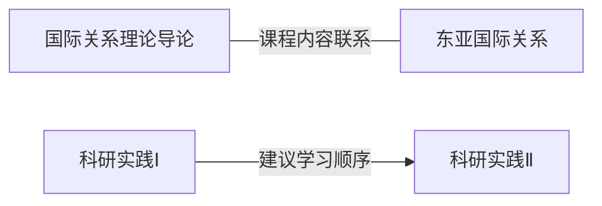

# 2025国际政治专业（国际组织与全球治理方向）-本科培养方案（留学生适用）

国际关系与公共事务学院 · 国际政治(国际组织与全球治理方向) · 方案 96772 · 39 个不同课程或科研条目。

[官方 Word](../originals/plan-96772.docx) · [教务详情](https://fdjwgl.fudan.edu.cn/manager/bizType/2/major-program-search/info/96772?skipAuth=1) · [方案快照](../raw/plan-96772.json.gz) · [年级目录](../README.md)

## 修读导读

- **建议先学**　《科研实践Ⅰ》（`POLI30065`） → 《科研实践Ⅱ》（`POLI30066`）。题名列出连续册次或级别。保留前一阶段的问题、记录和反馈，下一阶段可据此调整研究或实践计划。

- **可以对照着读**　《国际关系理论导论》（`POLI20005`）与《东亚国际关系》（`POLI70005`）。两门课的题名都涉及国际关系。用同一国际事件比较两门课关注的行为体、利益和解释尺度。

- **查模块选课**　《国际组织》（`POLI20029`）、《国际法》（`POLI20015`）列在“专业核心教育课程”中。原表见 `/courseModules/6`。

## 课程关系图

图中展示部分关系。下表保留全部已建立的课程对，来源位置使用本方案 JSON Pointer。

## 先修与内容联系

| 类型 | 起点 | 终点 | 依据 | 原表定位 |
| --- | --- | --- | --- | --- |
| 建议学习顺序 | 科研实践Ⅰ (POLI30065) | 科研实践Ⅱ (POLI30066) | 同方案的课程题名具有连续分册或序号。  | `/courseModules/21/planCourses/2`、`/courseModules/21/planCourses/3` |
| 课程内容联系 | 国际关系理论导论 (POLI20005) | 东亚国际关系 (POLI70005) | 本方案两门课程的题名均含“国际关系”，可据此对照这一主题。  | `/courseModules/5/planCourses/1`、`/courseModules/13/planCourses/1` |

本次未从可定位的明确表述中确认课程对课程预修。学期安排、系列分册与编辑建议均保留各自的依据。

## 按原方案模块阅读

同一模块展示原表中的课程归属。模块内课程之间的先后仍须逐项查阅。

- **M1**　国际经济学、国际金融学、国际贸易（H）、国际发展、跨文化与国际交流、Global Environmental Governance（原表模块 10）
- **M2**　当代中国经济、经济全球化与中国、中国的全球与地区参与、Chinese Society: Past and Present、中国公共政策、China's Foreign Economic Policies（原表模块 12）
- **M3**　俄罗斯政治与对外关系、欧盟政治与对外关系、亚太地区政治与经济、美国政治与对外关系、东亚国际关系（原表模块 13）

## 课程表

同一课程在不同模块分别出现时，按原表逐行列出。季节字段保留原值。

| 课程 | 代码 | 学分 | 学期 | 模块 |
| --- | --- | ---: | --- | --- |
| 高等数学D | MATH10008 | 4.0 | 第1学期 | 培养方案 / 专业培养课程 / 学科基础课程 |
| 国际关系理论导论 | POLI20005 | 2.0 | 第1学期、第2学期 | 培养方案 / 专业培养课程 / 学科基础课程 |
| Contemporary Chinese Diplomacy | POLI60020 | 3.0 | 第1学期、第2学期 | 培养方案 / 专业培养课程 / 学科基础课程 |
| Chinese Public Administration | POLI60022 | 3.0 | 第1学期、第2学期 | 培养方案 / 专业培养课程 / 学科基础课程 |
| Political Development in Modern China | GESP40003 | 3.0 | 第3学期、第4学期 | 培养方案 / 专业培养课程 / 学科基础课程 |
| 微观经济学原理 | ECON20007 | 5.0 | 第3学期、第4学期 | 培养方案 / 专业培养课程 / 学科基础课程 |
| 宏观经济学原理 | ECON20008 | 5.0 | 第5学期、第6学期 | 培养方案 / 专业培养课程 / 学科基础课程 |
| 国际组织 | POLI20029 | 2.0 | 第3学期、第4学期 | 培养方案 / 专业培养课程 / 专业核心教育课程 |
| 国际法 | POLI20015 | 2.0 | 第1学期、第2学期 | 培养方案 / 专业培养课程 / 专业核心教育课程 |
| 全球事务与全球治理 | POLI70031 | 2.0 | 第1学期、第2学期 | 培养方案 / 专业培养课程 / 专业核心教育课程 |
| International Political Economy | POLI60024 | 3.0 | 第3学期、第4学期 | 培养方案 / 专业培养课程 / 专业核心教育课程 |
| 国际谈判 | POLI30018 | 2.0 | 第1学期、第2学期 | 培养方案 / 专业培养课程 / 专业核心教育课程 |
| 国际区域比较研究 | POLI70033 | 2.0 | 第1学期、第2学期 | 培养方案 / 专业培养课程 / 专业核心教育课程 |
| Global Public Policy | MANA60009 | 3.0 | 第3学期、第4学期 | 培养方案 / 专业培养课程 / 专业核心教育课程 |
| 国际战略与安全 | POLI60041 | 3.0 | 第5学期、第6学期 | 培养方案 / 专业培养课程 / 专业核心教育课程 |
| 外交政策分析 | POLI70035 | 2.0 | 第3学期、第4学期 | 培养方案 / 专业培养课程 / 专业核心教育课程 |
| Quantitative Research Methods | MANA40003 | 3.0 | 第3学期、第4学期 | 培养方案 / 专业培养课程 / 专业核心教育课程 |
| Qualitative Research Methods | MANA40004 | 3.0 | 第1学期、第2学期 | 培养方案 / 专业培养课程 / 专业核心教育课程 |
| Global Environmental Governance | POLI50009 | 2.0 | 第3学期、第4学期 | 培养方案 / 专业进阶I / M1 |
| 国际发展 | POLI30003 | 2.0 | 第5学期、第6学期 | 培养方案 / 专业进阶I / M1 |
| 跨文化与国际交流 | POLI30051 | 2.0 | 第3学期、第4学期 | 培养方案 / 专业进阶I / M1 |
| 国际经济学 | ECON30140 | 4.0 | 第7学期、第8学期 | 培养方案 / 专业进阶I / M1 |
| 国际金融学 | ECON30149 | 4.0 | 第7学期、第8学期 | 培养方案 / 专业进阶I / M1 |
| 国际贸易（H） | ECON40034h | 4.0 | 第7学期、第8学期 | 培养方案 / 专业进阶I / M1 |
| 中国的全球与地区参与 | GEEC10380 | 2.0 | 第3学期、第4学期 | 培养方案 / 专业进阶II / M2 |
| Chinese Society: Past and Present | GESP40004 | 3.0 | 第5学期、第6学期 | 培养方案 / 专业进阶II / M2 |
| China's Foreign Economic Policies | POLI70022 | 2.0 | 第5学期、第6学期 | 培养方案 / 专业进阶II / M2 |
| 经济全球化与中国 | ECON30152 | 4.0 | 第7学期、第8学期 | 培养方案 / 专业进阶II / M2 |
| 当代中国经济 | ECON30143 | 4.0 | 第7学期、第8学期 | 培养方案 / 专业进阶II / M2 |
| 中国公共政策 | POLI40034 | 2.0 | 第8学期 | 培养方案 / 专业进阶II / M2 |
| 欧盟政治与对外关系 | POLI30029 | 2.0 | 第5学期、第6学期 | 培养方案 / 专业进阶II / M3 |
| 东亚国际关系 | POLI70005 | 2.0 | 第5学期、第6学期 | 培养方案 / 专业进阶II / M3 |
| 美国政治与对外关系 | POLI40002 | 2.0 | 第5学期、第6学期 | 培养方案 / 专业进阶II / M3 |
| 亚太地区政治与经济 | POLI30035 | 2.0 | 第5学期、第6学期 | 培养方案 / 专业进阶II / M3 |
| 俄罗斯政治与对外关系 | POLI30021 | 2.0 | 第5学期、第6学期 | 培养方案 / 专业进阶II / M3 |
| Global Environmental Governance | POLI50009 | 2.0 | 第3学期、第4学期 | 培养方案 / 专业进阶1（辅修路径专业进阶1） |
| 国际发展 | POLI30003 | 2.0 | 第5学期、第6学期 | 培养方案 / 专业进阶1（辅修路径专业进阶1） |
| 跨文化与国际交流 | POLI30051 | 2.0 | 第3学期、第4学期 | 培养方案 / 专业进阶1（辅修路径专业进阶1） |
| 国际经济学 | ECON30140 | 4.0 | 第7学期、第8学期 | 培养方案 / 专业进阶1（辅修路径专业进阶1） |
| 国际金融学 | ECON30149 | 4.0 | 第7学期、第8学期 | 培养方案 / 专业进阶1（辅修路径专业进阶1） |
| 国际贸易（H） | ECON40034h | 4.0 | 第7学期、第8学期 | 培养方案 / 专业进阶1（辅修路径专业进阶1） |
| 毕业论文 | POLI40012 | 4.0 | 第8学期 | 融合创新能力 |
| 社会实践 | POLI40011 | 2.0 | 第8学期 | 融合创新能力 |
| 科研实践Ⅰ | POLI30065 | 4.0 | 第6学期、第7学期 | 融合创新能力 |
| 科研实践Ⅱ | POLI30066 | 4.0 | 第6学期、第7学期 | 融合创新能力 |
