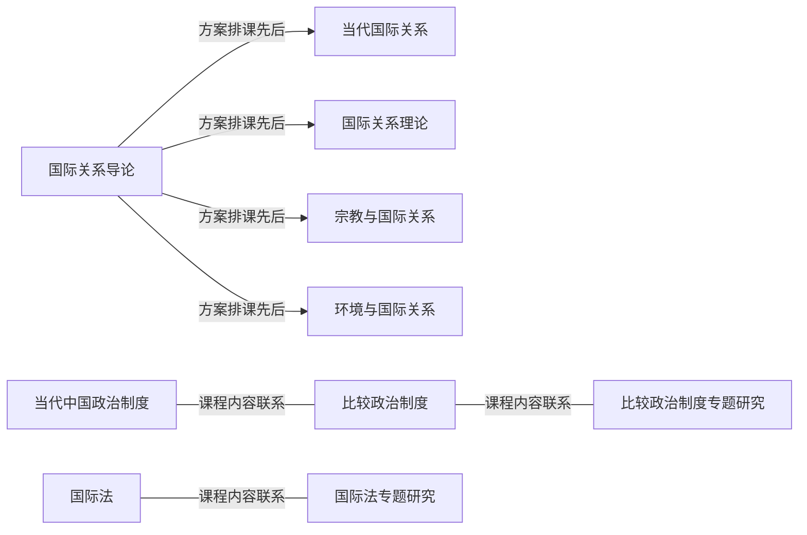

# 2025国际政治专业-政治学-本博融通培养方案（普通学生适用）

国际关系与公共事务学院 · 国际政治 · 方案 96902 · 83 个不同课程或科研条目。

[官方 Word](../originals/plan-96902.docx) · [教务详情](https://fdjwgl.fudan.edu.cn/manager/bizType/2/major-program-search/info/96902?skipAuth=1) · [方案快照](../raw/plan-96902.json.gz) · [年级目录](../README.md)

## 课程关系图

图中展示部分关系。下表保留全部已建立的课程对，来源位置使用本方案 JSON Pointer。

## 先修与内容联系

| 类型 | 起点 | 终点 | 依据 | 原表定位 |
| --- | --- | --- | --- | --- |
| 建议学习顺序 | 国际关系导论 (POLI10003) | 当代国际关系 (POLI20012) | 国际体系和行为体概念可用于时事与历史案例分析。  | `/courseModules/6/planCourses/2`、`/courseModules/7/planCourses/2` |
| 建议学习顺序 | 国际关系导论 (POLI10003) | 国际关系理论 (POLI20018) | “国际关系导论”题名标明基础层次，前置阅读可帮助了解“国际关系理论”中的国际关系主题。  | `/courseModules/6/planCourses/2`、`/courseModules/7/planCourses/0` |
| 建议学习顺序 | 国际关系导论 (POLI10003) | 宗教与国际关系 (POLI30039) | “国际关系导论”题名标明基础层次，前置阅读可帮助了解“宗教与国际关系”中的国际关系主题。  | `/courseModules/6/planCourses/2`、`/courseModules/10/planCourses/14` |
| 建议学习顺序 | 国际关系导论 (POLI10003) | 环境与国际关系 (POLI30040) | “国际关系导论”题名标明基础层次，前置阅读可帮助了解“环境与国际关系”中的国际关系主题。  | `/courseModules/6/planCourses/2`、`/courseModules/10/planCourses/15` |
| 方案排课先后 | 国际关系导论 (POLI10003) | 当代国际关系 (POLI20012) | 同方案该课程全部明确数字学期均早于后者。  | `/courseModules/6/planCourses/2`、`/courseModules/7/planCourses/2` |
| 方案排课先后 | 国际关系导论 (POLI10003) | 国际关系理论 (POLI20018) | 同方案该课程全部明确数字学期均早于后者。  | `/courseModules/6/planCourses/2`、`/courseModules/7/planCourses/0` |
| 方案排课先后 | 国际关系导论 (POLI10003) | 宗教与国际关系 (POLI30039) | 同方案该课程全部明确数字学期均早于后者。  | `/courseModules/6/planCourses/2`、`/courseModules/10/planCourses/14` |
| 方案排课先后 | 国际关系导论 (POLI10003) | 环境与国际关系 (POLI30040) | 同方案该课程全部明确数字学期均早于后者。  | `/courseModules/6/planCourses/2`、`/courseModules/10/planCourses/15` |
| 课程内容联系 | 国际关系导论 (POLI10003) | 当代国际关系 (POLI20012) | 本方案两门课程的题名均含“国际关系”，可据此对照这一主题。  | `/courseModules/6/planCourses/2`、`/courseModules/7/planCourses/2` |
| 课程内容联系 | 国际关系导论 (POLI10003) | 国际关系理论 (POLI20018) | 本方案两门课程的题名均含“国际关系”，可据此对照这一主题。  | `/courseModules/6/planCourses/2`、`/courseModules/7/planCourses/0` |
| 课程内容联系 | 国际关系导论 (POLI10003) | 宗教与国际关系 (POLI30039) | 本方案两门课程的题名均含“国际关系”，可据此对照这一主题。  | `/courseModules/6/planCourses/2`、`/courseModules/10/planCourses/14` |
| 课程内容联系 | 国际关系导论 (POLI10003) | 环境与国际关系 (POLI30040) | 本方案两门课程的题名均含“国际关系”，可据此对照这一主题。  | `/courseModules/6/planCourses/2`、`/courseModules/10/planCourses/15` |
| 课程内容联系 | 当代中国政治制度 (POLI10009) | 比较政治制度 (POLI20022) | 均涉及政治制度，可对照制度安排与研究对象。  | `/courseModules/6/planCourses/3`、`/courseModules/7/planCourses/5` |
| 课程内容联系 | 国际法 (POLI20015) | 国际法专题研究 (POLI60009) | 本方案两门课程的题名均含“国际法”，可据此对照这一主题。  | `/courseModules/7/planCourses/8`、`/courseModules/11/planCourses/19` |
| 课程内容联系 | 比较政治制度 (POLI20022) | 比较政治制度专题研究 (POLI60001) | 本方案两门课程的题名均含“政治制度”，可据此对照这一主题。  | `/courseModules/7/planCourses/5`、`/courseModules/11/planCourses/8` |

本次未从可定位的明确表述中确认课程对课程预修。学期安排、系列分册与编辑建议均保留各自的依据。

## 课程表

同一课程在不同模块分别出现时，按原表逐行列出。季节字段保留原值。

| 课程 | 代码 | 学分 | 学期 | 模块 |
| --- | --- | ---: | --- | --- |
| 政治学原理 | POLI10004 | 4.0 | 第1学期 | 培养方案 / 专业培养课程 / 学科基础课程 |
| 公共行政学 | MANA10001 | 4.0 | 第1学期 | 培养方案 / 专业培养课程 / 学科基础课程 |
| 国际关系导论 | POLI10003 | 4.0 | 第1学期、第2学期 | 培养方案 / 专业培养课程 / 学科基础课程 |
| 当代中国政治制度 | POLI10009 | 3.0 | 第2学期 | 培养方案 / 专业培养课程 / 学科基础课程 |
| 公共政策概论 | POLI10006 | 3.0 | 第2学期 | 培养方案 / 专业培养课程 / 学科基础课程 |
| 全球治理概论 | POLI10001 | 3.0 | 第2学期 | 培养方案 / 专业培养课程 / 学科基础课程 |
| 计算社会科学 | POLI10002 | 3.0 | 第3学期 | 培养方案 / 专业培养课程 / 学科基础课程 |
| 高等数学D | MATH10008 | 4.0 | 第1学期 | 培养方案 / 专业培养课程 / 学科基础课程 |
| 国际关系理论 | POLI20018 | 3.0 | 第4学期 | 培养方案 / 专业培养课程 / 专业核心教育课程 |
| 近现代国际关系 | POLI20027 | 3.0 | 第3学期 | 培养方案 / 专业培养课程 / 专业核心教育课程 |
| 当代国际关系 | POLI20012 | 3.0 | 第4学期 | 培养方案 / 专业培养课程 / 专业核心教育课程 |
| 近现代中国对外关系 | POLI20026 | 3.0 | 第3学期 | 培养方案 / 专业培养课程 / 专业核心教育课程 |
| 当代中国对外关系 | POLI20009 | 3.0 | 第4学期 | 培养方案 / 专业培养课程 / 专业核心教育课程 |
| 比较政治制度 | POLI20022 | 3.0 | 第3学期 | 培养方案 / 专业培养课程 / 专业核心教育课程 |
| 外交学 | POLI30027 | 2.0 | 第5学期 | 培养方案 / 专业培养课程 / 专业核心教育课程 |
| 国际组织概论 | POLI50005 | 2.0 | 第5学期 | 培养方案 / 专业培养课程 / 专业核心教育课程 |
| 国际法 | POLI20015 | 2.0 | 第2学期 | 培养方案 / 专业培养课程 / 专业核心教育课程 |
| 国际安全概论 | POLI20001 | 2.0 | 第7学期 | 培养方案 / 专业培养课程 / 专业核心教育课程 |
| 当代世界政治思潮 | POLI30019 | 2.0 | 第6学期 | 培养方案 / 专业培养课程 / 专业核心教育课程 |
| 社会科学研究方法 | POLI20016 | 3.0 | 第3学期、第4学期 | 培养方案 / 专业培养课程 / 专业核心教育课程 |
| 国际政治经济学 | POLI30016 | 2.0 | 第5学期 | 培养方案 / 专业进阶I |
| 区域国别学 | POLI30013 | 2.0 | 第5学期 | 培养方案 / 专业进阶I |
| 国家安全学 | POLI30006 | 2.0 | 第6学期 | 培养方案 / 专业进阶I |
| 习近平外交思想概论 | POLI40005 | 2.0 | 第6学期 | 培养方案 / 专业进阶I |
| 国际发展 | POLI30003 | 2.0 | 第5学期 | 培养方案 / 专业进阶I |
| 美国政治与对外关系 | POLI40002 | 2.0 | 第6学期 | 培养方案 / 专业进阶I |
| 欧盟政治与对外关系 | POLI30029 | 2.0 | 第6学期 | 培养方案 / 专业进阶I |
| 日本政治与对外关系 | POLI30030 | 2.0 | 第5学期 | 培养方案 / 专业进阶I |
| 发展中国家政治与对外关系 | POLI40018 | 2.0 | 第7学期 | 培养方案 / 专业进阶I |
| 中国外交文献选读 | POLI60040 | 2.0 | 第6学期 | 培养方案 / 专业进阶I |
| 国际政治文献选读 | POLI30010 | 2.0 | 第6学期 | 培养方案 / 专业进阶I |
| 人工智能时代的国际关系 | AIS310011 | 3.0 | 第5学期 | 培养方案 / 专业进阶I |
| 涉外法治与国际关系 | POLI30007 | 2.0 | 第5学期 | 培养方案 / 专业进阶I |
| 贸易与国际关系 | POLI30052 | 2.0 | 第6学期 | 培养方案 / 专业进阶I |
| 宗教与国际关系 | POLI30039 | 2.0 | 第6学期 | 培养方案 / 专业进阶I |
| 环境与国际关系 | POLI30040 | 2.0 | 第6学期 | 培养方案 / 专业进阶I |
| 能源与国际关系 | POLI30048 | 2.0 | 第6学期 | 培养方案 / 专业进阶I |
| 国际传播与人文交流 | POLI40006 | 2.0 | 第7学期 | 培养方案 / 专业进阶I |
| 俄罗斯政治与对外关系 | POLI30021 | 2.0 | 第7学期 | 培养方案 / 专业进阶I |
| 东南亚政治与对外关系 | POLI40004 | 2.0 | 第7学期 | 培养方案 / 专业进阶I |
| 中东政治与对外关系 | POLI20017 | 2.0 | 第7学期 | 培养方案 / 专业进阶I |
| 拉美政治与对外关系 | POLI40003 | 2.0 | 第7学期 | 培养方案 / 专业进阶I |
| 非洲政治与对外关系 | POLI30015 | 2.0 | 第7学期 | 培养方案 / 专业进阶I |
| 博弈论 | POLI40008 | 2.0 | 第7学期 | 培养方案 / 专业进阶I |
| 制度分析 | POLI30012 | 2.0 | 第7学期 | 培养方案 / 专业进阶I |
| 田野调查方法 | POLI40001 | 2.0 | 第7学期 | 培养方案 / 专业进阶I |
| 马克思主义政治学经典文献选读 | POLI50003 | 3.0 | 第9学期、第10学期 | 培养方案 / 专业进阶II |
| 当代中国政治行政经典文献选读 | POLI60005 | 3.0 | 第9学期、第10学期 | 培养方案 / 专业进阶II |
| 研究设计与论文写作 | POLI50002 | 2.0 | 第9学期、第10学期 | 培养方案 / 专业进阶II |
| 战略研究与政策分析 | POLI60013 | 2.0 | 第9学期 | 培养方案 / 专业进阶II |
| 国际关系前沿理论 | POLI60016 | 3.0 | 第9学期、第10学期 | 培养方案 / 专业进阶II |
| 外交学前沿专题 | POLI70008 | 3.0 | 第11学期、第12学期 | 培养方案 / 专业进阶II |
| 国际政治经济学前沿专题 | POLI60014 | 3.0 | 第11学期、第12学期 | 培养方案 / 专业进阶II |
| 全球治理前沿专题 | POLI70009 | 3.0 | 第9学期 | 培养方案 / 专业进阶II |
| 比较政治制度专题研究 | POLI60001 | 3.0 | 第9学期 | 培养方案 / 专业进阶II |
| 比较政治学前沿理论 | POLI50006 | 3.0 | 第13学期、第14学期 | 培养方案 / 专业进阶II |
| 中国式现代化研究 | POLI60019 | 3.0 | 第13学期、第14学期 | 培养方案 / 专业进阶II |
| 国家安全学前沿专题 | POLI80002 | 3.0 | 第11学期 | 培养方案 / 专业进阶II |
| 中国外交专题研究 | POLI70004 | 3.0 | 第11学期 | 培养方案 / 专业进阶II |
| 国际关系史专题研究 | POLI70011 | 3.0 | 第12学期 | 培养方案 / 专业进阶II |
| 中国外交史专题研究 | POLI60015 | 3.0 | 第12学期 | 培养方案 / 专业进阶II |
| 国际组织专题研究 | POLI70017 | 3.0 | 第9学期 | 培养方案 / 专业进阶II |
| 国际发展专题研究 | POLI70003 | 3.0 | 第9学期 | 培养方案 / 专业进阶II |
| 国际安全专题研究 | POLI60017 | 3.0 | 第9学期 | 培养方案 / 专业进阶II |
| 国际制度专题研究 | POLI60053 | 2.0 | 第9学期 | 培养方案 / 专业进阶II |
| 国际法专题研究 | POLI60009 | 3.0 | 第10学期 | 培养方案 / 专业进阶II |
| 国际秩序专题研究 | POLI70014 | 3.0 | 第10学期 | 培养方案 / 专业进阶II |
| 网络空间治理专题研究 | POLI70013 | 3.0 | 第10学期 | 培养方案 / 专业进阶II |
| 美国专题研究 | POLI70015 | 3.0 | 第10学期 | 培养方案 / 专业进阶II |
| 欧洲专题研究 | POLI50004 | 3.0 | 第10学期 | 培养方案 / 专业进阶II |
| 全球南方专题研究 | POLI70007 | 3.0 | 第10学期 | 培养方案 / 专业进阶II |
| 复芏计划(FDUROP) | 102 | 0.0 |  | 融合创新能力 |
| 研究生科研项目 | 41 | 0.0 |  | 融合创新能力 |
| 研究生学术活动 | 4 | 2.0 |  | 融合创新能力 |
| 研究生实践活动 | 5 | 2.0 |  | 融合创新能力 |
| 国际交流 | 7 | 0.0 |  | 融合创新能力 |
| 博士生资格考核 | 2 | 0.0 |  | 融合创新能力 |
| 博士学位论文开题 | 1 | 0.0 |  | 融合创新能力 |
| 博士论文中期考核 | 3 | 0.0 |  | 融合创新能力 |
| 博士学位论文预审 | 6 | 0.0 |  | 融合创新能力 |
| 毕业论文 | POLI40012 | 4.0 | 第8学期 | 融合创新能力 |
| 社会实践 | POLI40011 | 2.0 | 第8学期 | 融合创新能力 |
| 科研实践Ⅱ | POLI30066 | 4.0 | 第6学期、第7学期 | 融合创新能力 |
