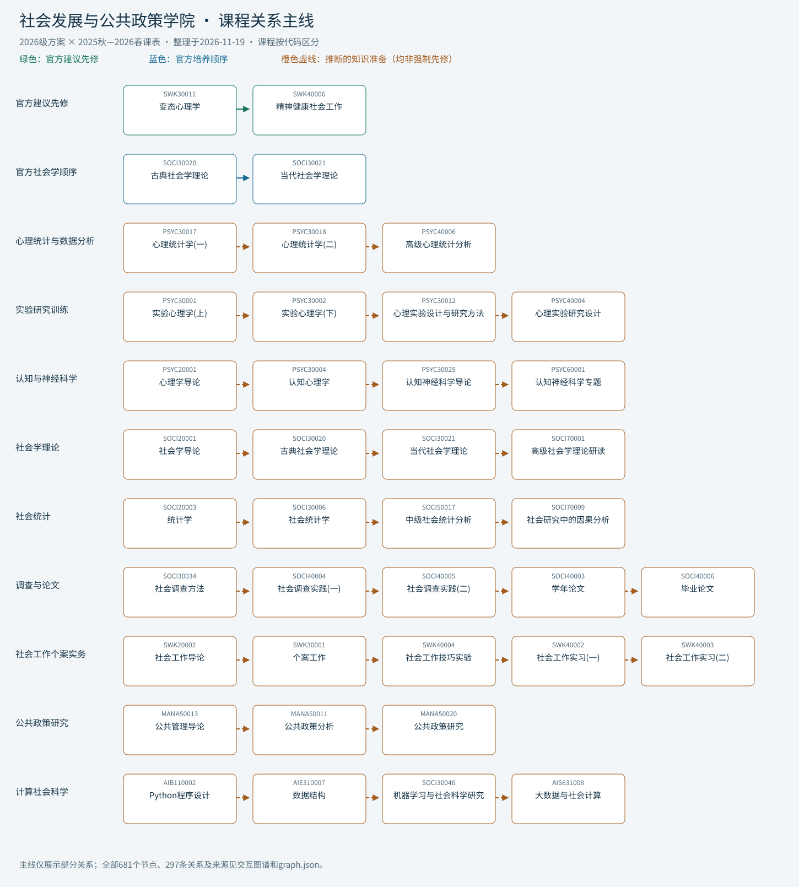
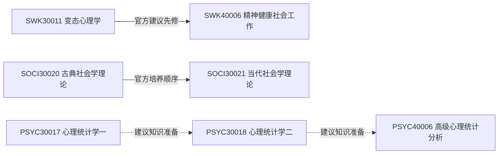

# 社会发展与公共政策学院课程关系图谱

覆盖**296个实际开课代码**和15份2026级方案引用的课程，共**681个节点、297条关系**。385个补充节点仅在方案中出现，包含其他院系课程与公共选修，不能据此判断本院开课。

## 查看与下载

- [交互图谱](index.html)：下载本目录后打开`index.html`，可按名称、别名、课号和课程范围检索，点击节点逐层浏览，并筛选关系类型。GitHub文件页不执行HTML；可直接在上方查看SVG。
- [图谱JSON](graph.json)、[课程节点CSV](nodes.csv)、[关系边CSV](edges.csv)，用于后续检索与数据库导入。
- [来源核查记录](source-audit.json)、[验证结果](validation.json)、[待补关系清单](待补关系.csv)。原296个开课代码中，288个已连接，8个保留待补大纲状态。

## 如何理解连线

| 类型 | 数量 | 判定依据 |
| --- | ---: | --- |
| 官方建议先修 | 1 | 社会工作普通、留学生、港澳台侨生方案的明确备注，三份方案支持同一关系 |
| 官方培养顺序 | 1 | 人工核读课程体系原图中的明确箭头；并非系统硬性先修 |
| 建议知识准备 | 73 | 题名和一般学科知识的整理者推断，待当期大纲复核 |
| 内容联系 | 222 | 无方向的共同内容／方法主题；低置信度主题导航可在交互图中关闭 |
| 已核定强制先修 | 0 | 不能用本图判断选课资格 |

官方文字明确建议 **SWK30011 变态心理学 → SWK40006 精神健康社会工作**。同一方案内的前课代码已核对；不将PSYC30023或其荣誉课自动当作可替代前课。每条关系记录方向、是否强制、依据类型、可信度、理由与来源定位。

## 官方原图与核查范围

- [心理学普通方案原图](source-figures/153443-curriculum.png)、[社会学普通方案原图](source-figures/153495-curriculum.png)、[社会工作普通方案原图](source-figures/154352-curriculum.png)。配套JSON保留原件SHA-256及Word内部图片位置，原图未经重绘。
- 检索15份原始方案JSON，记录了128个`defaultPreCourses`／`defaultPreCourseList`字段实例，均为空；字段为空不能证明没有先修。大量课程对象没有这些字段。
- 已核读普通社会学、社会工作原图的明确连线，仅选取名称和代码可准确对应的一条关系；社工原图中的“社会统计学”与列课代码SWK10001（社会统计学基础）名称不完全相同，不将其直接映射为SOCI30006。心理学原图附供查阅，未将所有原图符号编码为强制先修。
- 来源资料为2026-10-30采集批次，图谱整理日期为2026-11-19；本次没有重新采集新的课表或逐课大纲。
- 课程代码保留普通／荣誉、不同培养层次及新旧版本，不因同名合并；`course_code`关联不表示学分互认。方案学期与实际开课学期分别保存。
- 25条建议学习路线仅供规划，跨本科与研究生的连线表示知识背景，不保证课程对学生开放。

## 复现与维护

在本目录运行 `python build_graph.py`、`python build_views.py`、`python validate_graph.py`。全部离线，仅使用仓库内数据和显式的关系规则。更新关系时必须同步保存来源；强制先修仅在取得明确、可定位的官方条款后新增。父目录`manifest.json`记录全部交付文件哈希。

CSV使用UTF-8 BOM；JSON中的`nodes.id`为课号，`edges.source/target`为节点ID；`content_link`无方向，`mandatory`均为false，`evidence`引用`sources`。未经核实的关系不进入官方先修类别。
