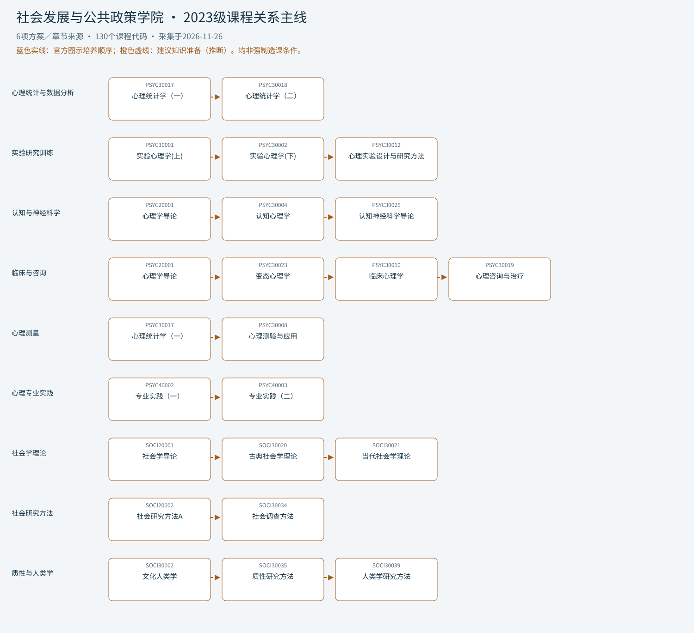

# 2023级课程关系图谱

覆盖本年级6份系统方案、130个课程代码及0个培养环节，共130个节点、86条关系。方案列课不等于实际开课，也不保证每门课对所有学生开放。

- [交互图谱](index.html)：下载目录后离线打开，可按课程名、代码与具体培养方案筛选、点击课程逐层浏览。GitHub不直接执行HTML。
- [完整图谱JSON](graph.json)、[节点CSV](nodes.csv)、[关系CSV](edges.csv)、[待补关系](待补关系.csv)。
- [来源核查](source-audit.json)、[培养方案及原件目录](../README.md)、[自动验证](../../validation.json)。

| 关系类型 | 数量 | 含义 |
| --- | ---: | --- |
| 官方图示培养顺序 | 0 | 同份方案原图中的明确箭头，课程名称与代码逐一对应；不是硬性先修 |
| 建议知识准备 | 42 | 题名及一般学科知识推断，两端须在至少同一方案列课 |
| 内容联系 | 44 | 无方向的共同议题或方法关联，可能跨专业，需大纲复核 |
| 已核定强制先修 | 0 | 当前资料不足以判定教务选课门槛 |

对6份JSON及Word导出文字检索先修关键词；未发现可编码的逐课强制先修条款或明确建议先修条款。2023、2024级接口未出现defaultPreCourse类字段。字段缺失、为空或未出现关键词，都不能证明没有先修。

每条边保留来源定位、适用方案、判断依据、方向及`mandatory:false`。课程号不同就分别保留，不能据同名或H标记自动互认。点击“依据”可核对两端课程列课来源；**推断关系的来源仅证明课程身份，不能作为官方认可此连线的证据**。

本年级Word导出仅包含页眉校名图片，未包含可编码的课程体系箭头；不由课程表先后或建议学期推导官方先修。

全部节点保留；31个节点尚无足够材料连接课程，列在待补关系中。培养环节与正式课程分开统计。2026级的先修备注没有继承到本年级。
