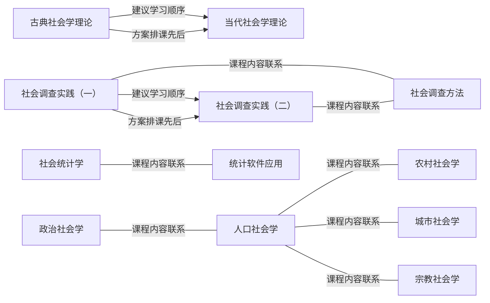

# 社会学专业“2+X”教学培养方案

2024 年汇编印刷页 363–366。原表记录 33 个可配对的课程代码。

[本节原页](plan-363.pdf#page=1) · [逐行数据](plan-363.json) · [院系目录](README.md)

## 课程关系图

图中展示最多 20 条关系。下表列出本节全部关系。建议学习顺序供规划课程使用，正式选课资格以教务规定为准。

| 课程 | 关联课程 | 关系 | 依据 |
| --- | --- | --- | --- |
| 古典社会学理论（SOCI130096） | 当代社会学理论（SOCI130097） | 建议学习顺序 | 熟悉经典社会学的问题意识有助于阅读后续理论。 |
| 社会调查实践（一）（SOCI130149） | 社会调查实践（二）（SOCI130150） | 建议学习顺序 | 同节课程题名标明连续分册或序号。 |
| 政治社会学（SOCI130009） | 人口社会学（SOCI130041） | 课程内容联系 | 本方案两门课程的题名均含“社会学”，可据此对照这一主题。 |
| 社会统计学（SOCI130010） | 统计软件应用（SOCI130201） | 课程内容联系 | 社会调查数据的整理、估计与解释可以结合软件学习。 |
| 人口社会学（SOCI130041） | 农村社会学（SOCI130047） | 课程内容联系 | 本方案两门课程的题名均含“社会学”，可据此对照这一主题。 |
| 人口社会学（SOCI130041） | 城市社会学（SOCI130049） | 课程内容联系 | 本方案两门课程的题名均含“社会学”，可据此对照这一主题。 |
| 人口社会学（SOCI130041） | 宗教社会学（SOCI130056） | 课程内容联系 | 本方案两门课程的题名均含“社会学”，可据此对照这一主题。 |
| 社会调查实践（一）（SOCI130149） | 社会调查方法（SOCI130197） | 课程内容联系 | 本方案两门课程的题名均含“社会调查”，可据此对照这一主题。 |
| 社会调查实践（二）（SOCI130150） | 社会调查方法（SOCI130197） | 课程内容联系 | 本方案两门课程的题名均含“社会调查”，可据此对照这一主题。 |
| 古典社会学理论（SOCI130096） | 当代社会学理论（SOCI130097） | 方案排课先后 | 本节原表所列全部明确学期均早于后者。 |
| 社会调查实践（一）（SOCI130149） | 社会调查实践（二）（SOCI130150） | 方案排课先后 | 本节原表所列全部明确学期均早于后者。 |

## 课程

| 课程代码 | 名称 | 开课学期原文 | 来源（PDF 页） |
| --- | --- | --- | --- |
| SOCI110048 | 现代化和中国社会 | 6 | 378 |
| SOCI130004 | 文化人类学 |  | 378 |
| SOCI130005 | 社区研究 |  | 378 |
| SOCI130008 | 经济社会学 | 5 | 377 |
| SOCI130009 | 政治社会学 | 6 | 378 |
| SOCI130010 | 社会统计学 | 3 | 377 |
| SOCI130014 | 学年论文 | 7 | 378 |
| SOCI130021 | 人类行为与社会环境 | 5 | 378 |
| SOCI130022 | 社会政策 | 4 | 378 |
| SOCI130036 | 社会心理学 |  | 378 |
| SOCI130041 | 人口社会学 | 5 | 378 |
| SOCI130042 | 组织社会学 | 5 | 377 |
| SOCI130043 | 社会变迁 |  | 378 |
| SOCI130045 | 环境社会学 | 5 | 378 |
| SOCI130047 | 农村社会学 | 5 | 378 |
| SOCI130049 | 城市社会学 | 4 | 378 |
| SOCI130054 | 医疗和健康社会学 | 5 | 378 |
| SOCI130056 | 宗教社会学 |  | 378 |
| SOCI130096 | 古典社会学理论 | 3 | 377 |
| SOCI130097 | 当代社会学理论 | 4 | 377 |
| SOCI130099 | 西方社会思想史 | 3 | 377 |
| SOCI130103 | 文化社会学 |  | 378 |
| SOCI130126 | 中国社会 | 6 | 377 |
| SOCI130132 | 社会分层与流动 | 6 | 378 |
| SOCI130148 | 婚姻与家庭 | 6 | 378 |
| SOCI130149 | 社会调查实践（一） | 5 | 377 |
| SOCI130150 | 社会调查实践（二） | 6 | 378 |
| SOCI130195 | 互联网与社会研究 |  | 378 |
| SOCI130197 | 社会调查方法 | 5 | 377 |
| SOCI130198 | 质性研究方法 | 4 | 377 |
| SOCI130199 | 毕业论文 | 8 | 378 |
| SOCI130201 | 统计软件应用 | 4 | 377 |
| SOCI130213 | 机器学习与社会科学研究 |  | 378 |
