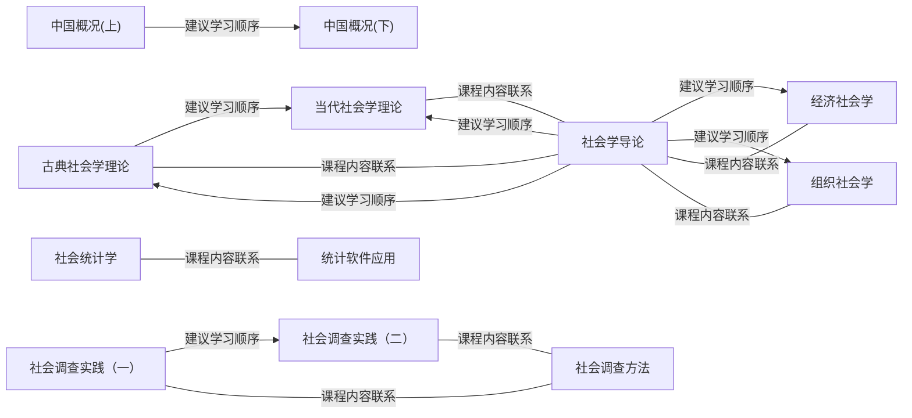

# 社会学专业“2+X”修读建议（留学生适用）

2024 年汇编印刷页 369–370。原表记录 35 个可配对的课程代码。

[本节原页](plan-363.pdf#page=7) · [逐行数据](plan-363.json) · [院系目录](README.md)

## 课程导读

想了解社会研究的课程安排，可以在原表中找到《古典社会学理论》（`SOCI130096`）、《社会调查方法》（`SOCI130197`）、《社会研究方法A》（`SOSC120009`）。 [原书 PDF 第 383 页](plan-363.pdf#page=7) · [原书 PDF 第 384 页](plan-363.pdf#page=8)

图中连接《经济社会学》（`SOCI130008`）和《社会学导论》（`SOSC120002`），两门课都从课程题名标出的“社会学”切入，可沿这一主题对照阅读。 [原书 PDF 第 383 页](plan-363.pdf#page=7) · [原书 PDF 第 384 页](plan-363.pdf#page=8)

## 课程关系图

图中展示最多 20 条关系。下表列出本节全部关系。建议学习顺序供规划课程使用，正式选课资格以教务规定为准。

| 课程 | 关联课程 | 关系 | 依据 |
| --- | --- | --- | --- |
| 中国概况(上)（ICES110012） | 中国概况(下)（ICES110013） | 建议学习顺序 | 同节课程题名标明连续分册或序号。 |
| 古典社会学理论（SOCI130096） | 当代社会学理论（SOCI130097） | 建议学习顺序 | 熟悉经典社会学的问题意识有助于阅读后续理论。 |
| 社会调查实践（一）（SOCI130149） | 社会调查实践（二）（SOCI130150） | 建议学习顺序 | 同节课程题名标明连续分册或序号。 |
| 社会学导论（SOSC120002） | 经济社会学（SOCI130008） | 建议学习顺序 | “社会学导论”题名标明基础层次，前置阅读可帮助了解“经济社会学”中的社会学主题。 |
| 社会学导论（SOSC120002） | 组织社会学（SOCI130042） | 建议学习顺序 | “社会学导论”题名标明基础层次，前置阅读可帮助了解“组织社会学”中的社会学主题。 |
| 社会学导论（SOSC120002） | 古典社会学理论（SOCI130096） | 建议学习顺序 | “社会学导论”题名标明基础层次，前置阅读可帮助了解“古典社会学理论”中的社会学主题。 |
| 社会学导论（SOSC120002） | 当代社会学理论（SOCI130097） | 建议学习顺序 | “社会学导论”题名标明基础层次，前置阅读可帮助了解“当代社会学理论”中的社会学主题。 |
| 经济社会学（SOCI130008） | 社会学导论（SOSC120002） | 课程内容联系 | 本方案两门课程的题名均含“社会学”，可据此对照这一主题。 |
| 社会统计学（SOCI130010） | 统计软件应用（SOCI130201） | 课程内容联系 | 社会调查数据的整理、估计与解释可以结合软件学习。 |
| 组织社会学（SOCI130042） | 社会学导论（SOSC120002） | 课程内容联系 | 本方案两门课程的题名均含“社会学”，可据此对照这一主题。 |
| 古典社会学理论（SOCI130096） | 社会学导论（SOSC120002） | 课程内容联系 | 本方案两门课程的题名均含“社会学”，可据此对照这一主题。 |
| 当代社会学理论（SOCI130097） | 社会学导论（SOSC120002） | 课程内容联系 | 本方案两门课程的题名均含“社会学”，可据此对照这一主题。 |
| 社会调查实践（一）（SOCI130149） | 社会调查方法（SOCI130197） | 课程内容联系 | 本方案两门课程的题名均含“社会调查”，可据此对照这一主题。 |
| 社会调查实践（二）（SOCI130150） | 社会调查方法（SOCI130197） | 课程内容联系 | 本方案两门课程的题名均含“社会调查”，可据此对照这一主题。 |

## 课程

| 课程代码 | 名称 | 开课学期原文 | 来源（PDF 页） |
| --- | --- | --- | --- |
| ICES110012 | 中国概况(上) |  | 383 |
| ICES110013 | 中国概况(下) |  | 383 |
| MATH120003 | 高等数学B（上） |  | 383 |
| MATH120004 | 高等数学B（上）、（下）10 |  | 383 |
| MATH120007 | 高等数学D |  | 383 |
| MATH120044 | 线性代数 |  | 383 |
| SOCI130008 | 经济社会学 |  | 384 |
| SOCI130010 | 社会统计学 |  | 384 |
| SOCI130014 | 学年论文 |  | 384 |
| SOCI130042 | 组织社会学 |  | 384 |
| SOCI130096 | 古典社会学理论 |  | 384 |
| SOCI130097 | 当代社会学理论 |  | 384 |
| SOCI130099 | 西方社会思想史 |  | 384 |
| SOCI130126 | 中国社会 |  | 384 |
| SOCI130132 | 社会分层与流动 |  | 384 |
| SOCI130148 | 婚姻与家庭 |  | 384 |
| SOCI130149 | 社会调查实践（一） |  | 384 |
| SOCI130150 | 社会调查实践（二） |  | 384 |
| SOCI130197 | 社会调查方法 |  | 384 |
| SOCI130198 | 质性研究方法 |  | 384 |
| SOCI130199 | 毕业论文 |  | 384 |
| SOCI130201 | 统计软件应用 |  | 384 |
| SOSC120001 | 政治学原理 |  | 383 |
| SOSC120002 | 社会学导论 |  | 383 |
| SOSC120003 | 法理学导论 |  | 383 |
| SOSC120004 | 微观经济学 |  | 384 |
| SOSC120005 | 宏观经济学 |  | 384 |
| SOSC120007 | 经济学原理 |  | 383 |
| SOSC120008 | 政治经济学 |  | 384 |
| SOSC120009 | 社会研究方法A |  | 383 |
| SOSC120012 | 社会工作导论 |  | 383 |
| SOSC120013 | 心理学导论 |  | 383 |
| SOSC120014 | 管理学导论 |  | 384 |
| SOSC120018 | 公共行政学 |  | 384 |
| SOSC120019 | 当代中国政治制度 |  | 384 |
