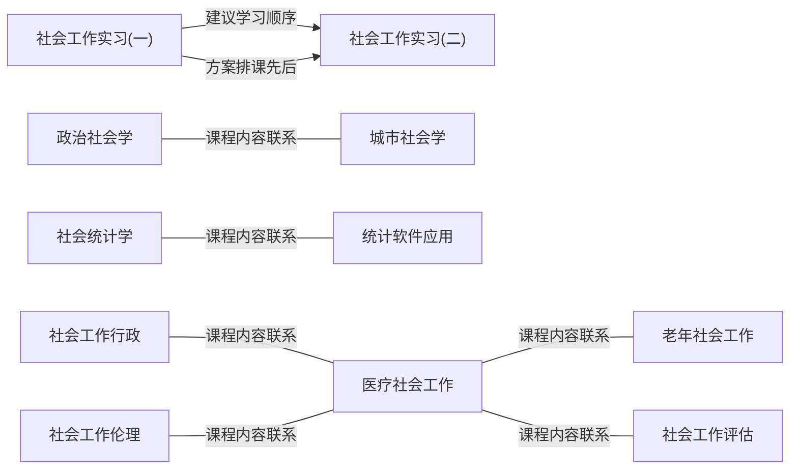

# 社会工作专业“2+X”教学培养方案

2024 年汇编印刷页 371–373。原表记录 44 个可配对的课程代码。

[本节原页](plan-371.pdf#page=1) · [逐行数据](plan-371.json) · [院系目录](README.md)

## 课程导读

想了解社会工作方法的课程安排，可以在原表中找到《社会工作伦理》（`SOCI130023`）、《社会工作实务研究》（`SOCI130189`）、《个案工作》（`SOCI130017`）。 [原书 PDF 第 385 页](plan-371.pdf#page=1) · [原书 PDF 第 386 页](plan-371.pdf#page=2)

图中连接《社会工作行政》（`SOCI130020`）和《医疗社会工作》（`SOCI130073`），两门课都从课程题名标出的“社会工作”切入，可沿这一主题对照阅读。 [原书 PDF 第 385 页](plan-371.pdf#page=1) · [原书 PDF 第 386 页](plan-371.pdf#page=2)

## 课程关系图

图中展示最多 20 条关系。下表列出本节全部关系。建议学习顺序供规划课程使用，正式选课资格以教务规定为准。

| 课程 | 关联课程 | 关系 | 依据 |
| --- | --- | --- | --- |
| 社会工作实习(一)（SOCI130024） | 社会工作实习(二)（SOCI130025） | 建议学习顺序 | 同节课程题名标明连续分册或序号。 |
| 政治社会学（SOCI130009） | 城市社会学（SOCI130049） | 课程内容联系 | 本方案两门课程的题名均含“社会学”，可据此对照这一主题。 |
| 社会统计学（SOCI130010） | 统计软件应用（SOCI130201） | 课程内容联系 | 社会调查数据的整理、估计与解释可以结合软件学习。 |
| 社会工作行政（SOCI130020） | 医疗社会工作（SOCI130073） | 课程内容联系 | 本方案两门课程的题名均含“社会工作”，可据此对照这一主题。 |
| 社会工作伦理（SOCI130023） | 医疗社会工作（SOCI130073） | 课程内容联系 | 本方案两门课程的题名均含“社会工作”，可据此对照这一主题。 |
| 医疗社会工作（SOCI130073） | 老年社会工作（SOCI130074） | 课程内容联系 | 本方案两门课程的题名均含“社会工作”，可据此对照这一主题。 |
| 医疗社会工作（SOCI130073） | 社会工作评估（SOCI130114） | 课程内容联系 | 本方案两门课程的题名均含“社会工作”，可据此对照这一主题。 |
| 社会工作实习(一)（SOCI130024） | 社会工作实习(二)（SOCI130025） | 方案排课先后 | 本节原表所列全部明确学期均早于后者。 |

## 课程

| 课程代码 | 名称 | 开课学期原文 | 来源（PDF 页） |
| --- | --- | --- | --- |
| SOCI110088 | 数字化与长寿时代 |  | 386 |
| SOCI110089 | 大数据与社会科学 | 秋 | 387 |
| SOCI130004 | 文化人类学 | 5 | 387 |
| SOCI130009 | 政治社会学 | 6 | 387 |
| SOCI130010 | 社会统计学 | 3 | 386 |
| SOCI130014 | 学年论文 | 7 | 386 |
| SOCI130015 | 毕业论文 | 8 | 386 |
| SOCI130017 | 个案工作 | 3 | 385 |
| SOCI130018 | 小组工作 | 4 | 385 |
| SOCI130019 | 社区工作 | 5 | 385 |
| SOCI130020 | 社会工作行政 | 5 | 385 |
| SOCI130021 | 人类行为与社会环境 | 3 | 385 |
| SOCI130022 | 社会政策 | 4 | 385 |
| SOCI130023 | 社会工作伦理 | 3 | 385 |
| SOCI130024 | 社会工作实习(一) | 5 | 386 |
| SOCI130025 | 社会工作实习(二) | 6 | 386 |
| SOCI130031 | 发展心理学 |  | 386 |
| SOCI130036 | 社会心理学 | 5 | 387 |
| SOCI130049 | 城市社会学 | 4 | 387 |
| SOCI130073 | 医疗社会工作 |  | 386 |
| SOCI130074 | 老年社会工作 |  | 386 |
| SOCI130077 | 法律与社会工作 | 5 | 387 |
| SOCI130080 | 变态心理学 |  | 386 |
| SOCI130081 | 家庭治疗 |  | 386 |
| SOCI130084 | 非营利组织管理 | 4 | 387 |
| SOCI130099 | 西方社会思想史 | 3 | 387 |
| SOCI130108 | 社会福利理论与制度 | 3 | 385 |
| SOCI130114 | 社会工作评估 | 5 | 387 |
| SOCI130139 | 艺术治疗 |  | 386 |
| SOCI130144 | 贫穷与社会发展 | 4 | 387 |
| SOCI130145 | 青少年社会工作 |  | 386 |
| SOCI130148 | 婚姻与家庭 | 6 | 387 |
| SOCI130151 | 质性研究方法 | 4 | 386 |
| SOCI130153 | 论文写作 | 5 | 387 |
| SOCI130156 | 社会工作技巧实验 | 5 | 385 |
| SOCI130188 | 社会工作理论基础 | 4 | 385 |
| SOCI130189 | 社会工作实务研究 | 6 | 386 |
| SOCI130192 | 社会工作专业英语 |  | 386 |
| SOCI130193 | 精神健康社会工作 |  | 386 |
| SOCI130194 | 儿童社会工作理论与实务 |  | 386 |
| SOCI130195 | 互联网与社会研究 | 6 | 387 |
| SOCI130200 | 经济发展研究 | 春 | 387 |
| SOCI130201 | 统计软件应用 | 4 | 386 |
| SOCI130202 | 自我认知与成长 |  | 386 |
