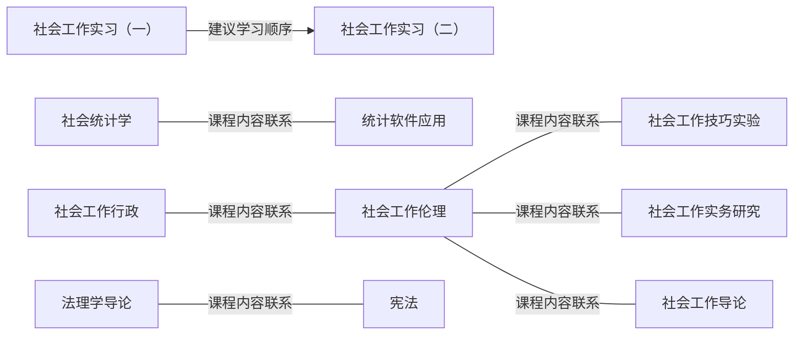

# 社会工作专业“2+X”修读建议

2024 年汇编印刷页 374–375。原表记录 36 个可配对的课程代码。

[本节原页](plan-371.pdf#page=4) · [逐行数据](plan-371.json) · [院系目录](README.md)

## 课程导读

想了解社会工作方法的课程安排，可以在原表中找到《社会工作伦理》（`SOCI130023`）、《社会工作实务研究》（`SOCI130189`）、《个案工作》（`SOCI130017`）。 [原书 PDF 第 389 页](plan-371.pdf#page=5)

图中连接《社会工作行政》（`SOCI130020`）和《社会工作伦理》（`SOCI130023`），两门课都从课程题名标出的“社会工作”切入，可沿这一主题对照阅读。 [原书 PDF 第 389 页](plan-371.pdf#page=5)

## 课程关系图

图中展示最多 20 条关系。下表列出本节全部关系。建议学习顺序供规划课程使用，正式选课资格以教务规定为准。

| 课程 | 关联课程 | 关系 | 依据 |
| --- | --- | --- | --- |
| 社会工作实习（一）（SOCI130024） | 社会工作实习（二）（SOCI130025） | 建议学习顺序 | 同节课程题名标明连续分册或序号。 |
| 社会统计学（SOCI130010） | 统计软件应用（SOCI130201） | 课程内容联系 | 社会调查数据的整理、估计与解释可以结合软件学习。 |
| 社会工作行政（SOCI130020） | 社会工作伦理（SOCI130023） | 课程内容联系 | 本方案两门课程的题名均含“社会工作”，可据此对照这一主题。 |
| 社会工作伦理（SOCI130023） | 社会工作技巧实验（SOCI130156） | 课程内容联系 | 本方案两门课程的题名均含“社会工作”，可据此对照这一主题。 |
| 社会工作伦理（SOCI130023） | 社会工作实务研究（SOCI130189） | 课程内容联系 | 本方案两门课程的题名均含“社会工作”，可据此对照这一主题。 |
| 社会工作伦理（SOCI130023） | 社会工作导论（SOSC120012） | 课程内容联系 | 本方案两门课程的题名均含“社会工作”，可据此对照这一主题。 |
| 法理学导论（SOSC120003） | 宪法（SOSC120015） | 课程内容联系 | 两课均涉及权利与公共权力的规范依据。 |

## 课程

| 课程代码 | 名称 | 开课学期原文 | 来源（PDF 页） |
| --- | --- | --- | --- |
| MATH120007 | 高等数学D |  | 388 |
| PTSS110082 | 毛泽东思想和中国特色社会主义理论体系概论 |  | 388 |
| PTSS110087 | 马克思主义基本原理 |  | 388 |
| PTSS110088 | 中国近现代史纲要 |  | 388 |
| PTSS110089 | 思想道德与法治 |  | 388 |
| PTSS110090 | 习近平新时代中国特色社会主义思想概论 |  | 388 |
| SOCI130010 | 社会统计学 |  | 389 |
| SOCI130014 | 学年论文 |  | 389 |
| SOCI130015 | 毕业论文 |  | 389 |
| SOCI130017 | 个案工作 |  | 389 |
| SOCI130018 | 小组工作 |  | 389 |
| SOCI130019 | 社区工作 |  | 389 |
| SOCI130020 | 社会工作行政 |  | 389 |
| SOCI130021 | 人类行为与社会环境 |  | 389 |
| SOCI130022 | 社会政策 |  | 389 |
| SOCI130023 | 社会工作伦理 |  | 389 |
| SOCI130024 | 社会工作实习（一） |  | 389 |
| SOCI130025 | 社会工作实习（二） |  | 389 |
| SOCI130108 | 社会福利理论与制度 |  | 389 |
| SOCI130151 | 质性研究方法 |  | 389 |
| SOCI130156 | 社会工作技巧实验 |  | 389 |
| SOCI130188 | 社会工作理论基础 |  | 389 |
| SOCI130189 | 社会工作实务研究 |  | 389 |
| SOCI130201 | 统计软件应用 |  | 389 |
| SOSC120001 | 政治学原理 |  | 388 |
| SOSC120002 | 社会学导论 |  | 388 |
| SOSC120003 | 法理学导论 |  | 388 |
| SOSC120007 | 经济学原理 |  | 388 |
| SOSC120008 | 政治经济学 |  | 388 |
| SOSC120009 | 社会研究方法A |  | 388 |
| SOSC120012 | 社会工作导论 |  | 388 |
| SOSC120013 | 心理学导论 |  | 388 |
| SOSC120014 | 管理学导论 |  | 388 |
| SOSC120015 | 宪法 |  | 388 |
| SOSC120018 | 公共行政学 |  | 388 |
| SOSC120019 | 当代中国政治制度 |  | 388 |
