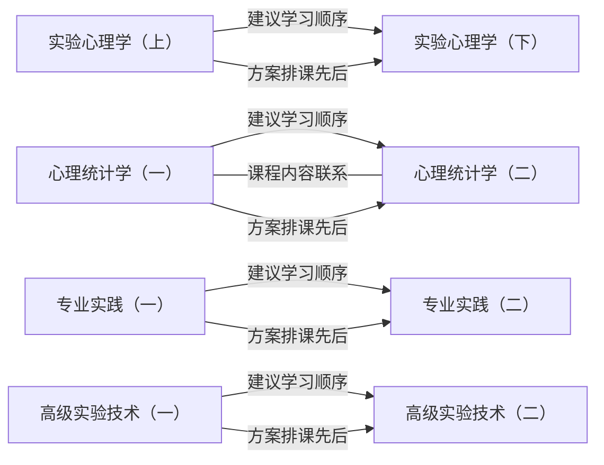

# 心理学专业“2+X”教学培养方案

2024 年汇编印刷页 733–735。原表记录 34 个可配对的课程代码。

[本节原页](plan-733.pdf#page=1) · [逐行数据](plan-733.json) · [院系目录](README.md)

## 课程导读

想了解心理与行为研究的课程安排，可以在原表中找到《实验心理学（上）》（`SOCI130028`）、《认知神经科学导论》（`SOCI130191`）、《社会心理学》（`SOCI130036`）。 [原书 PDF 第 747 页](plan-733.pdf#page=1)

图中连接《心理统计学（一）》（`SOCI130158`）和《心理统计学（二）》（`SOCI130159`），两门课都从课程题名标出的“统计学”切入，可沿这一主题对照阅读。 [原书 PDF 第 747 页](plan-733.pdf#page=1)

## 课程关系图

图中展示最多 20 条关系。下表列出本节全部关系。建议学习顺序供规划课程使用，正式选课资格以教务规定为准。

| 课程 | 关联课程 | 关系 | 依据 |
| --- | --- | --- | --- |
| 实验心理学（上）（SOCI130028） | 实验心理学（下）（SOCI130029） | 建议学习顺序 | 同节课程题名标明连续分册或序号。 |
| 心理统计学（一）（SOCI130158） | 心理统计学（二）（SOCI130159） | 建议学习顺序 | 同节课程题名标明连续分册或序号。 |
| 专业实践（一）（SOCI130160） | 专业实践（二）（SOCI130161） | 建议学习顺序 | 同节课程题名标明连续分册或序号。 |
| 高级实验技术（一）（SOCI130215） | 高级实验技术（二）（SOCI130216） | 建议学习顺序 | 同节课程题名标明连续分册或序号。 |
| 心理统计学（一）（SOCI130158） | 心理统计学（二）（SOCI130159） | 课程内容联系 | 本方案两门课程的题名均含“统计学”，可据此对照这一主题。 |
| 实验心理学（上）（SOCI130028） | 实验心理学（下）（SOCI130029） | 方案排课先后 | 本节原表所列全部明确学期均早于后者。 |
| 心理统计学（一）（SOCI130158） | 心理统计学（二）（SOCI130159） | 方案排课先后 | 本节原表所列全部明确学期均早于后者。 |
| 专业实践（一）（SOCI130160） | 专业实践（二）（SOCI130161） | 方案排课先后 | 本节原表所列全部明确学期均早于后者。 |
| 高级实验技术（一）（SOCI130215） | 高级实验技术（二）（SOCI130216） | 方案排课先后 | 本节原表所列全部明确学期均早于后者。 |

## 课程

| 课程代码 | 名称 | 开课学期原文 | 来源（PDF 页） |
| --- | --- | --- | --- |
| SOCI130014 | 学年论文 | 7 | 748 |
| SOCI130028 | 实验心理学（上） | 3 | 747 |
| SOCI130029 | 实验心理学（下） | 4 | 747 |
| SOCI130031 | 发展心理学 | 4 | 747 |
| SOCI130032 | 认知心理学 | 5 | 747 |
| SOCI130034 | 教育心理学 | 5 | 748 |
| SOCI130036 | 社会心理学 | 3 | 747 |
| SOCI130037 | 人格心理学 | 6 | 748 |
| SOCI130038 | 毕业论文 | 8 | 748 |
| SOCI130083 | 心理测验与应用 | 6 | 748 |
| SOCI130087 | 管理心理学 | 4 | 748 |
| SOCI130090 | 临床心理学 | 6 | 748 |
| SOCI130094 | 消费心理学 | 春 | 748 |
| SOCI130117 | 心理实验设计与研究方法 | 4 | 747 |
| SOCI130118 | 职业心理学 | 7 | 748 |
| SOCI130121 | 智力心理学 | 春 | 748 |
| SOCI130139 | 艺术治疗 | 6 | 748 |
| SOCI130140 | 语言心理学 | 秋 | 748 |
| SOCI130147 | 统计软件应用 | 春 | 748 |
| SOCI130153 | 论文写作 | 春 | 748 |
| SOCI130158 | 心理统计学（一） | 3 | 747 |
| SOCI130159 | 心理统计学（二） | 4 | 747 |
| SOCI130160 | 专业实践（一） | 5 | 747 |
| SOCI130161 | 专业实践（二） | 6 | 748 |
| SOCI130164 | 心理咨询与治疗 | 秋 | 748 |
| SOCI130166 | 性别心理学 | 春 | 748 |
| SOCI130172 | 决策心理学 | 6 | 748 |
| SOCI130178 | 心理分析与中国社会 | 秋 | 748 |
| SOCI130179 | 变态心理学 | 5 | 747 |
| SOCI130190 | 心理学研究技术与数据处理 | 5 | 748 |
| SOCI130191 | 认知神经科学导论 | 4 | 747 |
| SOCI130212 | 心理学质性研究方法 | 5 | 748 |
| SOCI130215 | 高级实验技术（一） | 6 | 748 |
| SOCI130216 | 高级实验技术（二） | 7 | 748 |
