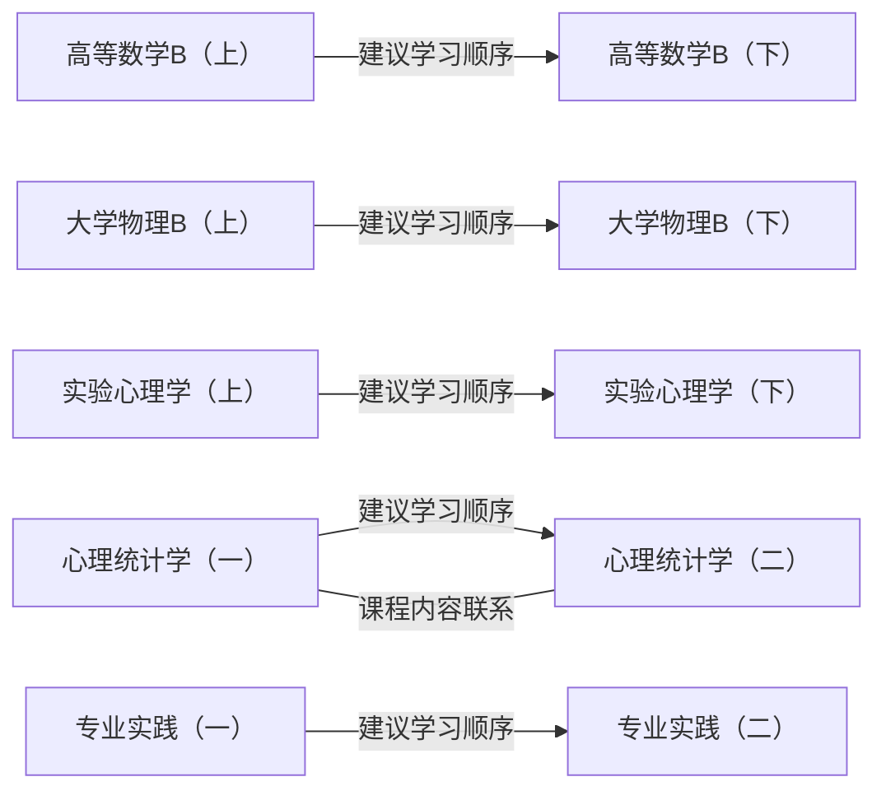

# 心理学专业“2+X”修读建议

2024 年汇编印刷页 736–737。原表记录 28 个可配对的课程代码。

[本节原页](plan-733.pdf#page=4) · [逐行数据](plan-733.json) · [院系目录](README.md)

## 课程导读

想了解心理与行为研究的课程安排，可以在原表中找到《实验心理学（上）》（`SOCI130028`）、《认知神经科学导论》（`SOCI130191`）、《社会心理学》（`SOCI130036`）。 [原书 PDF 第 750 页](plan-733.pdf#page=4)

图中连接《心理统计学（一）》（`SOCI130158`）和《心理统计学（二）》（`SOCI130159`），两门课都从课程题名标出的“统计学”切入，可沿这一主题对照阅读。 [原书 PDF 第 750 页](plan-733.pdf#page=4)

## 课程关系图

图中展示最多 20 条关系。下表列出本节全部关系。建议学习顺序供规划课程使用，正式选课资格以教务规定为准。

| 课程 | 关联课程 | 关系 | 依据 |
| --- | --- | --- | --- |
| 高等数学B（上）（MATH120003） | 高等数学B（下）（MATH120004） | 建议学习顺序 | 同节课程题名标明连续分册或序号。 |
| 大学物理B（上）（PHYS120013） | 大学物理B（下）（PHYS120014） | 建议学习顺序 | 同节课程题名标明连续分册或序号。 |
| 实验心理学（上）（SOCI130028） | 实验心理学（下）（SOCI130029） | 建议学习顺序 | 同节课程题名标明连续分册或序号。 |
| 心理统计学（一）（SOCI130158） | 心理统计学（二）（SOCI130159） | 建议学习顺序 | 同节课程题名标明连续分册或序号。 |
| 专业实践（一）（SOCI130160） | 专业实践（二）（SOCI130161） | 建议学习顺序 | 同节课程题名标明连续分册或序号。 |
| 心理统计学（一）（SOCI130158） | 心理统计学（二）（SOCI130159） | 课程内容联系 | 本方案两门课程的题名均含“统计学”，可据此对照这一主题。 |

## 课程

| 课程代码 | 名称 | 开课学期原文 | 来源（PDF 页） |
| --- | --- | --- | --- |
| BIOL120002 | 现代生物科学导论A |  | 750 |
| MATH120003 | 高等数学B（上） |  | 750 |
| MATH120004 | 高等数学B（下） |  | 750 |
| PHYS120013 | 大学物理B（上） |  | 750 |
| PHYS120014 | 大学物理B（下） |  | 750 |
| PHYS120015 | 基础物理实验 |  | 750 |
| PTSS110082 | 毛泽东思想和中国特色社会主义理论体系概论 |  | 750 |
| PTSS110087 | 马克思主义基本原理 |  | 750 |
| PTSS110088 | 中国近现代史纲要 |  | 750 |
| PTSS110089 | 思想道德与法治 |  | 750 |
| PTSS110090 | 习近平新时代中国特色社会主义思想概论 |  | 750 |
| SOCI130014 | 学年论文 |  | 751 |
| SOCI130028 | 实验心理学（上） |  | 750 |
| SOCI130029 | 实验心理学（下） |  | 750 |
| SOCI130031 | 发展心理学 |  | 750 |
| SOCI130032 | 认知心理学 |  | 751 |
| SOCI130036 | 社会心理学 |  | 750 |
| SOCI130037 | 人格心理学 |  | 751 |
| SOCI130038 | 毕业论文 |  | 751 |
| SOCI130083 | 心理测验与应用 |  | 751 |
| SOCI130117 | 心理实验设计与研究方法 |  | 751 |
| SOCI130158 | 心理统计学（一） |  | 750 |
| SOCI130159 | 心理统计学（二） |  | 750 |
| SOCI130160 | 专业实践（一） |  | 751 |
| SOCI130161 | 专业实践（二） |  | 751 |
| SOCI130179 | 变态心理学 |  | 751 |
| SOCI130191 | 认知神经科学导论 |  | 750 |
| SOSC120013 | 心理学导论 |  | 750 |
