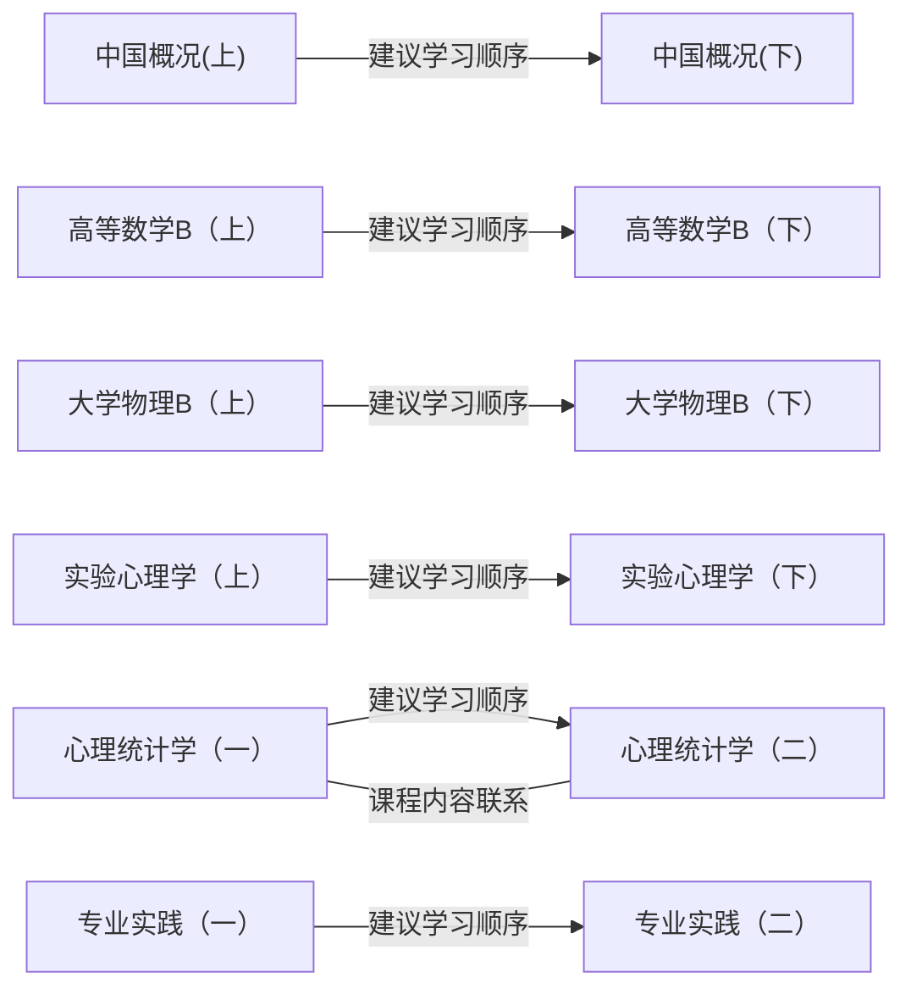

# 心理学专业“2+X”修读建议（留学生适用）

2024 年汇编印刷页 738–739。原表记录 25 个可配对的课程代码。

[本节原页](plan-733.pdf#page=6) · [逐行数据](plan-733.json) · [院系目录](README.md)

## 课程关系图

图中展示最多 20 条关系。下表列出本节全部关系。建议学习顺序供规划课程使用，正式选课资格以教务规定为准。

| 课程 | 关联课程 | 关系 | 依据 |
| --- | --- | --- | --- |
| 中国概况(上)（ICES110012） | 中国概况(下)（ICES110013） | 建议学习顺序 | 同节课程题名标明连续分册或序号。 |
| 高等数学B（上）（MATH120003） | 高等数学B（下）（MATH120004） | 建议学习顺序 | 同节课程题名标明连续分册或序号。 |
| 大学物理B（上）（PHYS120013） | 大学物理B（下）（PHYS120014） | 建议学习顺序 | 同节课程题名标明连续分册或序号。 |
| 实验心理学（上）（SOCI130028） | 实验心理学（下）（SOCI130029） | 建议学习顺序 | 同节课程题名标明连续分册或序号。 |
| 心理统计学（一）（SOCI130158） | 心理统计学（二）（SOCI130159） | 建议学习顺序 | 同节课程题名标明连续分册或序号。 |
| 专业实践（一）（SOCI130160） | 专业实践（二）（SOCI130161） | 建议学习顺序 | 同节课程题名标明连续分册或序号。 |
| 心理统计学（一）（SOCI130158） | 心理统计学（二）（SOCI130159） | 课程内容联系 | 本方案两门课程的题名均含“统计学”，可据此对照这一主题。 |

## 课程

| 课程代码 | 名称 | 开课学期原文 | 来源（PDF 页） |
| --- | --- | --- | --- |
| BIOL120002 | 现代生物科学导论A |  | 752 |
| ICES110012 | 中国概况(上) |  | 752 |
| ICES110013 | 中国概况(下) |  | 752 |
| MATH120003 | 高等数学B（上） |  | 752 |
| MATH120004 | 高等数学B（下） |  | 752 |
| PHYS120013 | 大学物理B（上） |  | 752 |
| PHYS120014 | 大学物理B（下） |  | 752 |
| PHYS120015 | 基础物理实验 |  | 752 |
| SOCI130014 | 学年论文 |  | 752 |
| SOCI130028 | 实验心理学（上） |  | 752 |
| SOCI130029 | 实验心理学（下） |  | 752 |
| SOCI130031 | 发展心理学 |  | 752 |
| SOCI130032 | 认知心理学 |  | 752 |
| SOCI130036 | 社会心理学 |  | 752 |
| SOCI130037 | 人格心理学 |  | 752 |
| SOCI130038 | 毕业论文 |  | 752 |
| SOCI130083 | 心理测验与应用 |  | 752 |
| SOCI130117 | 心理实验设计与研究方法 |  | 752 |
| SOCI130158 | 心理统计学（一） |  | 752 |
| SOCI130159 | 心理统计学（二） |  | 752 |
| SOCI130160 | 专业实践（一） |  | 752 |
| SOCI130161 | 专业实践（二） |  | 752 |
| SOCI130179 | 变态心理学 |  | 752 |
| SOCI130191 | 认知神经科学导论 |  | 752 |
| SOSC120013 | 心理学导论 |  | 752 |
