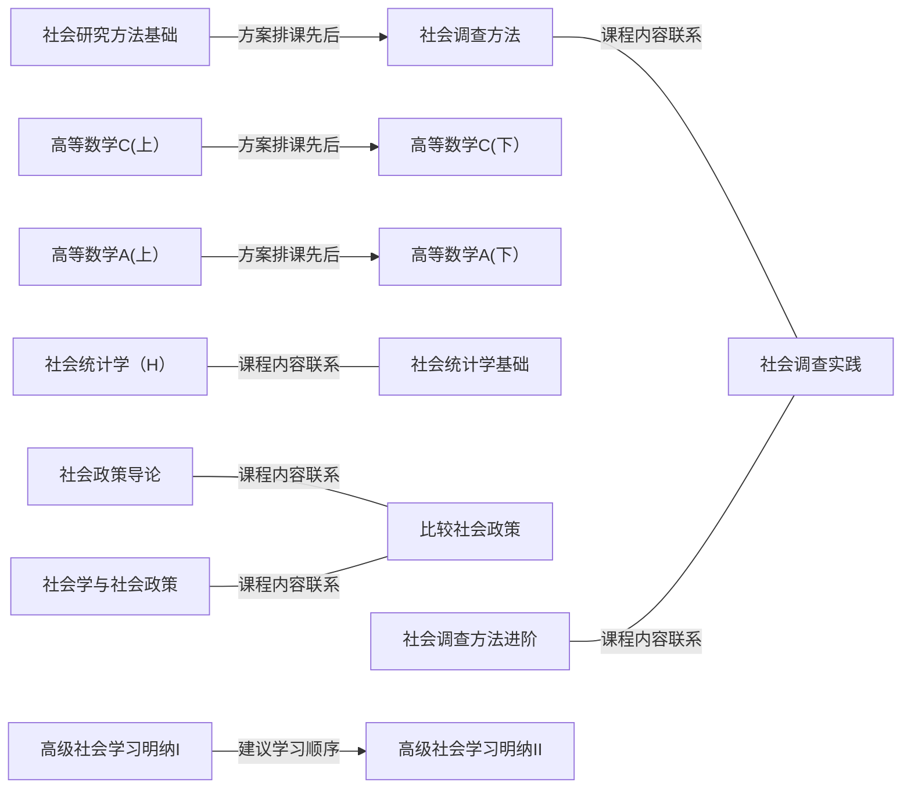

# 2025社会学专业本科培养方案（港澳台侨生）

社会发展与公共政策学院 · 社会学 · 方案 100163 · 99 个不同课程或科研条目。

[官方 Word](https://github.com/pythonbug225/fudan-course-atlas/blob/research/schoolwide-cohorts-2023-2025/research/contributions/%E5%85%A8%E6%A0%A1%E5%9F%B9%E5%85%BB%E6%96%B9%E6%A1%882023-2025/%E5%B7%B2%E6%9C%89%E9%99%A2%E7%B3%BB%E8%A7%84%E8%8C%83%E6%95%B0%E6%8D%AE/%E7%A4%BE%E4%BC%9A%E5%8F%91%E5%B1%95%E4%B8%8E%E5%85%AC%E5%85%B1%E6%94%BF%E7%AD%96%E5%AD%A6%E9%99%A2/2025/originals/plan-100163.docx) · [教务详情](https://fdjwgl.fudan.edu.cn/manager/bizType/2/major-program-search/info/100163?skipAuth=1) · [方案快照](https://github.com/pythonbug225/fudan-course-atlas/blob/research/schoolwide-cohorts-2023-2025/research/contributions/%E5%85%A8%E6%A0%A1%E5%9F%B9%E5%85%BB%E6%96%B9%E6%A1%882023-2025/%E5%B7%B2%E6%9C%89%E9%99%A2%E7%B3%BB%E8%A7%84%E8%8C%83%E6%95%B0%E6%8D%AE/%E7%A4%BE%E4%BC%9A%E5%8F%91%E5%B1%95%E4%B8%8E%E5%85%AC%E5%85%B1%E6%94%BF%E7%AD%96%E5%AD%A6%E9%99%A2/2025/raw/plan-100163.json.gz) · [年级目录](https://github.com/pythonbug225/fudan-course-atlas/blob/research/schoolwide-cohorts-2023-2025/research/contributions/%E5%85%A8%E6%A0%A1%E5%9F%B9%E5%85%BB%E6%96%B9%E6%A1%882023-2025/%E5%B7%B2%E6%9C%89%E9%99%A2%E7%B3%BB%E8%A7%84%E8%8C%83%E6%95%B0%E6%8D%AE/%E7%A4%BE%E4%BC%9A%E5%8F%91%E5%B1%95%E4%B8%8E%E5%85%AC%E5%85%B1%E6%94%BF%E7%AD%96%E5%AD%A6%E9%99%A2/2025/README.md)

## 修读导读

- **建议先学**　《社会研究方法基础》（`SOCI10003`） → 《社会调查方法》（`SOCI30034`）。研究设计和资料收集可用于调查方法学习。方案分别列在第2、4学期。

- **可以对照着读**　《社会学与社会政策》（`MSP50004`）与《比较社会政策》（`SWK50008`）。两门课的题名都涉及社会政策。从一个社会问题出发，比较谁能获得政策支持、由谁承担成本。

- **查模块选课**　《当代社会学理论》（`SOCI30021`）、《高级社会学理论研读》（`SOCI70001`）列在“专业核心教育课程”中。原表见 `/courseModules/9`。

## 课程关系图

图中展示部分关系。下表保留全部已建立的课程对，来源位置使用本方案 JSON Pointer。

## 先修与内容联系

| 类型 | 起点 | 终点 | 依据 | 原表定位 |
| --- | --- | --- | --- | --- |
| 建议学习顺序 | 高等数学C(上） (MATH10006) | 高等数学C(下） (MATH10007) | 同方案的课程题名具有连续分册或序号。  | `/courseModules/8/planCourses/3`、`/courseModules/8/planCourses/4` |
| 建议学习顺序 | 高等数学A(上） (MATH10015) | 高等数学A(下） (MATH10016) | 同方案的课程题名具有连续分册或序号。  | `/courseModules/8/planCourses/5`、`/courseModules/8/planCourses/6` |
| 建议学习顺序 | 社会研究方法基础 (SOCI10003) | 社会调查方法 (SOCI30034) | 研究设计和资料收集可用于调查方法学习。  | `/courseModules/6/planCourses/3`、`/courseModules/9/planCourses/3` |
| 建议学习顺序 | 高级社会学习明纳I (SOCI80002) | 高级社会学习明纳II (SOCI80003) | 同方案的课程题名具有连续分册或序号。  | `/courseModules/24/planCourses/3`、`/courseModules/24/planCourses/4` |
| 方案排课先后 | 高等数学C(上） (MATH10006) | 高等数学C(下） (MATH10007) | 同方案该课程全部明确数字学期均早于后者。  | `/courseModules/8/planCourses/3`、`/courseModules/8/planCourses/4` |
| 方案排课先后 | 高等数学A(上） (MATH10015) | 高等数学A(下） (MATH10016) | 同方案该课程全部明确数字学期均早于后者。  | `/courseModules/8/planCourses/5`、`/courseModules/8/planCourses/6` |
| 方案排课先后 | 社会研究方法基础 (SOCI10003) | 社会调查方法 (SOCI30034) | 同方案该课程全部明确数字学期均早于后者。  | `/courseModules/6/planCourses/3`、`/courseModules/9/planCourses/3` |
| 课程内容联系 | 人工智能程序设计 (AIB210001) | 人工智能、数据挖掘与算法：社会研究方法的新范式 (AIS631009) | 本方案两门课程的题名均含“人工智能”，可据此对照这一主题。  | `/courseModules/7/planCourses/0`、`/courseModules/15/planCourses/11` |
| 课程内容联系 | 社会政策评估 (MSP50001) | 比较社会政策 (SWK50008) | 本方案两门课程的题名均含“社会政策”，可据此对照这一主题。  | `/courseModules/15/planCourses/6`、`/courseModules/15/planCourses/12` |
| 课程内容联系 | 社会学与社会政策 (MSP50004) | 比较社会政策 (SWK50008) | 本方案两门课程的题名均含“社会政策”，可据此对照这一主题。  | `/courseModules/9/planCourses/18`、`/courseModules/15/planCourses/12` |
| 课程内容联系 | 社会政策导论 (MSP50005) | 比较社会政策 (SWK50008) | 本方案两门课程的题名均含“社会政策”，可据此对照这一主题。  | `/courseModules/9/planCourses/15`、`/courseModules/15/planCourses/12` |
| 课程内容联系 | 社会调查方法进阶 (MSP60002) | 社会调查实践 (SOCI30050) | 本方案两门课程的题名均含“社会调查”，可据此对照这一主题。  | `/courseModules/15/planCourses/8`、`/courseModules/24/planCourses/5` |
| 课程内容联系 | 文化人类学 (SOCI30002) | 医学人类学 (SOCI30038) | 本方案两门课程的题名均含“人类学”，可据此对照这一主题。  | `/courseModules/14/planCourses/3`、`/courseModules/12/planCourses/17` |
| 课程内容联系 | 社会统计学（H） (SOCI30006h) | 社会统计学基础 (SWK10001) | 本方案两门课程的题名均含“统计学”，可据此对照这一主题。  | `/courseModules/19/planCourses/0`、`/courseModules/9/planCourses/10` |
| 课程内容联系 | 人口社会学 (SOCI30008) | 农村社会学 (SOCI30012) | 本方案两门课程的题名均含“社会学”，可据此对照这一主题。  | `/courseModules/14/planCourses/8`、`/courseModules/14/planCourses/7` |
| 课程内容联系 | 人口社会学 (SOCI30008) | 城市社会学 (SOCI30013) | 本方案两门课程的题名均含“社会学”，可据此对照这一主题。  | `/courseModules/14/planCourses/8`、`/courseModules/14/planCourses/6` |
| 课程内容联系 | 人口社会学 (SOCI30008) | 文化社会学 (SOCI30023) | 本方案两门课程的题名均含“社会学”，可据此对照这一主题。  | `/courseModules/14/planCourses/8`、`/courseModules/14/planCourses/1` |
| 课程内容联系 | 人口社会学 (SOCI30008) | 情感社会学 (SOCI30040) | 本方案两门课程的题名均含“社会学”，可据此对照这一主题。  | `/courseModules/14/planCourses/8`、`/courseModules/12/planCourses/19` |
| 课程内容联系 | 饮食人类学 (SOCI30024) | 医学人类学 (SOCI30038) | 本方案两门课程的题名均含“人类学”，可据此对照这一主题。  | `/courseModules/12/planCourses/8`、`/courseModules/12/planCourses/17` |
| 课程内容联系 | 社会调查方法 (SOCI30034) | 社会调查实践 (SOCI30050) | 本方案两门课程的题名均含“社会调查”，可据此对照这一主题。  | `/courseModules/9/planCourses/3`、`/courseModules/24/planCourses/5` |
| 课程内容联系 | 医学人类学 (SOCI30038) | 人类学研究方法 (SOCI30039) | 本方案两门课程的题名均含“人类学”，可据此对照这一主题。  | `/courseModules/12/planCourses/17`、`/courseModules/12/planCourses/18` |
| 课程内容联系 | 人口问题与社会政策 (SOCI50023) | 比较社会政策 (SWK50008) | 本方案两门课程的题名均含“社会政策”，可据此对照这一主题。  | `/courseModules/16/planCourses/6`、`/courseModules/15/planCourses/12` |

本次未从可定位的明确表述中确认课程对课程预修。学期安排、系列分册与编辑建议均保留各自的依据。

## 按原方案模块阅读

同一模块展示原表中的课程归属。模块内课程之间的先后仍须逐项查阅。

- **荣誉项目课程**　社会心理学（H）、社会统计学（H）、组织社会学（H）、古典社会学理论（H）、社会分层与流动（H）、互联网与社会研究（H）、统计软件应用（H）、社会学研究 （高级研讨）（H）（原表模块 19）

## 课程表

同一课程在不同模块分别出现时，按原表逐行列出。季节字段保留原值。

| 课程 | 代码 | 学分 | 学期 | 模块 |
| --- | --- | ---: | --- | --- |
| 社会学导论 | SOCI20001 | 3.0 | 第1学期 | 培养方案 / 专业培养课程 / 学科基础课程 / 专业必修课程 |
| 社会工作导论 | SWK20002 | 3.0 | 第1学期 | 培养方案 / 专业培养课程 / 学科基础课程 / 专业必修课程 |
| 高等数学D | MATH10008 | 4.0 | 第1学期 | 培养方案 / 专业培养课程 / 学科基础课程 / 专业必修课程 |
| 社会研究方法基础 | SOCI10003 | 3.0 | 第2学期 | 培养方案 / 专业培养课程 / 学科基础课程 / 专业必修课程 |
| 人工智能程序设计 | AIB210001 | 1.0 | 第1学期、第2学期 | 培养方案 / 专业培养课程 / 学科基础课程 / 限定必修课程 |
| Python程序设计 | AIB110002 | 1.0 | 第1学期、第2学期 | 培养方案 / 专业培养课程 / 学科基础课程 / 限定必修课程 |
| 心理学导论 | PSYC20001 | 3.0 | 第1学期 | 培养方案 / 专业培养课程 / 学科基础课程 / 专业选修课程 |
| 线性代数 | MATH10017 | 3.0 | 第2学期 | 培养方案 / 专业培养课程 / 学科基础课程 / 专业选修课程 |
| 程序设计 | CS10004 | 4.0 | 第1学期 | 培养方案 / 专业培养课程 / 学科基础课程 / 专业选修课程 |
| 高等数学C(上） | MATH10006 | 4.0 | 第1学期 | 培养方案 / 专业培养课程 / 学科基础课程 / 专业选修课程 |
| 高等数学C(下） | MATH10007 | 4.0 | 第2学期 | 培养方案 / 专业培养课程 / 学科基础课程 / 专业选修课程 |
| 高等数学A(上） | MATH10015 | 5.0 | 第1学期 | 培养方案 / 专业培养课程 / 学科基础课程 / 专业选修课程 |
| 高等数学A(下） | MATH10016 | 5.0 | 第2学期 | 培养方案 / 专业培养课程 / 学科基础课程 / 专业选修课程 |
| 西方社会思想史 | SOCI30022 | 2.0 | 第2学期 | 培养方案 / 专业培养课程 / 专业核心教育课程 |
| 当代社会学理论 | SOCI30021 | 3.0 | 第3学期 | 培养方案 / 专业培养课程 / 专业核心教育课程 |
| 统计软件应用 | SOCI30037 | 3.0 | 第4学期 | 培养方案 / 专业培养课程 / 专业核心教育课程 |
| 社会调查方法 | SOCI30034 | 3.0 | 第4学期 | 培养方案 / 专业培养课程 / 专业核心教育课程 |
| 社会分层与流动 | SOCI30026 | 3.0 | 第5学期 | 培养方案 / 专业培养课程 / 专业核心教育课程 |
| 婚姻与家庭 | SOCI30030 | 2.0 | 第5学期 | 培养方案 / 专业培养课程 / 专业核心教育课程 |
| 高级社会学理论研读 | SOCI70001 | 2.0 | 第7学期 | 培养方案 / 专业培养课程 / 专业核心教育课程 |
| 高级社会研究方法 | SOCI40009 | 3.0 | 第8学期 | 培养方案 / 专业培养课程 / 专业核心教育课程 |
| 中级社会统计分析 | SOCI50017 | 3.0 | 第7学期 | 培养方案 / 专业培养课程 / 专业核心教育课程 |
| 经典社会学理论 | SOCI10004 | 3.0 | 第2学期 | 培养方案 / 专业培养课程 / 专业核心教育课程 |
| 社会统计学基础 | SWK10001 | 3.0 | 第3学期 | 培养方案 / 专业培养课程 / 专业核心教育课程 |
| 社会学视野下的青年 | SOCI10001 | 2.0 | 第2学期 | 培养方案 / 专业培养课程 / 专业核心教育课程 |
| 互联网与社会研究 | SOCI30033 | 4.0 | 第2学期 | 培养方案 / 专业培养课程 / 专业核心教育课程 |
| 理解当代中国社会 | SOCI20004 | 2.0 | 第2学期 | 培养方案 / 专业培养课程 / 专业核心教育课程 |
| 组织与社会 | SOCI30048 | 2.0 | 第4学期 | 培养方案 / 专业培养课程 / 专业核心教育课程 |
| 社会政策导论 | MSP50005 | 2.0 | AUTUMN | 培养方案 / 专业培养课程 / 专业核心教育课程 |
| 社会研究方法进阶 | MSP60003 | 2.0 | AUTUMN | 培养方案 / 专业培养课程 / 专业核心教育课程 |
| 统计分析进阶 | MSP60004 | 2.0 | SPRING | 培养方案 / 专业培养课程 / 专业核心教育课程 |
| 社会学与社会政策 | MSP50004 | 2.0 | SPRING | 培养方案 / 专业培养课程 / 专业核心教育课程 |
| 社会科学经典导读 | GECC10114 | 2.0 | 第4学期 | 培养方案 / 专业进阶路径 |
| 马克思主义社会理论 | SOCI130001 | 3.0 | 第6学期 | 培养方案 / 专业进阶路径 |
| 中国的政治经济状况 | SOCI30007 | 2.0 | SPRING、AUTUMN | 培养方案 / 专业进阶路径 |
| 全球化研究 | SOCI130064 | 2.0 | SPRING、AUTUMN | 培养方案 / 专业进阶路径 |
| 发展研究 | SOCI30016 | 2.0 | SPRING、AUTUMN | 培养方案 / 专业进阶路径 |
| 社会性别研究 | SOCI30017 | 2.0 | 第5学期 | 培养方案 / 专业进阶路径 |
| 人口分析 | SOCI30018 | 2.0 | 第6学期 | 培养方案 / 专业进阶路径 |
| 中国文化与商业实践 | SOCI30019 | 2.0 | SPRING、AUTUMN | 培养方案 / 专业进阶路径 |
| 饮食人类学 | SOCI30024 | 2.0 | 第6学期 | 培养方案 / 专业进阶路径 |
| 全球化争议 | SOCI130134 | 2.0 | SPRING、AUTUMN | 培养方案 / 专业进阶路径 |
| 上海：城市研究 | SOCI130135 | 2.0 | SPRING、AUTUMN | 培养方案 / 专业进阶路径 |
| 中国社会与宗教 | SOCI30027 | 2.0 | SPRING、AUTUMN | 培养方案 / 专业进阶路径 |
| 全球化下的中国文化与社会 | SOCI30028 | 2.0 | SPRING、AUTUMN | 培养方案 / 专业进阶路径 |
| 社会网络分析导论 | SOCI30031 | 2.0 | 第4学期 | 培养方案 / 专业进阶路径 |
| 论文写作 | SOCI30032 | 2.0 | 第5学期 | 培养方案 / 专业进阶路径 |
| 社会运动 | SOCI130154 | 2.0 | SPRING、AUTUMN | 培养方案 / 专业进阶路径 |
| 经济发展研究 | SOCI30036 | 2.0 | SPRING、AUTUMN | 培养方案 / 专业进阶路径 |
| 医学人类学 | SOCI30038 | 3.0 | SPRING | 培养方案 / 专业进阶路径 |
| 人类学研究方法 | SOCI30039 | 3.0 | AUTUMN | 培养方案 / 专业进阶路径 |
| 情感社会学 | SOCI30040 | 2.0 | SPRING、AUTUMN | 培养方案 / 专业进阶路径 |
| 实地调查实践 | SOCI30041 | 3.0 | SPRING、AUTUMN | 培养方案 / 专业进阶路径 |
| 社会心理学 | PSYC30006 | 3.0 | AUTUMN | 培养方案 / 专业进阶路径 / 专业进阶课程 / 专业进阶模块 |
| 文化社会学 | SOCI30023 | 2.0 | AUTUMN | 培养方案 / 专业进阶路径 / 专业进阶课程 / 专业进阶模块 |
| 宗教社会学 | SOCI30015 | 2.0 | SPRING | 培养方案 / 专业进阶路径 / 专业进阶课程 / 专业进阶模块 |
| 文化人类学 | SOCI30002 | 2.0 | SPRING | 培养方案 / 专业进阶路径 / 专业进阶课程 / 专业进阶模块 |
| 社区研究 | SOCI30003 | 2.0 | AUTUMN | 培养方案 / 专业进阶路径 / 专业进阶课程 / 专业进阶模块 |
| 社会变迁 | SOCI30010 | 2.0 | AUTUMN | 培养方案 / 专业进阶路径 / 专业进阶课程 / 专业进阶模块 |
| 城市社会学 | SOCI30013 | 2.0 | SPRING | 培养方案 / 专业进阶路径 / 专业进阶课程 / 专业进阶模块 |
| 农村社会学 | SOCI30012 | 2.0 | AUTUMN | 培养方案 / 专业进阶路径 / 专业进阶课程 / 专业进阶模块 |
| 人口社会学 | SOCI30008 | 2.0 | AUTUMN | 培养方案 / 专业进阶路径 / 专业进阶课程 / 专业进阶模块 |
| 医疗和健康社会学 | SOCI30014 | 2.0 | AUTUMN | 培养方案 / 专业进阶路径 / 专业进阶课程 / 专业进阶模块 |
| 社会网络分析导论 | SOCI30031 | 2.0 | SPRING | 培养方案 / 专业进阶路径 / 专业进阶课程 / 专业进阶模块 |
| 大数据与社会科学 | AIT410018 | 2.0 | SPRING | 培养方案 / 专业进阶路径 / 专业进阶课程 / 专业进阶模块 |
| 宗教社会学 | SOCI50021 | 3.0 | AUTUMN | 培养方案 / 专业进阶路径 / 专业进阶课程 / 专业进阶本研融通模块 |
| 政治与社会 | SOCI50037 | 2.0 | SPRING | 培养方案 / 专业进阶路径 / 专业进阶课程 / 专业进阶本研融通模块 |
| 经济社会学研究 | SOCI60014 | 3.0 | AUTUMN | 培养方案 / 专业进阶路径 / 专业进阶课程 / 专业进阶本研融通模块 |
| 社会资本研究 | SOCI30044 | 2.0 | SPRING | 培养方案 / 专业进阶路径 / 专业进阶课程 / 专业进阶本研融通模块 |
| 高级质性研究方法 | SOCI50044 | 3.0 | AUTUMN | 培养方案 / 专业进阶路径 / 专业进阶课程 / 专业进阶本研融通模块 |
| 贫困与反贫困政策 | SWK50016 | 2.0 | SPRING | 培养方案 / 专业进阶路径 / 专业进阶课程 / 专业进阶本研融通模块 |
| 社会政策评估 | MSP50001 | 2.0 | SPRING | 培养方案 / 专业进阶路径 / 专业进阶课程 / 专业进阶本研融通模块 |
| GIS技术与应用 | MSP60001 | 2.0 | AUTUMN | 培养方案 / 专业进阶路径 / 专业进阶课程 / 专业进阶本研融通模块 |
| 社会调查方法进阶 | MSP60002 | 2.0 | AUTUMN | 培养方案 / 专业进阶路径 / 专业进阶课程 / 专业进阶本研融通模块 |
| 当代中国社会 | MSP50003 | 2.0 | SPRING | 培养方案 / 专业进阶路径 / 专业进阶课程 / 专业进阶本研融通模块 |
| 大数据与社会计算 | AIS631008 | 2.0 | AUTUMN | 培养方案 / 专业进阶路径 / 专业进阶课程 / 专业进阶本研融通模块 |
| 人工智能、数据挖掘与算法：社会研究方法的新范式 | AIS631009 | 3.0 | AUTUMN | 培养方案 / 专业进阶路径 / 专业进阶课程 / 专业进阶本研融通模块 |
| 比较社会政策 | SWK50008 | 2.0 | AUTUMN | 培养方案 / 专业进阶路径 / 专业进阶课程 / 专业进阶本研融通模块 |
| 人类学研究方法 | SOCI30039 | 3.0 | AUTUMN | 培养方案 / 专业进阶路径 / 专业进阶任意选修课程 |
| 医学人类学 | SOCI30038 | 3.0 | SPRING | 培养方案 / 专业进阶路径 / 专业进阶任意选修课程 |
| 人口分析 | SOCI30018 | 2.0 | AUTUMN | 培养方案 / 专业进阶路径 / 专业进阶任意选修课程 |
| 饮食人类学 | SOCI30024 | 2.0 | AUTUMN | 培养方案 / 专业进阶路径 / 专业进阶任意选修课程 |
| 情感社会学 | SOCI30040 | 2.0 | AUTUMN | 培养方案 / 专业进阶路径 / 专业进阶任意选修课程 |
| 数字化与长寿时代 | GEEC10416 | 2.0 | AUTUMN | 培养方案 / 专业进阶路径 / 专业进阶任意选修课程 |
| 人口问题与社会政策 | SOCI50023 | 3.0 | SPRING | 培养方案 / 专业进阶路径 / 专业进阶任意选修课程 |
| 婚姻与家庭社会学 | SOCI50038 | 2.0 | SPRING | 培养方案 / 专业进阶路径 / 专业进阶任意选修课程 |
| 移民社会学 | SOCI50045 | 2.0 | SPRING | 培养方案 / 专业进阶路径 / 专业进阶任意选修课程 |
| 老龄社会研究专题 | SOCI50058 | 3.0 | SPRING | 培养方案 / 专业进阶路径 / 专业进阶任意选修课程 |
| Introduction to Chinese Society | SOCI50004 | 3.0 | AUTUMN | 培养方案 / 专业进阶路径 / 专业进阶任意选修课程 |
| Chinese Demography and Social Policy | SOCI50003 | 3.0 | SPRING | 培养方案 / 专业进阶路径 / 专业进阶任意选修课程 |
| Chinese Culture and Religion | SOCI50005 | 3.0 | AUTUMN | 培养方案 / 专业进阶路径 / 专业进阶任意选修课程 |
| 社会统计学（H） | SOCI30006h | 5.0 | 第3学期 | 培养方案 / 荣誉项目课程 |
| 社会心理学（H） | PSYC30006h | 4.0 | 第3学期 | 培养方案 / 荣誉项目课程 |
| 组织社会学（H） | SOCI30009h | 4.0 | 第5学期 | 培养方案 / 荣誉项目课程 |
| 古典社会学理论（H） | SOCI30020h | 5.0 | 第3学期 | 培养方案 / 荣誉项目课程 |
| 社会分层与流动（H） | SOCI30026h | 5.0 | 第6学期 | 培养方案 / 荣誉项目课程 |
| 社会学研究 （高级研讨）（H） | SOCI40010h | 4.0 | 第7学期 | 培养方案 / 荣誉项目课程 |
| 互联网与社会研究（H） | SOCI30033h | 5.0 | 第6学期 | 培养方案 / 荣誉项目课程 |
| 统计软件应用（H） | SOCI30037h | 5.0 | 第4学期 | 培养方案 / 荣誉项目课程 |
| 复芏计划(FDUROP) | 102 | 0.0 |  | 融合创新能力 |
| 论文写作 | SOCI30032 | 2.0 | 第5学期 | 融合创新能力 |
| 实地调查实践 | SOCI30041 | 3.0 | SUMMER | 融合创新能力 |
| 高级社会学习明纳I | SOCI80002 | 2.0 | AUTUMN | 融合创新能力 |
| 高级社会学习明纳II | SOCI80003 | 2.0 | SPRING | 融合创新能力 |
| 社会调查实践 | SOCI30050 | 2.0 | 第6学期 | 融合创新能力 |
| 学年论文 | SOCI40003 | 1.0 | 第7学期 | 融合创新能力 |
| 毕业论文 | SOCI40006 | 6.0 | 第8学期 | 融合创新能力 |
