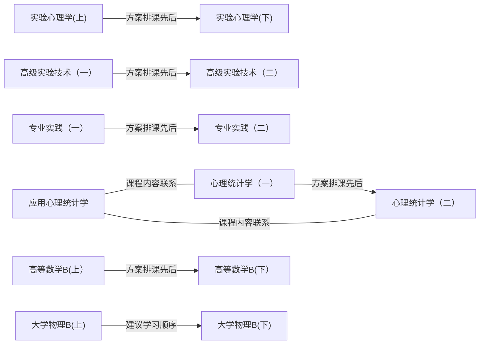

# 2025心理学专业本科培养方案（留学生）

社会发展与公共政策学院 · 心理学 · 方案 100166 · 64 个不同课程或科研条目。

[官方 Word](https://github.com/pythonbug225/fudan-course-atlas/blob/research/schoolwide-cohorts-2023-2025/research/contributions/%E5%85%A8%E6%A0%A1%E5%9F%B9%E5%85%BB%E6%96%B9%E6%A1%882023-2025/%E5%B7%B2%E6%9C%89%E9%99%A2%E7%B3%BB%E8%A7%84%E8%8C%83%E6%95%B0%E6%8D%AE/%E7%A4%BE%E4%BC%9A%E5%8F%91%E5%B1%95%E4%B8%8E%E5%85%AC%E5%85%B1%E6%94%BF%E7%AD%96%E5%AD%A6%E9%99%A2/2025/originals/plan-100166.docx) · [教务详情](https://fdjwgl.fudan.edu.cn/manager/bizType/2/major-program-search/info/100166?skipAuth=1) · [方案快照](https://github.com/pythonbug225/fudan-course-atlas/blob/research/schoolwide-cohorts-2023-2025/research/contributions/%E5%85%A8%E6%A0%A1%E5%9F%B9%E5%85%BB%E6%96%B9%E6%A1%882023-2025/%E5%B7%B2%E6%9C%89%E9%99%A2%E7%B3%BB%E8%A7%84%E8%8C%83%E6%95%B0%E6%8D%AE/%E7%A4%BE%E4%BC%9A%E5%8F%91%E5%B1%95%E4%B8%8E%E5%85%AC%E5%85%B1%E6%94%BF%E7%AD%96%E5%AD%A6%E9%99%A2/2025/raw/plan-100166.json.gz) · [年级目录](https://github.com/pythonbug225/fudan-course-atlas/blob/research/schoolwide-cohorts-2023-2025/research/contributions/%E5%85%A8%E6%A0%A1%E5%9F%B9%E5%85%BB%E6%96%B9%E6%A1%882023-2025/%E5%B7%B2%E6%9C%89%E9%99%A2%E7%B3%BB%E8%A7%84%E8%8C%83%E6%95%B0%E6%8D%AE/%E7%A4%BE%E4%BC%9A%E5%8F%91%E5%B1%95%E4%B8%8E%E5%85%AC%E5%85%B1%E6%94%BF%E7%AD%96%E5%AD%A6%E9%99%A2/2025/README.md)

## 修读导读

- **建议先学**　《实验心理学(上)》（`PSYC30001`） → 《实验心理学(下)》（`PSYC30002`）。题名列出连续册次或级别。将前一阶段出现的研究问题、变量和证据放在一张表中，再比较后续案例。方案分别列在第3、4学期。

- **可以对照着读**　《应用心理统计学》（`APSY70009`）与《心理统计学（一）》（`PSYC30017`）。两门课的题名都涉及统计学。选一组数据，区分准备比较的量、可用的信息，以及结论中的不确定性。

- **查模块选课**　《社会心理学》（`PSYC30006`）、《发展心理学》（`PSYC30003`）列在“专业核心教育课程”中。原表见 `/courseModules/6`。

## 课程关系图

图中展示部分关系。下表保留全部已建立的课程对，来源位置使用本方案 JSON Pointer。

## 先修与内容联系

| 类型 | 起点 | 终点 | 依据 | 原表定位 |
| --- | --- | --- | --- | --- |
| 建议学习顺序 | 高等数学B(上） (MATH10004) | 高等数学B(下） (MATH10005) | 同方案的课程题名具有连续分册或序号。  | `/courseModules/5/planCourses/1`、`/courseModules/5/planCourses/2` |
| 建议学习顺序 | 大学物理B(上) (PHYS10003) | 大学物理B(下) (PHYS10004) | 同方案的课程题名具有连续分册或序号。  | `/courseModules/5/planCourses/3`、`/courseModules/5/planCourses/4` |
| 建议学习顺序 | 实验心理学(上) (PSYC30001) | 实验心理学(下) (PSYC30002) | 同方案的课程题名具有连续分册或序号。  | `/courseModules/6/planCourses/0`、`/courseModules/6/planCourses/4` |
| 建议学习顺序 | 心理统计学（一） (PSYC30017) | 心理统计学（二） (PSYC30018) | 同方案的课程题名具有连续分册或序号。  | `/courseModules/6/planCourses/2`、`/courseModules/6/planCourses/3` |
| 建议学习顺序 | 高级实验技术（一） (PSYC30027) | 高级实验技术（二） (PSYC30028) | 同方案的课程题名具有连续分册或序号。  | `/courseModules/10/planCourses/4`、`/courseModules/10/planCourses/5` |
| 建议学习顺序 | 专业实践（一） (PSYC30029) | 专业实践（二） (PSYC30030) | 同方案的课程题名具有连续分册或序号。  | `/courseModules/17/planCourses/3`、`/courseModules/17/planCourses/4` |
| 方案排课先后 | 高等数学B(上） (MATH10004) | 高等数学B(下） (MATH10005) | 同方案该课程全部明确数字学期均早于后者。  | `/courseModules/5/planCourses/1`、`/courseModules/5/planCourses/2` |
| 方案排课先后 | 大学物理B(上) (PHYS10003) | 大学物理B(下) (PHYS10004) | 同方案该课程全部明确数字学期均早于后者。  | `/courseModules/5/planCourses/3`、`/courseModules/5/planCourses/4` |
| 方案排课先后 | 实验心理学(上) (PSYC30001) | 实验心理学(下) (PSYC30002) | 同方案该课程全部明确数字学期均早于后者。  | `/courseModules/6/planCourses/0`、`/courseModules/6/planCourses/4` |
| 方案排课先后 | 心理统计学（一） (PSYC30017) | 心理统计学（二） (PSYC30018) | 同方案该课程全部明确数字学期均早于后者。  | `/courseModules/6/planCourses/2`、`/courseModules/6/planCourses/3` |
| 方案排课先后 | 高级实验技术（一） (PSYC30027) | 高级实验技术（二） (PSYC30028) | 同方案该课程全部明确数字学期均早于后者。  | `/courseModules/10/planCourses/4`、`/courseModules/10/planCourses/5` |
| 方案排课先后 | 专业实践（一） (PSYC30029) | 专业实践（二） (PSYC30030) | 同方案该课程全部明确数字学期均早于后者。  | `/courseModules/17/planCourses/3`、`/courseModules/17/planCourses/4` |
| 课程内容联系 | 应用心理统计学 (APSY70009) | 心理统计学（一） (PSYC30017) | 本方案两门课程的题名均含“统计学”，可据此对照这一主题。  | `/courseModules/6/planCourses/14`、`/courseModules/6/planCourses/2` |
| 课程内容联系 | 应用心理统计学 (APSY70009) | 心理统计学（二） (PSYC30018) | 本方案两门课程的题名均含“统计学”，可据此对照这一主题。  | `/courseModules/6/planCourses/14`、`/courseModules/6/planCourses/3` |

本次未从可定位的明确表述中确认课程对课程预修。学期安排、系列分册与编辑建议均保留各自的依据。

## 课程表

同一课程在不同模块分别出现时，按原表逐行列出。季节字段保留原值。

| 课程 | 代码 | 学分 | 学期 | 模块 |
| --- | --- | ---: | --- | --- |
| 心理学导论 | PSYC20001 | 3.0 | 第1学期 | 培养方案 / 专业培养课程 / 学科基础课程 |
| 高等数学B(上） | MATH10004 | 5.0 | 第1学期 | 培养方案 / 专业培养课程 / 学科基础课程 |
| 高等数学B(下） | MATH10005 | 5.0 | 第2学期 | 培养方案 / 专业培养课程 / 学科基础课程 |
| 大学物理B(上) | PHYS10003 | 4.0 | 第1学期 | 培养方案 / 专业培养课程 / 学科基础课程 |
| 大学物理B(下) | PHYS10004 | 4.0 | 第2学期 | 培养方案 / 专业培养课程 / 学科基础课程 |
| 基础物理实验 | PHYS10005 | 2.0 | 第1学期 | 培养方案 / 专业培养课程 / 学科基础课程 |
| 现代生物科学导论A | BIOL10001 | 3.0 | 第1学期 | 培养方案 / 专业培养课程 / 学科基础课程 |
| 实验心理学(上) | PSYC30001 | 3.0 | 第3学期 | 培养方案 / 专业培养课程 / 专业核心教育课程 |
| 社会心理学 | PSYC30006 | 3.0 | 第3学期 | 培养方案 / 专业培养课程 / 专业核心教育课程 |
| 心理统计学（一） | PSYC30017 | 3.0 | 第3学期 | 培养方案 / 专业培养课程 / 专业核心教育课程 |
| 心理统计学（二） | PSYC30018 | 2.0 | 第4学期 | 培养方案 / 专业培养课程 / 专业核心教育课程 |
| 实验心理学(下) | PSYC30002 | 3.0 | 第4学期 | 培养方案 / 专业培养课程 / 专业核心教育课程 |
| 发展心理学 | PSYC30003 | 3.0 | 第4学期 | 培养方案 / 专业培养课程 / 专业核心教育课程 |
| 心理实验设计与研究方法 | PSYC30012 | 3.0 | 第4学期 | 培养方案 / 专业培养课程 / 专业核心教育课程 |
| 认知神经科学导论 | PSYC30025 | 3.0 | 第4学期 | 培养方案 / 专业培养课程 / 专业核心教育课程 |
| 认知心理学 | PSYC30004 | 2.0 | 第5学期 | 培养方案 / 专业培养课程 / 专业核心教育课程 |
| 变态心理学 | PSYC30023 | 3.0 | 第5学期 | 培养方案 / 专业培养课程 / 专业核心教育课程 |
| 人格心理学 | PSYC30007 | 3.0 | 第6学期 | 培养方案 / 专业培养课程 / 专业核心教育课程 |
| 心理测验与应用 | PSYC30008 | 2.0 | 第6学期 | 培养方案 / 专业培养课程 / 专业核心教育课程 |
| 高级心理学研究方法 | APSY70010 | 3.0 | SPRING、AUTUMN | 培养方案 / 专业培养课程 / 专业核心教育课程 |
| 心理学研究进展 | PSYC40005 | 3.0 | SPRING、AUTUMN | 培养方案 / 专业培养课程 / 专业核心教育课程 |
| 应用心理统计学 | APSY70009 | 3.0 | SPRING、AUTUMN | 培养方案 / 专业培养课程 / 专业核心教育课程 |
| 发展心理学专题 | APSY60001 | 2.0 | SPRING、AUTUMN | 培养方案 / 专业培养课程 / 专业核心教育课程 |
| 心理测量及应用 | APSY60016 | 2.0 | SPRING、AUTUMN | 培养方案 / 专业培养课程 / 专业核心教育课程 |
| 心理咨询与治疗的理论与实务专题 | APSY60005 | 2.0 | SPRING、AUTUMN | 培养方案 / 专业培养课程 / 专业核心教育课程 |
| 心理学研究技术与数据处理 | PSYC30024 | 2.0 | 第5学期 | 培养方案 / 专业进阶模块 / 专业进阶模块I |
| 智力心理学 | PSYC30014 | 2.0 | SPRING | 培养方案 / 专业进阶模块 / 专业进阶模块I |
| 语言心理学 | PSYC30016 | 2.0 | AUTUMN | 培养方案 / 专业进阶模块 / 专业进阶模块I |
| 统计软件应用 | SOCI30029 | 2.0 | SPRING | 培养方案 / 专业进阶模块 / 专业进阶模块I |
| 高级实验技术（一） | PSYC30027 | 2.0 | 第6学期 | 培养方案 / 专业进阶模块 / 专业进阶模块I |
| 高级实验技术（二） | PSYC30028 | 2.0 | 第7学期 | 培养方案 / 专业进阶模块 / 专业进阶模块I |
| 心理学质性研究方法 | PSYC30026 | 3.0 | 第5学期 | 培养方案 / 专业进阶模块 / 专业进阶模块I |
| 工程心理学 | APSY60003 | 2.0 | SPRING、AUTUMN | 培养方案 / 专业进阶模块 / 专业进阶模块I |
| 决策心理学 | APSY60013 | 2.0 | SPRING、AUTUMN | 培养方案 / 专业进阶模块 / 专业进阶模块I |
| 咨询与访谈技巧 | APSY60008 | 2.0 | SPRING、AUTUMN | 培养方案 / 专业进阶模块 / 专业进阶模块I |
| 心理评估诊断与案例概念化 | APSY60006 | 2.0 | SPRING、AUTUMN | 培养方案 / 专业进阶模块 / 专业进阶模块I |
| 社会心理学（MAP） | APSY60002 | 2.0 | SPRING、AUTUMN | 培养方案 / 专业进阶模块 / 专业进阶模块I |
| 心理咨询与治疗 | PSYC30019 | 2.0 | AUTUMN | 培养方案 / 专业进阶模块 / 专业进阶模块II |
| 临床心理学 | PSYC30010 | 2.0 | 第6学期 | 培养方案 / 专业进阶模块 / 专业进阶模块II |
| 艺术治疗 | PSYC30015 | 2.0 | 第6学期 | 培养方案 / 专业进阶模块 / 专业进阶模块II |
| 心理分析与中国社会 | PSYC30022 | 2.0 | AUTUMN | 培养方案 / 专业进阶模块 / 专业进阶模块II |
| 教育心理学 | PSYC30005 | 2.0 | 第5学期 | 培养方案 / 专业进阶模块 / 专业进阶模块II |
| 管理心理学 | PSYC30009 | 2.0 | 第4学期 | 培养方案 / 专业进阶模块 / 专业进阶模块II |
| 性别心理学 | PSYC30020 | 2.0 | SPRING | 培养方案 / 专业进阶模块 / 专业进阶模块II |
| 决策心理学 | PSYC30021 | 2.0 | 第6学期 | 培养方案 / 专业进阶模块 / 专业进阶模块II |
| 职业心理学 | PSYC30013 | 2.0 | 第7学期 | 培养方案 / 专业进阶模块 / 专业进阶模块II |
| 消费心理学 | PSYC30011 | 2.0 | SPRING | 培养方案 / 专业进阶模块 / 专业进阶模块II |
| 实验心理学专题 | APSY70002 | 2.0 | SPRING、AUTUMN | 培养方案 / 专业进阶模块 / 专业进阶模块II |
| 人机交互 | APSY70008 | 2.0 | SPRING、AUTUMN | 培养方案 / 专业进阶模块 / 专业进阶模块II |
| 消费与广告心理学 | APSY60019 | 2.0 | SPRING、AUTUMN | 培养方案 / 专业进阶模块 / 专业进阶模块II |
| 产品设计和用户体验研究 | APSY60015 | 2.0 | SPRING、AUTUMN | 培养方案 / 专业进阶模块 / 专业进阶模块II |
| 组织心理学 | APSY60022 | 2.0 | SPRING、AUTUMN | 培养方案 / 专业进阶模块 / 专业进阶模块II |
| 生涯发展与咨询 | APSY60010 | 2.0 | SPRING、AUTUMN | 培养方案 / 专业进阶模块 / 专业进阶模块II |
| 团体心理辅导 | APSY60014 | 2.0 | SPRING、AUTUMN | 培养方案 / 专业进阶模块 / 专业进阶模块II |
| 精神分析引论 | APSY70005 | 2.0 | SPRING、AUTUMN | 培养方案 / 专业进阶模块 / 专业进阶模块II |
| 个体咨询技术与案例督导 | APSY70004 | 2.0 | SPRING、AUTUMN | 培养方案 / 专业进阶模块 / 专业进阶模块II |
| 死亡与生命研究专题 | SOCI70004 | 2.0 | SPRING、AUTUMN | 培养方案 / 专业进阶模块 / 专业进阶模块II |
| 老年心理学 | SOCI70005 | 2.0 | SPRING、AUTUMN | 培养方案 / 专业进阶模块 / 专业进阶模块II |
| 前沿讲座 | 1061 | 1.0 |  | 融合创新能力 |
| 复芏计划(FDUROP) | 102 | 0.0 |  | 融合创新能力 |
| 学年论文 | SOCI40003 | 1.0 | 第7学期 | 融合创新能力 |
| 专业实践（一） | PSYC30029 | 1.0 | 第5学期 | 融合创新能力 |
| 专业实践（二） | PSYC30030 | 1.0 | 第6学期 | 融合创新能力 |
| 毕业论文 | PSYC40007 | 4.0 | 第8学期 | 融合创新能力 |
