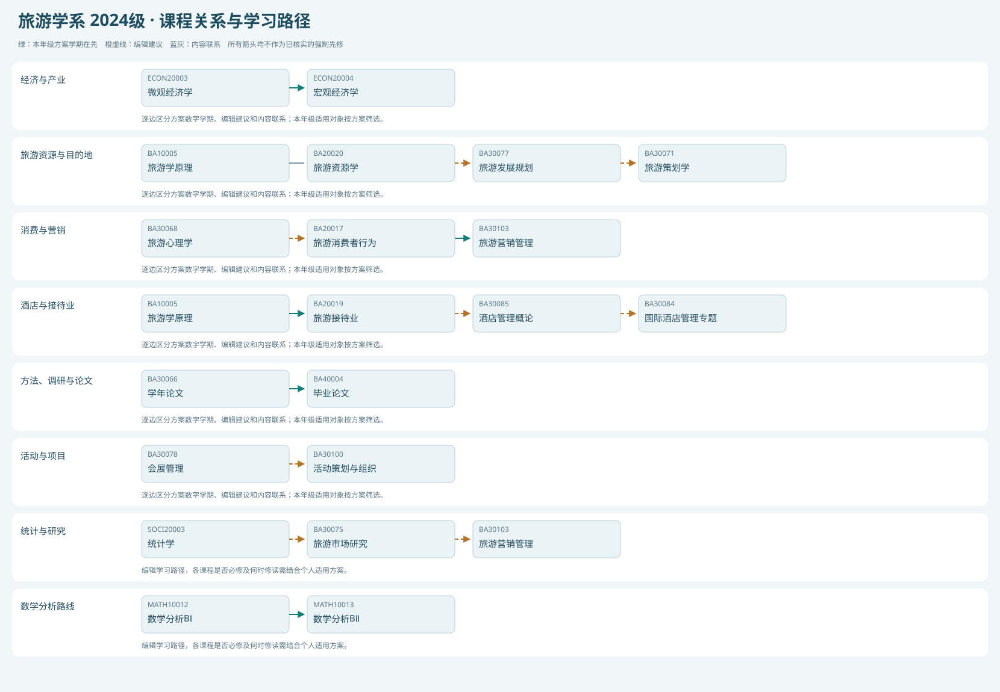

# 旅游学系2024级培养方案与课程关系

本年级共取得 **2份方案原件**，去重 **435个课程/科研条目**，其中 **68个专业、基础或科研培养条目**，另 **367个仅见于公共候选目录**。图谱另设59个方案模块节点；不能把全目录数量读作个人必修课数。

- [交互图谱](course-graph/index.html)：下载后打开，默认显示专业培养条目，可按方案、主题和公共目录范围筛选。
- [学习路径与课程关系](course-graph/learning-paths.md)、[静态总览](course-graph/overview.svg)
- [完整图谱JSON](course-graph/graph.json)、[节点CSV](course-graph/nodes.csv)、[关系CSV](course-graph/edges.csv)
- [课程逐行清单](official/courses.csv)、[模块与学分规则原字段](official/modules.json)、[来源核查](course-graph/source-audit.json)

## 官方方案原件

| ID | 名称与适用对象 | 原件 | 离线阅读 |
| --- | --- | --- | --- |
| 72915 | 2024旅游管理专业“2+X”教学培养方案（留学生适用）；留学生；旅游学系 | [Word](official/word-originals\plan-72915.docx) | [阅读页](official/programme-72915.html) |
| 72914 | 2024旅游管理专业“2+X”教学培养方案；普通本科生；旅游学系 | [Word](official/word-originals\plan-72914.docx) | [阅读页](official/programme-72914.html) |

## 怎样理解先修与版本

本年级方案正文、Word文本及先修字段已检索，**未取得能够确认课程对课程强制先修的条款**。绿色“方案学期在先”只依据同一方案内的数字学期；橙色为编辑建议，蓝灰色为内容联系；“模块收录”只表示原表列出候选课程。字段缺失不等于没有先修，是否执行选课门槛仍需核对该年级正式大纲和教务规则。

本图不复制2026年的学期数。编辑主题关系按本年级唯一同名课程定位；原课号完整保留，未将旧TOUR代码改写成BA代码，也不推断学分互认。数学三选一路线按原模块并列，不能把三条路线都当成必修链。未明确数字学期的春、秋季节不参与先后推导。

原始接口与官方Word均存于official/；目录记录和方案详情为2026-11-26取得的本年级当前公开快照，系统可能后续修订，不能称为入学当年的原始发布版。JSON经格式规范化并gzip压缩，Word保持下载字节不变；哈希见总清单。原件权利归原权利人，未取得单独的再利用许可声明。
