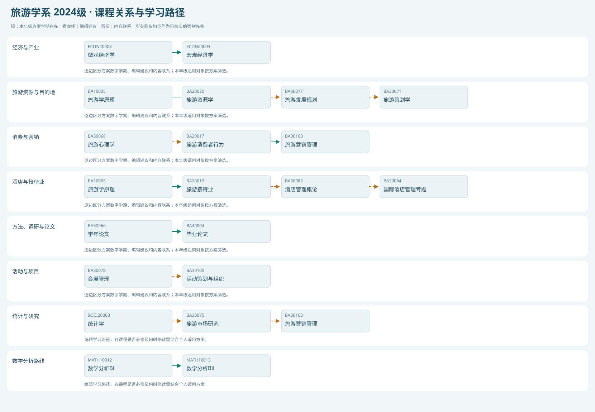

# 旅游学系2024级课程关系与先修梳理

正式硬性先修尚无可核实依据；以下将本年级数字学期安排和编辑建议分开。模块候选收录另见graph.json，不当作先修。

## 逐条课程关系

| 起点 | 终点 | 类型 | 理由 |
| --- | --- | --- | --- |
| 管理学导论 BA10004 | 旅游学原理 BA10005 | 2024方案学期在先（非先修） | 本年级同一方案中，前者的数字学期早于后者。管理学概念为旅游管理问题提供背景。 这里只表达方案安排，未认定强制先修。 |
| 微观经济学 ECON20003 | 宏观经济学 ECON20004 | 2024方案学期在先（非先修） | 本年级同一方案中，前者的数字学期早于后者。《微观经济学》与《宏观经济学》可按相关概念、研究对象或方法建立联系；具体内容及资格要求需核对该年级大纲。 这里只表达方案安排，未认定强制先修。 |
| 旅游学原理 BA10005 | 旅游经济学 BA30067 | 2024方案学期在先（非先修） | 本年级同一方案中，前者的数字学期早于后者。从旅游概念与系统认识进入经济分析。 这里只表达方案安排，未认定强制先修。 |
| 旅游学原理 BA10005 | 旅游接待业 BA20019 | 2024方案学期在先（非先修） | 本年级同一方案中，前者的数字学期早于后者。从旅游系统认识进入接待业这一行业方向。 这里只表达方案安排，未认定强制先修。 |
| 学年论文 BA30066 | 毕业论文 BA40004 | 2024方案学期在先（非先修） | 本年级同一方案中，前者的数字学期早于后者。《学年论文》与《毕业论文》可按相关概念、研究对象或方法建立联系；具体内容及资格要求需核对该年级大纲。 这里只表达方案安排，未认定强制先修。 |
| 旅游消费者行为 BA20017 | 旅游营销管理 BA30103 | 2024方案学期在先（非先修） | 本年级同一方案中，前者的数字学期早于后者。从消费者认识延伸到营销决策。 这里只表达方案安排，未认定强制先修。 |
| 会计学 BA10003 | 旅游业投资学 BA30095 | 建议先学（编辑判断） | 《会计学》与《旅游业投资学》可按相关概念、研究对象或方法建立联系；具体内容及资格要求需核对该年级大纲。 |
| 会计学 BA10003 | 财务管理 BA30102 | 2024方案学期在先（非先修） | 本年级同一方案中，前者的数字学期早于后者。先了解会计报表，再学习财务决策是可行的准备顺序。 这里只表达方案安排，未认定强制先修。 |
| 旅游心理学 BA30068 | 旅游消费者行为 BA20017 | 建议先学（编辑判断） | 心理学视角可辅助理解旅游消费者行为。 |
| 旅游市场研究 BA30075 | 旅游营销管理 BA30103 | 建议先学（编辑判断） | 市场调查与证据整理可支持营销决策；实际课程允许并学与否需另查。 |
| 旅游资源学 BA20020 | 旅游发展规划 BA30077 | 建议先学（编辑判断） | 先认识旅游资源，再讨论旅游发展的规划取舍。 |
| 旅游资源学 BA20020 | 旅游目的地管理 BA30083 | 2024方案学期在先（非先修） | 本年级同一方案中，前者的数字学期早于后者。资源的识别和评价可支持目的地管理。 这里只表达方案安排，未认定强制先修。 |
| 旅游发展规划 BA30077 | 旅游策划学 BA30071 | 建议先学（编辑判断） | 发展规划的整体认识可为具体策划项目作准备。 |
| 旅游接待业 BA20019 | 酒店管理概论 BA30085 | 建议先学（编辑判断） | 接待业的一般认识可为酒店这一业态作准备。 |
| 酒店管理概论 BA30085 | 国际酒店管理专题 BA30084 | 建议先学（编辑判断） | 酒店管理的基础认识可支持国际酒店专题讨论。 |
| 会展管理 BA30078 | 活动策划与组织 BA30100 | 建议先学（编辑判断） | 会展管理经验可支持活动策划与组织；属于一种建议路径。 |
| 旅游文献阅读 BA30098 | 学年论文 BA30066 | 建议先学（编辑判断） | 文献阅读可为论文选题和论证提供准备。 |
| 教学实习 BA30079 | 学年论文 BA30066 | 建议先学（编辑判断） | 实习中的观察可作为研究问题来源；不意味着必须先完成实习。 |
| 旅游英语 BA20018 | 旅游文献阅读 BA30098 | 建议先学（编辑判断） | 英语阅读能力可辅助文献阅读，不推断当前文献课使用语言或入课门槛。 |
| 文化遗产管理 BA30092 | 遗产旅游 BA30082 | 建议先学（编辑判断） | 管理视角可作为分析遗产旅游实践的准备。 |
| 旅游学原理 BA10005 | 旅游资源学 BA20020 | 内容联系（编辑判断） | 旅游系统的基本认识可与资源识别和评价主题联系。 |
| 旅游学原理 BA10005 | 旅游管理专题 BA30073 | 内容联系（编辑判断） | 基本旅游概念与旅游管理专题存在由概览到专题的主题联系。 |
| 旅游地产与度假区管理 BA30088 | 旅游业投资学 BA30095 | 内容联系（编辑判断） | 投资判断与旅游地产项目存在应用场景联系。 |
| 旅游广告 BA30089 | 旅游营销管理 BA30103 | 内容联系（编辑判断） | 广告表达与营销决策在传播与市场触达方面有关。 |
| 休闲学概论 BA30076 | 游憩管理 BA30093 | 内容联系（编辑判断） | 休闲的概念与游憩场所管理可从需求和场景联系。 |
| 旅游社会学 BA30072 | 旅游人类学 BA30099 | 内容联系（编辑判断） | 人类学与社会学可为旅游社会文化现象提供不同视角。 |
| 旅游地产与度假区管理 BA30088 | 游憩管理 BA30093 | 内容联系（编辑判断） | 度假区和游憩管理在空间体验与运营场景上有关。 |
| 游憩管理 BA30093 | 主题公园管理 BA30094 | 内容联系（编辑判断） | 主题公园是可以与游憩管理比较的一类旅游空间。 |
| 文化创意产业引论 BA30091 | 主题公园管理 BA30094 | 内容联系（编辑判断） | 主题公园与文化创意在主题叙事、产品和体验方面存在联系。 |
| 旅游接待业 BA20019 | 服务管理 BA30086 | 内容联系（编辑判断） | 接待业与服务管理从业态和服务过程两个角度联系。 |
| 服务管理 BA30086 | 邮轮产业与服务管理 BA30096 | 内容联系（编辑判断） | 邮轮产业中的服务问题可与一般服务管理相联系。 |
| 旅游市场研究 BA30075 | 旅游信息系统 BA30090 | 内容联系（编辑判断） | 信息系统与市场研究可从数据采集和组织方式联系；未核实具体软件。 |
| 旅游法规 BA20015 | 旅游伦理学 BA30080 | 内容联系（编辑判断） | 法规约束与伦理判断可共同分析旅游实践中的行为选择。 |
| 文化遗产管理 BA30092 | 博物馆学概论 MUSE20001 | 内容联系（编辑判断） | 博物馆作为遗产机构，可与文化遗产管理的实践问题联系。 |
| 数学分析BⅠ MATH10012 | 数学分析BⅡ MATH10013 | 2024方案学期在先（非先修） | 本年级同一方案中，前者的数字学期早于后者。数学分析B系列上、下阶段可按基础到延伸的顺序学习。 这里只表达方案安排，未认定强制先修。 |
| 高等数学A(上） MATH10015 | 高等数学A(下） MATH10016 | 2024方案学期在先（非先修） | 本年级同一方案中，前者的数字学期早于后者。同一数学系列的上、下部分按阶段学习。 这里只表达方案安排，未认定强制先修。 |
| 高等数学B(上） MATH10004 | 高等数学B(下） MATH10005 | 2024方案学期在先（非先修） | 本年级同一方案中，前者的数字学期早于后者。同一数学系列的上、下部分按阶段学习。 这里只表达方案安排，未认定强制先修。 |
| 线性代数 MATH10017 | 统计学 SOCI20003 | 2024方案学期在先（非先修） | 本年级同一方案中，前者的数字学期早于后者。向量和矩阵的认识可为定量分析作准备；不是选课硬门槛。 这里只表达方案安排，未认定强制先修。 |
| 统计学 SOCI20003 | 旅游市场研究 BA30075 | 建议先学（编辑判断） | 统计方法可帮助组织和分析市场调查资料。 |
| 社会研究方法B MSE30029 | 旅游研究方法 BA30081 | 建议先学（编辑判断） | 一般社会研究的提问和证据意识可用于旅游研究。 |
| 旅游研究方法 BA30081 | 学年论文 BA30066 | 建议先学（编辑判断） | 研究设计和资料组织可为学年论文作准备。 |
| 旅游发展规划 BA30077 | 旅游项目管理 TOUR130074 | 建议先学（编辑判断） | 发展规划的整体认识可为具体项目组织作准备。 |
| 旅游资源学 BA20020 | 旅游景观考察 BA20016 | 建议先学（编辑判断） | 资源的基本认识可为实地观察和考察作准备。 |
| 旅游学原理 BA10005 | 导游学 BA30070 | 建议先学（编辑判断） | 旅游系统与游客活动的认识可支持导游主题学习。 |
| 社会研究方法B MSE30029 | 口述历史 HIST30035 | 建议先学（编辑判断） | 资料获取方法可为口述资料研究作准备；具体访谈要求需另核。 |
| 文化遗产管理 BA30092 | 展览内容策划 MUSE30003 | 建议先学（编辑判断） | 遗产管理与展览策划可在文化阐释场景中联系。 |
| 展览内容策划 MUSE30003 | 展览形式设计 MUSE30002 | 建议先学（编辑判断） | 先明确叙事内容再选择展示形式是一种可迭代的工作顺序。 |
| 旅游接待业 BA20019 | 商务旅行管理 TOUR130075 | 建议先学（编辑判断） | 接待业与商务旅行可从细分服务场景联系。 |
| 旅游法规 BA20015 | 经济法 LAW20011 | 建议先学（编辑判断） | 行业规范与经济活动中的法律问题可相互参照。 |
| 旅游景观考察 BA20016 | 教学实习 BA30079 | 建议先学（编辑判断） | 考察与实习可积累观察材料和实践问题。 |
| 旅游社会学 BA30072 | 中国古代乡村社会 HIST130263 | 建议先学（编辑判断） | 旅游社会现象与乡村社会史可以在社会结构视角下比较。 |
| 旅游与跨文化沟通 BA30097 | 国际旅游服务贸易 BA30101 | 内容联系（编辑判断） | 跨境旅游服务与跨文化沟通共享国际服务场景。 |
| 旅游发展规划 BA30077 | 中国古代城市史 HIST30020 | 内容联系（编辑判断） | 城市发展史与旅游规划可围绕空间变迁和文化背景比较。 |
| 旅行社经营管理 BA30069 | 商务旅行管理 TOUR130075 | 内容联系（编辑判断） | 商务旅行服务与旅行社经营共享行程、客户和服务链场景。 |
| 会展管理 BA30078 | 旅游项目管理 TOUR130074 | 内容联系（编辑判断） | 项目组织与会展运营可在时间、资源和参与者协调方面比较。 |
| 导游学 BA30070 | 旅游与跨文化沟通 BA30097 | 内容联系（编辑判断） | 导游服务与跨文化沟通可围绕游客交流场景联系。 |
| 旅游景观考察 BA20016 | 旅游资源学 BA20020 | 内容联系（编辑判断） | 资源识别与景观观察具有相互支持的内容联系。 |
| 口述历史 HIST30035 | 社会研究方法B MSE30029 | 内容联系（编辑判断） | 口述资料与社会研究可围绕资料获取和解释方法联系。 |
| 文化遗产管理 BA30092 | 展览内容策划 MUSE30003 | 内容联系（编辑判断） | 遗产阐释与展览叙事共享文化表达问题。 |
| 旅游策划学 BA30071 | 展览形式设计 MUSE30002 | 内容联系（编辑判断） | 展览表达与旅游策划可从体验设计的应用场景比较。 |
| 旅游社会学 BA30072 | 中国古代乡村社会 HIST130263 | 内容联系（编辑判断） | 乡村社会史与旅游社会学可从社区、社会关系和变迁比较。 |
| 旅游研究方法 BA30081 | 统计学 SOCI20003 | 内容联系（编辑判断） | 统计分析可作为研究方法体系中的一类方法，不能替代全部研究设计。 |
| 旅游信息系统 BA30090 | 线性代数 MATH10017 | 内容联系（编辑判断） | 数量表达与信息组织存在能力层面的联系，具体技术要求待核。 |
| 旅游法规 BA20015 | 经济法 LAW20011 | 内容联系（编辑判断） | 一般经济规范与旅游行业法规可以互相参照。 |
| 旅游文化学 BA30065 | 中国民俗旅游 BA30074 | 内容联系（编辑判断） | 文化观念与民俗旅游可从文化表达及历史背景联系。 |
| 旅游资源学 BA20020 | 文化遗产管理 BA30092 | 内容联系（编辑判断） | 资源利用与遗产保护在对象和决策目标上存在交集。 |
| 旅游发展规划 BA30077 | 旅游目的地管理 BA30083 | 内容联系（编辑判断） | 规划选择与目的地治理可以从长期发展和日常管理两个角度比较。 |
| 旅游市场研究 BA30075 | 旅游研究方法 BA30081 | 内容联系（编辑判断） | 一般研究设计与市场研究在证据和资料分析方面相交。 |
