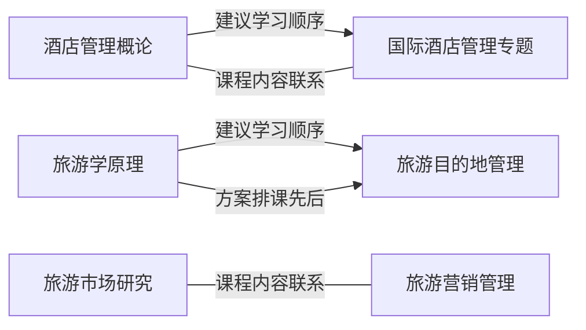

# 旅游管理专业“2+X”教学培养方案

2024 年汇编印刷页 124–126。原表记录 54 个可配对的课程代码。

[本节原页](plan-124.pdf#page=1) · [逐行数据](plan-124.json) · [院系目录](README.md)

## 课程关系图

图中展示最多 20 条关系。下表列出本节全部关系。建议学习顺序供规划课程使用，正式选课资格以教务规定为准。

| 课程 | 关联课程 | 关系 | 依据 |
| --- | --- | --- | --- |
| 酒店管理概论（TOUR130064） | 国际酒店管理专题（TOUR130063） | 建议学习顺序 | “酒店管理概论”题名标明基础层次，前置阅读可帮助了解“国际酒店管理专题”中的酒店管理主题。 |
| 旅游学原理（TOUR130094） | 旅游目的地管理（TOUR130062） | 建议学习顺序 | 旅游系统与游客行为的概念可用于理解目的地管理。 |
| 旅游市场研究（TOUR130037） | 旅游营销管理（TOUR130095） | 课程内容联系 | 游客需求和市场调查可用于营销问题。 |
| 国际酒店管理专题（TOUR130063） | 酒店管理概论（TOUR130064） | 课程内容联系 | 本方案两门课程的题名均含“酒店管理”，可据此对照这一主题。 |
| 旅游学原理（TOUR130094） | 旅游目的地管理（TOUR130062） | 方案排课先后 | 本节原表所列全部明确学期均早于后者。 |

## 课程

| 课程代码 | 名称 | 开课学期原文 | 来源（PDF 页） |
| --- | --- | --- | --- |
| HIST130047 | 中国古代城市史 | 春，秋 | 140 |
| HIST130099 | 口述历史 | 春，秋 | 140 |
| HIST130263 | 中国古代乡村社会 | 春，秋 | 140 |
| MUSE130003 | 博物馆学概论 | 3 | 140 |
| MUSE130045 | 展览形式设计 | 秋 | 140 |
| MUSE130052 | 展览内容策划 | 春 | 140 |
| TOUR130008 | 旅游文化学 | 秋 | 140 |
| TOUR130012 | 学年论文 | 6 | 139 |
| TOUR130013 | 毕业论文 | 8 | 139 |
| TOUR130014 | 旅游经济学 | 5 | 138 |
| TOUR130016 | 旅游心理学 | 春 | 140 |
| TOUR130019 | 旅行社经营管理 | 春 | 139 |
| TOUR130020 | 导游学 | 秋 | 139 |
| TOUR130022 | 旅游策划学 | 5 | 138 |
| TOUR130023 | 旅游社会学 | 春 | 140 |
| TOUR130030 | 旅游管理专题 | 秋 | 139 |
| TOUR130031 | 中国民俗旅游 | 春 | 139 |
| TOUR130037 | 旅游市场研究 | 春 | 139 |
| TOUR130038 | 休闲学概论 | 春 | 140 |
| TOUR130046 | 旅游发展规划 | 春，秋 | 139 |
| TOUR130048 | 旅游法规 | 4 | 138 |
| TOUR130054 | 会展管理 | 春，秋 | 139 |
| TOUR130055 | 旅游景观考察 | 暑期 | 138 |
| TOUR130057 | 教学实习 | 6 | 139 |
| TOUR130058 | 旅游消费者行为 | 4 | 138 |
| TOUR130059 | 旅游伦理学 | 春，秋 | 140 |
| TOUR130060 | 旅游研究方法 | 春，秋 | 140 |
| TOUR130061 | 遗产旅游 | 春，秋 | 139 |
| TOUR130062 | 旅游目的地管理 | 5 | 138 |
| TOUR130063 | 国际酒店管理专题 | 春，秋 | 139 |
| TOUR130064 | 酒店管理概论 | 春，秋 | 139 |
| TOUR130067 | 服务管理 | 春 | 140 |
| TOUR130069 | 旅游地产与度假区管理 | 春 | 139 |
| TOUR130070 | 旅游广告 | 春 | 139 |
| TOUR130071 | 旅游信息系统 | 春 | 139 |
| TOUR130074 | 旅游项目管理 | 春 | 139 |
| TOUR130075 | 商务旅行管理 | 春 | 139 |
| TOUR130077 | 文化创意产业引论 | 春 | 140 |
| TOUR130078 | 文化遗产管理 | 秋 | 140 |
| TOUR130079 | 游憩管理 | 春 | 139 |
| TOUR130080 | 主题公园管理 | 春，秋 | 139 |
| TOUR130082 | 旅游业投资学 | 春，秋 | 139 |
| TOUR130083 | 邮轮产业与服务管理 | 春，秋 | 139 |
| TOUR130086 | 旅游与跨文化沟通 | 春，秋 | 140 |
| TOUR130087 | 旅游英语 | 4 | 138 |
| TOUR130088 | 旅游接待业 | 3 | 138 |
| TOUR130089 | 旅游文献阅读 | 秋 | 140 |
| TOUR130090 | 旅游人类学 | 春，秋 | 140 |
| TOUR130091 | 活动策划与组织 | 秋 | 139 |
| TOUR130092 | 国际旅游服务贸易 | 春，秋 | 139 |
| TOUR130093 | 财务管理 | 5 | 138 |
| TOUR130094 | 旅游学原理 | 2 | 138 |
| TOUR130095 | 旅游营销管理 | 5 | 138 |
| TOUR130096 | 旅游资源学 | 3 | 138 |
