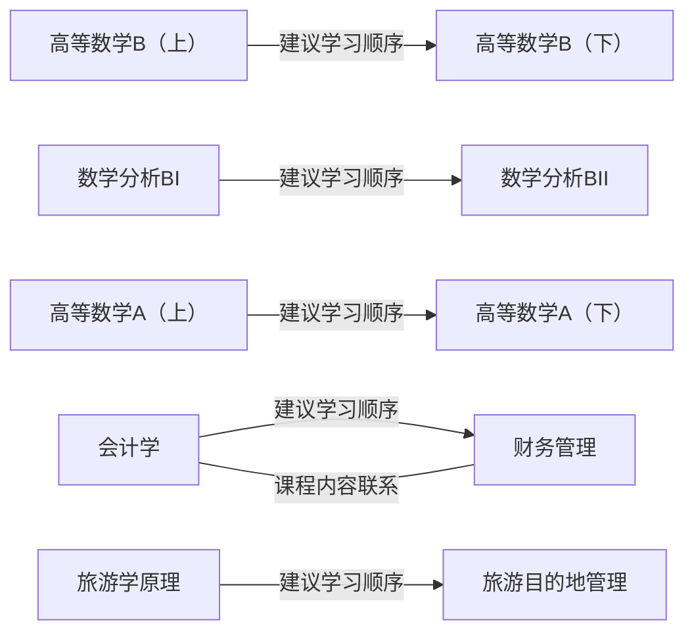

# 旅游管理专业“2+X”修读建议

2024 年汇编印刷页 127–128。原表记录 34 个可配对的课程代码。

[本节原页](plan-124.pdf#page=4) · [逐行数据](plan-124.json) · [院系目录](README.md)

## 课程导读

想了解旅游与目的地管理的课程安排，可以在原表中找到《旅游学原理》（`TOUR130094`）、《旅游目的地管理》（`TOUR130062`）、《旅游资源学》（`TOUR130096`）。 [原书 PDF 第 142 页](plan-124.pdf#page=5)

图谱建议先读《旅游学原理》（`TOUR130094`）再读《旅游目的地管理》（`TOUR130062`）。旅游系统与游客行为的概念可用于理解目的地管理。 [原书 PDF 第 142 页](plan-124.pdf#page=5)

## 课程关系图

图中展示最多 20 条关系。下表列出本节全部关系。建议学习顺序供规划课程使用，正式选课资格以教务规定为准。

| 课程 | 关联课程 | 关系 | 依据 |
| --- | --- | --- | --- |
| 高等数学B（上）（MATH120003） | 高等数学B（下）（MATH120004） | 建议学习顺序 | 同节课程题名标明连续分册或序号。 |
| 数学分析BI（MATH120016） | 数学分析BII（MATH120017） | 建议学习顺序 | 同节课程题名标明连续分册或序号。 |
| 高等数学A（上）（MATH120021） | 高等数学A（下）（MATH120022） | 建议学习顺序 | 同节课程题名标明连续分册或序号。 |
| 会计学（SOSC120006） | 财务管理（TOUR130093） | 建议学习顺序 | 会计报表和核算概念可用于理解财务决策。 |
| 旅游学原理（TOUR130094） | 旅游目的地管理（TOUR130062） | 建议学习顺序 | 旅游系统与游客行为的概念可用于理解目的地管理。 |
| 会计学（SOSC120006） | 财务管理（TOUR130093） | 课程内容联系 | 会计信息与企业融资、投资决策存在应用联系。 |

## 课程

| 课程代码 | 名称 | 开课学期原文 | 来源（PDF 页） |
| --- | --- | --- | --- |
| MATH120003 | 高等数学B（上） |  | 141 |
| MATH120004 | 高等数学B（下） |  | 141 |
| MATH120016 | 数学分析BI |  | 141 |
| MATH120017 | 数学分析BII |  | 141 |
| MATH120021 | 高等数学A（上） |  | 141 |
| MATH120022 | 高等数学A（下） |  | 141 |
| MATH120044 | 线性代数 |  | 141 |
| PTSS110082 | 毛泽东思想和中国特色社会主义理论体系概论 |  | 141 |
| PTSS110087 | 马克思主义基本原理 |  | 141 |
| PTSS110088 | 中国近现代史纲要 |  | 141 |
| PTSS110089 | 思想道德与法治 |  | 141 |
| PTSS110090 | 习近平新时代中国特色社会主义思想概论 |  | 141 |
| SOSC120004 | 微观经济学 |  | 141 |
| SOSC120005 | 宏观经济学 |  | 141 |
| SOSC120006 | 会计学 |  | 141 |
| SOSC120010 | 社会研究方法B |  | 141 |
| SOSC120014 | 管理学导论 |  | 141 |
| SOSC120016 | 经济法 |  | 141 |
| SOSC120017 | 统计学 |  | 141 |
| TOUR130012 | 学年论文 |  | 142 |
| TOUR130013 | 毕业论文 |  | 142 |
| TOUR130014 | 旅游经济学 |  | 142 |
| TOUR130022 | 旅游策划学 |  | 142 |
| TOUR130048 | 旅游法规 |  | 142 |
| TOUR130055 | 旅游景观考察 |  | 142 |
| TOUR130057 | 教学实习 |  | 142 |
| TOUR130058 | 旅游消费者行为 |  | 142 |
| TOUR130062 | 旅游目的地管理 |  | 142 |
| TOUR130087 | 旅游英语 |  | 142 |
| TOUR130088 | 旅游接待业 |  | 142 |
| TOUR130093 | 财务管理 |  | 142 |
| TOUR130094 | 旅游学原理 |  | 142 |
| TOUR130095 | 旅游营销管理 |  | 142 |
| TOUR130096 | 旅游资源学 |  | 142 |
