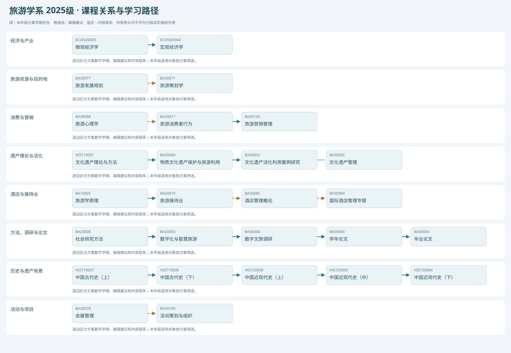

# 旅游学系2025级课程关系图谱

[交互HTML](index.html)（下载后打开） · [课程关系与先修梳理](learning-paths.md) · [图谱JSON](graph.json) · [节点CSV](nodes.csv) · [关系CSV](edges.csv) · [原件与适用方案](../README.md)

关系按本年级方案学期在先、建议先学、内容联系和模块收录分类；尚未确认强制先修。图谱含592个课程/科研条目，其中81个为专业培养条目、511个仅公共候选；另有42个模块节点。模块收录不代表全部必修，详情与原始定位见[source-audit.json](source-audit.json)。
