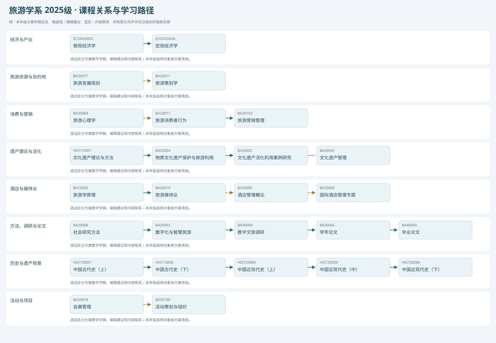

# 旅游学系2025级课程关系与先修梳理

正式硬性先修尚无可核实依据；以下将本年级数字学期安排和编辑建议分开。模块候选收录另见graph.json，不当作先修。

## 逐条课程关系

| 起点 | 终点 | 类型 | 理由 |
| --- | --- | --- | --- |
| 管理学导论 BA10004 | 旅游学原理 BA10005 | 2025方案学期在先（非先修） | 本年级同一方案中，前者的数字学期早于后者。管理学概念为旅游管理问题提供背景。 这里只表达方案安排，未认定强制先修。 |
| 微积分B MATH10028 | 大学数学Ⅱ MATH10030 | 建议先学（编辑判断） | 《微积分B》与《大学数学Ⅱ》可按相关概念、研究对象或方法建立联系；具体内容及资格要求需核对该年级大纲。 |
| 微观经济学 ECON20003 | 宏观经济学 ECON20004 | 2025方案学期在先（非先修） | 本年级同一方案中，前者的数字学期早于后者。《微观经济学》与《宏观经济学》可按相关概念、研究对象或方法建立联系；具体内容及资格要求需核对该年级大纲。 这里只表达方案安排，未认定强制先修。 |
| 旅游学原理 BA10005 | 旅游经济学 BA30067 | 2025方案学期在先（非先修） | 本年级同一方案中，前者的数字学期早于后者。从旅游概念与系统认识进入经济分析。 这里只表达方案安排，未认定强制先修。 |
| 旅游学原理 BA10005 | 旅游接待业 BA20019 | 2025方案学期在先（非先修） | 本年级同一方案中，前者的数字学期早于后者。从旅游系统认识进入接待业这一行业方向。 这里只表达方案安排，未认定强制先修。 |
| 文化遗产理论与方法 HIST10001 | 物质文化遗产保护与旅游利用 BA20004 | 2025方案学期在先（非先修） | 本年级同一方案中，前者的数字学期早于后者。遗产理论与方法为讨论物质遗产保护和利用提供框架。 这里只表达方案安排，未认定强制先修。 |
| 文化遗产理论与方法 HIST10001 | 文化遗产与城市旅游 BA20006 | 2025方案学期在先（非先修） | 本年级同一方案中，前者的数字学期早于后者。从遗产概念进入城市旅游中的遗产问题。 这里只表达方案安排，未认定强制先修。 |
| 物质文化遗产保护与旅游利用 BA20004 | 文化遗产活化利用案例研究 BA20002 | 2025方案学期在先（非先修） | 本年级同一方案中，前者的数字学期早于后者。由保护与利用的一般问题进入活化利用案例。 这里只表达方案安排，未认定强制先修。 |
| 社会研究方法 BA20008 | 数字化与智慧旅游 BA20003 | 2025方案学期在先（非先修） | 本年级同一方案中，前者的数字学期早于后者。社会研究训练可支持理解智慧旅游中的数据与研究问题；不是技术课程硬门槛。 这里只表达方案安排，未认定强制先修。 |
| 数字化与智慧旅游 BA20003 | 数字文旅调研 BA30008 | 2025方案学期在先（非先修） | 本年级同一方案中，前者的数字学期早于后者。从数字化旅游主题进入数字文旅调研。 这里只表达方案安排，未认定强制先修。 |
| 社会研究方法 BA20008 | 数字文旅调研 BA30008 | 2025方案学期在先（非先修） | 本年级同一方案中，前者的数字学期早于后者。研究问题和资料获取的基础可用于调研。 这里只表达方案安排，未认定强制先修。 |
| 数字文旅调研 BA30008 | 学年论文 BA30066 | 2025方案学期在先（非先修） | 本年级同一方案中，前者的数字学期早于后者。以调研经验支持论文选题和证据组织。 这里只表达方案安排，未认定强制先修。 |
| 学年论文 BA30066 | 毕业论文 BA40004 | 2025方案学期在先（非先修） | 本年级同一方案中，前者的数字学期早于后者。《学年论文》与《毕业论文》可按相关概念、研究对象或方法建立联系；具体内容及资格要求需核对该年级大纲。 这里只表达方案安排，未认定强制先修。 |
| 旅游消费者行为 BA20017 | 旅游营销管理 BA30103 | 2025方案学期在先（非先修） | 本年级同一方案中，前者的数字学期早于后者。从消费者认识延伸到营销决策。 这里只表达方案安排，未认定强制先修。 |
| 会计学 BA10003 | 旅游业投资学 BA30095 | 2025方案学期在先（非先修） | 本年级同一方案中，前者的数字学期早于后者。《会计学》与《旅游业投资学》可按相关概念、研究对象或方法建立联系；具体内容及资格要求需核对该年级大纲。 这里只表达方案安排，未认定强制先修。 |
| 中国古代史（上） HIST10007 | 中国古代史（下） HIST10008 | 2025方案学期在先（非先修） | 本年级同一方案中，前者的数字学期早于后者。同一历史通史的上、下部分依方案顺序学习。 这里只表达方案安排，未认定强制先修。 |
| 中国古代史（下） HIST10008 | 中国近现代史（上） HIST20008 | 2025方案学期在先（非先修） | 本年级同一方案中，前者的数字学期早于后者。由古代史延伸到近现代史；是方案安排和时段联系。 这里只表达方案安排，未认定强制先修。 |
| 中国近现代史（上） HIST20008 | 中国近现代史（中） HIST20009 | 2025方案学期在先（非先修） | 本年级同一方案中，前者的数字学期早于后者。中国近现代史上、中部分在方案中相继安排。 这里只表达方案安排，未认定强制先修。 |
| 中国近现代史（中） HIST20009 | 中国近现代史（下） HIST30084 | 2025方案学期在先（非先修） | 本年级同一方案中，前者的数字学期早于后者。中国近现代史中、下部分在方案中相继安排。 这里只表达方案安排，未认定强制先修。 |
| 15世纪以前的世界 HIST10009 | 世界近代史 HIST20010 | 2025方案学期在先（非先修） | 本年级同一方案中，前者的数字学期早于后者。从15世纪以前的世界进入世界近代史。 这里只表达方案安排，未认定强制先修。 |
| 世界近代史 HIST20010 | 20世纪的世界 HIST20007 | 2025方案学期在先（非先修） | 本年级同一方案中，前者的数字学期早于后者。从世界近代史延伸至20世纪。 这里只表达方案安排，未认定强制先修。 |
| 旅游心理学 BA30068 | 旅游消费者行为 BA20017 | 建议先学（编辑判断） | 心理学视角可辅助理解旅游消费者行为。 |
| 旅游市场研究 BA30075 | 旅游营销管理 BA30103 | 建议先学（编辑判断） | 市场调查与证据整理可支持营销决策；实际课程允许并学与否需另查。 |
| 旅游发展规划 BA30077 | 旅游策划学 BA30071 | 建议先学（编辑判断） | 发展规划的整体认识可为具体策划项目作准备。 |
| 旅游接待业 BA20019 | 酒店管理概论 BA30085 | 建议先学（编辑判断） | 接待业的一般认识可为酒店这一业态作准备。 |
| 酒店管理概论 BA30085 | 国际酒店管理专题 BA30084 | 建议先学（编辑判断） | 酒店管理的基础认识可支持国际酒店专题讨论。 |
| 管理学导论 BA10004 | 旅游运营商经营与管理 BA20007 | 建议先学（编辑判断） | 管理学中的组织与运营视角可用于旅游运营商。 |
| 会展管理 BA30078 | 活动策划与组织 BA30100 | 建议先学（编辑判断） | 会展管理经验可支持活动策划与组织；属于一种建议路径。 |
| 社会研究方法 BA20008 | 旅游人类学 BA30099 | 2025方案学期在先（非先修） | 本年级同一方案中，前者的数字学期早于后者。社会研究的提问和证据意识可支持人类学学习；具体方法要求未核。 这里只表达方案安排，未认定强制先修。 |
| 旅游与文化遗产文献阅读 BA30010 | 学年论文 BA30066 | 建议先学（编辑判断） | 旅游与文化遗产文献阅读可支持相关论文写作。 |
| 文化遗产理论与方法 HIST10001 | 非物质文化遗产保护与旅游利用 BA30006 | 建议先学（编辑判断） | 遗产理论有助于认识非物质遗产保护与旅游利用。 |
| 文化遗产理论与方法 HIST10001 | 文化遗产田野调查 BA30007 | 建议先学（编辑判断） | 遗产理论的问题框架可支持田野调查。 |
| 社会研究方法 BA20008 | 文化遗产田野调查 BA30007 | 建议先学（编辑判断） | 社会研究方法可支持遗产田野中的资料获取。 |
| 文化遗产管理 BA30092 | 遗产旅游 BA30082 | 建议先学（编辑判断） | 管理视角可作为分析遗产旅游实践的准备。 |
| 旅游学原理 BA10005 | 旅游管理专题 BA30073 | 内容联系（编辑判断） | 基本旅游概念与旅游管理专题存在由概览到专题的主题联系。 |
| 旅游地产与度假区管理 BA30088 | 旅游业投资学 BA30095 | 内容联系（编辑判断） | 投资判断与旅游地产项目存在应用场景联系。 |
| 微观经济学 ECON20003 | 微积分B MATH10028 | 内容联系（编辑判断） | 数量与变化率的认识可辅助经济建模；未取得数学预修规则。 |
| 旅游广告 BA30089 | 旅游营销管理 BA30103 | 内容联系（编辑判断） | 广告表达与营销决策在传播与市场触达方面有关。 |
| 社会研究方法 BA20008 | 旅游市场研究 BA30075 | 内容联系（编辑判断） | 旅游市场研究与社会研究方法在研究设计和资料收集方面可能相交。 |
| 休闲学概论 BA30076 | 游憩管理 BA30093 | 内容联系（编辑判断） | 休闲的概念与游憩场所管理可从需求和场景联系。 |
| 旅游社会学 BA30072 | 旅游人类学 BA30099 | 内容联系（编辑判断） | 人类学与社会学可为旅游社会文化现象提供不同视角。 |
| 文化遗产活化利用案例研究 BA20002 | 文化遗产管理 BA30092 | 内容联系（编辑判断） | 活化利用案例与遗产管理可比较保护和利用决策。 |
| 物质文化遗产保护与旅游利用 BA20004 | 非物质文化遗产保护与旅游利用 BA30006 | 内容联系（编辑判断） | 物质与非物质遗产保护提供不同对象的比较。 |
| 文化遗产与城市旅游 BA20006 | 文化遗产与乡村旅游 BA30011 | 内容联系（编辑判断） | 城市与乡村旅游是遗产研究的不同空间场景。 |
| 文化遗产与旅游发展伦理专题 BA30009 | 文化遗产管理 BA30092 | 内容联系（编辑判断） | 伦理专题可反思遗产管理中的利益和价值冲突。 |
| 文化与旅游地理学 BA20005 | 中国历史地理概论 HIST30009 | 内容联系（编辑判断） | 旅游地理与历史地理可比较空间格局及形成过程。 |
| 文化与旅游地理学 BA20005 | 旅游发展规划 BA30077 | 内容联系（编辑判断） | 空间分析视角可用于旅游发展规划。 |
| 旅游地产与度假区管理 BA30088 | 游憩管理 BA30093 | 内容联系（编辑判断） | 度假区和游憩管理在空间体验与运营场景上有关。 |
| 游憩管理 BA30093 | 主题公园管理 BA30094 | 内容联系（编辑判断） | 主题公园是可以与游憩管理比较的一类旅游空间。 |
| 文化创意产业引论 BA30091 | 主题公园管理 BA30094 | 内容联系（编辑判断） | 主题公园与文化创意在主题叙事、产品和体验方面存在联系。 |
| 旅游接待业 BA20019 | 服务管理 BA30086 | 内容联系（编辑判断） | 接待业与服务管理从业态和服务过程两个角度联系。 |
| 服务管理 BA30086 | 邮轮产业与服务管理 BA30096 | 内容联系（编辑判断） | 邮轮产业中的服务问题可与一般服务管理相联系。 |
| 社会研究方法 BA20008 | 数字文旅调研 BA30008 | 内容联系（编辑判断） | 数字文旅调研与社会研究在资料获取和研究设计上相交。 |
| 复芏计划(FDUROP) 102 | 学年论文 BA30066 | 内容联系（编辑判断） | FDUROP是科研训练活动条目，可与论文训练联系，不作为常规课程或硬性先修。 |
| 复芏计划(FDUROP) 102 | 毕业论文 BA40004 | 内容联系（编辑判断） | 科研训练可为毕业研究积累经验，但不推断必须参加。 |
| 文化遗产与城市旅游 BA20006 | 中国历史地理概论 HIST30009 | 内容联系（编辑判断） | 历史地理有助于从城市形成和空间演变理解城市遗产旅游。 |
| 文化遗产与城市旅游 BA20006 | 中国古代城市史 HIST30020 | 内容联系（编辑判断） | 古代城市史与城市遗产旅游共享城市文化这一研究对象。 |
| 文化创意产业引论 BA30091 | 美国大众文化史 HIST30030 | 内容联系（编辑判断） | 大众文化史可与文化创意产业从文化传播和消费主题联系。 |
| 15世纪以前的世界 HIST10009 | 古希腊史 HIST30072 | 内容联系（编辑判断） | 古希腊史为世界前近代历史框架提供区域专题。 |
| 世界近代史 HIST20010 | 日本近代史 HIST30115 | 内容联系（编辑判断） | 日本近代史与世界近代史可从区域及整体视角互相参照。 |
| 旅游与跨文化沟通 BA30097 | 韩国文化史 HIST30108 | 内容联系（编辑判断） | 韩国文化史与跨文化沟通可在文化背景认识上建立联系。 |
| 考古学导论 ARCH10001 | 文化遗产理论与方法 HIST10001 | 内容联系（编辑判断） | 考古证据与遗产理论可从文化遗产认识的不同方法比较。 |
| 文化遗产管理 BA30092 | 博物馆学概论 MUSE20001 | 内容联系（编辑判断） | 博物馆作为遗产机构，可与文化遗产管理的实践问题联系。 |
| 文化遗产活化利用案例研究 BA20002 | 博物馆学概论 MUSE20001 | 内容联系（编辑判断） | 博物馆展示与遗产活化案例在文化阐释方面存在联系。 |
| 高等数学C(上） MATH10006 | 高等数学C(下） MATH10007 | 建议先学（编辑判断） | 同一数学系列的上、下部分按阶段学习；与A/B路线分别保留。 |
| 旅游接待业 BA20019 | 商务旅行管理 TOUR130075 | 建议先学（编辑判断） | 接待业与商务旅行可从细分服务场景联系。 |
| 旅游与跨文化沟通 BA30097 | 国际旅游服务贸易 BA30101 | 内容联系（编辑判断） | 跨境旅游服务与跨文化沟通共享国际服务场景。 |
| 旅游发展规划 BA30077 | 中国古代城市史 HIST30020 | 内容联系（编辑判断） | 城市发展史与旅游规划可围绕空间变迁和文化背景比较。 |
| 中国文学经典 CHIN10005 | 文化遗产理论与方法 HIST10001 | 内容联系（编辑判断） | 文学材料可为文化遗产的解释提供一种文化背景，不推断两课具体章节。 |
| 社会研究方法 BA20008 | 逻辑学 PHIL10003 | 内容联系（编辑判断） | 逻辑与论证能力可支持研究设计和证据解释。 |
| 旅游英语 BA20018 | 旅游与文化遗产文献阅读 BA30010 | 内容联系（编辑判断） | 语言能力可辅助文献阅读；不据此推断文献课具体语种或入课要求。 |
| 文化遗产活化利用案例研究 BA20002 | 中国古代礼制研究 HIST30023 | 内容联系（编辑判断） | 礼制的历史语境可为遗产解释和案例分析提供背景。 |
| 文化遗产与城市旅游 BA20006 | 中国古代社会生活史 HIST30047 | 内容联系（编辑判断） | 城市文化与社会生活的历史联系可用于遗产旅游问题的比较。 |
| 旅游文化学 BA30065 | 明清文化史 HIST30075 | 内容联系（编辑判断） | 历史文化材料与旅游文化主题可以相互参照。 |
| 旅游与文化遗产文献阅读 BA30010 | 旅游文化学 BA30065 | 内容联系（编辑判断） | 文化主题与相关文献利用存在研究对象层面的联系。 |
| 旅游发展规划 BA30077 | 旅游目的地管理 BA30083 | 内容联系（编辑判断） | 规划选择与目的地治理可以从长期发展和日常管理两个角度比较。 |
