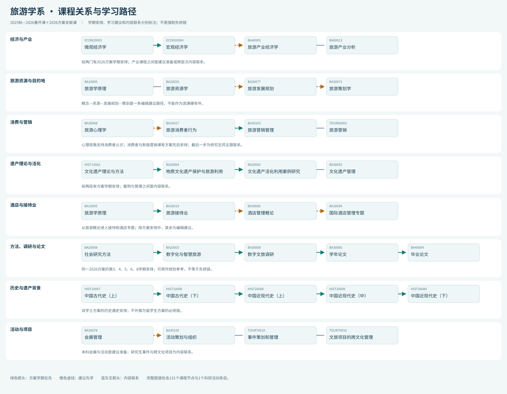

# 旅游学系课程关系图谱

覆盖 **131个课程节点＋1个科研活动条目、143条关系**。其中85个代码来自2025秋／2026春实际开课；另47个条目来自两份2026方案，包含跨院系基础课和科研活动，已注明“仅方案收录”。

- [交互图谱 index.html](index.html)：下载后直接打开，离线可用。支持课程/课号/教师搜索、主题/层次/开课范围筛选、关系开关和课程邻接图。
- [课程关系与学习路径](learning-paths.md)：GitHub可直接阅读，包含全部关系及理由。
- [graph.json](graph.json)、[课程节点CSV](nodes.csv)、[关系CSV](edges.csv)：用于后续检索与图数据库；每条边包含类型、方向、依据和明确的非强制标记。
- [方案原始学期字段提取](plan-fields.json)、[证据核查与缺口](source-audit.json)、[验证记录](validation.json)。

## 关系类型

| 类型 | 含义 |
| --- | --- |
| 2026方案学期在先 | 同一方案的A课程学期数字早于B。只表明安排先后，**不等于方案明确规定A是B的先修**；关联配对由编者选择 |
| 建议先学 | 依据课程名称与学科主题给出的准备顺序；未取得全量课程大纲，需结合个人基础调整 |
| 内容联系 | 无方向的主题、方法、能力或应用场景联系；不代表先修 |
| 同名异号 | 显示官方同名不同代码，保留层次与方案差异，不表示互认或替代 |

**当前已核实的硬性先修边：0。** 空白先修字段不等于没有要求。2026留学生方案154832和历史学—旅游管理双学士方案154078适用对象不同，不能合成同一人的必修链；2025秋／2026春实际开课也不等于2026级的建议修读学期。

## 官方依据

沿用[本分支官方资料](../官方资料/README.md)，源版本固定为提交`262d99e34d453e99fda887773c41137376209be0`；核对两份方案Word内嵌的课程体系图，保留[留学生方案图](source-figures/plan-154832-curriculum.png)和[双学士方案图](source-figures/plan-154078-curriculum.png)。原件与原始接口未改写，图像SHA-256及提取位置见source-audit.json。

直接读取原始`terms`中的`TERM_1…TERM_8`；会计学等数字学期来自已核对的体系图，另外标明图源。旧课程索引“开设季节”中的数字不是秋春标签；本图不根据空白`suggestTerms`编造顺序。共同属于某模块、教师相同、分数高低、课号大小均未用作先修依据。

同名异号、本科/研究生保持独立。“复芏计划(FDUROP)”及代码102沿用原字段，作为科研活动单列。图谱主题分组、建议和内容边为编辑判断；没有将历史课评中的先修传闻、未读学习手册或个人感受当作正式要求。公开手册入口转统一认证的访问缺口已登记。

## 复核与再生成

`graph.json`是面向检索的完整数据，`plan-fields.json`保存原始方案字段及JSON定位。`build_graph.py`、`curation.py`与`viewer-template.html`提供构建逻辑；在脚本旁的`sources/`放入本分支官方资料对应文件及体系图，运行Python脚本即可重建。内容修改后需运行`validate_graph.py`重新核验节点覆盖、关系证据、学期先后、图数据一致性及循环。

原件与提取图的权利归原权利人，公开来源不额外授予再利用许可。此提交将图谱存于旅游学系研究分支，不自动部署在线网站。
