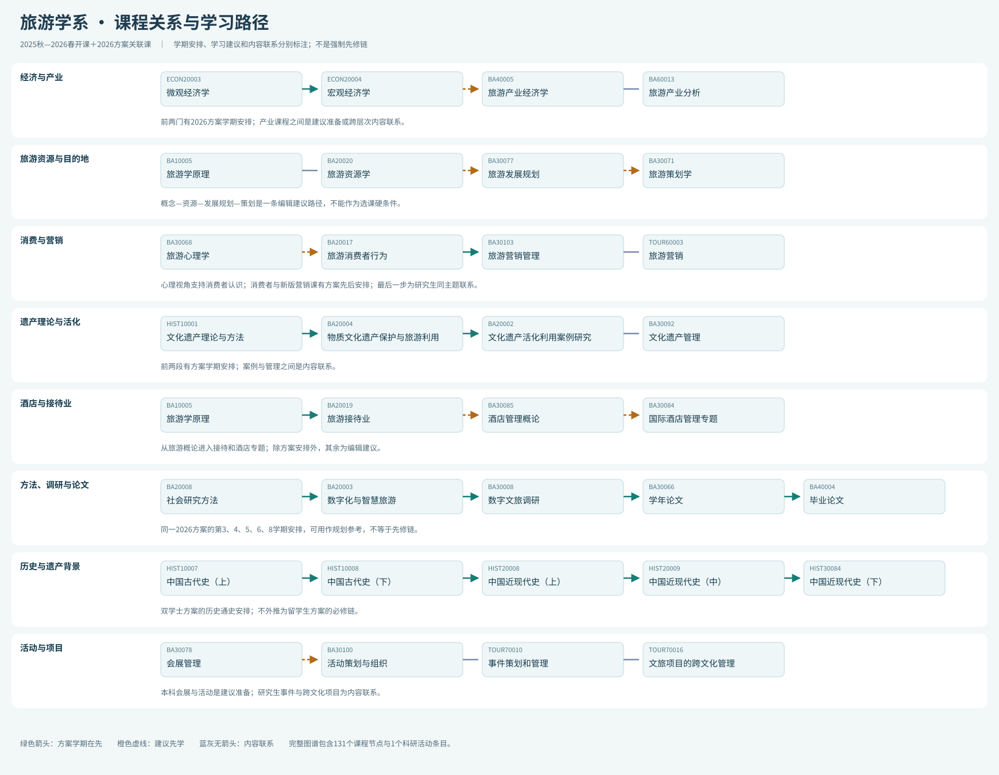

# 旅游学系课程关系与学习路径

## 先修关系如何理解

目前没有核实到可以作为当期强制先修的关系。绿色边依据同一2026方案中的学期安排；选择哪些课程配对展示由编者依据主题决定。橙色边为建议准备，蓝色边为内容联系，均可按具体目标调整。

## 学习路径

### 经济与产业

微观经济学（ECON20003） → 宏观经济学（ECON20004） → 旅游产业经济学（BA40005） → 旅游产业分析（BA60013）

前两门有2026方案学期安排；产业课程之间是建议准备或跨层次内容联系。

### 旅游资源与目的地

旅游学原理（BA10005） → 旅游资源学（BA20020） → 旅游发展规划（BA30077） → 旅游策划学（BA30071）

概念—资源—发展规划—策划是一条编辑建议路径，不能作为选课硬条件。

### 消费与营销

旅游心理学（BA30068） → 旅游消费者行为（BA20017） → 旅游营销管理（BA30103） → 旅游营销（TOUR60003）

心理视角支持消费者认识；消费者与新版营销课有方案先后安排；最后一步为研究生同主题联系。

### 遗产理论与活化

文化遗产理论与方法（HIST10001） → 物质文化遗产保护与旅游利用（BA20004） → 文化遗产活化利用案例研究（BA20002） → 文化遗产管理（BA30092）

前两段有方案学期安排；案例与管理之间是内容联系。

### 酒店与接待业

旅游学原理（BA10005） → 旅游接待业（BA20019） → 酒店管理概论（BA30085） → 国际酒店管理专题（BA30084）

从旅游概论进入接待和酒店专题；除方案安排外，其余为编辑建议。

### 方法、调研与论文

社会研究方法（BA20008） → 数字化与智慧旅游（BA20003） → 数字文旅调研（BA30008） → 学年论文（BA30066） → 毕业论文（BA40004）

同一2026方案的第3、4、5、6、8学期安排，可用作规划参考，不等于先修链。

### 历史与遗产背景

中国古代史（上）（HIST10007） → 中国古代史（下）（HIST10008） → 中国近现代史（上）（HIST20008） → 中国近现代史（中）（HIST20009） → 中国近现代史（下）（HIST30084）

双学士方案的历史通史安排；不外推为留学生方案的必修链。

### 活动与项目

会展管理（BA30078） → 活动策划与组织（BA30100） → 事件策划和管理（TOUR70010） → 文旅项目的跨文化管理（TOUR70016）

本科会展与活动是建议准备；研究生事件与跨文化项目为内容联系。

## 全部关系及理由

| 起点 | 终点 | 类型 | 理由 |
| --- | --- | --- | --- |
| 管理学导论 BA10006 | 旅游学原理 BA10005 | 2026方案学期在先（非先修） | 管理学概念为旅游管理问题提供背景。 此边只表达同一方案里的学期安排，方案未把这两课明确写成先修条件。 |
| 微积分B MATH10028 | 大学数学Ⅱ MATH10030 | 2026方案学期在先（非先修） | 两门数学基础课在课程体系图中分置第1、2学期；不据此认定大学数学Ⅱ的具体预修内容。 此边只表达同一方案里的学期安排，方案未把这两课明确写成先修条件。 |
| 微观经济学 ECON20003 | 宏观经济学 ECON20004 | 2026方案学期在先（非先修） | 由个体决策和市场视角延伸到总量经济问题；方案分置第2、3学期。 此边只表达同一方案里的学期安排，方案未把这两课明确写成先修条件。 |
| 旅游学原理 BA10005 | 旅游经济学 BA30067 | 2026方案学期在先（非先修） | 从旅游概念与系统认识进入经济分析。 此边只表达同一方案里的学期安排，方案未把这两课明确写成先修条件。 |
| 旅游学原理 BA10005 | 旅游接待业 BA20019 | 2026方案学期在先（非先修） | 从旅游系统认识进入接待业这一行业方向。 此边只表达同一方案里的学期安排，方案未把这两课明确写成先修条件。 |
| 文化遗产理论与方法 HIST10001 | 物质文化遗产保护与旅游利用 BA20004 | 2026方案学期在先（非先修） | 遗产理论与方法为讨论物质遗产保护和利用提供框架。 此边只表达同一方案里的学期安排，方案未把这两课明确写成先修条件。 |
| 文化遗产理论与方法 HIST10001 | 文化遗产与城市旅游 BA20006 | 2026方案学期在先（非先修） | 从遗产概念进入城市旅游中的遗产问题。 此边只表达同一方案里的学期安排，方案未把这两课明确写成先修条件。 |
| 物质文化遗产保护与旅游利用 BA20004 | 文化遗产活化利用案例研究 BA20002 | 2026方案学期在先（非先修） | 由保护与利用的一般问题进入活化利用案例。 此边只表达同一方案里的学期安排，方案未把这两课明确写成先修条件。 |
| 社会研究方法 BA20008 | 数字化与智慧旅游 BA20003 | 2026方案学期在先（非先修） | 社会研究训练可支持理解智慧旅游中的数据与研究问题；不是技术课程硬门槛。 此边只表达同一方案里的学期安排，方案未把这两课明确写成先修条件。 |
| 数字化与智慧旅游 BA20003 | 数字文旅调研 BA30008 | 2026方案学期在先（非先修） | 从数字化旅游主题进入数字文旅调研。 此边只表达同一方案里的学期安排，方案未把这两课明确写成先修条件。 |
| 社会研究方法 BA20008 | 数字文旅调研 BA30008 | 2026方案学期在先（非先修） | 研究问题和资料获取的基础可用于调研。 此边只表达同一方案里的学期安排，方案未把这两课明确写成先修条件。 |
| 数字文旅调研 BA30008 | 学年论文 BA30066 | 2026方案学期在先（非先修） | 以调研经验支持论文选题和证据组织。 此边只表达同一方案里的学期安排，方案未把这两课明确写成先修条件。 |
| 学年论文 BA30066 | 毕业论文 BA40004 | 2026方案学期在先（非先修） | 学年论文与毕业论文在方案分别位于第6、8学期。 此边只表达同一方案里的学期安排，方案未把这两课明确写成先修条件。 |
| 旅游消费者行为 BA20017 | 旅游营销管理 BA30103 | 2026方案学期在先（非先修） | 从消费者认识延伸到营销决策。 此边只表达同一方案里的学期安排，方案未把这两课明确写成先修条件。 |
| 会计学 BA10003 | 旅游业投资学 BA30095 | 2026方案学期在先（非先修） | 会计信息的理解可用于投资分析。会计学第4学期依据课程体系图，而不是空白suggestTerms字段。 此边只表达同一方案里的学期安排，方案未把这两课明确写成先修条件。 |
| 中国古代史（上） HIST10007 | 中国古代史（下） HIST10008 | 2026方案学期在先（非先修） | 同一历史通史的上、下部分依方案顺序学习。 此边只表达同一方案里的学期安排，方案未把这两课明确写成先修条件。 |
| 中国古代史（下） HIST10008 | 中国近现代史（上） HIST20008 | 2026方案学期在先（非先修） | 由古代史延伸到近现代史；是方案安排和时段联系。 此边只表达同一方案里的学期安排，方案未把这两课明确写成先修条件。 |
| 中国近现代史（上） HIST20008 | 中国近现代史（中） HIST20009 | 2026方案学期在先（非先修） | 中国近现代史上、中部分在方案中相继安排。 此边只表达同一方案里的学期安排，方案未把这两课明确写成先修条件。 |
| 中国近现代史（中） HIST20009 | 中国近现代史（下） HIST30084 | 2026方案学期在先（非先修） | 中国近现代史中、下部分在方案中相继安排。 此边只表达同一方案里的学期安排，方案未把这两课明确写成先修条件。 |
| 15世纪以前的世界 HIST10009 | 世界近代史 HIST20010 | 2026方案学期在先（非先修） | 从15世纪以前的世界进入世界近代史。 此边只表达同一方案里的学期安排，方案未把这两课明确写成先修条件。 |
| 世界近代史 HIST20010 | 20世纪的世界 HIST20007 | 2026方案学期在先（非先修） | 从世界近代史延伸至20世纪。 此边只表达同一方案里的学期安排，方案未把这两课明确写成先修条件。 |
| 微观经济学 ECON20003 | 旅游产业经济学 BA40005 | 建议先学（内容推断） | 微观经济学的决策和市场分析视角可为产业经济问题作准备。 |
| 宏观经济学 ECON20004 | 旅游产业经济学 BA40005 | 建议先学（内容推断） | 宏观环境的认识可帮助讨论旅游产业变化。 |
| 会计学 BA10003 | 财务管理 BA30063 | 建议先学（内容推断） | 先了解会计报表，再学习财务决策是可行的准备顺序。 |
| 财务管理 BA30063 | 旅游财务管理 BA40010 | 建议先学（内容推断） | 一般财务管理认识可用于旅游企业的财务问题。 |
| 旅游财务管理 BA40010 | 旅游业投资学 BA30095 | 建议先学（内容推断） | 财务分析认识可作为旅游投资判断的准备；不代表开课学期先后。 |
| 旅游心理学 BA30068 | 旅游消费者行为 BA20017 | 建议先学（内容推断） | 心理学视角可辅助理解旅游消费者行为。 |
| 旅游消费者行为 BA20017 | 旅游营销管理 BA30064 | 建议先学（内容推断） | 消费者需求的认识可支持营销选择。 |
| 旅游市场研究 BA30075 | 旅游营销管理 BA30064 | 建议先学（内容推断） | 市场调查与证据整理可支持营销决策；实际课程允许并学与否需另查。 |
| 旅游资源学 BA20020 | 旅游发展规划 BA30077 | 建议先学（内容推断） | 先认识旅游资源，再讨论旅游发展的规划取舍。 |
| 旅游资源学 BA20020 | 旅游目的地管理 BA30083 | 建议先学（内容推断） | 资源的识别和评价可支持目的地管理。 |
| 旅游发展规划 BA30077 | 旅游策划学 BA30071 | 建议先学（内容推断） | 发展规划的整体认识可为具体策划项目作准备。 |
| 旅游接待业 BA20019 | 酒店管理概论 BA30085 | 建议先学（内容推断） | 接待业的一般认识可为酒店这一业态作准备。 |
| 酒店管理概论 BA30085 | 国际酒店管理专题 BA30084 | 建议先学（内容推断） | 酒店管理的基础认识可支持国际酒店专题讨论。 |
| 管理学导论 BA10006 | 旅游运营商经营与管理 BA20007 | 建议先学（内容推断） | 管理学中的组织与运营视角可用于旅游运营商。 |
| 会展管理 BA30078 | 活动策划与组织 BA30100 | 建议先学（内容推断） | 会展管理经验可支持活动策划与组织；属于一种建议路径。 |
| 社会研究方法 BA20008 | 旅游人类学 BA30099 | 建议先学（内容推断） | 社会研究的提问和证据意识可支持人类学学习；具体方法要求未核。 |
| 社会研究方法 BA20008 | 教学实习 BA30079 | 建议先学（内容推断） | 研究设计和资料获取意识可支持教学实习中的观察。 |
| 旅游文献阅读 BA30098 | 学年论文 BA30066 | 建议先学（内容推断） | 文献阅读可为论文选题和论证提供准备。 |
| 旅游与文化遗产文献阅读 BA30010 | 学年论文 BA30066 | 建议先学（内容推断） | 旅游与文化遗产文献阅读可支持相关论文写作。 |
| 教学实习 BA30079 | 学年论文 BA30066 | 建议先学（内容推断） | 实习中的观察可作为研究问题来源；不意味着必须先完成实习。 |
| 旅游英语 BA20018 | 旅游文献阅读 BA30098 | 建议先学（内容推断） | 英语阅读能力可辅助文献阅读，不推断当前文献课使用语言或入课门槛。 |
| 文化遗产理论与方法 HIST10001 | 非物质文化遗产保护与旅游利用 BA30006 | 建议先学（内容推断） | 遗产理论有助于认识非物质遗产保护与旅游利用。 |
| 文化遗产理论与方法 HIST10001 | 文化遗产田野调查 BA30007 | 建议先学（内容推断） | 遗产理论的问题框架可支持田野调查。 |
| 社会研究方法 BA20008 | 文化遗产田野调查 BA30007 | 建议先学（内容推断） | 社会研究方法可支持遗产田野中的资料获取。 |
| 文化遗产管理 BA30092 | 遗产旅游 BA30082 | 建议先学（内容推断） | 管理视角可作为分析遗产旅游实践的准备。 |
| 旅游研究方法 TOUR70021 | 旅游文献的利用与研究 BA60008 | 建议先学（内容推断） | 研究方法认识可辅助文献的筛选与使用；是研究生主题间的学习建议。 |
| 服务管理 TOUR60006 | 旅游企业管理前沿 TOUR70013 | 建议先学（内容推断） | 服务运营视角可帮助讨论旅游企业前沿。 |
| 旅游管理研究方法 BA70056 | 国外旅游研究进展 BA70046 | 建议先学（内容推断） | 研究方法认识可用于阅读国外旅游研究。 |
| 旅游学原理 BA10005 | 旅游资源学 BA20020 | 内容联系（无方向） | 旅游系统的基本认识可与资源识别和评价主题联系。 |
| 旅游产业经济学 BA40005 | 旅游产业分析 BA60013 | 内容联系（无方向） | 旅游产业经济与产业分析具有共同的行业研究对象，保留培养层次差异。 |
| 旅游学原理 BA10005 | 旅游管理专题 BA30073 | 内容联系（无方向） | 基本旅游概念与旅游管理专题存在由概览到专题的主题联系。 |
| 旅游学原理 BA10005 | 旅游与经济管理 GEEC10420 | 内容联系（无方向） | 旅游基本概念与面向一般学习者的经济管理讨论可以互相参照。 |
| 旅游管理前沿理论 BA60014 | 国外旅游研究进展 BA70046 | 内容联系（无方向） | 前沿理论与国外研究进展可围绕研究问题和理论变化比较。 |
| 旅游管理前沿理论 BA60014 | 文化与旅游业基本理论与热点问题探索 TOUR70023 | 内容联系（无方向） | 均涉及旅游理论及当前议题，不能据此认定内容相同。 |
| 旅游企业战略管理 BA70048 | 旅游企业管理前沿 TOUR70013 | 内容联系（无方向） | 企业战略与企业管理前沿可围绕组织决策互相联系。 |
| 旅游经济学 BA30067 | 旅游产业经济学 BA40005 | 内容联系（无方向） | 旅游经济的行业视角与产业经济问题可以相互参照。 |
| 旅游产业经济学 BA40005 | 旅游产业经济分析 TOUR60001 | 内容联系（无方向） | 同属产业经济主题，保留不同层次和课程目标。 |
| 旅游产业分析 BA60013 | 旅游产业经济分析 TOUR60001 | 内容联系（无方向） | 产业分析与产业经济分析在研究对象上相近。 |
| 旅游财务管理 BA40010 | 旅游投资与财务管理 TOUR60005 | 内容联系（无方向） | 旅游财务与投融资主题相近，跨层次不自动互认。 |
| 旅游收益管理 BA30087 | 旅游财务管理 BA40010 | 内容联系（无方向） | 收益管理和企业财务在价格、收入与收益问题上有联系。 |
| 旅游地产与度假区管理 BA30088 | 旅游业投资学 BA30095 | 内容联系（无方向） | 投资判断与旅游地产项目存在应用场景联系。 |
| 微观经济学 ECON20003 | 微积分B MATH10028 | 内容联系（无方向） | 数量与变化率的认识可辅助经济建模；未取得数学预修规则。 |
| 旅游消费者行为 BA20017 | 旅游消费研究 BA60009 | 内容联系（无方向） | 旅游消费者行为与旅游消费研究关注相近的需求和行为问题。 |
| 旅游营销管理 BA30064 | 旅游营销 TOUR60003 | 内容联系（无方向） | 均属旅游营销主题，课程代码与层次独立。 |
| 旅游营销管理 BA30103 | 旅游营销 TOUR60003 | 内容联系（无方向） | 新版方案中的营销课程与研究生营销课存在主题联系。 |
| 旅游心理学 BA30068 | 管理心理学（MTA） TOUR70020 | 内容联系（无方向） | 旅游心理与管理心理都可从心理过程理解行为，但研究对象不同。 |
| 旅游营销管理 BA30064 | 旅游广告 BA30089 | 内容联系（无方向） | 广告表达与营销决策在传播与市场触达方面有关。 |
| 旅游消费研究 BA60009 | 文化与旅游品牌创新研究 BA60012 | 内容联系（无方向） | 品牌创新与旅游消费可从游客认知和体验建立联系。 |
| 文化创意产业引论 BA30091 | 文化与旅游品牌创新研究 BA60012 | 内容联系（无方向） | 文化创意产业与文旅品牌创新在产品和意义表达方面有关。 |
| 社会研究方法 BA20008 | 旅游市场研究 BA30075 | 内容联系（无方向） | 旅游市场研究与社会研究方法在研究设计和资料收集方面可能相交。 |
| 休闲学概论 BA30076 | 游憩管理 BA30093 | 内容联系（无方向） | 休闲的概念与游憩场所管理可从需求和场景联系。 |
| 休闲学概论 BA30076 | 休闲与文化创意产业 TOUR70005 | 内容联系（无方向） | 休闲学与休闲文化创意产业具有共同的问题背景。 |
| 文化创意产业引论 BA30091 | 休闲与文化创意产业 TOUR70005 | 内容联系（无方向） | 文化创意产业是两课共同的主题关键词，不推断同一大纲。 |
| 中国民俗旅游 BA30074 | 旅游文化资源 BA60015 | 内容联系（无方向） | 民俗实践与旅游文化资源可从文化表达和利用比较。 |
| 旅游文化学 BA30065 | 旅游文化 BA40008 | 内容联系（无方向） | 旅游文化与旅游文化学在题名上相近，沿革和互认未核实。 |
| 旅游文化 BA40008 | 文化旅游 BA60006 | 内容联系（无方向） | 旅游文化与文化旅游分别可从文化视角和旅游实践视角相互参照。 |
| 文化旅游 BA60006 | 旅游文化资源 BA60015 | 内容联系（无方向） | 文化资源与文化旅游的研究对象相关。 |
| 旅游社会学 BA30072 | 旅游人类学 BA30099 | 内容联系（无方向） | 人类学与社会学可为旅游社会文化现象提供不同视角。 |
| 旅游社会学 BA30072 | 旅游社会学专题讲座 BA70054 | 内容联系（无方向） | 社会学基础主题与专题讲座可互相参照，不跨层次设先修。 |
| 文化遗产管理 BA30092 | 遗产旅游研究 BA70047 | 内容联系（无方向） | 遗产管理与遗产旅游研究具有共同的遗产实践背景。 |
| 文化遗产活化利用案例研究 BA20002 | 文化遗产管理 BA30092 | 内容联系（无方向） | 活化利用案例与遗产管理可比较保护和利用决策。 |
| 物质文化遗产保护与旅游利用 BA20004 | 非物质文化遗产保护与旅游利用 BA30006 | 内容联系（无方向） | 物质与非物质遗产保护提供不同对象的比较。 |
| 文化遗产与城市旅游 BA20006 | 文化遗产与乡村旅游 BA30011 | 内容联系（无方向） | 城市与乡村旅游是遗产研究的不同空间场景。 |
| 文化遗产与旅游发展伦理专题 BA30009 | 文化遗产管理 BA30092 | 内容联系（无方向） | 伦理专题可反思遗产管理中的利益和价值冲突。 |
| 文化遗产与旅游发展伦理专题 BA30009 | 旅游伦理学 BA30080 | 内容联系（无方向） | 旅游伦理与遗产发展伦理在价值判断上相互联系。 |
| 文化与旅游地理学 BA20005 | 中国历史地理概论 HIST30009 | 内容联系（无方向） | 旅游地理与历史地理可比较空间格局及形成过程。 |
| 文化与旅游地理学 BA20005 | 旅游发展规划 BA30077 | 内容联系（无方向） | 空间分析视角可用于旅游发展规划。 |
| 旅游发展规划 BA30077 | 旅游规划原理 BA60007 | 内容联系（无方向） | 发展规划与规划原理在主题上相连，保留本科与研究生层次。 |
| 旅游规划原理 BA60007 | 旅游规划与战略 TOUR60004 | 内容联系（无方向） | 旅游规划原理与规划战略可围绕空间与发展决策比较。 |
| 旅游目的地管理 BA30083 | 旅游目的地开发与管理 TOUR60002 | 内容联系（无方向） | 目的地管理与目的地开发管理主题相近，不能自动互相替代。 |
| 旅游资源学 BA20020 | 旅游资源开发与管理 TOUR70004 | 内容联系（无方向） | 旅游资源学与资源开发管理关注资源及其利用。 |
| 旅游地产与度假区管理 BA30088 | 游憩管理 BA30093 | 内容联系（无方向） | 度假区和游憩管理在空间体验与运营场景上有关。 |
| 游憩管理 BA30093 | 主题公园管理 BA30094 | 内容联系（无方向） | 主题公园是可以与游憩管理比较的一类旅游空间。 |
| 文化创意产业引论 BA30091 | 主题公园管理 BA30094 | 内容联系（无方向） | 主题公园与文化创意在主题叙事、产品和体验方面存在联系。 |
| 旅游运营商经营与管理 BA20007 | 旅行社经营管理 BA30069 | 内容联系（无方向） | 旅行社与旅游运营商在业务组织和服务链上存在联系，名称沿革未核。 |
| 旅行社经营管理 BA30069 | 旅游渠道管理 TOUR70012 | 内容联系（无方向） | 旅行社经营与旅游渠道可从中介和分销环节比较。 |
| 旅游接待业 BA20019 | 服务管理 TOUR60006 | 内容联系（无方向） | 接待业与服务管理从业态和服务过程两个角度联系。 |
| 酒店管理概论 BA30085 | 饭店管理研究 BA70045 | 内容联系（无方向） | 酒店基础与饭店研究以相近业态为对象，保持层次差异。 |
| 邮轮产业与服务管理 BA30096 | 服务管理 TOUR60006 | 内容联系（无方向） | 邮轮产业中的服务问题可与一般服务管理相联系。 |
| 邮轮产业与服务管理 BA30096 | 航空公司战略与空运经济 TOUR70001 | 内容联系（无方向） | 邮轮和航空提供两类交通旅游服务的行业比较。 |
| 旅游企业战略管理 BA70048 | 航空公司战略与空运经济 TOUR70001 | 内容联系（无方向） | 航空公司战略可与旅游企业战略作行业比较。 |
| 活动策划与组织 BA30100 | 事件策划和管理 TOUR70010 | 内容联系（无方向） | 活动策划组织与事件管理的项目主题相近。 |
| 会展管理 BA30078 | 事件策划和管理 TOUR70010 | 内容联系（无方向） | 会展与事件管理在现场组织和利益相关者协调上有关。 |
| 事件策划和管理 TOUR70010 | 文旅项目的跨文化管理 TOUR70016 | 内容联系（无方向） | 文旅跨文化项目与事件管理可以在项目沟通场景中联系。 |
| 数字化与智慧旅游 BA20003 | 旅游信息系统 BA30090 | 内容联系（无方向） | 智慧旅游与旅游信息系统具有数字化应用的共同主题。 |
| 社会研究方法 BA20008 | 数字文旅调研 BA30008 | 内容联系（无方向） | 数字文旅调研与社会研究在资料获取和研究设计上相交。 |
| 旅游市场研究 BA30075 | 旅游信息系统 BA30090 | 内容联系（无方向） | 信息系统与市场研究可从数据采集和组织方式联系；未核实具体软件。 |
| 旅游与文化遗产文献阅读 BA30010 | 旅游文献的利用与研究 BA60008 | 内容联系（无方向） | 两课均涉及文献使用，但培养层次和研究对象不完全相同。 |
| 旅游管理研究方法 BA70056 | 旅游研究方法 TOUR70021 | 内容联系（无方向） | 旅游管理研究方法与旅游研究方法主题相近，不据名称合并。 |
| 旅游管理研究方法 BA70056 | 马克思主义与社会科学方法论 GEIP40008 | 内容联系（无方向） | 社会科学方法论可为旅游管理研究的方法反思提供背景。 |
| 文化遗产田野调查 BA30007 | 教学实习 BA30079 | 内容联系（无方向） | 教学实习与遗产田野调查都是实践性学习形式，不能据此互认学分。 |
| 复芏计划(FDUROP) 102 | 学年论文 BA30066 | 内容联系（无方向） | FDUROP是科研训练活动条目，可与论文训练联系，不作为常规课程或硬性先修。 |
| 复芏计划(FDUROP) 102 | 毕业论文 BA40004 | 内容联系（无方向） | 科研训练可为毕业研究积累经验，但不推断必须参加。 |
| 旅游英语 BA20018 | 专业英语 TOUR50001 | 内容联系（无方向） | 均涉及旅游相关英语，层次和具体内容需按大纲区分。 |
| 旅游文献阅读 BA30098 | 专业外语 BA40003 | 内容联系（无方向） | 外语能力与文献阅读存在能力层面的联系，不推断本课具体语种。 |
| 专业外语 BA50001 | 旅游文献的利用与研究 BA60008 | 内容联系（无方向） | 研究生外语与研究文献利用在阅读能力层面相关。 |
| 旅游与跨文化沟通 BA30097 | 文旅项目的跨文化管理 TOUR70016 | 内容联系（无方向） | 跨文化沟通与文旅项目管理存在沟通场景联系。 |
| 国际旅游服务贸易 BA30101 | 国际旅游服务贸易：实务与前沿 TOUR70022 | 内容联系（无方向） | 国际旅游服务贸易的同主题不同课程记录分别保留。 |
| 旅游法规 BA20015 | 旅游政策与法规 TOUR70007 | 内容联系（无方向） | 旅游法规与政策法规均关注规范及治理，不推断现行制度与大纲版本。 |
| 旅游法规 BA20015 | 旅游伦理学 BA30080 | 内容联系（无方向） | 法规约束与伦理判断可共同分析旅游实践中的行为选择。 |
| 马克思主义与社会科学方法论 GEIP40008 | 新时代中国特色社会主义理论与实践 GEIP40013 | 内容联系（无方向） | 公共理论课与社会科学方法论可在理论视角上联系，不代表先修。 |
| 旅游心理学 BA30068 | 自我与认同 GEMH10004 | 内容联系（无方向） | 自我认同与旅游心理可从个体经验的角度作主题联想，具体内容待核。 |
| 沟通心理学 GEMH10020 | 管理心理学（MTA） TOUR70020 | 内容联系（无方向） | 沟通心理与管理心理可从人际互动角度联系，不能外推统一课程内容。 |
| 文化遗产与城市旅游 BA20006 | 中国历史地理概论 HIST30009 | 内容联系（无方向） | 历史地理有助于从城市形成和空间演变理解城市遗产旅游。 |
| 文化遗产与城市旅游 BA20006 | 中国古代城市史 HIST30020 | 内容联系（无方向） | 古代城市史与城市遗产旅游共享城市文化这一研究对象。 |
| 中国民俗旅游 BA30074 | 中国古代礼制研究 HIST30023 | 内容联系（无方向） | 古代礼制与民俗旅游可以在仪式和文化表达方面比较。 |
| 中国民俗旅游 BA30074 | 中国古代社会生活史 HIST30047 | 内容联系（无方向） | 社会生活史为理解民俗的历史背景提供一种视角。 |
| 旅游文化 BA40008 | 明清文化史 HIST30075 | 内容联系（无方向） | 明清文化史与旅游文化可以从文化资源的历史语境联系。 |
| 文化创意产业引论 BA30091 | 美国大众文化史 HIST30030 | 内容联系（无方向） | 大众文化史可与文化创意产业从文化传播和消费主题联系。 |
| 15世纪以前的世界 HIST10009 | 古希腊史 HIST30072 | 内容联系（无方向） | 古希腊史为世界前近代历史框架提供区域专题。 |
| 世界近代史 HIST20010 | 日本近代史 HIST30115 | 内容联系（无方向） | 日本近代史与世界近代史可从区域及整体视角互相参照。 |
| 旅游与跨文化沟通 BA30097 | 韩国文化史 HIST30108 | 内容联系（无方向） | 韩国文化史与跨文化沟通可在文化背景认识上建立联系。 |
| 考古学导论 ARCH10001 | 文化遗产理论与方法 HIST10001 | 内容联系（无方向） | 考古证据与遗产理论可从文化遗产认识的不同方法比较。 |
| 文化遗产管理 BA30092 | 博物馆学概论 MUSE20001 | 内容联系（无方向） | 博物馆作为遗产机构，可与文化遗产管理的实践问题联系。 |
| 文化遗产活化利用案例研究 BA20002 | 博物馆学概论 MUSE20001 | 内容联系（无方向） | 博物馆展示与遗产活化案例在文化阐释方面存在联系。 |
| 旅游营销管理 BA30064 | 旅游营销管理 BA30103 | 同名异号（不代表互认） | 官方目录中同名“旅游营销管理”，课号与培养层次/方案分别保留；不据此认定等价、替代、课程沿革或先修。 |
| 旅游地产与度假区管理 BA30088 | 旅游地产与度假区管理 TOUR70018 | 同名异号（不代表互认） | 官方目录中同名“旅游地产与度假区管理”，课号与培养层次/方案分别保留；不据此认定等价、替代、课程沿革或先修。 |
| 旅游信息系统 BA30090 | 旅游信息系统 TOUR60007 | 同名异号（不代表互认） | 官方目录中同名“旅游信息系统”，课号与培养层次/方案分别保留；不据此认定等价、替代、课程沿革或先修。 |
| 专业外语 BA40003 | 专业外语 BA50001 | 同名异号（不代表互认） | 官方目录中同名“专业外语”，课号与培养层次/方案分别保留；不据此认定等价、替代、课程沿革或先修。 |
| 服务管理 BA30086 | 服务管理 TOUR60006 | 同名异号（不代表互认） | 官方目录中同名“服务管理”，课号与培养层次/方案分别保留；不据此认定等价、替代、课程沿革或先修。 |
| 遗产旅游 BA30082 | 遗产旅游 TOUR70006 | 同名异号（不代表互认） | 官方目录中同名“遗产旅游”，课号与培养层次/方案分别保留；不据此认定等价、替代、课程沿革或先修。 |
| 旅游消费者行为 BA20017 | 旅游消费者行为 TOUR70008 | 同名异号（不代表互认） | 官方目录中同名“旅游消费者行为”，课号与培养层次/方案分别保留；不据此认定等价、替代、课程沿革或先修。 |
