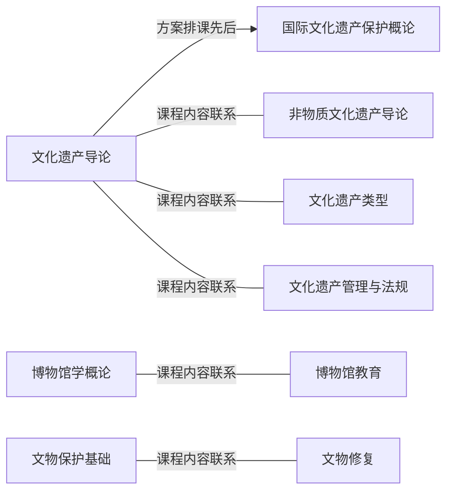

# 2023 文物与博物馆学专业“2+X”教学培养方案（留学生适用）

文物与博物馆学系 · 文物与博物馆学 · 方案 67374 · 117 个不同课程或科研条目。

[官方 Word](../originals/plan-67374.docx) · [教务详情](https://fdjwgl.fudan.edu.cn/manager/bizType/2/major-program-search/info/67374?skipAuth=1) · [方案快照](../raw/plan-67374.json.gz) · [年级目录](../README.md)

## 课程关系图

图中展示部分关系。下表保留全部已建立的课程对，来源位置使用本方案 JSON Pointer。

## 先修与内容联系

| 类型 | 起点 | 终点 | 依据 | 原表定位 |
| --- | --- | --- | --- | --- |
| 建议学习顺序 | 文化遗产导论 (CULT20002) | 非物质文化遗产导论 (CULT20004) | “文化遗产导论”题名标明基础层次，前置阅读可帮助了解“非物质文化遗产导论”中的文化遗产主题。  | `/courseModules/8/planCourses/9`、`/courseModules/8/planCourses/13` |
| 建议学习顺序 | 文化遗产导论 (CULT20002) | 国际文化遗产保护概论 (CULT20006) | “文化遗产导论”题名标明基础层次，前置阅读可帮助了解“国际文化遗产保护概论”中的文化遗产主题。  | `/courseModules/8/planCourses/9`、`/courseModules/8/planCourses/15` |
| 建议学习顺序 | 文化遗产导论 (CULT20002) | 文化遗产管理与法规 (CULT30001) | “文化遗产导论”题名标明基础层次，前置阅读可帮助了解“文化遗产管理与法规”中的文化遗产主题。  | `/courseModules/8/planCourses/9`、`/courseModules/10/planCourses/0` |
| 建议学习顺序 | 文化遗产导论 (CULT20002) | 文化遗产类型 (CULT30017) | “文化遗产导论”题名标明基础层次，前置阅读可帮助了解“文化遗产类型”中的文化遗产主题。  | `/courseModules/8/planCourses/9`、`/courseModules/10/planCourses/24` |
| 方案排课先后 | 文化遗产导论 (CULT20002) | 国际文化遗产保护概论 (CULT20006) | 同方案该课程全部明确数字学期均早于后者。  | `/courseModules/8/planCourses/9`、`/courseModules/8/planCourses/15` |
| 课程内容联系 | 体质人类学 (ARCH20001) | 古人类学 (ARCH30004) | 本方案两门课程的题名均含“人类学”，可据此对照这一主题。  | `/courseModules/10/planCourses/45`、`/courseModules/10/planCourses/58` |
| 课程内容联系 | 陶瓷考古 (ARCH30013) | 公众考古 (ARCH50002) | 本方案两门课程的题名均含“考古”，可据此对照这一主题。  | `/courseModules/10/planCourses/31`、`/courseModules/10/planCourses/55` |
| 课程内容联系 | 冶金考古 (ARCH40001) | 公众考古 (ARCH50002) | 本方案两门课程的题名均含“考古”，可据此对照这一主题。  | `/courseModules/10/planCourses/56`、`/courseModules/10/planCourses/55` |
| 课程内容联系 | 农业考古 (ARCH50001) | 公众考古 (ARCH50002) | 本方案两门课程的题名均含“考古”，可据此对照这一主题。  | `/courseModules/10/planCourses/53`、`/courseModules/10/planCourses/55` |
| 课程内容联系 | 公众考古 (ARCH50002) | 地学考古 (MUSE130082) | 本方案两门课程的题名均含“考古”，可据此对照这一主题。  | `/courseModules/10/planCourses/55`、`/courseModules/10/planCourses/29` |
| 课程内容联系 | 文化遗产导论 (CULT20002) | 非物质文化遗产导论 (CULT20004) | 本方案两门课程的题名均含“文化遗产”，可据此对照这一主题。  | `/courseModules/8/planCourses/9`、`/courseModules/8/planCourses/13` |
| 课程内容联系 | 文化遗产导论 (CULT20002) | 国际文化遗产保护概论 (CULT20006) | 本方案两门课程的题名均含“文化遗产”，可据此对照这一主题。  | `/courseModules/8/planCourses/9`、`/courseModules/8/planCourses/15` |
| 课程内容联系 | 文化遗产导论 (CULT20002) | 文化遗产管理与法规 (CULT30001) | 本方案两门课程的题名均含“文化遗产”，可据此对照这一主题。  | `/courseModules/8/planCourses/9`、`/courseModules/10/planCourses/0` |
| 课程内容联系 | 文化遗产导论 (CULT20002) | 文化遗产类型 (CULT30017) | 本方案两门课程的题名均含“文化遗产”，可据此对照这一主题。  | `/courseModules/8/planCourses/9`、`/courseModules/10/planCourses/24` |
| 课程内容联系 | 文物保护基础 (CULT20003) | 文物修复 (CULT30019) | 本方案两门课程的题名均含“文物”，可据此对照这一主题。  | `/courseModules/8/planCourses/11`、`/courseModules/10/planCourses/34` |
| 课程内容联系 | 国际文化遗产保护概论 (CULT20006) | 国际文化遗产保护概论（H） (CULT20006h) | 本方案两门课程的题名均含“遗产保护”，可据此对照这一主题。  | `/courseModules/8/planCourses/15`、`/courseModules/18/planCourses/11` |
| 课程内容联系 | 文物保护技术 (CULT30002) | 文物修复 (CULT30019) | 本方案两门课程的题名均含“文物”，可据此对照这一主题。  | `/courseModules/10/planCourses/1`、`/courseModules/10/planCourses/34` |
| 课程内容联系 | 文物分析技术 (CULT30010) | 文物修复 (CULT30019) | 本方案两门课程的题名均含“文物”，可据此对照这一主题。  | `/courseModules/10/planCourses/12`、`/courseModules/10/planCourses/34` |
| 课程内容联系 | 文物修复 (CULT30019) | 文物鉴赏 (ICLE10004) | 本方案两门课程的题名均含“文物”，可据此对照这一主题。  | `/courseModules/10/planCourses/34`、`/courseModules/7/planCourses/3` |
| 课程内容联系 | 世界博物馆概论 (MUSE130016) | 博物馆教育 (MUSE30004) | 本方案两门课程的题名均含“博物馆”，可据此对照这一主题。  | `/courseModules/10/planCourses/2`、`/courseModules/10/planCourses/17` |
| 课程内容联系 | 博物馆信息化 (MUSE130054) | 博物馆教育 (MUSE30004) | 本方案两门课程的题名均含“博物馆”，可据此对照这一主题。  | `/courseModules/10/planCourses/15`、`/courseModules/10/planCourses/17` |
| 课程内容联系 | 博物馆学概论 (MUSE20001) | 博物馆教育 (MUSE30004) | 本方案两门课程的题名均含“博物馆”，可据此对照这一主题。  | `/courseModules/8/planCourses/2`、`/courseModules/10/planCourses/17` |
| 课程内容联系 | 博物馆教育 (MUSE30004) | 儿童博物馆概论 (MUSE30006) | 本方案两门课程的题名均含“博物馆”，可据此对照这一主题。  | `/courseModules/10/planCourses/17`、`/courseModules/10/planCourses/25` |
| 课程内容联系 | 哲学导论 (PHIL10002) | 逻辑学 (PHIL10003) | 论证与概念分析是哲学讨论的共同方法。  | `/courseModules/6/planCourses/1`、`/courseModules/6/planCourses/2` |

本次未从可定位的明确表述中确认课程对课程预修。学期安排、系列分册与编辑建议均保留各自的依据。

## 按原方案模块阅读

同一模块展示原表中的课程归属。模块内课程之间的先后仍须逐项查阅。

- **人文类基础课程（必修）**　中国文学经典、中国古代文明、哲学导论、逻辑学（原表模块 6）
- **人文类基础课程（选修）**　考古学导论、中国哲学、中国绘画、中国书法、文物鉴赏、中国印、中国神话传说、中国传统医学文化、当代国际关系、中国旅游文化、中国传统戏曲赏析、中国传统建筑文化、经贸汉语、中国历史名人、中国文化地理、汉语与中国文化、跨文化交流理论与实践、文学美典与人生境界（原表模块 7）
- **博物馆学**　世界博物馆概论、博物馆国际交流与合作、儿童博物馆概论、博物馆展览说明文字研究、自然博物馆理论与实务（原表模块 13）
- **文物学**　中国玉器、中国钱币学、中国墓葬艺术导论、中国古典园林史、中国古代青瓷（原表模块 14）
- **文化遗产**　中国古代建筑史、世界建筑艺术概论、世界遗产概论（原表模块 15）
- **文物保护**　中国科技史概论、纸质文物修复、古陶瓷修复（原表模块 16）
- **考古学**　体质人类学、环境考古学、古人类学、东亚史前考古、动物考古学、植物考古学、陶瓷考古、饮食考古、冶金考古、石窟寺考古、海上丝绸之路考古概论、水下考古学导论、分子考古学、农业考古、公众考古、同位素考古、地学考古（原表模块 17）

## 课程表

同一课程在不同模块分别出现时，按原表逐行列出。季节字段保留原值。

| 课程 | 代码 | 学分 | 学期 | 模块 |
| --- | --- | ---: | --- | --- |
| 中国文学经典 | CHIN10005 | 3.0 | 第1学期 | 培养方案 / 专业培养课程 / 大类基础课程 / 人文类基础课程（必修） |
| 哲学导论 | PHIL10002 | 3.0 | 第2学期 | 培养方案 / 专业培养课程 / 大类基础课程 / 人文类基础课程（必修） |
| 逻辑学 | PHIL10003 | 3.0 | 第2学期 | 培养方案 / 专业培养课程 / 大类基础课程 / 人文类基础课程（必修） |
| 中国古代文明 | HIST10006 | 3.0 | 第1学期 | 培养方案 / 专业培养课程 / 大类基础课程 / 人文类基础课程（必修） |
| 中国哲学 | ICLE10001 | 2.0 | AUTUMN | 培养方案 / 专业培养课程 / 大类基础课程 / 人文类基础课程（选修） |
| 中国绘画 | ICLE10002 | 2.0 | AUTUMN | 培养方案 / 专业培养课程 / 大类基础课程 / 人文类基础课程（选修） |
| 中国书法 | ICLE10003 | 2.0 | SPRING | 培养方案 / 专业培养课程 / 大类基础课程 / 人文类基础课程（选修） |
| 文物鉴赏 | ICLE10004 | 2.0 | AUTUMN | 培养方案 / 专业培养课程 / 大类基础课程 / 人文类基础课程（选修） |
| 中国印 | ICLE10005 | 2.0 | AUTUMN | 培养方案 / 专业培养课程 / 大类基础课程 / 人文类基础课程（选修） |
| 中国神话传说 | ICLE10006 | 2.0 | AUTUMN | 培养方案 / 专业培养课程 / 大类基础课程 / 人文类基础课程（选修） |
| 中国传统医学文化 | ICLE10007 | 2.0 | AUTUMN | 培养方案 / 专业培养课程 / 大类基础课程 / 人文类基础课程（选修） |
| 当代国际关系 | ICLE10008 | 2.0 | AUTUMN | 培养方案 / 专业培养课程 / 大类基础课程 / 人文类基础课程（选修） |
| 中国旅游文化 | ICLE10009 | 2.0 | SPRING | 培养方案 / 专业培养课程 / 大类基础课程 / 人文类基础课程（选修） |
| 中国传统戏曲赏析 | ICLE10010 | 2.0 | SPRING | 培养方案 / 专业培养课程 / 大类基础课程 / 人文类基础课程（选修） |
| 中国传统建筑文化 | ICLE10011 | 2.0 | AUTUMN | 培养方案 / 专业培养课程 / 大类基础课程 / 人文类基础课程（选修） |
| 经贸汉语 | ICLE10012 | 2.0 | SPRING | 培养方案 / 专业培养课程 / 大类基础课程 / 人文类基础课程（选修） |
| 中国历史名人 | ICLE10013 | 2.0 | AUTUMN | 培养方案 / 专业培养课程 / 大类基础课程 / 人文类基础课程（选修） |
| 中国文化地理 | ICLE10014 | 2.0 | SPRING | 培养方案 / 专业培养课程 / 大类基础课程 / 人文类基础课程（选修） |
| 汉语与中国文化 | ICLE10015 | 2.0 | AUTUMN | 培养方案 / 专业培养课程 / 大类基础课程 / 人文类基础课程（选修） |
| 跨文化交流理论与实践 | ICLE10016 | 2.0 | SPRING | 培养方案 / 专业培养课程 / 大类基础课程 / 人文类基础课程（选修） |
| 文学美典与人生境界 | ICLE10017 | 2.0 | AUTUMN | 培养方案 / 专业培养课程 / 大类基础课程 / 人文类基础课程（选修） |
| 考古学导论 | ARCH10001 | 2.0 | AUTUMN | 培养方案 / 专业培养课程 / 大类基础课程 / 人文类基础课程（选修） |
| 中国历史地理概论 | HIST30009 | 2.0 | 第5学期 | 培养方案 / 专业培养课程 / 专业核心教育课程 |
| 15世纪以前的世界 | HIST10009 | 4.0 | 第2学期 | 培养方案 / 专业培养课程 / 专业核心教育课程 |
| 博物馆学概论 | MUSE20001 | 2.0 | 第3学期 | 培养方案 / 专业培养课程 / 专业核心教育课程 |
| 学年论文 | ARCH30006 | 1.0 | 第6学期 | 培养方案 / 专业培养课程 / 专业核心教育课程 |
| 毕业论文 | ARCH40004 | 4.0 | 第8学期 | 培养方案 / 专业培养课程 / 专业核心教育课程 |
| 考古学思想史 | ARCH30007 | 2.0 | 第4学期 | 培养方案 / 专业培养课程 / 专业核心教育课程 |
| 田野考古学 | ARCH20008 | 2.0 | 第5学期 | 培养方案 / 专业培养课程 / 专业核心教育课程 |
| 博物馆经营管理 | MUSE20002 | 2.0 | 第4学期 | 培养方案 / 专业培养课程 / 专业核心教育课程 |
| 专业论文写作 | ARCH20009 | 2.0 | 第4学期 | 培养方案 / 专业培养课程 / 专业核心教育课程 |
| 文化遗产导论 | CULT20002 | 2.0 | 第3学期 | 培养方案 / 专业培养课程 / 专业核心教育课程 |
| 科技考古导论 | ARCH20010 | 2.0 | 第3学期 | 培养方案 / 专业培养课程 / 专业核心教育课程 |
| 文物保护基础 | CULT20003 | 2.0 | 第4学期 | 培养方案 / 专业培养课程 / 专业核心教育课程 |
| 社会实践 | ARCH30008 | 6.0 | 第6学期 | 培养方案 / 专业培养课程 / 专业核心教育课程 |
| 非物质文化遗产导论 | CULT20004 | 2.0 | 第3学期 | 培养方案 / 专业培养课程 / 专业核心教育课程 |
| 文物研究导论 | CULT20005 | 2.0 | 第4学期 | 培养方案 / 专业培养课程 / 专业核心教育课程 |
| 国际文化遗产保护概论 | CULT20006 | 2.0 | 第4学期 | 培养方案 / 专业培养课程 / 专业核心教育课程 |
| 专业英语 | ARCH30010 | 2.0 | 第5学期 | 培养方案 / 专业培养课程 / 专业核心教育课程 |
| 博物馆职业伦理与法规 | MUSE20003 | 2.0 | 第4学期 | 培养方案 / 专业培养课程 / 专业核心教育课程 |
| 中国古代史 | ARCH20013 | 4.0 | 第3学期 | 培养方案 / 专业培养课程 / 专业核心教育课程 |
| 中国考古学 | ARCH20014 | 4.0 | 第3学期 | 培养方案 / 专业培养课程 / 专业核心教育课程 |
| 文化遗产管理与法规 | CULT30001 | 2.0 | SPRING、AUTUMN | 培养方案 / 专业进阶课程-多元发展 |
| 文物保护技术 | CULT30002 | 2.0 | SPRING、AUTUMN | 培养方案 / 专业进阶课程-多元发展 |
| 世界博物馆概论 | MUSE130016 | 2.0 | SPRING、AUTUMN | 培养方案 / 专业进阶课程-多元发展 |
| 博物馆藏品管理 | MUSE30001 | 2.0 | SPRING、AUTUMN | 培养方案 / 专业进阶课程-多元发展 |
| 中国玉器 | CULT30003 | 2.0 | SPRING、AUTUMN | 培养方案 / 专业进阶课程-多元发展 |
| 中国绘画史 | CULT30004 | 2.0 | SPRING、AUTUMN | 培养方案 / 专业进阶课程-多元发展 |
| 中国青铜器 | CULT30005 | 2.0 | SPRING、AUTUMN | 培养方案 / 专业进阶课程-多元发展 |
| 中国陶瓷史 | CULT30006 | 2.0 | SPRING、AUTUMN | 培养方案 / 专业进阶课程-多元发展 |
| 中国古代建筑史 | CULT30007 | 2.0 | SPRING、AUTUMN | 培养方案 / 专业进阶课程-多元发展 |
| 中国钱币学 | CULT30008 | 2.0 | SPRING、AUTUMN | 培养方案 / 专业进阶课程-多元发展 |
| 中国科技史概论 | CULT30009 | 2.0 | SPRING、AUTUMN | 培养方案 / 专业进阶课程-多元发展 |
| 展览形式设计 | MUSE30002 | 2.0 | SPRING、AUTUMN | 培养方案 / 专业进阶课程-多元发展 |
| 文物分析技术 | CULT30010 | 2.0 | SPRING、AUTUMN | 培养方案 / 专业进阶课程-多元发展 |
| 中国美术考古 | CULT30011 | 2.0 | SPRING、AUTUMN | 培养方案 / 专业进阶课程-多元发展 |
| 展览内容策划 | MUSE30003 | 2.0 | SPRING、AUTUMN | 培养方案 / 专业进阶课程-多元发展 |
| 博物馆信息化 | MUSE130054 | 2.0 | SPRING、AUTUMN | 培养方案 / 专业进阶课程-多元发展 |
| 中国漆器史 | CULT30012 | 2.0 | SPRING、AUTUMN | 培养方案 / 专业进阶课程-多元发展 |
| 博物馆教育 | MUSE30004 | 2.0 | SPRING、AUTUMN | 培养方案 / 专业进阶课程-多元发展 |
| 纸质文物修复 | CULT30013 | 2.0 | SPRING、AUTUMN | 培养方案 / 专业进阶课程-多元发展 |
| 古陶瓷修复 | CULT30014 | 2.0 | SPRING、AUTUMN | 培养方案 / 专业进阶课程-多元发展 |
| 中国墓葬艺术导论 | CULT30015 | 2.0 | SPRING、AUTUMN | 培养方案 / 专业进阶课程-多元发展 |
| 东亚史前考古 | ARCH30009 | 2.0 | SPRING、AUTUMN | 培养方案 / 专业进阶课程-多元发展 |
| 博物馆国际交流与合作 | MUSE30005 | 2.0 | SPRING、AUTUMN | 培养方案 / 专业进阶课程-多元发展 |
| 中国古典园林史 | CULT30016 | 2.0 | SPRING、AUTUMN | 培养方案 / 专业进阶课程-多元发展 |
| 文化遗产类型 | CULT30017 | 2.0 | SPRING、AUTUMN | 培养方案 / 专业进阶课程-多元发展 |
| 儿童博物馆概论 | MUSE30006 | 2.0 | SPRING、AUTUMN | 培养方案 / 专业进阶课程-多元发展 |
| 世界建筑艺术概论 | CULT30018 | 2.0 | SPRING、AUTUMN | 培养方案 / 专业进阶课程-多元发展 |
| 动物考古学 | ARCH30011 | 2.0 | SPRING、AUTUMN | 培养方案 / 专业进阶课程-多元发展 |
| 博物馆展览说明文字研究 | MUSE30007 | 2.0 | SPRING、AUTUMN | 培养方案 / 专业进阶课程-多元发展 |
| 地学考古 | MUSE130082 | 2.0 | SPRING、AUTUMN | 培养方案 / 专业进阶课程-多元发展 |
| 植物考古学 | ARCH30012 | 2.0 | SPRING、AUTUMN | 培养方案 / 专业进阶课程-多元发展 |
| 陶瓷考古 | ARCH30013 | 2.0 | SPRING、AUTUMN | 培养方案 / 专业进阶课程-多元发展 |
| 夏商周考古 | ARCH20011 | 2.0 | SPRING、AUTUMN | 培养方案 / 专业进阶课程-多元发展 |
| 汉唐考古 | ARCH20012 | 2.0 | SPRING、AUTUMN | 培养方案 / 专业进阶课程-多元发展 |
| 文物修复 | CULT30019 | 3.0 | SPRING、AUTUMN | 培养方案 / 专业进阶课程-多元发展 |
| 海上丝绸之路考古概论 | ARCH40005 | 2.0 | SPRING、AUTUMN | 培养方案 / 专业进阶课程-多元发展 |
| 水下考古学导论 | ARCH40006 | 2.0 | SPRING、AUTUMN | 培养方案 / 专业进阶课程-多元发展 |
| 中国古代青瓷 | CULT30020 | 2.0 | SPRING、AUTUMN | 培养方案 / 专业进阶课程-多元发展 |
| 中国史前考古 | ARCH20015 | 3.0 | SPRING、AUTUMN | 培养方案 / 专业进阶课程-多元发展 |
| 饮食考古 | ARCH30014 | 2.0 | SPRING、AUTUMN | 培养方案 / 专业进阶课程-多元发展 |
| 分子考古学 | ARCH40007 | 2.0 | SPRING、AUTUMN | 培养方案 / 专业进阶课程-多元发展 |
| 世界遗产概论 | CULT30021 | 2.0 | SPRING、AUTUMN | 培养方案 / 专业进阶课程-多元发展 |
| 宋元明考古 | ARCH20016 | 2.0 | SPRING、AUTUMN | 培养方案 / 专业进阶课程-多元发展 |
| 田野考古技术 | ARCH20017 | 3.0 | SPRING、AUTUMN | 培养方案 / 专业进阶课程-多元发展 |
| 自然博物馆理论与实务 | MUSE30008 | 2.0 | SPRING、AUTUMN | 培养方案 / 专业进阶课程-多元发展 |
| 体质人类学 | ARCH20001 | 2.0 | SPRING、AUTUMN | 培养方案 / 专业进阶课程-多元发展 |
| 旧石器时代考古 | ARCH20006 | 3.0 | SPRING、AUTUMN | 培养方案 / 专业进阶课程-多元发展 |
| 新石器时代考古 | ARCH20007 | 3.0 | SPRING、AUTUMN | 培养方案 / 专业进阶课程-多元发展 |
| 夏商周考古 | ARCH20005 | 3.0 | SPRING、AUTUMN | 培养方案 / 专业进阶课程-多元发展 |
| 汉唐考古 | ARCH20002 | 3.0 | SPRING、AUTUMN | 培养方案 / 专业进阶课程-多元发展 |
| 宋元明考古 | ARCH20004 | 3.0 | SPRING、AUTUMN | 培养方案 / 专业进阶课程-多元发展 |
| 世界考古概论 | ARCH30001 | 3.0 | SPRING、AUTUMN | 培养方案 / 专业进阶课程-多元发展 |
| 同位素考古 | ARCH50003 | 2.0 | SPRING、AUTUMN | 培养方案 / 专业进阶课程-多元发展 |
| 农业考古 | ARCH50001 | 2.0 | SPRING、AUTUMN | 培养方案 / 专业进阶课程-多元发展 |
| 石窟寺考古 | ARCH40002 | 2.0 | SPRING、AUTUMN | 培养方案 / 专业进阶课程-多元发展 |
| 公众考古 | ARCH50002 | 2.0 | SPRING、AUTUMN | 培养方案 / 专业进阶课程-多元发展 |
| 冶金考古 | ARCH40001 | 2.0 | SPRING、AUTUMN | 培养方案 / 专业进阶课程-多元发展 |
| 环境考古学 | ARCH30003 | 2.0 | SPRING、AUTUMN | 培养方案 / 专业进阶课程-多元发展 |
| 古人类学 | ARCH30004 | 2.0 | SPRING、AUTUMN | 培养方案 / 专业进阶课程-多元发展 |
| 田野考古实践训练 | ARCH30015 | 4.0 | SUMMER | 培养方案 / 专业进阶课程-多元发展 |
| AI考古理论与实践 | ARCH20003 | 2.0 | SPRING | 培养方案 / 专业进阶课程-多元发展 |
| 考古统计学 | ARCH30005 | 2.0 | SPRING | 培养方案 / 专业进阶课程-多元发展 |
| 文化遗产管理与法规 | CULT30001 | 2.0 | SPRING、AUTUMN | 培养方案 / 专业进阶模块I |
| 文物保护技术 | CULT30002 | 2.0 | SPRING、AUTUMN | 培养方案 / 专业进阶模块I |
| 博物馆藏品管理 | MUSE30001 | 2.0 | SPRING、AUTUMN | 培养方案 / 专业进阶模块I |
| 中国绘画史 | CULT30004 | 2.0 | SPRING、AUTUMN | 培养方案 / 专业进阶模块I |
| 中国青铜器 | CULT30005 | 2.0 | SPRING、AUTUMN | 培养方案 / 专业进阶模块I |
| 中国陶瓷史 | CULT30006 | 2.0 | SPRING、AUTUMN | 培养方案 / 专业进阶模块I |
| 展览形式设计 | MUSE30002 | 2.0 | SPRING、AUTUMN | 培养方案 / 专业进阶模块I |
| 文物分析技术 | CULT30010 | 2.0 | SPRING、AUTUMN | 培养方案 / 专业进阶模块I |
| 中国美术考古 | CULT30011 | 2.0 | SPRING、AUTUMN | 培养方案 / 专业进阶模块I |
| 展览内容策划 | MUSE30003 | 2.0 | SPRING、AUTUMN | 培养方案 / 专业进阶模块I |
| 博物馆信息化 | MUSE130054 | 2.0 | SPRING、AUTUMN | 培养方案 / 专业进阶模块I |
| 中国漆器史 | CULT30012 | 2.0 | SPRING、AUTUMN | 培养方案 / 专业进阶模块I |
| 博物馆教育 | MUSE30004 | 2.0 | SPRING、AUTUMN | 培养方案 / 专业进阶模块I |
| 文化遗产类型 | CULT30017 | 2.0 | SPRING、AUTUMN | 培养方案 / 专业进阶模块I |
| 夏商周考古 | ARCH20011 | 2.0 | SPRING、AUTUMN | 培养方案 / 专业进阶模块I |
| 汉唐考古 | ARCH20012 | 2.0 | SPRING、AUTUMN | 培养方案 / 专业进阶模块I |
| 文物修复 | CULT30019 | 3.0 | SPRING、AUTUMN | 培养方案 / 专业进阶模块I |
| 中国史前考古 | ARCH20015 | 3.0 | SPRING、AUTUMN | 培养方案 / 专业进阶模块I |
| 宋元明考古 | ARCH20016 | 2.0 | SPRING、AUTUMN | 培养方案 / 专业进阶模块I |
| 田野考古技术 | ARCH20017 | 3.0 | SPRING、AUTUMN | 培养方案 / 专业进阶模块I |
| 旧石器时代考古 | ARCH20006 | 3.0 | SPRING、AUTUMN | 培养方案 / 专业进阶模块I |
| 新石器时代考古 | ARCH20007 | 3.0 | SPRING、AUTUMN | 培养方案 / 专业进阶模块I |
| 夏商周考古 | ARCH20005 | 3.0 | SPRING、AUTUMN | 培养方案 / 专业进阶模块I |
| 汉唐考古 | ARCH20002 | 3.0 | SPRING、AUTUMN | 培养方案 / 专业进阶模块I |
| 宋元明考古 | ARCH20004 | 3.0 | SPRING、AUTUMN | 培养方案 / 专业进阶模块I |
| 世界考古概论 | ARCH30001 | 3.0 | SPRING、AUTUMN | 培养方案 / 专业进阶模块I |
| 田野考古实践训练 | ARCH30015 | 4.0 | SUMMER | 培养方案 / 专业进阶模块I |
| AI考古理论与实践 | ARCH20003 | 2.0 | SPRING | 培养方案 / 专业进阶模块I |
| 考古统计学 | ARCH30005 | 2.0 | SPRING | 培养方案 / 专业进阶模块I |
| 世界博物馆概论 | MUSE130016 | 2.0 | SPRING、AUTUMN | 培养方案 / 专业进阶模块II / 博物馆学 |
| 博物馆国际交流与合作 | MUSE30005 | 2.0 | SPRING、AUTUMN | 培养方案 / 专业进阶模块II / 博物馆学 |
| 儿童博物馆概论 | MUSE30006 | 2.0 | SPRING、AUTUMN | 培养方案 / 专业进阶模块II / 博物馆学 |
| 博物馆展览说明文字研究 | MUSE30007 | 2.0 | SPRING、AUTUMN | 培养方案 / 专业进阶模块II / 博物馆学 |
| 自然博物馆理论与实务 | MUSE30008 | 2.0 | SPRING、AUTUMN | 培养方案 / 专业进阶模块II / 博物馆学 |
| 中国玉器 | CULT30003 | 2.0 | SPRING、AUTUMN | 培养方案 / 专业进阶模块II / 文物学 |
| 中国钱币学 | CULT30008 | 2.0 | SPRING、AUTUMN | 培养方案 / 专业进阶模块II / 文物学 |
| 中国墓葬艺术导论 | CULT30015 | 2.0 | SPRING、AUTUMN | 培养方案 / 专业进阶模块II / 文物学 |
| 中国古典园林史 | CULT30016 | 2.0 | SPRING、AUTUMN | 培养方案 / 专业进阶模块II / 文物学 |
| 中国古代青瓷 | CULT30020 | 2.0 | SPRING、AUTUMN | 培养方案 / 专业进阶模块II / 文物学 |
| 中国古代建筑史 | CULT30007 | 2.0 | SPRING、AUTUMN | 培养方案 / 专业进阶模块II / 文化遗产 |
| 世界建筑艺术概论 | CULT30018 | 2.0 | SPRING、AUTUMN | 培养方案 / 专业进阶模块II / 文化遗产 |
| 世界遗产概论 | CULT30021 | 2.0 | SPRING、AUTUMN | 培养方案 / 专业进阶模块II / 文化遗产 |
| 中国科技史概论 | CULT30009 | 2.0 | SPRING、AUTUMN | 培养方案 / 专业进阶模块II / 文物保护 |
| 纸质文物修复 | CULT30013 | 2.0 | SPRING、AUTUMN | 培养方案 / 专业进阶模块II / 文物保护 |
| 古陶瓷修复 | CULT30014 | 2.0 | SPRING、AUTUMN | 培养方案 / 专业进阶模块II / 文物保护 |
| 东亚史前考古 | ARCH30009 | 2.0 | SPRING、AUTUMN | 培养方案 / 专业进阶模块II / 考古学 |
| 动物考古学 | ARCH30011 | 2.0 | SPRING、AUTUMN | 培养方案 / 专业进阶模块II / 考古学 |
| 地学考古 | MUSE130082 | 2.0 | SPRING、AUTUMN | 培养方案 / 专业进阶模块II / 考古学 |
| 植物考古学 | ARCH30012 | 2.0 | SPRING、AUTUMN | 培养方案 / 专业进阶模块II / 考古学 |
| 陶瓷考古 | ARCH30013 | 2.0 | SPRING、AUTUMN | 培养方案 / 专业进阶模块II / 考古学 |
| 海上丝绸之路考古概论 | ARCH40005 | 2.0 | SPRING、AUTUMN | 培养方案 / 专业进阶模块II / 考古学 |
| 水下考古学导论 | ARCH40006 | 2.0 | SPRING、AUTUMN | 培养方案 / 专业进阶模块II / 考古学 |
| 饮食考古 | ARCH30014 | 2.0 | SPRING、AUTUMN | 培养方案 / 专业进阶模块II / 考古学 |
| 分子考古学 | ARCH40007 | 2.0 | SPRING、AUTUMN | 培养方案 / 专业进阶模块II / 考古学 |
| 体质人类学 | ARCH20001 | 2.0 | SPRING、AUTUMN | 培养方案 / 专业进阶模块II / 考古学 |
| 同位素考古 | ARCH50003 | 2.0 | SPRING、AUTUMN | 培养方案 / 专业进阶模块II / 考古学 |
| 农业考古 | ARCH50001 | 2.0 | SPRING、AUTUMN | 培养方案 / 专业进阶模块II / 考古学 |
| 石窟寺考古 | ARCH40002 | 2.0 | SPRING、AUTUMN | 培养方案 / 专业进阶模块II / 考古学 |
| 公众考古 | ARCH50002 | 2.0 | SPRING、AUTUMN | 培养方案 / 专业进阶模块II / 考古学 |
| 冶金考古 | ARCH40001 | 2.0 | SPRING、AUTUMN | 培养方案 / 专业进阶模块II / 考古学 |
| 环境考古学 | ARCH30003 | 2.0 | SPRING、AUTUMN | 培养方案 / 专业进阶模块II / 考古学 |
| 古人类学 | ARCH30004 | 2.0 | SPRING、AUTUMN | 培养方案 / 专业进阶模块II / 考古学 |
| 史学导论(H) | HIST20002h | 4.0 | 第3学期 | 培养方案 / 荣誉课程 |
| 中国社会史专题研究(H) | HIST40019h | 4.0 | 第6学期 | 培养方案 / 荣誉课程 |
| 历史上的中国与世界(H) | HIST40021h | 4.0 | 第5学期 | 培养方案 / 荣誉课程 |
| 出土文献选读(H) | HIST40023h | 4.0 | 第3学期 | 培养方案 / 荣誉课程 |
| 博物馆学概论（H） | MUSE20001h | 4.0 | 第3学期 | 培养方案 / 荣誉课程 |
| 考古学思想史（H） | ARCH30007h | 4.0 | 第4学期 | 培养方案 / 荣誉课程 |
| 中国陶瓷史（H） | CULT30006h | 4.0 | AUTUMN | 培养方案 / 荣誉课程 |
| 文物分析技术（H） | CULT30010h | 4.0 | AUTUMN | 培养方案 / 荣誉课程 |
| 科技考古导论（H） | ARCH20010h | 4.0 | 第3学期 | 培养方案 / 荣誉课程 |
| 博物馆信息化（H） | MUSE130054h | 4.0 | SPRING | 培养方案 / 荣誉课程 |
| 中国漆器史（H） | CULT30012h | 4.0 | SPRING | 培养方案 / 荣誉课程 |
| 国际文化遗产保护概论（H） | CULT20006h | 4.0 | 第4学期 | 培养方案 / 荣誉课程 |
| 动物考古学（H） | ARCH30011h | 4.0 | SPRING | 培养方案 / 荣誉课程 |
