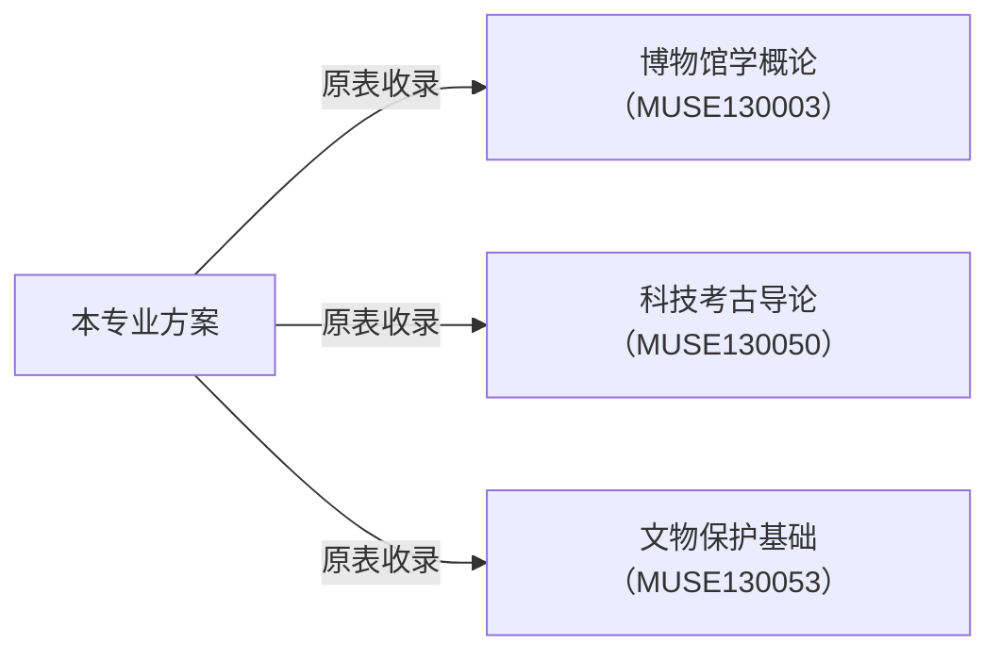

# 文物与博物馆学专业“2+X”教学培养方案

2023 年度汇编，方案正文印刷页 125–128。本页附上原书 PDF 第 137–144 页，其中含本专业紧随正文的各版修读建议。逐行数据覆盖可可靠对应课号和名称的原表记录。[方案原页](original-pages.pdf) · [完整原版](https://jwc.fudan.edu.cn/_upload/article/files/83/6c/8a3c080c4f8991024f4b59ad4f1b/64d23c13-0465-4619-bd18-9e491594f850.pdf#page=137) · [逐行数据与来源](record.json)

## 课程导读

想了解博物馆、考古与遗产的课程安排，可以在原表中找到《博物馆学概论》（`MUSE130003`）、《科技考古导论》（`MUSE130050`）、《文物保护基础》（`MUSE130053`）。 [原书 PDF 第 137 页](original-pages.pdf#page=1) · [原书 PDF 第 138 页](original-pages.pdf#page=2)

原表把 `MUSE130003` 列在第 3 学期，把 `MUSE130053` 列在第 4 学期。图中箭头表示本节原表收录该课，图上各课之间没有先修连线。

| 课号 | 课程名称 | 开课学期原文 | PDF 页 |
|---|---|---|---|
| HIST130027 | 中国历史地理概论 | 5 | 138 |
| HIST130235 | 15 世纪以前的世界 | 2 | 137 |
| MUSE130002 | 文化遗产管理与法规 | 春, 秋 | 138 |
| MUSE130003 | 博物馆学概论 | 3 | 137 |
| MUSE130004 | 文物保护技术 | 春, 秋 | 138 |
| MUSE130008 | 学年论文 | 6 | 138 |
| MUSE130009 | 毕业论文 | 8 | 138 |
| MUSE130016 | 世界博物馆概论 | 春, 秋 | 139 |
| MUSE130017 | 考古学思想史 | 4 | 137 |
| MUSE130018 | 田野考古学 | 5 | 138 |
| MUSE130020 | 博物馆经营管理 | 4 | 137 |
| MUSE130022 | 博物馆藏品管理 | 春, 秋 | 138 |
| MUSE130023 | 中国玉器 | 春, 秋 | 139 |
| MUSE130025 | 中国绘画史 | 春, 秋 | 138 |
| MUSE130026 | 中国青铜器 | 春, 秋 | 138 |
| MUSE130027 | 中国陶瓷史 | 春, 秋 | 138 |
| MUSE130028 | 中国古代建筑史 | 春, 秋 | 139 |
| MUSE130029 | 中国钱币学 | 春, 秋 | 139 |
| MUSE130037 | 专业论文写作 | 4 | 138 |
| MUSE130041 | 中国科技史概论 | 春, 秋 | 139 |
| MUSE130043 | 文化遗产导论 | 3 | 137 |
| MUSE130045 | 展览形式设计 | 春, 秋 | 138 |
| MUSE130047 | 文物分析技术 | 春, 秋 | 138 |
| MUSE130049 | 中国美术考古 | 春, 秋 | 138 |
| MUSE130050 | 科技考古导论 | 3 | 137 |
| MUSE130052 | 展览内容策划 | 春, 秋 | 138 |
| MUSE130053 | 文物保护基础 | 4 | 138 |
| MUSE130054 | 博物馆信息化 | 春, 秋 | 138 |
| MUSE130055 | 中国漆器史 | 春, 秋 | 138 |
| MUSE130056 | 博物馆教育 | 春, 秋 | 138 |
| MUSE130058 | 社会实践 | 6 | 138 |
| MUSE130060 | 纸质文物修复 | 春, 秋 | 139 |
| MUSE130061 | 古陶瓷修复 | 春, 秋 | 139 |
| MUSE130064 | 中国墓葬艺术导论 | 春, 秋 | 139 |
| MUSE130065 | 非物质文化遗产导论 | 3 | 137 |
| MUSE130066 | 文物研究导论 | 4 | 138 |
| MUSE130068 | 东亚史前考古 | 春, 秋 | 139 |
| MUSE130070 | 博物馆国际交流与合作 | 春, 秋 | 139 |
| MUSE130071 | 中国古典园林史 | 春, 秋 | 139 |
| MUSE130072 | 文化遗产类型 | 春, 秋 | 138 |
| MUSE130073 | 国际文化遗产保护概论 | 4 | 138 |
| MUSE130076 | 儿童博物馆概论 | 春, 秋 | 139 |
| MUSE130077 | 专业英语 | 5 | 138 |
| MUSE130078 | 博物馆职业伦理与法规 | 4 | 138 |
| MUSE130079 | 世界建筑艺术概论 | 春, 秋 | 139 |
| MUSE130080 | 动物考古学 | 春, 秋 | 139 |
| MUSE130081 | 博物馆展览说明文字研究 | 春, 秋 | 139 |
| MUSE130082 | 地学考古 | 春, 秋 | 139 |
| MUSE130084 | 植物考古学 | 春, 秋 | 139 |
| MUSE130085 | 陶瓷考古 | 春, 秋 | 139 |
| MUSE130086 | 夏商周考古 | 春, 秋 | 139 |
| MUSE130087 | 汉唐考古 | 春, 秋 | 139 |
| MUSE130088 | 中国古代史 | 3 | 137 |
| MUSE130089 | 文物修复 | 春, 秋 | 138 |
| MUSE130090 | 中国考古学 | 3 | 137 |
| MUSE130092 | 海上丝绸之路考古概论 | 春, 秋 | 139 |
| MUSE130094 | 水下考古学导论 | 春, 秋 | 139 |
| MUSE130095 | 中国古代青瓷 | 春, 秋 | 139 |
| MUSE130096 | 中国史前考古 | 春, 秋 | 139 |
| MUSE130097 | 饮食考古 | 春, 秋 | 139 |
| MUSE130098 | 分子考古学 | 春, 秋 | 139 |
| MUSE130099 | 世界遗产概论 | 春, 秋 | 139 |
| MUSE130100 | 宋元明考古 | 春, 秋 | 139 |
| MUSE130101 | 田野考古技术 | 春, 秋 | 139 |

可定位的课程对暂无明确先修记录，原课程表及备注见上方 PDF。
