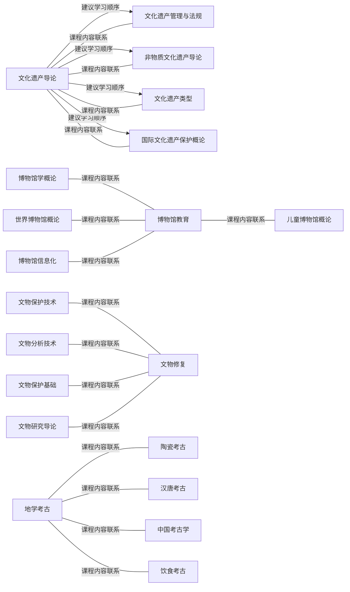

# 文物与博物馆学专业“2+X”教学培养方案

2024 年汇编印刷页 116–119。原表记录 65 个可配对的课程代码。

[本节原页](plan-116.pdf#page=1) · [逐行数据](plan-116.json) · [院系目录](README.md)

## 课程导读

想了解博物馆、考古与遗产的课程安排，可以在原表中找到《博物馆学概论》（`MUSE130003`）、《科技考古导论》（`MUSE130050`）、《文物保护基础》（`MUSE130053`）。 [原书 PDF 第 130 页](plan-116.pdf#page=1) · [原书 PDF 第 131 页](plan-116.pdf#page=2)

图中连接《文化遗产导论》（`MUSE130043`）和《非物质文化遗产导论》（`MUSE130065`），两门课都从课程题名标出的“文化遗产”切入，可沿这一主题对照阅读。 [原书 PDF 第 130 页](plan-116.pdf#page=1)

## 课程关系图

图中展示最多 20 条关系。下表列出本节全部关系。建议学习顺序供规划课程使用，正式选课资格以教务规定为准。

| 课程 | 关联课程 | 关系 | 依据 |
| --- | --- | --- | --- |
| 文化遗产导论（MUSE130043） | 文化遗产管理与法规（MUSE130002） | 建议学习顺序 | “文化遗产导论”题名标明基础层次，前置阅读可帮助了解“文化遗产管理与法规”中的文化遗产主题。 |
| 文化遗产导论（MUSE130043） | 非物质文化遗产导论（MUSE130065） | 建议学习顺序 | “文化遗产导论”题名标明基础层次，前置阅读可帮助了解“非物质文化遗产导论”中的文化遗产主题。 |
| 文化遗产导论（MUSE130043） | 文化遗产类型（MUSE130072） | 建议学习顺序 | “文化遗产导论”题名标明基础层次，前置阅读可帮助了解“文化遗产类型”中的文化遗产主题。 |
| 文化遗产导论（MUSE130043） | 国际文化遗产保护概论（MUSE130073） | 建议学习顺序 | “文化遗产导论”题名标明基础层次，前置阅读可帮助了解“国际文化遗产保护概论”中的文化遗产主题。 |
| 文化遗产管理与法规（MUSE130002） | 文化遗产导论（MUSE130043） | 课程内容联系 | 本方案两门课程的题名均含“文化遗产”，可据此对照这一主题。 |
| 博物馆学概论（MUSE130003） | 博物馆教育（MUSE130056） | 课程内容联系 | 本方案两门课程的题名均含“博物馆”，可据此对照这一主题。 |
| 文物保护技术（MUSE130004） | 文物修复（MUSE130089） | 课程内容联系 | 本方案两门课程的题名均含“文物”，可据此对照这一主题。 |
| 世界博物馆概论（MUSE130016） | 博物馆教育（MUSE130056） | 课程内容联系 | 本方案两门课程的题名均含“博物馆”，可据此对照这一主题。 |
| 文化遗产导论（MUSE130043） | 非物质文化遗产导论（MUSE130065） | 课程内容联系 | 本方案两门课程的题名均含“文化遗产”，可据此对照这一主题。 |
| 文化遗产导论（MUSE130043） | 文化遗产类型（MUSE130072） | 课程内容联系 | 本方案两门课程的题名均含“文化遗产”，可据此对照这一主题。 |
| 文化遗产导论（MUSE130043） | 国际文化遗产保护概论（MUSE130073） | 课程内容联系 | 本方案两门课程的题名均含“文化遗产”，可据此对照这一主题。 |
| 文物分析技术（MUSE130047） | 文物修复（MUSE130089） | 课程内容联系 | 本方案两门课程的题名均含“文物”，可据此对照这一主题。 |
| 文物保护基础（MUSE130053） | 文物修复（MUSE130089） | 课程内容联系 | 本方案两门课程的题名均含“文物”，可据此对照这一主题。 |
| 博物馆信息化（MUSE130054） | 博物馆教育（MUSE130056） | 课程内容联系 | 本方案两门课程的题名均含“博物馆”，可据此对照这一主题。 |
| 博物馆教育（MUSE130056） | 儿童博物馆概论（MUSE130076） | 课程内容联系 | 本方案两门课程的题名均含“博物馆”，可据此对照这一主题。 |
| 文物研究导论（MUSE130066） | 文物修复（MUSE130089） | 课程内容联系 | 本方案两门课程的题名均含“文物”，可据此对照这一主题。 |
| 地学考古（MUSE130082） | 陶瓷考古（MUSE130085） | 课程内容联系 | 本方案两门课程的题名均含“考古”，可据此对照这一主题。 |
| 地学考古（MUSE130082） | 汉唐考古（MUSE130087） | 课程内容联系 | 本方案两门课程的题名均含“考古”，可据此对照这一主题。 |
| 地学考古（MUSE130082） | 中国考古学（MUSE130090） | 课程内容联系 | 本方案两门课程的题名均含“考古”，可据此对照这一主题。 |
| 地学考古（MUSE130082） | 饮食考古（MUSE130097） | 课程内容联系 | 本方案两门课程的题名均含“考古”，可据此对照这一主题。 |
| 文化遗产导论（MUSE130043） | 国际文化遗产保护概论（MUSE130073） | 方案排课先后 | 本节原表所列全部明确学期均早于后者。 |

## 课程

| 课程代码 | 名称 | 开课学期原文 | 来源（PDF 页） |
| --- | --- | --- | --- |
| HIST130027 | 中国历史地理概论 | 5 | 131 |
| HIST130235 | 15世纪以前的世界 | 2 | 130 |
| MUSE130002 | 文化遗产管理与法规 | 春，秋 | 131 |
| MUSE130003 | 博物馆学概论 | 3 | 130 |
| MUSE130004 | 文物保护技术 | 春，秋 | 131 |
| MUSE130008 | 学年论文 | 6 | 131 |
| MUSE130009 | 毕业论文 | 8 | 131 |
| MUSE130016 | 世界博物馆概论 | 春，秋 | 132 |
| MUSE130017 | 考古学思想史 | 4 | 130 |
| MUSE130018 | 田野考古学 | 5 | 131 |
| MUSE130020 | 博物馆经营管理 | 4 | 130 |
| MUSE130022 | 博物馆藏品管理 | 春，秋 | 131 |
| MUSE130023 | 中国玉器 | 春，秋 | 132 |
| MUSE130025 | 中国绘画史 | 春，秋 | 131 |
| MUSE130026 | 中国青铜器 | 春，秋 | 131 |
| MUSE130027 | 中国陶瓷史 | 春，秋 | 131 |
| MUSE130028 | 中国古代建筑史 | 春，秋 | 132 |
| MUSE130029 | 中国钱币学 | 春，秋 | 132 |
| MUSE130037 | 专业论文写作 | 4 | 131 |
| MUSE130041 | 中国科技史概论 | 春，秋 | 132 |
| MUSE130043 | 文化遗产导论 | 3 | 130 |
| MUSE130045 | 展览形式设计 | 春，秋 | 131 |
| MUSE130047 | 文物分析技术 | 春，秋 | 131 |
| MUSE130049 | 中国美术考古 | 春，秋 | 131 |
| MUSE130050 | 科技考古导论 | 3 | 130 |
| MUSE130052 | 展览内容策划 | 春，秋 | 131 |
| MUSE130053 | 文物保护基础 | 4 | 131 |
| MUSE130054 | 博物馆信息化 | 春，秋 | 131 |
| MUSE130055 | 中国漆器史 | 春，秋 | 131 |
| MUSE130056 | 博物馆教育 | 春，秋 | 131 |
| MUSE130058 | 社会实践 | 6 | 131 |
| MUSE130060 | 纸质文物修复 | 春，秋 | 132 |
| MUSE130061 | 古陶瓷修复 | 春，秋 | 132 |
| MUSE130064 | 中国墓葬艺术导论 | 春，秋 | 132 |
| MUSE130065 | 非物质文化遗产导论 | 3 | 130 |
| MUSE130066 | 文物研究导论 | 4 | 131 |
| MUSE130068 | 东亚史前考古 | 秋 | 132 |
| MUSE130070 | 博物馆国际交流与合作 | 春 | 132 |
| MUSE130071 | 中国古典园林史 | 春，秋 | 132 |
| MUSE130072 | 文化遗产类型 | 春，秋 | 131 |
| MUSE130073 | 国际文化遗产保护概论 | 4 | 131 |
| MUSE130076 | 儿童博物馆概论 | 春，秋 | 132 |
| MUSE130077 | 专业英语 | 5 | 131 |
| MUSE130078 | 博物馆职业伦理与法规 | 4 | 131 |
| MUSE130079 | 世界建筑艺术概论 | 春，秋 | 132 |
| MUSE130080 | 动物考古学 | 春 | 132 |
| MUSE130081 | 博物馆展览说明文字研究 | 春，秋 | 132 |
| MUSE130082 | 地学考古 | 春，秋 | 132 |
| MUSE130084 | 植物考古学 | 春 | 132 |
| MUSE130085 | 陶瓷考古 | 春，秋 | 132 |
| MUSE130086 | 夏商周考古 | 春，秋 | 132 |
| MUSE130087 | 汉唐考古 | 春，秋 | 132 |
| MUSE130088 | 中国古代史 | 3 | 130 |
| MUSE130089 | 文物修复 | 春，秋 | 131 |
| MUSE130090 | 中国考古学 | 3 | 130 |
| MUSE130092 | 海上丝绸之路考古概论 | 春，秋 | 132 |
| MUSE130094 | 水下考古学导论 | 春，秋 | 132 |
| MUSE130095 | 中国古代青瓷 | 春，秋 | 132 |
| MUSE130096 | 中国史前考古 | 秋 | 131 |
| MUSE130097 | 饮食考古 | 春，秋 | 132 |
| MUSE130098 | 分子考古学 | 春，秋 | 132 |
| MUSE130099 | 世界遗产概论 | 春，秋 | 132 |
| MUSE130100 | 宋元明考古 | 春，秋 | 132 |
| MUSE130101 | 田野考古技术 | 春，秋 | 132 |
| MUSE130102 | 自然博物馆理论与实务 | 春，秋 | 132 |
