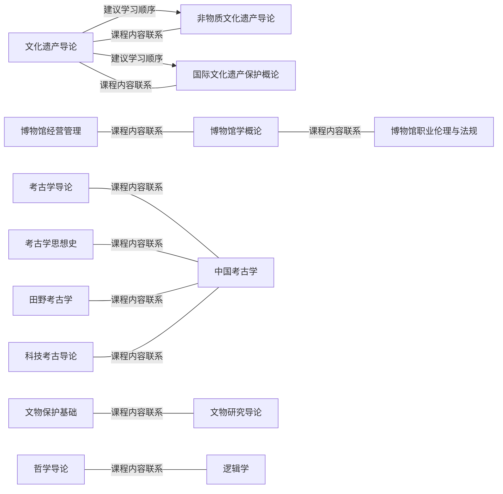

# 文物与博物馆学专业“2+X”修读建议

2024 年汇编印刷页 120–121。原表记录 30 个可配对的课程代码。

[本节原页](plan-116.pdf#page=5) · [逐行数据](plan-116.json) · [院系目录](README.md)

## 课程导读

想了解博物馆、考古与遗产的课程安排，可以在原表中找到《博物馆学概论》（`MUSE130003`）、《科技考古导论》（`MUSE130050`）、《文物保护基础》（`MUSE130053`）。 [原书 PDF 第 134 页](plan-116.pdf#page=5) · [原书 PDF 第 135 页](plan-116.pdf#page=6)

图中连接《博物馆经营管理》（`MSUE130020`）和《博物馆学概论》（`MUSE130003`），两门课都从课程题名标出的“博物馆”切入，可沿这一主题对照阅读。 [原书 PDF 第 134 页](plan-116.pdf#page=5) · [原书 PDF 第 135 页](plan-116.pdf#page=6)

## 课程关系图

图中展示最多 20 条关系。下表列出本节全部关系。建议学习顺序供规划课程使用，正式选课资格以教务规定为准。

| 课程 | 关联课程 | 关系 | 依据 |
| --- | --- | --- | --- |
| 文化遗产导论（MUSE130043） | 非物质文化遗产导论（MUSE130065） | 建议学习顺序 | “文化遗产导论”题名标明基础层次，前置阅读可帮助了解“非物质文化遗产导论”中的文化遗产主题。 |
| 文化遗产导论（MUSE130043） | 国际文化遗产保护概论（MUSE130073） | 建议学习顺序 | “文化遗产导论”题名标明基础层次，前置阅读可帮助了解“国际文化遗产保护概论”中的文化遗产主题。 |
| 博物馆经营管理（MSUE130020） | 博物馆学概论（MUSE130003） | 课程内容联系 | 本方案两门课程的题名均含“博物馆”，可据此对照这一主题。 |
| 考古学导论（MUSE120001） | 中国考古学（MUSE130090） | 课程内容联系 | 本方案两门课程的题名均含“考古”，可据此对照这一主题。 |
| 博物馆学概论（MUSE130003） | 博物馆职业伦理与法规（MUSE130078） | 课程内容联系 | 本方案两门课程的题名均含“博物馆”，可据此对照这一主题。 |
| 考古学思想史（MUSE130017） | 中国考古学（MUSE130090） | 课程内容联系 | 本方案两门课程的题名均含“考古”，可据此对照这一主题。 |
| 田野考古学（MUSE130018） | 中国考古学（MUSE130090） | 课程内容联系 | 本方案两门课程的题名均含“考古”，可据此对照这一主题。 |
| 文化遗产导论（MUSE130043） | 非物质文化遗产导论（MUSE130065） | 课程内容联系 | 本方案两门课程的题名均含“文化遗产”，可据此对照这一主题。 |
| 文化遗产导论（MUSE130043） | 国际文化遗产保护概论（MUSE130073） | 课程内容联系 | 本方案两门课程的题名均含“文化遗产”，可据此对照这一主题。 |
| 科技考古导论（MUSE130050） | 中国考古学（MUSE130090） | 课程内容联系 | 本方案两门课程的题名均含“考古”，可据此对照这一主题。 |
| 文物保护基础（MUSE130053） | 文物研究导论（MUSE130066） | 课程内容联系 | 本方案两门课程的题名均含“文物”，可据此对照这一主题。 |
| 哲学导论（PHIL120012） | 逻辑学（PHIL120013） | 课程内容联系 | 论证与概念分析是哲学讨论的共同方法。 |

## 课程

| 课程代码 | 名称 | 开课学期原文 | 来源（PDF 页） |
| --- | --- | --- | --- |
| CHIN120012 | 中国文学经典 |  | 134 |
| HIST120012 | 中国古代文明 |  | 134 |
| HIST130027 | 中国历史地理概论 |  | 135 |
| HIST130235 | 15世纪以前的世界 |  | 134 |
| MSUE130020 | 博物馆经营管理 |  | 135 |
| MSUE130037 | 专业论文写作 |  | 135 |
| MUSE120001 | 考古学导论 |  | 134 |
| MUSE130003 | 博物馆学概论 |  | 134 |
| MUSE130008 | 学年论文 |  | 135 |
| MUSE130009 | 毕业论文 |  | 135 |
| MUSE130017 | 考古学思想史 |  | 135 |
| MUSE130018 | 田野考古学 |  | 135 |
| MUSE130043 | 文化遗产导论 |  | 134 |
| MUSE130050 | 科技考古导论 |  | 134 |
| MUSE130053 | 文物保护基础 |  | 135 |
| MUSE130058 | 社会实践 |  | 135 |
| MUSE130065 | 非物质文化遗产导论 |  | 134 |
| MUSE130066 | 文物研究导论 |  | 135 |
| MUSE130073 | 国际文化遗产保护概论 |  | 135 |
| MUSE130077 | 专业英语 |  | 135 |
| MUSE130078 | 博物馆职业伦理与法规 |  | 135 |
| MUSE130088 | 中国古代史 |  | 134 |
| MUSE130090 | 中国考古学 |  | 134 |
| PHIL120012 | 哲学导论 |  | 134 |
| PHIL120013 | 逻辑学 |  | 134 |
| PTSS110082 | 毛泽东思想和中国特色社会主义理论体系概论 |  | 134 |
| PTSS110087 | 马克思主义基本原理 |  | 134 |
| PTSS110088 | 中国近现代史纲要 |  | 134 |
| PTSS110089 | 思想道德与法治 |  | 134 |
| PTSS110090 | 习近平新时代中国特色社会主义思想概论 |  | 134 |
