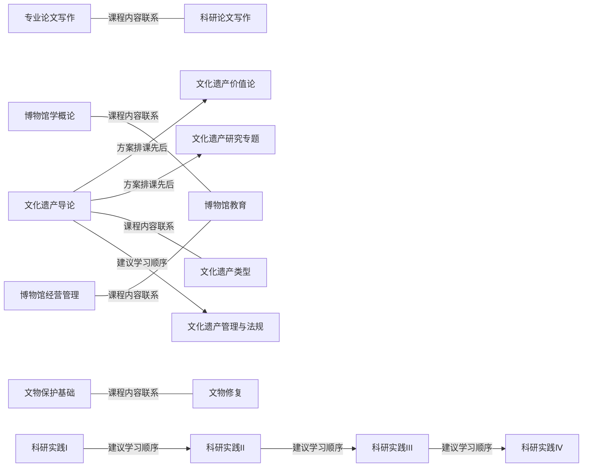

# 2025 文物与博物馆学-考古学本博融通培养方案（文物与博物馆学博雅班）

文物与博物馆学系 · 文物与博物馆学 · 方案 96929 · 140 个不同课程或科研条目。

[官方 Word](../originals/plan-96929.docx) · [教务详情](https://fdjwgl.fudan.edu.cn/manager/bizType/2/major-program-search/info/96929?skipAuth=1) · [方案快照](../raw/plan-96929.json.gz) · [年级目录](../README.md)

## 课程关系图

图中展示部分关系。下表保留全部已建立的课程对，来源位置使用本方案 JSON Pointer。

## 先修与内容联系

| 类型 | 起点 | 终点 | 依据 | 原表定位 |
| --- | --- | --- | --- | --- |
| 建议学习顺序 | 科研实践I (52) | 科研实践II (53) | 同方案的课程题名具有连续分册或序号。  | `/courseModules/32/planCourses/1`、`/courseModules/32/planCourses/2` |
| 建议学习顺序 | 科研实践II (53) | 科研实践III (55) | 同方案的课程题名具有连续分册或序号。  | `/courseModules/32/planCourses/2`、`/courseModules/32/planCourses/3` |
| 建议学习顺序 | 科研实践III (55) | 科研实践Ⅳ (56) | 同方案的课程题名具有连续分册或序号。  | `/courseModules/32/planCourses/3`、`/courseModules/32/planCourses/4` |
| 建议学习顺序 | 文化遗产导论 (CULT20002) | 文化遗产价值论 (ARCH70017) | “文化遗产导论”题名标明基础层次，前置阅读可帮助了解“文化遗产价值论”中的文化遗产主题。  | `/courseModules/6/planCourses/4`、`/courseModules/18/planCourses/1` |
| 建议学习顺序 | 文化遗产导论 (CULT20002) | 文化遗产管理与法规 (CULT30001) | “文化遗产导论”题名标明基础层次，前置阅读可帮助了解“文化遗产管理与法规”中的文化遗产主题。  | `/courseModules/6/planCourses/4`、`/courseModules/12/planCourses/0` |
| 建议学习顺序 | 文化遗产导论 (CULT20002) | 文化遗产类型 (CULT30017) | “文化遗产导论”题名标明基础层次，前置阅读可帮助了解“文化遗产类型”中的文化遗产主题。  | `/courseModules/6/planCourses/4`、`/courseModules/12/planCourses/1` |
| 建议学习顺序 | 文化遗产导论 (CULT20002) | 文化遗产研究专题 (CULT50002) | “文化遗产导论”题名标明基础层次，前置阅读可帮助了解“文化遗产研究专题”中的文化遗产主题。  | `/courseModules/6/planCourses/4`、`/courseModules/18/planCourses/0` |
| 方案排课先后 | 文化遗产导论 (CULT20002) | 文化遗产价值论 (ARCH70017) | 同方案该课程全部明确数字学期均早于后者。  | `/courseModules/6/planCourses/4`、`/courseModules/18/planCourses/1` |
| 方案排课先后 | 文化遗产导论 (CULT20002) | 文化遗产研究专题 (CULT50002) | 同方案该课程全部明确数字学期均早于后者。  | `/courseModules/6/planCourses/4`、`/courseModules/18/planCourses/0` |
| 课程内容联系 | 体质人类学 (ARCH20001) | 古人类学 (ARCH30004) | 本方案两门课程的题名均含“人类学”，可据此对照这一主题。  | `/courseModules/14/planCourses/17`、`/courseModules/14/planCourses/24` |
| 课程内容联系 | 汉唐考古 (ARCH20002) | 公众考古 (ARCH50002) | 本方案两门课程的题名均含“考古”，可据此对照这一主题。  | `/courseModules/14/planCourses/3`、`/courseModules/14/planCourses/21` |
| 课程内容联系 | 专业论文写作 (ARCH20009) | 科研论文写作 (CULT60005) | 本方案两门课程的题名均含“写作”，可据此对照这一主题。  | `/courseModules/6/planCourses/8`、`/courseModules/26/planCourses/14` |
| 课程内容联系 | 古人类学 (ARCH30004) | 生物人类学 (CULT60029) | 本方案两门课程的题名均含“人类学”，可据此对照这一主题。  | `/courseModules/14/planCourses/24`、`/courseModules/26/planCourses/13` |
| 课程内容联系 | 冶金考古 (ARCH40001) | 公众考古 (ARCH50002) | 本方案两门课程的题名均含“考古”，可据此对照这一主题。  | `/courseModules/14/planCourses/22`、`/courseModules/14/planCourses/21` |
| 课程内容联系 | 农业考古 (ARCH50001) | 公众考古 (ARCH50002) | 本方案两门课程的题名均含“考古”，可据此对照这一主题。  | `/courseModules/14/planCourses/19`、`/courseModules/14/planCourses/21` |
| 课程内容联系 | 公众考古 (ARCH50002) | 生物考古 (CULT60009) | 本方案两门课程的题名均含“考古”，可据此对照这一主题。  | `/courseModules/14/planCourses/21`、`/courseModules/26/planCourses/7` |
| 课程内容联系 | 文化遗产保护理论与实践前沿 (ARCH70011) | 国际文化遗产保护概论 (CULT20006) | 本方案两门课程的题名均含“遗产保护”，可据此对照这一主题。  | `/courseModules/24/planCourses/3`、`/courseModules/6/planCourses/9` |
| 课程内容联系 | 文化遗产保护理论与实践前沿 (ARCH70011) | 建筑遗产保护理论与方法 (CULT60018) | 本方案两门课程的题名均含“护理”，可据此对照这一主题。  | `/courseModules/24/planCourses/3`、`/courseModules/24/planCourses/2` |
| 课程内容联系 | 文物研究专题 (ARCH70012) | 文物修复 (CULT30019) | 本方案两门课程的题名均含“文物”，可据此对照这一主题。  | `/courseModules/17/planCourses/2`、`/courseModules/13/planCourses/3` |
| 课程内容联系 | 文化遗产价值论 (ARCH70017) | 文化遗产导论 (CULT20002) | 本方案两门课程的题名均含“文化遗产”，可据此对照这一主题。  | `/courseModules/18/planCourses/1`、`/courseModules/6/planCourses/4` |
| 课程内容联系 | 文物保护基础 (CULT20001) | 文物修复 (CULT30019) | 本方案两门课程的题名均含“文物”，可据此对照这一主题。  | `/courseModules/6/planCourses/2`、`/courseModules/13/planCourses/3` |
| 课程内容联系 | 文化遗产导论 (CULT20002) | 文化遗产管理与法规 (CULT30001) | 本方案两门课程的题名均含“文化遗产”，可据此对照这一主题。  | `/courseModules/6/planCourses/4`、`/courseModules/12/planCourses/0` |
| 课程内容联系 | 文化遗产导论 (CULT20002) | 文化遗产类型 (CULT30017) | 本方案两门课程的题名均含“文化遗产”，可据此对照这一主题。  | `/courseModules/6/planCourses/4`、`/courseModules/12/planCourses/1` |
| 课程内容联系 | 文化遗产导论 (CULT20002) | 文化遗产研究专题 (CULT50002) | 本方案两门课程的题名均含“文化遗产”，可据此对照这一主题。  | `/courseModules/6/planCourses/4`、`/courseModules/18/planCourses/0` |
| 课程内容联系 | 国际文化遗产保护概论 (CULT20006) | 建筑遗产保护理论与方法 (CULT60018) | 本方案两门课程的题名均含“遗产保护”，可据此对照这一主题。  | `/courseModules/6/planCourses/9`、`/courseModules/24/planCourses/2` |
| 课程内容联系 | 文物保护技术 (CULT30002) | 文物修复 (CULT30019) | 本方案两门课程的题名均含“文物”，可据此对照这一主题。  | `/courseModules/13/planCourses/0`、`/courseModules/13/planCourses/3` |
| 课程内容联系 | 文物分析技术 (CULT30010) | 文物修复 (CULT30019) | 本方案两门课程的题名均含“文物”，可据此对照这一主题。  | `/courseModules/13/planCourses/2`、`/courseModules/13/planCourses/3` |
| 课程内容联系 | 博物馆学概论 (MUSE20001) | 博物馆教育 (MUSE30004) | 本方案两门课程的题名均含“博物馆”，可据此对照这一主题。  | `/courseModules/6/planCourses/3`、`/courseModules/10/planCourses/3` |
| 课程内容联系 | 博物馆经营管理 (MUSE20002) | 博物馆教育 (MUSE30004) | 本方案两门课程的题名均含“博物馆”，可据此对照这一主题。  | `/courseModules/6/planCourses/7`、`/courseModules/10/planCourses/3` |
| 课程内容联系 | 博物馆藏品管理 (MUSE30001) | 博物馆教育 (MUSE30004) | 本方案两门课程的题名均含“博物馆”，可据此对照这一主题。  | `/courseModules/10/planCourses/0`、`/courseModules/10/planCourses/3` |
| 课程内容联系 | 博物馆教育 (MUSE30004) | 儿童博物馆概论 (MUSE30006) | 本方案两门课程的题名均含“博物馆”，可据此对照这一主题。  | `/courseModules/10/planCourses/3`、`/courseModules/10/planCourses/5` |

本次未从可定位的明确表述中确认课程对课程预修。学期安排、系列分册与编辑建议均保留各自的依据。

## 按原方案模块阅读

同一模块展示原表中的课程归属。模块内课程之间的先后仍须逐项查阅。

- **博物馆学**　博物馆藏品管理、展览形式设计、展览内容策划、博物馆教育、博物馆国际交流与合作、儿童博物馆概论、博物馆展览说明文字研究、自然博物馆理论与实务（原表模块 10）
- **文物学**　中国玉器、中国绘画史、中国青铜器、中国陶瓷史、中国钱币学、中国美术考古、中国漆器史、中国墓葬艺术导论、中国古典园林史、中国古代青瓷（原表模块 11）
- **文化遗产**　文化遗产管理与法规、中国古代建筑史、文化遗产类型、世界建筑艺术概论、世界遗产概论（原表模块 12）
- **文物保护**　文物保护技术、中国科技史概论、文物分析技术、文物修复（原表模块 13）
- **考古学**　体质人类学、汉唐考古、AI考古理论与实践、宋元明考古、夏商周考古、旧石器时代考古、新石器时代考古、田野考古学、田野考古技术、世界考古概论、环境考古学、古人类学、考古统计学、考古学思想史、东亚史前考古、动物考古学、植物考古学、陶瓷考古等28项（原表模块 14）
- **本博融通-博物馆学方向**　博物馆学的理论与实践前沿、博物馆教育活动的策划与实施、博物馆学理论与实践（原表模块 16）
- **本博融通-文物学方向**　文物研究专题、中国古陶瓷标本研究、中国古代外销瓷研究（原表模块 17）
- **本博融通-文化遗产方向**　文化遗产价值论、文化遗产研究专题（原表模块 18）
- **本博融通-文物保护方向**　文物保护与修复专题、现代科技与文物（原表模块 19）
- **本博融通-考古学方向**　考古学理论与方法、中国考古学前沿、科技考古研究（原表模块 20）
- **博物馆学**　博物馆教育专题研究、智慧博物馆理论与实践、展示规划设计研究、博物馆观众研究与展览评估、国际展览理论与实践、数字媒体展示设计、英美博物馆发展前沿（原表模块 22）
- **文化遗产**　文化遗产保护理论与实践前沿、石窟寺保护研究、文化景观专题研究、石窟寺研究、建筑遗产保护理论与方法（原表模块 24）
- **文物保护**　传统造纸工艺研究、硅酸盐文物的材料学基础、硅酸盐类文物的科技研究、传统造纸工艺与纸张保护（原表模块 25）
- **考古学**　聚落考古研究、分子考古前沿、生物考古前沿研究、历史时期考古学理论与实践、陶瓷考古理论与实践、丝绸之路考古研究、动物考古的分析与阐释、陶器的生产与利用研究、瓷器起源研究、科研论文写作、陶瓷考古研究、人骨考古学、丝绸之路考古、生物考古、农业起源研究、同位素食谱分析、中国古代制瓷技术研究、动物考古的方法与实践等24项（原表模块 26）

## 课程表

同一课程在不同模块分别出现时，按原表逐行列出。季节字段保留原值。

| 课程 | 代码 | 学分 | 学期 | 模块 |
| --- | --- | ---: | --- | --- |
| 中国古代史 | ARCH20013 | 4.0 | 第1学期 | 培养方案 / 专业培养课程 / 专业核心教育课程 |
| 文物研究导论 | CULT20005 | 2.0 | 第2学期 | 培养方案 / 专业培养课程 / 专业核心教育课程 |
| 文物保护基础 | CULT20001 | 3.0 | 第2学期 | 培养方案 / 专业培养课程 / 专业核心教育课程 |
| 博物馆学概论 | MUSE20001 | 2.0 | 第3学期 | 培养方案 / 专业培养课程 / 专业核心教育课程 |
| 文化遗产导论 | CULT20002 | 2.0 | 第3学期 | 培养方案 / 专业培养课程 / 专业核心教育课程 |
| 科技考古导论 | ARCH20010 | 2.0 | 第3学期 | 培养方案 / 专业培养课程 / 专业核心教育课程 |
| 非物质文化遗产导论 | CULT20004 | 2.0 | 第3学期 | 培养方案 / 专业培养课程 / 专业核心教育课程 |
| 博物馆经营管理 | MUSE20002 | 2.0 | 第4学期 | 培养方案 / 专业培养课程 / 专业核心教育课程 |
| 专业论文写作 | ARCH20009 | 2.0 | 第4学期 | 培养方案 / 专业培养课程 / 专业核心教育课程 |
| 国际文化遗产保护概论 | CULT20006 | 2.0 | 第4学期 | 培养方案 / 专业培养课程 / 专业核心教育课程 |
| 博物馆职业伦理与法规 | MUSE20003 | 2.0 | 第4学期 | 培养方案 / 专业培养课程 / 专业核心教育课程 |
| 专业英语 | ARCH30010 | 2.0 | 第5学期 | 培养方案 / 专业培养课程 / 专业核心教育课程 |
| 博物馆藏品管理 | MUSE30001 | 2.0 | SPRING、AUTUMN | 培养方案 / 专业进阶模块I / 博物馆学 |
| 展览形式设计 | MUSE30002 | 2.0 | AUTUMN | 培养方案 / 专业进阶模块I / 博物馆学 |
| 展览内容策划 | MUSE30003 | 2.0 | SPRING | 培养方案 / 专业进阶模块I / 博物馆学 |
| 博物馆教育 | MUSE30004 | 2.0 | SPRING、AUTUMN | 培养方案 / 专业进阶模块I / 博物馆学 |
| 博物馆国际交流与合作 | MUSE30005 | 2.0 | SPRING | 培养方案 / 专业进阶模块I / 博物馆学 |
| 儿童博物馆概论 | MUSE30006 | 2.0 | SPRING、AUTUMN | 培养方案 / 专业进阶模块I / 博物馆学 |
| 博物馆展览说明文字研究 | MUSE30007 | 2.0 | SPRING、AUTUMN | 培养方案 / 专业进阶模块I / 博物馆学 |
| 自然博物馆理论与实务 | MUSE30008 | 2.0 | SPRING、AUTUMN | 培养方案 / 专业进阶模块I / 博物馆学 |
| 中国绘画史 | CULT30004 | 2.0 | SPRING、AUTUMN | 培养方案 / 专业进阶模块I / 文物学 |
| 中国青铜器 | CULT30005 | 2.0 | AUTUMN | 培养方案 / 专业进阶模块I / 文物学 |
| 中国陶瓷史 | CULT30006 | 2.0 | SPRING、AUTUMN | 培养方案 / 专业进阶模块I / 文物学 |
| 中国玉器 | CULT30003 | 2.0 | SPRING、AUTUMN | 培养方案 / 专业进阶模块I / 文物学 |
| 中国钱币学 | CULT30008 | 2.0 | AUTUMN | 培养方案 / 专业进阶模块I / 文物学 |
| 中国漆器史 | CULT30012 | 2.0 | SPRING、AUTUMN | 培养方案 / 专业进阶模块I / 文物学 |
| 中国美术考古 | CULT30011 | 2.0 | SPRING | 培养方案 / 专业进阶模块I / 文物学 |
| 中国墓葬艺术导论 | CULT30015 | 2.0 | SPRING、AUTUMN | 培养方案 / 专业进阶模块I / 文物学 |
| 中国古典园林史 | CULT30016 | 2.0 | SPRING | 培养方案 / 专业进阶模块I / 文物学 |
| 中国古代青瓷 | CULT30020 | 2.0 | SPRING、AUTUMN | 培养方案 / 专业进阶模块I / 文物学 |
| 文化遗产管理与法规 | CULT30001 | 2.0 | SPRING | 培养方案 / 专业进阶模块I / 文化遗产 |
| 文化遗产类型 | CULT30017 | 2.0 | AUTUMN | 培养方案 / 专业进阶模块I / 文化遗产 |
| 中国古代建筑史 | CULT30007 | 2.0 | SPRING | 培养方案 / 专业进阶模块I / 文化遗产 |
| 世界建筑艺术概论 | CULT30018 | 2.0 | AUTUMN | 培养方案 / 专业进阶模块I / 文化遗产 |
| 世界遗产概论 | CULT30021 | 2.0 | SPRING | 培养方案 / 专业进阶模块I / 文化遗产 |
| 文物保护技术 | CULT30002 | 2.0 | SPRING、AUTUMN | 培养方案 / 专业进阶模块I / 文物保护 |
| 中国科技史概论 | CULT30009 | 2.0 | SPRING、AUTUMN | 培养方案 / 专业进阶模块I / 文物保护 |
| 文物分析技术 | CULT30010 | 2.0 | AUTUMN | 培养方案 / 专业进阶模块I / 文物保护 |
| 文物修复 | CULT30019 | 3.0 | SPRING、AUTUMN | 培养方案 / 专业进阶模块I / 文物保护 |
| 旧石器时代考古 | ARCH20006 | 3.0 | SPRING、AUTUMN | 培养方案 / 专业进阶模块I / 考古学 |
| 新石器时代考古 | ARCH20007 | 3.0 | SPRING、AUTUMN | 培养方案 / 专业进阶模块I / 考古学 |
| 夏商周考古 | ARCH20005 | 3.0 | SPRING、AUTUMN | 培养方案 / 专业进阶模块I / 考古学 |
| 汉唐考古 | ARCH20002 | 3.0 | SPRING、AUTUMN | 培养方案 / 专业进阶模块I / 考古学 |
| 宋元明考古 | ARCH20004 | 3.0 | SPRING、AUTUMN | 培养方案 / 专业进阶模块I / 考古学 |
| 田野考古学 | ARCH20008 | 2.0 | AUTUMN | 培养方案 / 专业进阶模块I / 考古学 |
| 田野考古技术 | ARCH20017 | 3.0 | SPRING | 培养方案 / 专业进阶模块I / 考古学 |
| 世界考古概论 | ARCH30001 | 3.0 | SPRING、AUTUMN | 培养方案 / 专业进阶模块I / 考古学 |
| 考古学思想史 | ARCH30007 | 2.0 | SPRING、AUTUMN | 培养方案 / 专业进阶模块I / 考古学 |
| 东亚史前考古 | ARCH30009 | 2.0 | SPRING、AUTUMN | 培养方案 / 专业进阶模块I / 考古学 |
| 动物考古学 | ARCH30011 | 2.0 | SPRING | 培养方案 / 专业进阶模块I / 考古学 |
| 植物考古学 | ARCH30012 | 2.0 | SPRING、AUTUMN | 培养方案 / 专业进阶模块I / 考古学 |
| 陶瓷考古 | ARCH30013 | 2.0 | AUTUMN | 培养方案 / 专业进阶模块I / 考古学 |
| 海上丝绸之路考古概论 | ARCH40005 | 2.0 | SPRING、AUTUMN | 培养方案 / 专业进阶模块I / 考古学 |
| 水下考古学导论 | ARCH40006 | 2.0 | SPRING、AUTUMN | 培养方案 / 专业进阶模块I / 考古学 |
| 饮食考古 | ARCH30014 | 2.0 | SPRING、AUTUMN | 培养方案 / 专业进阶模块I / 考古学 |
| 分子考古学 | ARCH40007 | 2.0 | SPRING、AUTUMN | 培养方案 / 专业进阶模块I / 考古学 |
| 体质人类学 | ARCH20001 | 2.0 | SPRING、AUTUMN | 培养方案 / 专业进阶模块I / 考古学 |
| 同位素考古 | ARCH50003 | 2.0 | SPRING、AUTUMN | 培养方案 / 专业进阶模块I / 考古学 |
| 农业考古 | ARCH50001 | 2.0 | SPRING、AUTUMN | 培养方案 / 专业进阶模块I / 考古学 |
| 石窟寺考古 | ARCH40002 | 2.0 | SPRING、AUTUMN | 培养方案 / 专业进阶模块I / 考古学 |
| 公众考古 | ARCH50002 | 2.0 | SPRING、AUTUMN | 培养方案 / 专业进阶模块I / 考古学 |
| 冶金考古 | ARCH40001 | 2.0 | SPRING、AUTUMN | 培养方案 / 专业进阶模块I / 考古学 |
| 环境考古学 | ARCH30003 | 2.0 | SPRING、AUTUMN | 培养方案 / 专业进阶模块I / 考古学 |
| 古人类学 | ARCH30004 | 2.0 | SPRING、AUTUMN | 培养方案 / 专业进阶模块I / 考古学 |
| AI考古理论与实践 | ARCH20003 | 2.0 | SPRING | 培养方案 / 专业进阶模块I / 考古学 |
| 考古统计学 | ARCH30005 | 2.0 | SPRING | 培养方案 / 专业进阶模块I / 考古学 |
| 田野考古实践训练 | ARCH30015 | 4.0 | SUMMER | 培养方案 / 专业进阶模块I / 考古学 |
| 博物馆学理论与实践 | MUSE50002 | 3.0 | 第7学期、第8学期 | 培养方案 / 专业进阶模块I / 研究生课程课组 / 本博融通-博物馆学方向 |
| 博物馆教育活动的策划与实施 | MUSE50001 | 3.0 | 第7学期、第8学期 | 培养方案 / 专业进阶模块I / 研究生课程课组 / 本博融通-博物馆学方向 |
| 博物馆学的理论与实践前沿 | ARCH70016 | 3.0 | 第9学期、第10学期 | 培养方案 / 专业进阶模块I / 研究生课程课组 / 本博融通-博物馆学方向 |
| 中国古代外销瓷研究 | CULT60011 | 2.0 | 第7学期、第8学期 | 培养方案 / 专业进阶模块I / 研究生课程课组 / 本博融通-文物学方向 |
| 中国古陶瓷标本研究 | CULT60004 | 2.0 | 第7学期、第8学期 | 培养方案 / 专业进阶模块I / 研究生课程课组 / 本博融通-文物学方向 |
| 文物研究专题 | ARCH70012 | 3.0 | 第9学期、第10学期 | 培养方案 / 专业进阶模块I / 研究生课程课组 / 本博融通-文物学方向 |
| 文化遗产研究专题 | CULT50002 | 3.0 | 第7学期、第8学期 | 培养方案 / 专业进阶模块I / 研究生课程课组 / 本博融通-文化遗产方向 |
| 文化遗产价值论 | ARCH70017 | 3.0 | 第9学期、第10学期 | 培养方案 / 专业进阶模块I / 研究生课程课组 / 本博融通-文化遗产方向 |
| 现代科技与文物 | CULT50003 | 3.0 | 第7学期、第8学期 | 培养方案 / 专业进阶模块I / 研究生课程课组 / 本博融通-文物保护方向 |
| 文物保护与修复专题 | CULT50001 | 3.0 | 第7学期、第8学期 | 培养方案 / 专业进阶模块I / 研究生课程课组 / 本博融通-文物保护方向 |
| 科技考古研究 | CULT50005 | 3.0 | 第7学期、第8学期 | 培养方案 / 专业进阶模块I / 研究生课程课组 / 本博融通-考古学方向 |
| 考古学理论与方法 | ARCH60001 | 4.0 | 第7学期、第8学期 | 培养方案 / 专业进阶模块I / 研究生课程课组 / 本博融通-考古学方向 |
| 中国考古学前沿 | ARCH70009 | 3.0 | 第9学期、第10学期 | 培养方案 / 专业进阶模块I / 研究生课程课组 / 本博融通-考古学方向 |
| 数字媒体展示设计 | MUSE60008 | 2.0 | 第7学期、第8学期 | 培养方案 / 专业进阶模块II / 博物馆学 |
| 博物馆观众研究与展览评估 | MUSE60005 | 2.0 | 第7学期、第8学期 | 培养方案 / 专业进阶模块II / 博物馆学 |
| 国际展览理论与实践 | MUSE60006 | 2.0 | 第7学期、第8学期 | 培养方案 / 专业进阶模块II / 博物馆学 |
| 英美博物馆发展前沿 | MUSE60009 | 2.0 | 第7学期、第8学期 | 培养方案 / 专业进阶模块II / 博物馆学 |
| 智慧博物馆理论与实践 | ARCH70013 | 3.0 | 第9学期、第10学期 | 培养方案 / 专业进阶模块II / 博物馆学 |
| 博物馆教育专题研究 | ARCH70010 | 3.0 | 第9学期、第10学期 | 培养方案 / 专业进阶模块II / 博物馆学 |
| 展示规划设计研究 | ARCH80010 | 2.0 | 第9学期、第10学期 | 培养方案 / 专业进阶模块II / 博物馆学 |
| 景德镇瓷业史研究 | ARCH80003 | 2.0 | 第9学期、第10学期 | 培养方案 / 专业进阶模块II / 文物学 |
| 石窟寺研究 | CULT60017 | 2.0 | 第7学期、第8学期 | 培养方案 / 专业进阶模块II / 文化遗产 |
| 文化景观专题研究 | CULT60016 | 2.0 | 第7学期、第8学期 | 培养方案 / 专业进阶模块II / 文化遗产 |
| 建筑遗产保护理论与方法 | CULT60018 | 2.0 | 第7学期、第8学期 | 培养方案 / 专业进阶模块II / 文化遗产 |
| 文化遗产保护理论与实践前沿 | ARCH70011 | 3.0 | 第9学期、第10学期 | 培养方案 / 专业进阶模块II / 文化遗产 |
| 石窟寺保护研究 | ARCH80005 | 2.0 | 第9学期、第10学期 | 培养方案 / 专业进阶模块II / 文化遗产 |
| 硅酸盐文物的材料学基础 | CULT60002 | 2.0 | 第7学期、第8学期 | 培养方案 / 专业进阶模块II / 文物保护 |
| 传统造纸工艺与纸张保护 | CULT60013 | 2.0 | 第7学期、第8学期 | 培养方案 / 专业进阶模块II / 文物保护 |
| 硅酸盐类文物的科技研究 | CULT60010 | 2.0 | 第9学期、第10学期 | 培养方案 / 专业进阶模块II / 文物保护 |
| 传统造纸工艺研究 | ARCH80014 | 2.0 | 第9学期、第10学期 | 培养方案 / 专业进阶模块II / 文物保护 |
| 古代陶器研究 | CULT60022 | 2.0 | 第7学期、第8学期 | 培养方案 / 专业进阶模块II / 考古学 |
| 新石器考古研究 | CULT60025 | 2.0 | 第7学期、第8学期 | 培养方案 / 专业进阶模块II / 考古学 |
| 聚落考古研究 | ARCH50004 | 3.0 | 第7学期、第8学期 | 培养方案 / 专业进阶模块II / 考古学 |
| 丝绸之路考古 | CULT60008 | 2.0 | 第7学期、第8学期 | 培养方案 / 专业进阶模块II / 考古学 |
| 历史时期城址与墓葬研究专题 | CULT60024 | 2.0 | 第7学期、第8学期 | 培养方案 / 专业进阶模块II / 考古学 |
| 陶瓷考古研究 | CULT60006 | 2.0 | 第7学期、第8学期 | 培养方案 / 专业进阶模块II / 考古学 |
| 动物考古的方法与实践 | CULT60021 | 2.0 | 第7学期、第8学期 | 培养方案 / 专业进阶模块II / 考古学 |
| 生物考古 | CULT60009 | 2.0 | 第7学期、第8学期 | 培养方案 / 专业进阶模块II / 考古学 |
| 农业起源研究 | CULT60014 | 2.0 | 第7学期、第8学期 | 培养方案 / 专业进阶模块II / 考古学 |
| 同位素食谱分析 | CULT60015 | 2.0 | 第7学期、第8学期 | 培养方案 / 专业进阶模块II / 考古学 |
| 人骨考古学 | CULT60007 | 2.0 | 第7学期、第8学期 | 培养方案 / 专业进阶模块II / 考古学 |
| 史前经济研究专题 | CULT60027 | 2.0 | 第7学期、第8学期 | 培养方案 / 专业进阶模块II / 考古学 |
| 植物考古的方法与实践 | CULT60030 | 2.0 | 第7学期、第8学期 | 培养方案 / 专业进阶模块II / 考古学 |
| 生物人类学 | CULT60029 | 2.0 | 第7学期、第8学期 | 培养方案 / 专业进阶模块II / 考古学 |
| 科研论文写作 | CULT60005 | 2.0 | 第7学期、第8学期 | 培养方案 / 专业进阶模块II / 考古学 |
| 中国古代制瓷技术研究 | CULT60020 | 2.0 | 第7学期、第8学期 | 培养方案 / 专业进阶模块II / 考古学 |
| 陶器的生产与利用研究 | ARCH80016 | 2.0 | 第9学期、第10学期 | 培养方案 / 专业进阶模块II / 考古学 |
| 丝绸之路考古研究 | ARCH80001 | 2.0 | 第9学期、第10学期 | 培养方案 / 专业进阶模块II / 考古学 |
| 历史时期考古学理论与实践 | ARCH70015 | 2.0 | 第9学期、第10学期 | 培养方案 / 专业进阶模块II / 考古学 |
| 陶瓷考古理论与实践 | ARCH70018 | 3.0 | 第9学期、第10学期 | 培养方案 / 专业进阶模块II / 考古学 |
| 瓷器起源研究 | ARCH80018 | 2.0 | 第9学期、第10学期 | 培养方案 / 专业进阶模块II / 考古学 |
| 动物考古的分析与阐释 | ARCH80015 | 2.0 | 第9学期、第10学期 | 培养方案 / 专业进阶模块II / 考古学 |
| 生物考古前沿研究 | ARCH70014 | 3.0 | 第9学期、第10学期 | 培养方案 / 专业进阶模块II / 考古学 |
| 分子考古前沿 | ARCH70001 | 2.0 | 第9学期、第10学期 | 培养方案 / 专业进阶模块II / 考古学 |
| 前沿讲座 | 1061 | 2.0 |  | 融合创新能力 |
| 科研实践I | 52 | 2.0 |  | 融合创新能力 |
| 科研实践II | 53 | 2.0 |  | 融合创新能力 |
| 科研实践III | 55 | 2.0 |  | 融合创新能力 |
| 科研实践Ⅳ | 56 | 2.0 |  | 融合创新能力 |
| 复芏计划(FDUROP) | 102 | 0.0 |  | 融合创新能力 |
| 研究生学术活动 | 4 | 2.0 |  | 融合创新能力 |
| 研究生实践活动 | 5 | 2.0 |  | 融合创新能力 |
| 博士生资格考核 | 2 | 0.0 |  | 融合创新能力 |
| 博士学位论文开题 | 1 | 0.0 |  | 融合创新能力 |
| 博士论文中期考核 | 3 | 0.0 |  | 融合创新能力 |
| 博士学位论文预审 | 6 | 0.0 |  | 融合创新能力 |
| 学年论文 | ARCH30006 | 1.0 | 第6学期 | 融合创新能力 |
| 社会实践 | ARCH30008 | 6.0 | 第6学期 | 融合创新能力 |
| 陶瓷工艺的理论与实践 | CULT60028 | 4.0 | 第7学期、第8学期 | 融合创新能力 |
| 毕业论文 | ARCH40004 | 4.0 | 第8学期 | 融合创新能力 |
| 纸质文物修复 | CULT30013 | 2.0 | SPRING、AUTUMN | 融合创新能力 |
| 公众考古学 | CULT60012 | 2.0 | 第7学期、第8学期 | 融合创新能力 |
| 古陶瓷修复 | CULT30014 | 2.0 | SPRING、AUTUMN | 融合创新能力 |
