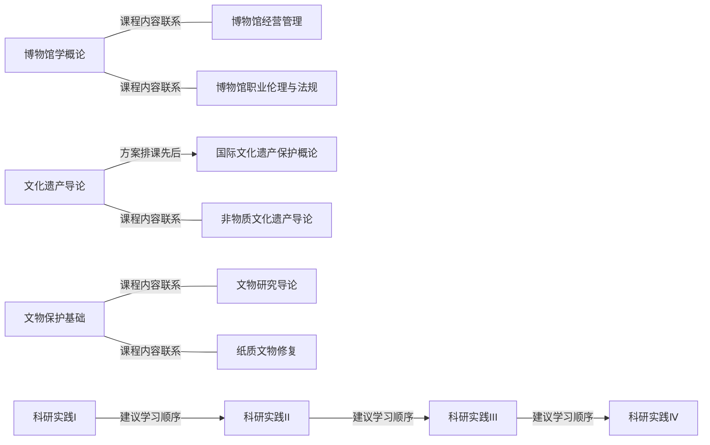

# 2025 文物与博物馆学专业本科培养方案

文物与博物馆学系 · 文物与博物馆学 · 方案 96946 · 23 个不同课程或科研条目。

[官方 Word](../originals/plan-96946.docx) · [教务详情](https://fdjwgl.fudan.edu.cn/manager/bizType/2/major-program-search/info/96946?skipAuth=1) · [方案快照](../raw/plan-96946.json.gz) · [年级目录](../README.md)

## 修读导读

- **建议先学**　《文化遗产导论》（`CULT20002`） → 《国际文化遗产保护概论》（`CULT20006`）。前一门从基础概念入手，可用这套概念阅读后一门涉及文化遗产的材料。方案分别列在第3、4学期。

- **可以对照着读**　《博物馆学概论》（`MUSE20001`）与《博物馆经营管理》（`MUSE20002`）。两门课的题名都涉及博物馆。选一件藏品，区分它作为研究材料和作为展品时分别需要哪些说明。

- **查模块选课**　《中国古代史》（`ARCH20013`）、《文物研究导论》（`CULT20005`）列在“专业核心教育课程”中。原表见 `/courseModules/6`。

## 课程关系图

图中展示部分关系。下表保留全部已建立的课程对，来源位置使用本方案 JSON Pointer。

## 先修与内容联系

| 类型 | 起点 | 终点 | 依据 | 原表定位 |
| --- | --- | --- | --- | --- |
| 建议学习顺序 | 科研实践I (52) | 科研实践II (53) | 同方案的课程题名具有连续分册或序号。  | `/courseModules/16/planCourses/1`、`/courseModules/16/planCourses/2` |
| 建议学习顺序 | 科研实践II (53) | 科研实践III (55) | 同方案的课程题名具有连续分册或序号。  | `/courseModules/16/planCourses/2`、`/courseModules/16/planCourses/3` |
| 建议学习顺序 | 科研实践III (55) | 科研实践Ⅳ (56) | 同方案的课程题名具有连续分册或序号。  | `/courseModules/16/planCourses/3`、`/courseModules/16/planCourses/4` |
| 建议学习顺序 | 文化遗产导论 (CULT20002) | 非物质文化遗产导论 (CULT20004) | “文化遗产导论”题名标明基础层次，前置阅读可帮助了解“非物质文化遗产导论”中的文化遗产主题。  | `/courseModules/6/planCourses/4`、`/courseModules/6/planCourses/6` |
| 建议学习顺序 | 文化遗产导论 (CULT20002) | 国际文化遗产保护概论 (CULT20006) | “文化遗产导论”题名标明基础层次，前置阅读可帮助了解“国际文化遗产保护概论”中的文化遗产主题。  | `/courseModules/6/planCourses/4`、`/courseModules/6/planCourses/9` |
| 方案排课先后 | 文化遗产导论 (CULT20002) | 国际文化遗产保护概论 (CULT20006) | 同方案该课程全部明确数字学期均早于后者。  | `/courseModules/6/planCourses/4`、`/courseModules/6/planCourses/9` |
| 课程内容联系 | 文物保护基础 (CULT20001) | 文物研究导论 (CULT20005) | 本方案两门课程的题名均含“文物”，可据此对照这一主题。  | `/courseModules/6/planCourses/2`、`/courseModules/6/planCourses/1` |
| 课程内容联系 | 文物保护基础 (CULT20001) | 纸质文物修复 (CULT30013) | 本方案两门课程的题名均含“文物”，可据此对照这一主题。  | `/courseModules/6/planCourses/2`、`/courseModules/16/planCourses/9` |
| 课程内容联系 | 文化遗产导论 (CULT20002) | 非物质文化遗产导论 (CULT20004) | 本方案两门课程的题名均含“文化遗产”，可据此对照这一主题。  | `/courseModules/6/planCourses/4`、`/courseModules/6/planCourses/6` |
| 课程内容联系 | 文化遗产导论 (CULT20002) | 国际文化遗产保护概论 (CULT20006) | 本方案两门课程的题名均含“文化遗产”，可据此对照这一主题。  | `/courseModules/6/planCourses/4`、`/courseModules/6/planCourses/9` |
| 课程内容联系 | 博物馆学概论 (MUSE20001) | 博物馆经营管理 (MUSE20002) | 本方案两门课程的题名均含“博物馆”，可据此对照这一主题。  | `/courseModules/6/planCourses/3`、`/courseModules/6/planCourses/7` |
| 课程内容联系 | 博物馆学概论 (MUSE20001) | 博物馆职业伦理与法规 (MUSE20003) | 本方案两门课程的题名均含“博物馆”，可据此对照这一主题。  | `/courseModules/6/planCourses/3`、`/courseModules/6/planCourses/10` |

本次未从可定位的明确表述中确认课程对课程预修。学期安排、系列分册与编辑建议均保留各自的依据。

## 课程表

同一课程在不同模块分别出现时，按原表逐行列出。季节字段保留原值。

| 课程 | 代码 | 学分 | 学期 | 模块 |
| --- | --- | ---: | --- | --- |
| 中国古代史 | ARCH20013 | 4.0 | 第1学期 | 培养方案 / 专业培养课程 / 专业核心教育课程 |
| 文物研究导论 | CULT20005 | 2.0 | 第2学期 | 培养方案 / 专业培养课程 / 专业核心教育课程 |
| 文物保护基础 | CULT20001 | 3.0 | 第2学期 | 培养方案 / 专业培养课程 / 专业核心教育课程 |
| 博物馆学概论 | MUSE20001 | 2.0 | 第3学期 | 培养方案 / 专业培养课程 / 专业核心教育课程 |
| 文化遗产导论 | CULT20002 | 2.0 | 第3学期 | 培养方案 / 专业培养课程 / 专业核心教育课程 |
| 科技考古导论 | ARCH20010 | 2.0 | 第3学期 | 培养方案 / 专业培养课程 / 专业核心教育课程 |
| 非物质文化遗产导论 | CULT20004 | 2.0 | 第3学期 | 培养方案 / 专业培养课程 / 专业核心教育课程 |
| 博物馆经营管理 | MUSE20002 | 2.0 | 第4学期 | 培养方案 / 专业培养课程 / 专业核心教育课程 |
| 专业论文写作 | ARCH20009 | 2.0 | 第4学期 | 培养方案 / 专业培养课程 / 专业核心教育课程 |
| 国际文化遗产保护概论 | CULT20006 | 2.0 | 第4学期 | 培养方案 / 专业培养课程 / 专业核心教育课程 |
| 博物馆职业伦理与法规 | MUSE20003 | 2.0 | 第4学期 | 培养方案 / 专业培养课程 / 专业核心教育课程 |
| 专业英语 | ARCH30010 | 2.0 | 第5学期 | 培养方案 / 专业培养课程 / 专业核心教育课程 |
| 前沿讲座 | 1061 | 2.0 |  | 融合创新能力 |
| 科研实践I | 52 | 2.0 |  | 融合创新能力 |
| 科研实践II | 53 | 2.0 |  | 融合创新能力 |
| 科研实践III | 55 | 2.0 |  | 融合创新能力 |
| 科研实践Ⅳ | 56 | 2.0 |  | 融合创新能力 |
| 复芏计划(FDUROP) | 102 | 0.0 |  | 融合创新能力 |
| 学年论文 | ARCH30006 | 1.0 | 第6学期 | 融合创新能力 |
| 社会实践 | ARCH30008 | 6.0 | 第6学期 | 融合创新能力 |
| 毕业论文 | ARCH40004 | 4.0 | 第8学期 | 融合创新能力 |
| 纸质文物修复 | CULT30013 | 2.0 | SPRING、AUTUMN | 融合创新能力 |
| 古陶瓷修复 | CULT30014 | 2.0 | SPRING、AUTUMN | 融合创新能力 |
