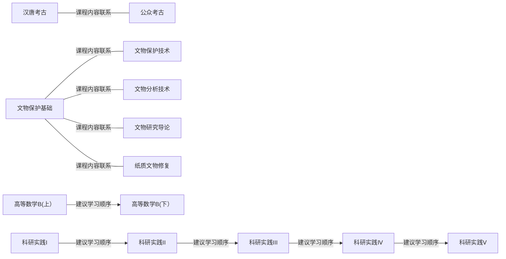

# 2025 文物与博物馆学（科技考古）专业本科培养方案（港澳台侨生）

文物与博物馆学系 · 文物与博物馆学(科技考古方向) · 方案 97107 · 62 个不同课程或科研条目。

[官方 Word](../originals/plan-97107.docx) · [教务详情](https://fdjwgl.fudan.edu.cn/manager/bizType/2/major-program-search/info/97107?skipAuth=1) · [方案快照](../raw/plan-97107.json.gz) · [年级目录](../README.md)

## 修读导读

- **建议先学**　《高等数学B(上）》（`MATH10004`） → 《高等数学B(下）》（`MATH10005`）。题名列出连续册次或级别。可把定义、定理的条件和典型例题保留下来，读后续分册时继续沿用。

- **可以对照着读**　《汉唐考古》（`ARCH20002`）与《公众考古》（`ARCH50002`）。两门课的题名都涉及考古。从一个遗址或器物入手，比较材料的出土背景能支持哪些解释。

- **查模块选课**　《中国古代史》（`ARCH20013`）、《科技考古导论（H）》（`ARCH20010h`）列在“专业核心教育课程”中。原表见 `/courseModules/6`。

## 课程关系图

图中展示部分关系。下表保留全部已建立的课程对，来源位置使用本方案 JSON Pointer。

## 先修与内容联系

| 类型 | 起点 | 终点 | 依据 | 原表定位 |
| --- | --- | --- | --- | --- |
| 建议学习顺序 | 科研实践I (52) | 科研实践II (53) | 同方案的课程题名具有连续分册或序号。  | `/courseModules/16/planCourses/1`、`/courseModules/16/planCourses/2` |
| 建议学习顺序 | 科研实践II (53) | 科研实践III (55) | 同方案的课程题名具有连续分册或序号。  | `/courseModules/16/planCourses/2`、`/courseModules/16/planCourses/3` |
| 建议学习顺序 | 科研实践III (55) | 科研实践Ⅳ (56) | 同方案的课程题名具有连续分册或序号。  | `/courseModules/16/planCourses/3`、`/courseModules/16/planCourses/4` |
| 建议学习顺序 | 科研实践Ⅳ (56) | 科研实践Ⅴ (57) | 同方案的课程题名具有连续分册或序号。  | `/courseModules/16/planCourses/4`、`/courseModules/16/planCourses/5` |
| 建议学习顺序 | 科研实践Ⅴ (57) | 科研实践Ⅵ (58) | 同方案的课程题名具有连续分册或序号。  | `/courseModules/16/planCourses/5`、`/courseModules/16/planCourses/6` |
| 建议学习顺序 | 高等数学B(上） (MATH10004) | 高等数学B(下） (MATH10005) | 同方案的课程题名具有连续分册或序号。  | `/courseModules/5/planCourses/1`、`/courseModules/5/planCourses/2` |
| 课程内容联系 | 体质人类学 (ARCH20001) | 古人类学 (ARCH30004) | 本方案两门课程的题名均含“人类学”，可据此对照这一主题。  | `/courseModules/10/planCourses/7`、`/courseModules/10/planCourses/15` |
| 课程内容联系 | 汉唐考古 (ARCH20002) | 公众考古 (ARCH50002) | 本方案两门课程的题名均含“考古”，可据此对照这一主题。  | `/courseModules/6/planCourses/6`、`/courseModules/10/planCourses/12` |
| 课程内容联系 | 陶瓷考古 (ARCH30013) | 公众考古 (ARCH50002) | 本方案两门课程的题名均含“考古”，可据此对照这一主题。  | `/courseModules/10/planCourses/3`、`/courseModules/10/planCourses/12` |
| 课程内容联系 | 冶金考古 (ARCH40001) | 公众考古 (ARCH50002) | 本方案两门课程的题名均含“考古”，可据此对照这一主题。  | `/courseModules/10/planCourses/13`、`/courseModules/10/planCourses/12` |
| 课程内容联系 | 农业考古 (ARCH50001) | 公众考古 (ARCH50002) | 本方案两门课程的题名均含“考古”，可据此对照这一主题。  | `/courseModules/10/planCourses/9`、`/courseModules/10/planCourses/12` |
| 课程内容联系 | 文物保护基础 (CULT20001) | 文物研究导论 (CULT20005) | 本方案两门课程的题名均含“文物”，可据此对照这一主题。  | `/courseModules/6/planCourses/4`、`/courseModules/10/planCourses/18` |
| 课程内容联系 | 文物保护基础 (CULT20001) | 文物保护技术 (CULT30002) | 本方案两门课程的题名均含“文物”，可据此对照这一主题。  | `/courseModules/6/planCourses/4`、`/courseModules/10/planCourses/22` |
| 课程内容联系 | 文物保护基础 (CULT20001) | 文物分析技术 (CULT30010) | 本方案两门课程的题名均含“文物”，可据此对照这一主题。  | `/courseModules/6/planCourses/4`、`/courseModules/10/planCourses/23` |
| 课程内容联系 | 文物保护基础 (CULT20001) | 纸质文物修复 (CULT30013) | 本方案两门课程的题名均含“文物”，可据此对照这一主题。  | `/courseModules/6/planCourses/4`、`/courseModules/16/planCourses/10` |

本次未从可定位的明确表述中确认课程对课程预修。学期安排、系列分册与编辑建议均保留各自的依据。

## 课程表

同一课程在不同模块分别出现时，按原表逐行列出。季节字段保留原值。

| 课程 | 代码 | 学分 | 学期 | 模块 |
| --- | --- | ---: | --- | --- |
| 考古学导论 | ARCH10001 | 2.0 | 第1学期 | 培养方案 / 专业培养课程 / 学科基础课程 |
| 高等数学B(上） | MATH10004 | 5.0 | AUTUMN | 培养方案 / 专业培养课程 / 学科基础课程 |
| 高等数学B(下） | MATH10005 | 5.0 | SPRING | 培养方案 / 专业培养课程 / 学科基础课程 |
| 普通物理B | PHYS10002 | 3.0 | AUTUMN | 培养方案 / 专业培养课程 / 学科基础课程 |
| 普通化学C | CHEM10008 | 3.0 | AUTUMN | 培养方案 / 专业培养课程 / 学科基础课程 |
| 有机化学C | CHEM10007 | 3.0 | SPRING | 培养方案 / 专业培养课程 / 学科基础课程 |
| 程序设计 | CS10004 | 4.0 | AUTUMN | 培养方案 / 专业培养课程 / 学科基础课程 |
| 现代生物科学导论C | BIOL10002 | 2.0 | SPRING、AUTUMN | 培养方案 / 专业培养课程 / 学科基础课程 |
| 中国古代史 | ARCH20013 | 4.0 | 第1学期 | 培养方案 / 专业培养课程 / 专业核心教育课程 |
| 科技考古导论（H） | ARCH20010h | 4.0 | 第1学期 | 培养方案 / 专业培养课程 / 专业核心教育课程 |
| 旧石器时代考古 | ARCH20006 | 3.0 | 第2学期 | 培养方案 / 专业培养课程 / 专业核心教育课程 |
| 新石器时代考古 | ARCH20007 | 3.0 | 第2学期 | 培养方案 / 专业培养课程 / 专业核心教育课程 |
| 文物保护基础 | CULT20001 | 3.0 | 第2学期 | 培养方案 / 专业培养课程 / 专业核心教育课程 |
| 夏商周考古 | ARCH20005 | 3.0 | 第3学期 | 培养方案 / 专业培养课程 / 专业核心教育课程 |
| 汉唐考古 | ARCH20002 | 3.0 | 第3学期 | 培养方案 / 专业培养课程 / 专业核心教育课程 |
| 田野考古学 | ARCH20008 | 2.0 | 第3学期 | 培养方案 / 专业培养课程 / 专业核心教育课程 |
| 宋元明考古 | ARCH20004 | 3.0 | 第4学期 | 培养方案 / 专业培养课程 / 专业核心教育课程 |
| AI考古理论与实践 | ARCH20003 | 2.0 | 第4学期 | 培养方案 / 专业培养课程 / 专业核心教育课程 |
| 田野考古技术 | ARCH20017 | 3.0 | 第4学期 | 培养方案 / 专业培养课程 / 专业核心教育课程 |
| 田野考古实践教学 | ARCH30002 | 12.0 | 第5学期 | 培养方案 / 专业培养课程 / 专业核心教育课程 |
| 考古统计学 | ARCH30005 | 2.0 | 第6学期 | 培养方案 / 专业培养课程 / 专业核心教育课程 |
| 考古学思想史 | ARCH30007 | 2.0 | SPRING、AUTUMN | 培养方案 / 专业进阶模块 |
| 动物考古学 | ARCH30011 | 2.0 | SPRING | 培养方案 / 专业进阶模块 |
| 植物考古学 | ARCH30012 | 2.0 | SPRING、AUTUMN | 培养方案 / 专业进阶模块 |
| 陶瓷考古 | ARCH30013 | 2.0 | AUTUMN | 培养方案 / 专业进阶模块 |
| 海上丝绸之路考古概论 | ARCH40005 | 2.0 | SPRING、AUTUMN | 培养方案 / 专业进阶模块 |
| 水下考古学导论 | ARCH40006 | 2.0 | SPRING、AUTUMN | 培养方案 / 专业进阶模块 |
| 分子考古学 | ARCH40007 | 2.0 | SPRING、AUTUMN | 培养方案 / 专业进阶模块 |
| 体质人类学 | ARCH20001 | 2.0 | SPRING、AUTUMN | 培养方案 / 专业进阶模块 |
| 同位素考古 | ARCH50003 | 2.0 | SPRING、AUTUMN | 培养方案 / 专业进阶模块 |
| 农业考古 | ARCH50001 | 2.0 | SPRING、AUTUMN | 培养方案 / 专业进阶模块 |
| 石窟寺考古 | ARCH40002 | 2.0 | SPRING、AUTUMN | 培养方案 / 专业进阶模块 |
| 世界考古概论 | ARCH30001 | 3.0 | SPRING、AUTUMN | 培养方案 / 专业进阶模块 |
| 公众考古 | ARCH50002 | 2.0 | SPRING、AUTUMN | 培养方案 / 专业进阶模块 |
| 冶金考古 | ARCH40001 | 2.0 | SPRING、AUTUMN | 培养方案 / 专业进阶模块 |
| 环境考古学 | ARCH30003 | 2.0 | SPRING、AUTUMN | 培养方案 / 专业进阶模块 |
| 古人类学 | ARCH30004 | 2.0 | SPRING、AUTUMN | 培养方案 / 专业进阶模块 |
| 博物馆学概论 | MUSE20001 | 2.0 | AUTUMN | 培养方案 / 专业进阶模块 |
| 文化遗产导论 | CULT20002 | 2.0 | AUTUMN | 培养方案 / 专业进阶模块 |
| 文物研究导论 | CULT20005 | 2.0 | SPRING | 培养方案 / 专业进阶模块 |
| 中国古代建筑史 | CULT30007 | 2.0 | SPRING | 培养方案 / 专业进阶模块 |
| 中国美术考古 | CULT30011 | 2.0 | SPRING | 培养方案 / 专业进阶模块 |
| 中国科技史概论 | CULT30009 | 2.0 | SPRING、AUTUMN | 培养方案 / 专业进阶模块 |
| 文物保护技术 | CULT30002 | 2.0 | SPRING、AUTUMN | 培养方案 / 专业进阶模块 |
| 文物分析技术 | CULT30010 | 2.0 | AUTUMN | 培养方案 / 专业进阶模块 |
| 人工智能的编程基础 | AIE310006 | 2.0 | SPRING、AUTUMN | 培养方案 / 专业进阶模块 |
| 模式识别与机器学习 | AIE410001 | 3.0 | SPRING、AUTUMN | 培养方案 / 专业进阶模块 |
| 自然语言处理与大语言模型 | AIE410002 | 3.0 | SPRING、AUTUMN | 培养方案 / 专业进阶模块 |
| 计算机视觉 | AIE310004 | 3.0 | SPRING、AUTUMN | 培养方案 / 专业进阶模块 |
| 前沿讲座 | 1061 | 2.0 |  | 融合创新能力 |
| 科研实践I | 52 | 2.0 |  | 融合创新能力 |
| 科研实践II | 53 | 2.0 |  | 融合创新能力 |
| 科研实践III | 55 | 2.0 |  | 融合创新能力 |
| 科研实践Ⅳ | 56 | 2.0 |  | 融合创新能力 |
| 科研实践Ⅴ | 57 | 2.0 |  | 融合创新能力 |
| 科研实践Ⅵ | 58 | 2.0 |  | 融合创新能力 |
| 科研实践Ⅶ | 59 | 2.0 |  | 融合创新能力 |
| 复芏计划(FDUROP) | 102 | 0.0 |  | 融合创新能力 |
| 学年论文 | ARCH30006 | 1.0 | 第6学期 | 融合创新能力 |
| 纸质文物修复 | CULT30013 | 2.0 | SPRING、AUTUMN | 融合创新能力 |
| 毕业论文 | ARCH40004 | 4.0 | 第8学期 | 融合创新能力 |
| 古陶瓷修复 | CULT30014 | 2.0 | SPRING、AUTUMN | 融合创新能力 |
