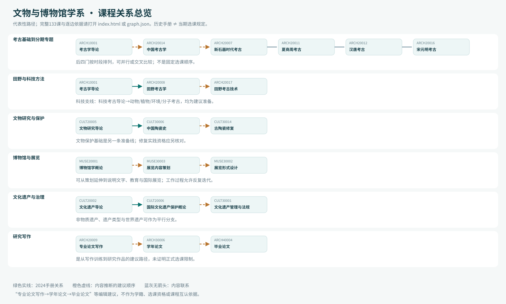

# 文物与博物馆学系课程关系图谱

覆盖2025秋、2026春的 **133个课程代码、156条关系、9个主题方向**。课程和教师沿用本分支官方开课资料，普通/H班、同名异号、本科/研究生保持独立。

- **[交互图谱 index.html](index.html)**：下载后直接打开，离线可用；搜索课程/课号/教师，筛选关系类型，点击课程查看前后关联及逐边出处。默认显示局部邻接图，避免133课全连线造成拥挤。
- [完整机器可读图谱 graph.json](graph.json)：所有课程节点、关系方向、类型、理由、依据链接和学习路径。
- [历史大纲字段及未映射名称](historical-fields.json)、[证据核查与限制](source-audit.json)、[学习路径与具名关系](learning-paths.md)。

## 怎样理解箭头

| 类型 | 含义 |
| --- | --- |
| 2024手册预修要求 | 历史大纲的预修字段明确列课；不证明当前学年执行相同要求 |
| 2024手册建议预修 | 历史大纲明确使用“建议” |
| 2024手册后续课程 | 历史大纲列出后续学习方向；不等同强制先修 |
| 内容推断：建议先学 | 编辑根据课程主题提出的准备顺序，带理由；属于建议 |
| 内容联系 | 无方向；研究对象、方法、时段或实践问题相关 |
| 普通/H、同名异号 | 仅说明名称和课号关系，不说明互认、替代或相同考核 |

本次未获得可证明当期选课硬条件的来源，因此 `current_verified_hard_prerequisites=0` 表示**未核实到硬条件**，并不表示所有课都没有先修要求。2026培养方案中目标课程的建议学期字段为空；不能用实际开课学期推断学习顺序。

## 官方手册依据

[文博系《本科生课程学习手册》2024](https://jwc.fudan.edu.cn/_upload/article/files/d4/56/707002a8413b8a3cc690244c1118/62a17cae-2a02-4686-b167-07cd85099113.pdf)，355页。图谱核对了同名本科课程大纲的“预修课程／后续课程”字段，以及PDF第37—38页的修读参考。所有页面定位均按PDF从1起算，不能与印刷页码混用。手册与当前课号的同名对应只是历史内容定位，并非官方代码沿革证明。历史同名多课号、范围外名称、研究生与本科之间不强行继承要求。原文中的“无”和空栏分别保留。

现有7份2026方案和开课数据固定引用到提交 `c86c5d3eaa692022ee9b8a6439c21c35ffde4244`。手册仅存取证URL、SHA-256和必要字段事实，不把355页全文复制进仓库。每条关系可从 `source_refs` 追溯。学生评价未用于生成正式先修约束。

## 更新与复现

`curation.py` 保存编辑建议和内容联系；`build_graph.py` 构建数据、SVG、说明及HTML。构建需要本分支官方JSON、原始方案详情、从上述URL下载的2024手册PDF，以及Python的pypdf库。运行 `python build_graph.py --handbook 手册.pdf`；文字提取缓存写入被忽略的 `.build-cache/`，不提交手册全文。`viewer-template.html`是无外部依赖的交互模板。修改后应核对课号有效、关系方向、建议边无环、来源页码和统计，并更新上层manifest。
