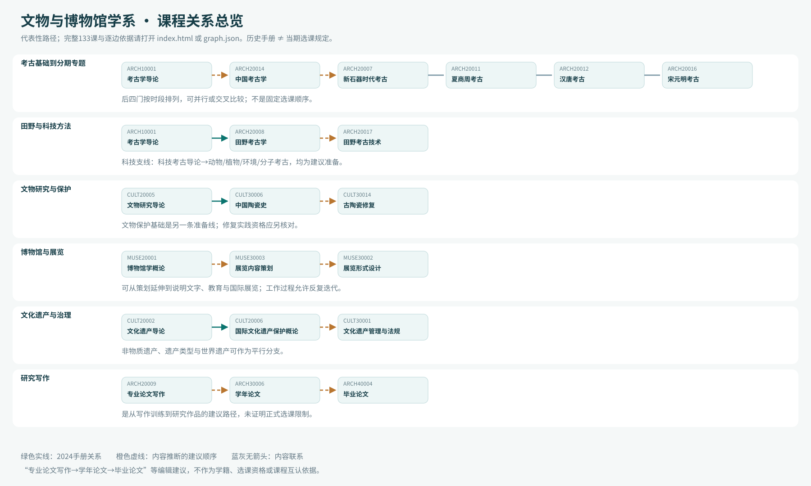

# 课程学习路径与关系依据

图谱范围为133个课程代码。箭头类型须结合标签阅读；“历史预修”来自2024手册，不能直接认定为2025秋／2026春硬性条件。

## 2024手册中的具名关系

- **考古学导论（ARCH10001）→考古学思想史（ARCH30007）**：2024手册预修要求。[PDF依据](https://jwc.fudan.edu.cn/_upload/article/files/d4/56/707002a8413b8a3cc690244c1118/62a17cae-2a02-4686-b167-07cd85099113.pdf#page=46)。2024手册对本课的预修字段列出该课程；本次未核验当前学年的执行要求。
- **考古学导论（ARCH10001）→田野考古学（ARCH20008）**：2024手册预修要求。[PDF依据](https://jwc.fudan.edu.cn/_upload/article/files/d4/56/707002a8413b8a3cc690244c1118/62a17cae-2a02-4686-b167-07cd85099113.pdf#page=46)。2024手册对本课的预修字段列出该课程；本次未核验当前学年的执行要求。
- **文化遗产导论（CULT20002）→国际文化遗产保护概论（CULT20006）**：2024手册预修要求。[PDF依据](https://jwc.fudan.edu.cn/_upload/article/files/d4/56/707002a8413b8a3cc690244c1118/62a17cae-2a02-4686-b167-07cd85099113.pdf#page=64)。2024手册对本课的预修字段列出该课程；本次未核验当前学年的执行要求。
- **博物馆学概论（MUSE20001）→专业英语（ARCH30010）**：2024手册建议预修。[PDF依据](https://jwc.fudan.edu.cn/_upload/article/files/d4/56/707002a8413b8a3cc690244c1118/62a17cae-2a02-4686-b167-07cd85099113.pdf#page=80)。2024手册对本课的建议预修字段列出该课程；本次未核验当前学年的执行要求。
- **考古学导论（ARCH10001）→专业英语（ARCH30010）**：2024手册建议预修。[PDF依据](https://jwc.fudan.edu.cn/_upload/article/files/d4/56/707002a8413b8a3cc690244c1118/62a17cae-2a02-4686-b167-07cd85099113.pdf#page=80)。2024手册对本课的建议预修字段列出该课程；本次未核验当前学年的执行要求。
- **文化遗产导论（CULT20002）→专业英语（ARCH30010）**：2024手册建议预修。[PDF依据](https://jwc.fudan.edu.cn/_upload/article/files/d4/56/707002a8413b8a3cc690244c1118/62a17cae-2a02-4686-b167-07cd85099113.pdf#page=80)。2024手册对本课的建议预修字段列出该课程；本次未核验当前学年的执行要求。
- **博物馆学概论（MUSE20001）→博物馆职业伦理与法规（MUSE20003）**：2024手册建议预修。[PDF依据](https://jwc.fudan.edu.cn/_upload/article/files/d4/56/707002a8413b8a3cc690244c1118/62a17cae-2a02-4686-b167-07cd85099113.pdf#page=82)。2024手册对本课的建议预修字段列出该课程；本次未核验当前学年的执行要求。
- **考古学导论（ARCH10001）→中国青铜器（CULT30005）**：2024手册预修要求。[PDF依据](https://jwc.fudan.edu.cn/_upload/article/files/d4/56/707002a8413b8a3cc690244c1118/62a17cae-2a02-4686-b167-07cd85099113.pdf#page=108)。2024手册对本课的预修字段列出该课程；本次未核验当前学年的执行要求。
- **考古学导论（ARCH10001）→中国陶瓷史（CULT30006）**：2024手册预修要求。[PDF依据](https://jwc.fudan.edu.cn/_upload/article/files/d4/56/707002a8413b8a3cc690244c1118/62a17cae-2a02-4686-b167-07cd85099113.pdf#page=111)。2024手册对本课的预修字段列出该课程；本次未核验当前学年的执行要求。
- **文物研究导论（CULT20005）→中国陶瓷史（CULT30006）**：2024手册预修要求。[PDF依据](https://jwc.fudan.edu.cn/_upload/article/files/d4/56/707002a8413b8a3cc690244c1118/62a17cae-2a02-4686-b167-07cd85099113.pdf#page=111)。2024手册对本课的预修字段列出该课程；本次未核验当前学年的执行要求。
- **中国古代史（ARCH20013）→中国陶瓷史（CULT30006）**：2024手册预修要求。[PDF依据](https://jwc.fudan.edu.cn/_upload/article/files/d4/56/707002a8413b8a3cc690244c1118/62a17cae-2a02-4686-b167-07cd85099113.pdf#page=114)。2024手册对本课的预修字段列出该课程；本次未核验当前学年的执行要求。
- **博物馆学概论（MUSE20001）→展览形式设计（MUSE30002）**：2024手册预修要求。[PDF依据](https://jwc.fudan.edu.cn/_upload/article/files/d4/56/707002a8413b8a3cc690244c1118/62a17cae-2a02-4686-b167-07cd85099113.pdf#page=125)。2024手册对本课的预修字段列出该课程；本次未核验当前学年的执行要求。
- **文物研究导论（CULT20005）→中国美术考古（CULT30011）**：2024手册预修要求。[PDF依据](https://jwc.fudan.edu.cn/_upload/article/files/d4/56/707002a8413b8a3cc690244c1118/62a17cae-2a02-4686-b167-07cd85099113.pdf#page=130)。2024手册对本课的预修字段列出该课程；本次未核验当前学年的执行要求。
- **考古学导论（ARCH10001）→东亚史前考古（ARCH30009）**：2024手册预修要求。[PDF依据](https://jwc.fudan.edu.cn/_upload/article/files/d4/56/707002a8413b8a3cc690244c1118/62a17cae-2a02-4686-b167-07cd85099113.pdf#page=154)。2024手册对本课的预修字段列出该课程；本次未核验当前学年的执行要求。
- **博物馆学概论（MUSE20001）→博物馆国际交流与合作（MUSE30005）**：2024手册建议预修。[PDF依据](https://jwc.fudan.edu.cn/_upload/article/files/d4/56/707002a8413b8a3cc690244c1118/62a17cae-2a02-4686-b167-07cd85099113.pdf#page=159)。2024手册对本课的建议预修字段列出该课程；本次未核验当前学年的执行要求。

## 建议学习路径

### 考古基础到分期专题

考古学导论 → 中国考古学 → 新石器时代考古 → 夏商周考古 → 汉唐考古 → 宋元明考古

后四门按时段排列，可并行或交叉比较；不是固定选课顺序。

### 田野与科技方法

考古学导论 → 田野考古学 → 田野考古技术

科技支线：科技考古导论→动物/植物/环境/分子考古，均为建议准备。

### 文物研究与保护

文物研究导论 → 中国陶瓷史 → 古陶瓷修复

文物保护基础是另一条准备线；修复实践资格应另核对。

### 博物馆与展览

博物馆学概论 → 展览内容策划 → 展览形式设计

可从策划延伸到说明文字、教育与国际展览；工作过程允许反复迭代。

### 文化遗产与治理

文化遗产导论 → 国际文化遗产保护概论 → 文化遗产管理与法规

非物质遗产、遗产类型与世界遗产可作为平行分支。

### 研究写作

专业论文写作 → 学年论文 → 毕业论文

是从写作训练到研究作品的建议路径，未证明正式选课限制。

## 尚待核实

- 当前学年每个教学班的正式先修、修读资格和教师要求。
- 历史“文物学导论”“文物学概论”“中国工艺美术史”等名称与当前课号的官方沿革，未强行映射。
- 同名“文物保护基础”的两个课号，以及普通／H班的课程互认。
- 研究生专题的实际方法门槛：本图仅建立内容联系，不推断跨层次选课资格。
