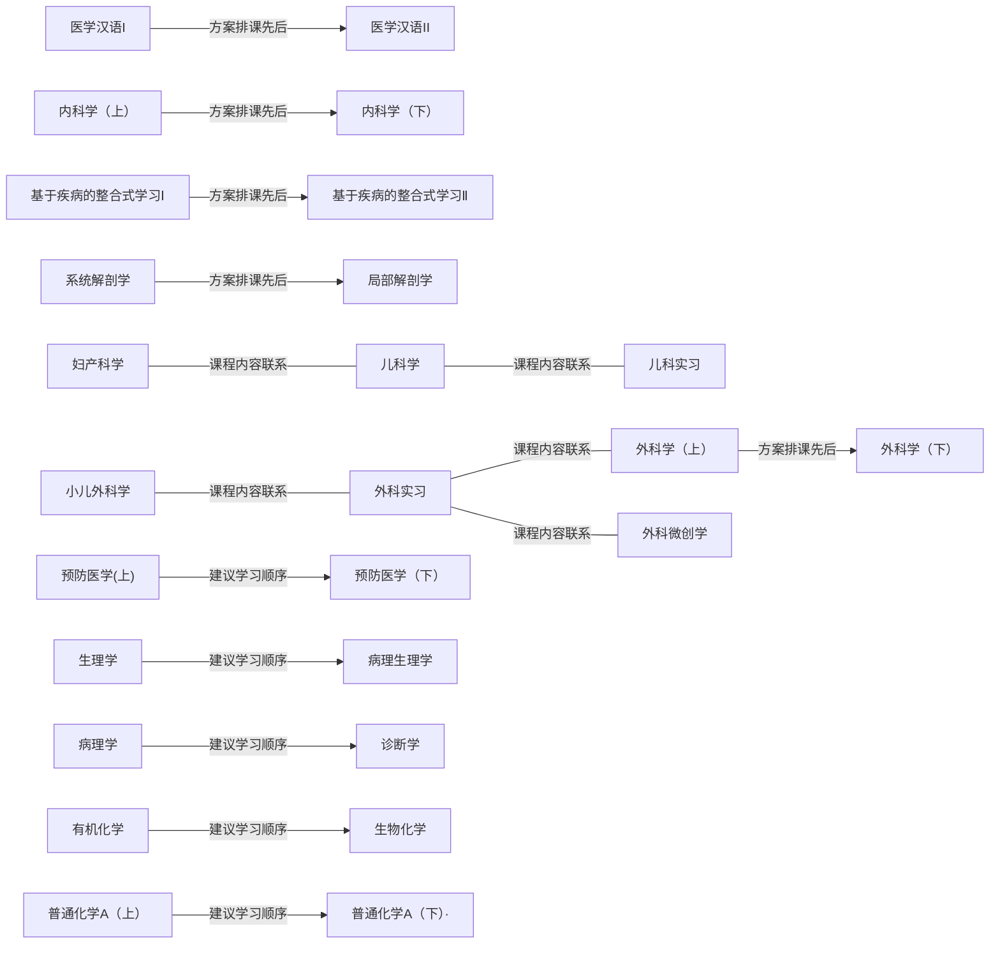

# 2023临床医学（六年制）（MBBS 审核计划）

临床医学院 · 临床医学(六年制) · 方案 68054 · 134 个不同课程或科研条目。

[官方 Word](../originals/plan-68054.docx) · [教务详情](https://fdjwgl.fudan.edu.cn/manager/bizType/2/major-program-search/info/68054?skipAuth=1) · [方案快照](../raw/plan-68054.json.gz) · [年级目录](../README.md)

## 修读导读

- **建议先学**　《外科学（上）》（`MED40043`） → 《外科学（下）》（`MED40044`）。题名列出连续册次或级别。可按解剖部位或临床问题整理前一阶段的病例要点，再用后续案例补充比较。方案分别列在第7、8学期。

- **可以对照着读**　《妇产科学》（`MED30054`）与《儿科学》（`MED30055`）。共同主题为围产期与儿童早期健康。

- **查模块选课**　《内科实习》（`MED40021`）、《外科实习》（`MED40022`）列在“专业核心教育课程”中。原表见 `/courseModules/6`。

## 课程关系图

图中展示部分关系。下表保留全部已建立的课程对，来源位置使用本方案 JSON Pointer。

## 先修与内容联系

| 类型 | 起点 | 终点 | 依据 | 原表定位 |
| --- | --- | --- | --- | --- |
| 建议学习顺序 | 有机化学 (CHEM10002) | 生物化学 (MED20051) | 官能团与有机反应是理解生物分子性质的基础。  | `/courseModules/2/planCourses/1`、`/courseModules/6/planCourses/41` |
| 建议学习顺序 | 普通化学A（上） (CHEM10003) | 普通化学A（下） (CHEM10004) | 同方案的课程题名具有连续分册或序号。  | `/courseModules/2/planCourses/2`、`/courseModules/2/planCourses/3` |
| 建议学习顺序 | 汉语I (GECS10007) | 汉语II (GECS10008) | 同方案的课程题名具有连续分册或序号。  | `/courseModules/2/planCourses/9`、`/courseModules/2/planCourses/10` |
| 建议学习顺序 | 中国概况（上） (GESP10001) | 中国概况（下） (GESP10002) | 同方案的课程题名具有连续分册或序号。  | `/courseModules/2/planCourses/7`、`/courseModules/2/planCourses/8` |
| 建议学习顺序 | 微积分（上） (MED10001) | 微积分（下） (MED10002) | 同方案的课程题名具有连续分册或序号。  | `/courseModules/2/planCourses/11`、`/courseModules/2/planCourses/12` |
| 建议学习顺序 | 医学汉语I (MED20037) | 医学汉语II (MED20038) | 同方案的课程题名具有连续分册或序号。  | `/courseModules/6/planCourses/7`、`/courseModules/6/planCourses/8` |
| 建议学习顺序 | 系统解剖学 (MED20041) | 局部解剖学 (MED20045) | 系统解剖中的结构名称与位置用于区域解剖学习。  | `/courseModules/6/planCourses/11`、`/courseModules/6/planCourses/15` |
| 建议学习顺序 | 生理学 (MED20043) | 病理生理学 (MED30045) | 正常生理功能为理解功能异常提供参照。  | `/courseModules/6/planCourses/13`、`/courseModules/6/planCourses/19` |
| 建议学习顺序 | 神经精神疾病Ⅰ (MED20055) | 神经精神疾病Ⅱ (MED20056) | 同方案的课程题名具有连续分册或序号。  | `/courseModules/4/planCourses/19`、`/courseModules/4/planCourses/20` |
| 建议学习顺序 | 病理学 (MED30043) | 诊断学 (MED30048) | 组织与器官病变有助于解释临床表现。  | `/courseModules/6/planCourses/17`、`/courseModules/6/planCourses/22` |
| 建议学习顺序 | 医学伦理学 (MED30046) | 医患交流技巧 (MED30040) | 伦理原则和患者自主权为沟通情境提供背景。  | `/courseModules/4/planCourses/15`、`/courseModules/4/planCourses/12` |
| 建议学习顺序 | 内科学（上） (MED30052) | 内科学（下） (MED30053) | 同方案的课程题名具有连续分册或序号。  | `/courseModules/6/planCourses/27`、`/courseModules/6/planCourses/28` |
| 建议学习顺序 | 基于疾病的整合式学习Ⅰ (MED30070) | 基于疾病的整合式学习Ⅱ (MED30071) | 同方案的课程题名具有连续分册或序号。  | `/courseModules/6/planCourses/43`、`/courseModules/6/planCourses/44` |
| 建议学习顺序 | 外科学（上） (MED40043) | 外科学（下） (MED40044) | 同方案的课程题名具有连续分册或序号。  | `/courseModules/6/planCourses/29`、`/courseModules/6/planCourses/30` |
| 建议学习顺序 | 预防医学(上) (PHPM40021) | 预防医学（下） (PHPM20014) | 同方案的课程题名具有连续分册或序号。  | `/courseModules/6/planCourses/45`、`/courseModules/6/planCourses/46` |
| 方案排课先后 | 汉语I (GECS10007) | 汉语II (GECS10008) | 同方案该课程全部明确数字学期均早于后者。  | `/courseModules/2/planCourses/9`、`/courseModules/2/planCourses/10` |
| 方案排课先后 | 中国概况（上） (GESP10001) | 中国概况（下） (GESP10002) | 同方案该课程全部明确数字学期均早于后者。  | `/courseModules/2/planCourses/7`、`/courseModules/2/planCourses/8` |
| 方案排课先后 | 微积分（上） (MED10001) | 微积分（下） (MED10002) | 同方案该课程全部明确数字学期均早于后者。  | `/courseModules/2/planCourses/11`、`/courseModules/2/planCourses/12` |
| 方案排课先后 | 医学汉语I (MED20037) | 医学汉语II (MED20038) | 同方案该课程全部明确数字学期均早于后者。  | `/courseModules/6/planCourses/7`、`/courseModules/6/planCourses/8` |
| 方案排课先后 | 系统解剖学 (MED20041) | 局部解剖学 (MED20045) | 同方案该课程全部明确数字学期均早于后者。  | `/courseModules/6/planCourses/11`、`/courseModules/6/planCourses/15` |
| 方案排课先后 | 生理学 (MED20043) | 病理生理学 (MED30045) | 同方案该课程全部明确数字学期均早于后者。  | `/courseModules/6/planCourses/13`、`/courseModules/6/planCourses/19` |
| 方案排课先后 | 病理学 (MED30043) | 诊断学 (MED30048) | 同方案该课程全部明确数字学期均早于后者。  | `/courseModules/6/planCourses/17`、`/courseModules/6/planCourses/22` |
| 方案排课先后 | 内科学（上） (MED30052) | 内科学（下） (MED30053) | 同方案该课程全部明确数字学期均早于后者。  | `/courseModules/6/planCourses/27`、`/courseModules/6/planCourses/28` |
| 方案排课先后 | 基于疾病的整合式学习Ⅰ (MED30070) | 基于疾病的整合式学习Ⅱ (MED30071) | 同方案该课程全部明确数字学期均早于后者。  | `/courseModules/6/planCourses/43`、`/courseModules/6/planCourses/44` |
| 方案排课先后 | 外科学（上） (MED40043) | 外科学（下） (MED40044) | 同方案该课程全部明确数字学期均早于后者。  | `/courseModules/6/planCourses/29`、`/courseModules/6/planCourses/30` |
| 课程内容联系 | 有机化学 (CHEM10002) | 有机化学实验I (CHEM10006) | 本方案两门课程的题名均含“有机化学”，可据此对照这一主题。  | `/courseModules/2/planCourses/1`、`/courseModules/2/planCourses/5` |
| 课程内容联系 | 临床药理学 (MED130079) | 药理学 (MED20047) | 本方案两门课程的题名均含“药理”，可据此对照这一主题。  | `/courseModules/4/planCourses/2`、`/courseModules/6/planCourses/20` |
| 课程内容联系 | 医学与现代分子生物学技术 (MED130102) | 肿瘤分子生物学 (MED50016) | 本方案两门课程的题名均含“分子生物学”，可据此对照这一主题。  | `/courseModules/4/planCourses/8`、`/courseModules/4/planCourses/18` |
| 课程内容联系 | 分子生物学技术的临床应用 (MED130318) | 肿瘤分子生物学 (MED50016) | 本方案两门课程的题名均含“分子生物学”，可据此对照这一主题。  | `/courseModules/4/planCourses/23`、`/courseModules/4/planCourses/18` |
| 课程内容联系 | 系统解剖学 (MED20041) | 局部解剖学 (MED20045) | 本方案两门课程的题名均含“解剖”，可据此对照这一主题。  | `/courseModules/6/planCourses/11`、`/courseModules/6/planCourses/15` |
| 课程内容联系 | 生理学 (MED20043) | 药理学 (MED20047) | 共同主题为生理调节与药物作用。  | `/courseModules/6/planCourses/13`、`/courseModules/6/planCourses/20` |
| 课程内容联系 | 生理学 (MED20043) | 病理生理学 (MED30045) | 本方案两门课程的题名均含“生理学”，可据此对照这一主题。  | `/courseModules/6/planCourses/13`、`/courseModules/6/planCourses/19` |
| 课程内容联系 | 免疫学 (MED20044) | 病理学 (MED30043) | 共同主题为炎症反应与组织变化。  | `/courseModules/6/planCourses/14`、`/courseModules/6/planCourses/17` |
| 课程内容联系 | 生物化学实验 (MED20049) | 生物化学 (MED20051) | 题名显示相同主题的课程与实验、实践或实习。  | `/courseModules/6/planCourses/40`、`/courseModules/6/planCourses/41` |
| 课程内容联系 | 小儿外科学 (MED30026) | 外科实习 (MED40022) | 本方案两门课程的题名均含“外科”，可据此对照这一主题。  | `/courseModules/4/planCourses/3`、`/courseModules/6/planCourses/1` |
| 课程内容联系 | 医患交流技巧 (MED30040) | 医学心理学 (MED30049) | 患者体验与诊疗沟通共享临床情境。  | `/courseModules/4/planCourses/12`、`/courseModules/6/planCourses/23` |
| 课程内容联系 | 病理学 (MED30043) | 病理生理学 (MED30045) | 本方案两门课程的题名均含“病理”，可据此对照这一主题。  | `/courseModules/6/planCourses/17`、`/courseModules/6/planCourses/19` |
| 课程内容联系 | 内科学（上） (MED30052) | 内科实习 (MED40021) | 本方案两门课程的题名均含“内科”，可据此对照这一主题。  | `/courseModules/6/planCourses/27`、`/courseModules/6/planCourses/0` |
| 课程内容联系 | 内科学（下） (MED30053) | 内科实习 (MED40021) | 本方案两门课程的题名均含“内科”，可据此对照这一主题。  | `/courseModules/6/planCourses/28`、`/courseModules/6/planCourses/0` |
| 课程内容联系 | 妇产科学 (MED30054) | 儿科学 (MED30055) | 共同主题为围产期与儿童早期健康。  | `/courseModules/6/planCourses/31`、`/courseModules/6/planCourses/32` |
| 课程内容联系 | 儿科学 (MED30055) | 儿科实习 (MED40024) | 本方案两门课程的题名均含“儿科”，可据此对照这一主题。  | `/courseModules/6/planCourses/32`、`/courseModules/6/planCourses/3` |
| 课程内容联系 | 外科实习 (MED40022) | 外科学（上） (MED40043) | 本方案两门课程的题名均含“外科”，可据此对照这一主题。  | `/courseModules/6/planCourses/1`、`/courseModules/6/planCourses/29` |
| 课程内容联系 | 外科实习 (MED40022) | 心外科实习 (MED40056) | 本方案两门课程的题名均含“外科”，可据此对照这一主题。  | `/courseModules/6/planCourses/1`、`/courseModules/9/planCourses/3` |
| 课程内容联系 | 外科实习 (MED40022) | 外科微创学 (MED50026) | 本方案两门课程的题名均含“外科”，可据此对照这一主题。  | `/courseModules/6/planCourses/1`、`/courseModules/4/planCourses/35` |

本次未从可定位的明确表述中确认课程对课程预修。学期安排、系列分册与编辑建议均保留各自的依据。

## 按原方案模块阅读

同一模块展示原表中的课程归属。模块内课程之间的先后仍须逐项查阅。

- **Compulsory Course**　现代生物科学导论C、有机化学、普通化学A（上）、普通化学A（下）、普通化学实验I、有机化学实验I、汉语I、汉语II、计算机、中国概况（上）、中国概况（下）、微积分（上）、微积分（下）、普通物理B、基础物理实验（原表模块 2）
- **Selective Course**　医学史、临床药理学、危重疾病诊治、康复医学、医学与现代分子生物学技术、皮肤美学、医疗保险经济学、问诊的艺术、卫生法学实践、分子生物学技术的临床应用、临床技能I、走进重症医学—从基础到临床、从医之道—医患沟通情景模拟、医学人工智能导论、中西医结合基础概论、动物疾病和人类健康、神经精神疾病Ⅰ、神经精神疾病Ⅱ等60项（原表模块 4）
- **肿瘤科实习二选一**　肿瘤外科实习、肿瘤放疗科实习（原表模块 7）
- **五官科实习二选一**　眼科实习、耳鼻喉科实习（原表模块 8）
- **选科实习4分组**　中医科实习、全科医学实习、神经外科实习、心外科实习、整形外科实习（原表模块 9）
- **皮肤/放射科实习二选一**　皮肤科实习、放射科实习（原表模块 10）

## 课程表

同一课程在不同模块分别出现时，按原表逐行列出。季节字段保留原值。

| 课程 | 代码 | 学分 | 学期 | 模块 |
| --- | --- | ---: | --- | --- |
| 现代生物科学导论C | BIOL10002 | 2.0 | 第1学期 | 培养方案 / Premedical Study / Compulsory Course |
| 有机化学 | CHEM10002 | 4.0 | 第2学期 | 培养方案 / Premedical Study / Compulsory Course |
| 普通化学A（上） | CHEM10003 | 2.0 | 第1学期 | 培养方案 / Premedical Study / Compulsory Course |
| 普通化学A（下） | CHEM10004 | 2.0 | 第1学期 | 培养方案 / Premedical Study / Compulsory Course |
| 普通化学实验I | CHEM10005 | 1.0 | 第1学期 | 培养方案 / Premedical Study / Compulsory Course |
| 有机化学实验I | CHEM10006 | 1.0 | 第1学期 | 培养方案 / Premedical Study / Compulsory Course |
| 计算机 | GEEC10065 | 3.0 | 第1学期 | 培养方案 / Premedical Study / Compulsory Course |
| 中国概况（上） | GESP10001 | 2.0 | 第1学期 | 培养方案 / Premedical Study / Compulsory Course |
| 中国概况（下） | GESP10002 | 2.0 | 第2学期 | 培养方案 / Premedical Study / Compulsory Course |
| 汉语I | GECS10007 | 4.0 | 第1学期 | 培养方案 / Premedical Study / Compulsory Course |
| 汉语II | GECS10008 | 4.0 | 第2学期 | 培养方案 / Premedical Study / Compulsory Course |
| 微积分（上） | MED10001 | 4.0 | 第1学期 | 培养方案 / Premedical Study / Compulsory Course |
| 微积分（下） | MED10002 | 4.0 | 第2学期 | 培养方案 / Premedical Study / Compulsory Course |
| 普通物理B | PHYS10002 | 3.0 | 第1学期 | 培养方案 / Premedical Study / Compulsory Course |
| 基础物理实验 | PHYS10005 | 2.0 | 第1学期 | 培养方案 / Premedical Study / Compulsory Course |
| 医学史 | HIST130165 | 1.0 | 第1学期 | 培养方案 / Specialized Course / Selective Course |
| 医学文献检索与利用A | MED40012 | 2.5 | SPRING、AUTUMN | 培养方案 / Specialized Course / Selective Course |
| 临床药理学 | MED130079 | 1.0 | SPRING、AUTUMN | 培养方案 / Specialized Course / Selective Course |
| 小儿外科学 | MED30026 | 1.0 | SPRING、AUTUMN | 培养方案 / Specialized Course / Selective Course |
| 危重疾病诊治 | MED130084 | 1.0 | SPRING、AUTUMN | 培养方案 / Specialized Course / Selective Course |
| 针灸与推拿学 | MED40019 | 2.0 | SPRING、AUTUMN | 培养方案 / Specialized Course / Selective Course |
| 康复医学 | MED130086 | 2.0 | SPRING、AUTUMN | 培养方案 / Specialized Course / Selective Course |
| 中西医结合基础概论 | MED20018 | 2.0 | SPRING、AUTUMN | 培养方案 / Specialized Course / Selective Course |
| 医学与现代分子生物学技术 | MED130102 | 2.0 | SPRING、AUTUMN | 培养方案 / Specialized Course / Selective Course |
| 中西医结合临床 | MED30030 | 2.0 | SPRING、AUTUMN | 培养方案 / Specialized Course / Selective Course |
| 新发传染病 | MED50011 | 2.0 | 第1学期 | 培养方案 / Specialized Course / Selective Course |
| 高级病原生物学 | MED30031 | 2.0 | 第1学期 | 培养方案 / Specialized Course / Selective Course |
| 医患交流技巧 | MED30040 | 2.0 | SPRING、AUTUMN | 培养方案 / Specialized Course / Selective Course |
| 皮肤美学 | MED130188 | 1.5 | 第1学期 | 培养方案 / Specialized Course / Selective Course |
| 医疗保险经济学 | MED130191 | 2.0 | 第1学期 | 培养方案 / Specialized Course / Selective Course |
| 医学伦理学 | MED30046 | 1.0 | SPRING、AUTUMN | 培养方案 / Specialized Course / Selective Course |
| 动物疾病和人类健康 | MED20050 | 2.0 | 第1学期 | 培养方案 / Specialized Course / Selective Course |
| 艾滋病基础和临床 | MED50015 | 2.0 | 第1学期 | 培养方案 / Specialized Course / Selective Course |
| 肿瘤分子生物学 | MED50016 | 2.0 | 第1学期 | 培养方案 / Specialized Course / Selective Course |
| 神经精神疾病Ⅰ | MED20055 | 2.0 | 第1学期 | 培养方案 / Specialized Course / Selective Course |
| 神经精神疾病Ⅱ | MED20056 | 2.0 | 第1学期 | 培养方案 / Specialized Course / Selective Course |
| 问诊的艺术 | MED130313 | 1.0 | 第1学期 | 培养方案 / Specialized Course / Selective Course |
| 卫生法学实践 | MED130317 | 2.0 | 第1学期 | 培养方案 / Specialized Course / Selective Course |
| 分子生物学技术的临床应用 | MED130318 | 1.0 | 第1学期 | 培养方案 / Specialized Course / Selective Course |
| 临床技能I | MED130319 | 1.0 | 第1学期 | 培养方案 / Specialized Course / Selective Course |
| 走近临床Ⅱ—医护初体验 | MED20057 | 2.0 | 第1学期 | 培养方案 / Specialized Course / Selective Course |
| 走进重症医学—从基础到临床 | MED130323 | 2.0 | 第1学期 | 培养方案 / Specialized Course / Selective Course |
| 颅颈交界外科学—机遇和挑战 | MED30072 | 2.0 | 第1学期 | 培养方案 / Specialized Course / Selective Course |
| 中医老年病学概论 | MED50021 | 2.0 | 第1学期 | 培养方案 / Specialized Course / Selective Course |
| 实验诊断学与临床沟通 | MED50022 | 2.0 | 第1学期 | 培养方案 / Specialized Course / Selective Course |
| 急危重症医学概论 | MED40060 | 2.0 | 第1学期 | 培养方案 / Specialized Course / Selective Course |
| 整复外科学基础 | MED50024 | 2.0 | 第1学期 | 培养方案 / Specialized Course / Selective Course |
| 康复医学导论 | MED40061 | 2.0 | 第1学期 | 培养方案 / Specialized Course / Selective Course |
| 老年医学临床决策及案例解析 | MED50025 | 2.0 | 第1学期 | 培养方案 / Specialized Course / Selective Course |
| 从医之道—医患沟通情景模拟 | MED130356 | 2.0 | 第1学期 | 培养方案 / Specialized Course / Selective Course |
| 外科微创学 | MED50026 | 2.0 | 第1学期 | 培养方案 / Specialized Course / Selective Course |
| 医学人工智能导论 | MED130359 | 2.0 | 第1学期 | 培养方案 / Specialized Course / Selective Course |
| 麻醉学新进展 | MED40064 | 2.0 | 第1学期 | 培养方案 / Specialized Course / Selective Course |
| 临床肿瘤学进展 | MED40065 | 2.0 | 第1学期 | 培养方案 / Specialized Course / Selective Course |
| 临床初探 | MED50028 | 2.0 | 第1学期 | 培养方案 / Specialized Course / Selective Course |
| 影像中的药物开发 | PHAR30028 | 2.0 | 第1学期 | 培养方案 / Specialized Course / Selective Course |
| 基础毒理 | PHPM40001 | 2.0 | 第1学期 | 培养方案 / Specialized Course / Selective Course |
| 生殖健康进展 | PHPM130035 | 1.0 | 第1学期 | 培养方案 / Specialized Course / Selective Course |
| 临床技能Ⅰ | MED40066 | 2.0 | SPRING、AUTUMN | 培养方案 / Specialized Course / Selective Course |
| 临床肿瘤免疫学基础 | MED50033 | 2.0 | SPRING、AUTUMN | 培养方案 / Specialized Course / Selective Course |
| 心理社会肿瘤学实践与进展 | MED40077 | 2.0 | SPRING、AUTUMN | 培养方案 / Specialized Course / Selective Course |
| 医学科技创新与转化 | MED30114 | 2.0 | SPRING、AUTUMN | 培养方案 / Specialized Course / Selective Course |
| 肥胖医学 | MED50034 | 2.0 | SPRING、AUTUMN | 培养方案 / Specialized Course / Selective Course |
| 育龄期女性乳腺疾病诊疗学 | MED50035 | 2.0 | SPRING、AUTUMN | 培养方案 / Specialized Course / Selective Course |
| 精准医学时代的肿瘤影像学 | MED40079 | 2.0 | SPRING、AUTUMN | 培养方案 / Specialized Course / Selective Course |
| 临床运动医学 | MED40080 | 2.0 | SPRING、AUTUMN | 培养方案 / Specialized Course / Selective Course |
| 重症医学 | MED30115 | 2.0 | SPRING、AUTUMN | 培养方案 / Specialized Course / Selective Course |
| 眼耳鼻整形与美容 | MED50036 | 2.0 | SPRING、AUTUMN | 培养方案 / Specialized Course / Selective Course |
| 出生缺陷 | MED50037 | 2.0 | SPRING、AUTUMN | 培养方案 / Specialized Course / Selective Course |
| 感染性疾病与抗微生物治疗 | MED40097 | 2.0 | SPRING、AUTUMN | 培养方案 / Specialized Course / Selective Course |
| 患者安全 | MED40098 | 1.0 | SPRING、AUTUMN | 培养方案 / Specialized Course / Selective Course |
| 神经外科与神经科学前沿 | MED30141 | 2.0 | SPRING、AUTUMN | 培养方案 / Specialized Course / Selective Course |
| 输血医学 | MED30142 | 1.0 | SPRING、AUTUMN | 培养方案 / Specialized Course / Selective Course |
| 眼视光学 | MED50038 | 1.5 | SPRING、AUTUMN | 培养方案 / Specialized Course / Selective Course |
| 遗传罕见病学 | MED50039 | 2.0 | SPRING、AUTUMN | 培养方案 / Specialized Course / Selective Course |
| 内科实习 | MED40021 | 12.0 | 第11学期、第12学期 | 培养方案 / Specialized Course / Compulsory / 专业核心教育课程 |
| 外科实习 | MED40022 | 12.0 | 第11学期、第12学期 | 培养方案 / Specialized Course / Compulsory / 专业核心教育课程 |
| 妇产科实习 | MED40023 | 4.0 | 第11学期、第12学期 | 培养方案 / Specialized Course / Compulsory / 专业核心教育课程 |
| 儿科实习 | MED40024 | 4.0 | 第11学期、第12学期 | 培养方案 / Specialized Course / Compulsory / 专业核心教育课程 |
| 神经科实习 | MED40025 | 2.0 | 第11学期、第12学期 | 培养方案 / Specialized Course / Compulsory / 专业核心教育课程 |
| 精神科实习 | MED40026 | 2.0 | 第11学期、第12学期 | 培养方案 / Specialized Course / Compulsory / 专业核心教育课程 |
| 传染科实习 | MED40027 | 2.0 | 第11学期、第12学期 | 培养方案 / Specialized Course / Compulsory / 专业核心教育课程 |
| 医学汉语I | MED20037 | 4.0 | 第5学期 | 培养方案 / Specialized Course / Compulsory / 专业核心教育课程 |
| 医学汉语II | MED20038 | 4.0 | 第6学期 | 培养方案 / Specialized Course / Compulsory / 专业核心教育课程 |
| 细胞生物学 | MED20039 | 1.5 | 第3学期 | 培养方案 / Specialized Course / Compulsory / 专业核心教育课程 |
| 医学遗传学 | MED20040 | 1.5 | 第3学期 | 培养方案 / Specialized Course / Compulsory / 专业核心教育课程 |
| 系统解剖学 | MED20041 | 4.0 | 第3学期 | 培养方案 / Specialized Course / Compulsory / 专业核心教育课程 |
| 组织胚胎学 | MED20042 | 4.0 | 第3学期 | 培养方案 / Specialized Course / Compulsory / 专业核心教育课程 |
| 生理学 | MED20043 | 4.5 | 第4学期 | 培养方案 / Specialized Course / Compulsory / 专业核心教育课程 |
| 免疫学 | MED20044 | 3.0 | 第4学期 | 培养方案 / Specialized Course / Compulsory / 专业核心教育课程 |
| 局部解剖学 | MED20045 | 3.5 | 第4学期 | 培养方案 / Specialized Course / Compulsory / 专业核心教育课程 |
| 医学微生物学 | MED20046 | 4.0 | 第5学期 | 培养方案 / Specialized Course / Compulsory / 专业核心教育课程 |
| 病理学 | MED30043 | 6.0 | 第5学期 | 培养方案 / Specialized Course / Compulsory / 专业核心教育课程 |
| 寄生虫学 | MED30044 | 2.5 | 第5学期 | 培养方案 / Specialized Course / Compulsory / 专业核心教育课程 |
| 病理生理学 | MED30045 | 3.5 | 第5学期 | 培养方案 / Specialized Course / Compulsory / 专业核心教育课程 |
| 药理学 | MED20047 | 4.5 | 第6学期 | 培养方案 / Specialized Course / Compulsory / 专业核心教育课程 |
| 功能学科综合实验 | MED30047 | 3.0 | 第6学期 | 培养方案 / Specialized Course / Compulsory / 专业核心教育课程 |
| 诊断学 | MED30048 | 6.0 | 第6学期 | 培养方案 / Specialized Course / Compulsory / 专业核心教育课程 |
| 医学心理学 | MED30049 | 2.0 | 第8学期 | 培养方案 / Specialized Course / Compulsory / 专业核心教育课程 |
| 影像诊断学 | MED40042 | 4.5 | 第8学期 | 培养方案 / Specialized Course / Compulsory / 专业核心教育课程 |
| 肿瘤学概论 | MED30050 | 2.0 | 第10学期 | 培养方案 / Specialized Course / Compulsory / 专业核心教育课程 |
| 中医学 | MED30051 | 4.0 | 第7学期 | 培养方案 / Specialized Course / Compulsory / 专业核心教育课程 |
| 内科学（上） | MED30052 | 5.0 | 第7学期 | 培养方案 / Specialized Course / Compulsory / 专业核心教育课程 |
| 内科学（下） | MED30053 | 4.0 | 第8学期 | 培养方案 / Specialized Course / Compulsory / 专业核心教育课程 |
| 外科学（上） | MED40043 | 5.0 | 第7学期 | 培养方案 / Specialized Course / Compulsory / 专业核心教育课程 |
| 外科学（下） | MED40044 | 4.0 | 第8学期 | 培养方案 / Specialized Course / Compulsory / 专业核心教育课程 |
| 妇产科学 | MED30054 | 4.5 | 第9学期 | 培养方案 / Specialized Course / Compulsory / 专业核心教育课程 |
| 儿科学 | MED30055 | 5.0 | 第9学期 | 培养方案 / Specialized Course / Compulsory / 专业核心教育课程 |
| 传染病学 | MED30056 | 3.0 | 第9学期 | 培养方案 / Specialized Course / Compulsory / 专业核心教育课程 |
| 皮肤病学 | MED30057 | 2.5 | 第9学期 | 培养方案 / Specialized Course / Compulsory / 专业核心教育课程 |
| 眼科学 | MED30058 | 2.0 | 第10学期 | 培养方案 / Specialized Course / Compulsory / 专业核心教育课程 |
| 耳鼻喉科学 | MED30059 | 2.0 | 第10学期 | 培养方案 / Specialized Course / Compulsory / 专业核心教育课程 |
| 口腔科学 | MED40045 | 1.5 | 第10学期 | 培养方案 / Specialized Course / Compulsory / 专业核心教育课程 |
| 精神医学 | MED40046 | 2.0 | 第9学期 | 培养方案 / Specialized Course / Compulsory / 专业核心教育课程 |
| 神经病学 | MED30060 | 2.0 | 第10学期 | 培养方案 / Specialized Course / Compulsory / 专业核心教育课程 |
| 生物化学实验 | MED20049 | 2.0 | 第4学期 | 培养方案 / Specialized Course / Compulsory / 专业核心教育课程 |
| 生物化学 | MED20051 | 4.5 | 第1学期 | 培养方案 / Specialized Course / Compulsory / 专业核心教育课程 |
| 法医学 | MED20052 | 2.5 | 第1学期 | 培养方案 / Specialized Course / Compulsory / 专业核心教育课程 |
| 基于疾病的整合式学习Ⅰ | MED30070 | 2.0 | 第4学期 | 培养方案 / Specialized Course / Compulsory / 专业核心教育课程 |
| 基于疾病的整合式学习Ⅱ | MED30071 | 2.0 | 第5学期 | 培养方案 / Specialized Course / Compulsory / 专业核心教育课程 |
| 预防医学(上) | PHPM40021 | 2.0 | 第1学期 | 培养方案 / Specialized Course / Compulsory / 专业核心教育课程 |
| 预防医学（下） | PHPM20014 | 1.5 | 第1学期 | 培养方案 / Specialized Course / Compulsory / 专业核心教育课程 |
| 卫生统计学 | PHPM30017 | 1.5 | 第1学期 | 培养方案 / Specialized Course / Compulsory / 专业核心教育课程 |
| 肿瘤外科实习 | MED40048 | 2.0 | 第1学期 | 培养方案 / Specialized Course / Compulsory / 肿瘤科实习二选一 |
| 肿瘤放疗科实习 | MED40053 | 2.0 | 第1学期 | 培养方案 / Specialized Course / Compulsory / 肿瘤科实习二选一 |
| 眼科实习 | MED40049 | 2.0 | 第1学期 | 培养方案 / Specialized Course / Compulsory / 五官科实习二选一 |
| 耳鼻喉科实习 | MED40050 | 2.0 | 第1学期 | 培养方案 / Specialized Course / Compulsory / 五官科实习二选一 |
| 中医科实习 | MED40041 | 4.0 | 第1学期 | 培养方案 / Specialized Course / Compulsory / 选科实习4分组 |
| 全科医学实习 | MED40054 | 2.0 | 第1学期 | 培养方案 / Specialized Course / Compulsory / 选科实习4分组 |
| 神经外科实习 | MED40055 | 2.0 | 第1学期 | 培养方案 / Specialized Course / Compulsory / 选科实习4分组 |
| 心外科实习 | MED40056 | 2.0 | 第1学期 | 培养方案 / Specialized Course / Compulsory / 选科实习4分组 |
| 整形外科实习 | MED40057 | 2.0 | 第1学期 | 培养方案 / Specialized Course / Compulsory / 选科实习4分组 |
| 皮肤科实习 | MED40051 | 2.0 | 第1学期 | 培养方案 / Specialized Course / Compulsory / 皮肤/放射科实习二选一 |
| 放射科实习 | MED40052 | 2.0 | 第1学期 | 培养方案 / Specialized Course / Compulsory / 皮肤/放射科实习二选一 |
