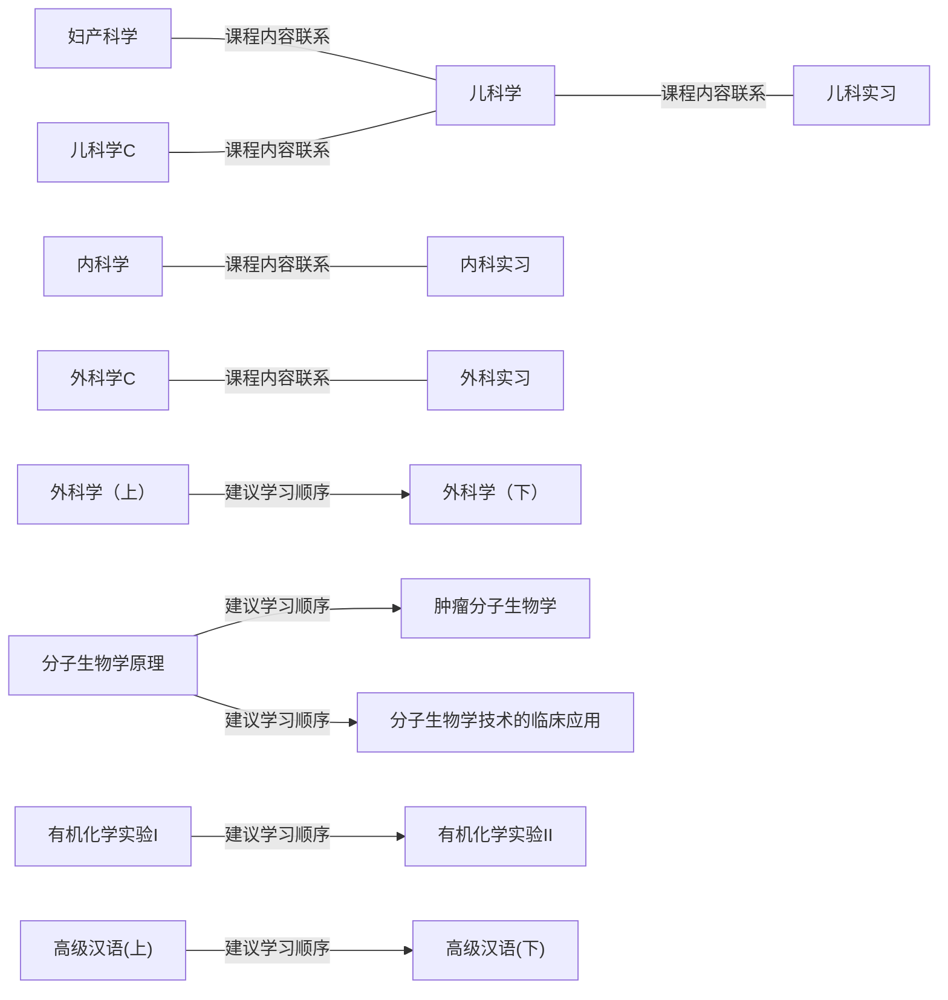

# 2023 临床医学（五年制）专业“2+X”教学培养方案-港澳台

临床医学院 · 临床医学(五年制) · 方案 68115 · 1024 个不同课程或科研条目。

[官方 Word](../originals/plan-68115.docx) · [教务详情](https://fdjwgl.fudan.edu.cn/manager/bizType/2/major-program-search/info/68115?skipAuth=1) · [方案快照](../raw/plan-68115.json.gz) · [年级目录](../README.md)

## 修读导读

- **建议先学**　《外科学（上）》（`MED40043`） → 《外科学（下）》（`MED40044`）。题名列出连续册次或级别。可按解剖部位或临床问题整理前一阶段的病例要点，再用后续案例补充比较。

- **可以对照着读**　《妇产科学》（`MED30054`）与《儿科学》（`MED30055`）。共同主题为围产期与儿童早期健康。

- **查模块选课**　《妇产科学B》（`MED40009`）、《精神医学》（`MED40011`）列在“专业核心教育课程”中。原表见 `/courseModules/5`。

## 课程关系图

图中展示部分关系。下表保留全部已建立的课程对，来源位置使用本方案 JSON Pointer。

## 先修与内容联系

| 类型 | 起点 | 终点 | 依据 | 原表定位 |
| --- | --- | --- | --- | --- |
| 建议学习顺序 | 有机化学实验I (CHEM10006) | 有机化学实验II (PHAR20014) | 同方案的课程题名具有连续分册或序号。  | `/courseModules/8/planCourses/1`、`/courseModules/13/planCourses/706` |
| 建议学习顺序 | 高级汉语(上) (MED110010) | 高级汉语(下) (MED110011) | 同方案的课程题名具有连续分册或序号。  | `/courseModules/13/planCourses/15`、`/courseModules/13/planCourses/16` |
| 建议学习顺序 | 疾病探究I (MED110047) | 疾病探究II (MED110048) | 同方案的课程题名具有连续分册或序号。  | `/courseModules/13/planCourses/32`、`/courseModules/13/planCourses/33` |
| 建议学习顺序 | 分子生物学原理 (MED130064) | 分子生物学理论与实验 (MED130065) | “分子生物学原理”题名标明基础层次，前置阅读可帮助了解“分子生物学理论与实验”中的分子生物学主题。  | `/courseModules/13/planCourses/159`、`/courseModules/13/planCourses/160` |
| 建议学习顺序 | 分子生物学原理 (MED130064) | 医学与现代分子生物学技术 (MED130102) | “分子生物学原理”题名标明基础层次，前置阅读可帮助了解“医学与现代分子生物学技术”中的分子生物学主题。  | `/courseModules/13/planCourses/159`、`/courseModules/13/planCourses/193` |
| 建议学习顺序 | 分子生物学原理 (MED130064) | 分子生物学技术的临床应用 (MED130318) | “分子生物学原理”题名标明基础层次，前置阅读可帮助了解“分子生物学技术的临床应用”中的分子生物学主题。  | `/courseModules/13/planCourses/159`、`/courseModules/13/planCourses/363` |
| 建议学习顺序 | 分子生物学原理 (MED130064) | 肿瘤分子生物学 (MED50016) | “分子生物学原理”题名标明基础层次，前置阅读可帮助了解“肿瘤分子生物学”中的分子生物学主题。  | `/courseModules/13/planCourses/159`、`/courseModules/13/planCourses/320` |
| 建议学习顺序 | 病理解剖学A(上) (MED130147) | 病理解剖学A(下) (MED130148) | 同方案的课程题名具有连续分册或序号。  | `/courseModules/13/planCourses/217`、`/courseModules/13/planCourses/218` |
| 建议学习顺序 | 医学汉语III (MED130258) | 医学汉语IV (MED130259) | 同方案的课程题名具有连续分册或序号。  | `/courseModules/13/planCourses/313`、`/courseModules/13/planCourses/314` |
| 建议学习顺序 | 医学基础I (MED130262) | 医学基础II (MED130263) | 同方案的课程题名具有连续分册或序号。  | `/courseModules/13/planCourses/317`、`/courseModules/13/planCourses/318` |
| 建议学习顺序 | 医学科研思维训练与科研实践I (MED130274) | 医学科研思维训练与科研实践II (MED130275) | 同方案的课程题名具有连续分册或序号。  | `/courseModules/13/planCourses/329`、`/courseModules/13/planCourses/330` |
| 建议学习顺序 | 医学科研思维训练与科研实践II (MED130275) | 医学科研思维训练与科研实践III (MED130276) | 同方案的课程题名具有连续分册或序号。  | `/courseModules/13/planCourses/330`、`/courseModules/13/planCourses/331` |
| 建议学习顺序 | 医学科研思维训练与科研实践III (MED130276) | 医学科研思维训练与科研实践IV (MED130277) | 同方案的课程题名具有连续分册或序号。  | `/courseModules/13/planCourses/331`、`/courseModules/13/planCourses/332` |
| 建议学习顺序 | 医学英语I (MED20025) | 医学英语II (MED20026) | 同方案的课程题名具有连续分册或序号。  | `/courseModules/13/planCourses/211`、`/courseModules/13/planCourses/212` |
| 建议学习顺序 | 医学英语II (MED20026) | 医学英语III (MED20027) | 同方案的课程题名具有连续分册或序号。  | `/courseModules/13/planCourses/212`、`/courseModules/13/planCourses/213` |
| 建议学习顺序 | 医学汉语I (MED20037) | 医学汉语II (MED20038) | 同方案的课程题名具有连续分册或序号。  | `/courseModules/13/planCourses/264`、`/courseModules/13/planCourses/265` |
| 建议学习顺序 | 医学汉语II (MED20038) | 医学汉语III (MED130258) | 同方案的课程题名具有连续分册或序号。  | `/courseModules/13/planCourses/265`、`/courseModules/13/planCourses/313` |
| 建议学习顺序 | 神经精神疾病Ⅰ (MED20055) | 神经精神疾病Ⅱ (MED20056) | 同方案的课程题名具有连续分册或序号。  | `/courseModules/13/planCourses/358`、`/courseModules/13/planCourses/359` |
| 建议学习顺序 | 核心实验技术I (MED20078) | 核心实验技术II (MED20080) | 同方案的课程题名具有连续分册或序号。  | `/courseModules/13/planCourses/435`、`/courseModules/13/planCourses/444` |
| 建议学习顺序 | 核心实验技术II (MED20080) | 核心实验技术III (MED30100) | 同方案的课程题名具有连续分册或序号。  | `/courseModules/13/planCourses/444`、`/courseModules/13/planCourses/448` |
| 建议学习顺序 | 内科学（上） (MED30052) | 内科学（下） (MED30053) | 同方案的课程题名具有连续分册或序号。  | `/courseModules/13/planCourses/286`、`/courseModules/13/planCourses/287` |
| 建议学习顺序 | 功能学科实验I (MED40037) | 功能学科实验II (MED40038) | 同方案的课程题名具有连续分册或序号。  | `/courseModules/13/planCourses/222`、`/courseModules/13/planCourses/223` |
| 建议学习顺序 | 外科学（上） (MED40043) | 外科学（下） (MED40044) | 同方案的课程题名具有连续分册或序号。  | `/courseModules/13/planCourses/288`、`/courseModules/13/planCourses/289` |
| 建议学习顺序 | 护理学基础（上） (NURS20002) | 护理学基础（下） (NURS20003) | 同方案的课程题名具有连续分册或序号。  | `/courseModules/13/planCourses/489`、`/courseModules/13/planCourses/490` |
| 建议学习顺序 | 传染病护理学的理论及实践（上） (NURS50012) | 传染病护理学的理论及实践（下） (NURS50013) | 同方案的课程题名具有连续分册或序号。  | `/courseModules/13/planCourses/535`、`/courseModules/13/planCourses/536` |
| 建议学习顺序 | 药用植物学I (PHAR130012) | 药用植物学II (PHAR30008) | 同方案的课程题名具有连续分册或序号。  | `/courseModules/13/planCourses/602`、`/courseModules/13/planCourses/624` |
| 建议学习顺序 | 生药学I (PHAR30002) | 生药学II (PHAR30009) | 同方案的课程题名具有连续分册或序号。  | `/courseModules/13/planCourses/603`、`/courseModules/13/planCourses/625` |
| 建议学习顺序 | 实验药物化学I (PHAR30003) | 实验药物化学II (PHAR130051) | 同方案的课程题名具有连续分册或序号。  | `/courseModules/13/planCourses/605`、`/courseModules/13/planCourses/642` |
| 建议学习顺序 | 天然药物化学I (PHAR30004) | 天然药物化学II (PHAR40010) | 同方案的课程题名具有连续分册或序号。  | `/courseModules/13/planCourses/607`、`/courseModules/13/planCourses/637` |
| 建议学习顺序 | 临床药学概论 (PHAR30023) | 临床药学技能与实践 (PHAR40015) | “临床药学概论”题名标明基础层次，前置阅读可帮助了解“临床药学技能与实践”中的临床药学主题。  | `/courseModules/13/planCourses/676`、`/courseModules/13/planCourses/716` |
| 建议学习顺序 | 临床药物治疗学I (PHAR30039) | 临床药物治疗学II (PHAR40014) | 同方案的课程题名具有连续分册或序号。  | `/courseModules/13/planCourses/712`、`/courseModules/13/planCourses/713` |
| 建议学习顺序 | 公共卫生导论 (PHPM10002) | 公共卫生应急与现代社会 (GECC10109) | “公共卫生导论”题名标明基础层次，前置阅读可帮助了解“公共卫生应急与现代社会”中的公共卫生主题。  | `/courseModules/13/planCourses/876`、`/courseModules/13/planCourses/812` |
| 建议学习顺序 | 公共卫生导论 (PHPM10002) | 从公共卫生视角看心理健康 (GEMH20001) | “公共卫生导论”题名标明基础层次，前置阅读可帮助了解“从公共卫生视角看心理健康”中的公共卫生主题。  | `/courseModules/13/planCourses/876`、`/courseModules/13/planCourses/783` |
| 建议学习顺序 | 公共卫生导论 (PHPM10002) | 公共卫生应急与公众教育 (PHPM110055) | “公共卫生导论”题名标明基础层次，前置阅读可帮助了解“公共卫生应急与公众教育”中的公共卫生主题。  | `/courseModules/13/planCourses/876`、`/courseModules/13/planCourses/770` |
| 建议学习顺序 | 公共卫生导论 (PHPM10002) | 公共卫生监督学 (PHPM30007) | “公共卫生导论”题名标明基础层次，前置阅读可帮助了解“公共卫生监督学”中的公共卫生主题。  | `/courseModules/13/planCourses/876`、`/courseModules/13/planCourses/831` |
| 建议学习顺序 | 早接触临床实践 I (STOM130002) | 早接触临床实践 II (STOM130003) | 同方案的课程题名具有连续分册或序号。  | `/courseModules/13/planCourses/903`、`/courseModules/13/planCourses/904` |
| 建议学习顺序 | 口腔外科学（上） (STOM40002) | 口腔外科学（下） (STOM40003) | 同方案的课程题名具有连续分册或序号。  | `/courseModules/13/planCourses/909`、`/courseModules/13/planCourses/910` |
| 建议学习顺序 | 口腔修复学（上） (STOM40004) | 口腔修复学（下） (STOM40005) | 同方案的课程题名具有连续分册或序号。  | `/courseModules/13/planCourses/911`、`/courseModules/13/planCourses/912` |
| 建议学习顺序 | 基于口腔疾病的多学科教学I (STOM40015) | 基于口腔疾病的多学科教学II (STOM40016) | 同方案的课程题名具有连续分册或序号。  | `/courseModules/13/planCourses/922`、`/courseModules/13/planCourses/923` |
| 课程内容联系 | 有机化学实验I (CHEM10006) | 有机化学C (CHEM10007) | 本方案两门课程的题名均含“有机化学”，可据此对照这一主题。  | `/courseModules/8/planCourses/1`、`/courseModules/8/planCourses/2` |
| 课程内容联系 | 有机化学C (CHEM10007) | 有机化学实验II (PHAR20014) | 本方案两门课程的题名均含“有机化学”，可据此对照这一主题。  | `/courseModules/8/planCourses/2`、`/courseModules/13/planCourses/706` |
| 课程内容联系 | 公共卫生应急与现代社会 (GECC10109) | 公共卫生导论 (PHPM10002) | 本方案两门课程的题名均含“公共卫生”，可据此对照这一主题。  | `/courseModules/13/planCourses/812`、`/courseModules/13/planCourses/876` |
| 课程内容联系 | 简明法医学 (GEEC10263) | 临床法医学 (MED40018) | 本方案两门课程的题名均含“法医学”，可据此对照这一主题。  | `/courseModules/13/planCourses/26`、`/courseModules/13/planCourses/170` |
| 课程内容联系 | 大学生健康教育 (GEEC10264) | 性健康教育 (PHPM110031) | 本方案两门课程的题名均含“健康教育”，可据此对照这一主题。  | `/courseModules/13/planCourses/28`、`/courseModules/13/planCourses/755` |
| 课程内容联系 | 健康传播理论与实践 (GEEC10363) | 医学传播导论 (GEEC20036) | 本方案两门课程的题名均含“传播”，可据此对照这一主题。  | `/courseModules/13/planCourses/773`、`/courseModules/13/planCourses/51` |
| 课程内容联系 | 大学生健康教育与健康管理 (GEEC10365) | 性健康教育 (PHPM110031) | 本方案两门课程的题名均含“健康教育”，可据此对照这一主题。  | `/courseModules/13/planCourses/784`、`/courseModules/13/planCourses/755` |
| 课程内容联系 | 医学传播导论 (GEEC20036) | 健康科普——从选题到多样化传播 (MED130473) | 本方案两门课程的题名均含“传播”，可据此对照这一主题。  | `/courseModules/13/planCourses/51`、`/courseModules/13/planCourses/931` |
| 课程内容联系 | 流行病学常识与解读 (GEEC20054) | 流行病学实践 (PHPM30016) | 本方案两门课程的题名均含“流行病学”，可据此对照这一主题。  | `/courseModules/13/planCourses/774`、`/courseModules/13/planCourses/863` |
| 课程内容联系 | 从公共卫生视角看心理健康 (GEMH20001) | 公共卫生导论 (PHPM10002) | 本方案两门课程的题名均含“公共卫生”，可据此对照这一主题。  | `/courseModules/13/planCourses/783`、`/courseModules/13/planCourses/876` |
| 课程内容联系 | 法医学导论 (KQSY118006) | 临床法医学 (MED40018) | 本方案两门课程的题名均含“法医学”，可据此对照这一主题。  | `/courseModules/13/planCourses/5`、`/courseModules/13/planCourses/170` |
| 课程内容联系 | 人体生理学概论 (MED110016) | 生理学A (MED130301) | 本方案两门课程的题名均含“生理学”，可据此对照这一主题。  | `/courseModules/13/planCourses/21`、`/courseModules/13/planCourses/349` |
| 课程内容联系 | 表面解剖学 (MED110026) | 人体解剖学 (MED20070) | 本方案两门课程的题名均含“解剖”，可据此对照这一主题。  | `/courseModules/13/planCourses/27`、`/courseModules/5/planCourses/26` |
| 课程内容联系 | 光影传奇-医学影像史话 (MED110064) | 医学影像深度学习 (MED130428) | 本方案两门课程的题名均含“医学影像”，可据此对照这一主题。  | `/courseModules/13/planCourses/48`、`/courseModules/13/planCourses/445` |
| 课程内容联系 | 光影传奇—医学影像史话 (MED110072) | 医学影像深度学习 (MED130428) | 本方案两门课程的题名均含“医学影像”，可据此对照这一主题。  | `/courseModules/13/planCourses/56`、`/courseModules/13/planCourses/445` |
| 课程内容联系 | 细胞生物学B (MED130001) | 细胞生物学 (MED20039) | 本方案两门课程的题名均含“细胞生物学”，可据此对照这一主题。  | `/courseModules/13/planCourses/111`、`/courseModules/13/planCourses/266` |
| 课程内容联系 | 医学遗传学A (MED130008) | 医学表观遗传学 (MED130279) | 本方案两门课程的题名均含“遗传学”，可据此对照这一主题。  | `/courseModules/13/planCourses/116`、`/courseModules/13/planCourses/333` |
| 课程内容联系 | 医学遗传学A (MED130008) | 医学遗传学C (MED130300) | 本方案两门课程的题名均含“遗传学”，可据此对照这一主题。  | `/courseModules/13/planCourses/116`、`/courseModules/13/planCourses/348` |
| 课程内容联系 | 医学遗传学A (MED130008) | 医学细胞与遗传学 (MED20031) | 本方案两门课程的题名均含“遗传学”，可据此对照这一主题。  | `/courseModules/13/planCourses/116`、`/courseModules/13/planCourses/250` |
| 课程内容联系 | 医学遗传学A (MED130008) | 细胞与医学遗传学实验 (MED30025) | 本方案两门课程的题名均含“遗传学”，可据此对照这一主题。  | `/courseModules/13/planCourses/116`、`/courseModules/13/planCourses/157` |
| 课程内容联系 | 局部解剖学A (MED130027) | 人体解剖学 (MED20070) | 本方案两门课程的题名均含“解剖”，可据此对照这一主题。  | `/courseModules/13/planCourses/131`、`/courseModules/5/planCourses/26` |
| 课程内容联系 | 细胞生物学A (MED130040) | 细胞生物学 (MED20039) | 本方案两门课程的题名均含“细胞生物学”，可据此对照这一主题。  | `/courseModules/13/planCourses/136`、`/courseModules/13/planCourses/266` |
| 课程内容联系 | 分子生物学原理 (MED130064) | 分子生物学理论与实验 (MED130065) | 本方案两门课程的题名均含“分子生物学”，可据此对照这一主题。  | `/courseModules/13/planCourses/159`、`/courseModules/13/planCourses/160` |
| 课程内容联系 | 分子生物学原理 (MED130064) | 医学与现代分子生物学技术 (MED130102) | 本方案两门课程的题名均含“分子生物学”，可据此对照这一主题。  | `/courseModules/13/planCourses/159`、`/courseModules/13/planCourses/193` |
| 课程内容联系 | 分子生物学原理 (MED130064) | 分子生物学技术的临床应用 (MED130318) | 本方案两门课程的题名均含“分子生物学”，可据此对照这一主题。  | `/courseModules/13/planCourses/159`、`/courseModules/13/planCourses/363` |
| 课程内容联系 | 分子生物学原理 (MED130064) | 肿瘤分子生物学 (MED50016) | 本方案两门课程的题名均含“分子生物学”，可据此对照这一主题。  | `/courseModules/13/planCourses/159`、`/courseModules/13/planCourses/320` |
| 课程内容联系 | 生物化学(一) (MED130066) | 生物化学I (MED130366) | 本方案两门课程的题名均含“生物化学”，可据此对照这一主题。  | `/courseModules/13/planCourses/161`、`/courseModules/13/planCourses/401` |
| 课程内容联系 | 生物化学(二) (MED130067) | 生物化学I (MED130366) | 本方案两门课程的题名均含“生物化学”，可据此对照这一主题。  | `/courseModules/13/planCourses/162`、`/courseModules/13/planCourses/401` |
| 课程内容联系 | 高级内科学 (MED130158) | 内科学 (MED30088) | 本方案两门课程的题名均含“内科”，可据此对照这一主题。  | `/courseModules/13/planCourses/226`、`/courseModules/13/planCourses/427` |
| 课程内容联系 | 高级外科学 (MED130159) | 外科学C (MED30022) | 本方案两门课程的题名均含“外科”，可据此对照这一主题。  | `/courseModules/13/planCourses/227`、`/courseModules/13/planCourses/152` |
| 课程内容联系 | 现代法医学进展 (MED130297) | 临床法医学 (MED40018) | 本方案两门课程的题名均含“法医学”，可据此对照这一主题。  | `/courseModules/13/planCourses/346`、`/courseModules/13/planCourses/170` |
| 课程内容联系 | 生理学A (MED130301) | 生理学B (MED20008) | 本方案两门课程的题名均含“生理学”，可据此对照这一主题。  | `/courseModules/13/planCourses/349`、`/courseModules/5/planCourses/1` |
| 课程内容联系 | 生理学A (MED130301) | 病理生理学B (MED30009) | 本方案两门课程的题名均含“生理学”，可据此对照这一主题。  | `/courseModules/13/planCourses/349`、`/courseModules/5/planCourses/4` |
| 课程内容联系 | 生理学A (MED130301) | 病理生理学 (MED30045) | 本方案两门课程的题名均含“生理学”，可据此对照这一主题。  | `/courseModules/13/planCourses/349`、`/courseModules/13/planCourses/277` |
| 课程内容联系 | 卫生法学实践 (MED130317) | 卫生法学 (PHPM20003) | 题名显示相同主题的课程与实验、实践或实习。  | `/courseModules/13/planCourses/362`、`/courseModules/13/planCourses/822` |
| 课程内容联系 | 细胞生物学D (MED130332) | 细胞生物学 (MED20039) | 本方案两门课程的题名均含“细胞生物学”，可据此对照这一主题。  | `/courseModules/13/planCourses/377`、`/courseModules/13/planCourses/266` |
| 课程内容联系 | 医学人工智能与机器学习 (MED130347) | 医学人工智能导论 (MED130359) | 本方案两门课程的题名均含“人工智能”，可据此对照这一主题。  | `/courseModules/13/planCourses/390`、`/courseModules/14/planCourses/9` |
| 课程内容联系 | 生物化学I (MED130366) | 生物化学II (MED130367) | 本方案两门课程的题名均含“生物化学”，可据此对照这一主题。  | `/courseModules/13/planCourses/401`、`/courseModules/13/planCourses/402` |
| 课程内容联系 | 生物化学I (MED130366) | 生物化学(H) (PHAR130145h) | 本方案两门课程的题名均含“生物化学”，可据此对照这一主题。  | `/courseModules/13/planCourses/401`、`/courseModules/13/planCourses/722` |
| 课程内容联系 | 医学影像深度学习 (MED130428) | 医学影像信息学概论 (MED30065) | 本方案两门课程的题名均含“医学影像”，可据此对照这一主题。  | `/courseModules/13/planCourses/445`、`/courseModules/13/planCourses/338` |
| 课程内容联系 | 医学影像深度学习 (MED130428) | 口腔颌面医学影像诊断学 (STOM40006) | 本方案两门课程的题名均含“医学影像”，可据此对照这一主题。  | `/courseModules/13/planCourses/445`、`/courseModules/13/planCourses/913` |
| 课程内容联系 | 组织胚胎学同步高阶课程 (MED130437) | 组织胚胎学B (MED20007) | 本方案两门课程的题名均含“组织胚胎”，可据此对照这一主题。  | `/courseModules/13/planCourses/455`、`/courseModules/5/planCourses/0` |
| 课程内容联系 | 组织胚胎学B (MED20007) | 组织胚胎学史话 (MED20083) | 本方案两门课程的题名均含“组织胚胎”，可据此对照这一主题。  | `/courseModules/5/planCourses/0`、`/courseModules/13/planCourses/456` |
| 课程内容联系 | 局部解剖学B (MED20010) | 人体解剖学 (MED20070) | 本方案两门课程的题名均含“解剖”，可据此对照这一主题。  | `/courseModules/13/planCourses/117`、`/courseModules/5/planCourses/26` |
| 课程内容联系 | 药理学C (MED20011) | 定量药理 (PHAR130060) | 本方案两门课程的题名均含“药理”，可据此对照这一主题。  | `/courseModules/5/planCourses/5`、`/courseModules/13/planCourses/651` |
| 课程内容联系 | 医学实验动物学 (MED20014) | 实验动物学 (MED20029) | 本方案两门课程的题名均含“动物学”，可据此对照这一主题。  | `/courseModules/13/planCourses/158`、`/courseModules/13/planCourses/230` |
| 课程内容联系 | 法医学概论 (MED20020) | 临床法医学 (MED40018) | 本方案两门课程的题名均含“法医学”，可据此对照这一主题。  | `/courseModules/13/planCourses/196`、`/courseModules/13/planCourses/170` |
| 课程内容联系 | 细胞生物学C (MED20030) | 细胞生物学 (MED20039) | 本方案两门课程的题名均含“细胞生物学”，可据此对照这一主题。  | `/courseModules/13/planCourses/249`、`/courseModules/13/planCourses/266` |
| 课程内容联系 | 系统解剖学 (MED20041) | 人体解剖学 (MED20070) | 本方案两门课程的题名均含“解剖”，可据此对照这一主题。  | `/courseModules/13/planCourses/268`、`/courseModules/5/planCourses/26` |
| 课程内容联系 | 病理解剖学B (MED30007) | 法医病理学 (MED40013) | 本方案两门课程的题名均含“病理”，可据此对照这一主题。  | `/courseModules/5/planCourses/2`、`/courseModules/13/planCourses/165` |
| 课程内容联系 | 病理生理学B (MED30009) | 法医病理学 (MED40013) | 本方案两门课程的题名均含“病理”，可据此对照这一主题。  | `/courseModules/5/planCourses/4`、`/courseModules/13/planCourses/165` |
| 课程内容联系 | 内科学C (MED30021) | 内科学 (MED30088) | 本方案两门课程的题名均含“内科”，可据此对照这一主题。  | `/courseModules/13/planCourses/151`、`/courseModules/13/planCourses/427` |
| 课程内容联系 | 外科学C (MED30022) | 小儿外科学 (MED30026) | 本方案两门课程的题名均含“外科”，可据此对照这一主题。  | `/courseModules/13/planCourses/152`、`/courseModules/13/planCourses/176` |
| 课程内容联系 | 外科学C (MED30022) | 外科实习 (MED40022) | 本方案两门课程的题名均含“外科”，可据此对照这一主题。  | `/courseModules/13/planCourses/152`、`/courseModules/5/planCourses/11` |
| 课程内容联系 | 外科学C (MED30022) | 外科学（上） (MED40043) | 本方案两门课程的题名均含“外科”，可据此对照这一主题。  | `/courseModules/13/planCourses/152`、`/courseModules/13/planCourses/288` |
| 课程内容联系 | 儿科学C (MED30024) | 儿科学 (MED30055) | 本方案两门课程的题名均含“儿科”，可据此对照这一主题。  | `/courseModules/13/planCourses/154`、`/courseModules/13/planCourses/294` |
| 课程内容联系 | 临床病理讨论课程 (MED30042) | 法医病理学 (MED40013) | 本方案两门课程的题名均含“病理”，可据此对照这一主题。  | `/courseModules/13/planCourses/263`、`/courseModules/13/planCourses/165` |
| 课程内容联系 | 病理生理学 (MED30045) | 法医病理学 (MED40013) | 本方案两门课程的题名均含“病理”，可据此对照这一主题。  | `/courseModules/13/planCourses/277`、`/courseModules/13/planCourses/165` |
| 课程内容联系 | 妇产科学 (MED30054) | 儿科学 (MED30055) | 共同主题为围产期与儿童早期健康。  | `/courseModules/13/planCourses/293`、`/courseModules/13/planCourses/294` |
| 课程内容联系 | 儿科学 (MED30055) | 儿科学总论 (MED30093) | 本方案两门课程的题名均含“儿科”，可据此对照这一主题。  | `/courseModules/13/planCourses/294`、`/courseModules/13/planCourses/432` |
| 课程内容联系 | 儿科学 (MED30055) | 儿科实习 (MED40074) | 本方案两门课程的题名均含“儿科”，可据此对照这一主题。  | `/courseModules/13/planCourses/294`、`/courseModules/5/planCourses/23` |
| 课程内容联系 | 儿科学 (MED30055) | 儿科护理学 (NURS30002) | 本方案两门课程的题名均含“儿科”，可据此对照这一主题。  | `/courseModules/13/planCourses/294`、`/courseModules/13/planCourses/494` |
| 课程内容联系 | 医学论文写作 (MED30076) | 科学写作：聚焦群医学 (PHPM40029) | 本方案两门课程的题名均含“写作”，可据此对照这一主题。  | `/courseModules/13/planCourses/405`、`/courseModules/13/planCourses/898` |
| 课程内容联系 | 内科学 (MED30088) | 内科实习 (MED40021) | 本方案两门课程的题名均含“内科”，可据此对照这一主题。  | `/courseModules/13/planCourses/427`、`/courseModules/5/planCourses/10` |
| 课程内容联系 | 内科学 (MED30088) | 内科护理学 (NURS30001) | 本方案两门课程的题名均含“内科”，可据此对照这一主题。  | `/courseModules/13/planCourses/427`、`/courseModules/13/planCourses/491` |
| 课程内容联系 | 口腔科学 (MED40045) | 口腔材料学 (STOM130006) | 本方案两门课程的题名均含“口腔”，可据此对照这一主题。  | `/courseModules/13/planCourses/299`、`/courseModules/13/planCourses/907` |
| 课程内容联系 | 口腔科学 (MED40045) | 口腔急诊学 (STOM40009) | 本方案两门课程的题名均含“口腔”，可据此对照这一主题。  | `/courseModules/13/planCourses/299`、`/courseModules/13/planCourses/916` |
| 课程内容联系 | 口腔科学 (MED40045) | 口腔正畸学 (STOM40012) | 本方案两门课程的题名均含“口腔”，可据此对照这一主题。  | `/courseModules/13/planCourses/299`、`/courseModules/13/planCourses/919` |
| 课程内容联系 | 口腔科学 (MED40045) | 口腔种植学 (STOM40013) | 本方案两门课程的题名均含“口腔”，可据此对照这一主题。  | `/courseModules/13/planCourses/299`、`/courseModules/13/planCourses/920` |
| 课程内容联系 | 康复护理 (NURS130024) | 护理科研 (NURS20004) | 本方案两门课程的题名均含“护理”，可据此对照这一主题。  | `/courseModules/13/planCourses/507`、`/courseModules/13/planCourses/495` |
| 课程内容联系 | 康复护理 (NURS130024) | 社区护理 (NURS30007) | 本方案两门课程的题名均含“护理”，可据此对照这一主题。  | `/courseModules/13/planCourses/507`、`/courseModules/13/planCourses/508` |
| 课程内容联系 | 康复护理 (NURS130024) | 疼痛护理 (NURS50003) | 本方案两门课程的题名均含“护理”，可据此对照这一主题。  | `/courseModules/13/planCourses/507`、`/courseModules/13/planCourses/506` |
| 课程内容联系 | 康复护理 (NURS130024) | 护理美学 (NURS50004) | 本方案两门课程的题名均含“护理”，可据此对照这一主题。  | `/courseModules/13/planCourses/507`、`/courseModules/13/planCourses/511` |
| 课程内容联系 | 护理伦理学 (NURS50009) | 医药伦理学 (PHAR110011) | 本方案两门课程的题名均含“伦理学”，可据此对照这一主题。  | `/courseModules/13/planCourses/530`、`/courseModules/13/planCourses/553` |
| 课程内容联系 | 医药伦理学 (PHAR110011) | 药学伦理学 (PHAR130067) | 本方案两门课程的题名均含“伦理学”，可据此对照这一主题。  | `/courseModules/13/planCourses/553`、`/courseModules/13/planCourses/658` |
| 课程内容联系 | 药用植物学I (PHAR130012) | 药用植物学与生药学 (PHAR130118) | 本方案两门课程的题名均含“植物学”，可据此对照这一主题。  | `/courseModules/13/planCourses/602`、`/courseModules/13/planCourses/694` |
| 课程内容联系 | 药用植物学I (PHAR130012) | 药用植物学II (PHAR30008) | 本方案两门课程的题名均含“植物学”，可据此对照这一主题。  | `/courseModules/13/planCourses/602`、`/courseModules/13/planCourses/624` |
| 课程内容联系 | 药物分析II (PHAR130033) | 药物分析 (PHAR130120) | 本方案两门课程的题名均含“药物分析”，可据此对照这一主题。  | `/courseModules/13/planCourses/623`、`/courseModules/13/planCourses/696` |
| 课程内容联系 | 免疫药理学 (PHAR130058) | 定量药理 (PHAR130060) | 本方案两门课程的题名均含“药理”，可据此对照这一主题。  | `/courseModules/13/planCourses/649`、`/courseModules/13/planCourses/651` |
| 课程内容联系 | 定量药理 (PHAR130060) | 中药药理学 (PHAR130061) | 本方案两门课程的题名均含“药理”，可据此对照这一主题。  | `/courseModules/13/planCourses/651`、`/courseModules/13/planCourses/652` |
| 课程内容联系 | 定量药理 (PHAR130060) | 实验药理学 (PHAR130064) | 本方案两门课程的题名均含“药理”，可据此对照这一主题。  | `/courseModules/13/planCourses/651`、`/courseModules/13/planCourses/655` |
| 课程内容联系 | 药物分析 (PHAR130120) | 药物分析(H) (PHAR30045h) | 本方案两门课程的题名均含“药物分析”，可据此对照这一主题。  | `/courseModules/13/planCourses/696`、`/courseModules/13/planCourses/730` |
| 课程内容联系 | 药物分析 (PHAR130120) | 药物分析I实验 (PHAR30046) | 本方案两门课程的题名均含“药物分析”，可据此对照这一主题。  | `/courseModules/13/planCourses/696`、`/courseModules/13/planCourses/731` |
| 课程内容联系 | 药剂学II (PHAR30011) | 分子药剂学(H) (PHAR30011h) | 本方案两门课程的题名均含“药剂”，可据此对照这一主题。  | `/courseModules/13/planCourses/629`、`/courseModules/13/planCourses/630` |
| 课程内容联系 | 药剂学II (PHAR30011) | 药剂学概论 (PHAR30031) | 本方案两门课程的题名均含“药剂”，可据此对照这一主题。  | `/courseModules/13/planCourses/629`、`/courseModules/13/planCourses/691` |
| 课程内容联系 | 药剂学II (PHAR30011) | 生物药剂学与药物动力学 (PHAR30036) | 本方案两门课程的题名均含“药剂”，可据此对照这一主题。  | `/courseModules/13/planCourses/629`、`/courseModules/13/planCourses/702` |
| 课程内容联系 | 药剂学II (PHAR30011) | 药剂学I实验 (PHAR30044) | 本方案两门课程的题名均含“药剂”，可据此对照这一主题。  | `/courseModules/13/planCourses/629`、`/courseModules/13/planCourses/728` |
| 课程内容联系 | 临床药学概论 (PHAR30023) | 临床药学技能与实践 (PHAR40015) | 本方案两门课程的题名均含“临床药学”，可据此对照这一主题。  | `/courseModules/13/planCourses/676`、`/courseModules/13/planCourses/716` |
| 课程内容联系 | 药物流行病学 (PHAR30029) | 流行病学实践 (PHPM30016) | 本方案两门课程的题名均含“流行病学”，可据此对照这一主题。  | `/courseModules/13/planCourses/687`、`/courseModules/13/planCourses/863` |
| 课程内容联系 | 公共卫生导论 (PHPM10002) | 公共卫生应急与公众教育 (PHPM110055) | 本方案两门课程的题名均含“公共卫生”，可据此对照这一主题。  | `/courseModules/13/planCourses/876`、`/courseModules/13/planCourses/770` |
| 课程内容联系 | 公共卫生导论 (PHPM10002) | 公共卫生监督学 (PHPM30007) | 本方案两门课程的题名均含“公共卫生”，可据此对照这一主题。  | `/courseModules/13/planCourses/876`、`/courseModules/13/planCourses/831` |
| 课程内容联系 | 性健康教育 (PHPM110031) | 健康教育学（H） (PHPM40002h) | 本方案两门课程的题名均含“健康教育”，可据此对照这一主题。  | `/courseModules/13/planCourses/755`、`/courseModules/13/planCourses/818` |
| 课程内容联系 | 医学人口统计学 (PHPM30006) | 卫生统计学A (PHPM40014) | 本方案两门课程的题名均含“统计学”，可据此对照这一主题。  | `/courseModules/13/planCourses/830`、`/courseModules/13/planCourses/859` |
| 课程内容联系 | 卫生统计学B (PHPM30010) | 卫生统计学A (PHPM40014) | 本方案两门课程的题名均含“统计学”，可据此对照这一主题。  | `/courseModules/13/planCourses/839`、`/courseModules/13/planCourses/859` |
| 课程内容联系 | 卫生统计学C (PHPM30013) | 卫生统计学A (PHPM40014) | 本方案两门课程的题名均含“统计学”，可据此对照这一主题。  | `/courseModules/13/planCourses/849`、`/courseModules/13/planCourses/859` |
| 课程内容联系 | 流行病学（H） (PHPM30015h) | 流行病学实践 (PHPM30016) | 本方案两门课程的题名均含“流行病学”，可据此对照这一主题。  | `/courseModules/13/planCourses/862`、`/courseModules/13/planCourses/863` |
| 课程内容联系 | 卫生统计学实践 (PHPM40013) | 卫生统计学A (PHPM40014) | 本方案两门课程的题名均含“统计学”，可据此对照这一主题。  | `/courseModules/13/planCourses/857`、`/courseModules/13/planCourses/859` |
| 课程内容联系 | 卫生统计学A (PHPM40014) | 卫生统计学（H） (PHPM40014h) | 本方案两门课程的题名均含“卫生统计”，可据此对照这一主题。  | `/courseModules/13/planCourses/859`、`/courseModules/13/planCourses/860` |
| 课程内容联系 | 职业卫生与职业医学 (PHPM40015) | 职业卫生与职业医学（H） (PHPM40015h) | 本方案两门课程的题名均含“职业卫生”，可据此对照这一主题。  | `/courseModules/13/planCourses/864`、`/courseModules/13/planCourses/865` |
| 课程内容联系 | 职业卫生与职业医学 (PHPM40015) | 职业卫生与职业医学实验 (PHPM40016) | 题名显示相同主题的课程与实验、实践或实习。  | `/courseModules/13/planCourses/864`、`/courseModules/13/planCourses/866` |
| 课程内容联系 | 环境卫生学 (PHPM40017) | 环境卫生学（H） (PHPM40017h) | 本方案两门课程的题名均含“环境卫生”，可据此对照这一主题。  | `/courseModules/13/planCourses/867`、`/courseModules/13/planCourses/868` |
| 课程内容联系 | 环境卫生学 (PHPM40017) | 环境卫生学实验 (PHPM40018) | 题名显示相同主题的课程与实验、实践或实习。  | `/courseModules/13/planCourses/867`、`/courseModules/13/planCourses/869` |

本次未从可定位的明确表述中确认课程对课程预修。学期安排、系列分册与编辑建议均保留各自的依据。

## 按原方案模块阅读

同一模块展示原表中的课程归属。模块内课程之间的先后仍须逐项查阅。

- **肿瘤科实习二选一**　肿瘤外科实习、肿瘤放疗科实习（原表模块 6）
- **五官科实习二选一**　眼科实习、耳鼻喉科实习（原表模块 7）
- **其他上海医学院开设的本科生课程**　智能肿瘤学的探索实践与临床应用、医药伦理、药物·生命·社会、环境与人群健康、社会发展与健康、公共卫生应急与现代社会、中国书法艺术、元宇宙与未来医学、病原生物与人类、改变世界的流行病、昆虫与健康、旅游与寄生虫病、人身伤害的法医学鉴定、毒物分析、简明法医学、大学生健康教育、创伤与急救、信息素养与科学发现等932项（原表模块 13）
- **进阶选修课程**　流行-传染病的动态分析、医学人工智能导论、脑科学前沿、代谢分子医学与疾病、解码疾病的医学遗传学原理、医患交流技巧、临床思维建立与提高、重症医学、康复医学导论、麻醉学新进展、临床肿瘤学进展、安宁关怀、临床运动医学、新发传染病、临床营养学、急诊医学、老年医学临床实践、外科微创学等23项（原表模块 14）
- **其他上海医学院开设的本科生课程**　医药伦理、药物·生命·社会、环境与人群健康、社会发展与健康、公共卫生应急与现代社会、中国书法艺术、元宇宙与未来医学、病原生物与人类、改变世界的流行病、昆虫与健康、旅游与寄生虫病、人身伤害的法医学鉴定、毒物分析、简明法医学、大学生健康教育、创伤与急救、信息素养与科学发现、睡眠与健康等938项（原表模块 17）
- **进阶选修课**　流行-传染病的动态分析、医学人工智能导论、脑科学前沿、代谢分子医学与疾病、解码疾病的医学遗传学原理、重症医学、麻醉学新进展、临床肿瘤学进展、安宁关怀、临床运动医学、免疫学进阶、卫生统计方法（二）（原表模块 18）
- **进阶选修课**　流行-传染病的动态分析、医学人工智能导论、脑科学前沿、代谢分子医学与疾病、解码疾病的医学遗传学原理、重症医学、麻醉学新进展、临床肿瘤学进展、安宁关怀、临床运动医学、免疫学进阶、卫生统计方法（二）（原表模块 22）
- **其他上海医学院开设的本科生课程**　医药伦理、药物·生命·社会、环境与人群健康、社会发展与健康、公共卫生应急与现代社会、中国书法艺术、元宇宙与未来医学、病原生物与人类、改变世界的流行病、昆虫与健康、旅游与寄生虫病、人身伤害的法医学鉴定、毒物分析、简明法医学、大学生健康教育、创伤与急救、信息素养与科学发现、睡眠与健康等938项（原表模块 23）

## 课程表

同一课程在不同模块分别出现时，按原表逐行列出。季节字段保留原值。

| 课程 | 代码 | 学分 | 学期 | 模块 |
| --- | --- | ---: | --- | --- |
| 组织胚胎学B | MED20007 | 3.5 | 第3学期 | 培养方案 / 专业培养课程 / 专业核心教育课程 |
| 生理学B | MED20008 | 4.0 | 第4学期 | 培养方案 / 专业培养课程 / 专业核心教育课程 |
| 病理解剖学B | MED30007 | 5.5 | 第4学期 | 培养方案 / 专业培养课程 / 专业核心教育课程 |
| 寄生虫学C | MED30008 | 2.0 | 第5学期 | 培养方案 / 专业培养课程 / 专业核心教育课程 |
| 病理生理学B | MED30009 | 3.0 | 第5学期 | 培养方案 / 专业培养课程 / 专业核心教育课程 |
| 药理学C | MED20011 | 4.0 | 第5学期 | 培养方案 / 专业培养课程 / 专业核心教育课程 |
| 妇产科学B | MED40009 | 4.0 | 第7学期 | 培养方案 / 专业培养课程 / 专业核心教育课程 |
| 精神医学 | MED40011 | 1.5 | 第8学期 | 培养方案 / 专业培养课程 / 专业核心教育课程 |
| 神经病学 | MED30018 | 1.5 | 第8学期 | 培养方案 / 专业培养课程 / 专业核心教育课程 |
| 传染病学B | MED30029 | 2.5 | 第7学期 | 培养方案 / 专业培养课程 / 专业核心教育课程 |
| 内科实习 | MED40021 | 12.0 | 第9学期、第10学期 | 培养方案 / 专业培养课程 / 专业核心教育课程 |
| 外科实习 | MED40022 | 12.0 | 第9学期、第10学期 | 培养方案 / 专业培养课程 / 专业核心教育课程 |
| 神经科实习 | MED40025 | 2.0 | 第9学期、第10学期 | 培养方案 / 专业培养课程 / 专业核心教育课程 |
| 精神科实习 | MED40026 | 2.0 | 第9学期、第10学期 | 培养方案 / 专业培养课程 / 专业核心教育课程 |
| 传染科实习 | MED40027 | 2.0 | 第9学期、第10学期 | 培养方案 / 专业培养课程 / 专业核心教育课程 |
| 眼科学 | MED30034 | 2.0 | 第6学期 | 培养方案 / 专业培养课程 / 专业核心教育课程 |
| 耳鼻喉科学 | MED30035 | 2.0 | 第6学期 | 培养方案 / 专业培养课程 / 专业核心教育课程 |
| 肿瘤学概论B | MED30081 | 1.0 | 第7学期 | 培养方案 / 专业培养课程 / 专业核心教育课程 |
| 内科学B（上） | MED30083 | 4.0 | 第6学期 | 培养方案 / 专业培养课程 / 专业核心教育课程 |
| 内科学B（下） | MED30084 | 4.0 | 第7学期 | 培养方案 / 专业培养课程 / 专业核心教育课程 |
| 外科学B(上) | MED40072 | 4.0 | 第6学期 | 培养方案 / 专业培养课程 / 专业核心教育课程 |
| 外科学B（下） | MED40073 | 4.0 | 第7学期 | 培养方案 / 专业培养课程 / 专业核心教育课程 |
| 儿科学B | MED30085 | 4.0 | 第7学期 | 培养方案 / 专业培养课程 / 专业核心教育课程 |
| 儿科实习 | MED40074 | 6.0 | 第9学期、第10学期 | 培养方案 / 专业培养课程 / 专业核心教育课程 |
| 妇产科实习 | MED40075 | 6.0 | 第9学期、第10学期 | 培养方案 / 专业培养课程 / 专业核心教育课程 |
| 生物化学实验 | MED20066 | 1.0 | 第3学期 | 培养方案 / 专业培养课程 / 专业核心教育课程 |
| 人体解剖学 | MED20070 | 3.0 | 第3学期 | 培养方案 / 专业培养课程 / 专业核心教育课程 |
| 医学伦理与法规 | MED30087 | 1.0 | 第5学期 | 培养方案 / 专业培养课程 / 专业核心教育课程 |
| 免疫学B | MED20085 | 2.0 | 第4学期 | 培养方案 / 专业培养课程 / 专业核心教育课程 |
| 医学微生物学C | MED20086 | 2.0 | 第4学期 | 培养方案 / 专业培养课程 / 专业核心教育课程 |
| 功能学科综合实验 | MED30103 | 2.0 | 第5学期 | 培养方案 / 专业培养课程 / 专业核心教育课程 |
| 中医学概论 | MED30104 | 2.0 | 第5学期 | 培养方案 / 专业培养课程 / 专业核心教育课程 |
| 局部解剖学 | MED20087 | 2.0 | 第4学期 | 培养方案 / 专业培养课程 / 专业核心教育课程 |
| 诊断学 | MED30105 | 3.0 | 第5学期 | 培养方案 / 专业培养课程 / 专业核心教育课程 |
| 医学心理学 | MED30106 | 1.0 | 第6学期 | 培养方案 / 专业培养课程 / 专业核心教育课程 |
| 循证医学 | MED30107 | 1.5 | 第8学期 | 培养方案 / 专业培养课程 / 专业核心教育课程 |
| 全科医学 | MED30108 | 1.5 | 第8学期 | 培养方案 / 专业培养课程 / 专业核心教育课程 |
| 影像诊断学 | MED30109 | 3.0 | 第6学期 | 培养方案 / 专业培养课程 / 专业核心教育课程 |
| 人体分子与细胞 | MED20093 | 4.5 | 第3学期 | 培养方案 / 专业培养课程 / 专业核心教育课程 |
| 医学遗传学 | MED30117 | 1.5 | 第5学期 | 培养方案 / 专业培养课程 / 专业核心教育课程 |
| 预防医学 | PHPM40025 | 2.0 | 第8学期 | 培养方案 / 专业培养课程 / 专业核心教育课程 |
| 预防医学实习 | PHPM40028 | 2.0 | 第1学期 | 培养方案 / 专业培养课程 / 专业核心教育课程 |
| 卫生统计方法（一） | PHPM30022 | 1.0 | 第6学期 | 培养方案 / 专业培养课程 / 专业核心教育课程 |
| 肿瘤外科实习 | MED40048 | 2.0 | 第9学期、第10学期 | 培养方案 / 专业培养课程 / 专业核心教育课程 / 肿瘤科实习二选一 |
| 肿瘤放疗科实习 | MED40053 | 2.0 | 第10学期 | 培养方案 / 专业培养课程 / 专业核心教育课程 / 肿瘤科实习二选一 |
| 眼科实习 | MED40049 | 2.0 | 第10学期 | 培养方案 / 专业培养课程 / 专业核心教育课程 / 五官科实习二选一 |
| 耳鼻喉科实习 | MED40050 | 2.0 | 第10学期 | 培养方案 / 专业培养课程 / 专业核心教育课程 / 五官科实习二选一 |
| 普通化学实验I | CHEM10005 | 1.0 | 第2学期 | 培养方案 / 专业培养课程 / 大类基础课程 |
| 有机化学实验I | CHEM10006 | 1.0 | 第2学期 | 培养方案 / 专业培养课程 / 大类基础课程 |
| 有机化学C | CHEM10007 | 3.0 | 第2学期 | 培养方案 / 专业培养课程 / 大类基础课程 |
| 普通化学C | CHEM10008 | 3.0 | 第1学期 | 培养方案 / 专业培养课程 / 大类基础课程 |
| 高等数学C I | MATH10018 | 5.0 | 第1学期 | 培养方案 / 专业培养课程 / 大类基础课程 |
| 普通物理B | PHYS10002 | 3.0 | 第1学期 | 培养方案 / 专业培养课程 / 大类基础课程 |
| 基础物理实验 | PHYS10005 | 2.0 | 第1学期 | 培养方案 / 专业培养课程 / 大类基础课程 |
| 法医学 | MED20012 | 2.0 | 第8学期 | 培养方案 / 专业进阶模块I |
| 基于疾病的多学科教学I | MED30032 | 2.0 | 第4学期 | 培养方案 / 专业进阶模块I |
| 基于疾病的多学科教学II | MED30033 | 2.0 | 第5学期 | 培养方案 / 专业进阶模块I |
| 生物医学信息学概论 | MED20054 | 2.0 | 第5学期 | 培养方案 / 专业进阶模块I |
| 高级医学微生物学 | MED20088 | 1.5 | 第4学期 | 培养方案 / 专业进阶模块I |
| 医学信息检索 | MED20094 | 1.0 | 第6学期 | 培养方案 / 专业进阶模块I |
| 流行病学 | PHPM30023 | 1.0 | 第7学期 | 培养方案 / 专业进阶模块I |
| 皮肤病学B | MED30017 | 2.0 | 第8学期 | 培养方案 / 专业进阶模块II |
| 口腔科学B | MED40010 | 1.0 | 第6学期 | 培养方案 / 专业进阶模块II |
| 临床诊断基本技术操作 | MED30080 | 1.0 | 第8学期 | 培养方案 / 专业进阶模块II |
| 走近临床Ⅰ | MED20064 | 1.0 | 第2学期 | 培养方案 / 专业进阶模块II |
| 走进临床—从医之道 | MED30102 | 1.0 | 第7学期 | 培养方案 / 专业进阶模块II |
| 中西医结合临床 | MED30110 | 2.0 | 第8学期 | 培养方案 / 专业进阶模块II |
| 家庭、社区与人群健康 | PHPM30001 | 2.0 | 第6学期 | 培养方案 / 专业进阶模块II |
| 人文医学导论 | KQSY118001 | 2.0 | SPRING、AUTUMN | 培养方案 / 其他选修课 / 其他上海医学院开设的本科生课程 |
| 免疫学和社会学的对话 | GEFS10001 | 1.0 | SPRING、AUTUMN | 培养方案 / 其他选修课 / 其他上海医学院开设的本科生课程 |
| 大学生健康素养及促进 | GEFS10002 | 1.0 | SPRING、AUTUMN | 培养方案 / 其他选修课 / 其他上海医学院开设的本科生课程 |
| 诺贝尔生理医学奖——皇冠背后的故事 | KQSY118004 | 2.0 | SPRING、AUTUMN | 培养方案 / 其他选修课 / 其他上海医学院开设的本科生课程 |
| 艾滋病的防与治：过去、现在和将来 | KQSY118005 | 1.0 | SPRING、AUTUMN | 培养方案 / 其他选修课 / 其他上海医学院开设的本科生课程 |
| 法医学导论 | KQSY118006 | 1.0 | SPRING、AUTUMN | 培养方案 / 其他选修课 / 其他上海医学院开设的本科生课程 |
| 人类与社会多元文化探讨 | KQSY118007 | 2.0 | SPRING、AUTUMN | 培养方案 / 其他选修课 / 其他上海医学院开设的本科生课程 |
| 病原生物与人类 | MED110001 | 2.0 | SPRING、AUTUMN | 培养方案 / 其他选修课 / 其他上海医学院开设的本科生课程 |
| 法医人类学 | MED110003 | 1.0 | SPRING、AUTUMN | 培养方案 / 其他选修课 / 其他上海医学院开设的本科生课程 |
| 法医血清学 | MED110004 | 2.0 | SPRING、AUTUMN | 培养方案 / 其他选修课 / 其他上海医学院开设的本科生课程 |
| 疾病的机制入门(概论部分) | MED110005 | 2.0 | SPRING、AUTUMN | 培养方案 / 其他选修课 / 其他上海医学院开设的本科生课程 |
| 疾病的机制入门(各论部分) | MED110006 | 2.0 | SPRING、AUTUMN | 培养方案 / 其他选修课 / 其他上海医学院开设的本科生课程 |
| 寄生虫与过敏性疾病 | MED110007 | 2.0 | SPRING、AUTUMN | 培养方案 / 其他选修课 / 其他上海医学院开设的本科生课程 |
| 昆虫与健康 | GEEC10259 | 2.0 | SPRING、AUTUMN | 培养方案 / 其他选修课 / 其他上海医学院开设的本科生课程 |
| 旅游与寄生虫病 | GEEC10260 | 2.0 | SPRING、AUTUMN | 培养方案 / 其他选修课 / 其他上海医学院开设的本科生课程 |
| 高级汉语(上) | MED110010 | 4.0 | SPRING、AUTUMN | 培养方案 / 其他选修课 / 其他上海医学院开设的本科生课程 |
| 高级汉语(下) | MED110011 | 4.0 | SPRING、AUTUMN | 培养方案 / 其他选修课 / 其他上海医学院开设的本科生课程 |
| 专业汉语 | MED110012 | 4.0 | SPRING、AUTUMN | 培养方案 / 其他选修课 / 其他上海医学院开设的本科生课程 |
| 人身伤害的法医学鉴定 | GEEC10261 | 2.0 | SPRING、AUTUMN | 培养方案 / 其他选修课 / 其他上海医学院开设的本科生课程 |
| 人体奥秘 | MED110014 | 2.0 | SPRING、AUTUMN | 培养方案 / 其他选修课 / 其他上海医学院开设的本科生课程 |
| 人体结构与功能 | MED110015 | 2.0 | SPRING、AUTUMN | 培养方案 / 其他选修课 / 其他上海医学院开设的本科生课程 |
| 人体生理学概论 | MED110016 | 2.0 | SPRING、AUTUMN | 培养方案 / 其他选修课 / 其他上海医学院开设的本科生课程 |
| 神经生理学概论 | MED110017 | 2.0 | SPRING、AUTUMN | 培养方案 / 其他选修课 / 其他上海医学院开设的本科生课程 |
| 室内环境与过敏 | MED110018 | 2.0 | SPRING、AUTUMN | 培养方案 / 其他选修课 / 其他上海医学院开设的本科生课程 |
| 心血管生理及心血管疾病基础 | MED110020 | 2.0 | SPRING、AUTUMN | 培养方案 / 其他选修课 / 其他上海医学院开设的本科生课程 |
| 毒物分析 | GEEC10262 | 2.0 | SPRING、AUTUMN | 培养方案 / 其他选修课 / 其他上海医学院开设的本科生课程 |
| 简明法医学 | GEEC10263 | 2.0 | SPRING、AUTUMN | 培养方案 / 其他选修课 / 其他上海医学院开设的本科生课程 |
| 表面解剖学 | MED110026 | 2.0 | SPRING、AUTUMN | 培养方案 / 其他选修课 / 其他上海医学院开设的本科生课程 |
| 大学生健康教育 | GEEC10264 | 2.0 | SPRING、AUTUMN | 培养方案 / 其他选修课 / 其他上海医学院开设的本科生课程 |
| 营养学概论 | MED110044 | 2.0 | SPRING、AUTUMN | 培养方案 / 其他选修课 / 其他上海医学院开设的本科生课程 |
| 生物安全基础 | MED110045 | 2.0 | SPRING、AUTUMN | 培养方案 / 其他选修课 / 其他上海医学院开设的本科生课程 |
| 动物疾病和人类健康 | MED110046 | 2.0 | SPRING、AUTUMN | 培养方案 / 其他选修课 / 其他上海医学院开设的本科生课程 |
| 疾病探究I | MED110047 | 2.0 | SPRING、AUTUMN | 培养方案 / 其他选修课 / 其他上海医学院开设的本科生课程 |
| 疾病探究II | MED110048 | 2.0 | SPRING、AUTUMN | 培养方案 / 其他选修课 / 其他上海医学院开设的本科生课程 |
| 身边的诺贝尔医学奖 | MED110049 | 2.0 | SPRING、AUTUMN | 培养方案 / 其他选修课 / 其他上海医学院开设的本科生课程 |
| 直面灾难，自救与互救 | GEEC20030 | 2.0 | SPRING、AUTUMN | 培养方案 / 其他选修课 / 其他上海医学院开设的本科生课程 |
| 口腔健康与美学 | MED110052 | 2.0 | SPRING、AUTUMN | 培养方案 / 其他选修课 / 其他上海医学院开设的本科生课程 |
| 创伤与急救 | GEEC10265 | 2.0 | SPRING、AUTUMN | 培养方案 / 其他选修课 / 其他上海医学院开设的本科生课程 |
| 中西医学大师与人文素养 | MED110054 | 2.0 | SPRING、AUTUMN | 培养方案 / 其他选修课 / 其他上海医学院开设的本科生课程 |
| 疼痛-隐藏的慢性杀手 | GEEC20031 | 2.0 | SPRING、AUTUMN | 培养方案 / 其他选修课 / 其他上海医学院开设的本科生课程 |
| 艺术与现实中的医学—医学影视作品赏析 | GEEC20032 | 2.0 | SPRING、AUTUMN | 培养方案 / 其他选修课 / 其他上海医学院开设的本科生课程 |
| 近代医学人文历史巡礼 | GEEC20072 | 2.0 | SPRING、AUTUMN | 培养方案 / 其他选修课 / 其他上海医学院开设的本科生课程 |
| 生物力学与人类健康 | MED110058 | 2.0 | SPRING、AUTUMN | 培养方案 / 其他选修课 / 其他上海医学院开设的本科生课程 |
| 药物滥用与健康 | MED110059 | 2.0 | SPRING、AUTUMN | 培养方案 / 其他选修课 / 其他上海医学院开设的本科生课程 |
| 中西医急救知识及技能培训 | GEEC20033 | 2.0 | SPRING、AUTUMN | 培养方案 / 其他选修课 / 其他上海医学院开设的本科生课程 |
| 直面生命—医学纪录片《人间世》赏析 | GEEC20034 | 2.0 | SPRING、AUTUMN | 培养方案 / 其他选修课 / 其他上海医学院开设的本科生课程 |
| 医疗救治与人文关怀 | GEXZ20002 | 3.0 | SPRING、AUTUMN | 培养方案 / 其他选修课 / 其他上海医学院开设的本科生课程 |
| 旅行中的医学 | MED110063 | 1.0 | SPRING、AUTUMN | 培养方案 / 其他选修课 / 其他上海医学院开设的本科生课程 |
| 光影传奇-医学影像史话 | MED110064 | 1.5 | SPRING、AUTUMN | 培养方案 / 其他选修课 / 其他上海医学院开设的本科生课程 |
| 信息素养与科学发现 | GEEC10266 | 2.0 | SPRING、AUTUMN | 培养方案 / 其他选修课 / 其他上海医学院开设的本科生课程 |
| 营养与健康 | GEEC20035 | 2.0 | SPRING、AUTUMN | 培养方案 / 其他选修课 / 其他上海医学院开设的本科生课程 |
| 医学传播导论 | GEEC20036 | 2.0 | SPRING、AUTUMN | 培养方案 / 其他选修课 / 其他上海医学院开设的本科生课程 |
| 中国传统医学初探 | GEEC10424 | 2.0 | SPRING、AUTUMN | 培养方案 / 其他选修课 / 其他上海医学院开设的本科生课程 |
| 儿科常见病解惑 | MED110069 | 2.0 | SPRING、AUTUMN | 培养方案 / 其他选修课 / 其他上海医学院开设的本科生课程 |
| 睡眠与健康 | GEEC10267 | 2.0 | SPRING、AUTUMN | 培养方案 / 其他选修课 / 其他上海医学院开设的本科生课程 |
| 女性健康与保健 | GEEC10268 | 2.0 | SPRING、AUTUMN | 培养方案 / 其他选修课 / 其他上海医学院开设的本科生课程 |
| 光影传奇—医学影像史话 | MED110072 | 2.0 | SPRING、AUTUMN | 培养方案 / 其他选修课 / 其他上海医学院开设的本科生课程 |
| 旅行中的医学 | GEEC10269 | 2.0 | SPRING、AUTUMN | 培养方案 / 其他选修课 / 其他上海医学院开设的本科生课程 |
| 法医生物学 | MED110074 | 2.0 | SPRING、AUTUMN | 培养方案 / 其他选修课 / 其他上海医学院开设的本科生课程 |
| 显微镜下的生命奥秘 | GEEC10270 | 1.0 | SPRING、AUTUMN | 培养方案 / 其他选修课 / 其他上海医学院开设的本科生课程 |
| 医学人文导论 | MED110076 | 3.0 | SPRING、AUTUMN | 培养方案 / 其他选修课 / 其他上海医学院开设的本科生课程 |
| 常见疾病与健康促进 | GEXZ30001 | 3.0 | SPRING、AUTUMN | 培养方案 / 其他选修课 / 其他上海医学院开设的本科生课程 |
| 生物医学信息技术的变革与展望 | MED115001 | 1.0 | SPRING、AUTUMN | 培养方案 / 其他选修课 / 其他上海医学院开设的本科生课程 |
| 移动医疗 | GEIN30006 | 1.0 | SPRING、AUTUMN | 培养方案 / 其他选修课 / 其他上海医学院开设的本科生课程 |
| 智慧医疗概论与案例解析 | MED115003 | 1.0 | SPRING、AUTUMN | 培养方案 / 其他选修课 / 其他上海医学院开设的本科生课程 |
| 移动医疗A | GEIN30007 | 2.0 | SPRING、AUTUMN | 培养方案 / 其他选修课 / 其他上海医学院开设的本科生课程 |
| 智慧医疗概论与案例解析A | GEIN20011 | 2.0 | SPRING、AUTUMN | 培养方案 / 其他选修课 / 其他上海医学院开设的本科生课程 |
| 医学科学的前沿创新和实践 | GEIN10036 | 1.0 | SPRING、AUTUMN | 培养方案 / 其他选修课 / 其他上海医学院开设的本科生课程 |
| 人文与医学 | GEEC10272 | 2.0 | SPRING、AUTUMN | 培养方案 / 其他选修课 / 其他上海医学院开设的本科生课程 |
| 医学人文导论Ⅰ | MED116002 | 3.0 | SPRING、AUTUMN | 培养方案 / 其他选修课 / 其他上海医学院开设的本科生课程 |
| 医学人文导论II | MED116003 | 3.0 | SPRING、AUTUMN | 培养方案 / 其他选修课 / 其他上海医学院开设的本科生课程 |
| 医学导论 | MED117001 | 2.0 | SPRING、AUTUMN | 培养方案 / 其他选修课 / 其他上海医学院开设的本科生课程 |
| 基于疾病的多学科教学I | MED117002 | 2.0 | SPRING、AUTUMN | 培养方案 / 其他选修课 / 其他上海医学院开设的本科生课程 |
| 基于疾病的多学科教学II | MED117003 | 2.0 | SPRING、AUTUMN | 培养方案 / 其他选修课 / 其他上海医学院开设的本科生课程 |
| 基于疾病的多学科教学III | MED117004 | 2.0 | SPRING、AUTUMN | 培养方案 / 其他选修课 / 其他上海医学院开设的本科生课程 |
| 医学生综合素养I | MED117005 | 2.0 | SPRING、AUTUMN | 培养方案 / 其他选修课 / 其他上海医学院开设的本科生课程 |
| 医学生综合素养II | MED117006 | 2.0 | SPRING、AUTUMN | 培养方案 / 其他选修课 / 其他上海医学院开设的本科生课程 |
| 基于疾病的整合式学习Ⅰ | MED117007 | 2.0 | SPRING、AUTUMN | 培养方案 / 其他选修课 / 其他上海医学院开设的本科生课程 |
| 基于疾病的整合式学习Ⅱ | MED117008 | 2.0 | SPRING、AUTUMN | 培养方案 / 其他选修课 / 其他上海医学院开设的本科生课程 |
| 法医人类学 | MED117009 | 1.0 | SPRING、AUTUMN | 培养方案 / 其他选修课 / 其他上海医学院开设的本科生课程 |
| 医学心理学 | MED117010 | 1.5 | SPRING、AUTUMN | 培养方案 / 其他选修课 / 其他上海医学院开设的本科生课程 |
| 医学伦理学 | MED117011 | 0.0 | SPRING、AUTUMN | 培养方案 / 其他选修课 / 其他上海医学院开设的本科生课程 |
| 全科医学 | MED117012 | 2.0 | SPRING、AUTUMN | 培养方案 / 其他选修课 / 其他上海医学院开设的本科生课程 |
| 正谊明道：医学人文素养导论 | MED117013 | 2.0 | SPRING、AUTUMN | 培养方案 / 其他选修课 / 其他上海医学院开设的本科生课程 |
| 医患交流技巧 | MED117014 | 2.0 | SPRING、AUTUMN | 培养方案 / 其他选修课 / 其他上海医学院开设的本科生课程 |
| 从医之道I | MED117015 | 2.0 | SPRING、AUTUMN | 培养方案 / 其他选修课 / 其他上海医学院开设的本科生课程 |
| 走近临床Ⅱ—医护初体验 | MED117016 | 2.0 | SPRING、AUTUMN | 培养方案 / 其他选修课 / 其他上海医学院开设的本科生课程 |
| 走进重症医学—从基础到临床 | MED117017 | 2.0 | SPRING、AUTUMN | 培养方案 / 其他选修课 / 其他上海医学院开设的本科生课程 |
| 问诊的艺术 | MED117018 | 1.0 | SPRING、AUTUMN | 培养方案 / 其他选修课 / 其他上海医学院开设的本科生课程 |
| 走近医学：历史与传承 | MED117019 | 2.0 | SPRING、AUTUMN | 培养方案 / 其他选修课 / 其他上海医学院开设的本科生课程 |
| 生物医学信息技术的变革与展望 | MED117020 | 1.0 | SPRING、AUTUMN | 培养方案 / 其他选修课 / 其他上海医学院开设的本科生课程 |
| 人文与医学 | MED117021 | 2.0 | SPRING、AUTUMN | 培养方案 / 其他选修课 / 其他上海医学院开设的本科生课程 |
| 医学人文导论Ⅰ | MED117022 | 3.0 | SPRING、AUTUMN | 培养方案 / 其他选修课 / 其他上海医学院开设的本科生课程 |
| 医学人文导论II | MED117023 | 3.0 | SPRING、AUTUMN | 培养方案 / 其他选修课 / 其他上海医学院开设的本科生课程 |
| 法医人类学 | MED117024 | 1.0 | SPRING、AUTUMN | 培养方案 / 其他选修课 / 其他上海医学院开设的本科生课程 |
| 艺术与现实中的医学—医学影视作品赏析 | MED117025 | 2.0 | SPRING、AUTUMN | 培养方案 / 其他选修课 / 其他上海医学院开设的本科生课程 |
| 近代医学人文历史巡礼 | MED117026 | 2.0 | SPRING、AUTUMN | 培养方案 / 其他选修课 / 其他上海医学院开设的本科生课程 |
| 直面生命—医学纪录片《人间世》赏析 | MED117027 | 2.0 | SPRING、AUTUMN | 培养方案 / 其他选修课 / 其他上海医学院开设的本科生课程 |
| 口腔健康与美学 | MED117028 | 2.0 | SPRING、AUTUMN | 培养方案 / 其他选修课 / 其他上海医学院开设的本科生课程 |
| 走近医学：历史与传承 | MED119001 | 2.0 | SPRING、AUTUMN | 培养方案 / 其他选修课 / 其他上海医学院开设的本科生课程 |
| 疫苗改变世界 | MED119002 | 2.0 | SPRING、AUTUMN | 培养方案 / 其他选修课 / 其他上海医学院开设的本科生课程 |
| 中医文化 | MED119003 | 2.0 | SPRING、AUTUMN | 培养方案 / 其他选修课 / 其他上海医学院开设的本科生课程 |
| 病原生物与人类 | GECC20055 | 2.0 | SPRING、AUTUMN | 培养方案 / 其他选修课 / 其他上海医学院开设的本科生课程 |
| 信息素养与科学发现 | MED119005 | 2.0 | SPRING、AUTUMN | 培养方案 / 其他选修课 / 其他上海医学院开设的本科生课程 |
| 人体奥秘 | MED119006 | 2.0 | SPRING、AUTUMN | 培养方案 / 其他选修课 / 其他上海医学院开设的本科生课程 |
| 昆虫与健康 | MED119007 | 2.0 | SPRING、AUTUMN | 培养方案 / 其他选修课 / 其他上海医学院开设的本科生课程 |
| 中西医学大师与人文素养 | MED119008 | 2.0 | SPRING、AUTUMN | 培养方案 / 其他选修课 / 其他上海医学院开设的本科生课程 |
| 免疫学的诺贝尔辉煌 | MED119009 | 2.0 | SPRING、AUTUMN | 培养方案 / 其他选修课 / 其他上海医学院开设的本科生课程 |
| 人类与社会多元文化 | MED119010 | 2.0 | SPRING、AUTUMN | 培养方案 / 其他选修课 / 其他上海医学院开设的本科生课程 |
| 生物力学与人类健康 | MED119011 | 2.0 | SPRING、AUTUMN | 培养方案 / 其他选修课 / 其他上海医学院开设的本科生课程 |
| 元宇宙与未来医学 | GECC20053 | 2.0 | SPRING、AUTUMN | 培养方案 / 其他选修课 / 其他上海医学院开设的本科生课程 |
| 细胞生物学B | MED130001 | 2.5 | SPRING、AUTUMN | 培养方案 / 其他选修课 / 其他上海医学院开设的本科生课程 |
| 系统解剖学B | MED20006 | 3.5 | SPRING、AUTUMN | 培养方案 / 其他选修课 / 其他上海医学院开设的本科生课程 |
| 生物化学 | MED130004 | 6.0 | SPRING、AUTUMN | 培养方案 / 其他选修课 / 其他上海医学院开设的本科生课程 |
| 免疫学C | MED20009 | 2.5 | SPRING、AUTUMN | 培养方案 / 其他选修课 / 其他上海医学院开设的本科生课程 |
| 微生物学C | MED130007 | 3.5 | SPRING、AUTUMN | 培养方案 / 其他选修课 / 其他上海医学院开设的本科生课程 |
| 医学遗传学A | MED130008 | 2.0 | SPRING、AUTUMN | 培养方案 / 其他选修课 / 其他上海医学院开设的本科生课程 |
| 局部解剖学B | MED20010 | 3.0 | SPRING、AUTUMN | 培养方案 / 其他选修课 / 其他上海医学院开设的本科生课程 |
| 寄生虫学A | MED130011 | 2.5 | SPRING、AUTUMN | 培养方案 / 其他选修课 / 其他上海医学院开设的本科生课程 |
| 功能学科综合实验 | MED30010 | 2.5 | SPRING、AUTUMN | 培养方案 / 其他选修课 / 其他上海医学院开设的本科生课程 |
| 诊断学A | MED130016 | 5.5 | SPRING、AUTUMN | 培养方案 / 其他选修课 / 其他上海医学院开设的本科生课程 |
| 医学心理学 | MED30011 | 1.5 | SPRING、AUTUMN | 培养方案 / 其他选修课 / 其他上海医学院开设的本科生课程 |
| 影像诊断学B | MED130018 | 4.0 | SPRING、AUTUMN | 培养方案 / 其他选修课 / 其他上海医学院开设的本科生课程 |
| 肿瘤学概论B | MED130019 | 1.5 | SPRING、AUTUMN | 培养方案 / 其他选修课 / 其他上海医学院开设的本科生课程 |
| 中医学 | MED30012 | 3.5 | SPRING、AUTUMN | 培养方案 / 其他选修课 / 其他上海医学院开设的本科生课程 |
| 内科学B（上） | MED30013 | 4.5 | SPRING、AUTUMN | 培养方案 / 其他选修课 / 其他上海医学院开设的本科生课程 |
| 内科学B（下） | MED30014 | 3.5 | SPRING、AUTUMN | 培养方案 / 其他选修课 / 其他上海医学院开设的本科生课程 |
| 外科学B（上） | MED130023 | 4.5 | SPRING、AUTUMN | 培养方案 / 其他选修课 / 其他上海医学院开设的本科生课程 |
| 外科学B（下） | MED130024 | 3.5 | SPRING、AUTUMN | 培养方案 / 其他选修课 / 其他上海医学院开设的本科生课程 |
| 内科学A | MED30015 | 4.0 | SPRING、AUTUMN | 培养方案 / 其他选修课 / 其他上海医学院开设的本科生课程 |
| 外科学A | MED30016 | 4.0 | SPRING、AUTUMN | 培养方案 / 其他选修课 / 其他上海医学院开设的本科生课程 |
| 局部解剖学A | MED130027 | 3.5 | SPRING、AUTUMN | 培养方案 / 其他选修课 / 其他上海医学院开设的本科生课程 |
| 儿科学B | MED130029 | 4.5 | SPRING、AUTUMN | 培养方案 / 其他选修课 / 其他上海医学院开设的本科生课程 |
| 传染病学A | MED130030 | 3.0 | SPRING、AUTUMN | 培养方案 / 其他选修课 / 其他上海医学院开设的本科生课程 |
| 眼耳鼻喉科 | MED130032 | 3.5 | SPRING、AUTUMN | 培养方案 / 其他选修课 / 其他上海医学院开设的本科生课程 |
| 生物化学实验 | MED130039 | 1.0 | SPRING、AUTUMN | 培养方案 / 其他选修课 / 其他上海医学院开设的本科生课程 |
| 细胞生物学A | MED130040 | 3.0 | SPRING、AUTUMN | 培养方案 / 其他选修课 / 其他上海医学院开设的本科生课程 |
| 免疫学B | MED20013 | 3.0 | SPRING、AUTUMN | 培养方案 / 其他选修课 / 其他上海医学院开设的本科生课程 |
| 正常人体形态与功能学IA | MED130042 | 6.0 | SPRING、AUTUMN | 培养方案 / 其他选修课 / 其他上海医学院开设的本科生课程 |
| 正常人体形态与功能学ⅡA | MED130043 | 3.0 | SPRING、AUTUMN | 培养方案 / 其他选修课 / 其他上海医学院开设的本科生课程 |
| 正常人体形态与功能学ⅢA | MED130044 | 2.5 | SPRING、AUTUMN | 培养方案 / 其他选修课 / 其他上海医学院开设的本科生课程 |
| 正常人体形态与功能学ⅣA | MED130045 | 4.0 | SPRING、AUTUMN | 培养方案 / 其他选修课 / 其他上海医学院开设的本科生课程 |
| 疾病机制IA | MED130047 | 3.5 | SPRING、AUTUMN | 培养方案 / 其他选修课 / 其他上海医学院开设的本科生课程 |
| 疾病机制ⅡA | MED130048 | 5.0 | SPRING、AUTUMN | 培养方案 / 其他选修课 / 其他上海医学院开设的本科生课程 |
| 诊断学B | MED30019 | 3.5 | SPRING、AUTUMN | 培养方案 / 其他选修课 / 其他上海医学院开设的本科生课程 |
| 影像诊断学C | MED30020 | 2.5 | SPRING、AUTUMN | 培养方案 / 其他选修课 / 其他上海医学院开设的本科生课程 |
| 寄生虫学B | MED130051 | 3.0 | SPRING、AUTUMN | 培养方案 / 其他选修课 / 其他上海医学院开设的本科生课程 |
| 微生物学B | MED130052 | 4.0 | SPRING、AUTUMN | 培养方案 / 其他选修课 / 其他上海医学院开设的本科生课程 |
| 医学遗传学 | MED130053 | 1.5 | SPRING、AUTUMN | 培养方案 / 其他选修课 / 其他上海医学院开设的本科生课程 |
| 药理学B | MED130054 | 5.0 | SPRING、AUTUMN | 培养方案 / 其他选修课 / 其他上海医学院开设的本科生课程 |
| 功能学科自行设计实验 | MED130055 | 1.0 | SPRING、AUTUMN | 培养方案 / 其他选修课 / 其他上海医学院开设的本科生课程 |
| 内科学C | MED30021 | 6.0 | SPRING、AUTUMN | 培养方案 / 其他选修课 / 其他上海医学院开设的本科生课程 |
| 外科学C | MED30022 | 3.0 | SPRING、AUTUMN | 培养方案 / 其他选修课 / 其他上海医学院开设的本科生课程 |
| 妇产科学C | MED30023 | 2.5 | SPRING、AUTUMN | 培养方案 / 其他选修课 / 其他上海医学院开设的本科生课程 |
| 儿科学C | MED30024 | 2.5 | SPRING、AUTUMN | 培养方案 / 其他选修课 / 其他上海医学院开设的本科生课程 |
| 神经生物学 | MED130060 | 3.0 | SPRING、AUTUMN | 培养方案 / 其他选修课 / 其他上海医学院开设的本科生课程 |
| 疾病机制IB | MED130061 | 3.0 | SPRING、AUTUMN | 培养方案 / 其他选修课 / 其他上海医学院开设的本科生课程 |
| 细胞与医学遗传学实验 | MED30025 | 1.0 | SPRING、AUTUMN | 培养方案 / 其他选修课 / 其他上海医学院开设的本科生课程 |
| 医学实验动物学 | MED20014 | 2.5 | SPRING、AUTUMN | 培养方案 / 其他选修课 / 其他上海医学院开设的本科生课程 |
| 分子生物学原理 | MED130064 | 2.0 | SPRING、AUTUMN | 培养方案 / 其他选修课 / 其他上海医学院开设的本科生课程 |
| 分子生物学理论与实验 | MED130065 | 2.5 | SPRING、AUTUMN | 培养方案 / 其他选修课 / 其他上海医学院开设的本科生课程 |
| 生物化学(一) | MED130066 | 3.0 | SPRING、AUTUMN | 培养方案 / 其他选修课 / 其他上海医学院开设的本科生课程 |
| 生物化学(二) | MED130067 | 2.0 | SPRING、AUTUMN | 培养方案 / 其他选修课 / 其他上海医学院开设的本科生课程 |
| 刑事科学技术 | MED130068 | 2.0 | SPRING、AUTUMN | 培养方案 / 其他选修课 / 其他上海医学院开设的本科生课程 |
| 刑事摄影技术 | MED130069 | 1.0 | SPRING、AUTUMN | 培养方案 / 其他选修课 / 其他上海医学院开设的本科生课程 |
| 法医病理学 | MED40013 | 6.0 | SPRING、AUTUMN | 培养方案 / 其他选修课 / 其他上海医学院开设的本科生课程 |
| 法医物证学 | MED40014 | 4.0 | SPRING、AUTUMN | 培养方案 / 其他选修课 / 其他上海医学院开设的本科生课程 |
| 法医人类学 | MED40015 | 1.0 | SPRING、AUTUMN | 培养方案 / 其他选修课 / 其他上海医学院开设的本科生课程 |
| 法医毒物分析 | MED40016 | 3.0 | SPRING、AUTUMN | 培养方案 / 其他选修课 / 其他上海医学院开设的本科生课程 |
| 法医毒理学 | MED40017 | 1.5 | SPRING、AUTUMN | 培养方案 / 其他选修课 / 其他上海医学院开设的本科生课程 |
| 临床法医学 | MED40018 | 2.5 | SPRING、AUTUMN | 培养方案 / 其他选修课 / 其他上海医学院开设的本科生课程 |
| 精神医学与司法精神医学 | MED130076 | 2.0 | SPRING、AUTUMN | 培养方案 / 其他选修课 / 其他上海医学院开设的本科生课程 |
| 细胞超微结构与电镜技术 | MED20015 | 3.0 | SPRING、AUTUMN | 培养方案 / 其他选修课 / 其他上海医学院开设的本科生课程 |
| 医学导论 | MED130078 | 2.0 | SPRING、AUTUMN | 培养方案 / 其他选修课 / 其他上海医学院开设的本科生课程 |
| 临床药理学 | MED130079 | 1.0 | SPRING、AUTUMN | 培养方案 / 其他选修课 / 其他上海医学院开设的本科生课程 |
| 分子医学导论 | MED130080 | 1.0 | SPRING、AUTUMN | 培养方案 / 其他选修课 / 其他上海医学院开设的本科生课程 |
| 小儿外科学 | MED30026 | 1.0 | SPRING、AUTUMN | 培养方案 / 其他选修课 / 其他上海医学院开设的本科生课程 |
| 中西医结合研究 | MED130082 | 1.5 | SPRING、AUTUMN | 培养方案 / 其他选修课 / 其他上海医学院开设的本科生课程 |
| 全科医学 | MED30027 | 2.0 | SPRING、AUTUMN | 培养方案 / 其他选修课 / 其他上海医学院开设的本科生课程 |
| 危重疾病诊治 | MED130084 | 1.0 | SPRING、AUTUMN | 培养方案 / 其他选修课 / 其他上海医学院开设的本科生课程 |
| 针灸与推拿学 | MED40019 | 2.0 | SPRING、AUTUMN | 培养方案 / 其他选修课 / 其他上海医学院开设的本科生课程 |
| 康复医学 | MED130086 | 2.0 | SPRING、AUTUMN | 培养方案 / 其他选修课 / 其他上海医学院开设的本科生课程 |
| 医学文献检索与利用B | MED20016 | 2.0 | SPRING、AUTUMN | 培养方案 / 其他选修课 / 其他上海医学院开设的本科生课程 |
| 医学昆虫学 | MED20017 | 1.5 | SPRING、AUTUMN | 培养方案 / 其他选修课 / 其他上海医学院开设的本科生课程 |
| 细胞和分子免疫学 | MED130090 | 3.0 | SPRING、AUTUMN | 培养方案 / 其他选修课 / 其他上海医学院开设的本科生课程 |
| 病原生物学进展 | MED130093 | 2.0 | SPRING、AUTUMN | 培养方案 / 其他选修课 / 其他上海医学院开设的本科生课程 |
| 组织工程与动物克隆 | MED130094 | 1.0 | SPRING、AUTUMN | 培养方案 / 其他选修课 / 其他上海医学院开设的本科生课程 |
| 放射卫生防护 | MED130095 | 1.0 | SPRING、AUTUMN | 培养方案 / 其他选修课 / 其他上海医学院开设的本科生课程 |
| 早期科研能力培训 | MED130096 | 4.0 | SPRING、AUTUMN | 培养方案 / 其他选修课 / 其他上海医学院开设的本科生课程 |
| 中西医结合基础概论 | MED20018 | 2.0 | SPRING、AUTUMN | 培养方案 / 其他选修课 / 其他上海医学院开设的本科生课程 |
| 免疫工程 | MED20019 | 2.0 | SPRING、AUTUMN | 培养方案 / 其他选修课 / 其他上海医学院开设的本科生课程 |
| 医学信号处理的原理和方法 | MED130100 | 2.0 | SPRING、AUTUMN | 培养方案 / 其他选修课 / 其他上海医学院开设的本科生课程 |
| 原子力显微镜与纳米医学 | MED130101 | 1.0 | SPRING、AUTUMN | 培养方案 / 其他选修课 / 其他上海医学院开设的本科生课程 |
| 医学与现代分子生物学技术 | MED130102 | 2.0 | SPRING、AUTUMN | 培养方案 / 其他选修课 / 其他上海医学院开设的本科生课程 |
| 医用生物物理学 | MED130103 | 2.0 | SPRING、AUTUMN | 培养方案 / 其他选修课 / 其他上海医学院开设的本科生课程 |
| 循证医学 | MED30028 | 2.0 | SPRING、AUTUMN | 培养方案 / 其他选修课 / 其他上海医学院开设的本科生课程 |
| 法医学概论 | MED20020 | 2.0 | SPRING、AUTUMN | 培养方案 / 其他选修课 / 其他上海医学院开设的本科生课程 |
| 科研交流的专业技巧 | MED130106 | 2.0 | SPRING、AUTUMN | 培养方案 / 其他选修课 / 其他上海医学院开设的本科生课程 |
| 临床免疫学 | MED130107 | 2.0 | SPRING、AUTUMN | 培养方案 / 其他选修课 / 其他上海医学院开设的本科生课程 |
| 免疫学D | MED130108 | 2.0 | SPRING、AUTUMN | 培养方案 / 其他选修课 / 其他上海医学院开设的本科生课程 |
| 正常人体形态与功能学IB | MED20021 | 3.0 | SPRING、AUTUMN | 培养方案 / 其他选修课 / 其他上海医学院开设的本科生课程 |
| 正常人体形态与功能学ⅡB | MED20022 | 1.5 | SPRING、AUTUMN | 培养方案 / 其他选修课 / 其他上海医学院开设的本科生课程 |
| 正常人体形态与功能学ⅢB | MED20023 | 1.5 | SPRING、AUTUMN | 培养方案 / 其他选修课 / 其他上海医学院开设的本科生课程 |
| 正常人体形态与功能学ⅣB | MED20024 | 2.0 | SPRING、AUTUMN | 培养方案 / 其他选修课 / 其他上海医学院开设的本科生课程 |
| 病理学 | MED130114 | 6.0 | SPRING、AUTUMN | 培养方案 / 其他选修课 / 其他上海医学院开设的本科生课程 |
| 中医护理学 | MED40020 | 2.0 | SPRING、AUTUMN | 培养方案 / 其他选修课 / 其他上海医学院开设的本科生课程 |
| 五官科护理 | MED130116 | 2.0 | SPRING、AUTUMN | 培养方案 / 其他选修课 / 其他上海医学院开设的本科生课程 |
| 传染科护理 | MED130117 | 2.0 | SPRING、AUTUMN | 培养方案 / 其他选修课 / 其他上海医学院开设的本科生课程 |
| 病理生理学C | MED130118 | 2.0 | SPRING、AUTUMN | 培养方案 / 其他选修课 / 其他上海医学院开设的本科生课程 |
| 中西医结合临床 | MED30030 | 2.0 | SPRING、AUTUMN | 培养方案 / 其他选修课 / 其他上海医学院开设的本科生课程 |
| 高级病原生物学 | MED30031 | 2.0 | SPRING、AUTUMN | 培养方案 / 其他选修课 / 其他上海医学院开设的本科生课程 |
| 医学英语I | MED20025 | 2.0 | SPRING、AUTUMN | 培养方案 / 其他选修课 / 其他上海医学院开设的本科生课程 |
| 医学英语II | MED20026 | 2.0 | SPRING、AUTUMN | 培养方案 / 其他选修课 / 其他上海医学院开设的本科生课程 |
| 医学英语III | MED20027 | 2.0 | SPRING、AUTUMN | 培养方案 / 其他选修课 / 其他上海医学院开设的本科生课程 |
| 细胞与发育生物学 | MED130142 | 2.0 | SPRING、AUTUMN | 培养方案 / 其他选修课 / 其他上海医学院开设的本科生课程 |
| 基于疾病的多学科教学III | MED40036 | 2.0 | SPRING、AUTUMN | 培养方案 / 其他选修课 / 其他上海医学院开设的本科生课程 |
| 基于疾病的多学科教学IV | MED130146 | 2.0 | SPRING、AUTUMN | 培养方案 / 其他选修课 / 其他上海医学院开设的本科生课程 |
| 病理解剖学A(上) | MED130147 | 2.5 | SPRING、AUTUMN | 培养方案 / 其他选修课 / 其他上海医学院开设的本科生课程 |
| 病理解剖学A(下) | MED130148 | 3.0 | SPRING、AUTUMN | 培养方案 / 其他选修课 / 其他上海医学院开设的本科生课程 |
| 预防医学I | MED130149 | 1.5 | SPRING、AUTUMN | 培养方案 / 其他选修课 / 其他上海医学院开设的本科生课程 |
| 预防医学II | MED130150 | 1.5 | SPRING、AUTUMN | 培养方案 / 其他选修课 / 其他上海医学院开设的本科生课程 |
| 预防医学III | MED130151 | 1.5 | SPRING、AUTUMN | 培养方案 / 其他选修课 / 其他上海医学院开设的本科生课程 |
| 功能学科实验I | MED40037 | 2.0 | SPRING、AUTUMN | 培养方案 / 其他选修课 / 其他上海医学院开设的本科生课程 |
| 功能学科实验II | MED40038 | 1.0 | SPRING、AUTUMN | 培养方案 / 其他选修课 / 其他上海医学院开设的本科生课程 |
| 妇产科学A | MED130154 | 2.0 | SPRING、AUTUMN | 培养方案 / 其他选修课 / 其他上海医学院开设的本科生课程 |
| 儿科学A | MED130155 | 2.5 | SPRING、AUTUMN | 培养方案 / 其他选修课 / 其他上海医学院开设的本科生课程 |
| 高级内科学 | MED130158 | 2.0 | SPRING、AUTUMN | 培养方案 / 其他选修课 / 其他上海医学院开设的本科生课程 |
| 高级外科学 | MED130159 | 2.0 | SPRING、AUTUMN | 培养方案 / 其他选修课 / 其他上海医学院开设的本科生课程 |
| 感染性疾病的诊断与治疗 | MED40039 | 2.0 | SPRING、AUTUMN | 培养方案 / 其他选修课 / 其他上海医学院开设的本科生课程 |
| 医学神经生物学 | MED20028 | 2.0 | SPRING、AUTUMN | 培养方案 / 其他选修课 / 其他上海医学院开设的本科生课程 |
| 实验动物学 | MED20029 | 2.0 | SPRING、AUTUMN | 培养方案 / 其他选修课 / 其他上海医学院开设的本科生课程 |
| 内科学床边教学 | MED130163 | 5.0 | SPRING、AUTUMN | 培养方案 / 其他选修课 / 其他上海医学院开设的本科生课程 |
| 外科学床边教学 | MED130164 | 5.0 | SPRING、AUTUMN | 培养方案 / 其他选修课 / 其他上海医学院开设的本科生课程 |
| 外科手术学基本操作 | MED130165 | 1.0 | SPRING、AUTUMN | 培养方案 / 其他选修课 / 其他上海医学院开设的本科生课程 |
| 妇产科学床边教学 | MED130166 | 2.0 | SPRING、AUTUMN | 培养方案 / 其他选修课 / 其他上海医学院开设的本科生课程 |
| 儿科学床边教学 | MED130167 | 2.0 | SPRING、AUTUMN | 培养方案 / 其他选修课 / 其他上海医学院开设的本科生课程 |
| 生物安全导论 | MED130168 | 1.5 | SPRING、AUTUMN | 培养方案 / 其他选修课 / 其他上海医学院开设的本科生课程 |
| 医学神经生物学 | MED130169 | 1.0 | SPRING、AUTUMN | 培养方案 / 其他选修课 / 其他上海医学院开设的本科生课程 |
| 基本生命支持技能培训 | MED30036 | 1.0 | SPRING、AUTUMN | 培养方案 / 其他选修课 / 其他上海医学院开设的本科生课程 |
| 皮肤病学A | MED30037 | 2.0 | SPRING、AUTUMN | 培养方案 / 其他选修课 / 其他上海医学院开设的本科生课程 |
| 临床诊断基本技术操作 | MED30038 | 1.5 | SPRING、AUTUMN | 培养方案 / 其他选修课 / 其他上海医学院开设的本科生课程 |
| 诊断学基础 | MED130174 | 5.0 | SPRING、AUTUMN | 培养方案 / 其他选修课 / 其他上海医学院开设的本科生课程 |
| 病原生物学研究进展 | MED130175 | 1.0 | SPRING、AUTUMN | 培养方案 / 其他选修课 / 其他上海医学院开设的本科生课程 |
| 呼吸支持技术 | MED130176 | 2.0 | SPRING、AUTUMN | 培养方案 / 其他选修课 / 其他上海医学院开设的本科生课程 |
| 整形美容外科学 | MED30039 | 2.0 | SPRING、AUTUMN | 培养方案 / 其他选修课 / 其他上海医学院开设的本科生课程 |
| 高级心血管生命支持技能培训 | MED130178 | 2.0 | SPRING、AUTUMN | 培养方案 / 其他选修课 / 其他上海医学院开设的本科生课程 |
| 心肺功能监测的理论和实践 | MED130179 | 2.0 | SPRING、AUTUMN | 培养方案 / 其他选修课 / 其他上海医学院开设的本科生课程 |
| 内科学床边教学 | MED130181 | 6.0 | SPRING、AUTUMN | 培养方案 / 其他选修课 / 其他上海医学院开设的本科生课程 |
| 外科学床边教学 | MED40040 | 6.0 | SPRING、AUTUMN | 培养方案 / 其他选修课 / 其他上海医学院开设的本科生课程 |
| 细胞生物学C | MED20030 | 2.0 | SPRING、AUTUMN | 培养方案 / 其他选修课 / 其他上海医学院开设的本科生课程 |
| 医学细胞与遗传学 | MED20031 | 2.0 | SPRING、AUTUMN | 培养方案 / 其他选修课 / 其他上海医学院开设的本科生课程 |
| 中医脊柱病学概论 | MED130186 | 2.0 | SPRING、AUTUMN | 培养方案 / 其他选修课 / 其他上海医学院开设的本科生课程 |
| 老年医学概论 | MED50013 | 2.0 | SPRING、AUTUMN | 培养方案 / 其他选修课 / 其他上海医学院开设的本科生课程 |
| 皮肤美学 | MED130188 | 1.5 | SPRING、AUTUMN | 培养方案 / 其他选修课 / 其他上海医学院开设的本科生课程 |
| 临床解剖学进展 | MED130189 | 1.5 | SPRING、AUTUMN | 培养方案 / 其他选修课 / 其他上海医学院开设的本科生课程 |
| 基础医学研究入门 | MED20032 | 2.0 | SPRING、AUTUMN | 培养方案 / 其他选修课 / 其他上海医学院开设的本科生课程 |
| 医疗保险经济学 | MED130191 | 2.0 | SPRING、AUTUMN | 培养方案 / 其他选修课 / 其他上海医学院开设的本科生课程 |
| 诊断学C | MED30041 | 2.0 | SPRING、AUTUMN | 培养方案 / 其他选修课 / 其他上海医学院开设的本科生课程 |
| 微生物学 | MED20033 | 3.0 | SPRING、AUTUMN | 培养方案 / 其他选修课 / 其他上海医学院开设的本科生课程 |
| 免疫学 | MED20034 | 1.5 | SPRING、AUTUMN | 培养方案 / 其他选修课 / 其他上海医学院开设的本科生课程 |
| 疾病机制 | MED20035 | 3.0 | SPRING、AUTUMN | 培养方案 / 其他选修课 / 其他上海医学院开设的本科生课程 |
| 医学与生物安全 | MED20036 | 2.0 | SPRING、AUTUMN | 培养方案 / 其他选修课 / 其他上海医学院开设的本科生课程 |
| 临床药理学进展 | MED130198 | 2.0 | SPRING、AUTUMN | 培养方案 / 其他选修课 / 其他上海医学院开设的本科生课程 |
| 临床病理讨论课程 | MED30042 | 2.0 | SPRING、AUTUMN | 培养方案 / 其他选修课 / 其他上海医学院开设的本科生课程 |
| 医学汉语I | MED20037 | 4.0 | SPRING、AUTUMN | 培养方案 / 其他选修课 / 其他上海医学院开设的本科生课程 |
| 医学汉语II | MED20038 | 4.0 | SPRING、AUTUMN | 培养方案 / 其他选修课 / 其他上海医学院开设的本科生课程 |
| 细胞生物学 | MED20039 | 1.5 | SPRING、AUTUMN | 培养方案 / 其他选修课 / 其他上海医学院开设的本科生课程 |
| 医学遗传学 | MED20040 | 1.5 | SPRING、AUTUMN | 培养方案 / 其他选修课 / 其他上海医学院开设的本科生课程 |
| 系统解剖学 | MED20041 | 4.0 | SPRING、AUTUMN | 培养方案 / 其他选修课 / 其他上海医学院开设的本科生课程 |
| 组织胚胎学 | MED20042 | 4.0 | SPRING、AUTUMN | 培养方案 / 其他选修课 / 其他上海医学院开设的本科生课程 |
| 生理学 | MED20043 | 4.5 | SPRING、AUTUMN | 培养方案 / 其他选修课 / 其他上海医学院开设的本科生课程 |
| 生物化学 | MED130208 | 6.5 | SPRING、AUTUMN | 培养方案 / 其他选修课 / 其他上海医学院开设的本科生课程 |
| 免疫学 | MED20044 | 3.0 | SPRING、AUTUMN | 培养方案 / 其他选修课 / 其他上海医学院开设的本科生课程 |
| 局部解剖学 | MED20045 | 3.5 | SPRING、AUTUMN | 培养方案 / 其他选修课 / 其他上海医学院开设的本科生课程 |
| 医学微生物学 | MED20046 | 4.0 | SPRING、AUTUMN | 培养方案 / 其他选修课 / 其他上海医学院开设的本科生课程 |
| 病理学 | MED30043 | 6.0 | SPRING、AUTUMN | 培养方案 / 其他选修课 / 其他上海医学院开设的本科生课程 |
| 寄生虫学 | MED30044 | 2.5 | SPRING、AUTUMN | 培养方案 / 其他选修课 / 其他上海医学院开设的本科生课程 |
| 病理生理学 | MED30045 | 3.5 | SPRING、AUTUMN | 培养方案 / 其他选修课 / 其他上海医学院开设的本科生课程 |
| 医学伦理学 | MED30046 | 1.0 | SPRING、AUTUMN | 培养方案 / 其他选修课 / 其他上海医学院开设的本科生课程 |
| 药理学 | MED20047 | 4.5 | SPRING、AUTUMN | 培养方案 / 其他选修课 / 其他上海医学院开设的本科生课程 |
| 功能学科综合实验 | MED30047 | 3.0 | SPRING、AUTUMN | 培养方案 / 其他选修课 / 其他上海医学院开设的本科生课程 |
| 诊断学 | MED30048 | 6.0 | SPRING、AUTUMN | 培养方案 / 其他选修课 / 其他上海医学院开设的本科生课程 |
| 医学心理学 | MED30049 | 2.0 | SPRING、AUTUMN | 培养方案 / 其他选修课 / 其他上海医学院开设的本科生课程 |
| 影像诊断学 | MED40042 | 4.5 | SPRING、AUTUMN | 培养方案 / 其他选修课 / 其他上海医学院开设的本科生课程 |
| 肿瘤学概论 | MED30050 | 2.0 | SPRING、AUTUMN | 培养方案 / 其他选修课 / 其他上海医学院开设的本科生课程 |
| 中医学 | MED30051 | 4.0 | SPRING、AUTUMN | 培养方案 / 其他选修课 / 其他上海医学院开设的本科生课程 |
| 内科学（上） | MED30052 | 5.0 | SPRING、AUTUMN | 培养方案 / 其他选修课 / 其他上海医学院开设的本科生课程 |
| 内科学（下） | MED30053 | 4.0 | SPRING、AUTUMN | 培养方案 / 其他选修课 / 其他上海医学院开设的本科生课程 |
| 外科学（上） | MED40043 | 5.0 | SPRING、AUTUMN | 培养方案 / 其他选修课 / 其他上海医学院开设的本科生课程 |
| 外科学（下） | MED40044 | 4.0 | SPRING、AUTUMN | 培养方案 / 其他选修课 / 其他上海医学院开设的本科生课程 |
| 卫生统计学 | MED130227 | 1.5 | SPRING、AUTUMN | 培养方案 / 其他选修课 / 其他上海医学院开设的本科生课程 |
| 预防医学I | MED130228 | 2.0 | SPRING、AUTUMN | 培养方案 / 其他选修课 / 其他上海医学院开设的本科生课程 |
| 预防医学 II | MED130229 | 1.5 | SPRING、AUTUMN | 培养方案 / 其他选修课 / 其他上海医学院开设的本科生课程 |
| 妇产科学 | MED30054 | 4.5 | SPRING、AUTUMN | 培养方案 / 其他选修课 / 其他上海医学院开设的本科生课程 |
| 儿科学 | MED30055 | 5.0 | SPRING、AUTUMN | 培养方案 / 其他选修课 / 其他上海医学院开设的本科生课程 |
| 传染病学 | MED30056 | 3.0 | SPRING、AUTUMN | 培养方案 / 其他选修课 / 其他上海医学院开设的本科生课程 |
| 皮肤病学 | MED30057 | 2.5 | SPRING、AUTUMN | 培养方案 / 其他选修课 / 其他上海医学院开设的本科生课程 |
| 眼科学 | MED30058 | 2.0 | SPRING、AUTUMN | 培养方案 / 其他选修课 / 其他上海医学院开设的本科生课程 |
| 耳鼻喉科学 | MED30059 | 2.0 | SPRING、AUTUMN | 培养方案 / 其他选修课 / 其他上海医学院开设的本科生课程 |
| 口腔科学 | MED40045 | 1.5 | SPRING、AUTUMN | 培养方案 / 其他选修课 / 其他上海医学院开设的本科生课程 |
| 精神医学 | MED40046 | 2.0 | SPRING、AUTUMN | 培养方案 / 其他选修课 / 其他上海医学院开设的本科生课程 |
| 神经病学 | MED30060 | 2.0 | SPRING、AUTUMN | 培养方案 / 其他选修课 / 其他上海医学院开设的本科生课程 |
| 法医学 | MED130239 | 2.5 | SPRING、AUTUMN | 培养方案 / 其他选修课 / 其他上海医学院开设的本科生课程 |
| 生物化学 | MED20048 | 4.0 | SPRING、AUTUMN | 培养方案 / 其他选修课 / 其他上海医学院开设的本科生课程 |
| 生物化学实验 | MED20049 | 2.0 | SPRING、AUTUMN | 培养方案 / 其他选修课 / 其他上海医学院开设的本科生课程 |
| 临床诊断学 | MED30061 | 4.0 | SPRING、AUTUMN | 培养方案 / 其他选修课 / 其他上海医学院开设的本科生课程 |
| 实验诊断学 | MED30062 | 1.5 | SPRING、AUTUMN | 培养方案 / 其他选修课 / 其他上海医学院开设的本科生课程 |
| 动物疾病和人类健康 | MED20050 | 2.0 | SPRING、AUTUMN | 培养方案 / 其他选修课 / 其他上海医学院开设的本科生课程 |
| 医学生综合素养 | MED130247 | 4.0 | SPRING、AUTUMN | 培养方案 / 其他选修课 / 其他上海医学院开设的本科生课程 |
| 生物化学 | MED20051 | 4.5 | SPRING、AUTUMN | 培养方案 / 其他选修课 / 其他上海医学院开设的本科生课程 |
| 学术前沿 | MED130249 | 1.0 | SPRING、AUTUMN | 培养方案 / 其他选修课 / 其他上海医学院开设的本科生课程 |
| 医学生物学研究技术与实验 | MED40047 | 2.0 | SPRING、AUTUMN | 培养方案 / 其他选修课 / 其他上海医学院开设的本科生课程 |
| 医学信息学概论 | MED130251 | 2.0 | SPRING、AUTUMN | 培养方案 / 其他选修课 / 其他上海医学院开设的本科生课程 |
| 医学汉语III | MED130258 | 4.0 | SPRING、AUTUMN | 培养方案 / 其他选修课 / 其他上海医学院开设的本科生课程 |
| 医学汉语IV | MED130259 | 4.0 | SPRING、AUTUMN | 培养方案 / 其他选修课 / 其他上海医学院开设的本科生课程 |
| 从生物学视角看中国疾病问题 | MED130260 | 2.0 | SPRING、AUTUMN | 培养方案 / 其他选修课 / 其他上海医学院开设的本科生课程 |
| 生物医学实验研究 | MED130261 | 2.0 | SPRING、AUTUMN | 培养方案 / 其他选修课 / 其他上海医学院开设的本科生课程 |
| 医学基础I | MED130262 | 2.0 | SPRING、AUTUMN | 培养方案 / 其他选修课 / 其他上海医学院开设的本科生课程 |
| 医学基础II | MED130263 | 2.0 | SPRING、AUTUMN | 培养方案 / 其他选修课 / 其他上海医学院开设的本科生课程 |
| 艾滋病基础和临床 | MED50015 | 2.0 | SPRING、AUTUMN | 培养方案 / 其他选修课 / 其他上海医学院开设的本科生课程 |
| 肿瘤分子生物学 | MED50016 | 2.0 | SPRING、AUTUMN | 培养方案 / 其他选修课 / 其他上海医学院开设的本科生课程 |
| 从生物学和统计学视角看人类疾病 | MED130266 | 2.0 | SPRING、AUTUMN | 培养方案 / 其他选修课 / 其他上海医学院开设的本科生课程 |
| 病理学 | MED30063 | 2.0 | SPRING、AUTUMN | 培养方案 / 其他选修课 / 其他上海医学院开设的本科生课程 |
| 法医学 | MED20052 | 2.5 | SPRING、AUTUMN | 培养方案 / 其他选修课 / 其他上海医学院开设的本科生课程 |
| 刑事科学技术 | MED20053 | 3.0 | SPRING、AUTUMN | 培养方案 / 其他选修课 / 其他上海医学院开设的本科生课程 |
| 生物医学科研论文的撰写 | MED130270 | 2.0 | SPRING、AUTUMN | 培养方案 / 其他选修课 / 其他上海医学院开设的本科生课程 |
| 医学生综合素养I | MED130271 | 2.0 | SPRING、AUTUMN | 培养方案 / 其他选修课 / 其他上海医学院开设的本科生课程 |
| 医学生综合素养II | MED130272 | 2.0 | SPRING、AUTUMN | 培养方案 / 其他选修课 / 其他上海医学院开设的本科生课程 |
| 基础医学导论 | MED130273 | 2.0 | SPRING、AUTUMN | 培养方案 / 其他选修课 / 其他上海医学院开设的本科生课程 |
| 医学科研思维训练与科研实践I | MED130274 | 1.0 | SPRING、AUTUMN | 培养方案 / 其他选修课 / 其他上海医学院开设的本科生课程 |
| 医学科研思维训练与科研实践II | MED130275 | 1.0 | SPRING、AUTUMN | 培养方案 / 其他选修课 / 其他上海医学院开设的本科生课程 |
| 医学科研思维训练与科研实践III | MED130276 | 1.0 | SPRING、AUTUMN | 培养方案 / 其他选修课 / 其他上海医学院开设的本科生课程 |
| 医学科研思维训练与科研实践IV | MED130277 | 1.0 | SPRING、AUTUMN | 培养方案 / 其他选修课 / 其他上海医学院开设的本科生课程 |
| 医学表观遗传学 | MED130279 | 2.0 | SPRING、AUTUMN | 培养方案 / 其他选修课 / 其他上海医学院开设的本科生课程 |
| 医学生物安全与健康 | MED130280 | 2.0 | SPRING、AUTUMN | 培养方案 / 其他选修课 / 其他上海医学院开设的本科生课程 |
| 病原微生物与宿主细胞的相互作用 | MED130281 | 2.0 | SPRING、AUTUMN | 培养方案 / 其他选修课 / 其他上海医学院开设的本科生课程 |
| 现代细胞培养与应用技术 | MED130282 | 2.0 | SPRING、AUTUMN | 培养方案 / 其他选修课 / 其他上海医学院开设的本科生课程 |
| 人体的社交网络：共生微生物 | MED30064 | 2.0 | SPRING、AUTUMN | 培养方案 / 其他选修课 / 其他上海医学院开设的本科生课程 |
| 医学影像信息学概论 | MED30065 | 2.0 | SPRING、AUTUMN | 培养方案 / 其他选修课 / 其他上海医学院开设的本科生课程 |
| 司法精神医学 | MED30066 | 1.5 | SPRING、AUTUMN | 培养方案 / 其他选修课 / 其他上海医学院开设的本科生课程 |
| 医学微生物学B | MED130286 | 3.5 | SPRING、AUTUMN | 培养方案 / 其他选修课 / 其他上海医学院开设的本科生课程 |
| 医疗纠纷防范与应对 | MED30067 | 2.0 | SPRING、AUTUMN | 培养方案 / 其他选修课 / 其他上海医学院开设的本科生课程 |
| 中医骨伤科学概论 | MED50017 | 2.0 | SPRING、AUTUMN | 培养方案 / 其他选修课 / 其他上海医学院开设的本科生课程 |
| 从医之道I | MED130289 | 1.5 | SPRING、AUTUMN | 培养方案 / 其他选修课 / 其他上海医学院开设的本科生课程 |
| 医学微生物学A | MED30068 | 4.0 | SPRING、AUTUMN | 培养方案 / 其他选修课 / 其他上海医学院开设的本科生课程 |
| 急慢性肾脏损伤发生机制的基础与临床，前沿与趋势 | MED130296 | 2.0 | SPRING、AUTUMN | 培养方案 / 其他选修课 / 其他上海医学院开设的本科生课程 |
| 现代法医学进展 | MED130297 | 1.0 | SPRING、AUTUMN | 培养方案 / 其他选修课 / 其他上海医学院开设的本科生课程 |
| 老年基础医学进展 | MED50018 | 2.0 | SPRING、AUTUMN | 培养方案 / 其他选修课 / 其他上海医学院开设的本科生课程 |
| 医学遗传学C | MED130300 | 2.0 | SPRING、AUTUMN | 培养方案 / 其他选修课 / 其他上海医学院开设的本科生课程 |
| 生理学A | MED130301 | 4.0 | SPRING、AUTUMN | 培养方案 / 其他选修课 / 其他上海医学院开设的本科生课程 |
| 生物医学信息学 | MED130302 | 2.0 | SPRING、AUTUMN | 培养方案 / 其他选修课 / 其他上海医学院开设的本科生课程 |
| 围产新生儿学 | MED130303 | 1.0 | SPRING、AUTUMN | 培养方案 / 其他选修课 / 其他上海医学院开设的本科生课程 |
| 儿童保健与循证儿科学 | MED130305 | 1.0 | SPRING、AUTUMN | 培养方案 / 其他选修课 / 其他上海医学院开设的本科生课程 |
| 儿童传染与感染疾病 | MED30069 | 0.5 | SPRING、AUTUMN | 培养方案 / 其他选修课 / 其他上海医学院开设的本科生课程 |
| 微创外科手术临床应用及基本技能训练 | MED50020 | 2.0 | SPRING、AUTUMN | 培养方案 / 其他选修课 / 其他上海医学院开设的本科生课程 |
| 基于疾病的整合式学习Ⅰ | MED30070 | 2.0 | SPRING、AUTUMN | 培养方案 / 其他选修课 / 其他上海医学院开设的本科生课程 |
| 基于疾病的整合式学习Ⅱ | MED30071 | 2.0 | SPRING、AUTUMN | 培养方案 / 其他选修课 / 其他上海医学院开设的本科生课程 |
| 生物医学信息学(H) | MED20054h | 5.0 | SPRING、AUTUMN | 培养方案 / 其他选修课 / 其他上海医学院开设的本科生课程 |
| 神经精神疾病Ⅰ | MED20055 | 2.0 | SPRING、AUTUMN | 培养方案 / 其他选修课 / 其他上海医学院开设的本科生课程 |
| 神经精神疾病Ⅱ | MED20056 | 2.0 | SPRING、AUTUMN | 培养方案 / 其他选修课 / 其他上海医学院开设的本科生课程 |
| 问诊的艺术 | MED130313 | 1.0 | SPRING、AUTUMN | 培养方案 / 其他选修课 / 其他上海医学院开设的本科生课程 |
| 传染肿瘤学 | MED130314 | 2.0 | SPRING、AUTUMN | 培养方案 / 其他选修课 / 其他上海医学院开设的本科生课程 |
| 卫生法学实践 | MED130317 | 2.0 | SPRING、AUTUMN | 培养方案 / 其他选修课 / 其他上海医学院开设的本科生课程 |
| 分子生物学技术的临床应用 | MED130318 | 1.0 | SPRING、AUTUMN | 培养方案 / 其他选修课 / 其他上海医学院开设的本科生课程 |
| 临床技能I | MED130319 | 1.0 | SPRING、AUTUMN | 培养方案 / 其他选修课 / 其他上海医学院开设的本科生课程 |
| 儿童临床遗传病学 | MED130320 | 2.0 | SPRING、AUTUMN | 培养方案 / 其他选修课 / 其他上海医学院开设的本科生课程 |
| 如何提高英文论文发表和国际会议上发言的水平和技巧 | MED130321 | 2.0 | SPRING、AUTUMN | 培养方案 / 其他选修课 / 其他上海医学院开设的本科生课程 |
| 走近临床Ⅱ—医护初体验 | MED20057 | 2.0 | SPRING、AUTUMN | 培养方案 / 其他选修课 / 其他上海医学院开设的本科生课程 |
| 走进重症医学—从基础到临床 | MED130323 | 2.0 | SPRING、AUTUMN | 培养方案 / 其他选修课 / 其他上海医学院开设的本科生课程 |
| 生殖医学的基础及转化研究 | MED130324 | 2.0 | SPRING、AUTUMN | 培养方案 / 其他选修课 / 其他上海医学院开设的本科生课程 |
| 颅颈交界外科学—机遇和挑战 | MED30072 | 2.0 | SPRING、AUTUMN | 培养方案 / 其他选修课 / 其他上海医学院开设的本科生课程 |
| 中医老年病学概论 | MED50021 | 2.0 | SPRING、AUTUMN | 培养方案 / 其他选修课 / 其他上海医学院开设的本科生课程 |
| 实验诊断学与临床沟通 | MED50022 | 2.0 | SPRING、AUTUMN | 培养方案 / 其他选修课 / 其他上海医学院开设的本科生课程 |
| 急危重症医学概论 | MED40060 | 2.0 | SPRING、AUTUMN | 培养方案 / 其他选修课 / 其他上海医学院开设的本科生课程 |
| 正谊明道：医学人文素养导论 | MED20058 | 2.0 | SPRING、AUTUMN | 培养方案 / 其他选修课 / 其他上海医学院开设的本科生课程 |
| 现代法医学研究进展 | MED130330 | 1.0 | SPRING、AUTUMN | 培养方案 / 其他选修课 / 其他上海医学院开设的本科生课程 |
| 系统解剖学A | MED130331 | 3.5 | SPRING、AUTUMN | 培养方案 / 其他选修课 / 其他上海医学院开设的本科生课程 |
| 细胞生物学D | MED130332 | 2.0 | SPRING、AUTUMN | 培养方案 / 其他选修课 / 其他上海医学院开设的本科生课程 |
| 药理学B | MED20059 | 4.0 | SPRING、AUTUMN | 培养方案 / 其他选修课 / 其他上海医学院开设的本科生课程 |
| 从医之道I | MED130334 | 2.0 | SPRING、AUTUMN | 培养方案 / 其他选修课 / 其他上海医学院开设的本科生课程 |
| 医学-科学与中国文化 | MED130336 | 1.0 | SPRING、AUTUMN | 培养方案 / 其他选修课 / 其他上海医学院开设的本科生课程 |
| 现代医院质量评价及管理工具应用 | MED50023 | 2.0 | SPRING、AUTUMN | 培养方案 / 其他选修课 / 其他上海医学院开设的本科生课程 |
| 外科微创学 | MED130338 | 1.0 | SPRING、AUTUMN | 培养方案 / 其他选修课 / 其他上海医学院开设的本科生课程 |
| 小儿外科学概论 | MED130339 | 2.0 | SPRING、AUTUMN | 培养方案 / 其他选修课 / 其他上海医学院开设的本科生课程 |
| 耳鼻咽喉头颈微创外科学 | MED130340 | 2.0 | SPRING、AUTUMN | 培养方案 / 其他选修课 / 其他上海医学院开设的本科生课程 |
| 整复外科学基础 | MED50024 | 2.0 | SPRING、AUTUMN | 培养方案 / 其他选修课 / 其他上海医学院开设的本科生课程 |
| 医学微生物学C | MED20060 | 3.5 | SPRING、AUTUMN | 培养方案 / 其他选修课 / 其他上海医学院开设的本科生课程 |
| 生物信息学的临床研究应用 | MED130344 | 2.0 | SPRING、AUTUMN | 培养方案 / 其他选修课 / 其他上海医学院开设的本科生课程 |
| 病毒细菌中的RNA调控分子 | MED130345 | 1.0 | SPRING、AUTUMN | 培养方案 / 其他选修课 / 其他上海医学院开设的本科生课程 |
| 妇产科学临床研究方法与进展 | MED130346 | 2.0 | SPRING、AUTUMN | 培养方案 / 其他选修课 / 其他上海医学院开设的本科生课程 |
| 医学人工智能与机器学习 | MED130347 | 3.0 | SPRING、AUTUMN | 培养方案 / 其他选修课 / 其他上海医学院开设的本科生课程 |
| 达尔文演化论和现代医学 | MED30074 | 2.0 | SPRING、AUTUMN | 培养方案 / 其他选修课 / 其他上海医学院开设的本科生课程 |
| 医学科普的创作与实践 | MED20061 | 1.0 | SPRING、AUTUMN | 培养方案 / 其他选修课 / 其他上海医学院开设的本科生课程 |
| 中西医结合基础概论 | MED20062 | 2.0 | SPRING、AUTUMN | 培养方案 / 其他选修课 / 其他上海医学院开设的本科生课程 |
| 心理应激与慢性病 | MED30075 | 1.0 | SPRING、AUTUMN | 培养方案 / 其他选修课 / 其他上海医学院开设的本科生课程 |
| 疼痛生物医学 | MED20063 | 2.0 | SPRING、AUTUMN | 培养方案 / 其他选修课 / 其他上海医学院开设的本科生课程 |
| 老年医学临床决策及案例解析 | MED50025 | 2.0 | SPRING、AUTUMN | 培养方案 / 其他选修课 / 其他上海医学院开设的本科生课程 |
| 从医之道—医患沟通情景模拟 | MED130356 | 2.0 | SPRING、AUTUMN | 培养方案 / 其他选修课 / 其他上海医学院开设的本科生课程 |
| 中国传统医学概论 | MED130358 | 2.0 | SPRING、AUTUMN | 培养方案 / 其他选修课 / 其他上海医学院开设的本科生课程 |
| 问诊的艺术 | MED50027 | 2.0 | SPRING、AUTUMN | 培养方案 / 其他选修课 / 其他上海医学院开设的本科生课程 |
| 临床技能Ⅰ | MED40066 | 2.0 | SPRING、AUTUMN | 培养方案 / 其他选修课 / 其他上海医学院开设的本科生课程 |
| 生物化学I | MED130366 | 2.5 | SPRING、AUTUMN | 培养方案 / 其他选修课 / 其他上海医学院开设的本科生课程 |
| 生物化学II | MED130367 | 1.5 | SPRING、AUTUMN | 培养方案 / 其他选修课 / 其他上海医学院开设的本科生课程 |
| 生物化学实验C | MED130368 | 1.5 | SPRING、AUTUMN | 培养方案 / 其他选修课 / 其他上海医学院开设的本科生课程 |
| 病理学常用技术训练营 | MED130369 | 2.0 | SPRING、AUTUMN | 培养方案 / 其他选修课 / 其他上海医学院开设的本科生课程 |
| 医学论文写作 | MED30076 | 2.0 | SPRING、AUTUMN | 培养方案 / 其他选修课 / 其他上海医学院开设的本科生课程 |
| 临床诊断学 | MED30077 | 3.5 | SPRING、AUTUMN | 培养方案 / 其他选修课 / 其他上海医学院开设的本科生课程 |
| 内科学A | MED30078 | 8.5 | SPRING、AUTUMN | 培养方案 / 其他选修课 / 其他上海医学院开设的本科生课程 |
| 外科学A | MED30079 | 8.5 | SPRING、AUTUMN | 培养方案 / 其他选修课 / 其他上海医学院开设的本科生课程 |
| 影像诊断学B | MED40069 | 3.5 | SPRING、AUTUMN | 培养方案 / 其他选修课 / 其他上海医学院开设的本科生课程 |
| 妇产科学A | MED40070 | 4.0 | SPRING、AUTUMN | 培养方案 / 其他选修课 / 其他上海医学院开设的本科生课程 |
| 儿科学A | MED30082 | 4.0 | SPRING、AUTUMN | 培养方案 / 其他选修课 / 其他上海医学院开设的本科生课程 |
| 康复医学 | MED40071 | 1.0 | SPRING、AUTUMN | 培养方案 / 其他选修课 / 其他上海医学院开设的本科生课程 |
| 临床初探 | MED50028 | 2.0 | SPRING、AUTUMN | 培养方案 / 其他选修课 / 其他上海医学院开设的本科生课程 |
| 新发与再现传染病的研究前沿与展望 | MED130388 | 1.5 | SPRING、AUTUMN | 培养方案 / 其他选修课 / 其他上海医学院开设的本科生课程 |
| 基础医学导论 | MED20065 | 1.0 | SPRING、AUTUMN | 培养方案 / 其他选修课 / 其他上海医学院开设的本科生课程 |
| 组织胚胎学 | MED20067 | 2.0 | SPRING、AUTUMN | 培养方案 / 其他选修课 / 其他上海医学院开设的本科生课程 |
| 病理生理学C | MED20068 | 2.0 | SPRING、AUTUMN | 培养方案 / 其他选修课 / 其他上海医学院开设的本科生课程 |
| 病理学 | MED20069 | 3.5 | SPRING、AUTUMN | 培养方案 / 其他选修课 / 其他上海医学院开设的本科生课程 |
| 生理学 | MED20071 | 2.0 | SPRING、AUTUMN | 培养方案 / 其他选修课 / 其他上海医学院开设的本科生课程 |
| 功能学科综合实验 | MED20072 | 1.5 | SPRING、AUTUMN | 培养方案 / 其他选修课 / 其他上海医学院开设的本科生课程 |
| 药理学 | MED20073 | 2.0 | SPRING、AUTUMN | 培养方案 / 其他选修课 / 其他上海医学院开设的本科生课程 |
| 基于疾病的多学科教学 | MED30086 | 2.0 | SPRING、AUTUMN | 培养方案 / 其他选修课 / 其他上海医学院开设的本科生课程 |
| 医学微生物学 | MED20074 | 3.5 | SPRING、AUTUMN | 培养方案 / 其他选修课 / 其他上海医学院开设的本科生课程 |
| 头颈部局部解剖学 | MED130404 | 2.0 | SPRING、AUTUMN | 培养方案 / 其他选修课 / 其他上海医学院开设的本科生课程 |
| 口腔临床药物学 | MED20075 | 1.0 | SPRING、AUTUMN | 培养方案 / 其他选修课 / 其他上海医学院开设的本科生课程 |
| 脑科学前沿(H) | MED20076h | 4.0 | SPRING、AUTUMN | 培养方案 / 其他选修课 / 其他上海医学院开设的本科生课程 |
| 内科学 | MED30088 | 4.0 | SPRING、AUTUMN | 培养方案 / 其他选修课 / 其他上海医学院开设的本科生课程 |
| 妇产科学总论 | MED30089 | 1.0 | SPRING、AUTUMN | 培养方案 / 其他选修课 / 其他上海医学院开设的本科生课程 |
| 皮肤病与性病学概论 | MED30090 | 1.0 | SPRING、AUTUMN | 培养方案 / 其他选修课 / 其他上海医学院开设的本科生课程 |
| 传染病学 | MED30091 | 1.0 | SPRING、AUTUMN | 培养方案 / 其他选修课 / 其他上海医学院开设的本科生课程 |
| 耳鼻咽喉科学 | MED30092 | 1.5 | SPRING、AUTUMN | 培养方案 / 其他选修课 / 其他上海医学院开设的本科生课程 |
| 儿科学总论 | MED30093 | 1.0 | SPRING、AUTUMN | 培养方案 / 其他选修课 / 其他上海医学院开设的本科生课程 |
| 安宁关怀 | MED130416 | 1.5 | SPRING、AUTUMN | 培养方案 / 其他选修课 / 其他上海医学院开设的本科生课程 |
| 基础医学分论 | MED20077 | 5.0 | SPRING、AUTUMN | 培养方案 / 其他选修课 / 其他上海医学院开设的本科生课程 |
| 核心实验技术I | MED20078 | 4.0 | SPRING、AUTUMN | 培养方案 / 其他选修课 / 其他上海医学院开设的本科生课程 |
| 神经系统疾病基础 | MED30094 | 5.0 | SPRING、AUTUMN | 培养方案 / 其他选修课 / 其他上海医学院开设的本科生课程 |
| 循环血液系统疾病基础 | MED20079 | 4.5 | SPRING、AUTUMN | 培养方案 / 其他选修课 / 其他上海医学院开设的本科生课程 |
| 呼吸系统疾病基础 | MED30095 | 2.5 | SPRING、AUTUMN | 培养方案 / 其他选修课 / 其他上海医学院开设的本科生课程 |
| 消化系统疾病基础 | MED30096 | 3.0 | SPRING、AUTUMN | 培养方案 / 其他选修课 / 其他上海医学院开设的本科生课程 |
| 泌尿系统疾病基础 | MED30097 | 2.5 | SPRING、AUTUMN | 培养方案 / 其他选修课 / 其他上海医学院开设的本科生课程 |
| 内分泌生殖系统疾病基础 | MED30098 | 2.5 | SPRING、AUTUMN | 培养方案 / 其他选修课 / 其他上海医学院开设的本科生课程 |
| 医学微生物学进阶 | MED30099 | 3.5 | SPRING、AUTUMN | 培养方案 / 其他选修课 / 其他上海医学院开设的本科生课程 |
| 医学微生物探秘(H) | MED30099h | 5.0 | SPRING、AUTUMN | 培养方案 / 其他选修课 / 其他上海医学院开设的本科生课程 |
| 核心实验技术II | MED20080 | 4.0 | SPRING、AUTUMN | 培养方案 / 其他选修课 / 其他上海医学院开设的本科生课程 |
| 医学影像深度学习 | MED130428 | 2.0 | SPRING、AUTUMN | 培养方案 / 其他选修课 / 其他上海医学院开设的本科生课程 |
| 寄生虫感染的原理 | MED50030 | 3.0 | SPRING、AUTUMN | 培养方案 / 其他选修课 / 其他上海医学院开设的本科生课程 |
| 寄生虫感染的原理与实践(H) | MED50030h | 4.0 | SPRING、AUTUMN | 培养方案 / 其他选修课 / 其他上海医学院开设的本科生课程 |
| 核心实验技术III | MED30100 | 4.0 | SPRING、AUTUMN | 培养方案 / 其他选修课 / 其他上海医学院开设的本科生课程 |
| 代谢分子医学与疾病(H) | MED20081h | 4.0 | SPRING、AUTUMN | 培养方案 / 其他选修课 / 其他上海医学院开设的本科生课程 |
| 免疫学基础与临床应用(H) | MED50031h | 4.0 | SPRING、AUTUMN | 培养方案 / 其他选修课 / 其他上海医学院开设的本科生课程 |
| 解码疾病的医学遗传学原理(H) | MED20082h | 4.0 | SPRING、AUTUMN | 培养方案 / 其他选修课 / 其他上海医学院开设的本科生课程 |
| 肠道微生态与若干疾病的分子关联及干预策略 | MED130434 | 2.0 | SPRING、AUTUMN | 培养方案 / 其他选修课 / 其他上海医学院开设的本科生课程 |
| 生活方式医学研究前沿--饮食、睡眠、运动、应激与脑 | MED130435 | 2.0 | SPRING、AUTUMN | 培养方案 / 其他选修课 / 其他上海医学院开设的本科生课程 |
| 医学学术英语 | MED30101 | 2.0 | SPRING、AUTUMN | 培养方案 / 其他选修课 / 其他上海医学院开设的本科生课程 |
| 组织胚胎学同步高阶课程 | MED130437 | 1.0 | SPRING、AUTUMN | 培养方案 / 其他选修课 / 其他上海医学院开设的本科生课程 |
| 组织胚胎学史话 | MED20083 | 1.0 | SPRING、AUTUMN | 培养方案 / 其他选修课 / 其他上海医学院开设的本科生课程 |
| 走进儿科--儿科科研初体验 | MED50032 | 2.0 | SPRING、AUTUMN | 培养方案 / 其他选修课 / 其他上海医学院开设的本科生课程 |
| 智能医学影像分析前沿：理论与实践 | MED30111 | 2.0 | SPRING、AUTUMN | 培养方案 / 其他选修课 / 其他上海医学院开设的本科生课程 |
| 药物代谢动力学 | MED130455 | 3.0 | SPRING、AUTUMN | 培养方案 / 其他选修课 / 其他上海医学院开设的本科生课程 |
| 人体分子和细胞 I | MED130456 | 3.0 | SPRING、AUTUMN | 培养方案 / 其他选修课 / 其他上海医学院开设的本科生课程 |
| 人体分子与细胞II | MED130457 | 3.0 | SPRING、AUTUMN | 培养方案 / 其他选修课 / 其他上海医学院开设的本科生课程 |
| 感染与免疫 | MED20089 | 2.0 | SPRING、AUTUMN | 培养方案 / 其他选修课 / 其他上海医学院开设的本科生课程 |
| 医学基础 | MED20090 | 4.0 | SPRING、AUTUMN | 培养方案 / 其他选修课 / 其他上海医学院开设的本科生课程 |
| 儿童保健与发育行为儿科学 | MED30112 | 1.0 | SPRING、AUTUMN | 培养方案 / 其他选修课 / 其他上海医学院开设的本科生课程 |
| 新生儿学 | MED30113 | 1.0 | SPRING、AUTUMN | 培养方案 / 其他选修课 / 其他上海医学院开设的本科生课程 |
| 临床肿瘤免疫学基础 | MED50033 | 2.0 | SPRING、AUTUMN | 培养方案 / 其他选修课 / 其他上海医学院开设的本科生课程 |
| 精准医学时代的肿瘤影像学 | MED130464 | 1.5 | SPRING、AUTUMN | 培养方案 / 其他选修课 / 其他上海医学院开设的本科生课程 |
| 心理社会肿瘤学实践与进展 | MED40077 | 2.0 | SPRING、AUTUMN | 培养方案 / 其他选修课 / 其他上海医学院开设的本科生课程 |
| 医学科技创新与转化 | MED30114 | 2.0 | SPRING、AUTUMN | 培养方案 / 其他选修课 / 其他上海医学院开设的本科生课程 |
| 肥胖医学 | MED50034 | 2.0 | SPRING、AUTUMN | 培养方案 / 其他选修课 / 其他上海医学院开设的本科生课程 |
| 医学信息检索与利用 | MED130468 | 2.0 | SPRING、AUTUMN | 培养方案 / 其他选修课 / 其他上海医学院开设的本科生课程 |
| 育龄期女性乳腺疾病诊疗学 | MED50035 | 2.0 | SPRING、AUTUMN | 培养方案 / 其他选修课 / 其他上海医学院开设的本科生课程 |
| 文化探索之旅：神奇的中国传统医学 | MED170001 | 1.0 | SPRING、AUTUMN | 培养方案 / 其他选修课 / 其他上海医学院开设的本科生课程 |
| 上海医疗服务的多样性 | GEIS40001 | 1.0 | SPRING、AUTUMN | 培养方案 / 其他选修课 / 其他上海医学院开设的本科生课程 |
| 文化探索之旅：神奇的中国传统医学 | GEIS30022 | 2.0 | SPRING、AUTUMN | 培养方案 / 其他选修课 / 其他上海医学院开设的本科生课程 |
| 症状护理学 | GEEC20039 | 2.0 | SPRING、AUTUMN | 培养方案 / 其他选修课 / 其他上海医学院开设的本科生课程 |
| 实用老年护理学 | GEEC20040 | 2.0 | SPRING、AUTUMN | 培养方案 / 其他选修课 / 其他上海医学院开设的本科生课程 |
| 实用康复护理 | GEEC30009 | 1.0 | SPRING、AUTUMN | 培养方案 / 其他选修课 / 其他上海医学院开设的本科生课程 |
| 实用疼痛护理 | NURS110014 | 2.0 | SPRING、AUTUMN | 培养方案 / 其他选修课 / 其他上海医学院开设的本科生课程 |
| 现场急救 | NURS110015 | 2.0 | SPRING、AUTUMN | 培养方案 / 其他选修课 / 其他上海医学院开设的本科生课程 |
| 实用肿瘤预防与康复 | GEEC20041 | 2.0 | SPRING、AUTUMN | 培养方案 / 其他选修课 / 其他上海医学院开设的本科生课程 |
| 全球老龄化背景下的老年健康和长期照护 | NURS110017 | 1.0 | SPRING、AUTUMN | 培养方案 / 其他选修课 / 其他上海医学院开设的本科生课程 |
| 国际视角下的健康老龄化与长期照护 | NURS110018 | 2.0 | SPRING、AUTUMN | 培养方案 / 其他选修课 / 其他上海医学院开设的本科生课程 |
| 倾听患者声音：实践与研究 | NURS110019 | 1.0 | SPRING、AUTUMN | 培养方案 / 其他选修课 / 其他上海医学院开设的本科生课程 |
| 人本视角下的创业实践 | NURS115001 | 1.0 | SPRING、AUTUMN | 培养方案 / 其他选修课 / 其他上海医学院开设的本科生课程 |
| 人本视角下的创业实践A | GEIN10041 | 2.0 | SPRING、AUTUMN | 培养方案 / 其他选修课 / 其他上海医学院开设的本科生课程 |
| 健康与护理 | NURS117001 | 1.5 | SPRING、AUTUMN | 培养方案 / 其他选修课 / 其他上海医学院开设的本科生课程 |
| 健康评估 | NURS20001 | 5.5 | SPRING、AUTUMN | 培养方案 / 其他选修课 / 其他上海医学院开设的本科生课程 |
| 护理学基础（上） | NURS20002 | 3.0 | SPRING、AUTUMN | 培养方案 / 其他选修课 / 其他上海医学院开设的本科生课程 |
| 护理学基础（下） | NURS20003 | 3.0 | SPRING、AUTUMN | 培养方案 / 其他选修课 / 其他上海医学院开设的本科生课程 |
| 内科护理学 | NURS30001 | 8.0 | SPRING、AUTUMN | 培养方案 / 其他选修课 / 其他上海医学院开设的本科生课程 |
| 外科护理学 | NURS130006 | 6.0 | SPRING、AUTUMN | 培养方案 / 其他选修课 / 其他上海医学院开设的本科生课程 |
| 妇产科护理学 | NURS130007 | 3.5 | SPRING、AUTUMN | 培养方案 / 其他选修课 / 其他上海医学院开设的本科生课程 |
| 儿科护理学 | NURS30002 | 3.0 | SPRING、AUTUMN | 培养方案 / 其他选修课 / 其他上海医学院开设的本科生课程 |
| 护理科研 | NURS20004 | 2.0 | SPRING、AUTUMN | 培养方案 / 其他选修课 / 其他上海医学院开设的本科生课程 |
| 护理科研（H) | NURS20004h | 4.0 | SPRING、AUTUMN | 培养方案 / 其他选修课 / 其他上海医学院开设的本科生课程 |
| 精神科护理学 | NURS30003 | 2.0 | SPRING、AUTUMN | 培养方案 / 其他选修课 / 其他上海医学院开设的本科生课程 |
| 护理教育学 | NURS30004 | 1.5 | SPRING、AUTUMN | 培养方案 / 其他选修课 / 其他上海医学院开设的本科生课程 |
| 护理管理学 | NURS30005 | 1.5 | SPRING、AUTUMN | 培养方案 / 其他选修课 / 其他上海医学院开设的本科生课程 |
| 急救护理学 | NURS30006 | 2.0 | SPRING、AUTUMN | 培养方案 / 其他选修课 / 其他上海医学院开设的本科生课程 |
| 急救护理学（H） | NURS30006h | 4.0 | SPRING、AUTUMN | 培养方案 / 其他选修课 / 其他上海医学院开设的本科生课程 |
| 肿瘤护理 | NURS50001 | 2.0 | SPRING、AUTUMN | 培养方案 / 其他选修课 / 其他上海医学院开设的本科生课程 |
| 重症护理 | NURS130021 | 2.0 | SPRING、AUTUMN | 培养方案 / 其他选修课 / 其他上海医学院开设的本科生课程 |
| 老年护理 | NURS50002 | 2.0 | SPRING、AUTUMN | 培养方案 / 其他选修课 / 其他上海医学院开设的本科生课程 |
| 老年护理（H） | NURS50002h | 4.0 | SPRING、AUTUMN | 培养方案 / 其他选修课 / 其他上海医学院开设的本科生课程 |
| 疼痛护理 | NURS50003 | 2.0 | SPRING、AUTUMN | 培养方案 / 其他选修课 / 其他上海医学院开设的本科生课程 |
| 康复护理 | NURS130024 | 2.0 | SPRING、AUTUMN | 培养方案 / 其他选修课 / 其他上海医学院开设的本科生课程 |
| 社区护理 | NURS30007 | 1.5 | SPRING、AUTUMN | 培养方案 / 其他选修课 / 其他上海医学院开设的本科生课程 |
| 社区护理学（H） | NURS30007h | 4.0 | SPRING、AUTUMN | 培养方案 / 其他选修课 / 其他上海医学院开设的本科生课程 |
| 科研训练 | NURS130030 | 2.0 | SPRING、AUTUMN | 培养方案 / 其他选修课 / 其他上海医学院开设的本科生课程 |
| 护理美学 | NURS50004 | 2.0 | SPRING、AUTUMN | 培养方案 / 其他选修课 / 其他上海医学院开设的本科生课程 |
| 循证护理概论 | NURS50005 | 2.0 | SPRING、AUTUMN | 培养方案 / 其他选修课 / 其他上海医学院开设的本科生课程 |
| 循证护理概论(H) | NURS50005h | 4.0 | SPRING、AUTUMN | 培养方案 / 其他选修课 / 其他上海医学院开设的本科生课程 |
| 学术前沿专题 | NURS50006 | 1.0 | SPRING、AUTUMN | 培养方案 / 其他选修课 / 其他上海医学院开设的本科生课程 |
| 护理学导论 | NURS10001 | 1.0 | SPRING、AUTUMN | 培养方案 / 其他选修课 / 其他上海医学院开设的本科生课程 |
| 五官科护理 | NURS130053 | 2.0 | SPRING、AUTUMN | 培养方案 / 其他选修课 / 其他上海医学院开设的本科生课程 |
| 传染病护理学 | NURS50007 | 1.0 | SPRING、AUTUMN | 培养方案 / 其他选修课 / 其他上海医学院开设的本科生课程 |
| 外科护理学 | NURS30008 | 6.5 | SPRING、AUTUMN | 培养方案 / 其他选修课 / 其他上海医学院开设的本科生课程 |
| 妇产科护理学 | NURS30009 | 4.0 | SPRING、AUTUMN | 培养方案 / 其他选修课 / 其他上海医学院开设的本科生课程 |
| 健康与护理 | NURS50008 | 1.5 | SPRING、AUTUMN | 培养方案 / 其他选修课 / 其他上海医学院开设的本科生课程 |
| 健康与护理（H） | NURS50008h | 4.0 | SPRING、AUTUMN | 培养方案 / 其他选修课 / 其他上海医学院开设的本科生课程 |
| 妇科护理学 | NURS130063 | 2.0 | SPRING、AUTUMN | 培养方案 / 其他选修课 / 其他上海医学院开设的本科生课程 |
| 妇科护理学（H） | NURS130063h | 4.0 | SPRING、AUTUMN | 培养方案 / 其他选修课 / 其他上海医学院开设的本科生课程 |
| 胚胎与遗传咨询 | NURS130065 | 2.0 | SPRING、AUTUMN | 培养方案 / 其他选修课 / 其他上海医学院开设的本科生课程 |
| 社区母婴保健与护理 | NURS130066 | 1.5 | SPRING、AUTUMN | 培养方案 / 其他选修课 / 其他上海医学院开设的本科生课程 |
| 助产学（上） | NURS130068 | 4.0 | SPRING、AUTUMN | 培养方案 / 其他选修课 / 其他上海医学院开设的本科生课程 |
| 助产学（下） | NURS130069 | 4.0 | SPRING、AUTUMN | 培养方案 / 其他选修课 / 其他上海医学院开设的本科生课程 |
| 内科护理学A | NURS130070 | 5.5 | SPRING、AUTUMN | 培养方案 / 其他选修课 / 其他上海医学院开设的本科生课程 |
| 外科护理学A | NURS130071 | 4.5 | SPRING、AUTUMN | 培养方案 / 其他选修课 / 其他上海医学院开设的本科生课程 |
| 护理伦理学 | NURS50009 | 1.0 | SPRING、AUTUMN | 培养方案 / 其他选修课 / 其他上海医学院开设的本科生课程 |
| 安宁疗护概论 | NURS50010 | 2.0 | SPRING、AUTUMN | 培养方案 / 其他选修课 / 其他上海医学院开设的本科生课程 |
| “倾听患者声音”-患者报告结局导论课 | NURS130076 | 1.5 | SPRING、AUTUMN | 培养方案 / 其他选修课 / 其他上海医学院开设的本科生课程 |
| 护理创新设计理论与实践 | NURS50011 | 1.0 | SPRING、AUTUMN | 培养方案 / 其他选修课 / 其他上海医学院开设的本科生课程 |
| 基于模拟仿真教学的跨文化护理 | NURS130078 | 1.0 | SPRING、AUTUMN | 培养方案 / 其他选修课 / 其他上海医学院开设的本科生课程 |
| 传染病护理学的理论及实践（上） | NURS50012 | 1.0 | SPRING、AUTUMN | 培养方案 / 其他选修课 / 其他上海医学院开设的本科生课程 |
| 传染病护理学的理论及实践（下） | NURS50013 | 1.0 | SPRING、AUTUMN | 培养方案 / 其他选修课 / 其他上海医学院开设的本科生课程 |
| 健康教育学 | NURS50014 | 1.5 | SPRING、AUTUMN | 培养方案 / 其他选修课 / 其他上海医学院开设的本科生课程 |
| 内科护理床旁教学 | NURS30010 | 1.5 | SPRING、AUTUMN | 培养方案 / 其他选修课 / 其他上海医学院开设的本科生课程 |
| 外科护理床旁教学 | NURS30011 | 1.5 | SPRING、AUTUMN | 培养方案 / 其他选修课 / 其他上海医学院开设的本科生课程 |
| 护理学社会实践 | NURS50015 | 2.0 | SPRING、AUTUMN | 培养方案 / 其他选修课 / 其他上海医学院开设的本科生课程 |
| 心理护理探新：理论与实践 | NURS50016 | 2.0 | SPRING、AUTUMN | 培养方案 / 其他选修课 / 其他上海医学院开设的本科生课程 |
| 助产学（下） | NURS130089 | 3.0 | SPRING、AUTUMN | 培养方案 / 其他选修课 / 其他上海医学院开设的本科生课程 |
| 中草药概论 | PHAR110001 | 1.0 | SPRING、AUTUMN | 培养方案 / 其他选修课 / 其他上海医学院开设的本科生课程 |
| 环境放射卫生学 | PHAR110002 | 1.0 | SPRING、AUTUMN | 培养方案 / 其他选修课 / 其他上海医学院开设的本科生课程 |
| 新药研究与开发 | PHAR110003 | 1.0 | SPRING、AUTUMN | 培养方案 / 其他选修课 / 其他上海医学院开设的本科生课程 |
| 药学概论 | GEEC10320 | 1.0 | SPRING、AUTUMN | 培养方案 / 其他选修课 / 其他上海医学院开设的本科生课程 |
| 医药情报学 | PHAR110005 | 1.0 | SPRING、AUTUMN | 培养方案 / 其他选修课 / 其他上海医学院开设的本科生课程 |
| 医药市场营销学 | PHAR110006 | 1.0 | SPRING、AUTUMN | 培养方案 / 其他选修课 / 其他上海医学院开设的本科生课程 |
| 有机光谱分析 | PHAR110007 | 3.0 | SPRING、AUTUMN | 培养方案 / 其他选修课 / 其他上海医学院开设的本科生课程 |
| 元素化学 | GEEC10321 | 2.0 | SPRING、AUTUMN | 培养方案 / 其他选修课 / 其他上海医学院开设的本科生课程 |
| 医药及生物拉丁语 | PHAR110009 | 1.0 | SPRING、AUTUMN | 培养方案 / 其他选修课 / 其他上海医学院开设的本科生课程 |
| 食品化学概论 | PHAR110010 | 1.0 | SPRING、AUTUMN | 培养方案 / 其他选修课 / 其他上海医学院开设的本科生课程 |
| 医药伦理学 | PHAR110011 | 1.0 | SPRING、AUTUMN | 培养方案 / 其他选修课 / 其他上海医学院开设的本科生课程 |
| 医药微生物学 | GEEC10322 | 1.0 | SPRING、AUTUMN | 培养方案 / 其他选修课 / 其他上海医学院开设的本科生课程 |
| 生物技术药物 | GEEC10323 | 1.0 | SPRING、AUTUMN | 培养方案 / 其他选修课 / 其他上海医学院开设的本科生课程 |
| 医药市场营销学 | PHAR110014 | 2.0 | SPRING、AUTUMN | 培养方案 / 其他选修课 / 其他上海医学院开设的本科生课程 |
| 天然健康食品营养成分 | PHAR110015 | 2.0 | SPRING、AUTUMN | 培养方案 / 其他选修课 / 其他上海医学院开设的本科生课程 |
| 国家药物政策分析 | PHAR110016 | 1.0 | SPRING、AUTUMN | 培养方案 / 其他选修课 / 其他上海医学院开设的本科生课程 |
| 药学服务与健康 | GEEC10324 | 2.0 | SPRING、AUTUMN | 培养方案 / 其他选修课 / 其他上海医学院开设的本科生课程 |
| 药物剂型与疾病治疗 | GEEC10325 | 2.0 | SPRING、AUTUMN | 培养方案 / 其他选修课 / 其他上海医学院开设的本科生课程 |
| 脑健康科学 | GEEC10326 | 2.0 | SPRING、AUTUMN | 培养方案 / 其他选修课 / 其他上海医学院开设的本科生课程 |
| 纳米医学与健康 | GEEC10327 | 2.0 | SPRING、AUTUMN | 培养方案 / 其他选修课 / 其他上海医学院开设的本科生课程 |
| XY与医药 | PHAR110021 | 2.0 | SPRING、AUTUMN | 培养方案 / 其他选修课 / 其他上海医学院开设的本科生课程 |
| 病毒与人类的斗争 | GEEC10328 | 2.0 | SPRING、AUTUMN | 培养方案 / 其他选修课 / 其他上海医学院开设的本科生课程 |
| 抗菌药与超级细菌 | PHAR110023 | 2.0 | SPRING、AUTUMN | 培养方案 / 其他选修课 / 其他上海医学院开设的本科生课程 |
| 生命与急救 | PHAR110024 | 2.0 | SPRING、AUTUMN | 培养方案 / 其他选修课 / 其他上海医学院开设的本科生课程 |
| 新药研发中的科学和人文 | GEEC10329 | 2.0 | SPRING、AUTUMN | 培养方案 / 其他选修课 / 其他上海医学院开设的本科生课程 |
| 现代生活方式病与药物 | GEEC10330 | 2.0 | SPRING、AUTUMN | 培养方案 / 其他选修课 / 其他上海医学院开设的本科生课程 |
| 中草药概论 | GEEC10331 | 2.0 | SPRING、AUTUMN | 培养方案 / 其他选修课 / 其他上海医学院开设的本科生课程 |
| 认识抑郁症 | PHAR110028 | 1.0 | SPRING、AUTUMN | 培养方案 / 其他选修课 / 其他上海医学院开设的本科生课程 |
| 食品营养成分 | GEEC10332 | 2.0 | SPRING、AUTUMN | 培养方案 / 其他选修课 / 其他上海医学院开设的本科生课程 |
| 常见疾病的药物治疗 | GEEC10333 | 2.0 | SPRING、AUTUMN | 培养方案 / 其他选修课 / 其他上海医学院开设的本科生课程 |
| 药膳与中国饮食文化 | GEEC10334 | 2.0 | SPRING、AUTUMN | 培养方案 / 其他选修课 / 其他上海医学院开设的本科生课程 |
| 诺贝尔奖与药物 | GEEC10335 | 2.0 | SPRING、AUTUMN | 培养方案 / 其他选修课 / 其他上海医学院开设的本科生课程 |
| 走近中药：传承与发展 | GEEC10336 | 2.0 | SPRING、AUTUMN | 培养方案 / 其他选修课 / 其他上海医学院开设的本科生课程 |
| 有效沟通和团队协作 | PHAR110034 | 3.0 | SPRING、AUTUMN | 培养方案 / 其他选修课 / 其他上海医学院开设的本科生课程 |
| 影响脑功能的药物 | GEEC10337 | 2.0 | SPRING、AUTUMN | 培养方案 / 其他选修课 / 其他上海医学院开设的本科生课程 |
| 实用药学 | GEEC10338 | 2.0 | SPRING、AUTUMN | 培养方案 / 其他选修课 / 其他上海医学院开设的本科生课程 |
| 生物技术药物 | GEEC10339 | 2.0 | SPRING、AUTUMN | 培养方案 / 其他选修课 / 其他上海医学院开设的本科生课程 |
| 生物医药的创新、转化与创业 | GEIN10042 | 1.0 | SPRING、AUTUMN | 培养方案 / 其他选修课 / 其他上海医学院开设的本科生课程 |
| 互联网医药与大健康 | GEIN10043 | 2.0 | SPRING、AUTUMN | 培养方案 / 其他选修课 / 其他上海医学院开设的本科生课程 |
| 医药伦理 | PHAR117001 | 2.0 | SPRING、AUTUMN | 培养方案 / 其他选修课 / 其他上海医学院开设的本科生课程 |
| 药物·生命·社会 | PHAR117002 | 2.0 | SPRING、AUTUMN | 培养方案 / 其他选修课 / 其他上海医学院开设的本科生课程 |
| 新药研发中的科学和人文 | PHAR117003 | 2.0 | SPRING、AUTUMN | 培养方案 / 其他选修课 / 其他上海医学院开设的本科生课程 |
| 医药伦理 | GECC10105 | 2.0 | SPRING、AUTUMN | 培养方案 / 其他选修课 / 其他上海医学院开设的本科生课程 |
| 药膳与中国饮食文化 | PHAR119002 | 2.0 | SPRING、AUTUMN | 培养方案 / 其他选修课 / 其他上海医学院开设的本科生课程 |
| 药物·生命·社会 | GECC10106 | 2.0 | SPRING、AUTUMN | 培养方案 / 其他选修课 / 其他上海医学院开设的本科生课程 |
| 诺贝尔奖与药物 | PHAR119004 | 2.0 | SPRING、AUTUMN | 培养方案 / 其他选修课 / 其他上海医学院开设的本科生课程 |
| 走进中药：传承与发展 | PHAR119005 | 2.0 | SPRING、AUTUMN | 培养方案 / 其他选修课 / 其他上海医学院开设的本科生课程 |
| 化学分析 | PHAR130001 | 2.0 | SPRING、AUTUMN | 培养方案 / 其他选修课 / 其他上海医学院开设的本科生课程 |
| 仪器分析 | PHAR130002 | 3.0 | SPRING、AUTUMN | 培养方案 / 其他选修课 / 其他上海医学院开设的本科生课程 |
| 物理化学 | PHAR130003 | 5.0 | SPRING、AUTUMN | 培养方案 / 其他选修课 / 其他上海医学院开设的本科生课程 |
| 有机合成 | PHAR20001 | 2.0 | SPRING、AUTUMN | 培养方案 / 其他选修课 / 其他上海医学院开设的本科生课程 |
| 医学基础 | PHAR130005 | 4.0 | SPRING、AUTUMN | 培养方案 / 其他选修课 / 其他上海医学院开设的本科生课程 |
| 生物化学 | PHAR130006 | 5.0 | SPRING、AUTUMN | 培养方案 / 其他选修课 / 其他上海医学院开设的本科生课程 |
| 分子生物学 | PHAR130007 | 2.0 | SPRING、AUTUMN | 培养方案 / 其他选修课 / 其他上海医学院开设的本科生课程 |
| 生物制药技术 | PHAR30001 | 2.0 | SPRING、AUTUMN | 培养方案 / 其他选修课 / 其他上海医学院开设的本科生课程 |
| 生物技术药物学(H) | PHAR30001h | 5.0 | SPRING、AUTUMN | 培养方案 / 其他选修课 / 其他上海医学院开设的本科生课程 |
| 核药学概论 | PHAR20002 | 2.0 | SPRING、AUTUMN | 培养方案 / 其他选修课 / 其他上海医学院开设的本科生课程 |
| 药理学 | PHAR130010 | 5.0 | SPRING、AUTUMN | 培养方案 / 其他选修课 / 其他上海医学院开设的本科生课程 |
| 药物设计学 | PHAR40004 | 1.0 | SPRING、AUTUMN | 培养方案 / 其他选修课 / 其他上海医学院开设的本科生课程 |
| 药用植物学I | PHAR130012 | 2.0 | SPRING、AUTUMN | 培养方案 / 其他选修课 / 其他上海医学院开设的本科生课程 |
| 生药学I | PHAR30002 | 2.0 | SPRING、AUTUMN | 培养方案 / 其他选修课 / 其他上海医学院开设的本科生课程 |
| 生药学(H) | PHAR30002h | 4.0 | SPRING、AUTUMN | 培养方案 / 其他选修课 / 其他上海医学院开设的本科生课程 |
| 实验药物化学I | PHAR30003 | 2.0 | SPRING、AUTUMN | 培养方案 / 其他选修课 / 其他上海医学院开设的本科生课程 |
| 药物化学I | PHAR130015 | 4.0 | SPRING、AUTUMN | 培养方案 / 其他选修课 / 其他上海医学院开设的本科生课程 |
| 天然药物化学I | PHAR30004 | 2.0 | SPRING、AUTUMN | 培养方案 / 其他选修课 / 其他上海医学院开设的本科生课程 |
| 天然药物化学（H） | PHAR30004h | 4.0 | SPRING、AUTUMN | 培养方案 / 其他选修课 / 其他上海医学院开设的本科生课程 |
| 药物分析I | PHAR30005 | 3.0 | SPRING、AUTUMN | 培养方案 / 其他选修课 / 其他上海医学院开设的本科生课程 |
| 药剂学I | PHAR130018 | 3.0 | SPRING、AUTUMN | 培养方案 / 其他选修课 / 其他上海医学院开设的本科生课程 |
| 药事管理学 | PHAR40005 | 2.0 | SPRING、AUTUMN | 培养方案 / 其他选修课 / 其他上海医学院开设的本科生课程 |
| 医药拉丁语 | PHAR130022 | 1.0 | SPRING、AUTUMN | 培养方案 / 其他选修课 / 其他上海医学院开设的本科生课程 |
| 药学文献检索 | PHAR20003 | 2.0 | SPRING、AUTUMN | 培养方案 / 其他选修课 / 其他上海医学院开设的本科生课程 |
| 食品化学 | PHAR20004 | 1.0 | SPRING、AUTUMN | 培养方案 / 其他选修课 / 其他上海医学院开设的本科生课程 |
| Excel数值方法及在化学中应用 | PHAR130025 | 1.0 | SPRING、AUTUMN | 培养方案 / 其他选修课 / 其他上海医学院开设的本科生课程 |
| 多媒体演示制作技巧 | PHAR130026 | 1.0 | SPRING、AUTUMN | 培养方案 / 其他选修课 / 其他上海医学院开设的本科生课程 |
| 药学专业英语 | PHAR20005 | 2.0 | SPRING、AUTUMN | 培养方案 / 其他选修课 / 其他上海医学院开设的本科生课程 |
| 生物药物学 | PHAR20006 | 1.0 | SPRING、AUTUMN | 培养方案 / 其他选修课 / 其他上海医学院开设的本科生课程 |
| 药用微生物学 | PHAR20007 | 1.0 | SPRING、AUTUMN | 培养方案 / 其他选修课 / 其他上海医学院开设的本科生课程 |
| 中药新药的研究与开发 | PHAR20008 | 1.0 | SPRING、AUTUMN | 培养方案 / 其他选修课 / 其他上海医学院开设的本科生课程 |
| 药物情报学 | PHAR130031 | 1.0 | SPRING、AUTUMN | 培养方案 / 其他选修课 / 其他上海医学院开设的本科生课程 |
| 医药元素化学 | PHAR30007 | 2.0 | SPRING、AUTUMN | 培养方案 / 其他选修课 / 其他上海医学院开设的本科生课程 |
| 药物分析II | PHAR130033 | 2.0 | SPRING、AUTUMN | 培养方案 / 其他选修课 / 其他上海医学院开设的本科生课程 |
| 药用植物学II | PHAR30008 | 1.0 | SPRING、AUTUMN | 培养方案 / 其他选修课 / 其他上海医学院开设的本科生课程 |
| 生药学II | PHAR30009 | 2.0 | SPRING、AUTUMN | 培养方案 / 其他选修课 / 其他上海医学院开设的本科生课程 |
| 医院药学 | PHAR30010 | 2.0 | SPRING、AUTUMN | 培养方案 / 其他选修课 / 其他上海医学院开设的本科生课程 |
| 药物靶向传释系统 | PHAR130037 | 1.0 | SPRING、AUTUMN | 培养方案 / 其他选修课 / 其他上海医学院开设的本科生课程 |
| 生物粘附型给药体系 | PHAR130038 | 1.0 | SPRING、AUTUMN | 培养方案 / 其他选修课 / 其他上海医学院开设的本科生课程 |
| 药剂学II | PHAR30011 | 3.0 | SPRING、AUTUMN | 培养方案 / 其他选修课 / 其他上海医学院开设的本科生课程 |
| 分子药剂学(H) | PHAR30011h | 5.0 | SPRING、AUTUMN | 培养方案 / 其他选修课 / 其他上海医学院开设的本科生课程 |
| 生物药剂学 | PHAR130040 | 2.0 | SPRING、AUTUMN | 培养方案 / 其他选修课 / 其他上海医学院开设的本科生课程 |
| 体内药物分析 | PHAR130041 | 1.0 | SPRING、AUTUMN | 培养方案 / 其他选修课 / 其他上海医学院开设的本科生课程 |
| 药物动力学 | PHAR40007 | 3.0 | SPRING、AUTUMN | 培养方案 / 其他选修课 / 其他上海医学院开设的本科生课程 |
| 物理药学 | PHAR40008 | 2.0 | SPRING、AUTUMN | 培养方案 / 其他选修课 / 其他上海医学院开设的本科生课程 |
| 药物合成反应 | PHAR40009 | 3.0 | SPRING、AUTUMN | 培养方案 / 其他选修课 / 其他上海医学院开设的本科生课程 |
| 药物化学II | PHAR130045 | 1.0 | SPRING、AUTUMN | 培养方案 / 其他选修课 / 其他上海医学院开设的本科生课程 |
| 天然药物化学II | PHAR40010 | 1.0 | SPRING、AUTUMN | 培养方案 / 其他选修课 / 其他上海医学院开设的本科生课程 |
| 生物合成药物化学 | PHAR130047 | 4.0 | SPRING、AUTUMN | 培养方案 / 其他选修课 / 其他上海医学院开设的本科生课程 |
| 合成设计 | PHAR130048 | 1.0 | SPRING、AUTUMN | 培养方案 / 其他选修课 / 其他上海医学院开设的本科生课程 |
| 数理统计 | PHAR130049 | 2.0 | SPRING、AUTUMN | 培养方案 / 其他选修课 / 其他上海医学院开设的本科生课程 |
| 药学生职业生涯规划 | PHAR130050 | 1.0 | SPRING、AUTUMN | 培养方案 / 其他选修课 / 其他上海医学院开设的本科生课程 |
| 实验药物化学II | PHAR130051 | 5.0 | SPRING、AUTUMN | 培养方案 / 其他选修课 / 其他上海医学院开设的本科生课程 |
| 有机光谱 | PHAR20009 | 3.0 | SPRING、AUTUMN | 培养方案 / 其他选修课 / 其他上海医学院开设的本科生课程 |
| 新药研发中的化学信息学 | PHAR130053 | 1.0 | SPRING、AUTUMN | 培养方案 / 其他选修课 / 其他上海医学院开设的本科生课程 |
| 手性药物与手性合成反应研究 | PHAR30012 | 1.0 | SPRING、AUTUMN | 培养方案 / 其他选修课 / 其他上海医学院开设的本科生课程 |
| 有机化合物结构鉴定 | PHAR130055 | 3.0 | SPRING、AUTUMN | 培养方案 / 其他选修课 / 其他上海医学院开设的本科生课程 |
| 临床药理学 | PHAR130056 | 3.0 | SPRING、AUTUMN | 培养方案 / 其他选修课 / 其他上海医学院开设的本科生课程 |
| 生化药理学 | PHAR130057 | 2.0 | SPRING、AUTUMN | 培养方案 / 其他选修课 / 其他上海医学院开设的本科生课程 |
| 免疫药理学 | PHAR130058 | 2.0 | SPRING、AUTUMN | 培养方案 / 其他选修课 / 其他上海医学院开设的本科生课程 |
| 药物经济学 | PHAR30013 | 1.0 | SPRING、AUTUMN | 培养方案 / 其他选修课 / 其他上海医学院开设的本科生课程 |
| 定量药理 | PHAR130060 | 2.0 | SPRING、AUTUMN | 培养方案 / 其他选修课 / 其他上海医学院开设的本科生课程 |
| 中药药理学 | PHAR130061 | 2.0 | SPRING、AUTUMN | 培养方案 / 其他选修课 / 其他上海医学院开设的本科生课程 |
| 药物代谢动力学 | PHAR130062 | 3.0 | SPRING、AUTUMN | 培养方案 / 其他选修课 / 其他上海医学院开设的本科生课程 |
| 临床药理学实验 | PHAR130063 | 1.0 | SPRING、AUTUMN | 培养方案 / 其他选修课 / 其他上海医学院开设的本科生课程 |
| 实验药理学 | PHAR130064 | 2.0 | SPRING、AUTUMN | 培养方案 / 其他选修课 / 其他上海医学院开设的本科生课程 |
| 临床药物治疗学 | PHAR130065 | 2.0 | SPRING、AUTUMN | 培养方案 / 其他选修课 / 其他上海医学院开设的本科生课程 |
| 药品营销学 | PHAR130066 | 1.0 | SPRING、AUTUMN | 培养方案 / 其他选修课 / 其他上海医学院开设的本科生课程 |
| 药学伦理学 | PHAR130067 | 1.0 | SPRING、AUTUMN | 培养方案 / 其他选修课 / 其他上海医学院开设的本科生课程 |
| 药品专利法 | PHAR30014 | 1.0 | SPRING、AUTUMN | 培养方案 / 其他选修课 / 其他上海医学院开设的本科生课程 |
| 新药研发与上市管理 | PHAR30015 | 2.0 | SPRING、AUTUMN | 培养方案 / 其他选修课 / 其他上海医学院开设的本科生课程 |
| 创新药物研发的理论与实践 | PHAR30015h | 4.0 | SPRING、AUTUMN | 培养方案 / 其他选修课 / 其他上海医学院开设的本科生课程 |
| 药品生产与经营质量管理规范 | PHAR30016 | 1.0 | SPRING、AUTUMN | 培养方案 / 其他选修课 / 其他上海医学院开设的本科生课程 |
| 医药企业管理 | PHAR30017 | 1.0 | SPRING、AUTUMN | 培养方案 / 其他选修课 / 其他上海医学院开设的本科生课程 |
| 物理化学 | PHAR130072 | 2.0 | SPRING、AUTUMN | 培养方案 / 其他选修课 / 其他上海医学院开设的本科生课程 |
| 生物技术药物给药系统 | PHAR30018 | 2.0 | SPRING、AUTUMN | 培养方案 / 其他选修课 / 其他上海医学院开设的本科生课程 |
| 药用高分子材料学 | PHAR130074 | 1.0 | SPRING、AUTUMN | 培养方案 / 其他选修课 / 其他上海医学院开设的本科生课程 |
| 药理学专题讨论 | PHAR130075 | 1.0 | SPRING、AUTUMN | 培养方案 / 其他选修课 / 其他上海医学院开设的本科生课程 |
| 神经药理学导论 | PHAR30019 | 1.0 | SPRING、AUTUMN | 培养方案 / 其他选修课 / 其他上海医学院开设的本科生课程 |
| 国际医药贸易 | PHAR130077 | 1.0 | SPRING、AUTUMN | 培养方案 / 其他选修课 / 其他上海医学院开设的本科生课程 |
| 国际药事法规 | PHAR130078 | 1.0 | SPRING、AUTUMN | 培养方案 / 其他选修课 / 其他上海医学院开设的本科生课程 |
| 诊断学基础 | PHAR130079 | 2.0 | SPRING、AUTUMN | 培养方案 / 其他选修课 / 其他上海医学院开设的本科生课程 |
| 有机结构分析 | PHAR30020 | 3.0 | SPRING、AUTUMN | 培养方案 / 其他选修课 / 其他上海医学院开设的本科生课程 |
| 药品营销学 | PHAR130081 | 2.0 | SPRING、AUTUMN | 培养方案 / 其他选修课 / 其他上海医学院开设的本科生课程 |
| 药物靶向传释系统 | PHAR30021 | 2.0 | SPRING、AUTUMN | 培养方案 / 其他选修课 / 其他上海医学院开设的本科生课程 |
| 天然药物概论 | PHAR30022 | 2.0 | SPRING、AUTUMN | 培养方案 / 其他选修课 / 其他上海医学院开设的本科生课程 |
| 临床药学概论 | PHAR30023 | 2.0 | SPRING、AUTUMN | 培养方案 / 其他选修课 / 其他上海医学院开设的本科生课程 |
| 临床药物治疗学(H) | PHAR30023h | 4.0 | SPRING、AUTUMN | 培养方案 / 其他选修课 / 其他上海医学院开设的本科生课程 |
| 天然药物研究前沿技术 | PHAR30024 | 1.0 | SPRING、AUTUMN | 培养方案 / 其他选修课 / 其他上海医学院开设的本科生课程 |
| 基于问题的药理学 | PHAR30025 | 2.0 | SPRING、AUTUMN | 培养方案 / 其他选修课 / 其他上海医学院开设的本科生课程 |
| 临床药动学 | PHAR130087 | 2.0 | SPRING、AUTUMN | 培养方案 / 其他选修课 / 其他上海医学院开设的本科生课程 |
| 临床医学概论 | PHAR30026 | 2.0 | SPRING、AUTUMN | 培养方案 / 其他选修课 / 其他上海医学院开设的本科生课程 |
| 临床药物治疗学 | PHAR130089 | 3.0 | SPRING、AUTUMN | 培养方案 / 其他选修课 / 其他上海医学院开设的本科生课程 |
| 临床药物化学 | PHAR30027 | 2.0 | SPRING、AUTUMN | 培养方案 / 其他选修课 / 其他上海医学院开设的本科生课程 |
| 临床药物动力学 | PHAR40011 | 2.0 | SPRING、AUTUMN | 培养方案 / 其他选修课 / 其他上海医学院开设的本科生课程 |
| 影像中的药物开发 | PHAR30028 | 2.0 | SPRING、AUTUMN | 培养方案 / 其他选修课 / 其他上海医学院开设的本科生课程 |
| 药物基因组学 | PHAR130093 | 2.0 | SPRING、AUTUMN | 培养方案 / 其他选修课 / 其他上海医学院开设的本科生课程 |
| 药物流行病学 | PHAR30029 | 2.0 | SPRING、AUTUMN | 培养方案 / 其他选修课 / 其他上海医学院开设的本科生课程 |
| 医学基础 | PHAR20010 | 2.0 | SPRING、AUTUMN | 培养方案 / 其他选修课 / 其他上海医学院开设的本科生课程 |
| 药理学概论 | PHAR20011 | 2.5 | SPRING、AUTUMN | 培养方案 / 其他选修课 / 其他上海医学院开设的本科生课程 |
| 药物化学概论 | PHAR30030 | 2.0 | SPRING、AUTUMN | 培养方案 / 其他选修课 / 其他上海医学院开设的本科生课程 |
| 药剂学概论 | PHAR30031 | 2.0 | SPRING、AUTUMN | 培养方案 / 其他选修课 / 其他上海医学院开设的本科生课程 |
| 生物药物学 | PHAR20012 | 2.0 | SPRING、AUTUMN | 培养方案 / 其他选修课 / 其他上海医学院开设的本科生课程 |
| 药物和天然药物化学实验 | PHAR130117 | 1.0 | SPRING、AUTUMN | 培养方案 / 其他选修课 / 其他上海医学院开设的本科生课程 |
| 药用植物学与生药学 | PHAR130118 | 2.0 | SPRING、AUTUMN | 培养方案 / 其他选修课 / 其他上海医学院开设的本科生课程 |
| 高级药理学 | PHAR130119 | 3.0 | SPRING、AUTUMN | 培养方案 / 其他选修课 / 其他上海医学院开设的本科生课程 |
| 药物分析 | PHAR130120 | 2.0 | SPRING、AUTUMN | 培养方案 / 其他选修课 / 其他上海医学院开设的本科生课程 |
| 生物合成药物化学 | PHAR30032 | 3.0 | SPRING、AUTUMN | 培养方案 / 其他选修课 / 其他上海医学院开设的本科生课程 |
| 仪器分析 | PHAR130123 | 2.0 | SPRING、AUTUMN | 培养方案 / 其他选修课 / 其他上海医学院开设的本科生课程 |
| 体内药物分析 | PHAR30033 | 1.0 | SPRING、AUTUMN | 培养方案 / 其他选修课 / 其他上海医学院开设的本科生课程 |
| 合成药物化学实验 | PHAR30034 | 3.0 | SPRING、AUTUMN | 培养方案 / 其他选修课 / 其他上海医学院开设的本科生课程 |
| 天然药物化学实验 | PHAR30035 | 2.0 | SPRING、AUTUMN | 培养方案 / 其他选修课 / 其他上海医学院开设的本科生课程 |
| 生物药剂学与药物动力学 | PHAR30036 | 2.0 | SPRING、AUTUMN | 培养方案 / 其他选修课 / 其他上海医学院开设的本科生课程 |
| 化学制药工艺学 | PHAR130128 | 2.0 | SPRING、AUTUMN | 培养方案 / 其他选修课 / 其他上海医学院开设的本科生课程 |
| 化学生物学导论 | PHAR20013 | 1.0 | SPRING、AUTUMN | 培养方案 / 其他选修课 / 其他上海医学院开设的本科生课程 |
| 综合性药学实验 | PHAR40012 | 2.0 | SPRING、AUTUMN | 培养方案 / 其他选修课 / 其他上海医学院开设的本科生课程 |
| 有机化学实验II | PHAR20014 | 1.0 | SPRING、AUTUMN | 培养方案 / 其他选修课 / 其他上海医学院开设的本科生课程 |
| 学术前沿专题 | PHAR130132 | 1.0 | SPRING、AUTUMN | 培养方案 / 其他选修课 / 其他上海医学院开设的本科生课程 |
| 药物设计学 | PHAR40013 | 2.0 | SPRING、AUTUMN | 培养方案 / 其他选修课 / 其他上海医学院开设的本科生课程 |
| 药物化学I | PHAR30037 | 3.0 | SPRING、AUTUMN | 培养方案 / 其他选修课 / 其他上海医学院开设的本科生课程 |
| 药物化学(H) | PHAR30037h | 4.0 | SPRING、AUTUMN | 培养方案 / 其他选修课 / 其他上海医学院开设的本科生课程 |
| 药用高分子材料学 | PHAR30038 | 2.0 | SPRING、AUTUMN | 培养方案 / 其他选修课 / 其他上海医学院开设的本科生课程 |
| 临床药物治疗学I | PHAR30039 | 3.0 | SPRING、AUTUMN | 培养方案 / 其他选修课 / 其他上海医学院开设的本科生课程 |
| 临床药物治疗学II | PHAR40014 | 3.0 | SPRING、AUTUMN | 培养方案 / 其他选修课 / 其他上海医学院开设的本科生课程 |
| 分子生物学 | PHAR30040 | 2.5 | SPRING、AUTUMN | 培养方案 / 其他选修课 / 其他上海医学院开设的本科生课程 |
| 生物药剂学 | PHAR30041 | 2.5 | SPRING、AUTUMN | 培养方案 / 其他选修课 / 其他上海医学院开设的本科生课程 |
| 临床药学技能与实践 | PHAR40015 | 3.0 | SPRING、AUTUMN | 培养方案 / 其他选修课 / 其他上海医学院开设的本科生课程 |
| 化学分析 | PHAR130141 | 2.5 | SPRING、AUTUMN | 培养方案 / 其他选修课 / 其他上海医学院开设的本科生课程 |
| 仪器分析 | PHAR130142 | 3.5 | SPRING、AUTUMN | 培养方案 / 其他选修课 / 其他上海医学院开设的本科生课程 |
| 药剂学I | PHAR30042 | 3.5 | SPRING、AUTUMN | 培养方案 / 其他选修课 / 其他上海医学院开设的本科生课程 |
| 生命过程中的化学 | PHAR130144 | 1.0 | SPRING、AUTUMN | 培养方案 / 其他选修课 / 其他上海医学院开设的本科生课程 |
| 生物化学 | PHAR130145 | 4.0 | SPRING、AUTUMN | 培养方案 / 其他选修课 / 其他上海医学院开设的本科生课程 |
| 生物化学(H) | PHAR130145h | 6.0 | SPRING、AUTUMN | 培养方案 / 其他选修课 / 其他上海医学院开设的本科生课程 |
| 生物化学实验 | PHAR20015 | 1.0 | SPRING、AUTUMN | 培养方案 / 其他选修课 / 其他上海医学院开设的本科生课程 |
| 药理学 | PHAR20016 | 4.0 | SPRING、AUTUMN | 培养方案 / 其他选修课 / 其他上海医学院开设的本科生课程 |
| 药理学(H) | PHAR20016h | 6.0 | SPRING、AUTUMN | 培养方案 / 其他选修课 / 其他上海医学院开设的本科生课程 |
| 药理学实验 | PHAR20017 | 1.0 | SPRING、AUTUMN | 培养方案 / 其他选修课 / 其他上海医学院开设的本科生课程 |
| 药剂学I | PHAR30043 | 2.0 | SPRING、AUTUMN | 培养方案 / 其他选修课 / 其他上海医学院开设的本科生课程 |
| 药剂学I实验 | PHAR30044 | 1.5 | SPRING、AUTUMN | 培养方案 / 其他选修课 / 其他上海医学院开设的本科生课程 |
| 药物分析I | PHAR30045 | 2.0 | SPRING、AUTUMN | 培养方案 / 其他选修课 / 其他上海医学院开设的本科生课程 |
| 药物分析(H) | PHAR30045h | 4.0 | SPRING、AUTUMN | 培养方案 / 其他选修课 / 其他上海医学院开设的本科生课程 |
| 药物分析I实验 | PHAR30046 | 1.0 | SPRING、AUTUMN | 培养方案 / 其他选修课 / 其他上海医学院开设的本科生课程 |
| 创新药物研发及其过程管理 | PHAR30047 | 2.0 | SPRING、AUTUMN | 培养方案 / 其他选修课 / 其他上海医学院开设的本科生课程 |
| 药学生职业生涯规划 | PHAR130154 | 2.0 | SPRING、AUTUMN | 培养方案 / 其他选修课 / 其他上海医学院开设的本科生课程 |
| 药学研究热点话题讨论 | PHAR30048 | 2.0 | SPRING、AUTUMN | 培养方案 / 其他选修课 / 其他上海医学院开设的本科生课程 |
| 化学分析 | PHAR20018 | 1.0 | SPRING、AUTUMN | 培养方案 / 其他选修课 / 其他上海医学院开设的本科生课程 |
| 化学分析实验 | PHAR20019 | 1.0 | SPRING、AUTUMN | 培养方案 / 其他选修课 / 其他上海医学院开设的本科生课程 |
| 仪器分析 | PHAR20020 | 2.0 | SPRING、AUTUMN | 培养方案 / 其他选修课 / 其他上海医学院开设的本科生课程 |
| 仪器分析实验 | PHAR20021 | 1.0 | SPRING、AUTUMN | 培养方案 / 其他选修课 / 其他上海医学院开设的本科生课程 |
| 食物营养与健康 | GEEC10354 | 1.0 | SPRING、AUTUMN | 培养方案 / 其他选修课 / 其他上海医学院开设的本科生课程 |
| 毒物中毒 | GEEC10355 | 2.0 | SPRING、AUTUMN | 培养方案 / 其他选修课 / 其他上海医学院开设的本科生课程 |
| 法医毒理 | GEEC20042 | 1.0 | SPRING、AUTUMN | 培养方案 / 其他选修课 / 其他上海医学院开设的本科生课程 |
| 环境与健康 | GEEC20043 | 2.0 | SPRING、AUTUMN | 培养方案 / 其他选修课 / 其他上海医学院开设的本科生课程 |
| 疾病风险与健康保险 | PHPM110008 | 1.0 | SPRING、AUTUMN | 培养方案 / 其他选修课 / 其他上海医学院开设的本科生课程 |
| 健康未来学 | PHPM110009 | 2.0 | SPRING、AUTUMN | 培养方案 / 其他选修课 / 其他上海医学院开设的本科生课程 |
| 食品安全与健康 | GEEC20044 | 2.0 | SPRING、AUTUMN | 培养方案 / 其他选修课 / 其他上海医学院开设的本科生课程 |
| 卫生法导论 | GEEC10356 | 1.0 | SPRING、AUTUMN | 培养方案 / 其他选修课 / 其他上海医学院开设的本科生课程 |
| 卫生政策评估方法 | PHPM110014 | 1.0 | SPRING、AUTUMN | 培养方案 / 其他选修课 / 其他上海医学院开设的本科生课程 |
| 性病、艾滋病预防和控制 | GEEC20045 | 1.0 | SPRING、AUTUMN | 培养方案 / 其他选修课 / 其他上海医学院开设的本科生课程 |
| 药品经济与市场营销 | GEEC20046 | 2.0 | SPRING、AUTUMN | 培养方案 / 其他选修课 / 其他上海医学院开设的本科生课程 |
| 医学技术与健康 | GEEC10357 | 1.0 | SPRING、AUTUMN | 培养方案 / 其他选修课 / 其他上海医学院开设的本科生课程 |
| 营养与疾病 | GEEC20047 | 2.0 | SPRING、AUTUMN | 培养方案 / 其他选修课 / 其他上海医学院开设的本科生课程 |
| 职业与健康 | GEEC10358 | 2.0 | SPRING、AUTUMN | 培养方案 / 其他选修课 / 其他上海医学院开设的本科生课程 |
| 健康行为心理 | GEMH10005 | 1.0 | SPRING、AUTUMN | 培养方案 / 其他选修课 / 其他上海医学院开设的本科生课程 |
| 美国管理保健 | GEEC20048 | 1.0 | SPRING、AUTUMN | 培养方案 / 其他选修课 / 其他上海医学院开设的本科生课程 |
| 性健康教育 | PHPM110031 | 1.0 | SPRING、AUTUMN | 培养方案 / 其他选修课 / 其他上海医学院开设的本科生课程 |
| 我国医药政策的分析 | GEEC10359 | 1.0 | SPRING、AUTUMN | 培养方案 / 其他选修课 / 其他上海医学院开设的本科生课程 |
| 营养状况自我评价 | PHPM110037 | 1.0 | SPRING、AUTUMN | 培养方案 / 其他选修课 / 其他上海医学院开设的本科生课程 |
| 健康与公平 | PHPM110040 | 1.0 | SPRING、AUTUMN | 培养方案 / 其他选修课 / 其他上海医学院开设的本科生课程 |
| 食品安全与监督 | PHPM110043 | 2.0 | SPRING、AUTUMN | 培养方案 / 其他选修课 / 其他上海医学院开设的本科生课程 |
| 青少年健康 | GEEC10360 | 2.0 | SPRING、AUTUMN | 培养方案 / 其他选修课 / 其他上海医学院开设的本科生课程 |
| 医院管理理论与案例 | GEEC20049 | 2.0 | SPRING、AUTUMN | 培养方案 / 其他选修课 / 其他上海医学院开设的本科生课程 |
| 环境与生殖 | GEEC30010 | 2.0 | SPRING、AUTUMN | 培养方案 / 其他选修课 / 其他上海医学院开设的本科生课程 |
| 医院经营管理 | PHPM110047 | 2.0 | SPRING、AUTUMN | 培养方案 / 其他选修课 / 其他上海医学院开设的本科生课程 |
| 多学科视角的全球卫生 | GEEC20050 | 2.0 | SPRING、AUTUMN | 培养方案 / 其他选修课 / 其他上海医学院开设的本科生课程 |
| 空气污染、气候变化与人体健康 | GEEC20051 | 2.0 | SPRING、AUTUMN | 培养方案 / 其他选修课 / 其他上海医学院开设的本科生课程 |
| 新现环境污染物与健康 | GEEC20052 | 2.0 | SPRING、AUTUMN | 培养方案 / 其他选修课 / 其他上海医学院开设的本科生课程 |
| 儿童发展和社会适应 | GEMH10006 | 2.0 | SPRING、AUTUMN | 培养方案 / 其他选修课 / 其他上海医学院开设的本科生课程 |
| 中美卫生系统比较 | GEEC20053 | 2.0 | SPRING、AUTUMN | 培养方案 / 其他选修课 / 其他上海医学院开设的本科生课程 |
| 健康社会科学 | GEEC10361 | 2.0 | SPRING、AUTUMN | 培养方案 / 其他选修课 / 其他上海医学院开设的本科生课程 |
| 公共卫生应急与公众教育 | PHPM110055 | 2.0 | SPRING、AUTUMN | 培养方案 / 其他选修课 / 其他上海医学院开设的本科生课程 |
| 大气PM2.5与疾病 | GEEC30011 | 2.0 | SPRING、AUTUMN | 培养方案 / 其他选修课 / 其他上海医学院开设的本科生课程 |
| 系统思维 | GEEC10362 | 2.0 | SPRING、AUTUMN | 培养方案 / 其他选修课 / 其他上海医学院开设的本科生课程 |
| 健康传播理论与实践 | GEEC10363 | 2.0 | SPRING、AUTUMN | 培养方案 / 其他选修课 / 其他上海医学院开设的本科生课程 |
| 流行病学常识与解读 | GEEC20054 | 2.0 | SPRING、AUTUMN | 培养方案 / 其他选修课 / 其他上海医学院开设的本科生课程 |
| 地理环境与疾病 | PHPM110061 | 2.0 | SPRING、AUTUMN | 培养方案 / 其他选修课 / 其他上海医学院开设的本科生课程 |
| 卫生经济计量方法介绍 | GEEC20055 | 2.0 | SPRING、AUTUMN | 培养方案 / 其他选修课 / 其他上海医学院开设的本科生课程 |
| 健康促进与个体化干预 | GEEC10364 | 3.0 | SPRING、AUTUMN | 培养方案 / 其他选修课 / 其他上海医学院开设的本科生课程 |
| 正确理解统计值 | PHPM110064 | 2.0 | SPRING、AUTUMN | 培养方案 / 其他选修课 / 其他上海医学院开设的本科生课程 |
| 营养膳食与健康 | GEEC20056 | 2.0 | SPRING、AUTUMN | 培养方案 / 其他选修课 / 其他上海医学院开设的本科生课程 |
| 人类的伟大发明-疫苗 | GEEC20057 | 2.0 | SPRING、AUTUMN | 培养方案 / 其他选修课 / 其他上海医学院开设的本科生课程 |
| 人类的梦魇-生物恐怖 | GEEC20058 | 1.0 | SPRING、AUTUMN | 培养方案 / 其他选修课 / 其他上海医学院开设的本科生课程 |
| 全球卫生治理与实践 | GEEC20059 | 2.0 | SPRING、AUTUMN | 培养方案 / 其他选修课 / 其他上海医学院开设的本科生课程 |
| 从公共卫生视角看心理健康 | GEMH20001 | 2.0 | SPRING、AUTUMN | 培养方案 / 其他选修课 / 其他上海医学院开设的本科生课程 |
| 大学生健康教育与健康管理 | GEEC10365 | 2.0 | SPRING、AUTUMN | 培养方案 / 其他选修课 / 其他上海医学院开设的本科生课程 |
| 卫生体系与健康中国 | GEEC20060 | 1.0 | SPRING、AUTUMN | 培养方案 / 其他选修课 / 其他上海医学院开设的本科生课程 |
| 卫生健康治理案例分析 | GEEC20061 | 2.0 | SPRING、AUTUMN | 培养方案 / 其他选修课 / 其他上海医学院开设的本科生课程 |
| 全球健康：卫生体系视角 | PHPM110073 | 2.0 | SPRING、AUTUMN | 培养方案 / 其他选修课 / 其他上海医学院开设的本科生课程 |
| 人口老龄化与健康保障 | GEEC20062 | 2.0 | SPRING、AUTUMN | 培养方案 / 其他选修课 / 其他上海医学院开设的本科生课程 |
| 大数据在健康产业中的应用 | GEIN10046 | 1.0 | SPRING、AUTUMN | 培养方案 / 其他选修课 / 其他上海医学院开设的本科生课程 |
| 大数据在健康产业中的应用A | GEIN10047 | 2.0 | SPRING、AUTUMN | 培养方案 / 其他选修课 / 其他上海医学院开设的本科生课程 |
| 预防医学Ⅱ | PHPM117001 | 2.0 | SPRING、AUTUMN | 培养方案 / 其他选修课 / 其他上海医学院开设的本科生课程 |
| 卫生法 | PHPM117003 | 1.0 | SPRING、AUTUMN | 培养方案 / 其他选修课 / 其他上海医学院开设的本科生课程 |
| 社会医学 | PHPM117004 | 2.0 | SPRING、AUTUMN | 培养方案 / 其他选修课 / 其他上海医学院开设的本科生课程 |
| 营养与食品卫生学 | PHPM117005 | 2.5 | SPRING、AUTUMN | 培养方案 / 其他选修课 / 其他上海医学院开设的本科生课程 |
| 健康教育学 | PHPM117006 | 2.0 | SPRING、AUTUMN | 培养方案 / 其他选修课 / 其他上海医学院开设的本科生课程 |
| 卫生经济学 | PHPM117007 | 4.0 | SPRING、AUTUMN | 培养方案 / 其他选修课 / 其他上海医学院开设的本科生课程 |
| 卫生事业管理学 | PHPM117008 | 4.0 | SPRING、AUTUMN | 培养方案 / 其他选修课 / 其他上海医学院开设的本科生课程 |
| 医院管理学 | PHPM117009 | 4.0 | SPRING、AUTUMN | 培养方案 / 其他选修课 / 其他上海医学院开设的本科生课程 |
| 卫生管理心理学 | PHPM117010 | 3.0 | SPRING、AUTUMN | 培养方案 / 其他选修课 / 其他上海医学院开设的本科生课程 |
| 全球卫生导论 | PHPM117011 | 2.0 | SPRING、AUTUMN | 培养方案 / 其他选修课 / 其他上海医学院开设的本科生课程 |
| 健康心理学 | PHPM117012 | 1.0 | SPRING、AUTUMN | 培养方案 / 其他选修课 / 其他上海医学院开设的本科生课程 |
| 管理与沟通技巧 | PHPM117013 | 1.0 | SPRING、AUTUMN | 培养方案 / 其他选修课 / 其他上海医学院开设的本科生课程 |
| 改变世界的流行病 | PHPM117014 | 2.0 | SPRING、AUTUMN | 培养方案 / 其他选修课 / 其他上海医学院开设的本科生课程 |
| 社会发展与健康 | PHPM117015 | 2.0 | SPRING、AUTUMN | 培养方案 / 其他选修课 / 其他上海医学院开设的本科生课程 |
| 环境与人群健康 | PHPM117016 | 2.0 | SPRING、AUTUMN | 培养方案 / 其他选修课 / 其他上海医学院开设的本科生课程 |
| 多学科视角的全球卫生 | PHPM117017 | 2.0 | SPRING、AUTUMN | 培养方案 / 其他选修课 / 其他上海医学院开设的本科生课程 |
| 健康行为心理 | PHPM117018 | 1.0 | SPRING、AUTUMN | 培养方案 / 其他选修课 / 其他上海医学院开设的本科生课程 |
| 环境与人群健康 | GECC10107 | 2.0 | SPRING、AUTUMN | 培养方案 / 其他选修课 / 其他上海医学院开设的本科生课程 |
| 生命全程与健康 | PHPM119002 | 2.0 | SPRING、AUTUMN | 培养方案 / 其他选修课 / 其他上海医学院开设的本科生课程 |
| 社会发展与健康 | GECC10108 | 2.0 | SPRING、AUTUMN | 培养方案 / 其他选修课 / 其他上海医学院开设的本科生课程 |
| 改变世界的流行病 | GECC30001 | 2.0 | SPRING、AUTUMN | 培养方案 / 其他选修课 / 其他上海医学院开设的本科生课程 |
| 公共卫生应急与现代社会 | GECC10109 | 2.0 | SPRING、AUTUMN | 培养方案 / 其他选修课 / 其他上海医学院开设的本科生课程 |
| 中国书法艺术 | GECC10110 | 2.0 | SPRING、AUTUMN | 培养方案 / 其他选修课 / 其他上海医学院开设的本科生课程 |
| 基础毒理 | PHPM40001 | 2.0 | SPRING、AUTUMN | 培养方案 / 其他选修课 / 其他上海医学院开设的本科生课程 |
| 基础毒理（H） | PHPM40001h | 4.0 | SPRING、AUTUMN | 培养方案 / 其他选修课 / 其他上海医学院开设的本科生课程 |
| 社会医学 | PHPM20001 | 2.0 | SPRING、AUTUMN | 培养方案 / 其他选修课 / 其他上海医学院开设的本科生课程 |
| 健康教育学 | PHPM40002 | 2.0 | SPRING、AUTUMN | 培养方案 / 其他选修课 / 其他上海医学院开设的本科生课程 |
| 健康教育学（H） | PHPM40002h | 3.0 | SPRING、AUTUMN | 培养方案 / 其他选修课 / 其他上海医学院开设的本科生课程 |
| 卫生化学 | PHPM20002 | 2.5 | SPRING、AUTUMN | 培养方案 / 其他选修课 / 其他上海医学院开设的本科生课程 |
| 卫生事业管理学 | PHPM30003 | 2.0 | SPRING、AUTUMN | 培养方案 / 其他选修课 / 其他上海医学院开设的本科生课程 |
| 卫生微生物 | PHPM30004 | 2.0 | SPRING、AUTUMN | 培养方案 / 其他选修课 / 其他上海医学院开设的本科生课程 |
| 卫生法学 | PHPM20003 | 2.0 | SPRING、AUTUMN | 培养方案 / 其他选修课 / 其他上海医学院开设的本科生课程 |
| 儿少卫生学 | PHPM40003 | 2.5 | SPRING、AUTUMN | 培养方案 / 其他选修课 / 其他上海医学院开设的本科生课程 |
| 儿少卫生学（H） | PHPM40003h | 3.5 | SPRING、AUTUMN | 培养方案 / 其他选修课 / 其他上海医学院开设的本科生课程 |
| 环境医学综合实验 | PHPM40004 | 1.5 | SPRING、AUTUMN | 培养方案 / 其他选修课 / 其他上海医学院开设的本科生课程 |
| 健康心理学 | PHPM30005 | 1.0 | SPRING、AUTUMN | 培养方案 / 其他选修课 / 其他上海医学院开设的本科生课程 |
| 医院获得性感染 | PHPM20004 | 2.0 | SPRING、AUTUMN | 培养方案 / 其他选修课 / 其他上海医学院开设的本科生课程 |
| 管理与沟通技巧 | PHPM20005 | 1.0 | SPRING、AUTUMN | 培养方案 / 其他选修课 / 其他上海医学院开设的本科生课程 |
| 妇幼卫生学概论 | PHPM10001 | 1.0 | SPRING、AUTUMN | 培养方案 / 其他选修课 / 其他上海医学院开设的本科生课程 |
| 医学人口统计学 | PHPM30006 | 2.0 | SPRING、AUTUMN | 培养方案 / 其他选修课 / 其他上海医学院开设的本科生课程 |
| 公共卫生监督学 | PHPM30007 | 2.0 | SPRING、AUTUMN | 培养方案 / 其他选修课 / 其他上海医学院开设的本科生课程 |
| 卫生学评价 | PHPM40008 | 1.0 | SPRING、AUTUMN | 培养方案 / 其他选修课 / 其他上海医学院开设的本科生课程 |
| 卫生人力规划 | PHPM30008 | 2.0 | SPRING、AUTUMN | 培养方案 / 其他选修课 / 其他上海医学院开设的本科生课程 |
| 仪器分析的应用 | PHPM20006 | 2.0 | SPRING、AUTUMN | 培养方案 / 其他选修课 / 其他上海医学院开设的本科生课程 |
| 生殖健康进展 | PHPM130035 | 1.0 | SPRING、AUTUMN | 培养方案 / 其他选修课 / 其他上海医学院开设的本科生课程 |
| 卫生管理心理学 | PHPM130036 | 4.0 | SPRING、AUTUMN | 培养方案 / 其他选修课 / 其他上海医学院开设的本科生课程 |
| 流行病学 | PHPM30009 | 4.0 | SPRING、AUTUMN | 培养方案 / 其他选修课 / 其他上海医学院开设的本科生课程 |
| 卫生服务研究 | PHPM40009 | 2.0 | SPRING、AUTUMN | 培养方案 / 其他选修课 / 其他上海医学院开设的本科生课程 |
| 卫生统计学B | PHPM30010 | 4.0 | SPRING、AUTUMN | 培养方案 / 其他选修课 / 其他上海医学院开设的本科生课程 |
| 卫生事业管理学 | PHPM30011 | 4.0 | SPRING、AUTUMN | 培养方案 / 其他选修课 / 其他上海医学院开设的本科生课程 |
| 医院管理学 | PHPM40010 | 4.0 | SPRING、AUTUMN | 培养方案 / 其他选修课 / 其他上海医学院开设的本科生课程 |
| 卫生经济学 | PHPM20007 | 4.0 | SPRING、AUTUMN | 培养方案 / 其他选修课 / 其他上海医学院开设的本科生课程 |
| 预防医学导论 | PHPM30012 | 4.5 | SPRING、AUTUMN | 培养方案 / 其他选修课 / 其他上海医学院开设的本科生课程 |
| 卫生法与卫生监督 | PHPM20008 | 2.0 | SPRING、AUTUMN | 培养方案 / 其他选修课 / 其他上海医学院开设的本科生课程 |
| 卫生管理研究设计 | PHPM20009 | 2.0 | SPRING、AUTUMN | 培养方案 / 其他选修课 / 其他上海医学院开设的本科生课程 |
| 医疗保险 | PHPM40011 | 2.0 | SPRING、AUTUMN | 培养方案 / 其他选修课 / 其他上海医学院开设的本科生课程 |
| 卫生事业财会管理 | PHPM130051 | 1.0 | SPRING、AUTUMN | 培养方案 / 其他选修课 / 其他上海医学院开设的本科生课程 |
| 医学营养学 | PHPM20010 | 2.0 | SPRING、AUTUMN | 培养方案 / 其他选修课 / 其他上海医学院开设的本科生课程 |
| 卫生统计学C | PHPM30013 | 2.0 | SPRING、AUTUMN | 培养方案 / 其他选修课 / 其他上海医学院开设的本科生课程 |
| 卫生法 | PHPM20011 | 1.0 | SPRING、AUTUMN | 培养方案 / 其他选修课 / 其他上海医学院开设的本科生课程 |
| 预防医学（上） | PHPM130055 | 1.5 | SPRING、AUTUMN | 培养方案 / 其他选修课 / 其他上海医学院开设的本科生课程 |
| 预防医学（下） | PHPM130057 | 1.5 | SPRING、AUTUMN | 培养方案 / 其他选修课 / 其他上海医学院开设的本科生课程 |
| 卫生统计方法（一） | PHPM30014 | 1.5 | SPRING、AUTUMN | 培养方案 / 其他选修课 / 其他上海医学院开设的本科生课程 |
| 卫生管理运筹学 | PHPM20012 | 3.0 | SPRING、AUTUMN | 培养方案 / 其他选修课 / 其他上海医学院开设的本科生课程 |
| 卫生应急 | PHPM130063 | 2.0 | SPRING、AUTUMN | 培养方案 / 其他选修课 / 其他上海医学院开设的本科生课程 |
| 全球卫生导论 | PHPM20013 | 2.0 | SPRING、AUTUMN | 培养方案 / 其他选修课 / 其他上海医学院开设的本科生课程 |
| 卫生统计学实践 | PHPM40013 | 1.0 | SPRING、AUTUMN | 培养方案 / 其他选修课 / 其他上海医学院开设的本科生课程 |
| 卫生统计学实践（H） | PHPM40013h | 2.0 | SPRING、AUTUMN | 培养方案 / 其他选修课 / 其他上海医学院开设的本科生课程 |
| 卫生统计学A | PHPM40014 | 3.0 | SPRING、AUTUMN | 培养方案 / 其他选修课 / 其他上海医学院开设的本科生课程 |
| 卫生统计学（H） | PHPM40014h | 4.0 | SPRING、AUTUMN | 培养方案 / 其他选修课 / 其他上海医学院开设的本科生课程 |
| 流行病学 | PHPM30015 | 2.5 | SPRING、AUTUMN | 培养方案 / 其他选修课 / 其他上海医学院开设的本科生课程 |
| 流行病学（H） | PHPM30015h | 6.0 | SPRING、AUTUMN | 培养方案 / 其他选修课 / 其他上海医学院开设的本科生课程 |
| 流行病学实践 | PHPM30016 | 2.0 | SPRING、AUTUMN | 培养方案 / 其他选修课 / 其他上海医学院开设的本科生课程 |
| 职业卫生与职业医学 | PHPM40015 | 2.5 | SPRING、AUTUMN | 培养方案 / 其他选修课 / 其他上海医学院开设的本科生课程 |
| 职业卫生与职业医学（H） | PHPM40015h | 3.5 | SPRING、AUTUMN | 培养方案 / 其他选修课 / 其他上海医学院开设的本科生课程 |
| 职业卫生与职业医学实验 | PHPM40016 | 1.0 | SPRING、AUTUMN | 培养方案 / 其他选修课 / 其他上海医学院开设的本科生课程 |
| 环境卫生学 | PHPM40017 | 2.5 | SPRING、AUTUMN | 培养方案 / 其他选修课 / 其他上海医学院开设的本科生课程 |
| 环境卫生学（H） | PHPM40017h | 3.5 | SPRING、AUTUMN | 培养方案 / 其他选修课 / 其他上海医学院开设的本科生课程 |
| 环境卫生学实验 | PHPM40018 | 1.0 | SPRING、AUTUMN | 培养方案 / 其他选修课 / 其他上海医学院开设的本科生课程 |
| 营养与食品卫生学 | PHPM40019 | 2.5 | SPRING、AUTUMN | 培养方案 / 其他选修课 / 其他上海医学院开设的本科生课程 |
| 营养与食品卫生学（H） | PHPM40019h | 3.5 | SPRING、AUTUMN | 培养方案 / 其他选修课 / 其他上海医学院开设的本科生课程 |
| 营养与食品卫生学实验 | PHPM40020 | 1.0 | SPRING、AUTUMN | 培养方案 / 其他选修课 / 其他上海医学院开设的本科生课程 |
| 医学放射生物学 | PHPM130078 | 2.0 | SPRING、AUTUMN | 培养方案 / 其他选修课 / 其他上海医学院开设的本科生课程 |
| 放射卫生学与放射防护 | PHPM50002 | 2.0 | SPRING、AUTUMN | 培养方案 / 其他选修课 / 其他上海医学院开设的本科生课程 |
| 预防医学(上) | PHPM40021 | 2.0 | SPRING、AUTUMN | 培养方案 / 其他选修课 / 其他上海医学院开设的本科生课程 |
| 公共卫生导论 | PHPM10002 | 1.0 | SPRING、AUTUMN | 培养方案 / 其他选修课 / 其他上海医学院开设的本科生课程 |
| 卫生经济评价方法 | PHPM50003 | 2.0 | SPRING、AUTUMN | 培养方案 / 其他选修课 / 其他上海医学院开设的本科生课程 |
| 学术前沿专题 | PHPM130087 | 1.0 | SPRING、AUTUMN | 培养方案 / 其他选修课 / 其他上海医学院开设的本科生课程 |
| 预防医学（下） | PHPM20014 | 1.5 | SPRING、AUTUMN | 培养方案 / 其他选修课 / 其他上海医学院开设的本科生课程 |
| 色谱分析新技术 | PHPM40023 | 2.0 | SPRING、AUTUMN | 培养方案 / 其他选修课 / 其他上海医学院开设的本科生课程 |
| 卫生管理心理学 | PHPM130090 | 3.0 | SPRING、AUTUMN | 培养方案 / 其他选修课 / 其他上海医学院开设的本科生课程 |
| 卫生政策研究理论 | PHPM40024 | 3.0 | SPRING、AUTUMN | 培养方案 / 其他选修课 / 其他上海医学院开设的本科生课程 |
| 卫生统计学 | PHPM30017 | 1.5 | SPRING、AUTUMN | 培养方案 / 其他选修课 / 其他上海医学院开设的本科生课程 |
| 医学微生物学 | PHPM130094 | 3.5 | SPRING、AUTUMN | 培养方案 / 其他选修课 / 其他上海医学院开设的本科生课程 |
| 医学生职业生涯规划 | PHPM10003 | 1.0 | SPRING、AUTUMN | 培养方案 / 其他选修课 / 其他上海医学院开设的本科生课程 |
| 卫生体系与卫生筹资 | PHPM130096 | 1.0 | SPRING、AUTUMN | 培养方案 / 其他选修课 / 其他上海医学院开设的本科生课程 |
| 预防医学Ⅰ | PHPM30018 | 1.5 | SPRING、AUTUMN | 培养方案 / 其他选修课 / 其他上海医学院开设的本科生课程 |
| 预防医学Ⅱ | PHPM130098 | 2.0 | SPRING、AUTUMN | 培养方案 / 其他选修课 / 其他上海医学院开设的本科生课程 |
| 医学微生物学 | PHPM130099 | 2.0 | SPRING、AUTUMN | 培养方案 / 其他选修课 / 其他上海医学院开设的本科生课程 |
| 医学微生物学实验 | PHPM130100 | 1.5 | SPRING、AUTUMN | 培养方案 / 其他选修课 / 其他上海医学院开设的本科生课程 |
| 组织行为学：卫生视角 | PHPM20015 | 3.0 | SPRING、AUTUMN | 培养方案 / 其他选修课 / 其他上海医学院开设的本科生课程 |
| 流行病学 | PHPM30019 | 1.5 | SPRING、AUTUMN | 培养方案 / 其他选修课 / 其他上海医学院开设的本科生课程 |
| 卫生技术评估导论 | PHPM30020 | 2.0 | SPRING、AUTUMN | 培养方案 / 其他选修课 / 其他上海医学院开设的本科生课程 |
| 预防医学 | PHPM30021 | 1.0 | SPRING、AUTUMN | 培养方案 / 其他选修课 / 其他上海医学院开设的本科生课程 |
| 卫生经济学概论 | PHPM20016 | 2.0 | SPRING、AUTUMN | 培养方案 / 其他选修课 / 其他上海医学院开设的本科生课程 |
| 食品免疫学 | PHPM30024 | 2.0 | SPRING、AUTUMN | 培养方案 / 其他选修课 / 其他上海医学院开设的本科生课程 |
| 卫生管理预测与决策分析 | PHPM30025 | 2.0 | SPRING、AUTUMN | 培养方案 / 其他选修课 / 其他上海医学院开设的本科生课程 |
| 科学写作：聚焦群医学 | PHPM40029 | 2.0 | SPRING、AUTUMN | 培养方案 / 其他选修课 / 其他上海医学院开设的本科生课程 |
| 行为经济学与公众健康 | PHPM130116 | 2.0 | SPRING、AUTUMN | 培养方案 / 其他选修课 / 其他上海医学院开设的本科生课程 |
| 应用健康计量经济学与卫生政策 | GEIS10026 | 2.0 | SPRING、AUTUMN | 培养方案 / 其他选修课 / 其他上海医学院开设的本科生课程 |
| 二十一世纪人类学理论与实践 | SOCI130181 | 2.0 | SPRING、AUTUMN | 培养方案 / 其他选修课 / 其他上海医学院开设的本科生课程 |
| 口腔医学导论 | STOM10002 | 1.5 | SPRING、AUTUMN | 培养方案 / 其他选修课 / 其他上海医学院开设的本科生课程 |
| 早接触临床实践 I | STOM130002 | 2.0 | SPRING、AUTUMN | 培养方案 / 其他选修课 / 其他上海医学院开设的本科生课程 |
| 早接触临床实践 II | STOM130003 | 2.0 | SPRING、AUTUMN | 培养方案 / 其他选修课 / 其他上海医学院开设的本科生课程 |
| 口腔组织病理学 | STOM130004 | 2.0 | SPRING、AUTUMN | 培养方案 / 其他选修课 / 其他上海医学院开设的本科生课程 |
| 口腔解剖生理学 | STOM130005 | 2.5 | SPRING、AUTUMN | 培养方案 / 其他选修课 / 其他上海医学院开设的本科生课程 |
| 口腔材料学 | STOM130006 | 1.5 | SPRING、AUTUMN | 培养方案 / 其他选修课 / 其他上海医学院开设的本科生课程 |
| 口腔黏膜病学 | STOM40001 | 2.0 | SPRING、AUTUMN | 培养方案 / 其他选修课 / 其他上海医学院开设的本科生课程 |
| 口腔外科学（上） | STOM40002 | 4.0 | SPRING、AUTUMN | 培养方案 / 其他选修课 / 其他上海医学院开设的本科生课程 |
| 口腔外科学（下） | STOM40003 | 3.0 | SPRING、AUTUMN | 培养方案 / 其他选修课 / 其他上海医学院开设的本科生课程 |
| 口腔修复学（上） | STOM40004 | 4.5 | SPRING、AUTUMN | 培养方案 / 其他选修课 / 其他上海医学院开设的本科生课程 |
| 口腔修复学（下） | STOM40005 | 4.5 | SPRING、AUTUMN | 培养方案 / 其他选修课 / 其他上海医学院开设的本科生课程 |
| 口腔颌面医学影像诊断学 | STOM40006 | 1.5 | SPRING、AUTUMN | 培养方案 / 其他选修课 / 其他上海医学院开设的本科生课程 |
| 牙体牙髓病学 | STOM40007 | 5.5 | SPRING、AUTUMN | 培养方案 / 其他选修课 / 其他上海医学院开设的本科生课程 |
| 牙周病学 | STOM40008 | 2.5 | SPRING、AUTUMN | 培养方案 / 其他选修课 / 其他上海医学院开设的本科生课程 |
| 口腔急诊学 | STOM40009 | 1.0 | SPRING、AUTUMN | 培养方案 / 其他选修课 / 其他上海医学院开设的本科生课程 |
| 口腔预防医学 | STOM40010 | 1.5 | SPRING、AUTUMN | 培养方案 / 其他选修课 / 其他上海医学院开设的本科生课程 |
| 儿童口腔医学 | STOM40011 | 2.0 | SPRING、AUTUMN | 培养方案 / 其他选修课 / 其他上海医学院开设的本科生课程 |
| 口腔正畸学 | STOM40012 | 2.5 | SPRING、AUTUMN | 培养方案 / 其他选修课 / 其他上海医学院开设的本科生课程 |
| 口腔种植学 | STOM40013 | 1.0 | SPRING、AUTUMN | 培养方案 / 其他选修课 / 其他上海医学院开设的本科生课程 |
| 临床衔接课程 | STOM40014 | 1.5 | SPRING、AUTUMN | 培养方案 / 其他选修课 / 其他上海医学院开设的本科生课程 |
| 基于口腔疾病的多学科教学I | STOM40015 | 2.0 | SPRING、AUTUMN | 培养方案 / 其他选修课 / 其他上海医学院开设的本科生课程 |
| 基于口腔疾病的多学科教学II | STOM40016 | 2.0 | SPRING、AUTUMN | 培养方案 / 其他选修课 / 其他上海医学院开设的本科生课程 |
| 口腔专业英语 | STOM40017 | 1.0 | SPRING、AUTUMN | 培养方案 / 其他选修课 / 其他上海医学院开设的本科生课程 |
| 口腔设备学 | STOM40018 | 2.0 | SPRING、AUTUMN | 培养方案 / 其他选修课 / 其他上海医学院开设的本科生课程 |
| 口腔科研基础训练 | STOM130025 | 2.0 | SPRING、AUTUMN | 培养方案 / 其他选修课 / 其他上海医学院开设的本科生课程 |
| 口腔解剖生理学 | STOM30001 | 2.0 | SPRING、AUTUMN | 培养方案 / 其他选修课 / 其他上海医学院开设的本科生课程 |
| 口腔组织病理学 | STOM30002 | 2.5 | SPRING、AUTUMN | 培养方案 / 其他选修课 / 其他上海医学院开设的本科生课程 |
| 智能肿瘤学的探索实践与临床应用 | AIS531014 | 2.0 | SPRING、AUTUMN | 培养方案 / 其他选修课 / 其他上海医学院开设的本科生课程 |
| 精准医学时代的肿瘤影像学 | MED40079 | 2.0 | SPRING、AUTUMN | 培养方案 / 其他选修课 / 其他上海医学院开设的本科生课程 |
| 健康科普——从选题到多样化传播 | MED130473 | 2.0 | SPRING、AUTUMN | 培养方案 / 其他选修课 / 其他上海医学院开设的本科生课程 |
| 新发传染病 | MED50011 | 2.0 | SPRING、AUTUMN | 培养方案 / 其他选修课 / 进阶选修课程 |
| 临床营养学 | MED50012 | 2.0 | SPRING、AUTUMN | 培养方案 / 其他选修课 / 进阶选修课程 |
| 医患交流技巧 | MED30040 | 2.0 | SPRING、AUTUMN | 培养方案 / 其他选修课 / 进阶选修课程 |
| 急诊医学 | MED50014 | 2.0 | SPRING、AUTUMN | 培养方案 / 其他选修课 / 进阶选修课程 |
| 流行-传染病的动态分析 | MED130290 | 2.0 | SPRING、AUTUMN | 培养方案 / 其他选修课 / 进阶选修课程 |
| 老年医学临床实践 | MED50019 | 2.0 | SPRING、AUTUMN | 培养方案 / 其他选修课 / 进阶选修课程 |
| 临床思维建立与提高 | MED30073 | 2.0 | SPRING、AUTUMN | 培养方案 / 其他选修课 / 进阶选修课程 |
| 康复医学导论 | MED40061 | 2.0 | SPRING、AUTUMN | 培养方案 / 其他选修课 / 进阶选修课程 |
| 外科微创学 | MED50026 | 2.0 | SPRING、AUTUMN | 培养方案 / 其他选修课 / 进阶选修课程 |
| 医学人工智能导论 | MED130359 | 2.0 | SPRING、AUTUMN | 培养方案 / 其他选修课 / 进阶选修课程 |
| 麻醉学新进展 | MED40064 | 2.0 | SPRING、AUTUMN | 培养方案 / 其他选修课 / 进阶选修课程 |
| 临床肿瘤学进展 | MED40065 | 2.0 | SPRING、AUTUMN | 培养方案 / 其他选修课 / 进阶选修课程 |
| 脑科学前沿 | MED20076 | 2.0 | 第5学期 | 培养方案 / 其他选修课 / 进阶选修课程 |
| 生殖医学概论 | MED50029 | 2.0 | SPRING、AUTUMN | 培养方案 / 其他选修课 / 进阶选修课程 |
| 代谢分子医学与疾病 | MED20081 | 2.0 | 第6学期 | 培养方案 / 其他选修课 / 进阶选修课程 |
| 免疫学进阶 | MED50031 | 2.0 | 第6学期 | 培养方案 / 其他选修课 / 进阶选修课程 |
| 解码疾病的医学遗传学原理 | MED20082 | 2.0 | 第6学期 | 培养方案 / 其他选修课 / 进阶选修课程 |
| 安宁关怀 | MED40078 | 2.0 | SPRING、AUTUMN | 培养方案 / 其他选修课 / 进阶选修课程 |
| 重症医学 | MED30115 | 2.0 | SPRING、AUTUMN | 培养方案 / 其他选修课 / 进阶选修课程 |
| 临床运动医学 | MED40080 | 2.0 | SPRING、AUTUMN | 培养方案 / 其他选修课 / 进阶选修课程 |
| 出生缺陷 | MED50037 | 2.0 | SPRING、AUTUMN | 培养方案 / 其他选修课 / 进阶选修课程 |
| 眼视光学 | MED50038 | 1.5 | SPRING、AUTUMN | 培养方案 / 其他选修课 / 进阶选修课程 |
| 卫生统计方法（二） | PHPM130059 | 1.5 | 第8学期 | 培养方案 / 其他选修课 / 进阶选修课程 |
| 药源性疾病 | MED40101 | 2.0 |  | 培养方案 / 专业进阶模块I-多元路径15分 / 其他选修课 |
| 人文医学导论 | KQSY118001 | 2.0 | SPRING、AUTUMN | 培养方案 / 专业进阶模块I-多元路径15分 / 其他选修课 / 其他上海医学院开设的本科生课程 |
| 免疫学和社会学的对话 | GEFS10001 | 1.0 | SPRING、AUTUMN | 培养方案 / 专业进阶模块I-多元路径15分 / 其他选修课 / 其他上海医学院开设的本科生课程 |
| 大学生健康素养及促进 | GEFS10002 | 1.0 | SPRING、AUTUMN | 培养方案 / 专业进阶模块I-多元路径15分 / 其他选修课 / 其他上海医学院开设的本科生课程 |
| 诺贝尔生理医学奖——皇冠背后的故事 | KQSY118004 | 2.0 | SPRING、AUTUMN | 培养方案 / 专业进阶模块I-多元路径15分 / 其他选修课 / 其他上海医学院开设的本科生课程 |
| 艾滋病的防与治：过去、现在和将来 | KQSY118005 | 1.0 | SPRING、AUTUMN | 培养方案 / 专业进阶模块I-多元路径15分 / 其他选修课 / 其他上海医学院开设的本科生课程 |
| 法医学导论 | KQSY118006 | 1.0 | SPRING、AUTUMN | 培养方案 / 专业进阶模块I-多元路径15分 / 其他选修课 / 其他上海医学院开设的本科生课程 |
| 人类与社会多元文化探讨 | KQSY118007 | 2.0 | SPRING、AUTUMN | 培养方案 / 专业进阶模块I-多元路径15分 / 其他选修课 / 其他上海医学院开设的本科生课程 |
| 病原生物与人类 | MED110001 | 2.0 | SPRING、AUTUMN | 培养方案 / 专业进阶模块I-多元路径15分 / 其他选修课 / 其他上海医学院开设的本科生课程 |
| 法医人类学 | MED110003 | 1.0 | SPRING、AUTUMN | 培养方案 / 专业进阶模块I-多元路径15分 / 其他选修课 / 其他上海医学院开设的本科生课程 |
| 法医血清学 | MED110004 | 2.0 | SPRING、AUTUMN | 培养方案 / 专业进阶模块I-多元路径15分 / 其他选修课 / 其他上海医学院开设的本科生课程 |
| 疾病的机制入门(概论部分) | MED110005 | 2.0 | SPRING、AUTUMN | 培养方案 / 专业进阶模块I-多元路径15分 / 其他选修课 / 其他上海医学院开设的本科生课程 |
| 疾病的机制入门(各论部分) | MED110006 | 2.0 | SPRING、AUTUMN | 培养方案 / 专业进阶模块I-多元路径15分 / 其他选修课 / 其他上海医学院开设的本科生课程 |
| 寄生虫与过敏性疾病 | MED110007 | 2.0 | SPRING、AUTUMN | 培养方案 / 专业进阶模块I-多元路径15分 / 其他选修课 / 其他上海医学院开设的本科生课程 |
| 昆虫与健康 | GEEC10259 | 2.0 | SPRING、AUTUMN | 培养方案 / 专业进阶模块I-多元路径15分 / 其他选修课 / 其他上海医学院开设的本科生课程 |
| 旅游与寄生虫病 | GEEC10260 | 2.0 | SPRING、AUTUMN | 培养方案 / 专业进阶模块I-多元路径15分 / 其他选修课 / 其他上海医学院开设的本科生课程 |
| 高级汉语(上) | MED110010 | 4.0 | SPRING、AUTUMN | 培养方案 / 专业进阶模块I-多元路径15分 / 其他选修课 / 其他上海医学院开设的本科生课程 |
| 高级汉语(下) | MED110011 | 4.0 | SPRING、AUTUMN | 培养方案 / 专业进阶模块I-多元路径15分 / 其他选修课 / 其他上海医学院开设的本科生课程 |
| 专业汉语 | MED110012 | 4.0 | SPRING、AUTUMN | 培养方案 / 专业进阶模块I-多元路径15分 / 其他选修课 / 其他上海医学院开设的本科生课程 |
| 人身伤害的法医学鉴定 | GEEC10261 | 2.0 | SPRING、AUTUMN | 培养方案 / 专业进阶模块I-多元路径15分 / 其他选修课 / 其他上海医学院开设的本科生课程 |
| 人体奥秘 | MED110014 | 2.0 | SPRING、AUTUMN | 培养方案 / 专业进阶模块I-多元路径15分 / 其他选修课 / 其他上海医学院开设的本科生课程 |
| 人体结构与功能 | MED110015 | 2.0 | SPRING、AUTUMN | 培养方案 / 专业进阶模块I-多元路径15分 / 其他选修课 / 其他上海医学院开设的本科生课程 |
| 人体生理学概论 | MED110016 | 2.0 | SPRING、AUTUMN | 培养方案 / 专业进阶模块I-多元路径15分 / 其他选修课 / 其他上海医学院开设的本科生课程 |
| 神经生理学概论 | MED110017 | 2.0 | SPRING、AUTUMN | 培养方案 / 专业进阶模块I-多元路径15分 / 其他选修课 / 其他上海医学院开设的本科生课程 |
| 室内环境与过敏 | MED110018 | 2.0 | SPRING、AUTUMN | 培养方案 / 专业进阶模块I-多元路径15分 / 其他选修课 / 其他上海医学院开设的本科生课程 |
| 心血管生理及心血管疾病基础 | MED110020 | 2.0 | SPRING、AUTUMN | 培养方案 / 专业进阶模块I-多元路径15分 / 其他选修课 / 其他上海医学院开设的本科生课程 |
| 毒物分析 | GEEC10262 | 2.0 | SPRING、AUTUMN | 培养方案 / 专业进阶模块I-多元路径15分 / 其他选修课 / 其他上海医学院开设的本科生课程 |
| 简明法医学 | GEEC10263 | 2.0 | SPRING、AUTUMN | 培养方案 / 专业进阶模块I-多元路径15分 / 其他选修课 / 其他上海医学院开设的本科生课程 |
| 表面解剖学 | MED110026 | 2.0 | SPRING、AUTUMN | 培养方案 / 专业进阶模块I-多元路径15分 / 其他选修课 / 其他上海医学院开设的本科生课程 |
| 大学生健康教育 | GEEC10264 | 2.0 | SPRING、AUTUMN | 培养方案 / 专业进阶模块I-多元路径15分 / 其他选修课 / 其他上海医学院开设的本科生课程 |
| 营养学概论 | MED110044 | 2.0 | SPRING、AUTUMN | 培养方案 / 专业进阶模块I-多元路径15分 / 其他选修课 / 其他上海医学院开设的本科生课程 |
| 生物安全基础 | MED110045 | 2.0 | SPRING、AUTUMN | 培养方案 / 专业进阶模块I-多元路径15分 / 其他选修课 / 其他上海医学院开设的本科生课程 |
| 动物疾病和人类健康 | MED110046 | 2.0 | SPRING、AUTUMN | 培养方案 / 专业进阶模块I-多元路径15分 / 其他选修课 / 其他上海医学院开设的本科生课程 |
| 疾病探究I | MED110047 | 2.0 | SPRING、AUTUMN | 培养方案 / 专业进阶模块I-多元路径15分 / 其他选修课 / 其他上海医学院开设的本科生课程 |
| 疾病探究II | MED110048 | 2.0 | SPRING、AUTUMN | 培养方案 / 专业进阶模块I-多元路径15分 / 其他选修课 / 其他上海医学院开设的本科生课程 |
| 身边的诺贝尔医学奖 | MED110049 | 2.0 | SPRING、AUTUMN | 培养方案 / 专业进阶模块I-多元路径15分 / 其他选修课 / 其他上海医学院开设的本科生课程 |
| 直面灾难，自救与互救 | GEEC20030 | 2.0 | SPRING、AUTUMN | 培养方案 / 专业进阶模块I-多元路径15分 / 其他选修课 / 其他上海医学院开设的本科生课程 |
| 口腔健康与美学 | MED110052 | 2.0 | SPRING、AUTUMN | 培养方案 / 专业进阶模块I-多元路径15分 / 其他选修课 / 其他上海医学院开设的本科生课程 |
| 创伤与急救 | GEEC10265 | 2.0 | SPRING、AUTUMN | 培养方案 / 专业进阶模块I-多元路径15分 / 其他选修课 / 其他上海医学院开设的本科生课程 |
| 中西医学大师与人文素养 | MED110054 | 2.0 | SPRING、AUTUMN | 培养方案 / 专业进阶模块I-多元路径15分 / 其他选修课 / 其他上海医学院开设的本科生课程 |
| 疼痛-隐藏的慢性杀手 | GEEC20031 | 2.0 | SPRING、AUTUMN | 培养方案 / 专业进阶模块I-多元路径15分 / 其他选修课 / 其他上海医学院开设的本科生课程 |
| 艺术与现实中的医学—医学影视作品赏析 | GEEC20032 | 2.0 | SPRING、AUTUMN | 培养方案 / 专业进阶模块I-多元路径15分 / 其他选修课 / 其他上海医学院开设的本科生课程 |
| 近代医学人文历史巡礼 | GEEC20072 | 2.0 | SPRING、AUTUMN | 培养方案 / 专业进阶模块I-多元路径15分 / 其他选修课 / 其他上海医学院开设的本科生课程 |
| 生物力学与人类健康 | MED110058 | 2.0 | SPRING、AUTUMN | 培养方案 / 专业进阶模块I-多元路径15分 / 其他选修课 / 其他上海医学院开设的本科生课程 |
| 药物滥用与健康 | MED110059 | 2.0 | SPRING、AUTUMN | 培养方案 / 专业进阶模块I-多元路径15分 / 其他选修课 / 其他上海医学院开设的本科生课程 |
| 中西医急救知识及技能培训 | GEEC20033 | 2.0 | SPRING、AUTUMN | 培养方案 / 专业进阶模块I-多元路径15分 / 其他选修课 / 其他上海医学院开设的本科生课程 |
| 直面生命—医学纪录片《人间世》赏析 | GEEC20034 | 2.0 | SPRING、AUTUMN | 培养方案 / 专业进阶模块I-多元路径15分 / 其他选修课 / 其他上海医学院开设的本科生课程 |
| 医疗救治与人文关怀 | GEXZ20002 | 3.0 | SPRING、AUTUMN | 培养方案 / 专业进阶模块I-多元路径15分 / 其他选修课 / 其他上海医学院开设的本科生课程 |
| 旅行中的医学 | MED110063 | 1.0 | SPRING、AUTUMN | 培养方案 / 专业进阶模块I-多元路径15分 / 其他选修课 / 其他上海医学院开设的本科生课程 |
| 光影传奇-医学影像史话 | MED110064 | 1.5 | SPRING、AUTUMN | 培养方案 / 专业进阶模块I-多元路径15分 / 其他选修课 / 其他上海医学院开设的本科生课程 |
| 信息素养与科学发现 | GEEC10266 | 2.0 | SPRING、AUTUMN | 培养方案 / 专业进阶模块I-多元路径15分 / 其他选修课 / 其他上海医学院开设的本科生课程 |
| 营养与健康 | GEEC20035 | 2.0 | SPRING、AUTUMN | 培养方案 / 专业进阶模块I-多元路径15分 / 其他选修课 / 其他上海医学院开设的本科生课程 |
| 医学传播导论 | GEEC20036 | 2.0 | SPRING、AUTUMN | 培养方案 / 专业进阶模块I-多元路径15分 / 其他选修课 / 其他上海医学院开设的本科生课程 |
| 中国传统医学初探 | GEEC10424 | 2.0 | SPRING、AUTUMN | 培养方案 / 专业进阶模块I-多元路径15分 / 其他选修课 / 其他上海医学院开设的本科生课程 |
| 儿科常见病解惑 | MED110069 | 2.0 | SPRING、AUTUMN | 培养方案 / 专业进阶模块I-多元路径15分 / 其他选修课 / 其他上海医学院开设的本科生课程 |
| 睡眠与健康 | GEEC10267 | 2.0 | SPRING、AUTUMN | 培养方案 / 专业进阶模块I-多元路径15分 / 其他选修课 / 其他上海医学院开设的本科生课程 |
| 女性健康与保健 | GEEC10268 | 2.0 | SPRING、AUTUMN | 培养方案 / 专业进阶模块I-多元路径15分 / 其他选修课 / 其他上海医学院开设的本科生课程 |
| 光影传奇—医学影像史话 | MED110072 | 2.0 | SPRING、AUTUMN | 培养方案 / 专业进阶模块I-多元路径15分 / 其他选修课 / 其他上海医学院开设的本科生课程 |
| 旅行中的医学 | GEEC10269 | 2.0 | SPRING、AUTUMN | 培养方案 / 专业进阶模块I-多元路径15分 / 其他选修课 / 其他上海医学院开设的本科生课程 |
| 法医生物学 | MED110074 | 2.0 | SPRING、AUTUMN | 培养方案 / 专业进阶模块I-多元路径15分 / 其他选修课 / 其他上海医学院开设的本科生课程 |
| 显微镜下的生命奥秘 | GEEC10270 | 1.0 | SPRING、AUTUMN | 培养方案 / 专业进阶模块I-多元路径15分 / 其他选修课 / 其他上海医学院开设的本科生课程 |
| 医学人文导论 | MED110076 | 3.0 | SPRING、AUTUMN | 培养方案 / 专业进阶模块I-多元路径15分 / 其他选修课 / 其他上海医学院开设的本科生课程 |
| 常见疾病与健康促进 | GEXZ30001 | 3.0 | SPRING、AUTUMN | 培养方案 / 专业进阶模块I-多元路径15分 / 其他选修课 / 其他上海医学院开设的本科生课程 |
| 生物医学信息技术的变革与展望 | MED115001 | 1.0 | SPRING、AUTUMN | 培养方案 / 专业进阶模块I-多元路径15分 / 其他选修课 / 其他上海医学院开设的本科生课程 |
| 移动医疗 | GEIN30006 | 1.0 | SPRING、AUTUMN | 培养方案 / 专业进阶模块I-多元路径15分 / 其他选修课 / 其他上海医学院开设的本科生课程 |
| 智慧医疗概论与案例解析 | MED115003 | 1.0 | SPRING、AUTUMN | 培养方案 / 专业进阶模块I-多元路径15分 / 其他选修课 / 其他上海医学院开设的本科生课程 |
| 移动医疗A | GEIN30007 | 2.0 | SPRING、AUTUMN | 培养方案 / 专业进阶模块I-多元路径15分 / 其他选修课 / 其他上海医学院开设的本科生课程 |
| 智慧医疗概论与案例解析A | GEIN20011 | 2.0 | SPRING、AUTUMN | 培养方案 / 专业进阶模块I-多元路径15分 / 其他选修课 / 其他上海医学院开设的本科生课程 |
| 医学科学的前沿创新和实践 | GEIN10036 | 1.0 | SPRING、AUTUMN | 培养方案 / 专业进阶模块I-多元路径15分 / 其他选修课 / 其他上海医学院开设的本科生课程 |
| 人文与医学 | GEEC10272 | 2.0 | SPRING、AUTUMN | 培养方案 / 专业进阶模块I-多元路径15分 / 其他选修课 / 其他上海医学院开设的本科生课程 |
| 医学人文导论Ⅰ | MED116002 | 3.0 | SPRING、AUTUMN | 培养方案 / 专业进阶模块I-多元路径15分 / 其他选修课 / 其他上海医学院开设的本科生课程 |
| 医学人文导论II | MED116003 | 3.0 | SPRING、AUTUMN | 培养方案 / 专业进阶模块I-多元路径15分 / 其他选修课 / 其他上海医学院开设的本科生课程 |
| 医学导论 | MED117001 | 2.0 | SPRING、AUTUMN | 培养方案 / 专业进阶模块I-多元路径15分 / 其他选修课 / 其他上海医学院开设的本科生课程 |
| 基于疾病的多学科教学I | MED117002 | 2.0 | SPRING、AUTUMN | 培养方案 / 专业进阶模块I-多元路径15分 / 其他选修课 / 其他上海医学院开设的本科生课程 |
| 基于疾病的多学科教学II | MED117003 | 2.0 | SPRING、AUTUMN | 培养方案 / 专业进阶模块I-多元路径15分 / 其他选修课 / 其他上海医学院开设的本科生课程 |
| 基于疾病的多学科教学III | MED117004 | 2.0 | SPRING、AUTUMN | 培养方案 / 专业进阶模块I-多元路径15分 / 其他选修课 / 其他上海医学院开设的本科生课程 |
| 医学生综合素养I | MED117005 | 2.0 | SPRING、AUTUMN | 培养方案 / 专业进阶模块I-多元路径15分 / 其他选修课 / 其他上海医学院开设的本科生课程 |
| 医学生综合素养II | MED117006 | 2.0 | SPRING、AUTUMN | 培养方案 / 专业进阶模块I-多元路径15分 / 其他选修课 / 其他上海医学院开设的本科生课程 |
| 基于疾病的整合式学习Ⅰ | MED117007 | 2.0 | SPRING、AUTUMN | 培养方案 / 专业进阶模块I-多元路径15分 / 其他选修课 / 其他上海医学院开设的本科生课程 |
| 基于疾病的整合式学习Ⅱ | MED117008 | 2.0 | SPRING、AUTUMN | 培养方案 / 专业进阶模块I-多元路径15分 / 其他选修课 / 其他上海医学院开设的本科生课程 |
| 法医人类学 | MED117009 | 1.0 | SPRING、AUTUMN | 培养方案 / 专业进阶模块I-多元路径15分 / 其他选修课 / 其他上海医学院开设的本科生课程 |
| 医学心理学 | MED117010 | 1.5 | SPRING、AUTUMN | 培养方案 / 专业进阶模块I-多元路径15分 / 其他选修课 / 其他上海医学院开设的本科生课程 |
| 医学伦理学 | MED117011 | 0.0 | SPRING、AUTUMN | 培养方案 / 专业进阶模块I-多元路径15分 / 其他选修课 / 其他上海医学院开设的本科生课程 |
| 全科医学 | MED117012 | 2.0 | SPRING、AUTUMN | 培养方案 / 专业进阶模块I-多元路径15分 / 其他选修课 / 其他上海医学院开设的本科生课程 |
| 正谊明道：医学人文素养导论 | MED117013 | 2.0 | SPRING、AUTUMN | 培养方案 / 专业进阶模块I-多元路径15分 / 其他选修课 / 其他上海医学院开设的本科生课程 |
| 医患交流技巧 | MED117014 | 2.0 | SPRING、AUTUMN | 培养方案 / 专业进阶模块I-多元路径15分 / 其他选修课 / 其他上海医学院开设的本科生课程 |
| 从医之道I | MED117015 | 2.0 | SPRING、AUTUMN | 培养方案 / 专业进阶模块I-多元路径15分 / 其他选修课 / 其他上海医学院开设的本科生课程 |
| 走近临床Ⅱ—医护初体验 | MED117016 | 2.0 | SPRING、AUTUMN | 培养方案 / 专业进阶模块I-多元路径15分 / 其他选修课 / 其他上海医学院开设的本科生课程 |
| 走进重症医学—从基础到临床 | MED117017 | 2.0 | SPRING、AUTUMN | 培养方案 / 专业进阶模块I-多元路径15分 / 其他选修课 / 其他上海医学院开设的本科生课程 |
| 问诊的艺术 | MED117018 | 1.0 | SPRING、AUTUMN | 培养方案 / 专业进阶模块I-多元路径15分 / 其他选修课 / 其他上海医学院开设的本科生课程 |
| 走近医学：历史与传承 | MED117019 | 2.0 | SPRING、AUTUMN | 培养方案 / 专业进阶模块I-多元路径15分 / 其他选修课 / 其他上海医学院开设的本科生课程 |
| 生物医学信息技术的变革与展望 | MED117020 | 1.0 | SPRING、AUTUMN | 培养方案 / 专业进阶模块I-多元路径15分 / 其他选修课 / 其他上海医学院开设的本科生课程 |
| 人文与医学 | MED117021 | 2.0 | SPRING、AUTUMN | 培养方案 / 专业进阶模块I-多元路径15分 / 其他选修课 / 其他上海医学院开设的本科生课程 |
| 医学人文导论Ⅰ | MED117022 | 3.0 | SPRING、AUTUMN | 培养方案 / 专业进阶模块I-多元路径15分 / 其他选修课 / 其他上海医学院开设的本科生课程 |
| 医学人文导论II | MED117023 | 3.0 | SPRING、AUTUMN | 培养方案 / 专业进阶模块I-多元路径15分 / 其他选修课 / 其他上海医学院开设的本科生课程 |
| 法医人类学 | MED117024 | 1.0 | SPRING、AUTUMN | 培养方案 / 专业进阶模块I-多元路径15分 / 其他选修课 / 其他上海医学院开设的本科生课程 |
| 艺术与现实中的医学—医学影视作品赏析 | MED117025 | 2.0 | SPRING、AUTUMN | 培养方案 / 专业进阶模块I-多元路径15分 / 其他选修课 / 其他上海医学院开设的本科生课程 |
| 近代医学人文历史巡礼 | MED117026 | 2.0 | SPRING、AUTUMN | 培养方案 / 专业进阶模块I-多元路径15分 / 其他选修课 / 其他上海医学院开设的本科生课程 |
| 直面生命—医学纪录片《人间世》赏析 | MED117027 | 2.0 | SPRING、AUTUMN | 培养方案 / 专业进阶模块I-多元路径15分 / 其他选修课 / 其他上海医学院开设的本科生课程 |
| 口腔健康与美学 | MED117028 | 2.0 | SPRING、AUTUMN | 培养方案 / 专业进阶模块I-多元路径15分 / 其他选修课 / 其他上海医学院开设的本科生课程 |
| 走近医学：历史与传承 | MED119001 | 2.0 | SPRING、AUTUMN | 培养方案 / 专业进阶模块I-多元路径15分 / 其他选修课 / 其他上海医学院开设的本科生课程 |
| 疫苗改变世界 | MED119002 | 2.0 | SPRING、AUTUMN | 培养方案 / 专业进阶模块I-多元路径15分 / 其他选修课 / 其他上海医学院开设的本科生课程 |
| 中医文化 | MED119003 | 2.0 | SPRING、AUTUMN | 培养方案 / 专业进阶模块I-多元路径15分 / 其他选修课 / 其他上海医学院开设的本科生课程 |
| 病原生物与人类 | GECC20055 | 2.0 | SPRING、AUTUMN | 培养方案 / 专业进阶模块I-多元路径15分 / 其他选修课 / 其他上海医学院开设的本科生课程 |
| 信息素养与科学发现 | MED119005 | 2.0 | SPRING、AUTUMN | 培养方案 / 专业进阶模块I-多元路径15分 / 其他选修课 / 其他上海医学院开设的本科生课程 |
| 人体奥秘 | MED119006 | 2.0 | SPRING、AUTUMN | 培养方案 / 专业进阶模块I-多元路径15分 / 其他选修课 / 其他上海医学院开设的本科生课程 |
| 昆虫与健康 | MED119007 | 2.0 | SPRING、AUTUMN | 培养方案 / 专业进阶模块I-多元路径15分 / 其他选修课 / 其他上海医学院开设的本科生课程 |
| 中西医学大师与人文素养 | MED119008 | 2.0 | SPRING、AUTUMN | 培养方案 / 专业进阶模块I-多元路径15分 / 其他选修课 / 其他上海医学院开设的本科生课程 |
| 免疫学的诺贝尔辉煌 | MED119009 | 2.0 | SPRING、AUTUMN | 培养方案 / 专业进阶模块I-多元路径15分 / 其他选修课 / 其他上海医学院开设的本科生课程 |
| 人类与社会多元文化 | MED119010 | 2.0 | SPRING、AUTUMN | 培养方案 / 专业进阶模块I-多元路径15分 / 其他选修课 / 其他上海医学院开设的本科生课程 |
| 生物力学与人类健康 | MED119011 | 2.0 | SPRING、AUTUMN | 培养方案 / 专业进阶模块I-多元路径15分 / 其他选修课 / 其他上海医学院开设的本科生课程 |
| 元宇宙与未来医学 | GECC20053 | 2.0 | SPRING、AUTUMN | 培养方案 / 专业进阶模块I-多元路径15分 / 其他选修课 / 其他上海医学院开设的本科生课程 |
| 细胞生物学B | MED130001 | 2.5 | SPRING、AUTUMN | 培养方案 / 专业进阶模块I-多元路径15分 / 其他选修课 / 其他上海医学院开设的本科生课程 |
| 系统解剖学B | MED20006 | 3.5 | SPRING、AUTUMN | 培养方案 / 专业进阶模块I-多元路径15分 / 其他选修课 / 其他上海医学院开设的本科生课程 |
| 生物化学 | MED130004 | 6.0 | SPRING、AUTUMN | 培养方案 / 专业进阶模块I-多元路径15分 / 其他选修课 / 其他上海医学院开设的本科生课程 |
| 免疫学C | MED20009 | 2.5 | SPRING、AUTUMN | 培养方案 / 专业进阶模块I-多元路径15分 / 其他选修课 / 其他上海医学院开设的本科生课程 |
| 微生物学C | MED130007 | 3.5 | SPRING、AUTUMN | 培养方案 / 专业进阶模块I-多元路径15分 / 其他选修课 / 其他上海医学院开设的本科生课程 |
| 医学遗传学A | MED130008 | 2.0 | SPRING、AUTUMN | 培养方案 / 专业进阶模块I-多元路径15分 / 其他选修课 / 其他上海医学院开设的本科生课程 |
| 局部解剖学B | MED20010 | 3.0 | SPRING、AUTUMN | 培养方案 / 专业进阶模块I-多元路径15分 / 其他选修课 / 其他上海医学院开设的本科生课程 |
| 寄生虫学A | MED130011 | 2.5 | SPRING、AUTUMN | 培养方案 / 专业进阶模块I-多元路径15分 / 其他选修课 / 其他上海医学院开设的本科生课程 |
| 功能学科综合实验 | MED30010 | 2.5 | SPRING、AUTUMN | 培养方案 / 专业进阶模块I-多元路径15分 / 其他选修课 / 其他上海医学院开设的本科生课程 |
| 诊断学A | MED130016 | 5.5 | SPRING、AUTUMN | 培养方案 / 专业进阶模块I-多元路径15分 / 其他选修课 / 其他上海医学院开设的本科生课程 |
| 医学心理学 | MED30011 | 1.5 | SPRING、AUTUMN | 培养方案 / 专业进阶模块I-多元路径15分 / 其他选修课 / 其他上海医学院开设的本科生课程 |
| 影像诊断学B | MED130018 | 4.0 | SPRING、AUTUMN | 培养方案 / 专业进阶模块I-多元路径15分 / 其他选修课 / 其他上海医学院开设的本科生课程 |
| 肿瘤学概论B | MED130019 | 1.5 | SPRING、AUTUMN | 培养方案 / 专业进阶模块I-多元路径15分 / 其他选修课 / 其他上海医学院开设的本科生课程 |
| 中医学 | MED30012 | 3.5 | SPRING、AUTUMN | 培养方案 / 专业进阶模块I-多元路径15分 / 其他选修课 / 其他上海医学院开设的本科生课程 |
| 内科学B（上） | MED30013 | 4.5 | SPRING、AUTUMN | 培养方案 / 专业进阶模块I-多元路径15分 / 其他选修课 / 其他上海医学院开设的本科生课程 |
| 内科学B（下） | MED30014 | 3.5 | SPRING、AUTUMN | 培养方案 / 专业进阶模块I-多元路径15分 / 其他选修课 / 其他上海医学院开设的本科生课程 |
| 外科学B（上） | MED130023 | 4.5 | SPRING、AUTUMN | 培养方案 / 专业进阶模块I-多元路径15分 / 其他选修课 / 其他上海医学院开设的本科生课程 |
| 外科学B（下） | MED130024 | 3.5 | SPRING、AUTUMN | 培养方案 / 专业进阶模块I-多元路径15分 / 其他选修课 / 其他上海医学院开设的本科生课程 |
| 内科学A | MED30015 | 4.0 | SPRING、AUTUMN | 培养方案 / 专业进阶模块I-多元路径15分 / 其他选修课 / 其他上海医学院开设的本科生课程 |
| 外科学A | MED30016 | 4.0 | SPRING、AUTUMN | 培养方案 / 专业进阶模块I-多元路径15分 / 其他选修课 / 其他上海医学院开设的本科生课程 |
| 局部解剖学A | MED130027 | 3.5 | SPRING、AUTUMN | 培养方案 / 专业进阶模块I-多元路径15分 / 其他选修课 / 其他上海医学院开设的本科生课程 |
| 儿科学B | MED130029 | 4.5 | SPRING、AUTUMN | 培养方案 / 专业进阶模块I-多元路径15分 / 其他选修课 / 其他上海医学院开设的本科生课程 |
| 传染病学A | MED130030 | 3.0 | SPRING、AUTUMN | 培养方案 / 专业进阶模块I-多元路径15分 / 其他选修课 / 其他上海医学院开设的本科生课程 |
| 眼耳鼻喉科 | MED130032 | 3.5 | SPRING、AUTUMN | 培养方案 / 专业进阶模块I-多元路径15分 / 其他选修课 / 其他上海医学院开设的本科生课程 |
| 生物化学实验 | MED130039 | 1.0 | SPRING、AUTUMN | 培养方案 / 专业进阶模块I-多元路径15分 / 其他选修课 / 其他上海医学院开设的本科生课程 |
| 细胞生物学A | MED130040 | 3.0 | SPRING、AUTUMN | 培养方案 / 专业进阶模块I-多元路径15分 / 其他选修课 / 其他上海医学院开设的本科生课程 |
| 免疫学B | MED20013 | 3.0 | SPRING、AUTUMN | 培养方案 / 专业进阶模块I-多元路径15分 / 其他选修课 / 其他上海医学院开设的本科生课程 |
| 正常人体形态与功能学IA | MED130042 | 6.0 | SPRING、AUTUMN | 培养方案 / 专业进阶模块I-多元路径15分 / 其他选修课 / 其他上海医学院开设的本科生课程 |
| 正常人体形态与功能学ⅡA | MED130043 | 3.0 | SPRING、AUTUMN | 培养方案 / 专业进阶模块I-多元路径15分 / 其他选修课 / 其他上海医学院开设的本科生课程 |
| 正常人体形态与功能学ⅢA | MED130044 | 2.5 | SPRING、AUTUMN | 培养方案 / 专业进阶模块I-多元路径15分 / 其他选修课 / 其他上海医学院开设的本科生课程 |
| 正常人体形态与功能学ⅣA | MED130045 | 4.0 | SPRING、AUTUMN | 培养方案 / 专业进阶模块I-多元路径15分 / 其他选修课 / 其他上海医学院开设的本科生课程 |
| 疾病机制IA | MED130047 | 3.5 | SPRING、AUTUMN | 培养方案 / 专业进阶模块I-多元路径15分 / 其他选修课 / 其他上海医学院开设的本科生课程 |
| 疾病机制ⅡA | MED130048 | 5.0 | SPRING、AUTUMN | 培养方案 / 专业进阶模块I-多元路径15分 / 其他选修课 / 其他上海医学院开设的本科生课程 |
| 诊断学B | MED30019 | 3.5 | SPRING、AUTUMN | 培养方案 / 专业进阶模块I-多元路径15分 / 其他选修课 / 其他上海医学院开设的本科生课程 |
| 影像诊断学C | MED30020 | 2.5 | SPRING、AUTUMN | 培养方案 / 专业进阶模块I-多元路径15分 / 其他选修课 / 其他上海医学院开设的本科生课程 |
| 寄生虫学B | MED130051 | 3.0 | SPRING、AUTUMN | 培养方案 / 专业进阶模块I-多元路径15分 / 其他选修课 / 其他上海医学院开设的本科生课程 |
| 微生物学B | MED130052 | 4.0 | SPRING、AUTUMN | 培养方案 / 专业进阶模块I-多元路径15分 / 其他选修课 / 其他上海医学院开设的本科生课程 |
| 医学遗传学 | MED130053 | 1.5 | SPRING、AUTUMN | 培养方案 / 专业进阶模块I-多元路径15分 / 其他选修课 / 其他上海医学院开设的本科生课程 |
| 药理学B | MED130054 | 5.0 | SPRING、AUTUMN | 培养方案 / 专业进阶模块I-多元路径15分 / 其他选修课 / 其他上海医学院开设的本科生课程 |
| 功能学科自行设计实验 | MED130055 | 1.0 | SPRING、AUTUMN | 培养方案 / 专业进阶模块I-多元路径15分 / 其他选修课 / 其他上海医学院开设的本科生课程 |
| 内科学C | MED30021 | 6.0 | SPRING、AUTUMN | 培养方案 / 专业进阶模块I-多元路径15分 / 其他选修课 / 其他上海医学院开设的本科生课程 |
| 外科学C | MED30022 | 3.0 | SPRING、AUTUMN | 培养方案 / 专业进阶模块I-多元路径15分 / 其他选修课 / 其他上海医学院开设的本科生课程 |
| 妇产科学C | MED30023 | 2.5 | SPRING、AUTUMN | 培养方案 / 专业进阶模块I-多元路径15分 / 其他选修课 / 其他上海医学院开设的本科生课程 |
| 儿科学C | MED30024 | 2.5 | SPRING、AUTUMN | 培养方案 / 专业进阶模块I-多元路径15分 / 其他选修课 / 其他上海医学院开设的本科生课程 |
| 神经生物学 | MED130060 | 3.0 | SPRING、AUTUMN | 培养方案 / 专业进阶模块I-多元路径15分 / 其他选修课 / 其他上海医学院开设的本科生课程 |
| 疾病机制IB | MED130061 | 3.0 | SPRING、AUTUMN | 培养方案 / 专业进阶模块I-多元路径15分 / 其他选修课 / 其他上海医学院开设的本科生课程 |
| 细胞与医学遗传学实验 | MED30025 | 1.0 | SPRING、AUTUMN | 培养方案 / 专业进阶模块I-多元路径15分 / 其他选修课 / 其他上海医学院开设的本科生课程 |
| 医学实验动物学 | MED20014 | 2.5 | SPRING、AUTUMN | 培养方案 / 专业进阶模块I-多元路径15分 / 其他选修课 / 其他上海医学院开设的本科生课程 |
| 分子生物学原理 | MED130064 | 2.0 | SPRING、AUTUMN | 培养方案 / 专业进阶模块I-多元路径15分 / 其他选修课 / 其他上海医学院开设的本科生课程 |
| 分子生物学理论与实验 | MED130065 | 2.5 | SPRING、AUTUMN | 培养方案 / 专业进阶模块I-多元路径15分 / 其他选修课 / 其他上海医学院开设的本科生课程 |
| 生物化学(一) | MED130066 | 3.0 | SPRING、AUTUMN | 培养方案 / 专业进阶模块I-多元路径15分 / 其他选修课 / 其他上海医学院开设的本科生课程 |
| 生物化学(二) | MED130067 | 2.0 | SPRING、AUTUMN | 培养方案 / 专业进阶模块I-多元路径15分 / 其他选修课 / 其他上海医学院开设的本科生课程 |
| 刑事科学技术 | MED130068 | 2.0 | SPRING、AUTUMN | 培养方案 / 专业进阶模块I-多元路径15分 / 其他选修课 / 其他上海医学院开设的本科生课程 |
| 刑事摄影技术 | MED130069 | 1.0 | SPRING、AUTUMN | 培养方案 / 专业进阶模块I-多元路径15分 / 其他选修课 / 其他上海医学院开设的本科生课程 |
| 法医病理学 | MED40013 | 6.0 | SPRING、AUTUMN | 培养方案 / 专业进阶模块I-多元路径15分 / 其他选修课 / 其他上海医学院开设的本科生课程 |
| 法医物证学 | MED40014 | 4.0 | SPRING、AUTUMN | 培养方案 / 专业进阶模块I-多元路径15分 / 其他选修课 / 其他上海医学院开设的本科生课程 |
| 法医人类学 | MED40015 | 1.0 | SPRING、AUTUMN | 培养方案 / 专业进阶模块I-多元路径15分 / 其他选修课 / 其他上海医学院开设的本科生课程 |
| 法医毒物分析 | MED40016 | 3.0 | SPRING、AUTUMN | 培养方案 / 专业进阶模块I-多元路径15分 / 其他选修课 / 其他上海医学院开设的本科生课程 |
| 法医毒理学 | MED40017 | 1.5 | SPRING、AUTUMN | 培养方案 / 专业进阶模块I-多元路径15分 / 其他选修课 / 其他上海医学院开设的本科生课程 |
| 临床法医学 | MED40018 | 2.5 | SPRING、AUTUMN | 培养方案 / 专业进阶模块I-多元路径15分 / 其他选修课 / 其他上海医学院开设的本科生课程 |
| 精神医学与司法精神医学 | MED130076 | 2.0 | SPRING、AUTUMN | 培养方案 / 专业进阶模块I-多元路径15分 / 其他选修课 / 其他上海医学院开设的本科生课程 |
| 细胞超微结构与电镜技术 | MED20015 | 3.0 | SPRING、AUTUMN | 培养方案 / 专业进阶模块I-多元路径15分 / 其他选修课 / 其他上海医学院开设的本科生课程 |
| 医学导论 | MED130078 | 2.0 | SPRING、AUTUMN | 培养方案 / 专业进阶模块I-多元路径15分 / 其他选修课 / 其他上海医学院开设的本科生课程 |
| 临床药理学 | MED130079 | 1.0 | SPRING、AUTUMN | 培养方案 / 专业进阶模块I-多元路径15分 / 其他选修课 / 其他上海医学院开设的本科生课程 |
| 分子医学导论 | MED130080 | 1.0 | SPRING、AUTUMN | 培养方案 / 专业进阶模块I-多元路径15分 / 其他选修课 / 其他上海医学院开设的本科生课程 |
| 小儿外科学 | MED30026 | 1.0 | SPRING、AUTUMN | 培养方案 / 专业进阶模块I-多元路径15分 / 其他选修课 / 其他上海医学院开设的本科生课程 |
| 中西医结合研究 | MED130082 | 1.5 | SPRING、AUTUMN | 培养方案 / 专业进阶模块I-多元路径15分 / 其他选修课 / 其他上海医学院开设的本科生课程 |
| 全科医学 | MED30027 | 2.0 | SPRING、AUTUMN | 培养方案 / 专业进阶模块I-多元路径15分 / 其他选修课 / 其他上海医学院开设的本科生课程 |
| 危重疾病诊治 | MED130084 | 1.0 | SPRING、AUTUMN | 培养方案 / 专业进阶模块I-多元路径15分 / 其他选修课 / 其他上海医学院开设的本科生课程 |
| 针灸与推拿学 | MED40019 | 2.0 | SPRING、AUTUMN | 培养方案 / 专业进阶模块I-多元路径15分 / 其他选修课 / 其他上海医学院开设的本科生课程 |
| 康复医学 | MED130086 | 2.0 | SPRING、AUTUMN | 培养方案 / 专业进阶模块I-多元路径15分 / 其他选修课 / 其他上海医学院开设的本科生课程 |
| 医学文献检索与利用B | MED20016 | 2.0 | SPRING、AUTUMN | 培养方案 / 专业进阶模块I-多元路径15分 / 其他选修课 / 其他上海医学院开设的本科生课程 |
| 医学昆虫学 | MED20017 | 1.5 | SPRING、AUTUMN | 培养方案 / 专业进阶模块I-多元路径15分 / 其他选修课 / 其他上海医学院开设的本科生课程 |
| 细胞和分子免疫学 | MED130090 | 3.0 | SPRING、AUTUMN | 培养方案 / 专业进阶模块I-多元路径15分 / 其他选修课 / 其他上海医学院开设的本科生课程 |
| 病原生物学进展 | MED130093 | 2.0 | SPRING、AUTUMN | 培养方案 / 专业进阶模块I-多元路径15分 / 其他选修课 / 其他上海医学院开设的本科生课程 |
| 组织工程与动物克隆 | MED130094 | 1.0 | SPRING、AUTUMN | 培养方案 / 专业进阶模块I-多元路径15分 / 其他选修课 / 其他上海医学院开设的本科生课程 |
| 放射卫生防护 | MED130095 | 1.0 | SPRING、AUTUMN | 培养方案 / 专业进阶模块I-多元路径15分 / 其他选修课 / 其他上海医学院开设的本科生课程 |
| 早期科研能力培训 | MED130096 | 4.0 | SPRING、AUTUMN | 培养方案 / 专业进阶模块I-多元路径15分 / 其他选修课 / 其他上海医学院开设的本科生课程 |
| 中西医结合基础概论 | MED20018 | 2.0 | SPRING、AUTUMN | 培养方案 / 专业进阶模块I-多元路径15分 / 其他选修课 / 其他上海医学院开设的本科生课程 |
| 免疫工程 | MED20019 | 2.0 | SPRING、AUTUMN | 培养方案 / 专业进阶模块I-多元路径15分 / 其他选修课 / 其他上海医学院开设的本科生课程 |
| 医学信号处理的原理和方法 | MED130100 | 2.0 | SPRING、AUTUMN | 培养方案 / 专业进阶模块I-多元路径15分 / 其他选修课 / 其他上海医学院开设的本科生课程 |
| 原子力显微镜与纳米医学 | MED130101 | 1.0 | SPRING、AUTUMN | 培养方案 / 专业进阶模块I-多元路径15分 / 其他选修课 / 其他上海医学院开设的本科生课程 |
| 医学与现代分子生物学技术 | MED130102 | 2.0 | SPRING、AUTUMN | 培养方案 / 专业进阶模块I-多元路径15分 / 其他选修课 / 其他上海医学院开设的本科生课程 |
| 医用生物物理学 | MED130103 | 2.0 | SPRING、AUTUMN | 培养方案 / 专业进阶模块I-多元路径15分 / 其他选修课 / 其他上海医学院开设的本科生课程 |
| 循证医学 | MED30028 | 2.0 | SPRING、AUTUMN | 培养方案 / 专业进阶模块I-多元路径15分 / 其他选修课 / 其他上海医学院开设的本科生课程 |
| 法医学概论 | MED20020 | 2.0 | SPRING、AUTUMN | 培养方案 / 专业进阶模块I-多元路径15分 / 其他选修课 / 其他上海医学院开设的本科生课程 |
| 科研交流的专业技巧 | MED130106 | 2.0 | SPRING、AUTUMN | 培养方案 / 专业进阶模块I-多元路径15分 / 其他选修课 / 其他上海医学院开设的本科生课程 |
| 临床免疫学 | MED130107 | 2.0 | SPRING、AUTUMN | 培养方案 / 专业进阶模块I-多元路径15分 / 其他选修课 / 其他上海医学院开设的本科生课程 |
| 免疫学D | MED130108 | 2.0 | SPRING、AUTUMN | 培养方案 / 专业进阶模块I-多元路径15分 / 其他选修课 / 其他上海医学院开设的本科生课程 |
| 正常人体形态与功能学IB | MED20021 | 3.0 | SPRING、AUTUMN | 培养方案 / 专业进阶模块I-多元路径15分 / 其他选修课 / 其他上海医学院开设的本科生课程 |
| 正常人体形态与功能学ⅡB | MED20022 | 1.5 | SPRING、AUTUMN | 培养方案 / 专业进阶模块I-多元路径15分 / 其他选修课 / 其他上海医学院开设的本科生课程 |
| 正常人体形态与功能学ⅢB | MED20023 | 1.5 | SPRING、AUTUMN | 培养方案 / 专业进阶模块I-多元路径15分 / 其他选修课 / 其他上海医学院开设的本科生课程 |
| 正常人体形态与功能学ⅣB | MED20024 | 2.0 | SPRING、AUTUMN | 培养方案 / 专业进阶模块I-多元路径15分 / 其他选修课 / 其他上海医学院开设的本科生课程 |
| 病理学 | MED130114 | 6.0 | SPRING、AUTUMN | 培养方案 / 专业进阶模块I-多元路径15分 / 其他选修课 / 其他上海医学院开设的本科生课程 |
| 中医护理学 | MED40020 | 2.0 | SPRING、AUTUMN | 培养方案 / 专业进阶模块I-多元路径15分 / 其他选修课 / 其他上海医学院开设的本科生课程 |
| 五官科护理 | MED130116 | 2.0 | SPRING、AUTUMN | 培养方案 / 专业进阶模块I-多元路径15分 / 其他选修课 / 其他上海医学院开设的本科生课程 |
| 传染科护理 | MED130117 | 2.0 | SPRING、AUTUMN | 培养方案 / 专业进阶模块I-多元路径15分 / 其他选修课 / 其他上海医学院开设的本科生课程 |
| 病理生理学C | MED130118 | 2.0 | SPRING、AUTUMN | 培养方案 / 专业进阶模块I-多元路径15分 / 其他选修课 / 其他上海医学院开设的本科生课程 |
| 中西医结合临床 | MED30030 | 2.0 | SPRING、AUTUMN | 培养方案 / 专业进阶模块I-多元路径15分 / 其他选修课 / 其他上海医学院开设的本科生课程 |
| 新发传染病 | MED50011 | 2.0 | SPRING、AUTUMN | 培养方案 / 专业进阶模块I-多元路径15分 / 其他选修课 / 其他上海医学院开设的本科生课程 |
| 高级病原生物学 | MED30031 | 2.0 | SPRING、AUTUMN | 培养方案 / 专业进阶模块I-多元路径15分 / 其他选修课 / 其他上海医学院开设的本科生课程 |
| 医学英语I | MED20025 | 2.0 | SPRING、AUTUMN | 培养方案 / 专业进阶模块I-多元路径15分 / 其他选修课 / 其他上海医学院开设的本科生课程 |
| 医学英语II | MED20026 | 2.0 | SPRING、AUTUMN | 培养方案 / 专业进阶模块I-多元路径15分 / 其他选修课 / 其他上海医学院开设的本科生课程 |
| 医学英语III | MED20027 | 2.0 | SPRING、AUTUMN | 培养方案 / 专业进阶模块I-多元路径15分 / 其他选修课 / 其他上海医学院开设的本科生课程 |
| 细胞与发育生物学 | MED130142 | 2.0 | SPRING、AUTUMN | 培养方案 / 专业进阶模块I-多元路径15分 / 其他选修课 / 其他上海医学院开设的本科生课程 |
| 基于疾病的多学科教学III | MED40036 | 2.0 | SPRING、AUTUMN | 培养方案 / 专业进阶模块I-多元路径15分 / 其他选修课 / 其他上海医学院开设的本科生课程 |
| 基于疾病的多学科教学IV | MED130146 | 2.0 | SPRING、AUTUMN | 培养方案 / 专业进阶模块I-多元路径15分 / 其他选修课 / 其他上海医学院开设的本科生课程 |
| 病理解剖学A(上) | MED130147 | 2.5 | SPRING、AUTUMN | 培养方案 / 专业进阶模块I-多元路径15分 / 其他选修课 / 其他上海医学院开设的本科生课程 |
| 病理解剖学A(下) | MED130148 | 3.0 | SPRING、AUTUMN | 培养方案 / 专业进阶模块I-多元路径15分 / 其他选修课 / 其他上海医学院开设的本科生课程 |
| 预防医学I | MED130149 | 1.5 | SPRING、AUTUMN | 培养方案 / 专业进阶模块I-多元路径15分 / 其他选修课 / 其他上海医学院开设的本科生课程 |
| 预防医学II | MED130150 | 1.5 | SPRING、AUTUMN | 培养方案 / 专业进阶模块I-多元路径15分 / 其他选修课 / 其他上海医学院开设的本科生课程 |
| 预防医学III | MED130151 | 1.5 | SPRING、AUTUMN | 培养方案 / 专业进阶模块I-多元路径15分 / 其他选修课 / 其他上海医学院开设的本科生课程 |
| 功能学科实验I | MED40037 | 2.0 | SPRING、AUTUMN | 培养方案 / 专业进阶模块I-多元路径15分 / 其他选修课 / 其他上海医学院开设的本科生课程 |
| 功能学科实验II | MED40038 | 1.0 | SPRING、AUTUMN | 培养方案 / 专业进阶模块I-多元路径15分 / 其他选修课 / 其他上海医学院开设的本科生课程 |
| 妇产科学A | MED130154 | 2.0 | SPRING、AUTUMN | 培养方案 / 专业进阶模块I-多元路径15分 / 其他选修课 / 其他上海医学院开设的本科生课程 |
| 儿科学A | MED130155 | 2.5 | SPRING、AUTUMN | 培养方案 / 专业进阶模块I-多元路径15分 / 其他选修课 / 其他上海医学院开设的本科生课程 |
| 高级内科学 | MED130158 | 2.0 | SPRING、AUTUMN | 培养方案 / 专业进阶模块I-多元路径15分 / 其他选修课 / 其他上海医学院开设的本科生课程 |
| 高级外科学 | MED130159 | 2.0 | SPRING、AUTUMN | 培养方案 / 专业进阶模块I-多元路径15分 / 其他选修课 / 其他上海医学院开设的本科生课程 |
| 感染性疾病的诊断与治疗 | MED40039 | 2.0 | SPRING、AUTUMN | 培养方案 / 专业进阶模块I-多元路径15分 / 其他选修课 / 其他上海医学院开设的本科生课程 |
| 医学神经生物学 | MED20028 | 2.0 | SPRING、AUTUMN | 培养方案 / 专业进阶模块I-多元路径15分 / 其他选修课 / 其他上海医学院开设的本科生课程 |
| 实验动物学 | MED20029 | 2.0 | SPRING、AUTUMN | 培养方案 / 专业进阶模块I-多元路径15分 / 其他选修课 / 其他上海医学院开设的本科生课程 |
| 内科学床边教学 | MED130163 | 5.0 | SPRING、AUTUMN | 培养方案 / 专业进阶模块I-多元路径15分 / 其他选修课 / 其他上海医学院开设的本科生课程 |
| 外科学床边教学 | MED130164 | 5.0 | SPRING、AUTUMN | 培养方案 / 专业进阶模块I-多元路径15分 / 其他选修课 / 其他上海医学院开设的本科生课程 |
| 外科手术学基本操作 | MED130165 | 1.0 | SPRING、AUTUMN | 培养方案 / 专业进阶模块I-多元路径15分 / 其他选修课 / 其他上海医学院开设的本科生课程 |
| 妇产科学床边教学 | MED130166 | 2.0 | SPRING、AUTUMN | 培养方案 / 专业进阶模块I-多元路径15分 / 其他选修课 / 其他上海医学院开设的本科生课程 |
| 儿科学床边教学 | MED130167 | 2.0 | SPRING、AUTUMN | 培养方案 / 专业进阶模块I-多元路径15分 / 其他选修课 / 其他上海医学院开设的本科生课程 |
| 生物安全导论 | MED130168 | 1.5 | SPRING、AUTUMN | 培养方案 / 专业进阶模块I-多元路径15分 / 其他选修课 / 其他上海医学院开设的本科生课程 |
| 医学神经生物学 | MED130169 | 1.0 | SPRING、AUTUMN | 培养方案 / 专业进阶模块I-多元路径15分 / 其他选修课 / 其他上海医学院开设的本科生课程 |
| 基本生命支持技能培训 | MED30036 | 1.0 | SPRING、AUTUMN | 培养方案 / 专业进阶模块I-多元路径15分 / 其他选修课 / 其他上海医学院开设的本科生课程 |
| 皮肤病学A | MED30037 | 2.0 | SPRING、AUTUMN | 培养方案 / 专业进阶模块I-多元路径15分 / 其他选修课 / 其他上海医学院开设的本科生课程 |
| 临床诊断基本技术操作 | MED30038 | 1.5 | SPRING、AUTUMN | 培养方案 / 专业进阶模块I-多元路径15分 / 其他选修课 / 其他上海医学院开设的本科生课程 |
| 诊断学基础 | MED130174 | 5.0 | SPRING、AUTUMN | 培养方案 / 专业进阶模块I-多元路径15分 / 其他选修课 / 其他上海医学院开设的本科生课程 |
| 病原生物学研究进展 | MED130175 | 1.0 | SPRING、AUTUMN | 培养方案 / 专业进阶模块I-多元路径15分 / 其他选修课 / 其他上海医学院开设的本科生课程 |
| 呼吸支持技术 | MED130176 | 2.0 | SPRING、AUTUMN | 培养方案 / 专业进阶模块I-多元路径15分 / 其他选修课 / 其他上海医学院开设的本科生课程 |
| 整形美容外科学 | MED30039 | 2.0 | SPRING、AUTUMN | 培养方案 / 专业进阶模块I-多元路径15分 / 其他选修课 / 其他上海医学院开设的本科生课程 |
| 高级心血管生命支持技能培训 | MED130178 | 2.0 | SPRING、AUTUMN | 培养方案 / 专业进阶模块I-多元路径15分 / 其他选修课 / 其他上海医学院开设的本科生课程 |
| 心肺功能监测的理论和实践 | MED130179 | 2.0 | SPRING、AUTUMN | 培养方案 / 专业进阶模块I-多元路径15分 / 其他选修课 / 其他上海医学院开设的本科生课程 |
| 临床营养学 | MED50012 | 2.0 | SPRING、AUTUMN | 培养方案 / 专业进阶模块I-多元路径15分 / 其他选修课 / 其他上海医学院开设的本科生课程 |
| 内科学床边教学 | MED130181 | 6.0 | SPRING、AUTUMN | 培养方案 / 专业进阶模块I-多元路径15分 / 其他选修课 / 其他上海医学院开设的本科生课程 |
| 外科学床边教学 | MED40040 | 6.0 | SPRING、AUTUMN | 培养方案 / 专业进阶模块I-多元路径15分 / 其他选修课 / 其他上海医学院开设的本科生课程 |
| 细胞生物学C | MED20030 | 2.0 | SPRING、AUTUMN | 培养方案 / 专业进阶模块I-多元路径15分 / 其他选修课 / 其他上海医学院开设的本科生课程 |
| 医学细胞与遗传学 | MED20031 | 2.0 | SPRING、AUTUMN | 培养方案 / 专业进阶模块I-多元路径15分 / 其他选修课 / 其他上海医学院开设的本科生课程 |
| 医患交流技巧 | MED30040 | 2.0 | SPRING、AUTUMN | 培养方案 / 专业进阶模块I-多元路径15分 / 其他选修课 / 其他上海医学院开设的本科生课程 |
| 中医脊柱病学概论 | MED130186 | 2.0 | SPRING、AUTUMN | 培养方案 / 专业进阶模块I-多元路径15分 / 其他选修课 / 其他上海医学院开设的本科生课程 |
| 老年医学概论 | MED50013 | 2.0 | SPRING、AUTUMN | 培养方案 / 专业进阶模块I-多元路径15分 / 其他选修课 / 其他上海医学院开设的本科生课程 |
| 皮肤美学 | MED130188 | 1.5 | SPRING、AUTUMN | 培养方案 / 专业进阶模块I-多元路径15分 / 其他选修课 / 其他上海医学院开设的本科生课程 |
| 临床解剖学进展 | MED130189 | 1.5 | SPRING、AUTUMN | 培养方案 / 专业进阶模块I-多元路径15分 / 其他选修课 / 其他上海医学院开设的本科生课程 |
| 基础医学研究入门 | MED20032 | 2.0 | SPRING、AUTUMN | 培养方案 / 专业进阶模块I-多元路径15分 / 其他选修课 / 其他上海医学院开设的本科生课程 |
| 医疗保险经济学 | MED130191 | 2.0 | SPRING、AUTUMN | 培养方案 / 专业进阶模块I-多元路径15分 / 其他选修课 / 其他上海医学院开设的本科生课程 |
| 诊断学C | MED30041 | 2.0 | SPRING、AUTUMN | 培养方案 / 专业进阶模块I-多元路径15分 / 其他选修课 / 其他上海医学院开设的本科生课程 |
| 微生物学 | MED20033 | 3.0 | SPRING、AUTUMN | 培养方案 / 专业进阶模块I-多元路径15分 / 其他选修课 / 其他上海医学院开设的本科生课程 |
| 免疫学 | MED20034 | 1.5 | SPRING、AUTUMN | 培养方案 / 专业进阶模块I-多元路径15分 / 其他选修课 / 其他上海医学院开设的本科生课程 |
| 疾病机制 | MED20035 | 3.0 | SPRING、AUTUMN | 培养方案 / 专业进阶模块I-多元路径15分 / 其他选修课 / 其他上海医学院开设的本科生课程 |
| 急诊医学 | MED50014 | 2.0 | SPRING、AUTUMN | 培养方案 / 专业进阶模块I-多元路径15分 / 其他选修课 / 其他上海医学院开设的本科生课程 |
| 医学与生物安全 | MED20036 | 2.0 | SPRING、AUTUMN | 培养方案 / 专业进阶模块I-多元路径15分 / 其他选修课 / 其他上海医学院开设的本科生课程 |
| 临床药理学进展 | MED130198 | 2.0 | SPRING、AUTUMN | 培养方案 / 专业进阶模块I-多元路径15分 / 其他选修课 / 其他上海医学院开设的本科生课程 |
| 临床病理讨论课程 | MED30042 | 2.0 | SPRING、AUTUMN | 培养方案 / 专业进阶模块I-多元路径15分 / 其他选修课 / 其他上海医学院开设的本科生课程 |
| 医学汉语I | MED20037 | 4.0 | SPRING、AUTUMN | 培养方案 / 专业进阶模块I-多元路径15分 / 其他选修课 / 其他上海医学院开设的本科生课程 |
| 医学汉语II | MED20038 | 4.0 | SPRING、AUTUMN | 培养方案 / 专业进阶模块I-多元路径15分 / 其他选修课 / 其他上海医学院开设的本科生课程 |
| 细胞生物学 | MED20039 | 1.5 | SPRING、AUTUMN | 培养方案 / 专业进阶模块I-多元路径15分 / 其他选修课 / 其他上海医学院开设的本科生课程 |
| 医学遗传学 | MED20040 | 1.5 | SPRING、AUTUMN | 培养方案 / 专业进阶模块I-多元路径15分 / 其他选修课 / 其他上海医学院开设的本科生课程 |
| 系统解剖学 | MED20041 | 4.0 | SPRING、AUTUMN | 培养方案 / 专业进阶模块I-多元路径15分 / 其他选修课 / 其他上海医学院开设的本科生课程 |
| 组织胚胎学 | MED20042 | 4.0 | SPRING、AUTUMN | 培养方案 / 专业进阶模块I-多元路径15分 / 其他选修课 / 其他上海医学院开设的本科生课程 |
| 生理学 | MED20043 | 4.5 | SPRING、AUTUMN | 培养方案 / 专业进阶模块I-多元路径15分 / 其他选修课 / 其他上海医学院开设的本科生课程 |
| 生物化学 | MED130208 | 6.5 | SPRING、AUTUMN | 培养方案 / 专业进阶模块I-多元路径15分 / 其他选修课 / 其他上海医学院开设的本科生课程 |
| 免疫学 | MED20044 | 3.0 | SPRING、AUTUMN | 培养方案 / 专业进阶模块I-多元路径15分 / 其他选修课 / 其他上海医学院开设的本科生课程 |
| 局部解剖学 | MED20045 | 3.5 | SPRING、AUTUMN | 培养方案 / 专业进阶模块I-多元路径15分 / 其他选修课 / 其他上海医学院开设的本科生课程 |
| 医学微生物学 | MED20046 | 4.0 | SPRING、AUTUMN | 培养方案 / 专业进阶模块I-多元路径15分 / 其他选修课 / 其他上海医学院开设的本科生课程 |
| 病理学 | MED30043 | 6.0 | SPRING、AUTUMN | 培养方案 / 专业进阶模块I-多元路径15分 / 其他选修课 / 其他上海医学院开设的本科生课程 |
| 寄生虫学 | MED30044 | 2.5 | SPRING、AUTUMN | 培养方案 / 专业进阶模块I-多元路径15分 / 其他选修课 / 其他上海医学院开设的本科生课程 |
| 病理生理学 | MED30045 | 3.5 | SPRING、AUTUMN | 培养方案 / 专业进阶模块I-多元路径15分 / 其他选修课 / 其他上海医学院开设的本科生课程 |
| 医学伦理学 | MED30046 | 1.0 | SPRING、AUTUMN | 培养方案 / 专业进阶模块I-多元路径15分 / 其他选修课 / 其他上海医学院开设的本科生课程 |
| 药理学 | MED20047 | 4.5 | SPRING、AUTUMN | 培养方案 / 专业进阶模块I-多元路径15分 / 其他选修课 / 其他上海医学院开设的本科生课程 |
| 功能学科综合实验 | MED30047 | 3.0 | SPRING、AUTUMN | 培养方案 / 专业进阶模块I-多元路径15分 / 其他选修课 / 其他上海医学院开设的本科生课程 |
| 诊断学 | MED30048 | 6.0 | SPRING、AUTUMN | 培养方案 / 专业进阶模块I-多元路径15分 / 其他选修课 / 其他上海医学院开设的本科生课程 |
| 医学心理学 | MED30049 | 2.0 | SPRING、AUTUMN | 培养方案 / 专业进阶模块I-多元路径15分 / 其他选修课 / 其他上海医学院开设的本科生课程 |
| 影像诊断学 | MED40042 | 4.5 | SPRING、AUTUMN | 培养方案 / 专业进阶模块I-多元路径15分 / 其他选修课 / 其他上海医学院开设的本科生课程 |
| 肿瘤学概论 | MED30050 | 2.0 | SPRING、AUTUMN | 培养方案 / 专业进阶模块I-多元路径15分 / 其他选修课 / 其他上海医学院开设的本科生课程 |
| 中医学 | MED30051 | 4.0 | SPRING、AUTUMN | 培养方案 / 专业进阶模块I-多元路径15分 / 其他选修课 / 其他上海医学院开设的本科生课程 |
| 内科学（上） | MED30052 | 5.0 | SPRING、AUTUMN | 培养方案 / 专业进阶模块I-多元路径15分 / 其他选修课 / 其他上海医学院开设的本科生课程 |
| 内科学（下） | MED30053 | 4.0 | SPRING、AUTUMN | 培养方案 / 专业进阶模块I-多元路径15分 / 其他选修课 / 其他上海医学院开设的本科生课程 |
| 外科学（上） | MED40043 | 5.0 | SPRING、AUTUMN | 培养方案 / 专业进阶模块I-多元路径15分 / 其他选修课 / 其他上海医学院开设的本科生课程 |
| 外科学（下） | MED40044 | 4.0 | SPRING、AUTUMN | 培养方案 / 专业进阶模块I-多元路径15分 / 其他选修课 / 其他上海医学院开设的本科生课程 |
| 卫生统计学 | MED130227 | 1.5 | SPRING、AUTUMN | 培养方案 / 专业进阶模块I-多元路径15分 / 其他选修课 / 其他上海医学院开设的本科生课程 |
| 预防医学I | MED130228 | 2.0 | SPRING、AUTUMN | 培养方案 / 专业进阶模块I-多元路径15分 / 其他选修课 / 其他上海医学院开设的本科生课程 |
| 预防医学 II | MED130229 | 1.5 | SPRING、AUTUMN | 培养方案 / 专业进阶模块I-多元路径15分 / 其他选修课 / 其他上海医学院开设的本科生课程 |
| 妇产科学 | MED30054 | 4.5 | SPRING、AUTUMN | 培养方案 / 专业进阶模块I-多元路径15分 / 其他选修课 / 其他上海医学院开设的本科生课程 |
| 儿科学 | MED30055 | 5.0 | SPRING、AUTUMN | 培养方案 / 专业进阶模块I-多元路径15分 / 其他选修课 / 其他上海医学院开设的本科生课程 |
| 传染病学 | MED30056 | 3.0 | SPRING、AUTUMN | 培养方案 / 专业进阶模块I-多元路径15分 / 其他选修课 / 其他上海医学院开设的本科生课程 |
| 皮肤病学 | MED30057 | 2.5 | SPRING、AUTUMN | 培养方案 / 专业进阶模块I-多元路径15分 / 其他选修课 / 其他上海医学院开设的本科生课程 |
| 眼科学 | MED30058 | 2.0 | SPRING、AUTUMN | 培养方案 / 专业进阶模块I-多元路径15分 / 其他选修课 / 其他上海医学院开设的本科生课程 |
| 耳鼻喉科学 | MED30059 | 2.0 | SPRING、AUTUMN | 培养方案 / 专业进阶模块I-多元路径15分 / 其他选修课 / 其他上海医学院开设的本科生课程 |
| 口腔科学 | MED40045 | 1.5 | SPRING、AUTUMN | 培养方案 / 专业进阶模块I-多元路径15分 / 其他选修课 / 其他上海医学院开设的本科生课程 |
| 精神医学 | MED40046 | 2.0 | SPRING、AUTUMN | 培养方案 / 专业进阶模块I-多元路径15分 / 其他选修课 / 其他上海医学院开设的本科生课程 |
| 神经病学 | MED30060 | 2.0 | SPRING、AUTUMN | 培养方案 / 专业进阶模块I-多元路径15分 / 其他选修课 / 其他上海医学院开设的本科生课程 |
| 法医学 | MED130239 | 2.5 | SPRING、AUTUMN | 培养方案 / 专业进阶模块I-多元路径15分 / 其他选修课 / 其他上海医学院开设的本科生课程 |
| 生物化学 | MED20048 | 4.0 | SPRING、AUTUMN | 培养方案 / 专业进阶模块I-多元路径15分 / 其他选修课 / 其他上海医学院开设的本科生课程 |
| 生物化学实验 | MED20049 | 2.0 | SPRING、AUTUMN | 培养方案 / 专业进阶模块I-多元路径15分 / 其他选修课 / 其他上海医学院开设的本科生课程 |
| 临床诊断学 | MED30061 | 4.0 | SPRING、AUTUMN | 培养方案 / 专业进阶模块I-多元路径15分 / 其他选修课 / 其他上海医学院开设的本科生课程 |
| 实验诊断学 | MED30062 | 1.5 | SPRING、AUTUMN | 培养方案 / 专业进阶模块I-多元路径15分 / 其他选修课 / 其他上海医学院开设的本科生课程 |
| 动物疾病和人类健康 | MED20050 | 2.0 | SPRING、AUTUMN | 培养方案 / 专业进阶模块I-多元路径15分 / 其他选修课 / 其他上海医学院开设的本科生课程 |
| 医学生综合素养 | MED130247 | 4.0 | SPRING、AUTUMN | 培养方案 / 专业进阶模块I-多元路径15分 / 其他选修课 / 其他上海医学院开设的本科生课程 |
| 生物化学 | MED20051 | 4.5 | SPRING、AUTUMN | 培养方案 / 专业进阶模块I-多元路径15分 / 其他选修课 / 其他上海医学院开设的本科生课程 |
| 学术前沿 | MED130249 | 1.0 | SPRING、AUTUMN | 培养方案 / 专业进阶模块I-多元路径15分 / 其他选修课 / 其他上海医学院开设的本科生课程 |
| 医学生物学研究技术与实验 | MED40047 | 2.0 | SPRING、AUTUMN | 培养方案 / 专业进阶模块I-多元路径15分 / 其他选修课 / 其他上海医学院开设的本科生课程 |
| 医学信息学概论 | MED130251 | 2.0 | SPRING、AUTUMN | 培养方案 / 专业进阶模块I-多元路径15分 / 其他选修课 / 其他上海医学院开设的本科生课程 |
| 医学汉语III | MED130258 | 4.0 | SPRING、AUTUMN | 培养方案 / 专业进阶模块I-多元路径15分 / 其他选修课 / 其他上海医学院开设的本科生课程 |
| 医学汉语IV | MED130259 | 4.0 | SPRING、AUTUMN | 培养方案 / 专业进阶模块I-多元路径15分 / 其他选修课 / 其他上海医学院开设的本科生课程 |
| 从生物学视角看中国疾病问题 | MED130260 | 2.0 | SPRING、AUTUMN | 培养方案 / 专业进阶模块I-多元路径15分 / 其他选修课 / 其他上海医学院开设的本科生课程 |
| 生物医学实验研究 | MED130261 | 2.0 | SPRING、AUTUMN | 培养方案 / 专业进阶模块I-多元路径15分 / 其他选修课 / 其他上海医学院开设的本科生课程 |
| 医学基础I | MED130262 | 2.0 | SPRING、AUTUMN | 培养方案 / 专业进阶模块I-多元路径15分 / 其他选修课 / 其他上海医学院开设的本科生课程 |
| 医学基础II | MED130263 | 2.0 | SPRING、AUTUMN | 培养方案 / 专业进阶模块I-多元路径15分 / 其他选修课 / 其他上海医学院开设的本科生课程 |
| 艾滋病基础和临床 | MED50015 | 2.0 | SPRING、AUTUMN | 培养方案 / 专业进阶模块I-多元路径15分 / 其他选修课 / 其他上海医学院开设的本科生课程 |
| 肿瘤分子生物学 | MED50016 | 2.0 | SPRING、AUTUMN | 培养方案 / 专业进阶模块I-多元路径15分 / 其他选修课 / 其他上海医学院开设的本科生课程 |
| 从生物学和统计学视角看人类疾病 | MED130266 | 2.0 | SPRING、AUTUMN | 培养方案 / 专业进阶模块I-多元路径15分 / 其他选修课 / 其他上海医学院开设的本科生课程 |
| 病理学 | MED30063 | 2.0 | SPRING、AUTUMN | 培养方案 / 专业进阶模块I-多元路径15分 / 其他选修课 / 其他上海医学院开设的本科生课程 |
| 法医学 | MED20052 | 2.5 | SPRING、AUTUMN | 培养方案 / 专业进阶模块I-多元路径15分 / 其他选修课 / 其他上海医学院开设的本科生课程 |
| 刑事科学技术 | MED20053 | 3.0 | SPRING、AUTUMN | 培养方案 / 专业进阶模块I-多元路径15分 / 其他选修课 / 其他上海医学院开设的本科生课程 |
| 生物医学科研论文的撰写 | MED130270 | 2.0 | SPRING、AUTUMN | 培养方案 / 专业进阶模块I-多元路径15分 / 其他选修课 / 其他上海医学院开设的本科生课程 |
| 医学生综合素养I | MED130271 | 2.0 | SPRING、AUTUMN | 培养方案 / 专业进阶模块I-多元路径15分 / 其他选修课 / 其他上海医学院开设的本科生课程 |
| 医学生综合素养II | MED130272 | 2.0 | SPRING、AUTUMN | 培养方案 / 专业进阶模块I-多元路径15分 / 其他选修课 / 其他上海医学院开设的本科生课程 |
| 基础医学导论 | MED130273 | 2.0 | SPRING、AUTUMN | 培养方案 / 专业进阶模块I-多元路径15分 / 其他选修课 / 其他上海医学院开设的本科生课程 |
| 医学科研思维训练与科研实践I | MED130274 | 1.0 | SPRING、AUTUMN | 培养方案 / 专业进阶模块I-多元路径15分 / 其他选修课 / 其他上海医学院开设的本科生课程 |
| 医学科研思维训练与科研实践II | MED130275 | 1.0 | SPRING、AUTUMN | 培养方案 / 专业进阶模块I-多元路径15分 / 其他选修课 / 其他上海医学院开设的本科生课程 |
| 医学科研思维训练与科研实践III | MED130276 | 1.0 | SPRING、AUTUMN | 培养方案 / 专业进阶模块I-多元路径15分 / 其他选修课 / 其他上海医学院开设的本科生课程 |
| 医学科研思维训练与科研实践IV | MED130277 | 1.0 | SPRING、AUTUMN | 培养方案 / 专业进阶模块I-多元路径15分 / 其他选修课 / 其他上海医学院开设的本科生课程 |
| 医学表观遗传学 | MED130279 | 2.0 | SPRING、AUTUMN | 培养方案 / 专业进阶模块I-多元路径15分 / 其他选修课 / 其他上海医学院开设的本科生课程 |
| 医学生物安全与健康 | MED130280 | 2.0 | SPRING、AUTUMN | 培养方案 / 专业进阶模块I-多元路径15分 / 其他选修课 / 其他上海医学院开设的本科生课程 |
| 病原微生物与宿主细胞的相互作用 | MED130281 | 2.0 | SPRING、AUTUMN | 培养方案 / 专业进阶模块I-多元路径15分 / 其他选修课 / 其他上海医学院开设的本科生课程 |
| 现代细胞培养与应用技术 | MED130282 | 2.0 | SPRING、AUTUMN | 培养方案 / 专业进阶模块I-多元路径15分 / 其他选修课 / 其他上海医学院开设的本科生课程 |
| 人体的社交网络：共生微生物 | MED30064 | 2.0 | SPRING、AUTUMN | 培养方案 / 专业进阶模块I-多元路径15分 / 其他选修课 / 其他上海医学院开设的本科生课程 |
| 医学影像信息学概论 | MED30065 | 2.0 | SPRING、AUTUMN | 培养方案 / 专业进阶模块I-多元路径15分 / 其他选修课 / 其他上海医学院开设的本科生课程 |
| 司法精神医学 | MED30066 | 1.5 | SPRING、AUTUMN | 培养方案 / 专业进阶模块I-多元路径15分 / 其他选修课 / 其他上海医学院开设的本科生课程 |
| 医学微生物学B | MED130286 | 3.5 | SPRING、AUTUMN | 培养方案 / 专业进阶模块I-多元路径15分 / 其他选修课 / 其他上海医学院开设的本科生课程 |
| 医疗纠纷防范与应对 | MED30067 | 2.0 | SPRING、AUTUMN | 培养方案 / 专业进阶模块I-多元路径15分 / 其他选修课 / 其他上海医学院开设的本科生课程 |
| 中医骨伤科学概论 | MED50017 | 2.0 | SPRING、AUTUMN | 培养方案 / 专业进阶模块I-多元路径15分 / 其他选修课 / 其他上海医学院开设的本科生课程 |
| 从医之道I | MED130289 | 1.5 | SPRING、AUTUMN | 培养方案 / 专业进阶模块I-多元路径15分 / 其他选修课 / 其他上海医学院开设的本科生课程 |
| 医学微生物学A | MED30068 | 4.0 | SPRING、AUTUMN | 培养方案 / 专业进阶模块I-多元路径15分 / 其他选修课 / 其他上海医学院开设的本科生课程 |
| 急慢性肾脏损伤发生机制的基础与临床，前沿与趋势 | MED130296 | 2.0 | SPRING、AUTUMN | 培养方案 / 专业进阶模块I-多元路径15分 / 其他选修课 / 其他上海医学院开设的本科生课程 |
| 现代法医学进展 | MED130297 | 1.0 | SPRING、AUTUMN | 培养方案 / 专业进阶模块I-多元路径15分 / 其他选修课 / 其他上海医学院开设的本科生课程 |
| 老年基础医学进展 | MED50018 | 2.0 | SPRING、AUTUMN | 培养方案 / 专业进阶模块I-多元路径15分 / 其他选修课 / 其他上海医学院开设的本科生课程 |
| 老年医学临床实践 | MED50019 | 2.0 | SPRING、AUTUMN | 培养方案 / 专业进阶模块I-多元路径15分 / 其他选修课 / 其他上海医学院开设的本科生课程 |
| 医学遗传学C | MED130300 | 2.0 | SPRING、AUTUMN | 培养方案 / 专业进阶模块I-多元路径15分 / 其他选修课 / 其他上海医学院开设的本科生课程 |
| 生理学A | MED130301 | 4.0 | SPRING、AUTUMN | 培养方案 / 专业进阶模块I-多元路径15分 / 其他选修课 / 其他上海医学院开设的本科生课程 |
| 生物医学信息学 | MED130302 | 2.0 | SPRING、AUTUMN | 培养方案 / 专业进阶模块I-多元路径15分 / 其他选修课 / 其他上海医学院开设的本科生课程 |
| 围产新生儿学 | MED130303 | 1.0 | SPRING、AUTUMN | 培养方案 / 专业进阶模块I-多元路径15分 / 其他选修课 / 其他上海医学院开设的本科生课程 |
| 儿童保健与循证儿科学 | MED130305 | 1.0 | SPRING、AUTUMN | 培养方案 / 专业进阶模块I-多元路径15分 / 其他选修课 / 其他上海医学院开设的本科生课程 |
| 儿童传染与感染疾病 | MED30069 | 0.5 | SPRING、AUTUMN | 培养方案 / 专业进阶模块I-多元路径15分 / 其他选修课 / 其他上海医学院开设的本科生课程 |
| 微创外科手术临床应用及基本技能训练 | MED50020 | 2.0 | SPRING、AUTUMN | 培养方案 / 专业进阶模块I-多元路径15分 / 其他选修课 / 其他上海医学院开设的本科生课程 |
| 基于疾病的整合式学习Ⅰ | MED30070 | 2.0 | SPRING、AUTUMN | 培养方案 / 专业进阶模块I-多元路径15分 / 其他选修课 / 其他上海医学院开设的本科生课程 |
| 基于疾病的整合式学习Ⅱ | MED30071 | 2.0 | SPRING、AUTUMN | 培养方案 / 专业进阶模块I-多元路径15分 / 其他选修课 / 其他上海医学院开设的本科生课程 |
| 生物医学信息学(H) | MED20054h | 5.0 | SPRING、AUTUMN | 培养方案 / 专业进阶模块I-多元路径15分 / 其他选修课 / 其他上海医学院开设的本科生课程 |
| 神经精神疾病Ⅰ | MED20055 | 2.0 | SPRING、AUTUMN | 培养方案 / 专业进阶模块I-多元路径15分 / 其他选修课 / 其他上海医学院开设的本科生课程 |
| 神经精神疾病Ⅱ | MED20056 | 2.0 | SPRING、AUTUMN | 培养方案 / 专业进阶模块I-多元路径15分 / 其他选修课 / 其他上海医学院开设的本科生课程 |
| 问诊的艺术 | MED130313 | 1.0 | SPRING、AUTUMN | 培养方案 / 专业进阶模块I-多元路径15分 / 其他选修课 / 其他上海医学院开设的本科生课程 |
| 传染肿瘤学 | MED130314 | 2.0 | SPRING、AUTUMN | 培养方案 / 专业进阶模块I-多元路径15分 / 其他选修课 / 其他上海医学院开设的本科生课程 |
| 卫生法学实践 | MED130317 | 2.0 | SPRING、AUTUMN | 培养方案 / 专业进阶模块I-多元路径15分 / 其他选修课 / 其他上海医学院开设的本科生课程 |
| 分子生物学技术的临床应用 | MED130318 | 1.0 | SPRING、AUTUMN | 培养方案 / 专业进阶模块I-多元路径15分 / 其他选修课 / 其他上海医学院开设的本科生课程 |
| 临床技能I | MED130319 | 1.0 | SPRING、AUTUMN | 培养方案 / 专业进阶模块I-多元路径15分 / 其他选修课 / 其他上海医学院开设的本科生课程 |
| 儿童临床遗传病学 | MED130320 | 2.0 | SPRING、AUTUMN | 培养方案 / 专业进阶模块I-多元路径15分 / 其他选修课 / 其他上海医学院开设的本科生课程 |
| 如何提高英文论文发表和国际会议上发言的水平和技巧 | MED130321 | 2.0 | SPRING、AUTUMN | 培养方案 / 专业进阶模块I-多元路径15分 / 其他选修课 / 其他上海医学院开设的本科生课程 |
| 走近临床Ⅱ—医护初体验 | MED20057 | 2.0 | SPRING、AUTUMN | 培养方案 / 专业进阶模块I-多元路径15分 / 其他选修课 / 其他上海医学院开设的本科生课程 |
| 走进重症医学—从基础到临床 | MED130323 | 2.0 | SPRING、AUTUMN | 培养方案 / 专业进阶模块I-多元路径15分 / 其他选修课 / 其他上海医学院开设的本科生课程 |
| 生殖医学的基础及转化研究 | MED130324 | 2.0 | SPRING、AUTUMN | 培养方案 / 专业进阶模块I-多元路径15分 / 其他选修课 / 其他上海医学院开设的本科生课程 |
| 颅颈交界外科学—机遇和挑战 | MED30072 | 2.0 | SPRING、AUTUMN | 培养方案 / 专业进阶模块I-多元路径15分 / 其他选修课 / 其他上海医学院开设的本科生课程 |
| 中医老年病学概论 | MED50021 | 2.0 | SPRING、AUTUMN | 培养方案 / 专业进阶模块I-多元路径15分 / 其他选修课 / 其他上海医学院开设的本科生课程 |
| 实验诊断学与临床沟通 | MED50022 | 2.0 | SPRING、AUTUMN | 培养方案 / 专业进阶模块I-多元路径15分 / 其他选修课 / 其他上海医学院开设的本科生课程 |
| 急危重症医学概论 | MED40060 | 2.0 | SPRING、AUTUMN | 培养方案 / 专业进阶模块I-多元路径15分 / 其他选修课 / 其他上海医学院开设的本科生课程 |
| 正谊明道：医学人文素养导论 | MED20058 | 2.0 | SPRING、AUTUMN | 培养方案 / 专业进阶模块I-多元路径15分 / 其他选修课 / 其他上海医学院开设的本科生课程 |
| 现代法医学研究进展 | MED130330 | 1.0 | SPRING、AUTUMN | 培养方案 / 专业进阶模块I-多元路径15分 / 其他选修课 / 其他上海医学院开设的本科生课程 |
| 系统解剖学A | MED130331 | 3.5 | SPRING、AUTUMN | 培养方案 / 专业进阶模块I-多元路径15分 / 其他选修课 / 其他上海医学院开设的本科生课程 |
| 细胞生物学D | MED130332 | 2.0 | SPRING、AUTUMN | 培养方案 / 专业进阶模块I-多元路径15分 / 其他选修课 / 其他上海医学院开设的本科生课程 |
| 药理学B | MED20059 | 4.0 | SPRING、AUTUMN | 培养方案 / 专业进阶模块I-多元路径15分 / 其他选修课 / 其他上海医学院开设的本科生课程 |
| 从医之道I | MED130334 | 2.0 | SPRING、AUTUMN | 培养方案 / 专业进阶模块I-多元路径15分 / 其他选修课 / 其他上海医学院开设的本科生课程 |
| 临床思维建立与提高 | MED30073 | 2.0 | SPRING、AUTUMN | 培养方案 / 专业进阶模块I-多元路径15分 / 其他选修课 / 其他上海医学院开设的本科生课程 |
| 医学-科学与中国文化 | MED130336 | 1.0 | SPRING、AUTUMN | 培养方案 / 专业进阶模块I-多元路径15分 / 其他选修课 / 其他上海医学院开设的本科生课程 |
| 现代医院质量评价及管理工具应用 | MED50023 | 2.0 | SPRING、AUTUMN | 培养方案 / 专业进阶模块I-多元路径15分 / 其他选修课 / 其他上海医学院开设的本科生课程 |
| 外科微创学 | MED130338 | 1.0 | SPRING、AUTUMN | 培养方案 / 专业进阶模块I-多元路径15分 / 其他选修课 / 其他上海医学院开设的本科生课程 |
| 小儿外科学概论 | MED130339 | 2.0 | SPRING、AUTUMN | 培养方案 / 专业进阶模块I-多元路径15分 / 其他选修课 / 其他上海医学院开设的本科生课程 |
| 耳鼻咽喉头颈微创外科学 | MED130340 | 2.0 | SPRING、AUTUMN | 培养方案 / 专业进阶模块I-多元路径15分 / 其他选修课 / 其他上海医学院开设的本科生课程 |
| 整复外科学基础 | MED50024 | 2.0 | SPRING、AUTUMN | 培养方案 / 专业进阶模块I-多元路径15分 / 其他选修课 / 其他上海医学院开设的本科生课程 |
| 康复医学导论 | MED40061 | 2.0 | SPRING、AUTUMN | 培养方案 / 专业进阶模块I-多元路径15分 / 其他选修课 / 其他上海医学院开设的本科生课程 |
| 医学微生物学C | MED20060 | 3.5 | SPRING、AUTUMN | 培养方案 / 专业进阶模块I-多元路径15分 / 其他选修课 / 其他上海医学院开设的本科生课程 |
| 生物信息学的临床研究应用 | MED130344 | 2.0 | SPRING、AUTUMN | 培养方案 / 专业进阶模块I-多元路径15分 / 其他选修课 / 其他上海医学院开设的本科生课程 |
| 病毒细菌中的RNA调控分子 | MED130345 | 1.0 | SPRING、AUTUMN | 培养方案 / 专业进阶模块I-多元路径15分 / 其他选修课 / 其他上海医学院开设的本科生课程 |
| 妇产科学临床研究方法与进展 | MED130346 | 2.0 | SPRING、AUTUMN | 培养方案 / 专业进阶模块I-多元路径15分 / 其他选修课 / 其他上海医学院开设的本科生课程 |
| 医学人工智能与机器学习 | MED130347 | 3.0 | SPRING、AUTUMN | 培养方案 / 专业进阶模块I-多元路径15分 / 其他选修课 / 其他上海医学院开设的本科生课程 |
| 达尔文演化论和现代医学 | MED30074 | 2.0 | SPRING、AUTUMN | 培养方案 / 专业进阶模块I-多元路径15分 / 其他选修课 / 其他上海医学院开设的本科生课程 |
| 医学科普的创作与实践 | MED20061 | 1.0 | SPRING、AUTUMN | 培养方案 / 专业进阶模块I-多元路径15分 / 其他选修课 / 其他上海医学院开设的本科生课程 |
| 中西医结合基础概论 | MED20062 | 2.0 | SPRING、AUTUMN | 培养方案 / 专业进阶模块I-多元路径15分 / 其他选修课 / 其他上海医学院开设的本科生课程 |
| 心理应激与慢性病 | MED30075 | 1.0 | SPRING、AUTUMN | 培养方案 / 专业进阶模块I-多元路径15分 / 其他选修课 / 其他上海医学院开设的本科生课程 |
| 疼痛生物医学 | MED20063 | 2.0 | SPRING、AUTUMN | 培养方案 / 专业进阶模块I-多元路径15分 / 其他选修课 / 其他上海医学院开设的本科生课程 |
| 老年医学临床决策及案例解析 | MED50025 | 2.0 | SPRING、AUTUMN | 培养方案 / 专业进阶模块I-多元路径15分 / 其他选修课 / 其他上海医学院开设的本科生课程 |
| 从医之道—医患沟通情景模拟 | MED130356 | 2.0 | SPRING、AUTUMN | 培养方案 / 专业进阶模块I-多元路径15分 / 其他选修课 / 其他上海医学院开设的本科生课程 |
| 外科微创学 | MED50026 | 2.0 | SPRING、AUTUMN | 培养方案 / 专业进阶模块I-多元路径15分 / 其他选修课 / 其他上海医学院开设的本科生课程 |
| 中国传统医学概论 | MED130358 | 2.0 | SPRING、AUTUMN | 培养方案 / 专业进阶模块I-多元路径15分 / 其他选修课 / 其他上海医学院开设的本科生课程 |
| 问诊的艺术 | MED50027 | 2.0 | SPRING、AUTUMN | 培养方案 / 专业进阶模块I-多元路径15分 / 其他选修课 / 其他上海医学院开设的本科生课程 |
| 临床技能Ⅰ | MED40066 | 2.0 | SPRING、AUTUMN | 培养方案 / 专业进阶模块I-多元路径15分 / 其他选修课 / 其他上海医学院开设的本科生课程 |
| 生物化学I | MED130366 | 2.5 | SPRING、AUTUMN | 培养方案 / 专业进阶模块I-多元路径15分 / 其他选修课 / 其他上海医学院开设的本科生课程 |
| 生物化学II | MED130367 | 1.5 | SPRING、AUTUMN | 培养方案 / 专业进阶模块I-多元路径15分 / 其他选修课 / 其他上海医学院开设的本科生课程 |
| 生物化学实验C | MED130368 | 1.5 | SPRING、AUTUMN | 培养方案 / 专业进阶模块I-多元路径15分 / 其他选修课 / 其他上海医学院开设的本科生课程 |
| 病理学常用技术训练营 | MED130369 | 2.0 | SPRING、AUTUMN | 培养方案 / 专业进阶模块I-多元路径15分 / 其他选修课 / 其他上海医学院开设的本科生课程 |
| 医学论文写作 | MED30076 | 2.0 | SPRING、AUTUMN | 培养方案 / 专业进阶模块I-多元路径15分 / 其他选修课 / 其他上海医学院开设的本科生课程 |
| 临床诊断学 | MED30077 | 3.5 | SPRING、AUTUMN | 培养方案 / 专业进阶模块I-多元路径15分 / 其他选修课 / 其他上海医学院开设的本科生课程 |
| 内科学A | MED30078 | 8.5 | SPRING、AUTUMN | 培养方案 / 专业进阶模块I-多元路径15分 / 其他选修课 / 其他上海医学院开设的本科生课程 |
| 外科学A | MED30079 | 8.5 | SPRING、AUTUMN | 培养方案 / 专业进阶模块I-多元路径15分 / 其他选修课 / 其他上海医学院开设的本科生课程 |
| 影像诊断学B | MED40069 | 3.5 | SPRING、AUTUMN | 培养方案 / 专业进阶模块I-多元路径15分 / 其他选修课 / 其他上海医学院开设的本科生课程 |
| 妇产科学A | MED40070 | 4.0 | SPRING、AUTUMN | 培养方案 / 专业进阶模块I-多元路径15分 / 其他选修课 / 其他上海医学院开设的本科生课程 |
| 儿科学A | MED30082 | 4.0 | SPRING、AUTUMN | 培养方案 / 专业进阶模块I-多元路径15分 / 其他选修课 / 其他上海医学院开设的本科生课程 |
| 康复医学 | MED40071 | 1.0 | SPRING、AUTUMN | 培养方案 / 专业进阶模块I-多元路径15分 / 其他选修课 / 其他上海医学院开设的本科生课程 |
| 临床初探 | MED50028 | 2.0 | SPRING、AUTUMN | 培养方案 / 专业进阶模块I-多元路径15分 / 其他选修课 / 其他上海医学院开设的本科生课程 |
| 新发与再现传染病的研究前沿与展望 | MED130388 | 1.5 | SPRING、AUTUMN | 培养方案 / 专业进阶模块I-多元路径15分 / 其他选修课 / 其他上海医学院开设的本科生课程 |
| 基础医学导论 | MED20065 | 1.0 | SPRING、AUTUMN | 培养方案 / 专业进阶模块I-多元路径15分 / 其他选修课 / 其他上海医学院开设的本科生课程 |
| 组织胚胎学 | MED20067 | 2.0 | SPRING、AUTUMN | 培养方案 / 专业进阶模块I-多元路径15分 / 其他选修课 / 其他上海医学院开设的本科生课程 |
| 病理生理学C | MED20068 | 2.0 | SPRING、AUTUMN | 培养方案 / 专业进阶模块I-多元路径15分 / 其他选修课 / 其他上海医学院开设的本科生课程 |
| 病理学 | MED20069 | 3.5 | SPRING、AUTUMN | 培养方案 / 专业进阶模块I-多元路径15分 / 其他选修课 / 其他上海医学院开设的本科生课程 |
| 生理学 | MED20071 | 2.0 | SPRING、AUTUMN | 培养方案 / 专业进阶模块I-多元路径15分 / 其他选修课 / 其他上海医学院开设的本科生课程 |
| 功能学科综合实验 | MED20072 | 1.5 | SPRING、AUTUMN | 培养方案 / 专业进阶模块I-多元路径15分 / 其他选修课 / 其他上海医学院开设的本科生课程 |
| 药理学 | MED20073 | 2.0 | SPRING、AUTUMN | 培养方案 / 专业进阶模块I-多元路径15分 / 其他选修课 / 其他上海医学院开设的本科生课程 |
| 基于疾病的多学科教学 | MED30086 | 2.0 | SPRING、AUTUMN | 培养方案 / 专业进阶模块I-多元路径15分 / 其他选修课 / 其他上海医学院开设的本科生课程 |
| 医学微生物学 | MED20074 | 3.5 | SPRING、AUTUMN | 培养方案 / 专业进阶模块I-多元路径15分 / 其他选修课 / 其他上海医学院开设的本科生课程 |
| 头颈部局部解剖学 | MED130404 | 2.0 | SPRING、AUTUMN | 培养方案 / 专业进阶模块I-多元路径15分 / 其他选修课 / 其他上海医学院开设的本科生课程 |
| 口腔临床药物学 | MED20075 | 1.0 | SPRING、AUTUMN | 培养方案 / 专业进阶模块I-多元路径15分 / 其他选修课 / 其他上海医学院开设的本科生课程 |
| 脑科学前沿(H) | MED20076h | 4.0 | SPRING、AUTUMN | 培养方案 / 专业进阶模块I-多元路径15分 / 其他选修课 / 其他上海医学院开设的本科生课程 |
| 内科学 | MED30088 | 4.0 | SPRING、AUTUMN | 培养方案 / 专业进阶模块I-多元路径15分 / 其他选修课 / 其他上海医学院开设的本科生课程 |
| 妇产科学总论 | MED30089 | 1.0 | SPRING、AUTUMN | 培养方案 / 专业进阶模块I-多元路径15分 / 其他选修课 / 其他上海医学院开设的本科生课程 |
| 皮肤病与性病学概论 | MED30090 | 1.0 | SPRING、AUTUMN | 培养方案 / 专业进阶模块I-多元路径15分 / 其他选修课 / 其他上海医学院开设的本科生课程 |
| 传染病学 | MED30091 | 1.0 | SPRING、AUTUMN | 培养方案 / 专业进阶模块I-多元路径15分 / 其他选修课 / 其他上海医学院开设的本科生课程 |
| 耳鼻咽喉科学 | MED30092 | 1.5 | SPRING、AUTUMN | 培养方案 / 专业进阶模块I-多元路径15分 / 其他选修课 / 其他上海医学院开设的本科生课程 |
| 儿科学总论 | MED30093 | 1.0 | SPRING、AUTUMN | 培养方案 / 专业进阶模块I-多元路径15分 / 其他选修课 / 其他上海医学院开设的本科生课程 |
| 安宁关怀 | MED130416 | 1.5 | SPRING、AUTUMN | 培养方案 / 专业进阶模块I-多元路径15分 / 其他选修课 / 其他上海医学院开设的本科生课程 |
| 生殖医学概论 | MED50029 | 2.0 | SPRING、AUTUMN | 培养方案 / 专业进阶模块I-多元路径15分 / 其他选修课 / 其他上海医学院开设的本科生课程 |
| 基础医学分论 | MED20077 | 5.0 | SPRING、AUTUMN | 培养方案 / 专业进阶模块I-多元路径15分 / 其他选修课 / 其他上海医学院开设的本科生课程 |
| 核心实验技术I | MED20078 | 4.0 | SPRING、AUTUMN | 培养方案 / 专业进阶模块I-多元路径15分 / 其他选修课 / 其他上海医学院开设的本科生课程 |
| 神经系统疾病基础 | MED30094 | 5.0 | SPRING、AUTUMN | 培养方案 / 专业进阶模块I-多元路径15分 / 其他选修课 / 其他上海医学院开设的本科生课程 |
| 循环血液系统疾病基础 | MED20079 | 4.5 | SPRING、AUTUMN | 培养方案 / 专业进阶模块I-多元路径15分 / 其他选修课 / 其他上海医学院开设的本科生课程 |
| 呼吸系统疾病基础 | MED30095 | 2.5 | SPRING、AUTUMN | 培养方案 / 专业进阶模块I-多元路径15分 / 其他选修课 / 其他上海医学院开设的本科生课程 |
| 消化系统疾病基础 | MED30096 | 3.0 | SPRING、AUTUMN | 培养方案 / 专业进阶模块I-多元路径15分 / 其他选修课 / 其他上海医学院开设的本科生课程 |
| 泌尿系统疾病基础 | MED30097 | 2.5 | SPRING、AUTUMN | 培养方案 / 专业进阶模块I-多元路径15分 / 其他选修课 / 其他上海医学院开设的本科生课程 |
| 内分泌生殖系统疾病基础 | MED30098 | 2.5 | SPRING、AUTUMN | 培养方案 / 专业进阶模块I-多元路径15分 / 其他选修课 / 其他上海医学院开设的本科生课程 |
| 医学微生物学进阶 | MED30099 | 3.5 | SPRING、AUTUMN | 培养方案 / 专业进阶模块I-多元路径15分 / 其他选修课 / 其他上海医学院开设的本科生课程 |
| 医学微生物探秘(H) | MED30099h | 5.0 | SPRING、AUTUMN | 培养方案 / 专业进阶模块I-多元路径15分 / 其他选修课 / 其他上海医学院开设的本科生课程 |
| 核心实验技术II | MED20080 | 4.0 | SPRING、AUTUMN | 培养方案 / 专业进阶模块I-多元路径15分 / 其他选修课 / 其他上海医学院开设的本科生课程 |
| 医学影像深度学习 | MED130428 | 2.0 | SPRING、AUTUMN | 培养方案 / 专业进阶模块I-多元路径15分 / 其他选修课 / 其他上海医学院开设的本科生课程 |
| 寄生虫感染的原理 | MED50030 | 3.0 | SPRING、AUTUMN | 培养方案 / 专业进阶模块I-多元路径15分 / 其他选修课 / 其他上海医学院开设的本科生课程 |
| 寄生虫感染的原理与实践(H) | MED50030h | 4.0 | SPRING、AUTUMN | 培养方案 / 专业进阶模块I-多元路径15分 / 其他选修课 / 其他上海医学院开设的本科生课程 |
| 核心实验技术III | MED30100 | 4.0 | SPRING、AUTUMN | 培养方案 / 专业进阶模块I-多元路径15分 / 其他选修课 / 其他上海医学院开设的本科生课程 |
| 代谢分子医学与疾病(H) | MED20081h | 4.0 | SPRING、AUTUMN | 培养方案 / 专业进阶模块I-多元路径15分 / 其他选修课 / 其他上海医学院开设的本科生课程 |
| 免疫学基础与临床应用(H) | MED50031h | 4.0 | SPRING、AUTUMN | 培养方案 / 专业进阶模块I-多元路径15分 / 其他选修课 / 其他上海医学院开设的本科生课程 |
| 解码疾病的医学遗传学原理(H) | MED20082h | 4.0 | SPRING、AUTUMN | 培养方案 / 专业进阶模块I-多元路径15分 / 其他选修课 / 其他上海医学院开设的本科生课程 |
| 肠道微生态与若干疾病的分子关联及干预策略 | MED130434 | 2.0 | SPRING、AUTUMN | 培养方案 / 专业进阶模块I-多元路径15分 / 其他选修课 / 其他上海医学院开设的本科生课程 |
| 生活方式医学研究前沿--饮食、睡眠、运动、应激与脑 | MED130435 | 2.0 | SPRING、AUTUMN | 培养方案 / 专业进阶模块I-多元路径15分 / 其他选修课 / 其他上海医学院开设的本科生课程 |
| 医学学术英语 | MED30101 | 2.0 | SPRING、AUTUMN | 培养方案 / 专业进阶模块I-多元路径15分 / 其他选修课 / 其他上海医学院开设的本科生课程 |
| 组织胚胎学同步高阶课程 | MED130437 | 1.0 | SPRING、AUTUMN | 培养方案 / 专业进阶模块I-多元路径15分 / 其他选修课 / 其他上海医学院开设的本科生课程 |
| 组织胚胎学史话 | MED20083 | 1.0 | SPRING、AUTUMN | 培养方案 / 专业进阶模块I-多元路径15分 / 其他选修课 / 其他上海医学院开设的本科生课程 |
| 走进儿科--儿科科研初体验 | MED50032 | 2.0 | SPRING、AUTUMN | 培养方案 / 专业进阶模块I-多元路径15分 / 其他选修课 / 其他上海医学院开设的本科生课程 |
| 智能医学影像分析前沿：理论与实践 | MED30111 | 2.0 | SPRING、AUTUMN | 培养方案 / 专业进阶模块I-多元路径15分 / 其他选修课 / 其他上海医学院开设的本科生课程 |
| 药物代谢动力学 | MED130455 | 3.0 | SPRING、AUTUMN | 培养方案 / 专业进阶模块I-多元路径15分 / 其他选修课 / 其他上海医学院开设的本科生课程 |
| 人体分子和细胞 I | MED130456 | 3.0 | SPRING、AUTUMN | 培养方案 / 专业进阶模块I-多元路径15分 / 其他选修课 / 其他上海医学院开设的本科生课程 |
| 人体分子与细胞II | MED130457 | 3.0 | SPRING、AUTUMN | 培养方案 / 专业进阶模块I-多元路径15分 / 其他选修课 / 其他上海医学院开设的本科生课程 |
| 感染与免疫 | MED20089 | 2.0 | SPRING、AUTUMN | 培养方案 / 专业进阶模块I-多元路径15分 / 其他选修课 / 其他上海医学院开设的本科生课程 |
| 医学基础 | MED20090 | 4.0 | SPRING、AUTUMN | 培养方案 / 专业进阶模块I-多元路径15分 / 其他选修课 / 其他上海医学院开设的本科生课程 |
| 儿童保健与发育行为儿科学 | MED30112 | 1.0 | SPRING、AUTUMN | 培养方案 / 专业进阶模块I-多元路径15分 / 其他选修课 / 其他上海医学院开设的本科生课程 |
| 新生儿学 | MED30113 | 1.0 | SPRING、AUTUMN | 培养方案 / 专业进阶模块I-多元路径15分 / 其他选修课 / 其他上海医学院开设的本科生课程 |
| 临床肿瘤免疫学基础 | MED50033 | 2.0 | SPRING、AUTUMN | 培养方案 / 专业进阶模块I-多元路径15分 / 其他选修课 / 其他上海医学院开设的本科生课程 |
| 精准医学时代的肿瘤影像学 | MED130464 | 1.5 | SPRING、AUTUMN | 培养方案 / 专业进阶模块I-多元路径15分 / 其他选修课 / 其他上海医学院开设的本科生课程 |
| 心理社会肿瘤学实践与进展 | MED40077 | 2.0 | SPRING、AUTUMN | 培养方案 / 专业进阶模块I-多元路径15分 / 其他选修课 / 其他上海医学院开设的本科生课程 |
| 医学科技创新与转化 | MED30114 | 2.0 | SPRING、AUTUMN | 培养方案 / 专业进阶模块I-多元路径15分 / 其他选修课 / 其他上海医学院开设的本科生课程 |
| 肥胖医学 | MED50034 | 2.0 | SPRING、AUTUMN | 培养方案 / 专业进阶模块I-多元路径15分 / 其他选修课 / 其他上海医学院开设的本科生课程 |
| 医学信息检索与利用 | MED130468 | 2.0 | SPRING、AUTUMN | 培养方案 / 专业进阶模块I-多元路径15分 / 其他选修课 / 其他上海医学院开设的本科生课程 |
| 育龄期女性乳腺疾病诊疗学 | MED50035 | 2.0 | SPRING、AUTUMN | 培养方案 / 专业进阶模块I-多元路径15分 / 其他选修课 / 其他上海医学院开设的本科生课程 |
| 文化探索之旅：神奇的中国传统医学 | MED170001 | 1.0 | SPRING、AUTUMN | 培养方案 / 专业进阶模块I-多元路径15分 / 其他选修课 / 其他上海医学院开设的本科生课程 |
| 上海医疗服务的多样性 | GEIS40001 | 1.0 | SPRING、AUTUMN | 培养方案 / 专业进阶模块I-多元路径15分 / 其他选修课 / 其他上海医学院开设的本科生课程 |
| 文化探索之旅：神奇的中国传统医学 | GEIS30022 | 2.0 | SPRING、AUTUMN | 培养方案 / 专业进阶模块I-多元路径15分 / 其他选修课 / 其他上海医学院开设的本科生课程 |
| 症状护理学 | GEEC20039 | 2.0 | SPRING、AUTUMN | 培养方案 / 专业进阶模块I-多元路径15分 / 其他选修课 / 其他上海医学院开设的本科生课程 |
| 实用老年护理学 | GEEC20040 | 2.0 | SPRING、AUTUMN | 培养方案 / 专业进阶模块I-多元路径15分 / 其他选修课 / 其他上海医学院开设的本科生课程 |
| 实用康复护理 | GEEC30009 | 1.0 | SPRING、AUTUMN | 培养方案 / 专业进阶模块I-多元路径15分 / 其他选修课 / 其他上海医学院开设的本科生课程 |
| 实用疼痛护理 | NURS110014 | 2.0 | SPRING、AUTUMN | 培养方案 / 专业进阶模块I-多元路径15分 / 其他选修课 / 其他上海医学院开设的本科生课程 |
| 现场急救 | NURS110015 | 2.0 | SPRING、AUTUMN | 培养方案 / 专业进阶模块I-多元路径15分 / 其他选修课 / 其他上海医学院开设的本科生课程 |
| 实用肿瘤预防与康复 | GEEC20041 | 2.0 | SPRING、AUTUMN | 培养方案 / 专业进阶模块I-多元路径15分 / 其他选修课 / 其他上海医学院开设的本科生课程 |
| 全球老龄化背景下的老年健康和长期照护 | NURS110017 | 1.0 | SPRING、AUTUMN | 培养方案 / 专业进阶模块I-多元路径15分 / 其他选修课 / 其他上海医学院开设的本科生课程 |
| 国际视角下的健康老龄化与长期照护 | NURS110018 | 2.0 | SPRING、AUTUMN | 培养方案 / 专业进阶模块I-多元路径15分 / 其他选修课 / 其他上海医学院开设的本科生课程 |
| 倾听患者声音：实践与研究 | NURS110019 | 1.0 | SPRING、AUTUMN | 培养方案 / 专业进阶模块I-多元路径15分 / 其他选修课 / 其他上海医学院开设的本科生课程 |
| 人本视角下的创业实践 | NURS115001 | 1.0 | SPRING、AUTUMN | 培养方案 / 专业进阶模块I-多元路径15分 / 其他选修课 / 其他上海医学院开设的本科生课程 |
| 人本视角下的创业实践A | GEIN10041 | 2.0 | SPRING、AUTUMN | 培养方案 / 专业进阶模块I-多元路径15分 / 其他选修课 / 其他上海医学院开设的本科生课程 |
| 健康与护理 | NURS117001 | 1.5 | SPRING、AUTUMN | 培养方案 / 专业进阶模块I-多元路径15分 / 其他选修课 / 其他上海医学院开设的本科生课程 |
| 健康评估 | NURS20001 | 5.5 | SPRING、AUTUMN | 培养方案 / 专业进阶模块I-多元路径15分 / 其他选修课 / 其他上海医学院开设的本科生课程 |
| 护理学基础（上） | NURS20002 | 3.0 | SPRING、AUTUMN | 培养方案 / 专业进阶模块I-多元路径15分 / 其他选修课 / 其他上海医学院开设的本科生课程 |
| 护理学基础（下） | NURS20003 | 3.0 | SPRING、AUTUMN | 培养方案 / 专业进阶模块I-多元路径15分 / 其他选修课 / 其他上海医学院开设的本科生课程 |
| 内科护理学 | NURS30001 | 8.0 | SPRING、AUTUMN | 培养方案 / 专业进阶模块I-多元路径15分 / 其他选修课 / 其他上海医学院开设的本科生课程 |
| 外科护理学 | NURS130006 | 6.0 | SPRING、AUTUMN | 培养方案 / 专业进阶模块I-多元路径15分 / 其他选修课 / 其他上海医学院开设的本科生课程 |
| 妇产科护理学 | NURS130007 | 3.5 | SPRING、AUTUMN | 培养方案 / 专业进阶模块I-多元路径15分 / 其他选修课 / 其他上海医学院开设的本科生课程 |
| 儿科护理学 | NURS30002 | 3.0 | SPRING、AUTUMN | 培养方案 / 专业进阶模块I-多元路径15分 / 其他选修课 / 其他上海医学院开设的本科生课程 |
| 护理科研 | NURS20004 | 2.0 | SPRING、AUTUMN | 培养方案 / 专业进阶模块I-多元路径15分 / 其他选修课 / 其他上海医学院开设的本科生课程 |
| 护理科研（H) | NURS20004h | 4.0 | SPRING、AUTUMN | 培养方案 / 专业进阶模块I-多元路径15分 / 其他选修课 / 其他上海医学院开设的本科生课程 |
| 精神科护理学 | NURS30003 | 2.0 | SPRING、AUTUMN | 培养方案 / 专业进阶模块I-多元路径15分 / 其他选修课 / 其他上海医学院开设的本科生课程 |
| 护理教育学 | NURS30004 | 1.5 | SPRING、AUTUMN | 培养方案 / 专业进阶模块I-多元路径15分 / 其他选修课 / 其他上海医学院开设的本科生课程 |
| 护理管理学 | NURS30005 | 1.5 | SPRING、AUTUMN | 培养方案 / 专业进阶模块I-多元路径15分 / 其他选修课 / 其他上海医学院开设的本科生课程 |
| 急救护理学 | NURS30006 | 2.0 | SPRING、AUTUMN | 培养方案 / 专业进阶模块I-多元路径15分 / 其他选修课 / 其他上海医学院开设的本科生课程 |
| 急救护理学（H） | NURS30006h | 4.0 | SPRING、AUTUMN | 培养方案 / 专业进阶模块I-多元路径15分 / 其他选修课 / 其他上海医学院开设的本科生课程 |
| 肿瘤护理 | NURS50001 | 2.0 | SPRING、AUTUMN | 培养方案 / 专业进阶模块I-多元路径15分 / 其他选修课 / 其他上海医学院开设的本科生课程 |
| 重症护理 | NURS130021 | 2.0 | SPRING、AUTUMN | 培养方案 / 专业进阶模块I-多元路径15分 / 其他选修课 / 其他上海医学院开设的本科生课程 |
| 老年护理 | NURS50002 | 2.0 | SPRING、AUTUMN | 培养方案 / 专业进阶模块I-多元路径15分 / 其他选修课 / 其他上海医学院开设的本科生课程 |
| 老年护理（H） | NURS50002h | 4.0 | SPRING、AUTUMN | 培养方案 / 专业进阶模块I-多元路径15分 / 其他选修课 / 其他上海医学院开设的本科生课程 |
| 疼痛护理 | NURS50003 | 2.0 | SPRING、AUTUMN | 培养方案 / 专业进阶模块I-多元路径15分 / 其他选修课 / 其他上海医学院开设的本科生课程 |
| 康复护理 | NURS130024 | 2.0 | SPRING、AUTUMN | 培养方案 / 专业进阶模块I-多元路径15分 / 其他选修课 / 其他上海医学院开设的本科生课程 |
| 社区护理 | NURS30007 | 1.5 | SPRING、AUTUMN | 培养方案 / 专业进阶模块I-多元路径15分 / 其他选修课 / 其他上海医学院开设的本科生课程 |
| 社区护理学（H） | NURS30007h | 4.0 | SPRING、AUTUMN | 培养方案 / 专业进阶模块I-多元路径15分 / 其他选修课 / 其他上海医学院开设的本科生课程 |
| 科研训练 | NURS130030 | 2.0 | SPRING、AUTUMN | 培养方案 / 专业进阶模块I-多元路径15分 / 其他选修课 / 其他上海医学院开设的本科生课程 |
| 护理美学 | NURS50004 | 2.0 | SPRING、AUTUMN | 培养方案 / 专业进阶模块I-多元路径15分 / 其他选修课 / 其他上海医学院开设的本科生课程 |
| 循证护理概论 | NURS50005 | 2.0 | SPRING、AUTUMN | 培养方案 / 专业进阶模块I-多元路径15分 / 其他选修课 / 其他上海医学院开设的本科生课程 |
| 循证护理概论(H) | NURS50005h | 4.0 | SPRING、AUTUMN | 培养方案 / 专业进阶模块I-多元路径15分 / 其他选修课 / 其他上海医学院开设的本科生课程 |
| 学术前沿专题 | NURS50006 | 1.0 | SPRING、AUTUMN | 培养方案 / 专业进阶模块I-多元路径15分 / 其他选修课 / 其他上海医学院开设的本科生课程 |
| 护理学导论 | NURS10001 | 1.0 | SPRING、AUTUMN | 培养方案 / 专业进阶模块I-多元路径15分 / 其他选修课 / 其他上海医学院开设的本科生课程 |
| 五官科护理 | NURS130053 | 2.0 | SPRING、AUTUMN | 培养方案 / 专业进阶模块I-多元路径15分 / 其他选修课 / 其他上海医学院开设的本科生课程 |
| 传染病护理学 | NURS50007 | 1.0 | SPRING、AUTUMN | 培养方案 / 专业进阶模块I-多元路径15分 / 其他选修课 / 其他上海医学院开设的本科生课程 |
| 外科护理学 | NURS30008 | 6.5 | SPRING、AUTUMN | 培养方案 / 专业进阶模块I-多元路径15分 / 其他选修课 / 其他上海医学院开设的本科生课程 |
| 妇产科护理学 | NURS30009 | 4.0 | SPRING、AUTUMN | 培养方案 / 专业进阶模块I-多元路径15分 / 其他选修课 / 其他上海医学院开设的本科生课程 |
| 健康与护理 | NURS50008 | 1.5 | SPRING、AUTUMN | 培养方案 / 专业进阶模块I-多元路径15分 / 其他选修课 / 其他上海医学院开设的本科生课程 |
| 健康与护理（H） | NURS50008h | 4.0 | SPRING、AUTUMN | 培养方案 / 专业进阶模块I-多元路径15分 / 其他选修课 / 其他上海医学院开设的本科生课程 |
| 妇科护理学 | NURS130063 | 2.0 | SPRING、AUTUMN | 培养方案 / 专业进阶模块I-多元路径15分 / 其他选修课 / 其他上海医学院开设的本科生课程 |
| 妇科护理学（H） | NURS130063h | 4.0 | SPRING、AUTUMN | 培养方案 / 专业进阶模块I-多元路径15分 / 其他选修课 / 其他上海医学院开设的本科生课程 |
| 胚胎与遗传咨询 | NURS130065 | 2.0 | SPRING、AUTUMN | 培养方案 / 专业进阶模块I-多元路径15分 / 其他选修课 / 其他上海医学院开设的本科生课程 |
| 社区母婴保健与护理 | NURS130066 | 1.5 | SPRING、AUTUMN | 培养方案 / 专业进阶模块I-多元路径15分 / 其他选修课 / 其他上海医学院开设的本科生课程 |
| 助产学（上） | NURS130068 | 4.0 | SPRING、AUTUMN | 培养方案 / 专业进阶模块I-多元路径15分 / 其他选修课 / 其他上海医学院开设的本科生课程 |
| 助产学（下） | NURS130069 | 4.0 | SPRING、AUTUMN | 培养方案 / 专业进阶模块I-多元路径15分 / 其他选修课 / 其他上海医学院开设的本科生课程 |
| 内科护理学A | NURS130070 | 5.5 | SPRING、AUTUMN | 培养方案 / 专业进阶模块I-多元路径15分 / 其他选修课 / 其他上海医学院开设的本科生课程 |
| 外科护理学A | NURS130071 | 4.5 | SPRING、AUTUMN | 培养方案 / 专业进阶模块I-多元路径15分 / 其他选修课 / 其他上海医学院开设的本科生课程 |
| 护理伦理学 | NURS50009 | 1.0 | SPRING、AUTUMN | 培养方案 / 专业进阶模块I-多元路径15分 / 其他选修课 / 其他上海医学院开设的本科生课程 |
| 安宁疗护概论 | NURS50010 | 2.0 | SPRING、AUTUMN | 培养方案 / 专业进阶模块I-多元路径15分 / 其他选修课 / 其他上海医学院开设的本科生课程 |
| “倾听患者声音”-患者报告结局导论课 | NURS130076 | 1.5 | SPRING、AUTUMN | 培养方案 / 专业进阶模块I-多元路径15分 / 其他选修课 / 其他上海医学院开设的本科生课程 |
| 护理创新设计理论与实践 | NURS50011 | 1.0 | SPRING、AUTUMN | 培养方案 / 专业进阶模块I-多元路径15分 / 其他选修课 / 其他上海医学院开设的本科生课程 |
| 基于模拟仿真教学的跨文化护理 | NURS130078 | 1.0 | SPRING、AUTUMN | 培养方案 / 专业进阶模块I-多元路径15分 / 其他选修课 / 其他上海医学院开设的本科生课程 |
| 传染病护理学的理论及实践（上） | NURS50012 | 1.0 | SPRING、AUTUMN | 培养方案 / 专业进阶模块I-多元路径15分 / 其他选修课 / 其他上海医学院开设的本科生课程 |
| 传染病护理学的理论及实践（下） | NURS50013 | 1.0 | SPRING、AUTUMN | 培养方案 / 专业进阶模块I-多元路径15分 / 其他选修课 / 其他上海医学院开设的本科生课程 |
| 健康教育学 | NURS50014 | 1.5 | SPRING、AUTUMN | 培养方案 / 专业进阶模块I-多元路径15分 / 其他选修课 / 其他上海医学院开设的本科生课程 |
| 内科护理床旁教学 | NURS30010 | 1.5 | SPRING、AUTUMN | 培养方案 / 专业进阶模块I-多元路径15分 / 其他选修课 / 其他上海医学院开设的本科生课程 |
| 外科护理床旁教学 | NURS30011 | 1.5 | SPRING、AUTUMN | 培养方案 / 专业进阶模块I-多元路径15分 / 其他选修课 / 其他上海医学院开设的本科生课程 |
| 护理学社会实践 | NURS50015 | 2.0 | SPRING、AUTUMN | 培养方案 / 专业进阶模块I-多元路径15分 / 其他选修课 / 其他上海医学院开设的本科生课程 |
| 心理护理探新：理论与实践 | NURS50016 | 2.0 | SPRING、AUTUMN | 培养方案 / 专业进阶模块I-多元路径15分 / 其他选修课 / 其他上海医学院开设的本科生课程 |
| 助产学（下） | NURS130089 | 3.0 | SPRING、AUTUMN | 培养方案 / 专业进阶模块I-多元路径15分 / 其他选修课 / 其他上海医学院开设的本科生课程 |
| 中草药概论 | PHAR110001 | 1.0 | SPRING、AUTUMN | 培养方案 / 专业进阶模块I-多元路径15分 / 其他选修课 / 其他上海医学院开设的本科生课程 |
| 环境放射卫生学 | PHAR110002 | 1.0 | SPRING、AUTUMN | 培养方案 / 专业进阶模块I-多元路径15分 / 其他选修课 / 其他上海医学院开设的本科生课程 |
| 新药研究与开发 | PHAR110003 | 1.0 | SPRING、AUTUMN | 培养方案 / 专业进阶模块I-多元路径15分 / 其他选修课 / 其他上海医学院开设的本科生课程 |
| 药学概论 | GEEC10320 | 1.0 | SPRING、AUTUMN | 培养方案 / 专业进阶模块I-多元路径15分 / 其他选修课 / 其他上海医学院开设的本科生课程 |
| 医药情报学 | PHAR110005 | 1.0 | SPRING、AUTUMN | 培养方案 / 专业进阶模块I-多元路径15分 / 其他选修课 / 其他上海医学院开设的本科生课程 |
| 医药市场营销学 | PHAR110006 | 1.0 | SPRING、AUTUMN | 培养方案 / 专业进阶模块I-多元路径15分 / 其他选修课 / 其他上海医学院开设的本科生课程 |
| 有机光谱分析 | PHAR110007 | 3.0 | SPRING、AUTUMN | 培养方案 / 专业进阶模块I-多元路径15分 / 其他选修课 / 其他上海医学院开设的本科生课程 |
| 元素化学 | GEEC10321 | 2.0 | SPRING、AUTUMN | 培养方案 / 专业进阶模块I-多元路径15分 / 其他选修课 / 其他上海医学院开设的本科生课程 |
| 医药及生物拉丁语 | PHAR110009 | 1.0 | SPRING、AUTUMN | 培养方案 / 专业进阶模块I-多元路径15分 / 其他选修课 / 其他上海医学院开设的本科生课程 |
| 食品化学概论 | PHAR110010 | 1.0 | SPRING、AUTUMN | 培养方案 / 专业进阶模块I-多元路径15分 / 其他选修课 / 其他上海医学院开设的本科生课程 |
| 医药伦理学 | PHAR110011 | 1.0 | SPRING、AUTUMN | 培养方案 / 专业进阶模块I-多元路径15分 / 其他选修课 / 其他上海医学院开设的本科生课程 |
| 医药微生物学 | GEEC10322 | 1.0 | SPRING、AUTUMN | 培养方案 / 专业进阶模块I-多元路径15分 / 其他选修课 / 其他上海医学院开设的本科生课程 |
| 生物技术药物 | GEEC10323 | 1.0 | SPRING、AUTUMN | 培养方案 / 专业进阶模块I-多元路径15分 / 其他选修课 / 其他上海医学院开设的本科生课程 |
| 医药市场营销学 | PHAR110014 | 2.0 | SPRING、AUTUMN | 培养方案 / 专业进阶模块I-多元路径15分 / 其他选修课 / 其他上海医学院开设的本科生课程 |
| 天然健康食品营养成分 | PHAR110015 | 2.0 | SPRING、AUTUMN | 培养方案 / 专业进阶模块I-多元路径15分 / 其他选修课 / 其他上海医学院开设的本科生课程 |
| 国家药物政策分析 | PHAR110016 | 1.0 | SPRING、AUTUMN | 培养方案 / 专业进阶模块I-多元路径15分 / 其他选修课 / 其他上海医学院开设的本科生课程 |
| 药学服务与健康 | GEEC10324 | 2.0 | SPRING、AUTUMN | 培养方案 / 专业进阶模块I-多元路径15分 / 其他选修课 / 其他上海医学院开设的本科生课程 |
| 药物剂型与疾病治疗 | GEEC10325 | 2.0 | SPRING、AUTUMN | 培养方案 / 专业进阶模块I-多元路径15分 / 其他选修课 / 其他上海医学院开设的本科生课程 |
| 脑健康科学 | GEEC10326 | 2.0 | SPRING、AUTUMN | 培养方案 / 专业进阶模块I-多元路径15分 / 其他选修课 / 其他上海医学院开设的本科生课程 |
| 纳米医学与健康 | GEEC10327 | 2.0 | SPRING、AUTUMN | 培养方案 / 专业进阶模块I-多元路径15分 / 其他选修课 / 其他上海医学院开设的本科生课程 |
| XY与医药 | PHAR110021 | 2.0 | SPRING、AUTUMN | 培养方案 / 专业进阶模块I-多元路径15分 / 其他选修课 / 其他上海医学院开设的本科生课程 |
| 病毒与人类的斗争 | GEEC10328 | 2.0 | SPRING、AUTUMN | 培养方案 / 专业进阶模块I-多元路径15分 / 其他选修课 / 其他上海医学院开设的本科生课程 |
| 抗菌药与超级细菌 | PHAR110023 | 2.0 | SPRING、AUTUMN | 培养方案 / 专业进阶模块I-多元路径15分 / 其他选修课 / 其他上海医学院开设的本科生课程 |
| 生命与急救 | PHAR110024 | 2.0 | SPRING、AUTUMN | 培养方案 / 专业进阶模块I-多元路径15分 / 其他选修课 / 其他上海医学院开设的本科生课程 |
| 新药研发中的科学和人文 | GEEC10329 | 2.0 | SPRING、AUTUMN | 培养方案 / 专业进阶模块I-多元路径15分 / 其他选修课 / 其他上海医学院开设的本科生课程 |
| 现代生活方式病与药物 | GEEC10330 | 2.0 | SPRING、AUTUMN | 培养方案 / 专业进阶模块I-多元路径15分 / 其他选修课 / 其他上海医学院开设的本科生课程 |
| 中草药概论 | GEEC10331 | 2.0 | SPRING、AUTUMN | 培养方案 / 专业进阶模块I-多元路径15分 / 其他选修课 / 其他上海医学院开设的本科生课程 |
| 认识抑郁症 | PHAR110028 | 1.0 | SPRING、AUTUMN | 培养方案 / 专业进阶模块I-多元路径15分 / 其他选修课 / 其他上海医学院开设的本科生课程 |
| 食品营养成分 | GEEC10332 | 2.0 | SPRING、AUTUMN | 培养方案 / 专业进阶模块I-多元路径15分 / 其他选修课 / 其他上海医学院开设的本科生课程 |
| 常见疾病的药物治疗 | GEEC10333 | 2.0 | SPRING、AUTUMN | 培养方案 / 专业进阶模块I-多元路径15分 / 其他选修课 / 其他上海医学院开设的本科生课程 |
| 药膳与中国饮食文化 | GEEC10334 | 2.0 | SPRING、AUTUMN | 培养方案 / 专业进阶模块I-多元路径15分 / 其他选修课 / 其他上海医学院开设的本科生课程 |
| 诺贝尔奖与药物 | GEEC10335 | 2.0 | SPRING、AUTUMN | 培养方案 / 专业进阶模块I-多元路径15分 / 其他选修课 / 其他上海医学院开设的本科生课程 |
| 走近中药：传承与发展 | GEEC10336 | 2.0 | SPRING、AUTUMN | 培养方案 / 专业进阶模块I-多元路径15分 / 其他选修课 / 其他上海医学院开设的本科生课程 |
| 有效沟通和团队协作 | PHAR110034 | 3.0 | SPRING、AUTUMN | 培养方案 / 专业进阶模块I-多元路径15分 / 其他选修课 / 其他上海医学院开设的本科生课程 |
| 影响脑功能的药物 | GEEC10337 | 2.0 | SPRING、AUTUMN | 培养方案 / 专业进阶模块I-多元路径15分 / 其他选修课 / 其他上海医学院开设的本科生课程 |
| 实用药学 | GEEC10338 | 2.0 | SPRING、AUTUMN | 培养方案 / 专业进阶模块I-多元路径15分 / 其他选修课 / 其他上海医学院开设的本科生课程 |
| 生物技术药物 | GEEC10339 | 2.0 | SPRING、AUTUMN | 培养方案 / 专业进阶模块I-多元路径15分 / 其他选修课 / 其他上海医学院开设的本科生课程 |
| 生物医药的创新、转化与创业 | GEIN10042 | 1.0 | SPRING、AUTUMN | 培养方案 / 专业进阶模块I-多元路径15分 / 其他选修课 / 其他上海医学院开设的本科生课程 |
| 互联网医药与大健康 | GEIN10043 | 2.0 | SPRING、AUTUMN | 培养方案 / 专业进阶模块I-多元路径15分 / 其他选修课 / 其他上海医学院开设的本科生课程 |
| 医药伦理 | PHAR117001 | 2.0 | SPRING、AUTUMN | 培养方案 / 专业进阶模块I-多元路径15分 / 其他选修课 / 其他上海医学院开设的本科生课程 |
| 药物·生命·社会 | PHAR117002 | 2.0 | SPRING、AUTUMN | 培养方案 / 专业进阶模块I-多元路径15分 / 其他选修课 / 其他上海医学院开设的本科生课程 |
| 新药研发中的科学和人文 | PHAR117003 | 2.0 | SPRING、AUTUMN | 培养方案 / 专业进阶模块I-多元路径15分 / 其他选修课 / 其他上海医学院开设的本科生课程 |
| 医药伦理 | GECC10105 | 2.0 | SPRING、AUTUMN | 培养方案 / 专业进阶模块I-多元路径15分 / 其他选修课 / 其他上海医学院开设的本科生课程 |
| 药膳与中国饮食文化 | PHAR119002 | 2.0 | SPRING、AUTUMN | 培养方案 / 专业进阶模块I-多元路径15分 / 其他选修课 / 其他上海医学院开设的本科生课程 |
| 药物·生命·社会 | GECC10106 | 2.0 | SPRING、AUTUMN | 培养方案 / 专业进阶模块I-多元路径15分 / 其他选修课 / 其他上海医学院开设的本科生课程 |
| 诺贝尔奖与药物 | PHAR119004 | 2.0 | SPRING、AUTUMN | 培养方案 / 专业进阶模块I-多元路径15分 / 其他选修课 / 其他上海医学院开设的本科生课程 |
| 走进中药：传承与发展 | PHAR119005 | 2.0 | SPRING、AUTUMN | 培养方案 / 专业进阶模块I-多元路径15分 / 其他选修课 / 其他上海医学院开设的本科生课程 |
| 化学分析 | PHAR130001 | 2.0 | SPRING、AUTUMN | 培养方案 / 专业进阶模块I-多元路径15分 / 其他选修课 / 其他上海医学院开设的本科生课程 |
| 仪器分析 | PHAR130002 | 3.0 | SPRING、AUTUMN | 培养方案 / 专业进阶模块I-多元路径15分 / 其他选修课 / 其他上海医学院开设的本科生课程 |
| 物理化学 | PHAR130003 | 5.0 | SPRING、AUTUMN | 培养方案 / 专业进阶模块I-多元路径15分 / 其他选修课 / 其他上海医学院开设的本科生课程 |
| 有机合成 | PHAR20001 | 2.0 | SPRING、AUTUMN | 培养方案 / 专业进阶模块I-多元路径15分 / 其他选修课 / 其他上海医学院开设的本科生课程 |
| 医学基础 | PHAR130005 | 4.0 | SPRING、AUTUMN | 培养方案 / 专业进阶模块I-多元路径15分 / 其他选修课 / 其他上海医学院开设的本科生课程 |
| 生物化学 | PHAR130006 | 5.0 | SPRING、AUTUMN | 培养方案 / 专业进阶模块I-多元路径15分 / 其他选修课 / 其他上海医学院开设的本科生课程 |
| 分子生物学 | PHAR130007 | 2.0 | SPRING、AUTUMN | 培养方案 / 专业进阶模块I-多元路径15分 / 其他选修课 / 其他上海医学院开设的本科生课程 |
| 生物制药技术 | PHAR30001 | 2.0 | SPRING、AUTUMN | 培养方案 / 专业进阶模块I-多元路径15分 / 其他选修课 / 其他上海医学院开设的本科生课程 |
| 生物技术药物学(H) | PHAR30001h | 5.0 | SPRING、AUTUMN | 培养方案 / 专业进阶模块I-多元路径15分 / 其他选修课 / 其他上海医学院开设的本科生课程 |
| 核药学概论 | PHAR20002 | 2.0 | SPRING、AUTUMN | 培养方案 / 专业进阶模块I-多元路径15分 / 其他选修课 / 其他上海医学院开设的本科生课程 |
| 药理学 | PHAR130010 | 5.0 | SPRING、AUTUMN | 培养方案 / 专业进阶模块I-多元路径15分 / 其他选修课 / 其他上海医学院开设的本科生课程 |
| 药物设计学 | PHAR40004 | 1.0 | SPRING、AUTUMN | 培养方案 / 专业进阶模块I-多元路径15分 / 其他选修课 / 其他上海医学院开设的本科生课程 |
| 药用植物学I | PHAR130012 | 2.0 | SPRING、AUTUMN | 培养方案 / 专业进阶模块I-多元路径15分 / 其他选修课 / 其他上海医学院开设的本科生课程 |
| 生药学I | PHAR30002 | 2.0 | SPRING、AUTUMN | 培养方案 / 专业进阶模块I-多元路径15分 / 其他选修课 / 其他上海医学院开设的本科生课程 |
| 生药学(H) | PHAR30002h | 4.0 | SPRING、AUTUMN | 培养方案 / 专业进阶模块I-多元路径15分 / 其他选修课 / 其他上海医学院开设的本科生课程 |
| 实验药物化学I | PHAR30003 | 2.0 | SPRING、AUTUMN | 培养方案 / 专业进阶模块I-多元路径15分 / 其他选修课 / 其他上海医学院开设的本科生课程 |
| 药物化学I | PHAR130015 | 4.0 | SPRING、AUTUMN | 培养方案 / 专业进阶模块I-多元路径15分 / 其他选修课 / 其他上海医学院开设的本科生课程 |
| 天然药物化学I | PHAR30004 | 2.0 | SPRING、AUTUMN | 培养方案 / 专业进阶模块I-多元路径15分 / 其他选修课 / 其他上海医学院开设的本科生课程 |
| 天然药物化学（H） | PHAR30004h | 4.0 | SPRING、AUTUMN | 培养方案 / 专业进阶模块I-多元路径15分 / 其他选修课 / 其他上海医学院开设的本科生课程 |
| 药物分析I | PHAR30005 | 3.0 | SPRING、AUTUMN | 培养方案 / 专业进阶模块I-多元路径15分 / 其他选修课 / 其他上海医学院开设的本科生课程 |
| 药剂学I | PHAR130018 | 3.0 | SPRING、AUTUMN | 培养方案 / 专业进阶模块I-多元路径15分 / 其他选修课 / 其他上海医学院开设的本科生课程 |
| 药事管理学 | PHAR40005 | 2.0 | SPRING、AUTUMN | 培养方案 / 专业进阶模块I-多元路径15分 / 其他选修课 / 其他上海医学院开设的本科生课程 |
| 医药拉丁语 | PHAR130022 | 1.0 | SPRING、AUTUMN | 培养方案 / 专业进阶模块I-多元路径15分 / 其他选修课 / 其他上海医学院开设的本科生课程 |
| 药学文献检索 | PHAR20003 | 2.0 | SPRING、AUTUMN | 培养方案 / 专业进阶模块I-多元路径15分 / 其他选修课 / 其他上海医学院开设的本科生课程 |
| 食品化学 | PHAR20004 | 1.0 | SPRING、AUTUMN | 培养方案 / 专业进阶模块I-多元路径15分 / 其他选修课 / 其他上海医学院开设的本科生课程 |
| Excel数值方法及在化学中应用 | PHAR130025 | 1.0 | SPRING、AUTUMN | 培养方案 / 专业进阶模块I-多元路径15分 / 其他选修课 / 其他上海医学院开设的本科生课程 |
| 多媒体演示制作技巧 | PHAR130026 | 1.0 | SPRING、AUTUMN | 培养方案 / 专业进阶模块I-多元路径15分 / 其他选修课 / 其他上海医学院开设的本科生课程 |
| 药学专业英语 | PHAR20005 | 2.0 | SPRING、AUTUMN | 培养方案 / 专业进阶模块I-多元路径15分 / 其他选修课 / 其他上海医学院开设的本科生课程 |
| 生物药物学 | PHAR20006 | 1.0 | SPRING、AUTUMN | 培养方案 / 专业进阶模块I-多元路径15分 / 其他选修课 / 其他上海医学院开设的本科生课程 |
| 药用微生物学 | PHAR20007 | 1.0 | SPRING、AUTUMN | 培养方案 / 专业进阶模块I-多元路径15分 / 其他选修课 / 其他上海医学院开设的本科生课程 |
| 中药新药的研究与开发 | PHAR20008 | 1.0 | SPRING、AUTUMN | 培养方案 / 专业进阶模块I-多元路径15分 / 其他选修课 / 其他上海医学院开设的本科生课程 |
| 药物情报学 | PHAR130031 | 1.0 | SPRING、AUTUMN | 培养方案 / 专业进阶模块I-多元路径15分 / 其他选修课 / 其他上海医学院开设的本科生课程 |
| 医药元素化学 | PHAR30007 | 2.0 | SPRING、AUTUMN | 培养方案 / 专业进阶模块I-多元路径15分 / 其他选修课 / 其他上海医学院开设的本科生课程 |
| 药物分析II | PHAR130033 | 2.0 | SPRING、AUTUMN | 培养方案 / 专业进阶模块I-多元路径15分 / 其他选修课 / 其他上海医学院开设的本科生课程 |
| 药用植物学II | PHAR30008 | 1.0 | SPRING、AUTUMN | 培养方案 / 专业进阶模块I-多元路径15分 / 其他选修课 / 其他上海医学院开设的本科生课程 |
| 生药学II | PHAR30009 | 2.0 | SPRING、AUTUMN | 培养方案 / 专业进阶模块I-多元路径15分 / 其他选修课 / 其他上海医学院开设的本科生课程 |
| 医院药学 | PHAR30010 | 2.0 | SPRING、AUTUMN | 培养方案 / 专业进阶模块I-多元路径15分 / 其他选修课 / 其他上海医学院开设的本科生课程 |
| 药物靶向传释系统 | PHAR130037 | 1.0 | SPRING、AUTUMN | 培养方案 / 专业进阶模块I-多元路径15分 / 其他选修课 / 其他上海医学院开设的本科生课程 |
| 生物粘附型给药体系 | PHAR130038 | 1.0 | SPRING、AUTUMN | 培养方案 / 专业进阶模块I-多元路径15分 / 其他选修课 / 其他上海医学院开设的本科生课程 |
| 药剂学II | PHAR30011 | 3.0 | SPRING、AUTUMN | 培养方案 / 专业进阶模块I-多元路径15分 / 其他选修课 / 其他上海医学院开设的本科生课程 |
| 分子药剂学(H) | PHAR30011h | 5.0 | SPRING、AUTUMN | 培养方案 / 专业进阶模块I-多元路径15分 / 其他选修课 / 其他上海医学院开设的本科生课程 |
| 生物药剂学 | PHAR130040 | 2.0 | SPRING、AUTUMN | 培养方案 / 专业进阶模块I-多元路径15分 / 其他选修课 / 其他上海医学院开设的本科生课程 |
| 体内药物分析 | PHAR130041 | 1.0 | SPRING、AUTUMN | 培养方案 / 专业进阶模块I-多元路径15分 / 其他选修课 / 其他上海医学院开设的本科生课程 |
| 药物动力学 | PHAR40007 | 3.0 | SPRING、AUTUMN | 培养方案 / 专业进阶模块I-多元路径15分 / 其他选修课 / 其他上海医学院开设的本科生课程 |
| 物理药学 | PHAR40008 | 2.0 | SPRING、AUTUMN | 培养方案 / 专业进阶模块I-多元路径15分 / 其他选修课 / 其他上海医学院开设的本科生课程 |
| 药物合成反应 | PHAR40009 | 3.0 | SPRING、AUTUMN | 培养方案 / 专业进阶模块I-多元路径15分 / 其他选修课 / 其他上海医学院开设的本科生课程 |
| 药物化学II | PHAR130045 | 1.0 | SPRING、AUTUMN | 培养方案 / 专业进阶模块I-多元路径15分 / 其他选修课 / 其他上海医学院开设的本科生课程 |
| 天然药物化学II | PHAR40010 | 1.0 | SPRING、AUTUMN | 培养方案 / 专业进阶模块I-多元路径15分 / 其他选修课 / 其他上海医学院开设的本科生课程 |
| 生物合成药物化学 | PHAR130047 | 4.0 | SPRING、AUTUMN | 培养方案 / 专业进阶模块I-多元路径15分 / 其他选修课 / 其他上海医学院开设的本科生课程 |
| 合成设计 | PHAR130048 | 1.0 | SPRING、AUTUMN | 培养方案 / 专业进阶模块I-多元路径15分 / 其他选修课 / 其他上海医学院开设的本科生课程 |
| 数理统计 | PHAR130049 | 2.0 | SPRING、AUTUMN | 培养方案 / 专业进阶模块I-多元路径15分 / 其他选修课 / 其他上海医学院开设的本科生课程 |
| 药学生职业生涯规划 | PHAR130050 | 1.0 | SPRING、AUTUMN | 培养方案 / 专业进阶模块I-多元路径15分 / 其他选修课 / 其他上海医学院开设的本科生课程 |
| 实验药物化学II | PHAR130051 | 5.0 | SPRING、AUTUMN | 培养方案 / 专业进阶模块I-多元路径15分 / 其他选修课 / 其他上海医学院开设的本科生课程 |
| 有机光谱 | PHAR20009 | 3.0 | SPRING、AUTUMN | 培养方案 / 专业进阶模块I-多元路径15分 / 其他选修课 / 其他上海医学院开设的本科生课程 |
| 新药研发中的化学信息学 | PHAR130053 | 1.0 | SPRING、AUTUMN | 培养方案 / 专业进阶模块I-多元路径15分 / 其他选修课 / 其他上海医学院开设的本科生课程 |
| 手性药物与手性合成反应研究 | PHAR30012 | 1.0 | SPRING、AUTUMN | 培养方案 / 专业进阶模块I-多元路径15分 / 其他选修课 / 其他上海医学院开设的本科生课程 |
| 有机化合物结构鉴定 | PHAR130055 | 3.0 | SPRING、AUTUMN | 培养方案 / 专业进阶模块I-多元路径15分 / 其他选修课 / 其他上海医学院开设的本科生课程 |
| 临床药理学 | PHAR130056 | 3.0 | SPRING、AUTUMN | 培养方案 / 专业进阶模块I-多元路径15分 / 其他选修课 / 其他上海医学院开设的本科生课程 |
| 生化药理学 | PHAR130057 | 2.0 | SPRING、AUTUMN | 培养方案 / 专业进阶模块I-多元路径15分 / 其他选修课 / 其他上海医学院开设的本科生课程 |
| 免疫药理学 | PHAR130058 | 2.0 | SPRING、AUTUMN | 培养方案 / 专业进阶模块I-多元路径15分 / 其他选修课 / 其他上海医学院开设的本科生课程 |
| 药物经济学 | PHAR30013 | 1.0 | SPRING、AUTUMN | 培养方案 / 专业进阶模块I-多元路径15分 / 其他选修课 / 其他上海医学院开设的本科生课程 |
| 定量药理 | PHAR130060 | 2.0 | SPRING、AUTUMN | 培养方案 / 专业进阶模块I-多元路径15分 / 其他选修课 / 其他上海医学院开设的本科生课程 |
| 中药药理学 | PHAR130061 | 2.0 | SPRING、AUTUMN | 培养方案 / 专业进阶模块I-多元路径15分 / 其他选修课 / 其他上海医学院开设的本科生课程 |
| 药物代谢动力学 | PHAR130062 | 3.0 | SPRING、AUTUMN | 培养方案 / 专业进阶模块I-多元路径15分 / 其他选修课 / 其他上海医学院开设的本科生课程 |
| 临床药理学实验 | PHAR130063 | 1.0 | SPRING、AUTUMN | 培养方案 / 专业进阶模块I-多元路径15分 / 其他选修课 / 其他上海医学院开设的本科生课程 |
| 实验药理学 | PHAR130064 | 2.0 | SPRING、AUTUMN | 培养方案 / 专业进阶模块I-多元路径15分 / 其他选修课 / 其他上海医学院开设的本科生课程 |
| 临床药物治疗学 | PHAR130065 | 2.0 | SPRING、AUTUMN | 培养方案 / 专业进阶模块I-多元路径15分 / 其他选修课 / 其他上海医学院开设的本科生课程 |
| 药品营销学 | PHAR130066 | 1.0 | SPRING、AUTUMN | 培养方案 / 专业进阶模块I-多元路径15分 / 其他选修课 / 其他上海医学院开设的本科生课程 |
| 药学伦理学 | PHAR130067 | 1.0 | SPRING、AUTUMN | 培养方案 / 专业进阶模块I-多元路径15分 / 其他选修课 / 其他上海医学院开设的本科生课程 |
| 药品专利法 | PHAR30014 | 1.0 | SPRING、AUTUMN | 培养方案 / 专业进阶模块I-多元路径15分 / 其他选修课 / 其他上海医学院开设的本科生课程 |
| 新药研发与上市管理 | PHAR30015 | 2.0 | SPRING、AUTUMN | 培养方案 / 专业进阶模块I-多元路径15分 / 其他选修课 / 其他上海医学院开设的本科生课程 |
| 创新药物研发的理论与实践 | PHAR30015h | 4.0 | SPRING、AUTUMN | 培养方案 / 专业进阶模块I-多元路径15分 / 其他选修课 / 其他上海医学院开设的本科生课程 |
| 药品生产与经营质量管理规范 | PHAR30016 | 1.0 | SPRING、AUTUMN | 培养方案 / 专业进阶模块I-多元路径15分 / 其他选修课 / 其他上海医学院开设的本科生课程 |
| 医药企业管理 | PHAR30017 | 1.0 | SPRING、AUTUMN | 培养方案 / 专业进阶模块I-多元路径15分 / 其他选修课 / 其他上海医学院开设的本科生课程 |
| 物理化学 | PHAR130072 | 2.0 | SPRING、AUTUMN | 培养方案 / 专业进阶模块I-多元路径15分 / 其他选修课 / 其他上海医学院开设的本科生课程 |
| 生物技术药物给药系统 | PHAR30018 | 2.0 | SPRING、AUTUMN | 培养方案 / 专业进阶模块I-多元路径15分 / 其他选修课 / 其他上海医学院开设的本科生课程 |
| 药用高分子材料学 | PHAR130074 | 1.0 | SPRING、AUTUMN | 培养方案 / 专业进阶模块I-多元路径15分 / 其他选修课 / 其他上海医学院开设的本科生课程 |
| 药理学专题讨论 | PHAR130075 | 1.0 | SPRING、AUTUMN | 培养方案 / 专业进阶模块I-多元路径15分 / 其他选修课 / 其他上海医学院开设的本科生课程 |
| 神经药理学导论 | PHAR30019 | 1.0 | SPRING、AUTUMN | 培养方案 / 专业进阶模块I-多元路径15分 / 其他选修课 / 其他上海医学院开设的本科生课程 |
| 国际医药贸易 | PHAR130077 | 1.0 | SPRING、AUTUMN | 培养方案 / 专业进阶模块I-多元路径15分 / 其他选修课 / 其他上海医学院开设的本科生课程 |
| 国际药事法规 | PHAR130078 | 1.0 | SPRING、AUTUMN | 培养方案 / 专业进阶模块I-多元路径15分 / 其他选修课 / 其他上海医学院开设的本科生课程 |
| 诊断学基础 | PHAR130079 | 2.0 | SPRING、AUTUMN | 培养方案 / 专业进阶模块I-多元路径15分 / 其他选修课 / 其他上海医学院开设的本科生课程 |
| 有机结构分析 | PHAR30020 | 3.0 | SPRING、AUTUMN | 培养方案 / 专业进阶模块I-多元路径15分 / 其他选修课 / 其他上海医学院开设的本科生课程 |
| 药品营销学 | PHAR130081 | 2.0 | SPRING、AUTUMN | 培养方案 / 专业进阶模块I-多元路径15分 / 其他选修课 / 其他上海医学院开设的本科生课程 |
| 药物靶向传释系统 | PHAR30021 | 2.0 | SPRING、AUTUMN | 培养方案 / 专业进阶模块I-多元路径15分 / 其他选修课 / 其他上海医学院开设的本科生课程 |
| 天然药物概论 | PHAR30022 | 2.0 | SPRING、AUTUMN | 培养方案 / 专业进阶模块I-多元路径15分 / 其他选修课 / 其他上海医学院开设的本科生课程 |
| 临床药学概论 | PHAR30023 | 2.0 | SPRING、AUTUMN | 培养方案 / 专业进阶模块I-多元路径15分 / 其他选修课 / 其他上海医学院开设的本科生课程 |
| 临床药物治疗学(H) | PHAR30023h | 4.0 | SPRING、AUTUMN | 培养方案 / 专业进阶模块I-多元路径15分 / 其他选修课 / 其他上海医学院开设的本科生课程 |
| 天然药物研究前沿技术 | PHAR30024 | 1.0 | SPRING、AUTUMN | 培养方案 / 专业进阶模块I-多元路径15分 / 其他选修课 / 其他上海医学院开设的本科生课程 |
| 基于问题的药理学 | PHAR30025 | 2.0 | SPRING、AUTUMN | 培养方案 / 专业进阶模块I-多元路径15分 / 其他选修课 / 其他上海医学院开设的本科生课程 |
| 临床药动学 | PHAR130087 | 2.0 | SPRING、AUTUMN | 培养方案 / 专业进阶模块I-多元路径15分 / 其他选修课 / 其他上海医学院开设的本科生课程 |
| 临床医学概论 | PHAR30026 | 2.0 | SPRING、AUTUMN | 培养方案 / 专业进阶模块I-多元路径15分 / 其他选修课 / 其他上海医学院开设的本科生课程 |
| 临床药物治疗学 | PHAR130089 | 3.0 | SPRING、AUTUMN | 培养方案 / 专业进阶模块I-多元路径15分 / 其他选修课 / 其他上海医学院开设的本科生课程 |
| 临床药物化学 | PHAR30027 | 2.0 | SPRING、AUTUMN | 培养方案 / 专业进阶模块I-多元路径15分 / 其他选修课 / 其他上海医学院开设的本科生课程 |
| 临床药物动力学 | PHAR40011 | 2.0 | SPRING、AUTUMN | 培养方案 / 专业进阶模块I-多元路径15分 / 其他选修课 / 其他上海医学院开设的本科生课程 |
| 影像中的药物开发 | PHAR30028 | 2.0 | SPRING、AUTUMN | 培养方案 / 专业进阶模块I-多元路径15分 / 其他选修课 / 其他上海医学院开设的本科生课程 |
| 药物基因组学 | PHAR130093 | 2.0 | SPRING、AUTUMN | 培养方案 / 专业进阶模块I-多元路径15分 / 其他选修课 / 其他上海医学院开设的本科生课程 |
| 药物流行病学 | PHAR30029 | 2.0 | SPRING、AUTUMN | 培养方案 / 专业进阶模块I-多元路径15分 / 其他选修课 / 其他上海医学院开设的本科生课程 |
| 医学基础 | PHAR20010 | 2.0 | SPRING、AUTUMN | 培养方案 / 专业进阶模块I-多元路径15分 / 其他选修课 / 其他上海医学院开设的本科生课程 |
| 药理学概论 | PHAR20011 | 2.5 | SPRING、AUTUMN | 培养方案 / 专业进阶模块I-多元路径15分 / 其他选修课 / 其他上海医学院开设的本科生课程 |
| 药物化学概论 | PHAR30030 | 2.0 | SPRING、AUTUMN | 培养方案 / 专业进阶模块I-多元路径15分 / 其他选修课 / 其他上海医学院开设的本科生课程 |
| 药剂学概论 | PHAR30031 | 2.0 | SPRING、AUTUMN | 培养方案 / 专业进阶模块I-多元路径15分 / 其他选修课 / 其他上海医学院开设的本科生课程 |
| 生物药物学 | PHAR20012 | 2.0 | SPRING、AUTUMN | 培养方案 / 专业进阶模块I-多元路径15分 / 其他选修课 / 其他上海医学院开设的本科生课程 |
| 药物和天然药物化学实验 | PHAR130117 | 1.0 | SPRING、AUTUMN | 培养方案 / 专业进阶模块I-多元路径15分 / 其他选修课 / 其他上海医学院开设的本科生课程 |
| 药用植物学与生药学 | PHAR130118 | 2.0 | SPRING、AUTUMN | 培养方案 / 专业进阶模块I-多元路径15分 / 其他选修课 / 其他上海医学院开设的本科生课程 |
| 高级药理学 | PHAR130119 | 3.0 | SPRING、AUTUMN | 培养方案 / 专业进阶模块I-多元路径15分 / 其他选修课 / 其他上海医学院开设的本科生课程 |
| 药物分析 | PHAR130120 | 2.0 | SPRING、AUTUMN | 培养方案 / 专业进阶模块I-多元路径15分 / 其他选修课 / 其他上海医学院开设的本科生课程 |
| 生物合成药物化学 | PHAR30032 | 3.0 | SPRING、AUTUMN | 培养方案 / 专业进阶模块I-多元路径15分 / 其他选修课 / 其他上海医学院开设的本科生课程 |
| 仪器分析 | PHAR130123 | 2.0 | SPRING、AUTUMN | 培养方案 / 专业进阶模块I-多元路径15分 / 其他选修课 / 其他上海医学院开设的本科生课程 |
| 体内药物分析 | PHAR30033 | 1.0 | SPRING、AUTUMN | 培养方案 / 专业进阶模块I-多元路径15分 / 其他选修课 / 其他上海医学院开设的本科生课程 |
| 合成药物化学实验 | PHAR30034 | 3.0 | SPRING、AUTUMN | 培养方案 / 专业进阶模块I-多元路径15分 / 其他选修课 / 其他上海医学院开设的本科生课程 |
| 天然药物化学实验 | PHAR30035 | 2.0 | SPRING、AUTUMN | 培养方案 / 专业进阶模块I-多元路径15分 / 其他选修课 / 其他上海医学院开设的本科生课程 |
| 生物药剂学与药物动力学 | PHAR30036 | 2.0 | SPRING、AUTUMN | 培养方案 / 专业进阶模块I-多元路径15分 / 其他选修课 / 其他上海医学院开设的本科生课程 |
| 化学制药工艺学 | PHAR130128 | 2.0 | SPRING、AUTUMN | 培养方案 / 专业进阶模块I-多元路径15分 / 其他选修课 / 其他上海医学院开设的本科生课程 |
| 化学生物学导论 | PHAR20013 | 1.0 | SPRING、AUTUMN | 培养方案 / 专业进阶模块I-多元路径15分 / 其他选修课 / 其他上海医学院开设的本科生课程 |
| 综合性药学实验 | PHAR40012 | 2.0 | SPRING、AUTUMN | 培养方案 / 专业进阶模块I-多元路径15分 / 其他选修课 / 其他上海医学院开设的本科生课程 |
| 有机化学实验II | PHAR20014 | 1.0 | SPRING、AUTUMN | 培养方案 / 专业进阶模块I-多元路径15分 / 其他选修课 / 其他上海医学院开设的本科生课程 |
| 学术前沿专题 | PHAR130132 | 1.0 | SPRING、AUTUMN | 培养方案 / 专业进阶模块I-多元路径15分 / 其他选修课 / 其他上海医学院开设的本科生课程 |
| 药物设计学 | PHAR40013 | 2.0 | SPRING、AUTUMN | 培养方案 / 专业进阶模块I-多元路径15分 / 其他选修课 / 其他上海医学院开设的本科生课程 |
| 药物化学I | PHAR30037 | 3.0 | SPRING、AUTUMN | 培养方案 / 专业进阶模块I-多元路径15分 / 其他选修课 / 其他上海医学院开设的本科生课程 |
| 药物化学(H) | PHAR30037h | 4.0 | SPRING、AUTUMN | 培养方案 / 专业进阶模块I-多元路径15分 / 其他选修课 / 其他上海医学院开设的本科生课程 |
| 药用高分子材料学 | PHAR30038 | 2.0 | SPRING、AUTUMN | 培养方案 / 专业进阶模块I-多元路径15分 / 其他选修课 / 其他上海医学院开设的本科生课程 |
| 临床药物治疗学I | PHAR30039 | 3.0 | SPRING、AUTUMN | 培养方案 / 专业进阶模块I-多元路径15分 / 其他选修课 / 其他上海医学院开设的本科生课程 |
| 临床药物治疗学II | PHAR40014 | 3.0 | SPRING、AUTUMN | 培养方案 / 专业进阶模块I-多元路径15分 / 其他选修课 / 其他上海医学院开设的本科生课程 |
| 分子生物学 | PHAR30040 | 2.5 | SPRING、AUTUMN | 培养方案 / 专业进阶模块I-多元路径15分 / 其他选修课 / 其他上海医学院开设的本科生课程 |
| 生物药剂学 | PHAR30041 | 2.5 | SPRING、AUTUMN | 培养方案 / 专业进阶模块I-多元路径15分 / 其他选修课 / 其他上海医学院开设的本科生课程 |
| 临床药学技能与实践 | PHAR40015 | 3.0 | SPRING、AUTUMN | 培养方案 / 专业进阶模块I-多元路径15分 / 其他选修课 / 其他上海医学院开设的本科生课程 |
| 化学分析 | PHAR130141 | 2.5 | SPRING、AUTUMN | 培养方案 / 专业进阶模块I-多元路径15分 / 其他选修课 / 其他上海医学院开设的本科生课程 |
| 仪器分析 | PHAR130142 | 3.5 | SPRING、AUTUMN | 培养方案 / 专业进阶模块I-多元路径15分 / 其他选修课 / 其他上海医学院开设的本科生课程 |
| 药剂学I | PHAR30042 | 3.5 | SPRING、AUTUMN | 培养方案 / 专业进阶模块I-多元路径15分 / 其他选修课 / 其他上海医学院开设的本科生课程 |
| 生命过程中的化学 | PHAR130144 | 1.0 | SPRING、AUTUMN | 培养方案 / 专业进阶模块I-多元路径15分 / 其他选修课 / 其他上海医学院开设的本科生课程 |
| 生物化学 | PHAR130145 | 4.0 | SPRING、AUTUMN | 培养方案 / 专业进阶模块I-多元路径15分 / 其他选修课 / 其他上海医学院开设的本科生课程 |
| 生物化学(H) | PHAR130145h | 6.0 | SPRING、AUTUMN | 培养方案 / 专业进阶模块I-多元路径15分 / 其他选修课 / 其他上海医学院开设的本科生课程 |
| 生物化学实验 | PHAR20015 | 1.0 | SPRING、AUTUMN | 培养方案 / 专业进阶模块I-多元路径15分 / 其他选修课 / 其他上海医学院开设的本科生课程 |
| 药理学 | PHAR20016 | 4.0 | SPRING、AUTUMN | 培养方案 / 专业进阶模块I-多元路径15分 / 其他选修课 / 其他上海医学院开设的本科生课程 |
| 药理学(H) | PHAR20016h | 6.0 | SPRING、AUTUMN | 培养方案 / 专业进阶模块I-多元路径15分 / 其他选修课 / 其他上海医学院开设的本科生课程 |
| 药理学实验 | PHAR20017 | 1.0 | SPRING、AUTUMN | 培养方案 / 专业进阶模块I-多元路径15分 / 其他选修课 / 其他上海医学院开设的本科生课程 |
| 药剂学I | PHAR30043 | 2.0 | SPRING、AUTUMN | 培养方案 / 专业进阶模块I-多元路径15分 / 其他选修课 / 其他上海医学院开设的本科生课程 |
| 药剂学I实验 | PHAR30044 | 1.5 | SPRING、AUTUMN | 培养方案 / 专业进阶模块I-多元路径15分 / 其他选修课 / 其他上海医学院开设的本科生课程 |
| 药物分析I | PHAR30045 | 2.0 | SPRING、AUTUMN | 培养方案 / 专业进阶模块I-多元路径15分 / 其他选修课 / 其他上海医学院开设的本科生课程 |
| 药物分析(H) | PHAR30045h | 4.0 | SPRING、AUTUMN | 培养方案 / 专业进阶模块I-多元路径15分 / 其他选修课 / 其他上海医学院开设的本科生课程 |
| 药物分析I实验 | PHAR30046 | 1.0 | SPRING、AUTUMN | 培养方案 / 专业进阶模块I-多元路径15分 / 其他选修课 / 其他上海医学院开设的本科生课程 |
| 创新药物研发及其过程管理 | PHAR30047 | 2.0 | SPRING、AUTUMN | 培养方案 / 专业进阶模块I-多元路径15分 / 其他选修课 / 其他上海医学院开设的本科生课程 |
| 药学生职业生涯规划 | PHAR130154 | 2.0 | SPRING、AUTUMN | 培养方案 / 专业进阶模块I-多元路径15分 / 其他选修课 / 其他上海医学院开设的本科生课程 |
| 药学研究热点话题讨论 | PHAR30048 | 2.0 | SPRING、AUTUMN | 培养方案 / 专业进阶模块I-多元路径15分 / 其他选修课 / 其他上海医学院开设的本科生课程 |
| 化学分析 | PHAR20018 | 1.0 | SPRING、AUTUMN | 培养方案 / 专业进阶模块I-多元路径15分 / 其他选修课 / 其他上海医学院开设的本科生课程 |
| 化学分析实验 | PHAR20019 | 1.0 | SPRING、AUTUMN | 培养方案 / 专业进阶模块I-多元路径15分 / 其他选修课 / 其他上海医学院开设的本科生课程 |
| 仪器分析 | PHAR20020 | 2.0 | SPRING、AUTUMN | 培养方案 / 专业进阶模块I-多元路径15分 / 其他选修课 / 其他上海医学院开设的本科生课程 |
| 仪器分析实验 | PHAR20021 | 1.0 | SPRING、AUTUMN | 培养方案 / 专业进阶模块I-多元路径15分 / 其他选修课 / 其他上海医学院开设的本科生课程 |
| 食物营养与健康 | GEEC10354 | 1.0 | SPRING、AUTUMN | 培养方案 / 专业进阶模块I-多元路径15分 / 其他选修课 / 其他上海医学院开设的本科生课程 |
| 毒物中毒 | GEEC10355 | 2.0 | SPRING、AUTUMN | 培养方案 / 专业进阶模块I-多元路径15分 / 其他选修课 / 其他上海医学院开设的本科生课程 |
| 法医毒理 | GEEC20042 | 1.0 | SPRING、AUTUMN | 培养方案 / 专业进阶模块I-多元路径15分 / 其他选修课 / 其他上海医学院开设的本科生课程 |
| 环境与健康 | GEEC20043 | 2.0 | SPRING、AUTUMN | 培养方案 / 专业进阶模块I-多元路径15分 / 其他选修课 / 其他上海医学院开设的本科生课程 |
| 疾病风险与健康保险 | PHPM110008 | 1.0 | SPRING、AUTUMN | 培养方案 / 专业进阶模块I-多元路径15分 / 其他选修课 / 其他上海医学院开设的本科生课程 |
| 健康未来学 | PHPM110009 | 2.0 | SPRING、AUTUMN | 培养方案 / 专业进阶模块I-多元路径15分 / 其他选修课 / 其他上海医学院开设的本科生课程 |
| 食品安全与健康 | GEEC20044 | 2.0 | SPRING、AUTUMN | 培养方案 / 专业进阶模块I-多元路径15分 / 其他选修课 / 其他上海医学院开设的本科生课程 |
| 卫生法导论 | GEEC10356 | 1.0 | SPRING、AUTUMN | 培养方案 / 专业进阶模块I-多元路径15分 / 其他选修课 / 其他上海医学院开设的本科生课程 |
| 卫生政策评估方法 | PHPM110014 | 1.0 | SPRING、AUTUMN | 培养方案 / 专业进阶模块I-多元路径15分 / 其他选修课 / 其他上海医学院开设的本科生课程 |
| 性病、艾滋病预防和控制 | GEEC20045 | 1.0 | SPRING、AUTUMN | 培养方案 / 专业进阶模块I-多元路径15分 / 其他选修课 / 其他上海医学院开设的本科生课程 |
| 药品经济与市场营销 | GEEC20046 | 2.0 | SPRING、AUTUMN | 培养方案 / 专业进阶模块I-多元路径15分 / 其他选修课 / 其他上海医学院开设的本科生课程 |
| 医学技术与健康 | GEEC10357 | 1.0 | SPRING、AUTUMN | 培养方案 / 专业进阶模块I-多元路径15分 / 其他选修课 / 其他上海医学院开设的本科生课程 |
| 营养与疾病 | GEEC20047 | 2.0 | SPRING、AUTUMN | 培养方案 / 专业进阶模块I-多元路径15分 / 其他选修课 / 其他上海医学院开设的本科生课程 |
| 职业与健康 | GEEC10358 | 2.0 | SPRING、AUTUMN | 培养方案 / 专业进阶模块I-多元路径15分 / 其他选修课 / 其他上海医学院开设的本科生课程 |
| 健康行为心理 | GEMH10005 | 1.0 | SPRING、AUTUMN | 培养方案 / 专业进阶模块I-多元路径15分 / 其他选修课 / 其他上海医学院开设的本科生课程 |
| 美国管理保健 | GEEC20048 | 1.0 | SPRING、AUTUMN | 培养方案 / 专业进阶模块I-多元路径15分 / 其他选修课 / 其他上海医学院开设的本科生课程 |
| 性健康教育 | PHPM110031 | 1.0 | SPRING、AUTUMN | 培养方案 / 专业进阶模块I-多元路径15分 / 其他选修课 / 其他上海医学院开设的本科生课程 |
| 我国医药政策的分析 | GEEC10359 | 1.0 | SPRING、AUTUMN | 培养方案 / 专业进阶模块I-多元路径15分 / 其他选修课 / 其他上海医学院开设的本科生课程 |
| 营养状况自我评价 | PHPM110037 | 1.0 | SPRING、AUTUMN | 培养方案 / 专业进阶模块I-多元路径15分 / 其他选修课 / 其他上海医学院开设的本科生课程 |
| 健康与公平 | PHPM110040 | 1.0 | SPRING、AUTUMN | 培养方案 / 专业进阶模块I-多元路径15分 / 其他选修课 / 其他上海医学院开设的本科生课程 |
| 食品安全与监督 | PHPM110043 | 2.0 | SPRING、AUTUMN | 培养方案 / 专业进阶模块I-多元路径15分 / 其他选修课 / 其他上海医学院开设的本科生课程 |
| 青少年健康 | GEEC10360 | 2.0 | SPRING、AUTUMN | 培养方案 / 专业进阶模块I-多元路径15分 / 其他选修课 / 其他上海医学院开设的本科生课程 |
| 医院管理理论与案例 | GEEC20049 | 2.0 | SPRING、AUTUMN | 培养方案 / 专业进阶模块I-多元路径15分 / 其他选修课 / 其他上海医学院开设的本科生课程 |
| 环境与生殖 | GEEC30010 | 2.0 | SPRING、AUTUMN | 培养方案 / 专业进阶模块I-多元路径15分 / 其他选修课 / 其他上海医学院开设的本科生课程 |
| 医院经营管理 | PHPM110047 | 2.0 | SPRING、AUTUMN | 培养方案 / 专业进阶模块I-多元路径15分 / 其他选修课 / 其他上海医学院开设的本科生课程 |
| 多学科视角的全球卫生 | GEEC20050 | 2.0 | SPRING、AUTUMN | 培养方案 / 专业进阶模块I-多元路径15分 / 其他选修课 / 其他上海医学院开设的本科生课程 |
| 空气污染、气候变化与人体健康 | GEEC20051 | 2.0 | SPRING、AUTUMN | 培养方案 / 专业进阶模块I-多元路径15分 / 其他选修课 / 其他上海医学院开设的本科生课程 |
| 新现环境污染物与健康 | GEEC20052 | 2.0 | SPRING、AUTUMN | 培养方案 / 专业进阶模块I-多元路径15分 / 其他选修课 / 其他上海医学院开设的本科生课程 |
| 儿童发展和社会适应 | GEMH10006 | 2.0 | SPRING、AUTUMN | 培养方案 / 专业进阶模块I-多元路径15分 / 其他选修课 / 其他上海医学院开设的本科生课程 |
| 中美卫生系统比较 | GEEC20053 | 2.0 | SPRING、AUTUMN | 培养方案 / 专业进阶模块I-多元路径15分 / 其他选修课 / 其他上海医学院开设的本科生课程 |
| 健康社会科学 | GEEC10361 | 2.0 | SPRING、AUTUMN | 培养方案 / 专业进阶模块I-多元路径15分 / 其他选修课 / 其他上海医学院开设的本科生课程 |
| 公共卫生应急与公众教育 | PHPM110055 | 2.0 | SPRING、AUTUMN | 培养方案 / 专业进阶模块I-多元路径15分 / 其他选修课 / 其他上海医学院开设的本科生课程 |
| 大气PM2.5与疾病 | GEEC30011 | 2.0 | SPRING、AUTUMN | 培养方案 / 专业进阶模块I-多元路径15分 / 其他选修课 / 其他上海医学院开设的本科生课程 |
| 系统思维 | GEEC10362 | 2.0 | SPRING、AUTUMN | 培养方案 / 专业进阶模块I-多元路径15分 / 其他选修课 / 其他上海医学院开设的本科生课程 |
| 健康传播理论与实践 | GEEC10363 | 2.0 | SPRING、AUTUMN | 培养方案 / 专业进阶模块I-多元路径15分 / 其他选修课 / 其他上海医学院开设的本科生课程 |
| 流行病学常识与解读 | GEEC20054 | 2.0 | SPRING、AUTUMN | 培养方案 / 专业进阶模块I-多元路径15分 / 其他选修课 / 其他上海医学院开设的本科生课程 |
| 地理环境与疾病 | PHPM110061 | 2.0 | SPRING、AUTUMN | 培养方案 / 专业进阶模块I-多元路径15分 / 其他选修课 / 其他上海医学院开设的本科生课程 |
| 卫生经济计量方法介绍 | GEEC20055 | 2.0 | SPRING、AUTUMN | 培养方案 / 专业进阶模块I-多元路径15分 / 其他选修课 / 其他上海医学院开设的本科生课程 |
| 健康促进与个体化干预 | GEEC10364 | 3.0 | SPRING、AUTUMN | 培养方案 / 专业进阶模块I-多元路径15分 / 其他选修课 / 其他上海医学院开设的本科生课程 |
| 正确理解统计值 | PHPM110064 | 2.0 | SPRING、AUTUMN | 培养方案 / 专业进阶模块I-多元路径15分 / 其他选修课 / 其他上海医学院开设的本科生课程 |
| 营养膳食与健康 | GEEC20056 | 2.0 | SPRING、AUTUMN | 培养方案 / 专业进阶模块I-多元路径15分 / 其他选修课 / 其他上海医学院开设的本科生课程 |
| 人类的伟大发明-疫苗 | GEEC20057 | 2.0 | SPRING、AUTUMN | 培养方案 / 专业进阶模块I-多元路径15分 / 其他选修课 / 其他上海医学院开设的本科生课程 |
| 人类的梦魇-生物恐怖 | GEEC20058 | 1.0 | SPRING、AUTUMN | 培养方案 / 专业进阶模块I-多元路径15分 / 其他选修课 / 其他上海医学院开设的本科生课程 |
| 全球卫生治理与实践 | GEEC20059 | 2.0 | SPRING、AUTUMN | 培养方案 / 专业进阶模块I-多元路径15分 / 其他选修课 / 其他上海医学院开设的本科生课程 |
| 从公共卫生视角看心理健康 | GEMH20001 | 2.0 | SPRING、AUTUMN | 培养方案 / 专业进阶模块I-多元路径15分 / 其他选修课 / 其他上海医学院开设的本科生课程 |
| 大学生健康教育与健康管理 | GEEC10365 | 2.0 | SPRING、AUTUMN | 培养方案 / 专业进阶模块I-多元路径15分 / 其他选修课 / 其他上海医学院开设的本科生课程 |
| 卫生体系与健康中国 | GEEC20060 | 1.0 | SPRING、AUTUMN | 培养方案 / 专业进阶模块I-多元路径15分 / 其他选修课 / 其他上海医学院开设的本科生课程 |
| 卫生健康治理案例分析 | GEEC20061 | 2.0 | SPRING、AUTUMN | 培养方案 / 专业进阶模块I-多元路径15分 / 其他选修课 / 其他上海医学院开设的本科生课程 |
| 全球健康：卫生体系视角 | PHPM110073 | 2.0 | SPRING、AUTUMN | 培养方案 / 专业进阶模块I-多元路径15分 / 其他选修课 / 其他上海医学院开设的本科生课程 |
| 人口老龄化与健康保障 | GEEC20062 | 2.0 | SPRING、AUTUMN | 培养方案 / 专业进阶模块I-多元路径15分 / 其他选修课 / 其他上海医学院开设的本科生课程 |
| 大数据在健康产业中的应用 | GEIN10046 | 1.0 | SPRING、AUTUMN | 培养方案 / 专业进阶模块I-多元路径15分 / 其他选修课 / 其他上海医学院开设的本科生课程 |
| 大数据在健康产业中的应用A | GEIN10047 | 2.0 | SPRING、AUTUMN | 培养方案 / 专业进阶模块I-多元路径15分 / 其他选修课 / 其他上海医学院开设的本科生课程 |
| 预防医学Ⅱ | PHPM117001 | 2.0 | SPRING、AUTUMN | 培养方案 / 专业进阶模块I-多元路径15分 / 其他选修课 / 其他上海医学院开设的本科生课程 |
| 卫生法 | PHPM117003 | 1.0 | SPRING、AUTUMN | 培养方案 / 专业进阶模块I-多元路径15分 / 其他选修课 / 其他上海医学院开设的本科生课程 |
| 社会医学 | PHPM117004 | 2.0 | SPRING、AUTUMN | 培养方案 / 专业进阶模块I-多元路径15分 / 其他选修课 / 其他上海医学院开设的本科生课程 |
| 营养与食品卫生学 | PHPM117005 | 2.5 | SPRING、AUTUMN | 培养方案 / 专业进阶模块I-多元路径15分 / 其他选修课 / 其他上海医学院开设的本科生课程 |
| 健康教育学 | PHPM117006 | 2.0 | SPRING、AUTUMN | 培养方案 / 专业进阶模块I-多元路径15分 / 其他选修课 / 其他上海医学院开设的本科生课程 |
| 卫生经济学 | PHPM117007 | 4.0 | SPRING、AUTUMN | 培养方案 / 专业进阶模块I-多元路径15分 / 其他选修课 / 其他上海医学院开设的本科生课程 |
| 卫生事业管理学 | PHPM117008 | 4.0 | SPRING、AUTUMN | 培养方案 / 专业进阶模块I-多元路径15分 / 其他选修课 / 其他上海医学院开设的本科生课程 |
| 医院管理学 | PHPM117009 | 4.0 | SPRING、AUTUMN | 培养方案 / 专业进阶模块I-多元路径15分 / 其他选修课 / 其他上海医学院开设的本科生课程 |
| 卫生管理心理学 | PHPM117010 | 3.0 | SPRING、AUTUMN | 培养方案 / 专业进阶模块I-多元路径15分 / 其他选修课 / 其他上海医学院开设的本科生课程 |
| 全球卫生导论 | PHPM117011 | 2.0 | SPRING、AUTUMN | 培养方案 / 专业进阶模块I-多元路径15分 / 其他选修课 / 其他上海医学院开设的本科生课程 |
| 健康心理学 | PHPM117012 | 1.0 | SPRING、AUTUMN | 培养方案 / 专业进阶模块I-多元路径15分 / 其他选修课 / 其他上海医学院开设的本科生课程 |
| 管理与沟通技巧 | PHPM117013 | 1.0 | SPRING、AUTUMN | 培养方案 / 专业进阶模块I-多元路径15分 / 其他选修课 / 其他上海医学院开设的本科生课程 |
| 改变世界的流行病 | PHPM117014 | 2.0 | SPRING、AUTUMN | 培养方案 / 专业进阶模块I-多元路径15分 / 其他选修课 / 其他上海医学院开设的本科生课程 |
| 社会发展与健康 | PHPM117015 | 2.0 | SPRING、AUTUMN | 培养方案 / 专业进阶模块I-多元路径15分 / 其他选修课 / 其他上海医学院开设的本科生课程 |
| 环境与人群健康 | PHPM117016 | 2.0 | SPRING、AUTUMN | 培养方案 / 专业进阶模块I-多元路径15分 / 其他选修课 / 其他上海医学院开设的本科生课程 |
| 多学科视角的全球卫生 | PHPM117017 | 2.0 | SPRING、AUTUMN | 培养方案 / 专业进阶模块I-多元路径15分 / 其他选修课 / 其他上海医学院开设的本科生课程 |
| 健康行为心理 | PHPM117018 | 1.0 | SPRING、AUTUMN | 培养方案 / 专业进阶模块I-多元路径15分 / 其他选修课 / 其他上海医学院开设的本科生课程 |
| 环境与人群健康 | GECC10107 | 2.0 | SPRING、AUTUMN | 培养方案 / 专业进阶模块I-多元路径15分 / 其他选修课 / 其他上海医学院开设的本科生课程 |
| 生命全程与健康 | PHPM119002 | 2.0 | SPRING、AUTUMN | 培养方案 / 专业进阶模块I-多元路径15分 / 其他选修课 / 其他上海医学院开设的本科生课程 |
| 社会发展与健康 | GECC10108 | 2.0 | SPRING、AUTUMN | 培养方案 / 专业进阶模块I-多元路径15分 / 其他选修课 / 其他上海医学院开设的本科生课程 |
| 改变世界的流行病 | GECC30001 | 2.0 | SPRING、AUTUMN | 培养方案 / 专业进阶模块I-多元路径15分 / 其他选修课 / 其他上海医学院开设的本科生课程 |
| 公共卫生应急与现代社会 | GECC10109 | 2.0 | SPRING、AUTUMN | 培养方案 / 专业进阶模块I-多元路径15分 / 其他选修课 / 其他上海医学院开设的本科生课程 |
| 中国书法艺术 | GECC10110 | 2.0 | SPRING、AUTUMN | 培养方案 / 专业进阶模块I-多元路径15分 / 其他选修课 / 其他上海医学院开设的本科生课程 |
| 基础毒理 | PHPM40001 | 2.0 | SPRING、AUTUMN | 培养方案 / 专业进阶模块I-多元路径15分 / 其他选修课 / 其他上海医学院开设的本科生课程 |
| 基础毒理（H） | PHPM40001h | 4.0 | SPRING、AUTUMN | 培养方案 / 专业进阶模块I-多元路径15分 / 其他选修课 / 其他上海医学院开设的本科生课程 |
| 社会医学 | PHPM20001 | 2.0 | SPRING、AUTUMN | 培养方案 / 专业进阶模块I-多元路径15分 / 其他选修课 / 其他上海医学院开设的本科生课程 |
| 健康教育学 | PHPM40002 | 2.0 | SPRING、AUTUMN | 培养方案 / 专业进阶模块I-多元路径15分 / 其他选修课 / 其他上海医学院开设的本科生课程 |
| 健康教育学（H） | PHPM40002h | 3.0 | SPRING、AUTUMN | 培养方案 / 专业进阶模块I-多元路径15分 / 其他选修课 / 其他上海医学院开设的本科生课程 |
| 卫生化学 | PHPM20002 | 2.5 | SPRING、AUTUMN | 培养方案 / 专业进阶模块I-多元路径15分 / 其他选修课 / 其他上海医学院开设的本科生课程 |
| 卫生事业管理学 | PHPM30003 | 2.0 | SPRING、AUTUMN | 培养方案 / 专业进阶模块I-多元路径15分 / 其他选修课 / 其他上海医学院开设的本科生课程 |
| 卫生微生物 | PHPM30004 | 2.0 | SPRING、AUTUMN | 培养方案 / 专业进阶模块I-多元路径15分 / 其他选修课 / 其他上海医学院开设的本科生课程 |
| 卫生法学 | PHPM20003 | 2.0 | SPRING、AUTUMN | 培养方案 / 专业进阶模块I-多元路径15分 / 其他选修课 / 其他上海医学院开设的本科生课程 |
| 儿少卫生学 | PHPM40003 | 2.5 | SPRING、AUTUMN | 培养方案 / 专业进阶模块I-多元路径15分 / 其他选修课 / 其他上海医学院开设的本科生课程 |
| 儿少卫生学（H） | PHPM40003h | 3.5 | SPRING、AUTUMN | 培养方案 / 专业进阶模块I-多元路径15分 / 其他选修课 / 其他上海医学院开设的本科生课程 |
| 环境医学综合实验 | PHPM40004 | 1.5 | SPRING、AUTUMN | 培养方案 / 专业进阶模块I-多元路径15分 / 其他选修课 / 其他上海医学院开设的本科生课程 |
| 健康心理学 | PHPM30005 | 1.0 | SPRING、AUTUMN | 培养方案 / 专业进阶模块I-多元路径15分 / 其他选修课 / 其他上海医学院开设的本科生课程 |
| 医院获得性感染 | PHPM20004 | 2.0 | SPRING、AUTUMN | 培养方案 / 专业进阶模块I-多元路径15分 / 其他选修课 / 其他上海医学院开设的本科生课程 |
| 管理与沟通技巧 | PHPM20005 | 1.0 | SPRING、AUTUMN | 培养方案 / 专业进阶模块I-多元路径15分 / 其他选修课 / 其他上海医学院开设的本科生课程 |
| 妇幼卫生学概论 | PHPM10001 | 1.0 | SPRING、AUTUMN | 培养方案 / 专业进阶模块I-多元路径15分 / 其他选修课 / 其他上海医学院开设的本科生课程 |
| 医学人口统计学 | PHPM30006 | 2.0 | SPRING、AUTUMN | 培养方案 / 专业进阶模块I-多元路径15分 / 其他选修课 / 其他上海医学院开设的本科生课程 |
| 公共卫生监督学 | PHPM30007 | 2.0 | SPRING、AUTUMN | 培养方案 / 专业进阶模块I-多元路径15分 / 其他选修课 / 其他上海医学院开设的本科生课程 |
| 卫生学评价 | PHPM40008 | 1.0 | SPRING、AUTUMN | 培养方案 / 专业进阶模块I-多元路径15分 / 其他选修课 / 其他上海医学院开设的本科生课程 |
| 卫生人力规划 | PHPM30008 | 2.0 | SPRING、AUTUMN | 培养方案 / 专业进阶模块I-多元路径15分 / 其他选修课 / 其他上海医学院开设的本科生课程 |
| 仪器分析的应用 | PHPM20006 | 2.0 | SPRING、AUTUMN | 培养方案 / 专业进阶模块I-多元路径15分 / 其他选修课 / 其他上海医学院开设的本科生课程 |
| 生殖健康进展 | PHPM130035 | 1.0 | SPRING、AUTUMN | 培养方案 / 专业进阶模块I-多元路径15分 / 其他选修课 / 其他上海医学院开设的本科生课程 |
| 卫生管理心理学 | PHPM130036 | 4.0 | SPRING、AUTUMN | 培养方案 / 专业进阶模块I-多元路径15分 / 其他选修课 / 其他上海医学院开设的本科生课程 |
| 流行病学 | PHPM30009 | 4.0 | SPRING、AUTUMN | 培养方案 / 专业进阶模块I-多元路径15分 / 其他选修课 / 其他上海医学院开设的本科生课程 |
| 卫生服务研究 | PHPM40009 | 2.0 | SPRING、AUTUMN | 培养方案 / 专业进阶模块I-多元路径15分 / 其他选修课 / 其他上海医学院开设的本科生课程 |
| 卫生统计学B | PHPM30010 | 4.0 | SPRING、AUTUMN | 培养方案 / 专业进阶模块I-多元路径15分 / 其他选修课 / 其他上海医学院开设的本科生课程 |
| 卫生事业管理学 | PHPM30011 | 4.0 | SPRING、AUTUMN | 培养方案 / 专业进阶模块I-多元路径15分 / 其他选修课 / 其他上海医学院开设的本科生课程 |
| 医院管理学 | PHPM40010 | 4.0 | SPRING、AUTUMN | 培养方案 / 专业进阶模块I-多元路径15分 / 其他选修课 / 其他上海医学院开设的本科生课程 |
| 卫生经济学 | PHPM20007 | 4.0 | SPRING、AUTUMN | 培养方案 / 专业进阶模块I-多元路径15分 / 其他选修课 / 其他上海医学院开设的本科生课程 |
| 预防医学导论 | PHPM30012 | 4.5 | SPRING、AUTUMN | 培养方案 / 专业进阶模块I-多元路径15分 / 其他选修课 / 其他上海医学院开设的本科生课程 |
| 卫生法与卫生监督 | PHPM20008 | 2.0 | SPRING、AUTUMN | 培养方案 / 专业进阶模块I-多元路径15分 / 其他选修课 / 其他上海医学院开设的本科生课程 |
| 卫生管理研究设计 | PHPM20009 | 2.0 | SPRING、AUTUMN | 培养方案 / 专业进阶模块I-多元路径15分 / 其他选修课 / 其他上海医学院开设的本科生课程 |
| 医疗保险 | PHPM40011 | 2.0 | SPRING、AUTUMN | 培养方案 / 专业进阶模块I-多元路径15分 / 其他选修课 / 其他上海医学院开设的本科生课程 |
| 卫生事业财会管理 | PHPM130051 | 1.0 | SPRING、AUTUMN | 培养方案 / 专业进阶模块I-多元路径15分 / 其他选修课 / 其他上海医学院开设的本科生课程 |
| 医学营养学 | PHPM20010 | 2.0 | SPRING、AUTUMN | 培养方案 / 专业进阶模块I-多元路径15分 / 其他选修课 / 其他上海医学院开设的本科生课程 |
| 卫生统计学C | PHPM30013 | 2.0 | SPRING、AUTUMN | 培养方案 / 专业进阶模块I-多元路径15分 / 其他选修课 / 其他上海医学院开设的本科生课程 |
| 卫生法 | PHPM20011 | 1.0 | SPRING、AUTUMN | 培养方案 / 专业进阶模块I-多元路径15分 / 其他选修课 / 其他上海医学院开设的本科生课程 |
| 预防医学（上） | PHPM130055 | 1.5 | SPRING、AUTUMN | 培养方案 / 专业进阶模块I-多元路径15分 / 其他选修课 / 其他上海医学院开设的本科生课程 |
| 预防医学（下） | PHPM130057 | 1.5 | SPRING、AUTUMN | 培养方案 / 专业进阶模块I-多元路径15分 / 其他选修课 / 其他上海医学院开设的本科生课程 |
| 卫生统计方法（一） | PHPM30014 | 1.5 | SPRING、AUTUMN | 培养方案 / 专业进阶模块I-多元路径15分 / 其他选修课 / 其他上海医学院开设的本科生课程 |
| 卫生管理运筹学 | PHPM20012 | 3.0 | SPRING、AUTUMN | 培养方案 / 专业进阶模块I-多元路径15分 / 其他选修课 / 其他上海医学院开设的本科生课程 |
| 卫生应急 | PHPM130063 | 2.0 | SPRING、AUTUMN | 培养方案 / 专业进阶模块I-多元路径15分 / 其他选修课 / 其他上海医学院开设的本科生课程 |
| 全球卫生导论 | PHPM20013 | 2.0 | SPRING、AUTUMN | 培养方案 / 专业进阶模块I-多元路径15分 / 其他选修课 / 其他上海医学院开设的本科生课程 |
| 卫生统计学实践 | PHPM40013 | 1.0 | SPRING、AUTUMN | 培养方案 / 专业进阶模块I-多元路径15分 / 其他选修课 / 其他上海医学院开设的本科生课程 |
| 卫生统计学实践（H） | PHPM40013h | 2.0 | SPRING、AUTUMN | 培养方案 / 专业进阶模块I-多元路径15分 / 其他选修课 / 其他上海医学院开设的本科生课程 |
| 卫生统计学A | PHPM40014 | 3.0 | SPRING、AUTUMN | 培养方案 / 专业进阶模块I-多元路径15分 / 其他选修课 / 其他上海医学院开设的本科生课程 |
| 卫生统计学（H） | PHPM40014h | 4.0 | SPRING、AUTUMN | 培养方案 / 专业进阶模块I-多元路径15分 / 其他选修课 / 其他上海医学院开设的本科生课程 |
| 流行病学 | PHPM30015 | 2.5 | SPRING、AUTUMN | 培养方案 / 专业进阶模块I-多元路径15分 / 其他选修课 / 其他上海医学院开设的本科生课程 |
| 流行病学（H） | PHPM30015h | 6.0 | SPRING、AUTUMN | 培养方案 / 专业进阶模块I-多元路径15分 / 其他选修课 / 其他上海医学院开设的本科生课程 |
| 流行病学实践 | PHPM30016 | 2.0 | SPRING、AUTUMN | 培养方案 / 专业进阶模块I-多元路径15分 / 其他选修课 / 其他上海医学院开设的本科生课程 |
| 职业卫生与职业医学 | PHPM40015 | 2.5 | SPRING、AUTUMN | 培养方案 / 专业进阶模块I-多元路径15分 / 其他选修课 / 其他上海医学院开设的本科生课程 |
| 职业卫生与职业医学（H） | PHPM40015h | 3.5 | SPRING、AUTUMN | 培养方案 / 专业进阶模块I-多元路径15分 / 其他选修课 / 其他上海医学院开设的本科生课程 |
| 职业卫生与职业医学实验 | PHPM40016 | 1.0 | SPRING、AUTUMN | 培养方案 / 专业进阶模块I-多元路径15分 / 其他选修课 / 其他上海医学院开设的本科生课程 |
| 环境卫生学 | PHPM40017 | 2.5 | SPRING、AUTUMN | 培养方案 / 专业进阶模块I-多元路径15分 / 其他选修课 / 其他上海医学院开设的本科生课程 |
| 环境卫生学（H） | PHPM40017h | 3.5 | SPRING、AUTUMN | 培养方案 / 专业进阶模块I-多元路径15分 / 其他选修课 / 其他上海医学院开设的本科生课程 |
| 环境卫生学实验 | PHPM40018 | 1.0 | SPRING、AUTUMN | 培养方案 / 专业进阶模块I-多元路径15分 / 其他选修课 / 其他上海医学院开设的本科生课程 |
| 营养与食品卫生学 | PHPM40019 | 2.5 | SPRING、AUTUMN | 培养方案 / 专业进阶模块I-多元路径15分 / 其他选修课 / 其他上海医学院开设的本科生课程 |
| 营养与食品卫生学（H） | PHPM40019h | 3.5 | SPRING、AUTUMN | 培养方案 / 专业进阶模块I-多元路径15分 / 其他选修课 / 其他上海医学院开设的本科生课程 |
| 营养与食品卫生学实验 | PHPM40020 | 1.0 | SPRING、AUTUMN | 培养方案 / 专业进阶模块I-多元路径15分 / 其他选修课 / 其他上海医学院开设的本科生课程 |
| 医学放射生物学 | PHPM130078 | 2.0 | SPRING、AUTUMN | 培养方案 / 专业进阶模块I-多元路径15分 / 其他选修课 / 其他上海医学院开设的本科生课程 |
| 放射卫生学与放射防护 | PHPM50002 | 2.0 | SPRING、AUTUMN | 培养方案 / 专业进阶模块I-多元路径15分 / 其他选修课 / 其他上海医学院开设的本科生课程 |
| 预防医学(上) | PHPM40021 | 2.0 | SPRING、AUTUMN | 培养方案 / 专业进阶模块I-多元路径15分 / 其他选修课 / 其他上海医学院开设的本科生课程 |
| 公共卫生导论 | PHPM10002 | 1.0 | SPRING、AUTUMN | 培养方案 / 专业进阶模块I-多元路径15分 / 其他选修课 / 其他上海医学院开设的本科生课程 |
| 卫生经济评价方法 | PHPM50003 | 2.0 | SPRING、AUTUMN | 培养方案 / 专业进阶模块I-多元路径15分 / 其他选修课 / 其他上海医学院开设的本科生课程 |
| 学术前沿专题 | PHPM130087 | 1.0 | SPRING、AUTUMN | 培养方案 / 专业进阶模块I-多元路径15分 / 其他选修课 / 其他上海医学院开设的本科生课程 |
| 预防医学（下） | PHPM20014 | 1.5 | SPRING、AUTUMN | 培养方案 / 专业进阶模块I-多元路径15分 / 其他选修课 / 其他上海医学院开设的本科生课程 |
| 色谱分析新技术 | PHPM40023 | 2.0 | SPRING、AUTUMN | 培养方案 / 专业进阶模块I-多元路径15分 / 其他选修课 / 其他上海医学院开设的本科生课程 |
| 卫生管理心理学 | PHPM130090 | 3.0 | SPRING、AUTUMN | 培养方案 / 专业进阶模块I-多元路径15分 / 其他选修课 / 其他上海医学院开设的本科生课程 |
| 卫生政策研究理论 | PHPM40024 | 3.0 | SPRING、AUTUMN | 培养方案 / 专业进阶模块I-多元路径15分 / 其他选修课 / 其他上海医学院开设的本科生课程 |
| 卫生统计学 | PHPM30017 | 1.5 | SPRING、AUTUMN | 培养方案 / 专业进阶模块I-多元路径15分 / 其他选修课 / 其他上海医学院开设的本科生课程 |
| 医学微生物学 | PHPM130094 | 3.5 | SPRING、AUTUMN | 培养方案 / 专业进阶模块I-多元路径15分 / 其他选修课 / 其他上海医学院开设的本科生课程 |
| 医学生职业生涯规划 | PHPM10003 | 1.0 | SPRING、AUTUMN | 培养方案 / 专业进阶模块I-多元路径15分 / 其他选修课 / 其他上海医学院开设的本科生课程 |
| 卫生体系与卫生筹资 | PHPM130096 | 1.0 | SPRING、AUTUMN | 培养方案 / 专业进阶模块I-多元路径15分 / 其他选修课 / 其他上海医学院开设的本科生课程 |
| 预防医学Ⅰ | PHPM30018 | 1.5 | SPRING、AUTUMN | 培养方案 / 专业进阶模块I-多元路径15分 / 其他选修课 / 其他上海医学院开设的本科生课程 |
| 预防医学Ⅱ | PHPM130098 | 2.0 | SPRING、AUTUMN | 培养方案 / 专业进阶模块I-多元路径15分 / 其他选修课 / 其他上海医学院开设的本科生课程 |
| 医学微生物学 | PHPM130099 | 2.0 | SPRING、AUTUMN | 培养方案 / 专业进阶模块I-多元路径15分 / 其他选修课 / 其他上海医学院开设的本科生课程 |
| 医学微生物学实验 | PHPM130100 | 1.5 | SPRING、AUTUMN | 培养方案 / 专业进阶模块I-多元路径15分 / 其他选修课 / 其他上海医学院开设的本科生课程 |
| 组织行为学：卫生视角 | PHPM20015 | 3.0 | SPRING、AUTUMN | 培养方案 / 专业进阶模块I-多元路径15分 / 其他选修课 / 其他上海医学院开设的本科生课程 |
| 流行病学 | PHPM30019 | 1.5 | SPRING、AUTUMN | 培养方案 / 专业进阶模块I-多元路径15分 / 其他选修课 / 其他上海医学院开设的本科生课程 |
| 卫生技术评估导论 | PHPM30020 | 2.0 | SPRING、AUTUMN | 培养方案 / 专业进阶模块I-多元路径15分 / 其他选修课 / 其他上海医学院开设的本科生课程 |
| 预防医学 | PHPM30021 | 1.0 | SPRING、AUTUMN | 培养方案 / 专业进阶模块I-多元路径15分 / 其他选修课 / 其他上海医学院开设的本科生课程 |
| 卫生经济学概论 | PHPM20016 | 2.0 | SPRING、AUTUMN | 培养方案 / 专业进阶模块I-多元路径15分 / 其他选修课 / 其他上海医学院开设的本科生课程 |
| 食品免疫学 | PHPM30024 | 2.0 | SPRING、AUTUMN | 培养方案 / 专业进阶模块I-多元路径15分 / 其他选修课 / 其他上海医学院开设的本科生课程 |
| 卫生管理预测与决策分析 | PHPM30025 | 2.0 | SPRING、AUTUMN | 培养方案 / 专业进阶模块I-多元路径15分 / 其他选修课 / 其他上海医学院开设的本科生课程 |
| 科学写作：聚焦群医学 | PHPM40029 | 2.0 | SPRING、AUTUMN | 培养方案 / 专业进阶模块I-多元路径15分 / 其他选修课 / 其他上海医学院开设的本科生课程 |
| 行为经济学与公众健康 | PHPM130116 | 2.0 | SPRING、AUTUMN | 培养方案 / 专业进阶模块I-多元路径15分 / 其他选修课 / 其他上海医学院开设的本科生课程 |
| 应用健康计量经济学与卫生政策 | GEIS10026 | 2.0 | SPRING、AUTUMN | 培养方案 / 专业进阶模块I-多元路径15分 / 其他选修课 / 其他上海医学院开设的本科生课程 |
| 二十一世纪人类学理论与实践 | SOCI130181 | 2.0 | SPRING、AUTUMN | 培养方案 / 专业进阶模块I-多元路径15分 / 其他选修课 / 其他上海医学院开设的本科生课程 |
| 口腔医学导论 | STOM10002 | 1.5 | SPRING、AUTUMN | 培养方案 / 专业进阶模块I-多元路径15分 / 其他选修课 / 其他上海医学院开设的本科生课程 |
| 早接触临床实践 I | STOM130002 | 2.0 | SPRING、AUTUMN | 培养方案 / 专业进阶模块I-多元路径15分 / 其他选修课 / 其他上海医学院开设的本科生课程 |
| 早接触临床实践 II | STOM130003 | 2.0 | SPRING、AUTUMN | 培养方案 / 专业进阶模块I-多元路径15分 / 其他选修课 / 其他上海医学院开设的本科生课程 |
| 口腔组织病理学 | STOM130004 | 2.0 | SPRING、AUTUMN | 培养方案 / 专业进阶模块I-多元路径15分 / 其他选修课 / 其他上海医学院开设的本科生课程 |
| 口腔解剖生理学 | STOM130005 | 2.5 | SPRING、AUTUMN | 培养方案 / 专业进阶模块I-多元路径15分 / 其他选修课 / 其他上海医学院开设的本科生课程 |
| 口腔材料学 | STOM130006 | 1.5 | SPRING、AUTUMN | 培养方案 / 专业进阶模块I-多元路径15分 / 其他选修课 / 其他上海医学院开设的本科生课程 |
| 口腔黏膜病学 | STOM40001 | 2.0 | SPRING、AUTUMN | 培养方案 / 专业进阶模块I-多元路径15分 / 其他选修课 / 其他上海医学院开设的本科生课程 |
| 口腔外科学（上） | STOM40002 | 4.0 | SPRING、AUTUMN | 培养方案 / 专业进阶模块I-多元路径15分 / 其他选修课 / 其他上海医学院开设的本科生课程 |
| 口腔外科学（下） | STOM40003 | 3.0 | SPRING、AUTUMN | 培养方案 / 专业进阶模块I-多元路径15分 / 其他选修课 / 其他上海医学院开设的本科生课程 |
| 口腔修复学（上） | STOM40004 | 4.5 | SPRING、AUTUMN | 培养方案 / 专业进阶模块I-多元路径15分 / 其他选修课 / 其他上海医学院开设的本科生课程 |
| 口腔修复学（下） | STOM40005 | 4.5 | SPRING、AUTUMN | 培养方案 / 专业进阶模块I-多元路径15分 / 其他选修课 / 其他上海医学院开设的本科生课程 |
| 口腔颌面医学影像诊断学 | STOM40006 | 1.5 | SPRING、AUTUMN | 培养方案 / 专业进阶模块I-多元路径15分 / 其他选修课 / 其他上海医学院开设的本科生课程 |
| 牙体牙髓病学 | STOM40007 | 5.5 | SPRING、AUTUMN | 培养方案 / 专业进阶模块I-多元路径15分 / 其他选修课 / 其他上海医学院开设的本科生课程 |
| 牙周病学 | STOM40008 | 2.5 | SPRING、AUTUMN | 培养方案 / 专业进阶模块I-多元路径15分 / 其他选修课 / 其他上海医学院开设的本科生课程 |
| 口腔急诊学 | STOM40009 | 1.0 | SPRING、AUTUMN | 培养方案 / 专业进阶模块I-多元路径15分 / 其他选修课 / 其他上海医学院开设的本科生课程 |
| 口腔预防医学 | STOM40010 | 1.5 | SPRING、AUTUMN | 培养方案 / 专业进阶模块I-多元路径15分 / 其他选修课 / 其他上海医学院开设的本科生课程 |
| 儿童口腔医学 | STOM40011 | 2.0 | SPRING、AUTUMN | 培养方案 / 专业进阶模块I-多元路径15分 / 其他选修课 / 其他上海医学院开设的本科生课程 |
| 口腔正畸学 | STOM40012 | 2.5 | SPRING、AUTUMN | 培养方案 / 专业进阶模块I-多元路径15分 / 其他选修课 / 其他上海医学院开设的本科生课程 |
| 口腔种植学 | STOM40013 | 1.0 | SPRING、AUTUMN | 培养方案 / 专业进阶模块I-多元路径15分 / 其他选修课 / 其他上海医学院开设的本科生课程 |
| 临床衔接课程 | STOM40014 | 1.5 | SPRING、AUTUMN | 培养方案 / 专业进阶模块I-多元路径15分 / 其他选修课 / 其他上海医学院开设的本科生课程 |
| 基于口腔疾病的多学科教学I | STOM40015 | 2.0 | SPRING、AUTUMN | 培养方案 / 专业进阶模块I-多元路径15分 / 其他选修课 / 其他上海医学院开设的本科生课程 |
| 基于口腔疾病的多学科教学II | STOM40016 | 2.0 | SPRING、AUTUMN | 培养方案 / 专业进阶模块I-多元路径15分 / 其他选修课 / 其他上海医学院开设的本科生课程 |
| 口腔专业英语 | STOM40017 | 1.0 | SPRING、AUTUMN | 培养方案 / 专业进阶模块I-多元路径15分 / 其他选修课 / 其他上海医学院开设的本科生课程 |
| 口腔设备学 | STOM40018 | 2.0 | SPRING、AUTUMN | 培养方案 / 专业进阶模块I-多元路径15分 / 其他选修课 / 其他上海医学院开设的本科生课程 |
| 口腔科研基础训练 | STOM130025 | 2.0 | SPRING、AUTUMN | 培养方案 / 专业进阶模块I-多元路径15分 / 其他选修课 / 其他上海医学院开设的本科生课程 |
| 口腔解剖生理学 | STOM30001 | 2.0 | SPRING、AUTUMN | 培养方案 / 专业进阶模块I-多元路径15分 / 其他选修课 / 其他上海医学院开设的本科生课程 |
| 口腔组织病理学 | STOM30002 | 2.5 | SPRING、AUTUMN | 培养方案 / 专业进阶模块I-多元路径15分 / 其他选修课 / 其他上海医学院开设的本科生课程 |
| 流行-传染病的动态分析 | MED130290 | 2.0 | SPRING、AUTUMN | 培养方案 / 专业进阶模块I-多元路径15分 / 其他选修课 / 进阶选修课 |
| 医学人工智能导论 | MED130359 | 2.0 | SPRING、AUTUMN | 培养方案 / 专业进阶模块I-多元路径15分 / 其他选修课 / 进阶选修课 |
| 麻醉学新进展 | MED40064 | 2.0 | SPRING、AUTUMN | 培养方案 / 专业进阶模块I-多元路径15分 / 其他选修课 / 进阶选修课 |
| 临床肿瘤学进展 | MED40065 | 2.0 | SPRING、AUTUMN | 培养方案 / 专业进阶模块I-多元路径15分 / 其他选修课 / 进阶选修课 |
| 脑科学前沿 | MED20076 | 2.0 | 第5学期 | 培养方案 / 专业进阶模块I-多元路径15分 / 其他选修课 / 进阶选修课 |
| 代谢分子医学与疾病 | MED20081 | 2.0 | 第6学期 | 培养方案 / 专业进阶模块I-多元路径15分 / 其他选修课 / 进阶选修课 |
| 免疫学进阶 | MED50031 | 2.0 | 第6学期 | 培养方案 / 专业进阶模块I-多元路径15分 / 其他选修课 / 进阶选修课 |
| 解码疾病的医学遗传学原理 | MED20082 | 2.0 | 第6学期 | 培养方案 / 专业进阶模块I-多元路径15分 / 其他选修课 / 进阶选修课 |
| 安宁关怀 | MED40078 | 2.0 | SPRING、AUTUMN | 培养方案 / 专业进阶模块I-多元路径15分 / 其他选修课 / 进阶选修课 |
| 重症医学 | MED30115 | 2.0 | SPRING、AUTUMN | 培养方案 / 专业进阶模块I-多元路径15分 / 其他选修课 / 进阶选修课 |
| 临床运动医学 | MED40080 | 2.0 | SPRING、AUTUMN | 培养方案 / 专业进阶模块I-多元路径15分 / 其他选修课 / 进阶选修课 |
| 卫生统计方法（二） | PHPM130059 | 1.5 | 第8学期 | 培养方案 / 专业进阶模块I-多元路径15分 / 其他选修课 / 进阶选修课 |
| 法医学 | MED20012 | 2.0 | 第8学期 | 培养方案 / 专业进阶模块I-多元路径15分 / 必修课 |
| 基于疾病的多学科教学I | MED30032 | 2.0 | 第4学期 | 培养方案 / 专业进阶模块I-多元路径15分 / 必修课 |
| 基于疾病的多学科教学II | MED30033 | 2.0 | 第5学期 | 培养方案 / 专业进阶模块I-多元路径15分 / 必修课 |
| 生物医学信息学概论 | MED20054 | 2.0 | 第5学期 | 培养方案 / 专业进阶模块I-多元路径15分 / 必修课 |
| 高级医学微生物学 | MED20088 | 1.5 | 第4学期 | 培养方案 / 专业进阶模块I-多元路径15分 / 必修课 |
| 医学信息检索 | MED20094 | 1.0 | 第6学期 | 培养方案 / 专业进阶模块I-多元路径15分 / 必修课 |
| 流行病学 | PHPM30023 | 1.0 | 第7学期 | 培养方案 / 专业进阶模块I-多元路径15分 / 必修课 |
| 流行-传染病的动态分析 | MED130290 | 2.0 | SPRING、AUTUMN | 培养方案 / 专业进阶模块II-多元路径15分 / 其他选修课 / 进阶选修课 |
| 医学人工智能导论 | MED130359 | 2.0 | SPRING、AUTUMN | 培养方案 / 专业进阶模块II-多元路径15分 / 其他选修课 / 进阶选修课 |
| 麻醉学新进展 | MED40064 | 2.0 | SPRING、AUTUMN | 培养方案 / 专业进阶模块II-多元路径15分 / 其他选修课 / 进阶选修课 |
| 临床肿瘤学进展 | MED40065 | 2.0 | SPRING、AUTUMN | 培养方案 / 专业进阶模块II-多元路径15分 / 其他选修课 / 进阶选修课 |
| 脑科学前沿 | MED20076 | 2.0 | 第5学期 | 培养方案 / 专业进阶模块II-多元路径15分 / 其他选修课 / 进阶选修课 |
| 代谢分子医学与疾病 | MED20081 | 2.0 | 第6学期 | 培养方案 / 专业进阶模块II-多元路径15分 / 其他选修课 / 进阶选修课 |
| 免疫学进阶 | MED50031 | 2.0 | 第6学期 | 培养方案 / 专业进阶模块II-多元路径15分 / 其他选修课 / 进阶选修课 |
| 解码疾病的医学遗传学原理 | MED20082 | 2.0 | 第6学期 | 培养方案 / 专业进阶模块II-多元路径15分 / 其他选修课 / 进阶选修课 |
| 安宁关怀 | MED40078 | 2.0 | SPRING、AUTUMN | 培养方案 / 专业进阶模块II-多元路径15分 / 其他选修课 / 进阶选修课 |
| 重症医学 | MED30115 | 2.0 | SPRING、AUTUMN | 培养方案 / 专业进阶模块II-多元路径15分 / 其他选修课 / 进阶选修课 |
| 临床运动医学 | MED40080 | 2.0 | SPRING、AUTUMN | 培养方案 / 专业进阶模块II-多元路径15分 / 其他选修课 / 进阶选修课 |
| 卫生统计方法（二） | PHPM130059 | 1.5 | 第8学期 | 培养方案 / 专业进阶模块II-多元路径15分 / 其他选修课 / 进阶选修课 |
| 人文医学导论 | KQSY118001 | 2.0 | SPRING、AUTUMN | 培养方案 / 专业进阶模块II-多元路径15分 / 其他选修课 / 其他上海医学院开设的本科生课程 |
| 免疫学和社会学的对话 | GEFS10001 | 1.0 | SPRING、AUTUMN | 培养方案 / 专业进阶模块II-多元路径15分 / 其他选修课 / 其他上海医学院开设的本科生课程 |
| 大学生健康素养及促进 | GEFS10002 | 1.0 | SPRING、AUTUMN | 培养方案 / 专业进阶模块II-多元路径15分 / 其他选修课 / 其他上海医学院开设的本科生课程 |
| 诺贝尔生理医学奖——皇冠背后的故事 | KQSY118004 | 2.0 | SPRING、AUTUMN | 培养方案 / 专业进阶模块II-多元路径15分 / 其他选修课 / 其他上海医学院开设的本科生课程 |
| 艾滋病的防与治：过去、现在和将来 | KQSY118005 | 1.0 | SPRING、AUTUMN | 培养方案 / 专业进阶模块II-多元路径15分 / 其他选修课 / 其他上海医学院开设的本科生课程 |
| 法医学导论 | KQSY118006 | 1.0 | SPRING、AUTUMN | 培养方案 / 专业进阶模块II-多元路径15分 / 其他选修课 / 其他上海医学院开设的本科生课程 |
| 人类与社会多元文化探讨 | KQSY118007 | 2.0 | SPRING、AUTUMN | 培养方案 / 专业进阶模块II-多元路径15分 / 其他选修课 / 其他上海医学院开设的本科生课程 |
| 病原生物与人类 | MED110001 | 2.0 | SPRING、AUTUMN | 培养方案 / 专业进阶模块II-多元路径15分 / 其他选修课 / 其他上海医学院开设的本科生课程 |
| 法医人类学 | MED110003 | 1.0 | SPRING、AUTUMN | 培养方案 / 专业进阶模块II-多元路径15分 / 其他选修课 / 其他上海医学院开设的本科生课程 |
| 法医血清学 | MED110004 | 2.0 | SPRING、AUTUMN | 培养方案 / 专业进阶模块II-多元路径15分 / 其他选修课 / 其他上海医学院开设的本科生课程 |
| 疾病的机制入门(概论部分) | MED110005 | 2.0 | SPRING、AUTUMN | 培养方案 / 专业进阶模块II-多元路径15分 / 其他选修课 / 其他上海医学院开设的本科生课程 |
| 疾病的机制入门(各论部分) | MED110006 | 2.0 | SPRING、AUTUMN | 培养方案 / 专业进阶模块II-多元路径15分 / 其他选修课 / 其他上海医学院开设的本科生课程 |
| 寄生虫与过敏性疾病 | MED110007 | 2.0 | SPRING、AUTUMN | 培养方案 / 专业进阶模块II-多元路径15分 / 其他选修课 / 其他上海医学院开设的本科生课程 |
| 昆虫与健康 | GEEC10259 | 2.0 | SPRING、AUTUMN | 培养方案 / 专业进阶模块II-多元路径15分 / 其他选修课 / 其他上海医学院开设的本科生课程 |
| 旅游与寄生虫病 | GEEC10260 | 2.0 | SPRING、AUTUMN | 培养方案 / 专业进阶模块II-多元路径15分 / 其他选修课 / 其他上海医学院开设的本科生课程 |
| 高级汉语(上) | MED110010 | 4.0 | SPRING、AUTUMN | 培养方案 / 专业进阶模块II-多元路径15分 / 其他选修课 / 其他上海医学院开设的本科生课程 |
| 高级汉语(下) | MED110011 | 4.0 | SPRING、AUTUMN | 培养方案 / 专业进阶模块II-多元路径15分 / 其他选修课 / 其他上海医学院开设的本科生课程 |
| 专业汉语 | MED110012 | 4.0 | SPRING、AUTUMN | 培养方案 / 专业进阶模块II-多元路径15分 / 其他选修课 / 其他上海医学院开设的本科生课程 |
| 人身伤害的法医学鉴定 | GEEC10261 | 2.0 | SPRING、AUTUMN | 培养方案 / 专业进阶模块II-多元路径15分 / 其他选修课 / 其他上海医学院开设的本科生课程 |
| 人体奥秘 | MED110014 | 2.0 | SPRING、AUTUMN | 培养方案 / 专业进阶模块II-多元路径15分 / 其他选修课 / 其他上海医学院开设的本科生课程 |
| 人体结构与功能 | MED110015 | 2.0 | SPRING、AUTUMN | 培养方案 / 专业进阶模块II-多元路径15分 / 其他选修课 / 其他上海医学院开设的本科生课程 |
| 人体生理学概论 | MED110016 | 2.0 | SPRING、AUTUMN | 培养方案 / 专业进阶模块II-多元路径15分 / 其他选修课 / 其他上海医学院开设的本科生课程 |
| 神经生理学概论 | MED110017 | 2.0 | SPRING、AUTUMN | 培养方案 / 专业进阶模块II-多元路径15分 / 其他选修课 / 其他上海医学院开设的本科生课程 |
| 室内环境与过敏 | MED110018 | 2.0 | SPRING、AUTUMN | 培养方案 / 专业进阶模块II-多元路径15分 / 其他选修课 / 其他上海医学院开设的本科生课程 |
| 心血管生理及心血管疾病基础 | MED110020 | 2.0 | SPRING、AUTUMN | 培养方案 / 专业进阶模块II-多元路径15分 / 其他选修课 / 其他上海医学院开设的本科生课程 |
| 毒物分析 | GEEC10262 | 2.0 | SPRING、AUTUMN | 培养方案 / 专业进阶模块II-多元路径15分 / 其他选修课 / 其他上海医学院开设的本科生课程 |
| 简明法医学 | GEEC10263 | 2.0 | SPRING、AUTUMN | 培养方案 / 专业进阶模块II-多元路径15分 / 其他选修课 / 其他上海医学院开设的本科生课程 |
| 表面解剖学 | MED110026 | 2.0 | SPRING、AUTUMN | 培养方案 / 专业进阶模块II-多元路径15分 / 其他选修课 / 其他上海医学院开设的本科生课程 |
| 大学生健康教育 | GEEC10264 | 2.0 | SPRING、AUTUMN | 培养方案 / 专业进阶模块II-多元路径15分 / 其他选修课 / 其他上海医学院开设的本科生课程 |
| 营养学概论 | MED110044 | 2.0 | SPRING、AUTUMN | 培养方案 / 专业进阶模块II-多元路径15分 / 其他选修课 / 其他上海医学院开设的本科生课程 |
| 生物安全基础 | MED110045 | 2.0 | SPRING、AUTUMN | 培养方案 / 专业进阶模块II-多元路径15分 / 其他选修课 / 其他上海医学院开设的本科生课程 |
| 动物疾病和人类健康 | MED110046 | 2.0 | SPRING、AUTUMN | 培养方案 / 专业进阶模块II-多元路径15分 / 其他选修课 / 其他上海医学院开设的本科生课程 |
| 疾病探究I | MED110047 | 2.0 | SPRING、AUTUMN | 培养方案 / 专业进阶模块II-多元路径15分 / 其他选修课 / 其他上海医学院开设的本科生课程 |
| 疾病探究II | MED110048 | 2.0 | SPRING、AUTUMN | 培养方案 / 专业进阶模块II-多元路径15分 / 其他选修课 / 其他上海医学院开设的本科生课程 |
| 身边的诺贝尔医学奖 | MED110049 | 2.0 | SPRING、AUTUMN | 培养方案 / 专业进阶模块II-多元路径15分 / 其他选修课 / 其他上海医学院开设的本科生课程 |
| 直面灾难，自救与互救 | GEEC20030 | 2.0 | SPRING、AUTUMN | 培养方案 / 专业进阶模块II-多元路径15分 / 其他选修课 / 其他上海医学院开设的本科生课程 |
| 口腔健康与美学 | MED110052 | 2.0 | SPRING、AUTUMN | 培养方案 / 专业进阶模块II-多元路径15分 / 其他选修课 / 其他上海医学院开设的本科生课程 |
| 创伤与急救 | GEEC10265 | 2.0 | SPRING、AUTUMN | 培养方案 / 专业进阶模块II-多元路径15分 / 其他选修课 / 其他上海医学院开设的本科生课程 |
| 中西医学大师与人文素养 | MED110054 | 2.0 | SPRING、AUTUMN | 培养方案 / 专业进阶模块II-多元路径15分 / 其他选修课 / 其他上海医学院开设的本科生课程 |
| 疼痛-隐藏的慢性杀手 | GEEC20031 | 2.0 | SPRING、AUTUMN | 培养方案 / 专业进阶模块II-多元路径15分 / 其他选修课 / 其他上海医学院开设的本科生课程 |
| 艺术与现实中的医学—医学影视作品赏析 | GEEC20032 | 2.0 | SPRING、AUTUMN | 培养方案 / 专业进阶模块II-多元路径15分 / 其他选修课 / 其他上海医学院开设的本科生课程 |
| 近代医学人文历史巡礼 | GEEC20072 | 2.0 | SPRING、AUTUMN | 培养方案 / 专业进阶模块II-多元路径15分 / 其他选修课 / 其他上海医学院开设的本科生课程 |
| 生物力学与人类健康 | MED110058 | 2.0 | SPRING、AUTUMN | 培养方案 / 专业进阶模块II-多元路径15分 / 其他选修课 / 其他上海医学院开设的本科生课程 |
| 药物滥用与健康 | MED110059 | 2.0 | SPRING、AUTUMN | 培养方案 / 专业进阶模块II-多元路径15分 / 其他选修课 / 其他上海医学院开设的本科生课程 |
| 中西医急救知识及技能培训 | GEEC20033 | 2.0 | SPRING、AUTUMN | 培养方案 / 专业进阶模块II-多元路径15分 / 其他选修课 / 其他上海医学院开设的本科生课程 |
| 直面生命—医学纪录片《人间世》赏析 | GEEC20034 | 2.0 | SPRING、AUTUMN | 培养方案 / 专业进阶模块II-多元路径15分 / 其他选修课 / 其他上海医学院开设的本科生课程 |
| 医疗救治与人文关怀 | GEXZ20002 | 3.0 | SPRING、AUTUMN | 培养方案 / 专业进阶模块II-多元路径15分 / 其他选修课 / 其他上海医学院开设的本科生课程 |
| 旅行中的医学 | MED110063 | 1.0 | SPRING、AUTUMN | 培养方案 / 专业进阶模块II-多元路径15分 / 其他选修课 / 其他上海医学院开设的本科生课程 |
| 光影传奇-医学影像史话 | MED110064 | 1.5 | SPRING、AUTUMN | 培养方案 / 专业进阶模块II-多元路径15分 / 其他选修课 / 其他上海医学院开设的本科生课程 |
| 信息素养与科学发现 | GEEC10266 | 2.0 | SPRING、AUTUMN | 培养方案 / 专业进阶模块II-多元路径15分 / 其他选修课 / 其他上海医学院开设的本科生课程 |
| 营养与健康 | GEEC20035 | 2.0 | SPRING、AUTUMN | 培养方案 / 专业进阶模块II-多元路径15分 / 其他选修课 / 其他上海医学院开设的本科生课程 |
| 医学传播导论 | GEEC20036 | 2.0 | SPRING、AUTUMN | 培养方案 / 专业进阶模块II-多元路径15分 / 其他选修课 / 其他上海医学院开设的本科生课程 |
| 中国传统医学初探 | GEEC10424 | 2.0 | SPRING、AUTUMN | 培养方案 / 专业进阶模块II-多元路径15分 / 其他选修课 / 其他上海医学院开设的本科生课程 |
| 儿科常见病解惑 | MED110069 | 2.0 | SPRING、AUTUMN | 培养方案 / 专业进阶模块II-多元路径15分 / 其他选修课 / 其他上海医学院开设的本科生课程 |
| 睡眠与健康 | GEEC10267 | 2.0 | SPRING、AUTUMN | 培养方案 / 专业进阶模块II-多元路径15分 / 其他选修课 / 其他上海医学院开设的本科生课程 |
| 女性健康与保健 | GEEC10268 | 2.0 | SPRING、AUTUMN | 培养方案 / 专业进阶模块II-多元路径15分 / 其他选修课 / 其他上海医学院开设的本科生课程 |
| 光影传奇—医学影像史话 | MED110072 | 2.0 | SPRING、AUTUMN | 培养方案 / 专业进阶模块II-多元路径15分 / 其他选修课 / 其他上海医学院开设的本科生课程 |
| 旅行中的医学 | GEEC10269 | 2.0 | SPRING、AUTUMN | 培养方案 / 专业进阶模块II-多元路径15分 / 其他选修课 / 其他上海医学院开设的本科生课程 |
| 法医生物学 | MED110074 | 2.0 | SPRING、AUTUMN | 培养方案 / 专业进阶模块II-多元路径15分 / 其他选修课 / 其他上海医学院开设的本科生课程 |
| 显微镜下的生命奥秘 | GEEC10270 | 1.0 | SPRING、AUTUMN | 培养方案 / 专业进阶模块II-多元路径15分 / 其他选修课 / 其他上海医学院开设的本科生课程 |
| 医学人文导论 | MED110076 | 3.0 | SPRING、AUTUMN | 培养方案 / 专业进阶模块II-多元路径15分 / 其他选修课 / 其他上海医学院开设的本科生课程 |
| 常见疾病与健康促进 | GEXZ30001 | 3.0 | SPRING、AUTUMN | 培养方案 / 专业进阶模块II-多元路径15分 / 其他选修课 / 其他上海医学院开设的本科生课程 |
| 生物医学信息技术的变革与展望 | MED115001 | 1.0 | SPRING、AUTUMN | 培养方案 / 专业进阶模块II-多元路径15分 / 其他选修课 / 其他上海医学院开设的本科生课程 |
| 移动医疗 | GEIN30006 | 1.0 | SPRING、AUTUMN | 培养方案 / 专业进阶模块II-多元路径15分 / 其他选修课 / 其他上海医学院开设的本科生课程 |
| 智慧医疗概论与案例解析 | MED115003 | 1.0 | SPRING、AUTUMN | 培养方案 / 专业进阶模块II-多元路径15分 / 其他选修课 / 其他上海医学院开设的本科生课程 |
| 移动医疗A | GEIN30007 | 2.0 | SPRING、AUTUMN | 培养方案 / 专业进阶模块II-多元路径15分 / 其他选修课 / 其他上海医学院开设的本科生课程 |
| 智慧医疗概论与案例解析A | GEIN20011 | 2.0 | SPRING、AUTUMN | 培养方案 / 专业进阶模块II-多元路径15分 / 其他选修课 / 其他上海医学院开设的本科生课程 |
| 医学科学的前沿创新和实践 | GEIN10036 | 1.0 | SPRING、AUTUMN | 培养方案 / 专业进阶模块II-多元路径15分 / 其他选修课 / 其他上海医学院开设的本科生课程 |
| 人文与医学 | GEEC10272 | 2.0 | SPRING、AUTUMN | 培养方案 / 专业进阶模块II-多元路径15分 / 其他选修课 / 其他上海医学院开设的本科生课程 |
| 医学人文导论Ⅰ | MED116002 | 3.0 | SPRING、AUTUMN | 培养方案 / 专业进阶模块II-多元路径15分 / 其他选修课 / 其他上海医学院开设的本科生课程 |
| 医学人文导论II | MED116003 | 3.0 | SPRING、AUTUMN | 培养方案 / 专业进阶模块II-多元路径15分 / 其他选修课 / 其他上海医学院开设的本科生课程 |
| 医学导论 | MED117001 | 2.0 | SPRING、AUTUMN | 培养方案 / 专业进阶模块II-多元路径15分 / 其他选修课 / 其他上海医学院开设的本科生课程 |
| 基于疾病的多学科教学I | MED117002 | 2.0 | SPRING、AUTUMN | 培养方案 / 专业进阶模块II-多元路径15分 / 其他选修课 / 其他上海医学院开设的本科生课程 |
| 基于疾病的多学科教学II | MED117003 | 2.0 | SPRING、AUTUMN | 培养方案 / 专业进阶模块II-多元路径15分 / 其他选修课 / 其他上海医学院开设的本科生课程 |
| 基于疾病的多学科教学III | MED117004 | 2.0 | SPRING、AUTUMN | 培养方案 / 专业进阶模块II-多元路径15分 / 其他选修课 / 其他上海医学院开设的本科生课程 |
| 医学生综合素养I | MED117005 | 2.0 | SPRING、AUTUMN | 培养方案 / 专业进阶模块II-多元路径15分 / 其他选修课 / 其他上海医学院开设的本科生课程 |
| 医学生综合素养II | MED117006 | 2.0 | SPRING、AUTUMN | 培养方案 / 专业进阶模块II-多元路径15分 / 其他选修课 / 其他上海医学院开设的本科生课程 |
| 基于疾病的整合式学习Ⅰ | MED117007 | 2.0 | SPRING、AUTUMN | 培养方案 / 专业进阶模块II-多元路径15分 / 其他选修课 / 其他上海医学院开设的本科生课程 |
| 基于疾病的整合式学习Ⅱ | MED117008 | 2.0 | SPRING、AUTUMN | 培养方案 / 专业进阶模块II-多元路径15分 / 其他选修课 / 其他上海医学院开设的本科生课程 |
| 法医人类学 | MED117009 | 1.0 | SPRING、AUTUMN | 培养方案 / 专业进阶模块II-多元路径15分 / 其他选修课 / 其他上海医学院开设的本科生课程 |
| 医学心理学 | MED117010 | 1.5 | SPRING、AUTUMN | 培养方案 / 专业进阶模块II-多元路径15分 / 其他选修课 / 其他上海医学院开设的本科生课程 |
| 医学伦理学 | MED117011 | 0.0 | SPRING、AUTUMN | 培养方案 / 专业进阶模块II-多元路径15分 / 其他选修课 / 其他上海医学院开设的本科生课程 |
| 全科医学 | MED117012 | 2.0 | SPRING、AUTUMN | 培养方案 / 专业进阶模块II-多元路径15分 / 其他选修课 / 其他上海医学院开设的本科生课程 |
| 正谊明道：医学人文素养导论 | MED117013 | 2.0 | SPRING、AUTUMN | 培养方案 / 专业进阶模块II-多元路径15分 / 其他选修课 / 其他上海医学院开设的本科生课程 |
| 医患交流技巧 | MED117014 | 2.0 | SPRING、AUTUMN | 培养方案 / 专业进阶模块II-多元路径15分 / 其他选修课 / 其他上海医学院开设的本科生课程 |
| 从医之道I | MED117015 | 2.0 | SPRING、AUTUMN | 培养方案 / 专业进阶模块II-多元路径15分 / 其他选修课 / 其他上海医学院开设的本科生课程 |
| 走近临床Ⅱ—医护初体验 | MED117016 | 2.0 | SPRING、AUTUMN | 培养方案 / 专业进阶模块II-多元路径15分 / 其他选修课 / 其他上海医学院开设的本科生课程 |
| 走进重症医学—从基础到临床 | MED117017 | 2.0 | SPRING、AUTUMN | 培养方案 / 专业进阶模块II-多元路径15分 / 其他选修课 / 其他上海医学院开设的本科生课程 |
| 问诊的艺术 | MED117018 | 1.0 | SPRING、AUTUMN | 培养方案 / 专业进阶模块II-多元路径15分 / 其他选修课 / 其他上海医学院开设的本科生课程 |
| 走近医学：历史与传承 | MED117019 | 2.0 | SPRING、AUTUMN | 培养方案 / 专业进阶模块II-多元路径15分 / 其他选修课 / 其他上海医学院开设的本科生课程 |
| 生物医学信息技术的变革与展望 | MED117020 | 1.0 | SPRING、AUTUMN | 培养方案 / 专业进阶模块II-多元路径15分 / 其他选修课 / 其他上海医学院开设的本科生课程 |
| 人文与医学 | MED117021 | 2.0 | SPRING、AUTUMN | 培养方案 / 专业进阶模块II-多元路径15分 / 其他选修课 / 其他上海医学院开设的本科生课程 |
| 医学人文导论Ⅰ | MED117022 | 3.0 | SPRING、AUTUMN | 培养方案 / 专业进阶模块II-多元路径15分 / 其他选修课 / 其他上海医学院开设的本科生课程 |
| 医学人文导论II | MED117023 | 3.0 | SPRING、AUTUMN | 培养方案 / 专业进阶模块II-多元路径15分 / 其他选修课 / 其他上海医学院开设的本科生课程 |
| 法医人类学 | MED117024 | 1.0 | SPRING、AUTUMN | 培养方案 / 专业进阶模块II-多元路径15分 / 其他选修课 / 其他上海医学院开设的本科生课程 |
| 艺术与现实中的医学—医学影视作品赏析 | MED117025 | 2.0 | SPRING、AUTUMN | 培养方案 / 专业进阶模块II-多元路径15分 / 其他选修课 / 其他上海医学院开设的本科生课程 |
| 近代医学人文历史巡礼 | MED117026 | 2.0 | SPRING、AUTUMN | 培养方案 / 专业进阶模块II-多元路径15分 / 其他选修课 / 其他上海医学院开设的本科生课程 |
| 直面生命—医学纪录片《人间世》赏析 | MED117027 | 2.0 | SPRING、AUTUMN | 培养方案 / 专业进阶模块II-多元路径15分 / 其他选修课 / 其他上海医学院开设的本科生课程 |
| 口腔健康与美学 | MED117028 | 2.0 | SPRING、AUTUMN | 培养方案 / 专业进阶模块II-多元路径15分 / 其他选修课 / 其他上海医学院开设的本科生课程 |
| 走近医学：历史与传承 | MED119001 | 2.0 | SPRING、AUTUMN | 培养方案 / 专业进阶模块II-多元路径15分 / 其他选修课 / 其他上海医学院开设的本科生课程 |
| 疫苗改变世界 | MED119002 | 2.0 | SPRING、AUTUMN | 培养方案 / 专业进阶模块II-多元路径15分 / 其他选修课 / 其他上海医学院开设的本科生课程 |
| 中医文化 | MED119003 | 2.0 | SPRING、AUTUMN | 培养方案 / 专业进阶模块II-多元路径15分 / 其他选修课 / 其他上海医学院开设的本科生课程 |
| 病原生物与人类 | GECC20055 | 2.0 | SPRING、AUTUMN | 培养方案 / 专业进阶模块II-多元路径15分 / 其他选修课 / 其他上海医学院开设的本科生课程 |
| 信息素养与科学发现 | MED119005 | 2.0 | SPRING、AUTUMN | 培养方案 / 专业进阶模块II-多元路径15分 / 其他选修课 / 其他上海医学院开设的本科生课程 |
| 人体奥秘 | MED119006 | 2.0 | SPRING、AUTUMN | 培养方案 / 专业进阶模块II-多元路径15分 / 其他选修课 / 其他上海医学院开设的本科生课程 |
| 昆虫与健康 | MED119007 | 2.0 | SPRING、AUTUMN | 培养方案 / 专业进阶模块II-多元路径15分 / 其他选修课 / 其他上海医学院开设的本科生课程 |
| 中西医学大师与人文素养 | MED119008 | 2.0 | SPRING、AUTUMN | 培养方案 / 专业进阶模块II-多元路径15分 / 其他选修课 / 其他上海医学院开设的本科生课程 |
| 免疫学的诺贝尔辉煌 | MED119009 | 2.0 | SPRING、AUTUMN | 培养方案 / 专业进阶模块II-多元路径15分 / 其他选修课 / 其他上海医学院开设的本科生课程 |
| 人类与社会多元文化 | MED119010 | 2.0 | SPRING、AUTUMN | 培养方案 / 专业进阶模块II-多元路径15分 / 其他选修课 / 其他上海医学院开设的本科生课程 |
| 生物力学与人类健康 | MED119011 | 2.0 | SPRING、AUTUMN | 培养方案 / 专业进阶模块II-多元路径15分 / 其他选修课 / 其他上海医学院开设的本科生课程 |
| 元宇宙与未来医学 | GECC20053 | 2.0 | SPRING、AUTUMN | 培养方案 / 专业进阶模块II-多元路径15分 / 其他选修课 / 其他上海医学院开设的本科生课程 |
| 细胞生物学B | MED130001 | 2.5 | SPRING、AUTUMN | 培养方案 / 专业进阶模块II-多元路径15分 / 其他选修课 / 其他上海医学院开设的本科生课程 |
| 系统解剖学B | MED20006 | 3.5 | SPRING、AUTUMN | 培养方案 / 专业进阶模块II-多元路径15分 / 其他选修课 / 其他上海医学院开设的本科生课程 |
| 生物化学 | MED130004 | 6.0 | SPRING、AUTUMN | 培养方案 / 专业进阶模块II-多元路径15分 / 其他选修课 / 其他上海医学院开设的本科生课程 |
| 免疫学C | MED20009 | 2.5 | SPRING、AUTUMN | 培养方案 / 专业进阶模块II-多元路径15分 / 其他选修课 / 其他上海医学院开设的本科生课程 |
| 微生物学C | MED130007 | 3.5 | SPRING、AUTUMN | 培养方案 / 专业进阶模块II-多元路径15分 / 其他选修课 / 其他上海医学院开设的本科生课程 |
| 医学遗传学A | MED130008 | 2.0 | SPRING、AUTUMN | 培养方案 / 专业进阶模块II-多元路径15分 / 其他选修课 / 其他上海医学院开设的本科生课程 |
| 局部解剖学B | MED20010 | 3.0 | SPRING、AUTUMN | 培养方案 / 专业进阶模块II-多元路径15分 / 其他选修课 / 其他上海医学院开设的本科生课程 |
| 寄生虫学A | MED130011 | 2.5 | SPRING、AUTUMN | 培养方案 / 专业进阶模块II-多元路径15分 / 其他选修课 / 其他上海医学院开设的本科生课程 |
| 功能学科综合实验 | MED30010 | 2.5 | SPRING、AUTUMN | 培养方案 / 专业进阶模块II-多元路径15分 / 其他选修课 / 其他上海医学院开设的本科生课程 |
| 诊断学A | MED130016 | 5.5 | SPRING、AUTUMN | 培养方案 / 专业进阶模块II-多元路径15分 / 其他选修课 / 其他上海医学院开设的本科生课程 |
| 医学心理学 | MED30011 | 1.5 | SPRING、AUTUMN | 培养方案 / 专业进阶模块II-多元路径15分 / 其他选修课 / 其他上海医学院开设的本科生课程 |
| 影像诊断学B | MED130018 | 4.0 | SPRING、AUTUMN | 培养方案 / 专业进阶模块II-多元路径15分 / 其他选修课 / 其他上海医学院开设的本科生课程 |
| 肿瘤学概论B | MED130019 | 1.5 | SPRING、AUTUMN | 培养方案 / 专业进阶模块II-多元路径15分 / 其他选修课 / 其他上海医学院开设的本科生课程 |
| 中医学 | MED30012 | 3.5 | SPRING、AUTUMN | 培养方案 / 专业进阶模块II-多元路径15分 / 其他选修课 / 其他上海医学院开设的本科生课程 |
| 内科学B（上） | MED30013 | 4.5 | SPRING、AUTUMN | 培养方案 / 专业进阶模块II-多元路径15分 / 其他选修课 / 其他上海医学院开设的本科生课程 |
| 内科学B（下） | MED30014 | 3.5 | SPRING、AUTUMN | 培养方案 / 专业进阶模块II-多元路径15分 / 其他选修课 / 其他上海医学院开设的本科生课程 |
| 外科学B（上） | MED130023 | 4.5 | SPRING、AUTUMN | 培养方案 / 专业进阶模块II-多元路径15分 / 其他选修课 / 其他上海医学院开设的本科生课程 |
| 外科学B（下） | MED130024 | 3.5 | SPRING、AUTUMN | 培养方案 / 专业进阶模块II-多元路径15分 / 其他选修课 / 其他上海医学院开设的本科生课程 |
| 内科学A | MED30015 | 4.0 | SPRING、AUTUMN | 培养方案 / 专业进阶模块II-多元路径15分 / 其他选修课 / 其他上海医学院开设的本科生课程 |
| 外科学A | MED30016 | 4.0 | SPRING、AUTUMN | 培养方案 / 专业进阶模块II-多元路径15分 / 其他选修课 / 其他上海医学院开设的本科生课程 |
| 局部解剖学A | MED130027 | 3.5 | SPRING、AUTUMN | 培养方案 / 专业进阶模块II-多元路径15分 / 其他选修课 / 其他上海医学院开设的本科生课程 |
| 儿科学B | MED130029 | 4.5 | SPRING、AUTUMN | 培养方案 / 专业进阶模块II-多元路径15分 / 其他选修课 / 其他上海医学院开设的本科生课程 |
| 传染病学A | MED130030 | 3.0 | SPRING、AUTUMN | 培养方案 / 专业进阶模块II-多元路径15分 / 其他选修课 / 其他上海医学院开设的本科生课程 |
| 眼耳鼻喉科 | MED130032 | 3.5 | SPRING、AUTUMN | 培养方案 / 专业进阶模块II-多元路径15分 / 其他选修课 / 其他上海医学院开设的本科生课程 |
| 生物化学实验 | MED130039 | 1.0 | SPRING、AUTUMN | 培养方案 / 专业进阶模块II-多元路径15分 / 其他选修课 / 其他上海医学院开设的本科生课程 |
| 细胞生物学A | MED130040 | 3.0 | SPRING、AUTUMN | 培养方案 / 专业进阶模块II-多元路径15分 / 其他选修课 / 其他上海医学院开设的本科生课程 |
| 免疫学B | MED20013 | 3.0 | SPRING、AUTUMN | 培养方案 / 专业进阶模块II-多元路径15分 / 其他选修课 / 其他上海医学院开设的本科生课程 |
| 正常人体形态与功能学IA | MED130042 | 6.0 | SPRING、AUTUMN | 培养方案 / 专业进阶模块II-多元路径15分 / 其他选修课 / 其他上海医学院开设的本科生课程 |
| 正常人体形态与功能学ⅡA | MED130043 | 3.0 | SPRING、AUTUMN | 培养方案 / 专业进阶模块II-多元路径15分 / 其他选修课 / 其他上海医学院开设的本科生课程 |
| 正常人体形态与功能学ⅢA | MED130044 | 2.5 | SPRING、AUTUMN | 培养方案 / 专业进阶模块II-多元路径15分 / 其他选修课 / 其他上海医学院开设的本科生课程 |
| 正常人体形态与功能学ⅣA | MED130045 | 4.0 | SPRING、AUTUMN | 培养方案 / 专业进阶模块II-多元路径15分 / 其他选修课 / 其他上海医学院开设的本科生课程 |
| 疾病机制IA | MED130047 | 3.5 | SPRING、AUTUMN | 培养方案 / 专业进阶模块II-多元路径15分 / 其他选修课 / 其他上海医学院开设的本科生课程 |
| 疾病机制ⅡA | MED130048 | 5.0 | SPRING、AUTUMN | 培养方案 / 专业进阶模块II-多元路径15分 / 其他选修课 / 其他上海医学院开设的本科生课程 |
| 诊断学B | MED30019 | 3.5 | SPRING、AUTUMN | 培养方案 / 专业进阶模块II-多元路径15分 / 其他选修课 / 其他上海医学院开设的本科生课程 |
| 影像诊断学C | MED30020 | 2.5 | SPRING、AUTUMN | 培养方案 / 专业进阶模块II-多元路径15分 / 其他选修课 / 其他上海医学院开设的本科生课程 |
| 寄生虫学B | MED130051 | 3.0 | SPRING、AUTUMN | 培养方案 / 专业进阶模块II-多元路径15分 / 其他选修课 / 其他上海医学院开设的本科生课程 |
| 微生物学B | MED130052 | 4.0 | SPRING、AUTUMN | 培养方案 / 专业进阶模块II-多元路径15分 / 其他选修课 / 其他上海医学院开设的本科生课程 |
| 医学遗传学 | MED130053 | 1.5 | SPRING、AUTUMN | 培养方案 / 专业进阶模块II-多元路径15分 / 其他选修课 / 其他上海医学院开设的本科生课程 |
| 药理学B | MED130054 | 5.0 | SPRING、AUTUMN | 培养方案 / 专业进阶模块II-多元路径15分 / 其他选修课 / 其他上海医学院开设的本科生课程 |
| 功能学科自行设计实验 | MED130055 | 1.0 | SPRING、AUTUMN | 培养方案 / 专业进阶模块II-多元路径15分 / 其他选修课 / 其他上海医学院开设的本科生课程 |
| 内科学C | MED30021 | 6.0 | SPRING、AUTUMN | 培养方案 / 专业进阶模块II-多元路径15分 / 其他选修课 / 其他上海医学院开设的本科生课程 |
| 外科学C | MED30022 | 3.0 | SPRING、AUTUMN | 培养方案 / 专业进阶模块II-多元路径15分 / 其他选修课 / 其他上海医学院开设的本科生课程 |
| 妇产科学C | MED30023 | 2.5 | SPRING、AUTUMN | 培养方案 / 专业进阶模块II-多元路径15分 / 其他选修课 / 其他上海医学院开设的本科生课程 |
| 儿科学C | MED30024 | 2.5 | SPRING、AUTUMN | 培养方案 / 专业进阶模块II-多元路径15分 / 其他选修课 / 其他上海医学院开设的本科生课程 |
| 神经生物学 | MED130060 | 3.0 | SPRING、AUTUMN | 培养方案 / 专业进阶模块II-多元路径15分 / 其他选修课 / 其他上海医学院开设的本科生课程 |
| 疾病机制IB | MED130061 | 3.0 | SPRING、AUTUMN | 培养方案 / 专业进阶模块II-多元路径15分 / 其他选修课 / 其他上海医学院开设的本科生课程 |
| 细胞与医学遗传学实验 | MED30025 | 1.0 | SPRING、AUTUMN | 培养方案 / 专业进阶模块II-多元路径15分 / 其他选修课 / 其他上海医学院开设的本科生课程 |
| 医学实验动物学 | MED20014 | 2.5 | SPRING、AUTUMN | 培养方案 / 专业进阶模块II-多元路径15分 / 其他选修课 / 其他上海医学院开设的本科生课程 |
| 分子生物学原理 | MED130064 | 2.0 | SPRING、AUTUMN | 培养方案 / 专业进阶模块II-多元路径15分 / 其他选修课 / 其他上海医学院开设的本科生课程 |
| 分子生物学理论与实验 | MED130065 | 2.5 | SPRING、AUTUMN | 培养方案 / 专业进阶模块II-多元路径15分 / 其他选修课 / 其他上海医学院开设的本科生课程 |
| 生物化学(一) | MED130066 | 3.0 | SPRING、AUTUMN | 培养方案 / 专业进阶模块II-多元路径15分 / 其他选修课 / 其他上海医学院开设的本科生课程 |
| 生物化学(二) | MED130067 | 2.0 | SPRING、AUTUMN | 培养方案 / 专业进阶模块II-多元路径15分 / 其他选修课 / 其他上海医学院开设的本科生课程 |
| 刑事科学技术 | MED130068 | 2.0 | SPRING、AUTUMN | 培养方案 / 专业进阶模块II-多元路径15分 / 其他选修课 / 其他上海医学院开设的本科生课程 |
| 刑事摄影技术 | MED130069 | 1.0 | SPRING、AUTUMN | 培养方案 / 专业进阶模块II-多元路径15分 / 其他选修课 / 其他上海医学院开设的本科生课程 |
| 法医病理学 | MED40013 | 6.0 | SPRING、AUTUMN | 培养方案 / 专业进阶模块II-多元路径15分 / 其他选修课 / 其他上海医学院开设的本科生课程 |
| 法医物证学 | MED40014 | 4.0 | SPRING、AUTUMN | 培养方案 / 专业进阶模块II-多元路径15分 / 其他选修课 / 其他上海医学院开设的本科生课程 |
| 法医人类学 | MED40015 | 1.0 | SPRING、AUTUMN | 培养方案 / 专业进阶模块II-多元路径15分 / 其他选修课 / 其他上海医学院开设的本科生课程 |
| 法医毒物分析 | MED40016 | 3.0 | SPRING、AUTUMN | 培养方案 / 专业进阶模块II-多元路径15分 / 其他选修课 / 其他上海医学院开设的本科生课程 |
| 法医毒理学 | MED40017 | 1.5 | SPRING、AUTUMN | 培养方案 / 专业进阶模块II-多元路径15分 / 其他选修课 / 其他上海医学院开设的本科生课程 |
| 临床法医学 | MED40018 | 2.5 | SPRING、AUTUMN | 培养方案 / 专业进阶模块II-多元路径15分 / 其他选修课 / 其他上海医学院开设的本科生课程 |
| 精神医学与司法精神医学 | MED130076 | 2.0 | SPRING、AUTUMN | 培养方案 / 专业进阶模块II-多元路径15分 / 其他选修课 / 其他上海医学院开设的本科生课程 |
| 细胞超微结构与电镜技术 | MED20015 | 3.0 | SPRING、AUTUMN | 培养方案 / 专业进阶模块II-多元路径15分 / 其他选修课 / 其他上海医学院开设的本科生课程 |
| 医学导论 | MED130078 | 2.0 | SPRING、AUTUMN | 培养方案 / 专业进阶模块II-多元路径15分 / 其他选修课 / 其他上海医学院开设的本科生课程 |
| 临床药理学 | MED130079 | 1.0 | SPRING、AUTUMN | 培养方案 / 专业进阶模块II-多元路径15分 / 其他选修课 / 其他上海医学院开设的本科生课程 |
| 分子医学导论 | MED130080 | 1.0 | SPRING、AUTUMN | 培养方案 / 专业进阶模块II-多元路径15分 / 其他选修课 / 其他上海医学院开设的本科生课程 |
| 小儿外科学 | MED30026 | 1.0 | SPRING、AUTUMN | 培养方案 / 专业进阶模块II-多元路径15分 / 其他选修课 / 其他上海医学院开设的本科生课程 |
| 中西医结合研究 | MED130082 | 1.5 | SPRING、AUTUMN | 培养方案 / 专业进阶模块II-多元路径15分 / 其他选修课 / 其他上海医学院开设的本科生课程 |
| 全科医学 | MED30027 | 2.0 | SPRING、AUTUMN | 培养方案 / 专业进阶模块II-多元路径15分 / 其他选修课 / 其他上海医学院开设的本科生课程 |
| 危重疾病诊治 | MED130084 | 1.0 | SPRING、AUTUMN | 培养方案 / 专业进阶模块II-多元路径15分 / 其他选修课 / 其他上海医学院开设的本科生课程 |
| 针灸与推拿学 | MED40019 | 2.0 | SPRING、AUTUMN | 培养方案 / 专业进阶模块II-多元路径15分 / 其他选修课 / 其他上海医学院开设的本科生课程 |
| 康复医学 | MED130086 | 2.0 | SPRING、AUTUMN | 培养方案 / 专业进阶模块II-多元路径15分 / 其他选修课 / 其他上海医学院开设的本科生课程 |
| 医学文献检索与利用B | MED20016 | 2.0 | SPRING、AUTUMN | 培养方案 / 专业进阶模块II-多元路径15分 / 其他选修课 / 其他上海医学院开设的本科生课程 |
| 医学昆虫学 | MED20017 | 1.5 | SPRING、AUTUMN | 培养方案 / 专业进阶模块II-多元路径15分 / 其他选修课 / 其他上海医学院开设的本科生课程 |
| 细胞和分子免疫学 | MED130090 | 3.0 | SPRING、AUTUMN | 培养方案 / 专业进阶模块II-多元路径15分 / 其他选修课 / 其他上海医学院开设的本科生课程 |
| 病原生物学进展 | MED130093 | 2.0 | SPRING、AUTUMN | 培养方案 / 专业进阶模块II-多元路径15分 / 其他选修课 / 其他上海医学院开设的本科生课程 |
| 组织工程与动物克隆 | MED130094 | 1.0 | SPRING、AUTUMN | 培养方案 / 专业进阶模块II-多元路径15分 / 其他选修课 / 其他上海医学院开设的本科生课程 |
| 放射卫生防护 | MED130095 | 1.0 | SPRING、AUTUMN | 培养方案 / 专业进阶模块II-多元路径15分 / 其他选修课 / 其他上海医学院开设的本科生课程 |
| 早期科研能力培训 | MED130096 | 4.0 | SPRING、AUTUMN | 培养方案 / 专业进阶模块II-多元路径15分 / 其他选修课 / 其他上海医学院开设的本科生课程 |
| 中西医结合基础概论 | MED20018 | 2.0 | SPRING、AUTUMN | 培养方案 / 专业进阶模块II-多元路径15分 / 其他选修课 / 其他上海医学院开设的本科生课程 |
| 免疫工程 | MED20019 | 2.0 | SPRING、AUTUMN | 培养方案 / 专业进阶模块II-多元路径15分 / 其他选修课 / 其他上海医学院开设的本科生课程 |
| 医学信号处理的原理和方法 | MED130100 | 2.0 | SPRING、AUTUMN | 培养方案 / 专业进阶模块II-多元路径15分 / 其他选修课 / 其他上海医学院开设的本科生课程 |
| 原子力显微镜与纳米医学 | MED130101 | 1.0 | SPRING、AUTUMN | 培养方案 / 专业进阶模块II-多元路径15分 / 其他选修课 / 其他上海医学院开设的本科生课程 |
| 医学与现代分子生物学技术 | MED130102 | 2.0 | SPRING、AUTUMN | 培养方案 / 专业进阶模块II-多元路径15分 / 其他选修课 / 其他上海医学院开设的本科生课程 |
| 医用生物物理学 | MED130103 | 2.0 | SPRING、AUTUMN | 培养方案 / 专业进阶模块II-多元路径15分 / 其他选修课 / 其他上海医学院开设的本科生课程 |
| 循证医学 | MED30028 | 2.0 | SPRING、AUTUMN | 培养方案 / 专业进阶模块II-多元路径15分 / 其他选修课 / 其他上海医学院开设的本科生课程 |
| 法医学概论 | MED20020 | 2.0 | SPRING、AUTUMN | 培养方案 / 专业进阶模块II-多元路径15分 / 其他选修课 / 其他上海医学院开设的本科生课程 |
| 科研交流的专业技巧 | MED130106 | 2.0 | SPRING、AUTUMN | 培养方案 / 专业进阶模块II-多元路径15分 / 其他选修课 / 其他上海医学院开设的本科生课程 |
| 临床免疫学 | MED130107 | 2.0 | SPRING、AUTUMN | 培养方案 / 专业进阶模块II-多元路径15分 / 其他选修课 / 其他上海医学院开设的本科生课程 |
| 免疫学D | MED130108 | 2.0 | SPRING、AUTUMN | 培养方案 / 专业进阶模块II-多元路径15分 / 其他选修课 / 其他上海医学院开设的本科生课程 |
| 正常人体形态与功能学IB | MED20021 | 3.0 | SPRING、AUTUMN | 培养方案 / 专业进阶模块II-多元路径15分 / 其他选修课 / 其他上海医学院开设的本科生课程 |
| 正常人体形态与功能学ⅡB | MED20022 | 1.5 | SPRING、AUTUMN | 培养方案 / 专业进阶模块II-多元路径15分 / 其他选修课 / 其他上海医学院开设的本科生课程 |
| 正常人体形态与功能学ⅢB | MED20023 | 1.5 | SPRING、AUTUMN | 培养方案 / 专业进阶模块II-多元路径15分 / 其他选修课 / 其他上海医学院开设的本科生课程 |
| 正常人体形态与功能学ⅣB | MED20024 | 2.0 | SPRING、AUTUMN | 培养方案 / 专业进阶模块II-多元路径15分 / 其他选修课 / 其他上海医学院开设的本科生课程 |
| 病理学 | MED130114 | 6.0 | SPRING、AUTUMN | 培养方案 / 专业进阶模块II-多元路径15分 / 其他选修课 / 其他上海医学院开设的本科生课程 |
| 中医护理学 | MED40020 | 2.0 | SPRING、AUTUMN | 培养方案 / 专业进阶模块II-多元路径15分 / 其他选修课 / 其他上海医学院开设的本科生课程 |
| 五官科护理 | MED130116 | 2.0 | SPRING、AUTUMN | 培养方案 / 专业进阶模块II-多元路径15分 / 其他选修课 / 其他上海医学院开设的本科生课程 |
| 传染科护理 | MED130117 | 2.0 | SPRING、AUTUMN | 培养方案 / 专业进阶模块II-多元路径15分 / 其他选修课 / 其他上海医学院开设的本科生课程 |
| 病理生理学C | MED130118 | 2.0 | SPRING、AUTUMN | 培养方案 / 专业进阶模块II-多元路径15分 / 其他选修课 / 其他上海医学院开设的本科生课程 |
| 中西医结合临床 | MED30030 | 2.0 | SPRING、AUTUMN | 培养方案 / 专业进阶模块II-多元路径15分 / 其他选修课 / 其他上海医学院开设的本科生课程 |
| 新发传染病 | MED50011 | 2.0 | SPRING、AUTUMN | 培养方案 / 专业进阶模块II-多元路径15分 / 其他选修课 / 其他上海医学院开设的本科生课程 |
| 高级病原生物学 | MED30031 | 2.0 | SPRING、AUTUMN | 培养方案 / 专业进阶模块II-多元路径15分 / 其他选修课 / 其他上海医学院开设的本科生课程 |
| 医学英语I | MED20025 | 2.0 | SPRING、AUTUMN | 培养方案 / 专业进阶模块II-多元路径15分 / 其他选修课 / 其他上海医学院开设的本科生课程 |
| 医学英语II | MED20026 | 2.0 | SPRING、AUTUMN | 培养方案 / 专业进阶模块II-多元路径15分 / 其他选修课 / 其他上海医学院开设的本科生课程 |
| 医学英语III | MED20027 | 2.0 | SPRING、AUTUMN | 培养方案 / 专业进阶模块II-多元路径15分 / 其他选修课 / 其他上海医学院开设的本科生课程 |
| 细胞与发育生物学 | MED130142 | 2.0 | SPRING、AUTUMN | 培养方案 / 专业进阶模块II-多元路径15分 / 其他选修课 / 其他上海医学院开设的本科生课程 |
| 基于疾病的多学科教学III | MED40036 | 2.0 | SPRING、AUTUMN | 培养方案 / 专业进阶模块II-多元路径15分 / 其他选修课 / 其他上海医学院开设的本科生课程 |
| 基于疾病的多学科教学IV | MED130146 | 2.0 | SPRING、AUTUMN | 培养方案 / 专业进阶模块II-多元路径15分 / 其他选修课 / 其他上海医学院开设的本科生课程 |
| 病理解剖学A(上) | MED130147 | 2.5 | SPRING、AUTUMN | 培养方案 / 专业进阶模块II-多元路径15分 / 其他选修课 / 其他上海医学院开设的本科生课程 |
| 病理解剖学A(下) | MED130148 | 3.0 | SPRING、AUTUMN | 培养方案 / 专业进阶模块II-多元路径15分 / 其他选修课 / 其他上海医学院开设的本科生课程 |
| 预防医学I | MED130149 | 1.5 | SPRING、AUTUMN | 培养方案 / 专业进阶模块II-多元路径15分 / 其他选修课 / 其他上海医学院开设的本科生课程 |
| 预防医学II | MED130150 | 1.5 | SPRING、AUTUMN | 培养方案 / 专业进阶模块II-多元路径15分 / 其他选修课 / 其他上海医学院开设的本科生课程 |
| 预防医学III | MED130151 | 1.5 | SPRING、AUTUMN | 培养方案 / 专业进阶模块II-多元路径15分 / 其他选修课 / 其他上海医学院开设的本科生课程 |
| 功能学科实验I | MED40037 | 2.0 | SPRING、AUTUMN | 培养方案 / 专业进阶模块II-多元路径15分 / 其他选修课 / 其他上海医学院开设的本科生课程 |
| 功能学科实验II | MED40038 | 1.0 | SPRING、AUTUMN | 培养方案 / 专业进阶模块II-多元路径15分 / 其他选修课 / 其他上海医学院开设的本科生课程 |
| 妇产科学A | MED130154 | 2.0 | SPRING、AUTUMN | 培养方案 / 专业进阶模块II-多元路径15分 / 其他选修课 / 其他上海医学院开设的本科生课程 |
| 儿科学A | MED130155 | 2.5 | SPRING、AUTUMN | 培养方案 / 专业进阶模块II-多元路径15分 / 其他选修课 / 其他上海医学院开设的本科生课程 |
| 高级内科学 | MED130158 | 2.0 | SPRING、AUTUMN | 培养方案 / 专业进阶模块II-多元路径15分 / 其他选修课 / 其他上海医学院开设的本科生课程 |
| 高级外科学 | MED130159 | 2.0 | SPRING、AUTUMN | 培养方案 / 专业进阶模块II-多元路径15分 / 其他选修课 / 其他上海医学院开设的本科生课程 |
| 感染性疾病的诊断与治疗 | MED40039 | 2.0 | SPRING、AUTUMN | 培养方案 / 专业进阶模块II-多元路径15分 / 其他选修课 / 其他上海医学院开设的本科生课程 |
| 医学神经生物学 | MED20028 | 2.0 | SPRING、AUTUMN | 培养方案 / 专业进阶模块II-多元路径15分 / 其他选修课 / 其他上海医学院开设的本科生课程 |
| 实验动物学 | MED20029 | 2.0 | SPRING、AUTUMN | 培养方案 / 专业进阶模块II-多元路径15分 / 其他选修课 / 其他上海医学院开设的本科生课程 |
| 内科学床边教学 | MED130163 | 5.0 | SPRING、AUTUMN | 培养方案 / 专业进阶模块II-多元路径15分 / 其他选修课 / 其他上海医学院开设的本科生课程 |
| 外科学床边教学 | MED130164 | 5.0 | SPRING、AUTUMN | 培养方案 / 专业进阶模块II-多元路径15分 / 其他选修课 / 其他上海医学院开设的本科生课程 |
| 外科手术学基本操作 | MED130165 | 1.0 | SPRING、AUTUMN | 培养方案 / 专业进阶模块II-多元路径15分 / 其他选修课 / 其他上海医学院开设的本科生课程 |
| 妇产科学床边教学 | MED130166 | 2.0 | SPRING、AUTUMN | 培养方案 / 专业进阶模块II-多元路径15分 / 其他选修课 / 其他上海医学院开设的本科生课程 |
| 儿科学床边教学 | MED130167 | 2.0 | SPRING、AUTUMN | 培养方案 / 专业进阶模块II-多元路径15分 / 其他选修课 / 其他上海医学院开设的本科生课程 |
| 生物安全导论 | MED130168 | 1.5 | SPRING、AUTUMN | 培养方案 / 专业进阶模块II-多元路径15分 / 其他选修课 / 其他上海医学院开设的本科生课程 |
| 医学神经生物学 | MED130169 | 1.0 | SPRING、AUTUMN | 培养方案 / 专业进阶模块II-多元路径15分 / 其他选修课 / 其他上海医学院开设的本科生课程 |
| 基本生命支持技能培训 | MED30036 | 1.0 | SPRING、AUTUMN | 培养方案 / 专业进阶模块II-多元路径15分 / 其他选修课 / 其他上海医学院开设的本科生课程 |
| 皮肤病学A | MED30037 | 2.0 | SPRING、AUTUMN | 培养方案 / 专业进阶模块II-多元路径15分 / 其他选修课 / 其他上海医学院开设的本科生课程 |
| 临床诊断基本技术操作 | MED30038 | 1.5 | SPRING、AUTUMN | 培养方案 / 专业进阶模块II-多元路径15分 / 其他选修课 / 其他上海医学院开设的本科生课程 |
| 诊断学基础 | MED130174 | 5.0 | SPRING、AUTUMN | 培养方案 / 专业进阶模块II-多元路径15分 / 其他选修课 / 其他上海医学院开设的本科生课程 |
| 病原生物学研究进展 | MED130175 | 1.0 | SPRING、AUTUMN | 培养方案 / 专业进阶模块II-多元路径15分 / 其他选修课 / 其他上海医学院开设的本科生课程 |
| 呼吸支持技术 | MED130176 | 2.0 | SPRING、AUTUMN | 培养方案 / 专业进阶模块II-多元路径15分 / 其他选修课 / 其他上海医学院开设的本科生课程 |
| 整形美容外科学 | MED30039 | 2.0 | SPRING、AUTUMN | 培养方案 / 专业进阶模块II-多元路径15分 / 其他选修课 / 其他上海医学院开设的本科生课程 |
| 高级心血管生命支持技能培训 | MED130178 | 2.0 | SPRING、AUTUMN | 培养方案 / 专业进阶模块II-多元路径15分 / 其他选修课 / 其他上海医学院开设的本科生课程 |
| 心肺功能监测的理论和实践 | MED130179 | 2.0 | SPRING、AUTUMN | 培养方案 / 专业进阶模块II-多元路径15分 / 其他选修课 / 其他上海医学院开设的本科生课程 |
| 临床营养学 | MED50012 | 2.0 | SPRING、AUTUMN | 培养方案 / 专业进阶模块II-多元路径15分 / 其他选修课 / 其他上海医学院开设的本科生课程 |
| 内科学床边教学 | MED130181 | 6.0 | SPRING、AUTUMN | 培养方案 / 专业进阶模块II-多元路径15分 / 其他选修课 / 其他上海医学院开设的本科生课程 |
| 外科学床边教学 | MED40040 | 6.0 | SPRING、AUTUMN | 培养方案 / 专业进阶模块II-多元路径15分 / 其他选修课 / 其他上海医学院开设的本科生课程 |
| 细胞生物学C | MED20030 | 2.0 | SPRING、AUTUMN | 培养方案 / 专业进阶模块II-多元路径15分 / 其他选修课 / 其他上海医学院开设的本科生课程 |
| 医学细胞与遗传学 | MED20031 | 2.0 | SPRING、AUTUMN | 培养方案 / 专业进阶模块II-多元路径15分 / 其他选修课 / 其他上海医学院开设的本科生课程 |
| 医患交流技巧 | MED30040 | 2.0 | SPRING、AUTUMN | 培养方案 / 专业进阶模块II-多元路径15分 / 其他选修课 / 其他上海医学院开设的本科生课程 |
| 中医脊柱病学概论 | MED130186 | 2.0 | SPRING、AUTUMN | 培养方案 / 专业进阶模块II-多元路径15分 / 其他选修课 / 其他上海医学院开设的本科生课程 |
| 老年医学概论 | MED50013 | 2.0 | SPRING、AUTUMN | 培养方案 / 专业进阶模块II-多元路径15分 / 其他选修课 / 其他上海医学院开设的本科生课程 |
| 皮肤美学 | MED130188 | 1.5 | SPRING、AUTUMN | 培养方案 / 专业进阶模块II-多元路径15分 / 其他选修课 / 其他上海医学院开设的本科生课程 |
| 临床解剖学进展 | MED130189 | 1.5 | SPRING、AUTUMN | 培养方案 / 专业进阶模块II-多元路径15分 / 其他选修课 / 其他上海医学院开设的本科生课程 |
| 基础医学研究入门 | MED20032 | 2.0 | SPRING、AUTUMN | 培养方案 / 专业进阶模块II-多元路径15分 / 其他选修课 / 其他上海医学院开设的本科生课程 |
| 医疗保险经济学 | MED130191 | 2.0 | SPRING、AUTUMN | 培养方案 / 专业进阶模块II-多元路径15分 / 其他选修课 / 其他上海医学院开设的本科生课程 |
| 诊断学C | MED30041 | 2.0 | SPRING、AUTUMN | 培养方案 / 专业进阶模块II-多元路径15分 / 其他选修课 / 其他上海医学院开设的本科生课程 |
| 微生物学 | MED20033 | 3.0 | SPRING、AUTUMN | 培养方案 / 专业进阶模块II-多元路径15分 / 其他选修课 / 其他上海医学院开设的本科生课程 |
| 免疫学 | MED20034 | 1.5 | SPRING、AUTUMN | 培养方案 / 专业进阶模块II-多元路径15分 / 其他选修课 / 其他上海医学院开设的本科生课程 |
| 疾病机制 | MED20035 | 3.0 | SPRING、AUTUMN | 培养方案 / 专业进阶模块II-多元路径15分 / 其他选修课 / 其他上海医学院开设的本科生课程 |
| 急诊医学 | MED50014 | 2.0 | SPRING、AUTUMN | 培养方案 / 专业进阶模块II-多元路径15分 / 其他选修课 / 其他上海医学院开设的本科生课程 |
| 医学与生物安全 | MED20036 | 2.0 | SPRING、AUTUMN | 培养方案 / 专业进阶模块II-多元路径15分 / 其他选修课 / 其他上海医学院开设的本科生课程 |
| 临床药理学进展 | MED130198 | 2.0 | SPRING、AUTUMN | 培养方案 / 专业进阶模块II-多元路径15分 / 其他选修课 / 其他上海医学院开设的本科生课程 |
| 临床病理讨论课程 | MED30042 | 2.0 | SPRING、AUTUMN | 培养方案 / 专业进阶模块II-多元路径15分 / 其他选修课 / 其他上海医学院开设的本科生课程 |
| 医学汉语I | MED20037 | 4.0 | SPRING、AUTUMN | 培养方案 / 专业进阶模块II-多元路径15分 / 其他选修课 / 其他上海医学院开设的本科生课程 |
| 医学汉语II | MED20038 | 4.0 | SPRING、AUTUMN | 培养方案 / 专业进阶模块II-多元路径15分 / 其他选修课 / 其他上海医学院开设的本科生课程 |
| 细胞生物学 | MED20039 | 1.5 | SPRING、AUTUMN | 培养方案 / 专业进阶模块II-多元路径15分 / 其他选修课 / 其他上海医学院开设的本科生课程 |
| 医学遗传学 | MED20040 | 1.5 | SPRING、AUTUMN | 培养方案 / 专业进阶模块II-多元路径15分 / 其他选修课 / 其他上海医学院开设的本科生课程 |
| 系统解剖学 | MED20041 | 4.0 | SPRING、AUTUMN | 培养方案 / 专业进阶模块II-多元路径15分 / 其他选修课 / 其他上海医学院开设的本科生课程 |
| 组织胚胎学 | MED20042 | 4.0 | SPRING、AUTUMN | 培养方案 / 专业进阶模块II-多元路径15分 / 其他选修课 / 其他上海医学院开设的本科生课程 |
| 生理学 | MED20043 | 4.5 | SPRING、AUTUMN | 培养方案 / 专业进阶模块II-多元路径15分 / 其他选修课 / 其他上海医学院开设的本科生课程 |
| 生物化学 | MED130208 | 6.5 | SPRING、AUTUMN | 培养方案 / 专业进阶模块II-多元路径15分 / 其他选修课 / 其他上海医学院开设的本科生课程 |
| 免疫学 | MED20044 | 3.0 | SPRING、AUTUMN | 培养方案 / 专业进阶模块II-多元路径15分 / 其他选修课 / 其他上海医学院开设的本科生课程 |
| 局部解剖学 | MED20045 | 3.5 | SPRING、AUTUMN | 培养方案 / 专业进阶模块II-多元路径15分 / 其他选修课 / 其他上海医学院开设的本科生课程 |
| 医学微生物学 | MED20046 | 4.0 | SPRING、AUTUMN | 培养方案 / 专业进阶模块II-多元路径15分 / 其他选修课 / 其他上海医学院开设的本科生课程 |
| 病理学 | MED30043 | 6.0 | SPRING、AUTUMN | 培养方案 / 专业进阶模块II-多元路径15分 / 其他选修课 / 其他上海医学院开设的本科生课程 |
| 寄生虫学 | MED30044 | 2.5 | SPRING、AUTUMN | 培养方案 / 专业进阶模块II-多元路径15分 / 其他选修课 / 其他上海医学院开设的本科生课程 |
| 病理生理学 | MED30045 | 3.5 | SPRING、AUTUMN | 培养方案 / 专业进阶模块II-多元路径15分 / 其他选修课 / 其他上海医学院开设的本科生课程 |
| 医学伦理学 | MED30046 | 1.0 | SPRING、AUTUMN | 培养方案 / 专业进阶模块II-多元路径15分 / 其他选修课 / 其他上海医学院开设的本科生课程 |
| 药理学 | MED20047 | 4.5 | SPRING、AUTUMN | 培养方案 / 专业进阶模块II-多元路径15分 / 其他选修课 / 其他上海医学院开设的本科生课程 |
| 功能学科综合实验 | MED30047 | 3.0 | SPRING、AUTUMN | 培养方案 / 专业进阶模块II-多元路径15分 / 其他选修课 / 其他上海医学院开设的本科生课程 |
| 诊断学 | MED30048 | 6.0 | SPRING、AUTUMN | 培养方案 / 专业进阶模块II-多元路径15分 / 其他选修课 / 其他上海医学院开设的本科生课程 |
| 医学心理学 | MED30049 | 2.0 | SPRING、AUTUMN | 培养方案 / 专业进阶模块II-多元路径15分 / 其他选修课 / 其他上海医学院开设的本科生课程 |
| 影像诊断学 | MED40042 | 4.5 | SPRING、AUTUMN | 培养方案 / 专业进阶模块II-多元路径15分 / 其他选修课 / 其他上海医学院开设的本科生课程 |
| 肿瘤学概论 | MED30050 | 2.0 | SPRING、AUTUMN | 培养方案 / 专业进阶模块II-多元路径15分 / 其他选修课 / 其他上海医学院开设的本科生课程 |
| 中医学 | MED30051 | 4.0 | SPRING、AUTUMN | 培养方案 / 专业进阶模块II-多元路径15分 / 其他选修课 / 其他上海医学院开设的本科生课程 |
| 内科学（上） | MED30052 | 5.0 | SPRING、AUTUMN | 培养方案 / 专业进阶模块II-多元路径15分 / 其他选修课 / 其他上海医学院开设的本科生课程 |
| 内科学（下） | MED30053 | 4.0 | SPRING、AUTUMN | 培养方案 / 专业进阶模块II-多元路径15分 / 其他选修课 / 其他上海医学院开设的本科生课程 |
| 外科学（上） | MED40043 | 5.0 | SPRING、AUTUMN | 培养方案 / 专业进阶模块II-多元路径15分 / 其他选修课 / 其他上海医学院开设的本科生课程 |
| 外科学（下） | MED40044 | 4.0 | SPRING、AUTUMN | 培养方案 / 专业进阶模块II-多元路径15分 / 其他选修课 / 其他上海医学院开设的本科生课程 |
| 卫生统计学 | MED130227 | 1.5 | SPRING、AUTUMN | 培养方案 / 专业进阶模块II-多元路径15分 / 其他选修课 / 其他上海医学院开设的本科生课程 |
| 预防医学I | MED130228 | 2.0 | SPRING、AUTUMN | 培养方案 / 专业进阶模块II-多元路径15分 / 其他选修课 / 其他上海医学院开设的本科生课程 |
| 预防医学 II | MED130229 | 1.5 | SPRING、AUTUMN | 培养方案 / 专业进阶模块II-多元路径15分 / 其他选修课 / 其他上海医学院开设的本科生课程 |
| 妇产科学 | MED30054 | 4.5 | SPRING、AUTUMN | 培养方案 / 专业进阶模块II-多元路径15分 / 其他选修课 / 其他上海医学院开设的本科生课程 |
| 儿科学 | MED30055 | 5.0 | SPRING、AUTUMN | 培养方案 / 专业进阶模块II-多元路径15分 / 其他选修课 / 其他上海医学院开设的本科生课程 |
| 传染病学 | MED30056 | 3.0 | SPRING、AUTUMN | 培养方案 / 专业进阶模块II-多元路径15分 / 其他选修课 / 其他上海医学院开设的本科生课程 |
| 皮肤病学 | MED30057 | 2.5 | SPRING、AUTUMN | 培养方案 / 专业进阶模块II-多元路径15分 / 其他选修课 / 其他上海医学院开设的本科生课程 |
| 眼科学 | MED30058 | 2.0 | SPRING、AUTUMN | 培养方案 / 专业进阶模块II-多元路径15分 / 其他选修课 / 其他上海医学院开设的本科生课程 |
| 耳鼻喉科学 | MED30059 | 2.0 | SPRING、AUTUMN | 培养方案 / 专业进阶模块II-多元路径15分 / 其他选修课 / 其他上海医学院开设的本科生课程 |
| 口腔科学 | MED40045 | 1.5 | SPRING、AUTUMN | 培养方案 / 专业进阶模块II-多元路径15分 / 其他选修课 / 其他上海医学院开设的本科生课程 |
| 精神医学 | MED40046 | 2.0 | SPRING、AUTUMN | 培养方案 / 专业进阶模块II-多元路径15分 / 其他选修课 / 其他上海医学院开设的本科生课程 |
| 神经病学 | MED30060 | 2.0 | SPRING、AUTUMN | 培养方案 / 专业进阶模块II-多元路径15分 / 其他选修课 / 其他上海医学院开设的本科生课程 |
| 法医学 | MED130239 | 2.5 | SPRING、AUTUMN | 培养方案 / 专业进阶模块II-多元路径15分 / 其他选修课 / 其他上海医学院开设的本科生课程 |
| 生物化学 | MED20048 | 4.0 | SPRING、AUTUMN | 培养方案 / 专业进阶模块II-多元路径15分 / 其他选修课 / 其他上海医学院开设的本科生课程 |
| 生物化学实验 | MED20049 | 2.0 | SPRING、AUTUMN | 培养方案 / 专业进阶模块II-多元路径15分 / 其他选修课 / 其他上海医学院开设的本科生课程 |
| 临床诊断学 | MED30061 | 4.0 | SPRING、AUTUMN | 培养方案 / 专业进阶模块II-多元路径15分 / 其他选修课 / 其他上海医学院开设的本科生课程 |
| 实验诊断学 | MED30062 | 1.5 | SPRING、AUTUMN | 培养方案 / 专业进阶模块II-多元路径15分 / 其他选修课 / 其他上海医学院开设的本科生课程 |
| 动物疾病和人类健康 | MED20050 | 2.0 | SPRING、AUTUMN | 培养方案 / 专业进阶模块II-多元路径15分 / 其他选修课 / 其他上海医学院开设的本科生课程 |
| 医学生综合素养 | MED130247 | 4.0 | SPRING、AUTUMN | 培养方案 / 专业进阶模块II-多元路径15分 / 其他选修课 / 其他上海医学院开设的本科生课程 |
| 生物化学 | MED20051 | 4.5 | SPRING、AUTUMN | 培养方案 / 专业进阶模块II-多元路径15分 / 其他选修课 / 其他上海医学院开设的本科生课程 |
| 学术前沿 | MED130249 | 1.0 | SPRING、AUTUMN | 培养方案 / 专业进阶模块II-多元路径15分 / 其他选修课 / 其他上海医学院开设的本科生课程 |
| 医学生物学研究技术与实验 | MED40047 | 2.0 | SPRING、AUTUMN | 培养方案 / 专业进阶模块II-多元路径15分 / 其他选修课 / 其他上海医学院开设的本科生课程 |
| 医学信息学概论 | MED130251 | 2.0 | SPRING、AUTUMN | 培养方案 / 专业进阶模块II-多元路径15分 / 其他选修课 / 其他上海医学院开设的本科生课程 |
| 医学汉语III | MED130258 | 4.0 | SPRING、AUTUMN | 培养方案 / 专业进阶模块II-多元路径15分 / 其他选修课 / 其他上海医学院开设的本科生课程 |
| 医学汉语IV | MED130259 | 4.0 | SPRING、AUTUMN | 培养方案 / 专业进阶模块II-多元路径15分 / 其他选修课 / 其他上海医学院开设的本科生课程 |
| 从生物学视角看中国疾病问题 | MED130260 | 2.0 | SPRING、AUTUMN | 培养方案 / 专业进阶模块II-多元路径15分 / 其他选修课 / 其他上海医学院开设的本科生课程 |
| 生物医学实验研究 | MED130261 | 2.0 | SPRING、AUTUMN | 培养方案 / 专业进阶模块II-多元路径15分 / 其他选修课 / 其他上海医学院开设的本科生课程 |
| 医学基础I | MED130262 | 2.0 | SPRING、AUTUMN | 培养方案 / 专业进阶模块II-多元路径15分 / 其他选修课 / 其他上海医学院开设的本科生课程 |
| 医学基础II | MED130263 | 2.0 | SPRING、AUTUMN | 培养方案 / 专业进阶模块II-多元路径15分 / 其他选修课 / 其他上海医学院开设的本科生课程 |
| 艾滋病基础和临床 | MED50015 | 2.0 | SPRING、AUTUMN | 培养方案 / 专业进阶模块II-多元路径15分 / 其他选修课 / 其他上海医学院开设的本科生课程 |
| 肿瘤分子生物学 | MED50016 | 2.0 | SPRING、AUTUMN | 培养方案 / 专业进阶模块II-多元路径15分 / 其他选修课 / 其他上海医学院开设的本科生课程 |
| 从生物学和统计学视角看人类疾病 | MED130266 | 2.0 | SPRING、AUTUMN | 培养方案 / 专业进阶模块II-多元路径15分 / 其他选修课 / 其他上海医学院开设的本科生课程 |
| 病理学 | MED30063 | 2.0 | SPRING、AUTUMN | 培养方案 / 专业进阶模块II-多元路径15分 / 其他选修课 / 其他上海医学院开设的本科生课程 |
| 法医学 | MED20052 | 2.5 | SPRING、AUTUMN | 培养方案 / 专业进阶模块II-多元路径15分 / 其他选修课 / 其他上海医学院开设的本科生课程 |
| 刑事科学技术 | MED20053 | 3.0 | SPRING、AUTUMN | 培养方案 / 专业进阶模块II-多元路径15分 / 其他选修课 / 其他上海医学院开设的本科生课程 |
| 生物医学科研论文的撰写 | MED130270 | 2.0 | SPRING、AUTUMN | 培养方案 / 专业进阶模块II-多元路径15分 / 其他选修课 / 其他上海医学院开设的本科生课程 |
| 医学生综合素养I | MED130271 | 2.0 | SPRING、AUTUMN | 培养方案 / 专业进阶模块II-多元路径15分 / 其他选修课 / 其他上海医学院开设的本科生课程 |
| 医学生综合素养II | MED130272 | 2.0 | SPRING、AUTUMN | 培养方案 / 专业进阶模块II-多元路径15分 / 其他选修课 / 其他上海医学院开设的本科生课程 |
| 基础医学导论 | MED130273 | 2.0 | SPRING、AUTUMN | 培养方案 / 专业进阶模块II-多元路径15分 / 其他选修课 / 其他上海医学院开设的本科生课程 |
| 医学科研思维训练与科研实践I | MED130274 | 1.0 | SPRING、AUTUMN | 培养方案 / 专业进阶模块II-多元路径15分 / 其他选修课 / 其他上海医学院开设的本科生课程 |
| 医学科研思维训练与科研实践II | MED130275 | 1.0 | SPRING、AUTUMN | 培养方案 / 专业进阶模块II-多元路径15分 / 其他选修课 / 其他上海医学院开设的本科生课程 |
| 医学科研思维训练与科研实践III | MED130276 | 1.0 | SPRING、AUTUMN | 培养方案 / 专业进阶模块II-多元路径15分 / 其他选修课 / 其他上海医学院开设的本科生课程 |
| 医学科研思维训练与科研实践IV | MED130277 | 1.0 | SPRING、AUTUMN | 培养方案 / 专业进阶模块II-多元路径15分 / 其他选修课 / 其他上海医学院开设的本科生课程 |
| 医学表观遗传学 | MED130279 | 2.0 | SPRING、AUTUMN | 培养方案 / 专业进阶模块II-多元路径15分 / 其他选修课 / 其他上海医学院开设的本科生课程 |
| 医学生物安全与健康 | MED130280 | 2.0 | SPRING、AUTUMN | 培养方案 / 专业进阶模块II-多元路径15分 / 其他选修课 / 其他上海医学院开设的本科生课程 |
| 病原微生物与宿主细胞的相互作用 | MED130281 | 2.0 | SPRING、AUTUMN | 培养方案 / 专业进阶模块II-多元路径15分 / 其他选修课 / 其他上海医学院开设的本科生课程 |
| 现代细胞培养与应用技术 | MED130282 | 2.0 | SPRING、AUTUMN | 培养方案 / 专业进阶模块II-多元路径15分 / 其他选修课 / 其他上海医学院开设的本科生课程 |
| 人体的社交网络：共生微生物 | MED30064 | 2.0 | SPRING、AUTUMN | 培养方案 / 专业进阶模块II-多元路径15分 / 其他选修课 / 其他上海医学院开设的本科生课程 |
| 医学影像信息学概论 | MED30065 | 2.0 | SPRING、AUTUMN | 培养方案 / 专业进阶模块II-多元路径15分 / 其他选修课 / 其他上海医学院开设的本科生课程 |
| 司法精神医学 | MED30066 | 1.5 | SPRING、AUTUMN | 培养方案 / 专业进阶模块II-多元路径15分 / 其他选修课 / 其他上海医学院开设的本科生课程 |
| 医学微生物学B | MED130286 | 3.5 | SPRING、AUTUMN | 培养方案 / 专业进阶模块II-多元路径15分 / 其他选修课 / 其他上海医学院开设的本科生课程 |
| 医疗纠纷防范与应对 | MED30067 | 2.0 | SPRING、AUTUMN | 培养方案 / 专业进阶模块II-多元路径15分 / 其他选修课 / 其他上海医学院开设的本科生课程 |
| 中医骨伤科学概论 | MED50017 | 2.0 | SPRING、AUTUMN | 培养方案 / 专业进阶模块II-多元路径15分 / 其他选修课 / 其他上海医学院开设的本科生课程 |
| 从医之道I | MED130289 | 1.5 | SPRING、AUTUMN | 培养方案 / 专业进阶模块II-多元路径15分 / 其他选修课 / 其他上海医学院开设的本科生课程 |
| 医学微生物学A | MED30068 | 4.0 | SPRING、AUTUMN | 培养方案 / 专业进阶模块II-多元路径15分 / 其他选修课 / 其他上海医学院开设的本科生课程 |
| 急慢性肾脏损伤发生机制的基础与临床，前沿与趋势 | MED130296 | 2.0 | SPRING、AUTUMN | 培养方案 / 专业进阶模块II-多元路径15分 / 其他选修课 / 其他上海医学院开设的本科生课程 |
| 现代法医学进展 | MED130297 | 1.0 | SPRING、AUTUMN | 培养方案 / 专业进阶模块II-多元路径15分 / 其他选修课 / 其他上海医学院开设的本科生课程 |
| 老年基础医学进展 | MED50018 | 2.0 | SPRING、AUTUMN | 培养方案 / 专业进阶模块II-多元路径15分 / 其他选修课 / 其他上海医学院开设的本科生课程 |
| 老年医学临床实践 | MED50019 | 2.0 | SPRING、AUTUMN | 培养方案 / 专业进阶模块II-多元路径15分 / 其他选修课 / 其他上海医学院开设的本科生课程 |
| 医学遗传学C | MED130300 | 2.0 | SPRING、AUTUMN | 培养方案 / 专业进阶模块II-多元路径15分 / 其他选修课 / 其他上海医学院开设的本科生课程 |
| 生理学A | MED130301 | 4.0 | SPRING、AUTUMN | 培养方案 / 专业进阶模块II-多元路径15分 / 其他选修课 / 其他上海医学院开设的本科生课程 |
| 生物医学信息学 | MED130302 | 2.0 | SPRING、AUTUMN | 培养方案 / 专业进阶模块II-多元路径15分 / 其他选修课 / 其他上海医学院开设的本科生课程 |
| 围产新生儿学 | MED130303 | 1.0 | SPRING、AUTUMN | 培养方案 / 专业进阶模块II-多元路径15分 / 其他选修课 / 其他上海医学院开设的本科生课程 |
| 儿童保健与循证儿科学 | MED130305 | 1.0 | SPRING、AUTUMN | 培养方案 / 专业进阶模块II-多元路径15分 / 其他选修课 / 其他上海医学院开设的本科生课程 |
| 儿童传染与感染疾病 | MED30069 | 0.5 | SPRING、AUTUMN | 培养方案 / 专业进阶模块II-多元路径15分 / 其他选修课 / 其他上海医学院开设的本科生课程 |
| 微创外科手术临床应用及基本技能训练 | MED50020 | 2.0 | SPRING、AUTUMN | 培养方案 / 专业进阶模块II-多元路径15分 / 其他选修课 / 其他上海医学院开设的本科生课程 |
| 基于疾病的整合式学习Ⅰ | MED30070 | 2.0 | SPRING、AUTUMN | 培养方案 / 专业进阶模块II-多元路径15分 / 其他选修课 / 其他上海医学院开设的本科生课程 |
| 基于疾病的整合式学习Ⅱ | MED30071 | 2.0 | SPRING、AUTUMN | 培养方案 / 专业进阶模块II-多元路径15分 / 其他选修课 / 其他上海医学院开设的本科生课程 |
| 生物医学信息学(H) | MED20054h | 5.0 | SPRING、AUTUMN | 培养方案 / 专业进阶模块II-多元路径15分 / 其他选修课 / 其他上海医学院开设的本科生课程 |
| 神经精神疾病Ⅰ | MED20055 | 2.0 | SPRING、AUTUMN | 培养方案 / 专业进阶模块II-多元路径15分 / 其他选修课 / 其他上海医学院开设的本科生课程 |
| 神经精神疾病Ⅱ | MED20056 | 2.0 | SPRING、AUTUMN | 培养方案 / 专业进阶模块II-多元路径15分 / 其他选修课 / 其他上海医学院开设的本科生课程 |
| 问诊的艺术 | MED130313 | 1.0 | SPRING、AUTUMN | 培养方案 / 专业进阶模块II-多元路径15分 / 其他选修课 / 其他上海医学院开设的本科生课程 |
| 传染肿瘤学 | MED130314 | 2.0 | SPRING、AUTUMN | 培养方案 / 专业进阶模块II-多元路径15分 / 其他选修课 / 其他上海医学院开设的本科生课程 |
| 卫生法学实践 | MED130317 | 2.0 | SPRING、AUTUMN | 培养方案 / 专业进阶模块II-多元路径15分 / 其他选修课 / 其他上海医学院开设的本科生课程 |
| 分子生物学技术的临床应用 | MED130318 | 1.0 | SPRING、AUTUMN | 培养方案 / 专业进阶模块II-多元路径15分 / 其他选修课 / 其他上海医学院开设的本科生课程 |
| 临床技能I | MED130319 | 1.0 | SPRING、AUTUMN | 培养方案 / 专业进阶模块II-多元路径15分 / 其他选修课 / 其他上海医学院开设的本科生课程 |
| 儿童临床遗传病学 | MED130320 | 2.0 | SPRING、AUTUMN | 培养方案 / 专业进阶模块II-多元路径15分 / 其他选修课 / 其他上海医学院开设的本科生课程 |
| 如何提高英文论文发表和国际会议上发言的水平和技巧 | MED130321 | 2.0 | SPRING、AUTUMN | 培养方案 / 专业进阶模块II-多元路径15分 / 其他选修课 / 其他上海医学院开设的本科生课程 |
| 走近临床Ⅱ—医护初体验 | MED20057 | 2.0 | SPRING、AUTUMN | 培养方案 / 专业进阶模块II-多元路径15分 / 其他选修课 / 其他上海医学院开设的本科生课程 |
| 走进重症医学—从基础到临床 | MED130323 | 2.0 | SPRING、AUTUMN | 培养方案 / 专业进阶模块II-多元路径15分 / 其他选修课 / 其他上海医学院开设的本科生课程 |
| 生殖医学的基础及转化研究 | MED130324 | 2.0 | SPRING、AUTUMN | 培养方案 / 专业进阶模块II-多元路径15分 / 其他选修课 / 其他上海医学院开设的本科生课程 |
| 颅颈交界外科学—机遇和挑战 | MED30072 | 2.0 | SPRING、AUTUMN | 培养方案 / 专业进阶模块II-多元路径15分 / 其他选修课 / 其他上海医学院开设的本科生课程 |
| 中医老年病学概论 | MED50021 | 2.0 | SPRING、AUTUMN | 培养方案 / 专业进阶模块II-多元路径15分 / 其他选修课 / 其他上海医学院开设的本科生课程 |
| 实验诊断学与临床沟通 | MED50022 | 2.0 | SPRING、AUTUMN | 培养方案 / 专业进阶模块II-多元路径15分 / 其他选修课 / 其他上海医学院开设的本科生课程 |
| 急危重症医学概论 | MED40060 | 2.0 | SPRING、AUTUMN | 培养方案 / 专业进阶模块II-多元路径15分 / 其他选修课 / 其他上海医学院开设的本科生课程 |
| 正谊明道：医学人文素养导论 | MED20058 | 2.0 | SPRING、AUTUMN | 培养方案 / 专业进阶模块II-多元路径15分 / 其他选修课 / 其他上海医学院开设的本科生课程 |
| 现代法医学研究进展 | MED130330 | 1.0 | SPRING、AUTUMN | 培养方案 / 专业进阶模块II-多元路径15分 / 其他选修课 / 其他上海医学院开设的本科生课程 |
| 系统解剖学A | MED130331 | 3.5 | SPRING、AUTUMN | 培养方案 / 专业进阶模块II-多元路径15分 / 其他选修课 / 其他上海医学院开设的本科生课程 |
| 细胞生物学D | MED130332 | 2.0 | SPRING、AUTUMN | 培养方案 / 专业进阶模块II-多元路径15分 / 其他选修课 / 其他上海医学院开设的本科生课程 |
| 药理学B | MED20059 | 4.0 | SPRING、AUTUMN | 培养方案 / 专业进阶模块II-多元路径15分 / 其他选修课 / 其他上海医学院开设的本科生课程 |
| 从医之道I | MED130334 | 2.0 | SPRING、AUTUMN | 培养方案 / 专业进阶模块II-多元路径15分 / 其他选修课 / 其他上海医学院开设的本科生课程 |
| 临床思维建立与提高 | MED30073 | 2.0 | SPRING、AUTUMN | 培养方案 / 专业进阶模块II-多元路径15分 / 其他选修课 / 其他上海医学院开设的本科生课程 |
| 医学-科学与中国文化 | MED130336 | 1.0 | SPRING、AUTUMN | 培养方案 / 专业进阶模块II-多元路径15分 / 其他选修课 / 其他上海医学院开设的本科生课程 |
| 现代医院质量评价及管理工具应用 | MED50023 | 2.0 | SPRING、AUTUMN | 培养方案 / 专业进阶模块II-多元路径15分 / 其他选修课 / 其他上海医学院开设的本科生课程 |
| 外科微创学 | MED130338 | 1.0 | SPRING、AUTUMN | 培养方案 / 专业进阶模块II-多元路径15分 / 其他选修课 / 其他上海医学院开设的本科生课程 |
| 小儿外科学概论 | MED130339 | 2.0 | SPRING、AUTUMN | 培养方案 / 专业进阶模块II-多元路径15分 / 其他选修课 / 其他上海医学院开设的本科生课程 |
| 耳鼻咽喉头颈微创外科学 | MED130340 | 2.0 | SPRING、AUTUMN | 培养方案 / 专业进阶模块II-多元路径15分 / 其他选修课 / 其他上海医学院开设的本科生课程 |
| 整复外科学基础 | MED50024 | 2.0 | SPRING、AUTUMN | 培养方案 / 专业进阶模块II-多元路径15分 / 其他选修课 / 其他上海医学院开设的本科生课程 |
| 康复医学导论 | MED40061 | 2.0 | SPRING、AUTUMN | 培养方案 / 专业进阶模块II-多元路径15分 / 其他选修课 / 其他上海医学院开设的本科生课程 |
| 医学微生物学C | MED20060 | 3.5 | SPRING、AUTUMN | 培养方案 / 专业进阶模块II-多元路径15分 / 其他选修课 / 其他上海医学院开设的本科生课程 |
| 生物信息学的临床研究应用 | MED130344 | 2.0 | SPRING、AUTUMN | 培养方案 / 专业进阶模块II-多元路径15分 / 其他选修课 / 其他上海医学院开设的本科生课程 |
| 病毒细菌中的RNA调控分子 | MED130345 | 1.0 | SPRING、AUTUMN | 培养方案 / 专业进阶模块II-多元路径15分 / 其他选修课 / 其他上海医学院开设的本科生课程 |
| 妇产科学临床研究方法与进展 | MED130346 | 2.0 | SPRING、AUTUMN | 培养方案 / 专业进阶模块II-多元路径15分 / 其他选修课 / 其他上海医学院开设的本科生课程 |
| 医学人工智能与机器学习 | MED130347 | 3.0 | SPRING、AUTUMN | 培养方案 / 专业进阶模块II-多元路径15分 / 其他选修课 / 其他上海医学院开设的本科生课程 |
| 达尔文演化论和现代医学 | MED30074 | 2.0 | SPRING、AUTUMN | 培养方案 / 专业进阶模块II-多元路径15分 / 其他选修课 / 其他上海医学院开设的本科生课程 |
| 医学科普的创作与实践 | MED20061 | 1.0 | SPRING、AUTUMN | 培养方案 / 专业进阶模块II-多元路径15分 / 其他选修课 / 其他上海医学院开设的本科生课程 |
| 中西医结合基础概论 | MED20062 | 2.0 | SPRING、AUTUMN | 培养方案 / 专业进阶模块II-多元路径15分 / 其他选修课 / 其他上海医学院开设的本科生课程 |
| 心理应激与慢性病 | MED30075 | 1.0 | SPRING、AUTUMN | 培养方案 / 专业进阶模块II-多元路径15分 / 其他选修课 / 其他上海医学院开设的本科生课程 |
| 疼痛生物医学 | MED20063 | 2.0 | SPRING、AUTUMN | 培养方案 / 专业进阶模块II-多元路径15分 / 其他选修课 / 其他上海医学院开设的本科生课程 |
| 老年医学临床决策及案例解析 | MED50025 | 2.0 | SPRING、AUTUMN | 培养方案 / 专业进阶模块II-多元路径15分 / 其他选修课 / 其他上海医学院开设的本科生课程 |
| 从医之道—医患沟通情景模拟 | MED130356 | 2.0 | SPRING、AUTUMN | 培养方案 / 专业进阶模块II-多元路径15分 / 其他选修课 / 其他上海医学院开设的本科生课程 |
| 外科微创学 | MED50026 | 2.0 | SPRING、AUTUMN | 培养方案 / 专业进阶模块II-多元路径15分 / 其他选修课 / 其他上海医学院开设的本科生课程 |
| 中国传统医学概论 | MED130358 | 2.0 | SPRING、AUTUMN | 培养方案 / 专业进阶模块II-多元路径15分 / 其他选修课 / 其他上海医学院开设的本科生课程 |
| 问诊的艺术 | MED50027 | 2.0 | SPRING、AUTUMN | 培养方案 / 专业进阶模块II-多元路径15分 / 其他选修课 / 其他上海医学院开设的本科生课程 |
| 临床技能Ⅰ | MED40066 | 2.0 | SPRING、AUTUMN | 培养方案 / 专业进阶模块II-多元路径15分 / 其他选修课 / 其他上海医学院开设的本科生课程 |
| 生物化学I | MED130366 | 2.5 | SPRING、AUTUMN | 培养方案 / 专业进阶模块II-多元路径15分 / 其他选修课 / 其他上海医学院开设的本科生课程 |
| 生物化学II | MED130367 | 1.5 | SPRING、AUTUMN | 培养方案 / 专业进阶模块II-多元路径15分 / 其他选修课 / 其他上海医学院开设的本科生课程 |
| 生物化学实验C | MED130368 | 1.5 | SPRING、AUTUMN | 培养方案 / 专业进阶模块II-多元路径15分 / 其他选修课 / 其他上海医学院开设的本科生课程 |
| 病理学常用技术训练营 | MED130369 | 2.0 | SPRING、AUTUMN | 培养方案 / 专业进阶模块II-多元路径15分 / 其他选修课 / 其他上海医学院开设的本科生课程 |
| 医学论文写作 | MED30076 | 2.0 | SPRING、AUTUMN | 培养方案 / 专业进阶模块II-多元路径15分 / 其他选修课 / 其他上海医学院开设的本科生课程 |
| 临床诊断学 | MED30077 | 3.5 | SPRING、AUTUMN | 培养方案 / 专业进阶模块II-多元路径15分 / 其他选修课 / 其他上海医学院开设的本科生课程 |
| 内科学A | MED30078 | 8.5 | SPRING、AUTUMN | 培养方案 / 专业进阶模块II-多元路径15分 / 其他选修课 / 其他上海医学院开设的本科生课程 |
| 外科学A | MED30079 | 8.5 | SPRING、AUTUMN | 培养方案 / 专业进阶模块II-多元路径15分 / 其他选修课 / 其他上海医学院开设的本科生课程 |
| 影像诊断学B | MED40069 | 3.5 | SPRING、AUTUMN | 培养方案 / 专业进阶模块II-多元路径15分 / 其他选修课 / 其他上海医学院开设的本科生课程 |
| 妇产科学A | MED40070 | 4.0 | SPRING、AUTUMN | 培养方案 / 专业进阶模块II-多元路径15分 / 其他选修课 / 其他上海医学院开设的本科生课程 |
| 儿科学A | MED30082 | 4.0 | SPRING、AUTUMN | 培养方案 / 专业进阶模块II-多元路径15分 / 其他选修课 / 其他上海医学院开设的本科生课程 |
| 康复医学 | MED40071 | 1.0 | SPRING、AUTUMN | 培养方案 / 专业进阶模块II-多元路径15分 / 其他选修课 / 其他上海医学院开设的本科生课程 |
| 临床初探 | MED50028 | 2.0 | SPRING、AUTUMN | 培养方案 / 专业进阶模块II-多元路径15分 / 其他选修课 / 其他上海医学院开设的本科生课程 |
| 新发与再现传染病的研究前沿与展望 | MED130388 | 1.5 | SPRING、AUTUMN | 培养方案 / 专业进阶模块II-多元路径15分 / 其他选修课 / 其他上海医学院开设的本科生课程 |
| 基础医学导论 | MED20065 | 1.0 | SPRING、AUTUMN | 培养方案 / 专业进阶模块II-多元路径15分 / 其他选修课 / 其他上海医学院开设的本科生课程 |
| 组织胚胎学 | MED20067 | 2.0 | SPRING、AUTUMN | 培养方案 / 专业进阶模块II-多元路径15分 / 其他选修课 / 其他上海医学院开设的本科生课程 |
| 病理生理学C | MED20068 | 2.0 | SPRING、AUTUMN | 培养方案 / 专业进阶模块II-多元路径15分 / 其他选修课 / 其他上海医学院开设的本科生课程 |
| 病理学 | MED20069 | 3.5 | SPRING、AUTUMN | 培养方案 / 专业进阶模块II-多元路径15分 / 其他选修课 / 其他上海医学院开设的本科生课程 |
| 生理学 | MED20071 | 2.0 | SPRING、AUTUMN | 培养方案 / 专业进阶模块II-多元路径15分 / 其他选修课 / 其他上海医学院开设的本科生课程 |
| 功能学科综合实验 | MED20072 | 1.5 | SPRING、AUTUMN | 培养方案 / 专业进阶模块II-多元路径15分 / 其他选修课 / 其他上海医学院开设的本科生课程 |
| 药理学 | MED20073 | 2.0 | SPRING、AUTUMN | 培养方案 / 专业进阶模块II-多元路径15分 / 其他选修课 / 其他上海医学院开设的本科生课程 |
| 基于疾病的多学科教学 | MED30086 | 2.0 | SPRING、AUTUMN | 培养方案 / 专业进阶模块II-多元路径15分 / 其他选修课 / 其他上海医学院开设的本科生课程 |
| 医学微生物学 | MED20074 | 3.5 | SPRING、AUTUMN | 培养方案 / 专业进阶模块II-多元路径15分 / 其他选修课 / 其他上海医学院开设的本科生课程 |
| 头颈部局部解剖学 | MED130404 | 2.0 | SPRING、AUTUMN | 培养方案 / 专业进阶模块II-多元路径15分 / 其他选修课 / 其他上海医学院开设的本科生课程 |
| 口腔临床药物学 | MED20075 | 1.0 | SPRING、AUTUMN | 培养方案 / 专业进阶模块II-多元路径15分 / 其他选修课 / 其他上海医学院开设的本科生课程 |
| 脑科学前沿(H) | MED20076h | 4.0 | SPRING、AUTUMN | 培养方案 / 专业进阶模块II-多元路径15分 / 其他选修课 / 其他上海医学院开设的本科生课程 |
| 内科学 | MED30088 | 4.0 | SPRING、AUTUMN | 培养方案 / 专业进阶模块II-多元路径15分 / 其他选修课 / 其他上海医学院开设的本科生课程 |
| 妇产科学总论 | MED30089 | 1.0 | SPRING、AUTUMN | 培养方案 / 专业进阶模块II-多元路径15分 / 其他选修课 / 其他上海医学院开设的本科生课程 |
| 皮肤病与性病学概论 | MED30090 | 1.0 | SPRING、AUTUMN | 培养方案 / 专业进阶模块II-多元路径15分 / 其他选修课 / 其他上海医学院开设的本科生课程 |
| 传染病学 | MED30091 | 1.0 | SPRING、AUTUMN | 培养方案 / 专业进阶模块II-多元路径15分 / 其他选修课 / 其他上海医学院开设的本科生课程 |
| 耳鼻咽喉科学 | MED30092 | 1.5 | SPRING、AUTUMN | 培养方案 / 专业进阶模块II-多元路径15分 / 其他选修课 / 其他上海医学院开设的本科生课程 |
| 儿科学总论 | MED30093 | 1.0 | SPRING、AUTUMN | 培养方案 / 专业进阶模块II-多元路径15分 / 其他选修课 / 其他上海医学院开设的本科生课程 |
| 安宁关怀 | MED130416 | 1.5 | SPRING、AUTUMN | 培养方案 / 专业进阶模块II-多元路径15分 / 其他选修课 / 其他上海医学院开设的本科生课程 |
| 生殖医学概论 | MED50029 | 2.0 | SPRING、AUTUMN | 培养方案 / 专业进阶模块II-多元路径15分 / 其他选修课 / 其他上海医学院开设的本科生课程 |
| 基础医学分论 | MED20077 | 5.0 | SPRING、AUTUMN | 培养方案 / 专业进阶模块II-多元路径15分 / 其他选修课 / 其他上海医学院开设的本科生课程 |
| 核心实验技术I | MED20078 | 4.0 | SPRING、AUTUMN | 培养方案 / 专业进阶模块II-多元路径15分 / 其他选修课 / 其他上海医学院开设的本科生课程 |
| 神经系统疾病基础 | MED30094 | 5.0 | SPRING、AUTUMN | 培养方案 / 专业进阶模块II-多元路径15分 / 其他选修课 / 其他上海医学院开设的本科生课程 |
| 循环血液系统疾病基础 | MED20079 | 4.5 | SPRING、AUTUMN | 培养方案 / 专业进阶模块II-多元路径15分 / 其他选修课 / 其他上海医学院开设的本科生课程 |
| 呼吸系统疾病基础 | MED30095 | 2.5 | SPRING、AUTUMN | 培养方案 / 专业进阶模块II-多元路径15分 / 其他选修课 / 其他上海医学院开设的本科生课程 |
| 消化系统疾病基础 | MED30096 | 3.0 | SPRING、AUTUMN | 培养方案 / 专业进阶模块II-多元路径15分 / 其他选修课 / 其他上海医学院开设的本科生课程 |
| 泌尿系统疾病基础 | MED30097 | 2.5 | SPRING、AUTUMN | 培养方案 / 专业进阶模块II-多元路径15分 / 其他选修课 / 其他上海医学院开设的本科生课程 |
| 内分泌生殖系统疾病基础 | MED30098 | 2.5 | SPRING、AUTUMN | 培养方案 / 专业进阶模块II-多元路径15分 / 其他选修课 / 其他上海医学院开设的本科生课程 |
| 医学微生物学进阶 | MED30099 | 3.5 | SPRING、AUTUMN | 培养方案 / 专业进阶模块II-多元路径15分 / 其他选修课 / 其他上海医学院开设的本科生课程 |
| 医学微生物探秘(H) | MED30099h | 5.0 | SPRING、AUTUMN | 培养方案 / 专业进阶模块II-多元路径15分 / 其他选修课 / 其他上海医学院开设的本科生课程 |
| 核心实验技术II | MED20080 | 4.0 | SPRING、AUTUMN | 培养方案 / 专业进阶模块II-多元路径15分 / 其他选修课 / 其他上海医学院开设的本科生课程 |
| 医学影像深度学习 | MED130428 | 2.0 | SPRING、AUTUMN | 培养方案 / 专业进阶模块II-多元路径15分 / 其他选修课 / 其他上海医学院开设的本科生课程 |
| 寄生虫感染的原理 | MED50030 | 3.0 | SPRING、AUTUMN | 培养方案 / 专业进阶模块II-多元路径15分 / 其他选修课 / 其他上海医学院开设的本科生课程 |
| 寄生虫感染的原理与实践(H) | MED50030h | 4.0 | SPRING、AUTUMN | 培养方案 / 专业进阶模块II-多元路径15分 / 其他选修课 / 其他上海医学院开设的本科生课程 |
| 核心实验技术III | MED30100 | 4.0 | SPRING、AUTUMN | 培养方案 / 专业进阶模块II-多元路径15分 / 其他选修课 / 其他上海医学院开设的本科生课程 |
| 代谢分子医学与疾病(H) | MED20081h | 4.0 | SPRING、AUTUMN | 培养方案 / 专业进阶模块II-多元路径15分 / 其他选修课 / 其他上海医学院开设的本科生课程 |
| 免疫学基础与临床应用(H) | MED50031h | 4.0 | SPRING、AUTUMN | 培养方案 / 专业进阶模块II-多元路径15分 / 其他选修课 / 其他上海医学院开设的本科生课程 |
| 解码疾病的医学遗传学原理(H) | MED20082h | 4.0 | SPRING、AUTUMN | 培养方案 / 专业进阶模块II-多元路径15分 / 其他选修课 / 其他上海医学院开设的本科生课程 |
| 肠道微生态与若干疾病的分子关联及干预策略 | MED130434 | 2.0 | SPRING、AUTUMN | 培养方案 / 专业进阶模块II-多元路径15分 / 其他选修课 / 其他上海医学院开设的本科生课程 |
| 生活方式医学研究前沿--饮食、睡眠、运动、应激与脑 | MED130435 | 2.0 | SPRING、AUTUMN | 培养方案 / 专业进阶模块II-多元路径15分 / 其他选修课 / 其他上海医学院开设的本科生课程 |
| 医学学术英语 | MED30101 | 2.0 | SPRING、AUTUMN | 培养方案 / 专业进阶模块II-多元路径15分 / 其他选修课 / 其他上海医学院开设的本科生课程 |
| 组织胚胎学同步高阶课程 | MED130437 | 1.0 | SPRING、AUTUMN | 培养方案 / 专业进阶模块II-多元路径15分 / 其他选修课 / 其他上海医学院开设的本科生课程 |
| 组织胚胎学史话 | MED20083 | 1.0 | SPRING、AUTUMN | 培养方案 / 专业进阶模块II-多元路径15分 / 其他选修课 / 其他上海医学院开设的本科生课程 |
| 走进儿科--儿科科研初体验 | MED50032 | 2.0 | SPRING、AUTUMN | 培养方案 / 专业进阶模块II-多元路径15分 / 其他选修课 / 其他上海医学院开设的本科生课程 |
| 智能医学影像分析前沿：理论与实践 | MED30111 | 2.0 | SPRING、AUTUMN | 培养方案 / 专业进阶模块II-多元路径15分 / 其他选修课 / 其他上海医学院开设的本科生课程 |
| 药物代谢动力学 | MED130455 | 3.0 | SPRING、AUTUMN | 培养方案 / 专业进阶模块II-多元路径15分 / 其他选修课 / 其他上海医学院开设的本科生课程 |
| 人体分子和细胞 I | MED130456 | 3.0 | SPRING、AUTUMN | 培养方案 / 专业进阶模块II-多元路径15分 / 其他选修课 / 其他上海医学院开设的本科生课程 |
| 人体分子与细胞II | MED130457 | 3.0 | SPRING、AUTUMN | 培养方案 / 专业进阶模块II-多元路径15分 / 其他选修课 / 其他上海医学院开设的本科生课程 |
| 感染与免疫 | MED20089 | 2.0 | SPRING、AUTUMN | 培养方案 / 专业进阶模块II-多元路径15分 / 其他选修课 / 其他上海医学院开设的本科生课程 |
| 医学基础 | MED20090 | 4.0 | SPRING、AUTUMN | 培养方案 / 专业进阶模块II-多元路径15分 / 其他选修课 / 其他上海医学院开设的本科生课程 |
| 儿童保健与发育行为儿科学 | MED30112 | 1.0 | SPRING、AUTUMN | 培养方案 / 专业进阶模块II-多元路径15分 / 其他选修课 / 其他上海医学院开设的本科生课程 |
| 新生儿学 | MED30113 | 1.0 | SPRING、AUTUMN | 培养方案 / 专业进阶模块II-多元路径15分 / 其他选修课 / 其他上海医学院开设的本科生课程 |
| 临床肿瘤免疫学基础 | MED50033 | 2.0 | SPRING、AUTUMN | 培养方案 / 专业进阶模块II-多元路径15分 / 其他选修课 / 其他上海医学院开设的本科生课程 |
| 精准医学时代的肿瘤影像学 | MED130464 | 1.5 | SPRING、AUTUMN | 培养方案 / 专业进阶模块II-多元路径15分 / 其他选修课 / 其他上海医学院开设的本科生课程 |
| 心理社会肿瘤学实践与进展 | MED40077 | 2.0 | SPRING、AUTUMN | 培养方案 / 专业进阶模块II-多元路径15分 / 其他选修课 / 其他上海医学院开设的本科生课程 |
| 医学科技创新与转化 | MED30114 | 2.0 | SPRING、AUTUMN | 培养方案 / 专业进阶模块II-多元路径15分 / 其他选修课 / 其他上海医学院开设的本科生课程 |
| 肥胖医学 | MED50034 | 2.0 | SPRING、AUTUMN | 培养方案 / 专业进阶模块II-多元路径15分 / 其他选修课 / 其他上海医学院开设的本科生课程 |
| 医学信息检索与利用 | MED130468 | 2.0 | SPRING、AUTUMN | 培养方案 / 专业进阶模块II-多元路径15分 / 其他选修课 / 其他上海医学院开设的本科生课程 |
| 育龄期女性乳腺疾病诊疗学 | MED50035 | 2.0 | SPRING、AUTUMN | 培养方案 / 专业进阶模块II-多元路径15分 / 其他选修课 / 其他上海医学院开设的本科生课程 |
| 文化探索之旅：神奇的中国传统医学 | MED170001 | 1.0 | SPRING、AUTUMN | 培养方案 / 专业进阶模块II-多元路径15分 / 其他选修课 / 其他上海医学院开设的本科生课程 |
| 上海医疗服务的多样性 | GEIS40001 | 1.0 | SPRING、AUTUMN | 培养方案 / 专业进阶模块II-多元路径15分 / 其他选修课 / 其他上海医学院开设的本科生课程 |
| 文化探索之旅：神奇的中国传统医学 | GEIS30022 | 2.0 | SPRING、AUTUMN | 培养方案 / 专业进阶模块II-多元路径15分 / 其他选修课 / 其他上海医学院开设的本科生课程 |
| 症状护理学 | GEEC20039 | 2.0 | SPRING、AUTUMN | 培养方案 / 专业进阶模块II-多元路径15分 / 其他选修课 / 其他上海医学院开设的本科生课程 |
| 实用老年护理学 | GEEC20040 | 2.0 | SPRING、AUTUMN | 培养方案 / 专业进阶模块II-多元路径15分 / 其他选修课 / 其他上海医学院开设的本科生课程 |
| 实用康复护理 | GEEC30009 | 1.0 | SPRING、AUTUMN | 培养方案 / 专业进阶模块II-多元路径15分 / 其他选修课 / 其他上海医学院开设的本科生课程 |
| 实用疼痛护理 | NURS110014 | 2.0 | SPRING、AUTUMN | 培养方案 / 专业进阶模块II-多元路径15分 / 其他选修课 / 其他上海医学院开设的本科生课程 |
| 现场急救 | NURS110015 | 2.0 | SPRING、AUTUMN | 培养方案 / 专业进阶模块II-多元路径15分 / 其他选修课 / 其他上海医学院开设的本科生课程 |
| 实用肿瘤预防与康复 | GEEC20041 | 2.0 | SPRING、AUTUMN | 培养方案 / 专业进阶模块II-多元路径15分 / 其他选修课 / 其他上海医学院开设的本科生课程 |
| 全球老龄化背景下的老年健康和长期照护 | NURS110017 | 1.0 | SPRING、AUTUMN | 培养方案 / 专业进阶模块II-多元路径15分 / 其他选修课 / 其他上海医学院开设的本科生课程 |
| 国际视角下的健康老龄化与长期照护 | NURS110018 | 2.0 | SPRING、AUTUMN | 培养方案 / 专业进阶模块II-多元路径15分 / 其他选修课 / 其他上海医学院开设的本科生课程 |
| 倾听患者声音：实践与研究 | NURS110019 | 1.0 | SPRING、AUTUMN | 培养方案 / 专业进阶模块II-多元路径15分 / 其他选修课 / 其他上海医学院开设的本科生课程 |
| 人本视角下的创业实践 | NURS115001 | 1.0 | SPRING、AUTUMN | 培养方案 / 专业进阶模块II-多元路径15分 / 其他选修课 / 其他上海医学院开设的本科生课程 |
| 人本视角下的创业实践A | GEIN10041 | 2.0 | SPRING、AUTUMN | 培养方案 / 专业进阶模块II-多元路径15分 / 其他选修课 / 其他上海医学院开设的本科生课程 |
| 健康与护理 | NURS117001 | 1.5 | SPRING、AUTUMN | 培养方案 / 专业进阶模块II-多元路径15分 / 其他选修课 / 其他上海医学院开设的本科生课程 |
| 健康评估 | NURS20001 | 5.5 | SPRING、AUTUMN | 培养方案 / 专业进阶模块II-多元路径15分 / 其他选修课 / 其他上海医学院开设的本科生课程 |
| 护理学基础（上） | NURS20002 | 3.0 | SPRING、AUTUMN | 培养方案 / 专业进阶模块II-多元路径15分 / 其他选修课 / 其他上海医学院开设的本科生课程 |
| 护理学基础（下） | NURS20003 | 3.0 | SPRING、AUTUMN | 培养方案 / 专业进阶模块II-多元路径15分 / 其他选修课 / 其他上海医学院开设的本科生课程 |
| 内科护理学 | NURS30001 | 8.0 | SPRING、AUTUMN | 培养方案 / 专业进阶模块II-多元路径15分 / 其他选修课 / 其他上海医学院开设的本科生课程 |
| 外科护理学 | NURS130006 | 6.0 | SPRING、AUTUMN | 培养方案 / 专业进阶模块II-多元路径15分 / 其他选修课 / 其他上海医学院开设的本科生课程 |
| 妇产科护理学 | NURS130007 | 3.5 | SPRING、AUTUMN | 培养方案 / 专业进阶模块II-多元路径15分 / 其他选修课 / 其他上海医学院开设的本科生课程 |
| 儿科护理学 | NURS30002 | 3.0 | SPRING、AUTUMN | 培养方案 / 专业进阶模块II-多元路径15分 / 其他选修课 / 其他上海医学院开设的本科生课程 |
| 护理科研 | NURS20004 | 2.0 | SPRING、AUTUMN | 培养方案 / 专业进阶模块II-多元路径15分 / 其他选修课 / 其他上海医学院开设的本科生课程 |
| 护理科研（H) | NURS20004h | 4.0 | SPRING、AUTUMN | 培养方案 / 专业进阶模块II-多元路径15分 / 其他选修课 / 其他上海医学院开设的本科生课程 |
| 精神科护理学 | NURS30003 | 2.0 | SPRING、AUTUMN | 培养方案 / 专业进阶模块II-多元路径15分 / 其他选修课 / 其他上海医学院开设的本科生课程 |
| 护理教育学 | NURS30004 | 1.5 | SPRING、AUTUMN | 培养方案 / 专业进阶模块II-多元路径15分 / 其他选修课 / 其他上海医学院开设的本科生课程 |
| 护理管理学 | NURS30005 | 1.5 | SPRING、AUTUMN | 培养方案 / 专业进阶模块II-多元路径15分 / 其他选修课 / 其他上海医学院开设的本科生课程 |
| 急救护理学 | NURS30006 | 2.0 | SPRING、AUTUMN | 培养方案 / 专业进阶模块II-多元路径15分 / 其他选修课 / 其他上海医学院开设的本科生课程 |
| 急救护理学（H） | NURS30006h | 4.0 | SPRING、AUTUMN | 培养方案 / 专业进阶模块II-多元路径15分 / 其他选修课 / 其他上海医学院开设的本科生课程 |
| 肿瘤护理 | NURS50001 | 2.0 | SPRING、AUTUMN | 培养方案 / 专业进阶模块II-多元路径15分 / 其他选修课 / 其他上海医学院开设的本科生课程 |
| 重症护理 | NURS130021 | 2.0 | SPRING、AUTUMN | 培养方案 / 专业进阶模块II-多元路径15分 / 其他选修课 / 其他上海医学院开设的本科生课程 |
| 老年护理 | NURS50002 | 2.0 | SPRING、AUTUMN | 培养方案 / 专业进阶模块II-多元路径15分 / 其他选修课 / 其他上海医学院开设的本科生课程 |
| 老年护理（H） | NURS50002h | 4.0 | SPRING、AUTUMN | 培养方案 / 专业进阶模块II-多元路径15分 / 其他选修课 / 其他上海医学院开设的本科生课程 |
| 疼痛护理 | NURS50003 | 2.0 | SPRING、AUTUMN | 培养方案 / 专业进阶模块II-多元路径15分 / 其他选修课 / 其他上海医学院开设的本科生课程 |
| 康复护理 | NURS130024 | 2.0 | SPRING、AUTUMN | 培养方案 / 专业进阶模块II-多元路径15分 / 其他选修课 / 其他上海医学院开设的本科生课程 |
| 社区护理 | NURS30007 | 1.5 | SPRING、AUTUMN | 培养方案 / 专业进阶模块II-多元路径15分 / 其他选修课 / 其他上海医学院开设的本科生课程 |
| 社区护理学（H） | NURS30007h | 4.0 | SPRING、AUTUMN | 培养方案 / 专业进阶模块II-多元路径15分 / 其他选修课 / 其他上海医学院开设的本科生课程 |
| 科研训练 | NURS130030 | 2.0 | SPRING、AUTUMN | 培养方案 / 专业进阶模块II-多元路径15分 / 其他选修课 / 其他上海医学院开设的本科生课程 |
| 护理美学 | NURS50004 | 2.0 | SPRING、AUTUMN | 培养方案 / 专业进阶模块II-多元路径15分 / 其他选修课 / 其他上海医学院开设的本科生课程 |
| 循证护理概论 | NURS50005 | 2.0 | SPRING、AUTUMN | 培养方案 / 专业进阶模块II-多元路径15分 / 其他选修课 / 其他上海医学院开设的本科生课程 |
| 循证护理概论(H) | NURS50005h | 4.0 | SPRING、AUTUMN | 培养方案 / 专业进阶模块II-多元路径15分 / 其他选修课 / 其他上海医学院开设的本科生课程 |
| 学术前沿专题 | NURS50006 | 1.0 | SPRING、AUTUMN | 培养方案 / 专业进阶模块II-多元路径15分 / 其他选修课 / 其他上海医学院开设的本科生课程 |
| 护理学导论 | NURS10001 | 1.0 | SPRING、AUTUMN | 培养方案 / 专业进阶模块II-多元路径15分 / 其他选修课 / 其他上海医学院开设的本科生课程 |
| 五官科护理 | NURS130053 | 2.0 | SPRING、AUTUMN | 培养方案 / 专业进阶模块II-多元路径15分 / 其他选修课 / 其他上海医学院开设的本科生课程 |
| 传染病护理学 | NURS50007 | 1.0 | SPRING、AUTUMN | 培养方案 / 专业进阶模块II-多元路径15分 / 其他选修课 / 其他上海医学院开设的本科生课程 |
| 外科护理学 | NURS30008 | 6.5 | SPRING、AUTUMN | 培养方案 / 专业进阶模块II-多元路径15分 / 其他选修课 / 其他上海医学院开设的本科生课程 |
| 妇产科护理学 | NURS30009 | 4.0 | SPRING、AUTUMN | 培养方案 / 专业进阶模块II-多元路径15分 / 其他选修课 / 其他上海医学院开设的本科生课程 |
| 健康与护理 | NURS50008 | 1.5 | SPRING、AUTUMN | 培养方案 / 专业进阶模块II-多元路径15分 / 其他选修课 / 其他上海医学院开设的本科生课程 |
| 健康与护理（H） | NURS50008h | 4.0 | SPRING、AUTUMN | 培养方案 / 专业进阶模块II-多元路径15分 / 其他选修课 / 其他上海医学院开设的本科生课程 |
| 妇科护理学 | NURS130063 | 2.0 | SPRING、AUTUMN | 培养方案 / 专业进阶模块II-多元路径15分 / 其他选修课 / 其他上海医学院开设的本科生课程 |
| 妇科护理学（H） | NURS130063h | 4.0 | SPRING、AUTUMN | 培养方案 / 专业进阶模块II-多元路径15分 / 其他选修课 / 其他上海医学院开设的本科生课程 |
| 胚胎与遗传咨询 | NURS130065 | 2.0 | SPRING、AUTUMN | 培养方案 / 专业进阶模块II-多元路径15分 / 其他选修课 / 其他上海医学院开设的本科生课程 |
| 社区母婴保健与护理 | NURS130066 | 1.5 | SPRING、AUTUMN | 培养方案 / 专业进阶模块II-多元路径15分 / 其他选修课 / 其他上海医学院开设的本科生课程 |
| 助产学（上） | NURS130068 | 4.0 | SPRING、AUTUMN | 培养方案 / 专业进阶模块II-多元路径15分 / 其他选修课 / 其他上海医学院开设的本科生课程 |
| 助产学（下） | NURS130069 | 4.0 | SPRING、AUTUMN | 培养方案 / 专业进阶模块II-多元路径15分 / 其他选修课 / 其他上海医学院开设的本科生课程 |
| 内科护理学A | NURS130070 | 5.5 | SPRING、AUTUMN | 培养方案 / 专业进阶模块II-多元路径15分 / 其他选修课 / 其他上海医学院开设的本科生课程 |
| 外科护理学A | NURS130071 | 4.5 | SPRING、AUTUMN | 培养方案 / 专业进阶模块II-多元路径15分 / 其他选修课 / 其他上海医学院开设的本科生课程 |
| 护理伦理学 | NURS50009 | 1.0 | SPRING、AUTUMN | 培养方案 / 专业进阶模块II-多元路径15分 / 其他选修课 / 其他上海医学院开设的本科生课程 |
| 安宁疗护概论 | NURS50010 | 2.0 | SPRING、AUTUMN | 培养方案 / 专业进阶模块II-多元路径15分 / 其他选修课 / 其他上海医学院开设的本科生课程 |
| “倾听患者声音”-患者报告结局导论课 | NURS130076 | 1.5 | SPRING、AUTUMN | 培养方案 / 专业进阶模块II-多元路径15分 / 其他选修课 / 其他上海医学院开设的本科生课程 |
| 护理创新设计理论与实践 | NURS50011 | 1.0 | SPRING、AUTUMN | 培养方案 / 专业进阶模块II-多元路径15分 / 其他选修课 / 其他上海医学院开设的本科生课程 |
| 基于模拟仿真教学的跨文化护理 | NURS130078 | 1.0 | SPRING、AUTUMN | 培养方案 / 专业进阶模块II-多元路径15分 / 其他选修课 / 其他上海医学院开设的本科生课程 |
| 传染病护理学的理论及实践（上） | NURS50012 | 1.0 | SPRING、AUTUMN | 培养方案 / 专业进阶模块II-多元路径15分 / 其他选修课 / 其他上海医学院开设的本科生课程 |
| 传染病护理学的理论及实践（下） | NURS50013 | 1.0 | SPRING、AUTUMN | 培养方案 / 专业进阶模块II-多元路径15分 / 其他选修课 / 其他上海医学院开设的本科生课程 |
| 健康教育学 | NURS50014 | 1.5 | SPRING、AUTUMN | 培养方案 / 专业进阶模块II-多元路径15分 / 其他选修课 / 其他上海医学院开设的本科生课程 |
| 内科护理床旁教学 | NURS30010 | 1.5 | SPRING、AUTUMN | 培养方案 / 专业进阶模块II-多元路径15分 / 其他选修课 / 其他上海医学院开设的本科生课程 |
| 外科护理床旁教学 | NURS30011 | 1.5 | SPRING、AUTUMN | 培养方案 / 专业进阶模块II-多元路径15分 / 其他选修课 / 其他上海医学院开设的本科生课程 |
| 护理学社会实践 | NURS50015 | 2.0 | SPRING、AUTUMN | 培养方案 / 专业进阶模块II-多元路径15分 / 其他选修课 / 其他上海医学院开设的本科生课程 |
| 心理护理探新：理论与实践 | NURS50016 | 2.0 | SPRING、AUTUMN | 培养方案 / 专业进阶模块II-多元路径15分 / 其他选修课 / 其他上海医学院开设的本科生课程 |
| 助产学（下） | NURS130089 | 3.0 | SPRING、AUTUMN | 培养方案 / 专业进阶模块II-多元路径15分 / 其他选修课 / 其他上海医学院开设的本科生课程 |
| 中草药概论 | PHAR110001 | 1.0 | SPRING、AUTUMN | 培养方案 / 专业进阶模块II-多元路径15分 / 其他选修课 / 其他上海医学院开设的本科生课程 |
| 环境放射卫生学 | PHAR110002 | 1.0 | SPRING、AUTUMN | 培养方案 / 专业进阶模块II-多元路径15分 / 其他选修课 / 其他上海医学院开设的本科生课程 |
| 新药研究与开发 | PHAR110003 | 1.0 | SPRING、AUTUMN | 培养方案 / 专业进阶模块II-多元路径15分 / 其他选修课 / 其他上海医学院开设的本科生课程 |
| 药学概论 | GEEC10320 | 1.0 | SPRING、AUTUMN | 培养方案 / 专业进阶模块II-多元路径15分 / 其他选修课 / 其他上海医学院开设的本科生课程 |
| 医药情报学 | PHAR110005 | 1.0 | SPRING、AUTUMN | 培养方案 / 专业进阶模块II-多元路径15分 / 其他选修课 / 其他上海医学院开设的本科生课程 |
| 医药市场营销学 | PHAR110006 | 1.0 | SPRING、AUTUMN | 培养方案 / 专业进阶模块II-多元路径15分 / 其他选修课 / 其他上海医学院开设的本科生课程 |
| 有机光谱分析 | PHAR110007 | 3.0 | SPRING、AUTUMN | 培养方案 / 专业进阶模块II-多元路径15分 / 其他选修课 / 其他上海医学院开设的本科生课程 |
| 元素化学 | GEEC10321 | 2.0 | SPRING、AUTUMN | 培养方案 / 专业进阶模块II-多元路径15分 / 其他选修课 / 其他上海医学院开设的本科生课程 |
| 医药及生物拉丁语 | PHAR110009 | 1.0 | SPRING、AUTUMN | 培养方案 / 专业进阶模块II-多元路径15分 / 其他选修课 / 其他上海医学院开设的本科生课程 |
| 食品化学概论 | PHAR110010 | 1.0 | SPRING、AUTUMN | 培养方案 / 专业进阶模块II-多元路径15分 / 其他选修课 / 其他上海医学院开设的本科生课程 |
| 医药伦理学 | PHAR110011 | 1.0 | SPRING、AUTUMN | 培养方案 / 专业进阶模块II-多元路径15分 / 其他选修课 / 其他上海医学院开设的本科生课程 |
| 医药微生物学 | GEEC10322 | 1.0 | SPRING、AUTUMN | 培养方案 / 专业进阶模块II-多元路径15分 / 其他选修课 / 其他上海医学院开设的本科生课程 |
| 生物技术药物 | GEEC10323 | 1.0 | SPRING、AUTUMN | 培养方案 / 专业进阶模块II-多元路径15分 / 其他选修课 / 其他上海医学院开设的本科生课程 |
| 医药市场营销学 | PHAR110014 | 2.0 | SPRING、AUTUMN | 培养方案 / 专业进阶模块II-多元路径15分 / 其他选修课 / 其他上海医学院开设的本科生课程 |
| 天然健康食品营养成分 | PHAR110015 | 2.0 | SPRING、AUTUMN | 培养方案 / 专业进阶模块II-多元路径15分 / 其他选修课 / 其他上海医学院开设的本科生课程 |
| 国家药物政策分析 | PHAR110016 | 1.0 | SPRING、AUTUMN | 培养方案 / 专业进阶模块II-多元路径15分 / 其他选修课 / 其他上海医学院开设的本科生课程 |
| 药学服务与健康 | GEEC10324 | 2.0 | SPRING、AUTUMN | 培养方案 / 专业进阶模块II-多元路径15分 / 其他选修课 / 其他上海医学院开设的本科生课程 |
| 药物剂型与疾病治疗 | GEEC10325 | 2.0 | SPRING、AUTUMN | 培养方案 / 专业进阶模块II-多元路径15分 / 其他选修课 / 其他上海医学院开设的本科生课程 |
| 脑健康科学 | GEEC10326 | 2.0 | SPRING、AUTUMN | 培养方案 / 专业进阶模块II-多元路径15分 / 其他选修课 / 其他上海医学院开设的本科生课程 |
| 纳米医学与健康 | GEEC10327 | 2.0 | SPRING、AUTUMN | 培养方案 / 专业进阶模块II-多元路径15分 / 其他选修课 / 其他上海医学院开设的本科生课程 |
| XY与医药 | PHAR110021 | 2.0 | SPRING、AUTUMN | 培养方案 / 专业进阶模块II-多元路径15分 / 其他选修课 / 其他上海医学院开设的本科生课程 |
| 病毒与人类的斗争 | GEEC10328 | 2.0 | SPRING、AUTUMN | 培养方案 / 专业进阶模块II-多元路径15分 / 其他选修课 / 其他上海医学院开设的本科生课程 |
| 抗菌药与超级细菌 | PHAR110023 | 2.0 | SPRING、AUTUMN | 培养方案 / 专业进阶模块II-多元路径15分 / 其他选修课 / 其他上海医学院开设的本科生课程 |
| 生命与急救 | PHAR110024 | 2.0 | SPRING、AUTUMN | 培养方案 / 专业进阶模块II-多元路径15分 / 其他选修课 / 其他上海医学院开设的本科生课程 |
| 新药研发中的科学和人文 | GEEC10329 | 2.0 | SPRING、AUTUMN | 培养方案 / 专业进阶模块II-多元路径15分 / 其他选修课 / 其他上海医学院开设的本科生课程 |
| 现代生活方式病与药物 | GEEC10330 | 2.0 | SPRING、AUTUMN | 培养方案 / 专业进阶模块II-多元路径15分 / 其他选修课 / 其他上海医学院开设的本科生课程 |
| 中草药概论 | GEEC10331 | 2.0 | SPRING、AUTUMN | 培养方案 / 专业进阶模块II-多元路径15分 / 其他选修课 / 其他上海医学院开设的本科生课程 |
| 认识抑郁症 | PHAR110028 | 1.0 | SPRING、AUTUMN | 培养方案 / 专业进阶模块II-多元路径15分 / 其他选修课 / 其他上海医学院开设的本科生课程 |
| 食品营养成分 | GEEC10332 | 2.0 | SPRING、AUTUMN | 培养方案 / 专业进阶模块II-多元路径15分 / 其他选修课 / 其他上海医学院开设的本科生课程 |
| 常见疾病的药物治疗 | GEEC10333 | 2.0 | SPRING、AUTUMN | 培养方案 / 专业进阶模块II-多元路径15分 / 其他选修课 / 其他上海医学院开设的本科生课程 |
| 药膳与中国饮食文化 | GEEC10334 | 2.0 | SPRING、AUTUMN | 培养方案 / 专业进阶模块II-多元路径15分 / 其他选修课 / 其他上海医学院开设的本科生课程 |
| 诺贝尔奖与药物 | GEEC10335 | 2.0 | SPRING、AUTUMN | 培养方案 / 专业进阶模块II-多元路径15分 / 其他选修课 / 其他上海医学院开设的本科生课程 |
| 走近中药：传承与发展 | GEEC10336 | 2.0 | SPRING、AUTUMN | 培养方案 / 专业进阶模块II-多元路径15分 / 其他选修课 / 其他上海医学院开设的本科生课程 |
| 有效沟通和团队协作 | PHAR110034 | 3.0 | SPRING、AUTUMN | 培养方案 / 专业进阶模块II-多元路径15分 / 其他选修课 / 其他上海医学院开设的本科生课程 |
| 影响脑功能的药物 | GEEC10337 | 2.0 | SPRING、AUTUMN | 培养方案 / 专业进阶模块II-多元路径15分 / 其他选修课 / 其他上海医学院开设的本科生课程 |
| 实用药学 | GEEC10338 | 2.0 | SPRING、AUTUMN | 培养方案 / 专业进阶模块II-多元路径15分 / 其他选修课 / 其他上海医学院开设的本科生课程 |
| 生物技术药物 | GEEC10339 | 2.0 | SPRING、AUTUMN | 培养方案 / 专业进阶模块II-多元路径15分 / 其他选修课 / 其他上海医学院开设的本科生课程 |
| 生物医药的创新、转化与创业 | GEIN10042 | 1.0 | SPRING、AUTUMN | 培养方案 / 专业进阶模块II-多元路径15分 / 其他选修课 / 其他上海医学院开设的本科生课程 |
| 互联网医药与大健康 | GEIN10043 | 2.0 | SPRING、AUTUMN | 培养方案 / 专业进阶模块II-多元路径15分 / 其他选修课 / 其他上海医学院开设的本科生课程 |
| 医药伦理 | PHAR117001 | 2.0 | SPRING、AUTUMN | 培养方案 / 专业进阶模块II-多元路径15分 / 其他选修课 / 其他上海医学院开设的本科生课程 |
| 药物·生命·社会 | PHAR117002 | 2.0 | SPRING、AUTUMN | 培养方案 / 专业进阶模块II-多元路径15分 / 其他选修课 / 其他上海医学院开设的本科生课程 |
| 新药研发中的科学和人文 | PHAR117003 | 2.0 | SPRING、AUTUMN | 培养方案 / 专业进阶模块II-多元路径15分 / 其他选修课 / 其他上海医学院开设的本科生课程 |
| 医药伦理 | GECC10105 | 2.0 | SPRING、AUTUMN | 培养方案 / 专业进阶模块II-多元路径15分 / 其他选修课 / 其他上海医学院开设的本科生课程 |
| 药膳与中国饮食文化 | PHAR119002 | 2.0 | SPRING、AUTUMN | 培养方案 / 专业进阶模块II-多元路径15分 / 其他选修课 / 其他上海医学院开设的本科生课程 |
| 药物·生命·社会 | GECC10106 | 2.0 | SPRING、AUTUMN | 培养方案 / 专业进阶模块II-多元路径15分 / 其他选修课 / 其他上海医学院开设的本科生课程 |
| 诺贝尔奖与药物 | PHAR119004 | 2.0 | SPRING、AUTUMN | 培养方案 / 专业进阶模块II-多元路径15分 / 其他选修课 / 其他上海医学院开设的本科生课程 |
| 走进中药：传承与发展 | PHAR119005 | 2.0 | SPRING、AUTUMN | 培养方案 / 专业进阶模块II-多元路径15分 / 其他选修课 / 其他上海医学院开设的本科生课程 |
| 化学分析 | PHAR130001 | 2.0 | SPRING、AUTUMN | 培养方案 / 专业进阶模块II-多元路径15分 / 其他选修课 / 其他上海医学院开设的本科生课程 |
| 仪器分析 | PHAR130002 | 3.0 | SPRING、AUTUMN | 培养方案 / 专业进阶模块II-多元路径15分 / 其他选修课 / 其他上海医学院开设的本科生课程 |
| 物理化学 | PHAR130003 | 5.0 | SPRING、AUTUMN | 培养方案 / 专业进阶模块II-多元路径15分 / 其他选修课 / 其他上海医学院开设的本科生课程 |
| 有机合成 | PHAR20001 | 2.0 | SPRING、AUTUMN | 培养方案 / 专业进阶模块II-多元路径15分 / 其他选修课 / 其他上海医学院开设的本科生课程 |
| 医学基础 | PHAR130005 | 4.0 | SPRING、AUTUMN | 培养方案 / 专业进阶模块II-多元路径15分 / 其他选修课 / 其他上海医学院开设的本科生课程 |
| 生物化学 | PHAR130006 | 5.0 | SPRING、AUTUMN | 培养方案 / 专业进阶模块II-多元路径15分 / 其他选修课 / 其他上海医学院开设的本科生课程 |
| 分子生物学 | PHAR130007 | 2.0 | SPRING、AUTUMN | 培养方案 / 专业进阶模块II-多元路径15分 / 其他选修课 / 其他上海医学院开设的本科生课程 |
| 生物制药技术 | PHAR30001 | 2.0 | SPRING、AUTUMN | 培养方案 / 专业进阶模块II-多元路径15分 / 其他选修课 / 其他上海医学院开设的本科生课程 |
| 生物技术药物学(H) | PHAR30001h | 5.0 | SPRING、AUTUMN | 培养方案 / 专业进阶模块II-多元路径15分 / 其他选修课 / 其他上海医学院开设的本科生课程 |
| 核药学概论 | PHAR20002 | 2.0 | SPRING、AUTUMN | 培养方案 / 专业进阶模块II-多元路径15分 / 其他选修课 / 其他上海医学院开设的本科生课程 |
| 药理学 | PHAR130010 | 5.0 | SPRING、AUTUMN | 培养方案 / 专业进阶模块II-多元路径15分 / 其他选修课 / 其他上海医学院开设的本科生课程 |
| 药物设计学 | PHAR40004 | 1.0 | SPRING、AUTUMN | 培养方案 / 专业进阶模块II-多元路径15分 / 其他选修课 / 其他上海医学院开设的本科生课程 |
| 药用植物学I | PHAR130012 | 2.0 | SPRING、AUTUMN | 培养方案 / 专业进阶模块II-多元路径15分 / 其他选修课 / 其他上海医学院开设的本科生课程 |
| 生药学I | PHAR30002 | 2.0 | SPRING、AUTUMN | 培养方案 / 专业进阶模块II-多元路径15分 / 其他选修课 / 其他上海医学院开设的本科生课程 |
| 生药学(H) | PHAR30002h | 4.0 | SPRING、AUTUMN | 培养方案 / 专业进阶模块II-多元路径15分 / 其他选修课 / 其他上海医学院开设的本科生课程 |
| 实验药物化学I | PHAR30003 | 2.0 | SPRING、AUTUMN | 培养方案 / 专业进阶模块II-多元路径15分 / 其他选修课 / 其他上海医学院开设的本科生课程 |
| 药物化学I | PHAR130015 | 4.0 | SPRING、AUTUMN | 培养方案 / 专业进阶模块II-多元路径15分 / 其他选修课 / 其他上海医学院开设的本科生课程 |
| 天然药物化学I | PHAR30004 | 2.0 | SPRING、AUTUMN | 培养方案 / 专业进阶模块II-多元路径15分 / 其他选修课 / 其他上海医学院开设的本科生课程 |
| 天然药物化学（H） | PHAR30004h | 4.0 | SPRING、AUTUMN | 培养方案 / 专业进阶模块II-多元路径15分 / 其他选修课 / 其他上海医学院开设的本科生课程 |
| 药物分析I | PHAR30005 | 3.0 | SPRING、AUTUMN | 培养方案 / 专业进阶模块II-多元路径15分 / 其他选修课 / 其他上海医学院开设的本科生课程 |
| 药剂学I | PHAR130018 | 3.0 | SPRING、AUTUMN | 培养方案 / 专业进阶模块II-多元路径15分 / 其他选修课 / 其他上海医学院开设的本科生课程 |
| 药事管理学 | PHAR40005 | 2.0 | SPRING、AUTUMN | 培养方案 / 专业进阶模块II-多元路径15分 / 其他选修课 / 其他上海医学院开设的本科生课程 |
| 医药拉丁语 | PHAR130022 | 1.0 | SPRING、AUTUMN | 培养方案 / 专业进阶模块II-多元路径15分 / 其他选修课 / 其他上海医学院开设的本科生课程 |
| 药学文献检索 | PHAR20003 | 2.0 | SPRING、AUTUMN | 培养方案 / 专业进阶模块II-多元路径15分 / 其他选修课 / 其他上海医学院开设的本科生课程 |
| 食品化学 | PHAR20004 | 1.0 | SPRING、AUTUMN | 培养方案 / 专业进阶模块II-多元路径15分 / 其他选修课 / 其他上海医学院开设的本科生课程 |
| Excel数值方法及在化学中应用 | PHAR130025 | 1.0 | SPRING、AUTUMN | 培养方案 / 专业进阶模块II-多元路径15分 / 其他选修课 / 其他上海医学院开设的本科生课程 |
| 多媒体演示制作技巧 | PHAR130026 | 1.0 | SPRING、AUTUMN | 培养方案 / 专业进阶模块II-多元路径15分 / 其他选修课 / 其他上海医学院开设的本科生课程 |
| 药学专业英语 | PHAR20005 | 2.0 | SPRING、AUTUMN | 培养方案 / 专业进阶模块II-多元路径15分 / 其他选修课 / 其他上海医学院开设的本科生课程 |
| 生物药物学 | PHAR20006 | 1.0 | SPRING、AUTUMN | 培养方案 / 专业进阶模块II-多元路径15分 / 其他选修课 / 其他上海医学院开设的本科生课程 |
| 药用微生物学 | PHAR20007 | 1.0 | SPRING、AUTUMN | 培养方案 / 专业进阶模块II-多元路径15分 / 其他选修课 / 其他上海医学院开设的本科生课程 |
| 中药新药的研究与开发 | PHAR20008 | 1.0 | SPRING、AUTUMN | 培养方案 / 专业进阶模块II-多元路径15分 / 其他选修课 / 其他上海医学院开设的本科生课程 |
| 药物情报学 | PHAR130031 | 1.0 | SPRING、AUTUMN | 培养方案 / 专业进阶模块II-多元路径15分 / 其他选修课 / 其他上海医学院开设的本科生课程 |
| 医药元素化学 | PHAR30007 | 2.0 | SPRING、AUTUMN | 培养方案 / 专业进阶模块II-多元路径15分 / 其他选修课 / 其他上海医学院开设的本科生课程 |
| 药物分析II | PHAR130033 | 2.0 | SPRING、AUTUMN | 培养方案 / 专业进阶模块II-多元路径15分 / 其他选修课 / 其他上海医学院开设的本科生课程 |
| 药用植物学II | PHAR30008 | 1.0 | SPRING、AUTUMN | 培养方案 / 专业进阶模块II-多元路径15分 / 其他选修课 / 其他上海医学院开设的本科生课程 |
| 生药学II | PHAR30009 | 2.0 | SPRING、AUTUMN | 培养方案 / 专业进阶模块II-多元路径15分 / 其他选修课 / 其他上海医学院开设的本科生课程 |
| 医院药学 | PHAR30010 | 2.0 | SPRING、AUTUMN | 培养方案 / 专业进阶模块II-多元路径15分 / 其他选修课 / 其他上海医学院开设的本科生课程 |
| 药物靶向传释系统 | PHAR130037 | 1.0 | SPRING、AUTUMN | 培养方案 / 专业进阶模块II-多元路径15分 / 其他选修课 / 其他上海医学院开设的本科生课程 |
| 生物粘附型给药体系 | PHAR130038 | 1.0 | SPRING、AUTUMN | 培养方案 / 专业进阶模块II-多元路径15分 / 其他选修课 / 其他上海医学院开设的本科生课程 |
| 药剂学II | PHAR30011 | 3.0 | SPRING、AUTUMN | 培养方案 / 专业进阶模块II-多元路径15分 / 其他选修课 / 其他上海医学院开设的本科生课程 |
| 分子药剂学(H) | PHAR30011h | 5.0 | SPRING、AUTUMN | 培养方案 / 专业进阶模块II-多元路径15分 / 其他选修课 / 其他上海医学院开设的本科生课程 |
| 生物药剂学 | PHAR130040 | 2.0 | SPRING、AUTUMN | 培养方案 / 专业进阶模块II-多元路径15分 / 其他选修课 / 其他上海医学院开设的本科生课程 |
| 体内药物分析 | PHAR130041 | 1.0 | SPRING、AUTUMN | 培养方案 / 专业进阶模块II-多元路径15分 / 其他选修课 / 其他上海医学院开设的本科生课程 |
| 药物动力学 | PHAR40007 | 3.0 | SPRING、AUTUMN | 培养方案 / 专业进阶模块II-多元路径15分 / 其他选修课 / 其他上海医学院开设的本科生课程 |
| 物理药学 | PHAR40008 | 2.0 | SPRING、AUTUMN | 培养方案 / 专业进阶模块II-多元路径15分 / 其他选修课 / 其他上海医学院开设的本科生课程 |
| 药物合成反应 | PHAR40009 | 3.0 | SPRING、AUTUMN | 培养方案 / 专业进阶模块II-多元路径15分 / 其他选修课 / 其他上海医学院开设的本科生课程 |
| 药物化学II | PHAR130045 | 1.0 | SPRING、AUTUMN | 培养方案 / 专业进阶模块II-多元路径15分 / 其他选修课 / 其他上海医学院开设的本科生课程 |
| 天然药物化学II | PHAR40010 | 1.0 | SPRING、AUTUMN | 培养方案 / 专业进阶模块II-多元路径15分 / 其他选修课 / 其他上海医学院开设的本科生课程 |
| 生物合成药物化学 | PHAR130047 | 4.0 | SPRING、AUTUMN | 培养方案 / 专业进阶模块II-多元路径15分 / 其他选修课 / 其他上海医学院开设的本科生课程 |
| 合成设计 | PHAR130048 | 1.0 | SPRING、AUTUMN | 培养方案 / 专业进阶模块II-多元路径15分 / 其他选修课 / 其他上海医学院开设的本科生课程 |
| 数理统计 | PHAR130049 | 2.0 | SPRING、AUTUMN | 培养方案 / 专业进阶模块II-多元路径15分 / 其他选修课 / 其他上海医学院开设的本科生课程 |
| 药学生职业生涯规划 | PHAR130050 | 1.0 | SPRING、AUTUMN | 培养方案 / 专业进阶模块II-多元路径15分 / 其他选修课 / 其他上海医学院开设的本科生课程 |
| 实验药物化学II | PHAR130051 | 5.0 | SPRING、AUTUMN | 培养方案 / 专业进阶模块II-多元路径15分 / 其他选修课 / 其他上海医学院开设的本科生课程 |
| 有机光谱 | PHAR20009 | 3.0 | SPRING、AUTUMN | 培养方案 / 专业进阶模块II-多元路径15分 / 其他选修课 / 其他上海医学院开设的本科生课程 |
| 新药研发中的化学信息学 | PHAR130053 | 1.0 | SPRING、AUTUMN | 培养方案 / 专业进阶模块II-多元路径15分 / 其他选修课 / 其他上海医学院开设的本科生课程 |
| 手性药物与手性合成反应研究 | PHAR30012 | 1.0 | SPRING、AUTUMN | 培养方案 / 专业进阶模块II-多元路径15分 / 其他选修课 / 其他上海医学院开设的本科生课程 |
| 有机化合物结构鉴定 | PHAR130055 | 3.0 | SPRING、AUTUMN | 培养方案 / 专业进阶模块II-多元路径15分 / 其他选修课 / 其他上海医学院开设的本科生课程 |
| 临床药理学 | PHAR130056 | 3.0 | SPRING、AUTUMN | 培养方案 / 专业进阶模块II-多元路径15分 / 其他选修课 / 其他上海医学院开设的本科生课程 |
| 生化药理学 | PHAR130057 | 2.0 | SPRING、AUTUMN | 培养方案 / 专业进阶模块II-多元路径15分 / 其他选修课 / 其他上海医学院开设的本科生课程 |
| 免疫药理学 | PHAR130058 | 2.0 | SPRING、AUTUMN | 培养方案 / 专业进阶模块II-多元路径15分 / 其他选修课 / 其他上海医学院开设的本科生课程 |
| 药物经济学 | PHAR30013 | 1.0 | SPRING、AUTUMN | 培养方案 / 专业进阶模块II-多元路径15分 / 其他选修课 / 其他上海医学院开设的本科生课程 |
| 定量药理 | PHAR130060 | 2.0 | SPRING、AUTUMN | 培养方案 / 专业进阶模块II-多元路径15分 / 其他选修课 / 其他上海医学院开设的本科生课程 |
| 中药药理学 | PHAR130061 | 2.0 | SPRING、AUTUMN | 培养方案 / 专业进阶模块II-多元路径15分 / 其他选修课 / 其他上海医学院开设的本科生课程 |
| 药物代谢动力学 | PHAR130062 | 3.0 | SPRING、AUTUMN | 培养方案 / 专业进阶模块II-多元路径15分 / 其他选修课 / 其他上海医学院开设的本科生课程 |
| 临床药理学实验 | PHAR130063 | 1.0 | SPRING、AUTUMN | 培养方案 / 专业进阶模块II-多元路径15分 / 其他选修课 / 其他上海医学院开设的本科生课程 |
| 实验药理学 | PHAR130064 | 2.0 | SPRING、AUTUMN | 培养方案 / 专业进阶模块II-多元路径15分 / 其他选修课 / 其他上海医学院开设的本科生课程 |
| 临床药物治疗学 | PHAR130065 | 2.0 | SPRING、AUTUMN | 培养方案 / 专业进阶模块II-多元路径15分 / 其他选修课 / 其他上海医学院开设的本科生课程 |
| 药品营销学 | PHAR130066 | 1.0 | SPRING、AUTUMN | 培养方案 / 专业进阶模块II-多元路径15分 / 其他选修课 / 其他上海医学院开设的本科生课程 |
| 药学伦理学 | PHAR130067 | 1.0 | SPRING、AUTUMN | 培养方案 / 专业进阶模块II-多元路径15分 / 其他选修课 / 其他上海医学院开设的本科生课程 |
| 药品专利法 | PHAR30014 | 1.0 | SPRING、AUTUMN | 培养方案 / 专业进阶模块II-多元路径15分 / 其他选修课 / 其他上海医学院开设的本科生课程 |
| 新药研发与上市管理 | PHAR30015 | 2.0 | SPRING、AUTUMN | 培养方案 / 专业进阶模块II-多元路径15分 / 其他选修课 / 其他上海医学院开设的本科生课程 |
| 创新药物研发的理论与实践 | PHAR30015h | 4.0 | SPRING、AUTUMN | 培养方案 / 专业进阶模块II-多元路径15分 / 其他选修课 / 其他上海医学院开设的本科生课程 |
| 药品生产与经营质量管理规范 | PHAR30016 | 1.0 | SPRING、AUTUMN | 培养方案 / 专业进阶模块II-多元路径15分 / 其他选修课 / 其他上海医学院开设的本科生课程 |
| 医药企业管理 | PHAR30017 | 1.0 | SPRING、AUTUMN | 培养方案 / 专业进阶模块II-多元路径15分 / 其他选修课 / 其他上海医学院开设的本科生课程 |
| 物理化学 | PHAR130072 | 2.0 | SPRING、AUTUMN | 培养方案 / 专业进阶模块II-多元路径15分 / 其他选修课 / 其他上海医学院开设的本科生课程 |
| 生物技术药物给药系统 | PHAR30018 | 2.0 | SPRING、AUTUMN | 培养方案 / 专业进阶模块II-多元路径15分 / 其他选修课 / 其他上海医学院开设的本科生课程 |
| 药用高分子材料学 | PHAR130074 | 1.0 | SPRING、AUTUMN | 培养方案 / 专业进阶模块II-多元路径15分 / 其他选修课 / 其他上海医学院开设的本科生课程 |
| 药理学专题讨论 | PHAR130075 | 1.0 | SPRING、AUTUMN | 培养方案 / 专业进阶模块II-多元路径15分 / 其他选修课 / 其他上海医学院开设的本科生课程 |
| 神经药理学导论 | PHAR30019 | 1.0 | SPRING、AUTUMN | 培养方案 / 专业进阶模块II-多元路径15分 / 其他选修课 / 其他上海医学院开设的本科生课程 |
| 国际医药贸易 | PHAR130077 | 1.0 | SPRING、AUTUMN | 培养方案 / 专业进阶模块II-多元路径15分 / 其他选修课 / 其他上海医学院开设的本科生课程 |
| 国际药事法规 | PHAR130078 | 1.0 | SPRING、AUTUMN | 培养方案 / 专业进阶模块II-多元路径15分 / 其他选修课 / 其他上海医学院开设的本科生课程 |
| 诊断学基础 | PHAR130079 | 2.0 | SPRING、AUTUMN | 培养方案 / 专业进阶模块II-多元路径15分 / 其他选修课 / 其他上海医学院开设的本科生课程 |
| 有机结构分析 | PHAR30020 | 3.0 | SPRING、AUTUMN | 培养方案 / 专业进阶模块II-多元路径15分 / 其他选修课 / 其他上海医学院开设的本科生课程 |
| 药品营销学 | PHAR130081 | 2.0 | SPRING、AUTUMN | 培养方案 / 专业进阶模块II-多元路径15分 / 其他选修课 / 其他上海医学院开设的本科生课程 |
| 药物靶向传释系统 | PHAR30021 | 2.0 | SPRING、AUTUMN | 培养方案 / 专业进阶模块II-多元路径15分 / 其他选修课 / 其他上海医学院开设的本科生课程 |
| 天然药物概论 | PHAR30022 | 2.0 | SPRING、AUTUMN | 培养方案 / 专业进阶模块II-多元路径15分 / 其他选修课 / 其他上海医学院开设的本科生课程 |
| 临床药学概论 | PHAR30023 | 2.0 | SPRING、AUTUMN | 培养方案 / 专业进阶模块II-多元路径15分 / 其他选修课 / 其他上海医学院开设的本科生课程 |
| 临床药物治疗学(H) | PHAR30023h | 4.0 | SPRING、AUTUMN | 培养方案 / 专业进阶模块II-多元路径15分 / 其他选修课 / 其他上海医学院开设的本科生课程 |
| 天然药物研究前沿技术 | PHAR30024 | 1.0 | SPRING、AUTUMN | 培养方案 / 专业进阶模块II-多元路径15分 / 其他选修课 / 其他上海医学院开设的本科生课程 |
| 基于问题的药理学 | PHAR30025 | 2.0 | SPRING、AUTUMN | 培养方案 / 专业进阶模块II-多元路径15分 / 其他选修课 / 其他上海医学院开设的本科生课程 |
| 临床药动学 | PHAR130087 | 2.0 | SPRING、AUTUMN | 培养方案 / 专业进阶模块II-多元路径15分 / 其他选修课 / 其他上海医学院开设的本科生课程 |
| 临床医学概论 | PHAR30026 | 2.0 | SPRING、AUTUMN | 培养方案 / 专业进阶模块II-多元路径15分 / 其他选修课 / 其他上海医学院开设的本科生课程 |
| 临床药物治疗学 | PHAR130089 | 3.0 | SPRING、AUTUMN | 培养方案 / 专业进阶模块II-多元路径15分 / 其他选修课 / 其他上海医学院开设的本科生课程 |
| 临床药物化学 | PHAR30027 | 2.0 | SPRING、AUTUMN | 培养方案 / 专业进阶模块II-多元路径15分 / 其他选修课 / 其他上海医学院开设的本科生课程 |
| 临床药物动力学 | PHAR40011 | 2.0 | SPRING、AUTUMN | 培养方案 / 专业进阶模块II-多元路径15分 / 其他选修课 / 其他上海医学院开设的本科生课程 |
| 影像中的药物开发 | PHAR30028 | 2.0 | SPRING、AUTUMN | 培养方案 / 专业进阶模块II-多元路径15分 / 其他选修课 / 其他上海医学院开设的本科生课程 |
| 药物基因组学 | PHAR130093 | 2.0 | SPRING、AUTUMN | 培养方案 / 专业进阶模块II-多元路径15分 / 其他选修课 / 其他上海医学院开设的本科生课程 |
| 药物流行病学 | PHAR30029 | 2.0 | SPRING、AUTUMN | 培养方案 / 专业进阶模块II-多元路径15分 / 其他选修课 / 其他上海医学院开设的本科生课程 |
| 医学基础 | PHAR20010 | 2.0 | SPRING、AUTUMN | 培养方案 / 专业进阶模块II-多元路径15分 / 其他选修课 / 其他上海医学院开设的本科生课程 |
| 药理学概论 | PHAR20011 | 2.5 | SPRING、AUTUMN | 培养方案 / 专业进阶模块II-多元路径15分 / 其他选修课 / 其他上海医学院开设的本科生课程 |
| 药物化学概论 | PHAR30030 | 2.0 | SPRING、AUTUMN | 培养方案 / 专业进阶模块II-多元路径15分 / 其他选修课 / 其他上海医学院开设的本科生课程 |
| 药剂学概论 | PHAR30031 | 2.0 | SPRING、AUTUMN | 培养方案 / 专业进阶模块II-多元路径15分 / 其他选修课 / 其他上海医学院开设的本科生课程 |
| 生物药物学 | PHAR20012 | 2.0 | SPRING、AUTUMN | 培养方案 / 专业进阶模块II-多元路径15分 / 其他选修课 / 其他上海医学院开设的本科生课程 |
| 药物和天然药物化学实验 | PHAR130117 | 1.0 | SPRING、AUTUMN | 培养方案 / 专业进阶模块II-多元路径15分 / 其他选修课 / 其他上海医学院开设的本科生课程 |
| 药用植物学与生药学 | PHAR130118 | 2.0 | SPRING、AUTUMN | 培养方案 / 专业进阶模块II-多元路径15分 / 其他选修课 / 其他上海医学院开设的本科生课程 |
| 高级药理学 | PHAR130119 | 3.0 | SPRING、AUTUMN | 培养方案 / 专业进阶模块II-多元路径15分 / 其他选修课 / 其他上海医学院开设的本科生课程 |
| 药物分析 | PHAR130120 | 2.0 | SPRING、AUTUMN | 培养方案 / 专业进阶模块II-多元路径15分 / 其他选修课 / 其他上海医学院开设的本科生课程 |
| 生物合成药物化学 | PHAR30032 | 3.0 | SPRING、AUTUMN | 培养方案 / 专业进阶模块II-多元路径15分 / 其他选修课 / 其他上海医学院开设的本科生课程 |
| 仪器分析 | PHAR130123 | 2.0 | SPRING、AUTUMN | 培养方案 / 专业进阶模块II-多元路径15分 / 其他选修课 / 其他上海医学院开设的本科生课程 |
| 体内药物分析 | PHAR30033 | 1.0 | SPRING、AUTUMN | 培养方案 / 专业进阶模块II-多元路径15分 / 其他选修课 / 其他上海医学院开设的本科生课程 |
| 合成药物化学实验 | PHAR30034 | 3.0 | SPRING、AUTUMN | 培养方案 / 专业进阶模块II-多元路径15分 / 其他选修课 / 其他上海医学院开设的本科生课程 |
| 天然药物化学实验 | PHAR30035 | 2.0 | SPRING、AUTUMN | 培养方案 / 专业进阶模块II-多元路径15分 / 其他选修课 / 其他上海医学院开设的本科生课程 |
| 生物药剂学与药物动力学 | PHAR30036 | 2.0 | SPRING、AUTUMN | 培养方案 / 专业进阶模块II-多元路径15分 / 其他选修课 / 其他上海医学院开设的本科生课程 |
| 化学制药工艺学 | PHAR130128 | 2.0 | SPRING、AUTUMN | 培养方案 / 专业进阶模块II-多元路径15分 / 其他选修课 / 其他上海医学院开设的本科生课程 |
| 化学生物学导论 | PHAR20013 | 1.0 | SPRING、AUTUMN | 培养方案 / 专业进阶模块II-多元路径15分 / 其他选修课 / 其他上海医学院开设的本科生课程 |
| 综合性药学实验 | PHAR40012 | 2.0 | SPRING、AUTUMN | 培养方案 / 专业进阶模块II-多元路径15分 / 其他选修课 / 其他上海医学院开设的本科生课程 |
| 有机化学实验II | PHAR20014 | 1.0 | SPRING、AUTUMN | 培养方案 / 专业进阶模块II-多元路径15分 / 其他选修课 / 其他上海医学院开设的本科生课程 |
| 学术前沿专题 | PHAR130132 | 1.0 | SPRING、AUTUMN | 培养方案 / 专业进阶模块II-多元路径15分 / 其他选修课 / 其他上海医学院开设的本科生课程 |
| 药物设计学 | PHAR40013 | 2.0 | SPRING、AUTUMN | 培养方案 / 专业进阶模块II-多元路径15分 / 其他选修课 / 其他上海医学院开设的本科生课程 |
| 药物化学I | PHAR30037 | 3.0 | SPRING、AUTUMN | 培养方案 / 专业进阶模块II-多元路径15分 / 其他选修课 / 其他上海医学院开设的本科生课程 |
| 药物化学(H) | PHAR30037h | 4.0 | SPRING、AUTUMN | 培养方案 / 专业进阶模块II-多元路径15分 / 其他选修课 / 其他上海医学院开设的本科生课程 |
| 药用高分子材料学 | PHAR30038 | 2.0 | SPRING、AUTUMN | 培养方案 / 专业进阶模块II-多元路径15分 / 其他选修课 / 其他上海医学院开设的本科生课程 |
| 临床药物治疗学I | PHAR30039 | 3.0 | SPRING、AUTUMN | 培养方案 / 专业进阶模块II-多元路径15分 / 其他选修课 / 其他上海医学院开设的本科生课程 |
| 临床药物治疗学II | PHAR40014 | 3.0 | SPRING、AUTUMN | 培养方案 / 专业进阶模块II-多元路径15分 / 其他选修课 / 其他上海医学院开设的本科生课程 |
| 分子生物学 | PHAR30040 | 2.5 | SPRING、AUTUMN | 培养方案 / 专业进阶模块II-多元路径15分 / 其他选修课 / 其他上海医学院开设的本科生课程 |
| 生物药剂学 | PHAR30041 | 2.5 | SPRING、AUTUMN | 培养方案 / 专业进阶模块II-多元路径15分 / 其他选修课 / 其他上海医学院开设的本科生课程 |
| 临床药学技能与实践 | PHAR40015 | 3.0 | SPRING、AUTUMN | 培养方案 / 专业进阶模块II-多元路径15分 / 其他选修课 / 其他上海医学院开设的本科生课程 |
| 化学分析 | PHAR130141 | 2.5 | SPRING、AUTUMN | 培养方案 / 专业进阶模块II-多元路径15分 / 其他选修课 / 其他上海医学院开设的本科生课程 |
| 仪器分析 | PHAR130142 | 3.5 | SPRING、AUTUMN | 培养方案 / 专业进阶模块II-多元路径15分 / 其他选修课 / 其他上海医学院开设的本科生课程 |
| 药剂学I | PHAR30042 | 3.5 | SPRING、AUTUMN | 培养方案 / 专业进阶模块II-多元路径15分 / 其他选修课 / 其他上海医学院开设的本科生课程 |
| 生命过程中的化学 | PHAR130144 | 1.0 | SPRING、AUTUMN | 培养方案 / 专业进阶模块II-多元路径15分 / 其他选修课 / 其他上海医学院开设的本科生课程 |
| 生物化学 | PHAR130145 | 4.0 | SPRING、AUTUMN | 培养方案 / 专业进阶模块II-多元路径15分 / 其他选修课 / 其他上海医学院开设的本科生课程 |
| 生物化学(H) | PHAR130145h | 6.0 | SPRING、AUTUMN | 培养方案 / 专业进阶模块II-多元路径15分 / 其他选修课 / 其他上海医学院开设的本科生课程 |
| 生物化学实验 | PHAR20015 | 1.0 | SPRING、AUTUMN | 培养方案 / 专业进阶模块II-多元路径15分 / 其他选修课 / 其他上海医学院开设的本科生课程 |
| 药理学 | PHAR20016 | 4.0 | SPRING、AUTUMN | 培养方案 / 专业进阶模块II-多元路径15分 / 其他选修课 / 其他上海医学院开设的本科生课程 |
| 药理学(H) | PHAR20016h | 6.0 | SPRING、AUTUMN | 培养方案 / 专业进阶模块II-多元路径15分 / 其他选修课 / 其他上海医学院开设的本科生课程 |
| 药理学实验 | PHAR20017 | 1.0 | SPRING、AUTUMN | 培养方案 / 专业进阶模块II-多元路径15分 / 其他选修课 / 其他上海医学院开设的本科生课程 |
| 药剂学I | PHAR30043 | 2.0 | SPRING、AUTUMN | 培养方案 / 专业进阶模块II-多元路径15分 / 其他选修课 / 其他上海医学院开设的本科生课程 |
| 药剂学I实验 | PHAR30044 | 1.5 | SPRING、AUTUMN | 培养方案 / 专业进阶模块II-多元路径15分 / 其他选修课 / 其他上海医学院开设的本科生课程 |
| 药物分析I | PHAR30045 | 2.0 | SPRING、AUTUMN | 培养方案 / 专业进阶模块II-多元路径15分 / 其他选修课 / 其他上海医学院开设的本科生课程 |
| 药物分析(H) | PHAR30045h | 4.0 | SPRING、AUTUMN | 培养方案 / 专业进阶模块II-多元路径15分 / 其他选修课 / 其他上海医学院开设的本科生课程 |
| 药物分析I实验 | PHAR30046 | 1.0 | SPRING、AUTUMN | 培养方案 / 专业进阶模块II-多元路径15分 / 其他选修课 / 其他上海医学院开设的本科生课程 |
| 创新药物研发及其过程管理 | PHAR30047 | 2.0 | SPRING、AUTUMN | 培养方案 / 专业进阶模块II-多元路径15分 / 其他选修课 / 其他上海医学院开设的本科生课程 |
| 药学生职业生涯规划 | PHAR130154 | 2.0 | SPRING、AUTUMN | 培养方案 / 专业进阶模块II-多元路径15分 / 其他选修课 / 其他上海医学院开设的本科生课程 |
| 药学研究热点话题讨论 | PHAR30048 | 2.0 | SPRING、AUTUMN | 培养方案 / 专业进阶模块II-多元路径15分 / 其他选修课 / 其他上海医学院开设的本科生课程 |
| 化学分析 | PHAR20018 | 1.0 | SPRING、AUTUMN | 培养方案 / 专业进阶模块II-多元路径15分 / 其他选修课 / 其他上海医学院开设的本科生课程 |
| 化学分析实验 | PHAR20019 | 1.0 | SPRING、AUTUMN | 培养方案 / 专业进阶模块II-多元路径15分 / 其他选修课 / 其他上海医学院开设的本科生课程 |
| 仪器分析 | PHAR20020 | 2.0 | SPRING、AUTUMN | 培养方案 / 专业进阶模块II-多元路径15分 / 其他选修课 / 其他上海医学院开设的本科生课程 |
| 仪器分析实验 | PHAR20021 | 1.0 | SPRING、AUTUMN | 培养方案 / 专业进阶模块II-多元路径15分 / 其他选修课 / 其他上海医学院开设的本科生课程 |
| 食物营养与健康 | GEEC10354 | 1.0 | SPRING、AUTUMN | 培养方案 / 专业进阶模块II-多元路径15分 / 其他选修课 / 其他上海医学院开设的本科生课程 |
| 毒物中毒 | GEEC10355 | 2.0 | SPRING、AUTUMN | 培养方案 / 专业进阶模块II-多元路径15分 / 其他选修课 / 其他上海医学院开设的本科生课程 |
| 法医毒理 | GEEC20042 | 1.0 | SPRING、AUTUMN | 培养方案 / 专业进阶模块II-多元路径15分 / 其他选修课 / 其他上海医学院开设的本科生课程 |
| 环境与健康 | GEEC20043 | 2.0 | SPRING、AUTUMN | 培养方案 / 专业进阶模块II-多元路径15分 / 其他选修课 / 其他上海医学院开设的本科生课程 |
| 疾病风险与健康保险 | PHPM110008 | 1.0 | SPRING、AUTUMN | 培养方案 / 专业进阶模块II-多元路径15分 / 其他选修课 / 其他上海医学院开设的本科生课程 |
| 健康未来学 | PHPM110009 | 2.0 | SPRING、AUTUMN | 培养方案 / 专业进阶模块II-多元路径15分 / 其他选修课 / 其他上海医学院开设的本科生课程 |
| 食品安全与健康 | GEEC20044 | 2.0 | SPRING、AUTUMN | 培养方案 / 专业进阶模块II-多元路径15分 / 其他选修课 / 其他上海医学院开设的本科生课程 |
| 卫生法导论 | GEEC10356 | 1.0 | SPRING、AUTUMN | 培养方案 / 专业进阶模块II-多元路径15分 / 其他选修课 / 其他上海医学院开设的本科生课程 |
| 卫生政策评估方法 | PHPM110014 | 1.0 | SPRING、AUTUMN | 培养方案 / 专业进阶模块II-多元路径15分 / 其他选修课 / 其他上海医学院开设的本科生课程 |
| 性病、艾滋病预防和控制 | GEEC20045 | 1.0 | SPRING、AUTUMN | 培养方案 / 专业进阶模块II-多元路径15分 / 其他选修课 / 其他上海医学院开设的本科生课程 |
| 药品经济与市场营销 | GEEC20046 | 2.0 | SPRING、AUTUMN | 培养方案 / 专业进阶模块II-多元路径15分 / 其他选修课 / 其他上海医学院开设的本科生课程 |
| 医学技术与健康 | GEEC10357 | 1.0 | SPRING、AUTUMN | 培养方案 / 专业进阶模块II-多元路径15分 / 其他选修课 / 其他上海医学院开设的本科生课程 |
| 营养与疾病 | GEEC20047 | 2.0 | SPRING、AUTUMN | 培养方案 / 专业进阶模块II-多元路径15分 / 其他选修课 / 其他上海医学院开设的本科生课程 |
| 职业与健康 | GEEC10358 | 2.0 | SPRING、AUTUMN | 培养方案 / 专业进阶模块II-多元路径15分 / 其他选修课 / 其他上海医学院开设的本科生课程 |
| 健康行为心理 | GEMH10005 | 1.0 | SPRING、AUTUMN | 培养方案 / 专业进阶模块II-多元路径15分 / 其他选修课 / 其他上海医学院开设的本科生课程 |
| 美国管理保健 | GEEC20048 | 1.0 | SPRING、AUTUMN | 培养方案 / 专业进阶模块II-多元路径15分 / 其他选修课 / 其他上海医学院开设的本科生课程 |
| 性健康教育 | PHPM110031 | 1.0 | SPRING、AUTUMN | 培养方案 / 专业进阶模块II-多元路径15分 / 其他选修课 / 其他上海医学院开设的本科生课程 |
| 我国医药政策的分析 | GEEC10359 | 1.0 | SPRING、AUTUMN | 培养方案 / 专业进阶模块II-多元路径15分 / 其他选修课 / 其他上海医学院开设的本科生课程 |
| 营养状况自我评价 | PHPM110037 | 1.0 | SPRING、AUTUMN | 培养方案 / 专业进阶模块II-多元路径15分 / 其他选修课 / 其他上海医学院开设的本科生课程 |
| 健康与公平 | PHPM110040 | 1.0 | SPRING、AUTUMN | 培养方案 / 专业进阶模块II-多元路径15分 / 其他选修课 / 其他上海医学院开设的本科生课程 |
| 食品安全与监督 | PHPM110043 | 2.0 | SPRING、AUTUMN | 培养方案 / 专业进阶模块II-多元路径15分 / 其他选修课 / 其他上海医学院开设的本科生课程 |
| 青少年健康 | GEEC10360 | 2.0 | SPRING、AUTUMN | 培养方案 / 专业进阶模块II-多元路径15分 / 其他选修课 / 其他上海医学院开设的本科生课程 |
| 医院管理理论与案例 | GEEC20049 | 2.0 | SPRING、AUTUMN | 培养方案 / 专业进阶模块II-多元路径15分 / 其他选修课 / 其他上海医学院开设的本科生课程 |
| 环境与生殖 | GEEC30010 | 2.0 | SPRING、AUTUMN | 培养方案 / 专业进阶模块II-多元路径15分 / 其他选修课 / 其他上海医学院开设的本科生课程 |
| 医院经营管理 | PHPM110047 | 2.0 | SPRING、AUTUMN | 培养方案 / 专业进阶模块II-多元路径15分 / 其他选修课 / 其他上海医学院开设的本科生课程 |
| 多学科视角的全球卫生 | GEEC20050 | 2.0 | SPRING、AUTUMN | 培养方案 / 专业进阶模块II-多元路径15分 / 其他选修课 / 其他上海医学院开设的本科生课程 |
| 空气污染、气候变化与人体健康 | GEEC20051 | 2.0 | SPRING、AUTUMN | 培养方案 / 专业进阶模块II-多元路径15分 / 其他选修课 / 其他上海医学院开设的本科生课程 |
| 新现环境污染物与健康 | GEEC20052 | 2.0 | SPRING、AUTUMN | 培养方案 / 专业进阶模块II-多元路径15分 / 其他选修课 / 其他上海医学院开设的本科生课程 |
| 儿童发展和社会适应 | GEMH10006 | 2.0 | SPRING、AUTUMN | 培养方案 / 专业进阶模块II-多元路径15分 / 其他选修课 / 其他上海医学院开设的本科生课程 |
| 中美卫生系统比较 | GEEC20053 | 2.0 | SPRING、AUTUMN | 培养方案 / 专业进阶模块II-多元路径15分 / 其他选修课 / 其他上海医学院开设的本科生课程 |
| 健康社会科学 | GEEC10361 | 2.0 | SPRING、AUTUMN | 培养方案 / 专业进阶模块II-多元路径15分 / 其他选修课 / 其他上海医学院开设的本科生课程 |
| 公共卫生应急与公众教育 | PHPM110055 | 2.0 | SPRING、AUTUMN | 培养方案 / 专业进阶模块II-多元路径15分 / 其他选修课 / 其他上海医学院开设的本科生课程 |
| 大气PM2.5与疾病 | GEEC30011 | 2.0 | SPRING、AUTUMN | 培养方案 / 专业进阶模块II-多元路径15分 / 其他选修课 / 其他上海医学院开设的本科生课程 |
| 系统思维 | GEEC10362 | 2.0 | SPRING、AUTUMN | 培养方案 / 专业进阶模块II-多元路径15分 / 其他选修课 / 其他上海医学院开设的本科生课程 |
| 健康传播理论与实践 | GEEC10363 | 2.0 | SPRING、AUTUMN | 培养方案 / 专业进阶模块II-多元路径15分 / 其他选修课 / 其他上海医学院开设的本科生课程 |
| 流行病学常识与解读 | GEEC20054 | 2.0 | SPRING、AUTUMN | 培养方案 / 专业进阶模块II-多元路径15分 / 其他选修课 / 其他上海医学院开设的本科生课程 |
| 地理环境与疾病 | PHPM110061 | 2.0 | SPRING、AUTUMN | 培养方案 / 专业进阶模块II-多元路径15分 / 其他选修课 / 其他上海医学院开设的本科生课程 |
| 卫生经济计量方法介绍 | GEEC20055 | 2.0 | SPRING、AUTUMN | 培养方案 / 专业进阶模块II-多元路径15分 / 其他选修课 / 其他上海医学院开设的本科生课程 |
| 健康促进与个体化干预 | GEEC10364 | 3.0 | SPRING、AUTUMN | 培养方案 / 专业进阶模块II-多元路径15分 / 其他选修课 / 其他上海医学院开设的本科生课程 |
| 正确理解统计值 | PHPM110064 | 2.0 | SPRING、AUTUMN | 培养方案 / 专业进阶模块II-多元路径15分 / 其他选修课 / 其他上海医学院开设的本科生课程 |
| 营养膳食与健康 | GEEC20056 | 2.0 | SPRING、AUTUMN | 培养方案 / 专业进阶模块II-多元路径15分 / 其他选修课 / 其他上海医学院开设的本科生课程 |
| 人类的伟大发明-疫苗 | GEEC20057 | 2.0 | SPRING、AUTUMN | 培养方案 / 专业进阶模块II-多元路径15分 / 其他选修课 / 其他上海医学院开设的本科生课程 |
| 人类的梦魇-生物恐怖 | GEEC20058 | 1.0 | SPRING、AUTUMN | 培养方案 / 专业进阶模块II-多元路径15分 / 其他选修课 / 其他上海医学院开设的本科生课程 |
| 全球卫生治理与实践 | GEEC20059 | 2.0 | SPRING、AUTUMN | 培养方案 / 专业进阶模块II-多元路径15分 / 其他选修课 / 其他上海医学院开设的本科生课程 |
| 从公共卫生视角看心理健康 | GEMH20001 | 2.0 | SPRING、AUTUMN | 培养方案 / 专业进阶模块II-多元路径15分 / 其他选修课 / 其他上海医学院开设的本科生课程 |
| 大学生健康教育与健康管理 | GEEC10365 | 2.0 | SPRING、AUTUMN | 培养方案 / 专业进阶模块II-多元路径15分 / 其他选修课 / 其他上海医学院开设的本科生课程 |
| 卫生体系与健康中国 | GEEC20060 | 1.0 | SPRING、AUTUMN | 培养方案 / 专业进阶模块II-多元路径15分 / 其他选修课 / 其他上海医学院开设的本科生课程 |
| 卫生健康治理案例分析 | GEEC20061 | 2.0 | SPRING、AUTUMN | 培养方案 / 专业进阶模块II-多元路径15分 / 其他选修课 / 其他上海医学院开设的本科生课程 |
| 全球健康：卫生体系视角 | PHPM110073 | 2.0 | SPRING、AUTUMN | 培养方案 / 专业进阶模块II-多元路径15分 / 其他选修课 / 其他上海医学院开设的本科生课程 |
| 人口老龄化与健康保障 | GEEC20062 | 2.0 | SPRING、AUTUMN | 培养方案 / 专业进阶模块II-多元路径15分 / 其他选修课 / 其他上海医学院开设的本科生课程 |
| 大数据在健康产业中的应用 | GEIN10046 | 1.0 | SPRING、AUTUMN | 培养方案 / 专业进阶模块II-多元路径15分 / 其他选修课 / 其他上海医学院开设的本科生课程 |
| 大数据在健康产业中的应用A | GEIN10047 | 2.0 | SPRING、AUTUMN | 培养方案 / 专业进阶模块II-多元路径15分 / 其他选修课 / 其他上海医学院开设的本科生课程 |
| 预防医学Ⅱ | PHPM117001 | 2.0 | SPRING、AUTUMN | 培养方案 / 专业进阶模块II-多元路径15分 / 其他选修课 / 其他上海医学院开设的本科生课程 |
| 卫生法 | PHPM117003 | 1.0 | SPRING、AUTUMN | 培养方案 / 专业进阶模块II-多元路径15分 / 其他选修课 / 其他上海医学院开设的本科生课程 |
| 社会医学 | PHPM117004 | 2.0 | SPRING、AUTUMN | 培养方案 / 专业进阶模块II-多元路径15分 / 其他选修课 / 其他上海医学院开设的本科生课程 |
| 营养与食品卫生学 | PHPM117005 | 2.5 | SPRING、AUTUMN | 培养方案 / 专业进阶模块II-多元路径15分 / 其他选修课 / 其他上海医学院开设的本科生课程 |
| 健康教育学 | PHPM117006 | 2.0 | SPRING、AUTUMN | 培养方案 / 专业进阶模块II-多元路径15分 / 其他选修课 / 其他上海医学院开设的本科生课程 |
| 卫生经济学 | PHPM117007 | 4.0 | SPRING、AUTUMN | 培养方案 / 专业进阶模块II-多元路径15分 / 其他选修课 / 其他上海医学院开设的本科生课程 |
| 卫生事业管理学 | PHPM117008 | 4.0 | SPRING、AUTUMN | 培养方案 / 专业进阶模块II-多元路径15分 / 其他选修课 / 其他上海医学院开设的本科生课程 |
| 医院管理学 | PHPM117009 | 4.0 | SPRING、AUTUMN | 培养方案 / 专业进阶模块II-多元路径15分 / 其他选修课 / 其他上海医学院开设的本科生课程 |
| 卫生管理心理学 | PHPM117010 | 3.0 | SPRING、AUTUMN | 培养方案 / 专业进阶模块II-多元路径15分 / 其他选修课 / 其他上海医学院开设的本科生课程 |
| 全球卫生导论 | PHPM117011 | 2.0 | SPRING、AUTUMN | 培养方案 / 专业进阶模块II-多元路径15分 / 其他选修课 / 其他上海医学院开设的本科生课程 |
| 健康心理学 | PHPM117012 | 1.0 | SPRING、AUTUMN | 培养方案 / 专业进阶模块II-多元路径15分 / 其他选修课 / 其他上海医学院开设的本科生课程 |
| 管理与沟通技巧 | PHPM117013 | 1.0 | SPRING、AUTUMN | 培养方案 / 专业进阶模块II-多元路径15分 / 其他选修课 / 其他上海医学院开设的本科生课程 |
| 改变世界的流行病 | PHPM117014 | 2.0 | SPRING、AUTUMN | 培养方案 / 专业进阶模块II-多元路径15分 / 其他选修课 / 其他上海医学院开设的本科生课程 |
| 社会发展与健康 | PHPM117015 | 2.0 | SPRING、AUTUMN | 培养方案 / 专业进阶模块II-多元路径15分 / 其他选修课 / 其他上海医学院开设的本科生课程 |
| 环境与人群健康 | PHPM117016 | 2.0 | SPRING、AUTUMN | 培养方案 / 专业进阶模块II-多元路径15分 / 其他选修课 / 其他上海医学院开设的本科生课程 |
| 多学科视角的全球卫生 | PHPM117017 | 2.0 | SPRING、AUTUMN | 培养方案 / 专业进阶模块II-多元路径15分 / 其他选修课 / 其他上海医学院开设的本科生课程 |
| 健康行为心理 | PHPM117018 | 1.0 | SPRING、AUTUMN | 培养方案 / 专业进阶模块II-多元路径15分 / 其他选修课 / 其他上海医学院开设的本科生课程 |
| 环境与人群健康 | GECC10107 | 2.0 | SPRING、AUTUMN | 培养方案 / 专业进阶模块II-多元路径15分 / 其他选修课 / 其他上海医学院开设的本科生课程 |
| 生命全程与健康 | PHPM119002 | 2.0 | SPRING、AUTUMN | 培养方案 / 专业进阶模块II-多元路径15分 / 其他选修课 / 其他上海医学院开设的本科生课程 |
| 社会发展与健康 | GECC10108 | 2.0 | SPRING、AUTUMN | 培养方案 / 专业进阶模块II-多元路径15分 / 其他选修课 / 其他上海医学院开设的本科生课程 |
| 改变世界的流行病 | GECC30001 | 2.0 | SPRING、AUTUMN | 培养方案 / 专业进阶模块II-多元路径15分 / 其他选修课 / 其他上海医学院开设的本科生课程 |
| 公共卫生应急与现代社会 | GECC10109 | 2.0 | SPRING、AUTUMN | 培养方案 / 专业进阶模块II-多元路径15分 / 其他选修课 / 其他上海医学院开设的本科生课程 |
| 中国书法艺术 | GECC10110 | 2.0 | SPRING、AUTUMN | 培养方案 / 专业进阶模块II-多元路径15分 / 其他选修课 / 其他上海医学院开设的本科生课程 |
| 基础毒理 | PHPM40001 | 2.0 | SPRING、AUTUMN | 培养方案 / 专业进阶模块II-多元路径15分 / 其他选修课 / 其他上海医学院开设的本科生课程 |
| 基础毒理（H） | PHPM40001h | 4.0 | SPRING、AUTUMN | 培养方案 / 专业进阶模块II-多元路径15分 / 其他选修课 / 其他上海医学院开设的本科生课程 |
| 社会医学 | PHPM20001 | 2.0 | SPRING、AUTUMN | 培养方案 / 专业进阶模块II-多元路径15分 / 其他选修课 / 其他上海医学院开设的本科生课程 |
| 健康教育学 | PHPM40002 | 2.0 | SPRING、AUTUMN | 培养方案 / 专业进阶模块II-多元路径15分 / 其他选修课 / 其他上海医学院开设的本科生课程 |
| 健康教育学（H） | PHPM40002h | 3.0 | SPRING、AUTUMN | 培养方案 / 专业进阶模块II-多元路径15分 / 其他选修课 / 其他上海医学院开设的本科生课程 |
| 卫生化学 | PHPM20002 | 2.5 | SPRING、AUTUMN | 培养方案 / 专业进阶模块II-多元路径15分 / 其他选修课 / 其他上海医学院开设的本科生课程 |
| 卫生事业管理学 | PHPM30003 | 2.0 | SPRING、AUTUMN | 培养方案 / 专业进阶模块II-多元路径15分 / 其他选修课 / 其他上海医学院开设的本科生课程 |
| 卫生微生物 | PHPM30004 | 2.0 | SPRING、AUTUMN | 培养方案 / 专业进阶模块II-多元路径15分 / 其他选修课 / 其他上海医学院开设的本科生课程 |
| 卫生法学 | PHPM20003 | 2.0 | SPRING、AUTUMN | 培养方案 / 专业进阶模块II-多元路径15分 / 其他选修课 / 其他上海医学院开设的本科生课程 |
| 儿少卫生学 | PHPM40003 | 2.5 | SPRING、AUTUMN | 培养方案 / 专业进阶模块II-多元路径15分 / 其他选修课 / 其他上海医学院开设的本科生课程 |
| 儿少卫生学（H） | PHPM40003h | 3.5 | SPRING、AUTUMN | 培养方案 / 专业进阶模块II-多元路径15分 / 其他选修课 / 其他上海医学院开设的本科生课程 |
| 环境医学综合实验 | PHPM40004 | 1.5 | SPRING、AUTUMN | 培养方案 / 专业进阶模块II-多元路径15分 / 其他选修课 / 其他上海医学院开设的本科生课程 |
| 健康心理学 | PHPM30005 | 1.0 | SPRING、AUTUMN | 培养方案 / 专业进阶模块II-多元路径15分 / 其他选修课 / 其他上海医学院开设的本科生课程 |
| 医院获得性感染 | PHPM20004 | 2.0 | SPRING、AUTUMN | 培养方案 / 专业进阶模块II-多元路径15分 / 其他选修课 / 其他上海医学院开设的本科生课程 |
| 管理与沟通技巧 | PHPM20005 | 1.0 | SPRING、AUTUMN | 培养方案 / 专业进阶模块II-多元路径15分 / 其他选修课 / 其他上海医学院开设的本科生课程 |
| 妇幼卫生学概论 | PHPM10001 | 1.0 | SPRING、AUTUMN | 培养方案 / 专业进阶模块II-多元路径15分 / 其他选修课 / 其他上海医学院开设的本科生课程 |
| 医学人口统计学 | PHPM30006 | 2.0 | SPRING、AUTUMN | 培养方案 / 专业进阶模块II-多元路径15分 / 其他选修课 / 其他上海医学院开设的本科生课程 |
| 公共卫生监督学 | PHPM30007 | 2.0 | SPRING、AUTUMN | 培养方案 / 专业进阶模块II-多元路径15分 / 其他选修课 / 其他上海医学院开设的本科生课程 |
| 卫生学评价 | PHPM40008 | 1.0 | SPRING、AUTUMN | 培养方案 / 专业进阶模块II-多元路径15分 / 其他选修课 / 其他上海医学院开设的本科生课程 |
| 卫生人力规划 | PHPM30008 | 2.0 | SPRING、AUTUMN | 培养方案 / 专业进阶模块II-多元路径15分 / 其他选修课 / 其他上海医学院开设的本科生课程 |
| 仪器分析的应用 | PHPM20006 | 2.0 | SPRING、AUTUMN | 培养方案 / 专业进阶模块II-多元路径15分 / 其他选修课 / 其他上海医学院开设的本科生课程 |
| 生殖健康进展 | PHPM130035 | 1.0 | SPRING、AUTUMN | 培养方案 / 专业进阶模块II-多元路径15分 / 其他选修课 / 其他上海医学院开设的本科生课程 |
| 卫生管理心理学 | PHPM130036 | 4.0 | SPRING、AUTUMN | 培养方案 / 专业进阶模块II-多元路径15分 / 其他选修课 / 其他上海医学院开设的本科生课程 |
| 流行病学 | PHPM30009 | 4.0 | SPRING、AUTUMN | 培养方案 / 专业进阶模块II-多元路径15分 / 其他选修课 / 其他上海医学院开设的本科生课程 |
| 卫生服务研究 | PHPM40009 | 2.0 | SPRING、AUTUMN | 培养方案 / 专业进阶模块II-多元路径15分 / 其他选修课 / 其他上海医学院开设的本科生课程 |
| 卫生统计学B | PHPM30010 | 4.0 | SPRING、AUTUMN | 培养方案 / 专业进阶模块II-多元路径15分 / 其他选修课 / 其他上海医学院开设的本科生课程 |
| 卫生事业管理学 | PHPM30011 | 4.0 | SPRING、AUTUMN | 培养方案 / 专业进阶模块II-多元路径15分 / 其他选修课 / 其他上海医学院开设的本科生课程 |
| 医院管理学 | PHPM40010 | 4.0 | SPRING、AUTUMN | 培养方案 / 专业进阶模块II-多元路径15分 / 其他选修课 / 其他上海医学院开设的本科生课程 |
| 卫生经济学 | PHPM20007 | 4.0 | SPRING、AUTUMN | 培养方案 / 专业进阶模块II-多元路径15分 / 其他选修课 / 其他上海医学院开设的本科生课程 |
| 预防医学导论 | PHPM30012 | 4.5 | SPRING、AUTUMN | 培养方案 / 专业进阶模块II-多元路径15分 / 其他选修课 / 其他上海医学院开设的本科生课程 |
| 卫生法与卫生监督 | PHPM20008 | 2.0 | SPRING、AUTUMN | 培养方案 / 专业进阶模块II-多元路径15分 / 其他选修课 / 其他上海医学院开设的本科生课程 |
| 卫生管理研究设计 | PHPM20009 | 2.0 | SPRING、AUTUMN | 培养方案 / 专业进阶模块II-多元路径15分 / 其他选修课 / 其他上海医学院开设的本科生课程 |
| 医疗保险 | PHPM40011 | 2.0 | SPRING、AUTUMN | 培养方案 / 专业进阶模块II-多元路径15分 / 其他选修课 / 其他上海医学院开设的本科生课程 |
| 卫生事业财会管理 | PHPM130051 | 1.0 | SPRING、AUTUMN | 培养方案 / 专业进阶模块II-多元路径15分 / 其他选修课 / 其他上海医学院开设的本科生课程 |
| 医学营养学 | PHPM20010 | 2.0 | SPRING、AUTUMN | 培养方案 / 专业进阶模块II-多元路径15分 / 其他选修课 / 其他上海医学院开设的本科生课程 |
| 卫生统计学C | PHPM30013 | 2.0 | SPRING、AUTUMN | 培养方案 / 专业进阶模块II-多元路径15分 / 其他选修课 / 其他上海医学院开设的本科生课程 |
| 卫生法 | PHPM20011 | 1.0 | SPRING、AUTUMN | 培养方案 / 专业进阶模块II-多元路径15分 / 其他选修课 / 其他上海医学院开设的本科生课程 |
| 预防医学（上） | PHPM130055 | 1.5 | SPRING、AUTUMN | 培养方案 / 专业进阶模块II-多元路径15分 / 其他选修课 / 其他上海医学院开设的本科生课程 |
| 预防医学（下） | PHPM130057 | 1.5 | SPRING、AUTUMN | 培养方案 / 专业进阶模块II-多元路径15分 / 其他选修课 / 其他上海医学院开设的本科生课程 |
| 卫生统计方法（一） | PHPM30014 | 1.5 | SPRING、AUTUMN | 培养方案 / 专业进阶模块II-多元路径15分 / 其他选修课 / 其他上海医学院开设的本科生课程 |
| 卫生管理运筹学 | PHPM20012 | 3.0 | SPRING、AUTUMN | 培养方案 / 专业进阶模块II-多元路径15分 / 其他选修课 / 其他上海医学院开设的本科生课程 |
| 卫生应急 | PHPM130063 | 2.0 | SPRING、AUTUMN | 培养方案 / 专业进阶模块II-多元路径15分 / 其他选修课 / 其他上海医学院开设的本科生课程 |
| 全球卫生导论 | PHPM20013 | 2.0 | SPRING、AUTUMN | 培养方案 / 专业进阶模块II-多元路径15分 / 其他选修课 / 其他上海医学院开设的本科生课程 |
| 卫生统计学实践 | PHPM40013 | 1.0 | SPRING、AUTUMN | 培养方案 / 专业进阶模块II-多元路径15分 / 其他选修课 / 其他上海医学院开设的本科生课程 |
| 卫生统计学实践（H） | PHPM40013h | 2.0 | SPRING、AUTUMN | 培养方案 / 专业进阶模块II-多元路径15分 / 其他选修课 / 其他上海医学院开设的本科生课程 |
| 卫生统计学A | PHPM40014 | 3.0 | SPRING、AUTUMN | 培养方案 / 专业进阶模块II-多元路径15分 / 其他选修课 / 其他上海医学院开设的本科生课程 |
| 卫生统计学（H） | PHPM40014h | 4.0 | SPRING、AUTUMN | 培养方案 / 专业进阶模块II-多元路径15分 / 其他选修课 / 其他上海医学院开设的本科生课程 |
| 流行病学 | PHPM30015 | 2.5 | SPRING、AUTUMN | 培养方案 / 专业进阶模块II-多元路径15分 / 其他选修课 / 其他上海医学院开设的本科生课程 |
| 流行病学（H） | PHPM30015h | 6.0 | SPRING、AUTUMN | 培养方案 / 专业进阶模块II-多元路径15分 / 其他选修课 / 其他上海医学院开设的本科生课程 |
| 流行病学实践 | PHPM30016 | 2.0 | SPRING、AUTUMN | 培养方案 / 专业进阶模块II-多元路径15分 / 其他选修课 / 其他上海医学院开设的本科生课程 |
| 职业卫生与职业医学 | PHPM40015 | 2.5 | SPRING、AUTUMN | 培养方案 / 专业进阶模块II-多元路径15分 / 其他选修课 / 其他上海医学院开设的本科生课程 |
| 职业卫生与职业医学（H） | PHPM40015h | 3.5 | SPRING、AUTUMN | 培养方案 / 专业进阶模块II-多元路径15分 / 其他选修课 / 其他上海医学院开设的本科生课程 |
| 职业卫生与职业医学实验 | PHPM40016 | 1.0 | SPRING、AUTUMN | 培养方案 / 专业进阶模块II-多元路径15分 / 其他选修课 / 其他上海医学院开设的本科生课程 |
| 环境卫生学 | PHPM40017 | 2.5 | SPRING、AUTUMN | 培养方案 / 专业进阶模块II-多元路径15分 / 其他选修课 / 其他上海医学院开设的本科生课程 |
| 环境卫生学（H） | PHPM40017h | 3.5 | SPRING、AUTUMN | 培养方案 / 专业进阶模块II-多元路径15分 / 其他选修课 / 其他上海医学院开设的本科生课程 |
| 环境卫生学实验 | PHPM40018 | 1.0 | SPRING、AUTUMN | 培养方案 / 专业进阶模块II-多元路径15分 / 其他选修课 / 其他上海医学院开设的本科生课程 |
| 营养与食品卫生学 | PHPM40019 | 2.5 | SPRING、AUTUMN | 培养方案 / 专业进阶模块II-多元路径15分 / 其他选修课 / 其他上海医学院开设的本科生课程 |
| 营养与食品卫生学（H） | PHPM40019h | 3.5 | SPRING、AUTUMN | 培养方案 / 专业进阶模块II-多元路径15分 / 其他选修课 / 其他上海医学院开设的本科生课程 |
| 营养与食品卫生学实验 | PHPM40020 | 1.0 | SPRING、AUTUMN | 培养方案 / 专业进阶模块II-多元路径15分 / 其他选修课 / 其他上海医学院开设的本科生课程 |
| 医学放射生物学 | PHPM130078 | 2.0 | SPRING、AUTUMN | 培养方案 / 专业进阶模块II-多元路径15分 / 其他选修课 / 其他上海医学院开设的本科生课程 |
| 放射卫生学与放射防护 | PHPM50002 | 2.0 | SPRING、AUTUMN | 培养方案 / 专业进阶模块II-多元路径15分 / 其他选修课 / 其他上海医学院开设的本科生课程 |
| 预防医学(上) | PHPM40021 | 2.0 | SPRING、AUTUMN | 培养方案 / 专业进阶模块II-多元路径15分 / 其他选修课 / 其他上海医学院开设的本科生课程 |
| 公共卫生导论 | PHPM10002 | 1.0 | SPRING、AUTUMN | 培养方案 / 专业进阶模块II-多元路径15分 / 其他选修课 / 其他上海医学院开设的本科生课程 |
| 卫生经济评价方法 | PHPM50003 | 2.0 | SPRING、AUTUMN | 培养方案 / 专业进阶模块II-多元路径15分 / 其他选修课 / 其他上海医学院开设的本科生课程 |
| 学术前沿专题 | PHPM130087 | 1.0 | SPRING、AUTUMN | 培养方案 / 专业进阶模块II-多元路径15分 / 其他选修课 / 其他上海医学院开设的本科生课程 |
| 预防医学（下） | PHPM20014 | 1.5 | SPRING、AUTUMN | 培养方案 / 专业进阶模块II-多元路径15分 / 其他选修课 / 其他上海医学院开设的本科生课程 |
| 色谱分析新技术 | PHPM40023 | 2.0 | SPRING、AUTUMN | 培养方案 / 专业进阶模块II-多元路径15分 / 其他选修课 / 其他上海医学院开设的本科生课程 |
| 卫生管理心理学 | PHPM130090 | 3.0 | SPRING、AUTUMN | 培养方案 / 专业进阶模块II-多元路径15分 / 其他选修课 / 其他上海医学院开设的本科生课程 |
| 卫生政策研究理论 | PHPM40024 | 3.0 | SPRING、AUTUMN | 培养方案 / 专业进阶模块II-多元路径15分 / 其他选修课 / 其他上海医学院开设的本科生课程 |
| 卫生统计学 | PHPM30017 | 1.5 | SPRING、AUTUMN | 培养方案 / 专业进阶模块II-多元路径15分 / 其他选修课 / 其他上海医学院开设的本科生课程 |
| 医学微生物学 | PHPM130094 | 3.5 | SPRING、AUTUMN | 培养方案 / 专业进阶模块II-多元路径15分 / 其他选修课 / 其他上海医学院开设的本科生课程 |
| 医学生职业生涯规划 | PHPM10003 | 1.0 | SPRING、AUTUMN | 培养方案 / 专业进阶模块II-多元路径15分 / 其他选修课 / 其他上海医学院开设的本科生课程 |
| 卫生体系与卫生筹资 | PHPM130096 | 1.0 | SPRING、AUTUMN | 培养方案 / 专业进阶模块II-多元路径15分 / 其他选修课 / 其他上海医学院开设的本科生课程 |
| 预防医学Ⅰ | PHPM30018 | 1.5 | SPRING、AUTUMN | 培养方案 / 专业进阶模块II-多元路径15分 / 其他选修课 / 其他上海医学院开设的本科生课程 |
| 预防医学Ⅱ | PHPM130098 | 2.0 | SPRING、AUTUMN | 培养方案 / 专业进阶模块II-多元路径15分 / 其他选修课 / 其他上海医学院开设的本科生课程 |
| 医学微生物学 | PHPM130099 | 2.0 | SPRING、AUTUMN | 培养方案 / 专业进阶模块II-多元路径15分 / 其他选修课 / 其他上海医学院开设的本科生课程 |
| 医学微生物学实验 | PHPM130100 | 1.5 | SPRING、AUTUMN | 培养方案 / 专业进阶模块II-多元路径15分 / 其他选修课 / 其他上海医学院开设的本科生课程 |
| 组织行为学：卫生视角 | PHPM20015 | 3.0 | SPRING、AUTUMN | 培养方案 / 专业进阶模块II-多元路径15分 / 其他选修课 / 其他上海医学院开设的本科生课程 |
| 流行病学 | PHPM30019 | 1.5 | SPRING、AUTUMN | 培养方案 / 专业进阶模块II-多元路径15分 / 其他选修课 / 其他上海医学院开设的本科生课程 |
| 卫生技术评估导论 | PHPM30020 | 2.0 | SPRING、AUTUMN | 培养方案 / 专业进阶模块II-多元路径15分 / 其他选修课 / 其他上海医学院开设的本科生课程 |
| 预防医学 | PHPM30021 | 1.0 | SPRING、AUTUMN | 培养方案 / 专业进阶模块II-多元路径15分 / 其他选修课 / 其他上海医学院开设的本科生课程 |
| 卫生经济学概论 | PHPM20016 | 2.0 | SPRING、AUTUMN | 培养方案 / 专业进阶模块II-多元路径15分 / 其他选修课 / 其他上海医学院开设的本科生课程 |
| 食品免疫学 | PHPM30024 | 2.0 | SPRING、AUTUMN | 培养方案 / 专业进阶模块II-多元路径15分 / 其他选修课 / 其他上海医学院开设的本科生课程 |
| 卫生管理预测与决策分析 | PHPM30025 | 2.0 | SPRING、AUTUMN | 培养方案 / 专业进阶模块II-多元路径15分 / 其他选修课 / 其他上海医学院开设的本科生课程 |
| 科学写作：聚焦群医学 | PHPM40029 | 2.0 | SPRING、AUTUMN | 培养方案 / 专业进阶模块II-多元路径15分 / 其他选修课 / 其他上海医学院开设的本科生课程 |
| 行为经济学与公众健康 | PHPM130116 | 2.0 | SPRING、AUTUMN | 培养方案 / 专业进阶模块II-多元路径15分 / 其他选修课 / 其他上海医学院开设的本科生课程 |
| 应用健康计量经济学与卫生政策 | GEIS10026 | 2.0 | SPRING、AUTUMN | 培养方案 / 专业进阶模块II-多元路径15分 / 其他选修课 / 其他上海医学院开设的本科生课程 |
| 二十一世纪人类学理论与实践 | SOCI130181 | 2.0 | SPRING、AUTUMN | 培养方案 / 专业进阶模块II-多元路径15分 / 其他选修课 / 其他上海医学院开设的本科生课程 |
| 口腔医学导论 | STOM10002 | 1.5 | SPRING、AUTUMN | 培养方案 / 专业进阶模块II-多元路径15分 / 其他选修课 / 其他上海医学院开设的本科生课程 |
| 早接触临床实践 I | STOM130002 | 2.0 | SPRING、AUTUMN | 培养方案 / 专业进阶模块II-多元路径15分 / 其他选修课 / 其他上海医学院开设的本科生课程 |
| 早接触临床实践 II | STOM130003 | 2.0 | SPRING、AUTUMN | 培养方案 / 专业进阶模块II-多元路径15分 / 其他选修课 / 其他上海医学院开设的本科生课程 |
| 口腔组织病理学 | STOM130004 | 2.0 | SPRING、AUTUMN | 培养方案 / 专业进阶模块II-多元路径15分 / 其他选修课 / 其他上海医学院开设的本科生课程 |
| 口腔解剖生理学 | STOM130005 | 2.5 | SPRING、AUTUMN | 培养方案 / 专业进阶模块II-多元路径15分 / 其他选修课 / 其他上海医学院开设的本科生课程 |
| 口腔材料学 | STOM130006 | 1.5 | SPRING、AUTUMN | 培养方案 / 专业进阶模块II-多元路径15分 / 其他选修课 / 其他上海医学院开设的本科生课程 |
| 口腔黏膜病学 | STOM40001 | 2.0 | SPRING、AUTUMN | 培养方案 / 专业进阶模块II-多元路径15分 / 其他选修课 / 其他上海医学院开设的本科生课程 |
| 口腔外科学（上） | STOM40002 | 4.0 | SPRING、AUTUMN | 培养方案 / 专业进阶模块II-多元路径15分 / 其他选修课 / 其他上海医学院开设的本科生课程 |
| 口腔外科学（下） | STOM40003 | 3.0 | SPRING、AUTUMN | 培养方案 / 专业进阶模块II-多元路径15分 / 其他选修课 / 其他上海医学院开设的本科生课程 |
| 口腔修复学（上） | STOM40004 | 4.5 | SPRING、AUTUMN | 培养方案 / 专业进阶模块II-多元路径15分 / 其他选修课 / 其他上海医学院开设的本科生课程 |
| 口腔修复学（下） | STOM40005 | 4.5 | SPRING、AUTUMN | 培养方案 / 专业进阶模块II-多元路径15分 / 其他选修课 / 其他上海医学院开设的本科生课程 |
| 口腔颌面医学影像诊断学 | STOM40006 | 1.5 | SPRING、AUTUMN | 培养方案 / 专业进阶模块II-多元路径15分 / 其他选修课 / 其他上海医学院开设的本科生课程 |
| 牙体牙髓病学 | STOM40007 | 5.5 | SPRING、AUTUMN | 培养方案 / 专业进阶模块II-多元路径15分 / 其他选修课 / 其他上海医学院开设的本科生课程 |
| 牙周病学 | STOM40008 | 2.5 | SPRING、AUTUMN | 培养方案 / 专业进阶模块II-多元路径15分 / 其他选修课 / 其他上海医学院开设的本科生课程 |
| 口腔急诊学 | STOM40009 | 1.0 | SPRING、AUTUMN | 培养方案 / 专业进阶模块II-多元路径15分 / 其他选修课 / 其他上海医学院开设的本科生课程 |
| 口腔预防医学 | STOM40010 | 1.5 | SPRING、AUTUMN | 培养方案 / 专业进阶模块II-多元路径15分 / 其他选修课 / 其他上海医学院开设的本科生课程 |
| 儿童口腔医学 | STOM40011 | 2.0 | SPRING、AUTUMN | 培养方案 / 专业进阶模块II-多元路径15分 / 其他选修课 / 其他上海医学院开设的本科生课程 |
| 口腔正畸学 | STOM40012 | 2.5 | SPRING、AUTUMN | 培养方案 / 专业进阶模块II-多元路径15分 / 其他选修课 / 其他上海医学院开设的本科生课程 |
| 口腔种植学 | STOM40013 | 1.0 | SPRING、AUTUMN | 培养方案 / 专业进阶模块II-多元路径15分 / 其他选修课 / 其他上海医学院开设的本科生课程 |
| 临床衔接课程 | STOM40014 | 1.5 | SPRING、AUTUMN | 培养方案 / 专业进阶模块II-多元路径15分 / 其他选修课 / 其他上海医学院开设的本科生课程 |
| 基于口腔疾病的多学科教学I | STOM40015 | 2.0 | SPRING、AUTUMN | 培养方案 / 专业进阶模块II-多元路径15分 / 其他选修课 / 其他上海医学院开设的本科生课程 |
| 基于口腔疾病的多学科教学II | STOM40016 | 2.0 | SPRING、AUTUMN | 培养方案 / 专业进阶模块II-多元路径15分 / 其他选修课 / 其他上海医学院开设的本科生课程 |
| 口腔专业英语 | STOM40017 | 1.0 | SPRING、AUTUMN | 培养方案 / 专业进阶模块II-多元路径15分 / 其他选修课 / 其他上海医学院开设的本科生课程 |
| 口腔设备学 | STOM40018 | 2.0 | SPRING、AUTUMN | 培养方案 / 专业进阶模块II-多元路径15分 / 其他选修课 / 其他上海医学院开设的本科生课程 |
| 口腔科研基础训练 | STOM130025 | 2.0 | SPRING、AUTUMN | 培养方案 / 专业进阶模块II-多元路径15分 / 其他选修课 / 其他上海医学院开设的本科生课程 |
| 口腔解剖生理学 | STOM30001 | 2.0 | SPRING、AUTUMN | 培养方案 / 专业进阶模块II-多元路径15分 / 其他选修课 / 其他上海医学院开设的本科生课程 |
| 口腔组织病理学 | STOM30002 | 2.5 | SPRING、AUTUMN | 培养方案 / 专业进阶模块II-多元路径15分 / 其他选修课 / 其他上海医学院开设的本科生课程 |
| 皮肤病学B | MED30017 | 2.0 | 第8学期 | 培养方案 / 专业进阶模块II-多元路径15分 / 必修课 |
| 口腔科学B | MED40010 | 1.0 | 第6学期 | 培养方案 / 专业进阶模块II-多元路径15分 / 必修课 |
| 临床诊断基本技术操作 | MED30080 | 1.0 | 第8学期 | 培养方案 / 专业进阶模块II-多元路径15分 / 必修课 |
| 走近临床Ⅰ | MED20064 | 1.0 | SPRING、AUTUMN | 培养方案 / 专业进阶模块II-多元路径15分 / 必修课 |
| 走进临床—从医之道 | MED30102 | 1.0 | 第7学期 | 培养方案 / 专业进阶模块II-多元路径15分 / 必修课 |
| 中西医结合临床 | MED30110 | 2.0 | 第8学期 | 培养方案 / 专业进阶模块II-多元路径15分 / 必修课 |
| 家庭、社区与人群健康 | PHPM30001 | 2.0 | 第6学期 | 培养方案 / 专业进阶模块II-多元路径15分 / 必修课 |
